## !intro 从 0 开始手写一个 Code Agent

你好，我是大圣。这篇交互式教程借鉴了两个我很喜欢的开源项目：[learn-claude-code](https://github.com/shareAI-lab/learn-claude-code) 把复杂的 Agent 拆成了循序渐进的关卡；[Build your own React](https://pomb.us/build-your-own-react/) 则用“左文右码、随滚动逐行演进”的交互，让你不用在长源码里迷路。

很多人觉得 Code Agent 很神秘，其实把窗户纸捅破，**它核心就是一个 `while` 循环加上几把趁手的工具。** 我们用纯 JavaScript 从 `s00` 到 `s18` 拆成 19 节、一百多个小步，像打怪升级一样，左边聊思路，右边只聚焦当前改动的那几行代码，一步步带你把完整的 Agent 搭出来。

为了让新手零门槛上手，你不需要在本地配任何环境。在下方填好模型供应商和 API Token（仅保存在浏览器本地，不上传本站服务器，只在请求模型时发往所选服务商）。滚到 `s00` 最后一帧或任意章节末帧，点右侧代码框右上角的运行按钮，就能在浏览器终端里直接对话练习。我们直接从 `s00` 开始。
## !!steps s00：HTTP 调用 - 先和模型接通电话
把大模型看成一位坐在远程办公室的聪明实习生，给他派活之前，第一步是先把电话接通。[learn-claude-code](https://github.com/shareAI-lab/learn-claude-code) 直接从 `s01` 开始写循环，我们特意在前面补上这节 `s00`：**先用 20 多行代码跑通一次最朴素的 HTTP 对话，拿到第一个可见的正反馈。**

### 问题

大模型不在本地运行，而且本身没有记忆。每次发 HTTP 请求，程序需要把 API Token 放进 `Authorization` 请求头，再把模型名和历史 `messages` 数组放进 JSON 请求体发给对应接口。本章靠每次重发完整 `messages` 数组来维持多轮上下文。

### 解决方案

为了让主线代码保持极简，我们把底层 `fetch` 请求和命令行输入收进右侧的公共文件 `helper.js`，后面所有章节直接复用。当前文件只留最核心的两件事：用 `ask()` 调模型取回复，用 `main()` 接上命令行。

### 流程图

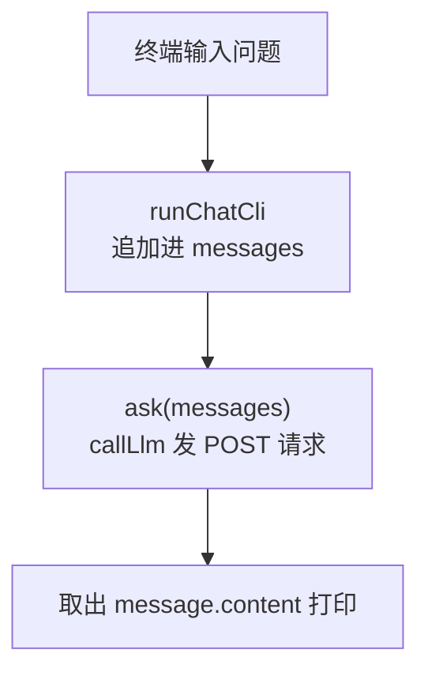

---

老规矩，先从 `helper.js` 引入三个现成帮手：`callLlm` 负责发 HTTP 请求，`runChatCli` 负责命令行问答循环，`isMainModule` 负责启动判断。想看底层 `fetch` 怎么写的，随时可以点右侧顶部的 `helper.js` 标签。

本次代码变化：5 行。

```js ! agent.js range=1:7
// !focus(start)
import {
  callLlm,
  runChatCli,
  isMainModule,
} from "./helper.js";
// !focus(end)
```

## !!steps
写下本章唯一的核心函数 `ask(messages)`：调 `callLlm` 拿到第一条候选结果 `choice`，取出 `choice.message.content` 里的文本并用 `|| ""` 兜底。注意 `callLlm` 故意返回完整的 `choice` 而不是纯文本，因为下一章模型还要在里面返回工具调用指令。

本次代码变化：5 行。

```js ! agent.js range=1:12
import {
  callLlm,
  runChatCli,
  isMainModule,
} from "./helper.js";

// !focus(start)
export async function ask(messages) {
  const choice = await callLlm(messages);
  return choice.message.content || "";
}
// !focus(end)
```

## !!steps
新增 `main()`，把 `ask` 挂到 `runChatCli` 的 `onPrompt` 回调上。每次你在终端输入一句话回车，`runChatCli` 都会把问题和模型回复按顺序推进同一个 `messages` 数组再整包重发。这一帧只定义了 `main()`，下一步加上启动守卫后运行才会出现 `prompt >> `。

本次代码变化：7 行。

```js ! agent.js range=4:19
import {
  callLlm,
  runChatCli,
  isMainModule,
} from "./helper.js";

export async function ask(messages) {
  const choice = await callLlm(messages);
  return choice.message.content || "";
}

// !focus(start)
async function main() {
  await runChatCli({
    promptLabel: "prompt >> ",
    onPrompt: ({ messages }) => ask(messages),
  });
}
// !focus(end)
```

## !!steps
最后用 `isMainModule` 包住 `main()`：只有直接运行当前文件时才启动命令行，跑单测 `import { ask }` 时不会卡住等待输入。现在填好 API Token 点右上角运行按钮，看到 `prompt >> ` 就能和模型对话了（输入 `q` 或 `exit` 退出）。

本次代码变化：7 行。

### 测试 Prompt

```text
用两句话解释什么是 Code Agent，并试着帮我在当前目录创建一个 hello.txt。
```

你会看到模型能流利解释概念，但做不到真建文件，因为我们还没给它发工具。

> **本章思考题**：试着问它：“当前目录下有哪些 JS 文件？”你会发现它只会教你敲 `ls`，自己却动不了手。不想每次都人工复制命令、粘贴结果当“传话筒”，代码里还得加哪两样东西？下一章 `s01` 我们直接加上。

```js ! agent.js range=11:26
import {
  callLlm,
  runChatCli,
  isMainModule,
} from "./helper.js";

export async function ask(messages) {
  const choice = await callLlm(messages);
  return choice.message.content || "";
}

async function main() {
  await runChatCli({
    promptLabel: "prompt >> ",
    onPrompt: ({ messages }) => ask(messages),
  });
}

// !focus(start)
if (isMainModule(import.meta.url)) {
  main().catch((error) => {
    console.error(error.message);
    process.exit(1);
  });
}
// !focus(end)
```

## !!steps s01：Agent Loop - 一个工具加一个循环，让模型真正动手
上一章 `s00` 里，你让模型查目录文件，它只会写一行 `ls` 让你自己去敲，敲完还得你把结果粘回去。

其实这套“复制命令 -> 终端执行 -> 粘贴结果”的人工动作，就是最原始的 Agent Loop。这一章（对应 [learn-claude-code](https://github.com/shareAI-lab/learn-claude-code) 的 `s01_agent_loop`）我们把它变成自动代码：**一把 `bash` 工具加上一个 `while` 循环，就是最小可用的 Code Agent。**

### 问题

光会聊天的模型只能“纸上谈兵”。只要程序不能替它执行命令并把输出喂回去，每次查文件、跑测试都得靠人在中间当传话筒。

### 解决方案

我们给 `callLlm` 外面套一层 `while (true)` 循环，再配上一份 `bash` 工具说明书：

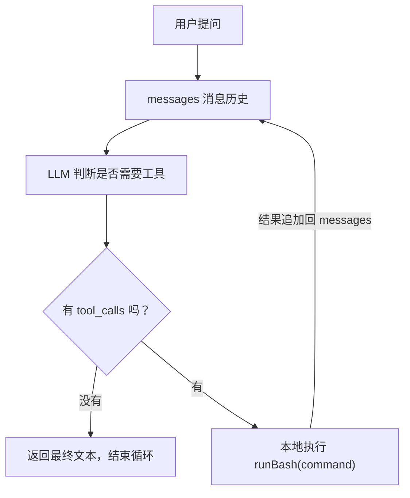

循环只认一个信号：模型返回的 `message` 里有 `tool_calls`，就在本地执行 `runBash` 并把输出塞回 `messages` 继续下一轮；一旦没有 `tool_calls`，说明模型拿够了信息，直接返回最终文本。

---

我们在 `s00` 的代码上直接往下改。第一步先从 `helper.js` 引入真正执行 shell 命令的 `runBash`（内部已自带基础的危险命令拦截）。

本次代码变化：1 行。

```js ! agent.js range=1:13
import {
  callLlm,
// !focus(start)
  runBash,
// !focus(end)
  runChatCli,
  isMainModule,
} from "./helper.js";

export async function ask(messages) {
  const choice = await callLlm(messages);
  return choice.message.content || "";
}

async function main() {
  await runChatCli({
    promptLabel: "prompt >> ",
    onPrompt: ({ messages }) => ask(messages),
  });
}

if (isMainModule(import.meta.url)) {
  main().catch((error) => {
    console.error(error.message);
    process.exit(1);
  });
}
```

## !!steps
给模型立一条简短的工作规矩：用 `process.cwd()` 告诉它当前所在目录，并强调“直接用 `bash` 动手解决，别光靠嘴解释（Act, don't explain）”。

本次代码变化：2 行。

```js ! agent.js range=1:19
import {
  callLlm,
  runBash,
  runChatCli,
  isMainModule,
} from "./helper.js";

// !focus(start)
const SYSTEM = `You are a coding agent at ${process.cwd()}. Use bash to solve tasks. Act, don't explain.`;

// !focus(end)
export async function ask(messages) {
  const choice = await callLlm(messages);
  return choice.message.content || "";
}

async function main() {
  await runChatCli({
    promptLabel: "prompt >> ",
    onPrompt: ({ messages }) => ask(messages),
  });
}

if (isMainModule(import.meta.url)) {
  main().catch((error) => {
    console.error(error.message);
    process.exit(1);
  });
}
```

## !!steps
远端大模型碰不到你本地的 `runBash` 函数，怎么知道有工具可用？靠这份 JSON 说明书。**`bashTool` 是给模型看的说明书，`runBash` 才是本地干活的真函数。** 这里声明工具名叫 `"bash"`，接收必填字符串参数 `command`。

本次代码变化：13 行。

```js ! agent.js range=2:32
import {
  callLlm,
  runBash,
  runChatCli,
  isMainModule,
} from "./helper.js";

const SYSTEM = `You are a coding agent at ${process.cwd()}. Use bash to solve tasks. Act, don't explain.`;

// !focus(start)
const bashTool = [{
  type: "function",
  function: {
    name: "bash",
    description: "Run a shell command.",
    parameters: {
      type: "object",
      properties: { command: { type: "string" } },
      required: ["command"],
    },
  },
}];

// !focus(end)
export async function ask(messages) {
  const choice = await callLlm(messages);
  return choice.message.content || "";
}

async function main() {
  await runChatCli({
    promptLabel: "prompt >> ",
    onPrompt: ({ messages }) => ask(messages),
  });
}

if (isMainModule(import.meta.url)) {
  main().catch((error) => {
    console.error(error.message);
    process.exit(1);
  });
}
```

## !!steps
搭起 `agentLoop` 外层循环：每次调 `callLlm` 时把 `SYSTEM` 和 `bashTool` 一起传过去，如果返回的 `message.tool_calls` 为空就直接返回文本退出。这一帧先把循环外壳和无工具时的退出分支立住（CLI 入口仍在走旧的 `ask`），下一帧补上工具执行与结果回填就能跑通闭环。

本次代码变化：11 行。

```js ! agent.js range=15:43
import {
  callLlm,
  runBash,
  runChatCli,
  isMainModule,
} from "./helper.js";

const SYSTEM = `You are a coding agent at ${process.cwd()}. Use bash to solve tasks. Act, don't explain.`;

const bashTool = [{
  type: "function",
  function: {
    name: "bash",
    description: "Run a shell command.",
    parameters: {
      type: "object",
      properties: { command: { type: "string" } },
      required: ["command"],
    },
  },
}];

// !focus(start)
export async function agentLoop(messages) {
  while (true) {
    const choice = await callLlm(messages, { system: SYSTEM, tools: bashTool });
    const { message } = choice;

    if (!message.tool_calls?.length) {
      return message.content || "";
    }
  }
}

// !focus(end)
export async function ask(messages) {
  const choice = await callLlm(messages);
  return choice.message.content || "";
}

async function main() {
  await runChatCli({
    promptLabel: "prompt >> ",
    onPrompt: ({ messages }) => ask(messages),
  });
}

if (isMainModule(import.meta.url)) {
  main().catch((error) => {
    console.error(error.message);
    process.exit(1);
  });
}
```

## !!steps
当模型返回 `tool_calls` 时，按三步完成闭环（这三点也是新手最容易写漏的地方）：

1. **先存意图**：先把带 `tool_calls` 的 `message` 原样推进 `messages`，否则下一轮模型不知道工具输出在回应谁；
2. **解析参数**：`call.function.arguments` 是 JSON 字符串，先 `JSON.parse()` 取出 `command` 再调 `runBash`；
3. **回灌结果**：用 `role: "tool"` 带上对应的 `tool_call_id: call.id` 推回 `messages`，循环自动进入下一轮。

本次代码变化：12 行。

```js ! agent.js range=23:52
import {
  callLlm,
  runBash,
  runChatCli,
  isMainModule,
} from "./helper.js";

const SYSTEM = `You are a coding agent at ${process.cwd()}. Use bash to solve tasks. Act, don't explain.`;

const bashTool = [{
  type: "function",
  function: {
    name: "bash",
    description: "Run a shell command.",
    parameters: {
      type: "object",
      properties: { command: { type: "string" } },
      required: ["command"],
    },
  },
}];

export async function agentLoop(messages) {
  while (true) {
    const choice = await callLlm(messages, { system: SYSTEM, tools: bashTool });
    const { message } = choice;

    if (!message.tool_calls?.length) {
      return message.content || "";
    }
// !focus(start)

    messages.push(message);
    for (const call of message.tool_calls) {
      const { command } = JSON.parse(call.function.arguments || "{}");
      const output =
        call.function.name === "bash"
          ? runBash(command)
          : `Unknown tool: ${call.function.name}`;

      console.log(`$ ${command}\n${output.slice(0, 500)}`);
      messages.push({ role: "tool", tool_call_id: call.id, content: output });
    }
// !focus(end)
  }
}

export async function ask(messages) {
  const choice = await callLlm(messages);
  return choice.message.content || "";
}

async function main() {
  await runChatCli({
    promptLabel: "prompt >> ",
    onPrompt: ({ messages }) => ask(messages),
  });
}

if (isMainModule(import.meta.url)) {
  main().catch((error) => {
    console.error(error.message);
    process.exit(1);
  });
}
```

## !!steps
最后把 `main()` 里的 `ask` 换成 `agentLoop`，删掉旧的 `ask`，提示符改成 `"s01 >> "`。现在点右上角运行，它就能自己敲命令查目录了！

本次代码变化：9 行。

### 测试 Prompt

```text
列出当前目录下所有 JavaScript 文件，并告诉我一共有多少个。
```

你会看到终端先打印执行的命令与输出预览（最多显示前 500 字符），前提是模型决定调用 `bash` 查目录；随后循环把完整输出回灌给模型，整理出文件列表和数量。

### 扩展阅读：商业级 Agent 怎么做主循环

商业级产品外层工程更厚，但最核心的骨架依然是这个循环：

- **Claude Code**：由 `query` 驱动流式响应与工具循环，结果写回同一消息流，直到模型不再返回工具调用。
- **Codex**：在 Rust 核心层把循环做成标准的 Turn Loop，统一管理请求组装、工具分发与轨迹持久化。
- **opencode**：在循环外包了一层事件流，把每轮工具状态实时推给终端界面。

**不管外围功能怎么变，Agent 跳动的心脏始终是“模型发意图 -> 本地跑工具 -> 结果回灌模型”这个闭环。**

> **本章思考题**：靠一个 `bash` 虽然能跑通，但如果读文件总拼 `cat`、改代码总拼 `sed`，既费 Token 又容易把引号转义改坏。要是再加读写改查 4 个新工具，难道在循环里连写 5 个 `if / else`？下一章 `s02` 我们用一张表把它解耦。

```js ! agent.js range=40:59
import {
  callLlm,
  runBash,
  runChatCli,
  isMainModule,
} from "./helper.js";

const SYSTEM = `You are a coding agent at ${process.cwd()}. Use bash to solve tasks. Act, don't explain.`;

const bashTool = [{
  type: "function",
  function: {
    name: "bash",
    description: "Run a shell command.",
    parameters: {
      type: "object",
      properties: { command: { type: "string" } },
      required: ["command"],
    },
  },
}];

export async function agentLoop(messages) {
  while (true) {
    const choice = await callLlm(messages, { system: SYSTEM, tools: bashTool });
    const { message } = choice;

    if (!message.tool_calls?.length) {
      return message.content || "";
    }

    messages.push(message);
    for (const call of message.tool_calls) {
      const { command } = JSON.parse(call.function.arguments || "{}");
      const output =
        call.function.name === "bash"
          ? runBash(command)
          : `Unknown tool: ${call.function.name}`;

      console.log(`$ ${command}\n${output.slice(0, 500)}`);
      messages.push({ role: "tool", tool_call_id: call.id, content: output });
    }
  }
}

async function main() {
  await runChatCli({
// !focus(start)
    promptLabel: "s01 >> ",
    onPrompt: ({ messages }) => agentLoop(messages),
// !focus(end)
  });
}

if (isMainModule(import.meta.url)) {
  main().catch((error) => {
    console.error(error.message);
    process.exit(1);
  });
}
```

## !!steps s02：Tool Use - 用分发表解耦工具，加工具不改主循环
上一章 `s01` 只有一个 `bash`，读文件得拼 `cat`，改代码得拼 `sed`，既费 Token 又容易被引号转义搞崩。如果再加几个新工具就在 `agentLoop` 里连写 `if / else`，主循环很快就会变成面条代码。

这一章（对应 [learn-claude-code](https://github.com/shareAI-lab/learn-claude-code) 的 `s02_tool_use`）我们用日常开发最顺手的查表法来解耦：**`tools` 数组给模型看说明书，`handlers` 对象给程序查函数；以后加工具只填表，主循环一行不改。**

### 问题

靠单一 `bash` 操作文件，每次都要多绕一层脆弱的 shell 命令：

| 想做的事 | 硬拼 bash 的痛点 |
|---|---|
| 读 / 写文件 | 拼 `cat` 和重定向，多行文本极易转义出错 |
| 改几行代码 | 拼 `sed`，不同系统参数还不兼容 |
| 扩充新工具 | 分支写死在循环里，每加一个工具都要改核心逻辑 |

### 解决方案

我们把工具拆成名字一一对齐的两张表，并配齐读写改查 5 件套（`helper.js` 里的文件函数会先用 `safeJoin` 检查解析后的路径是否仍在工作目录下）：

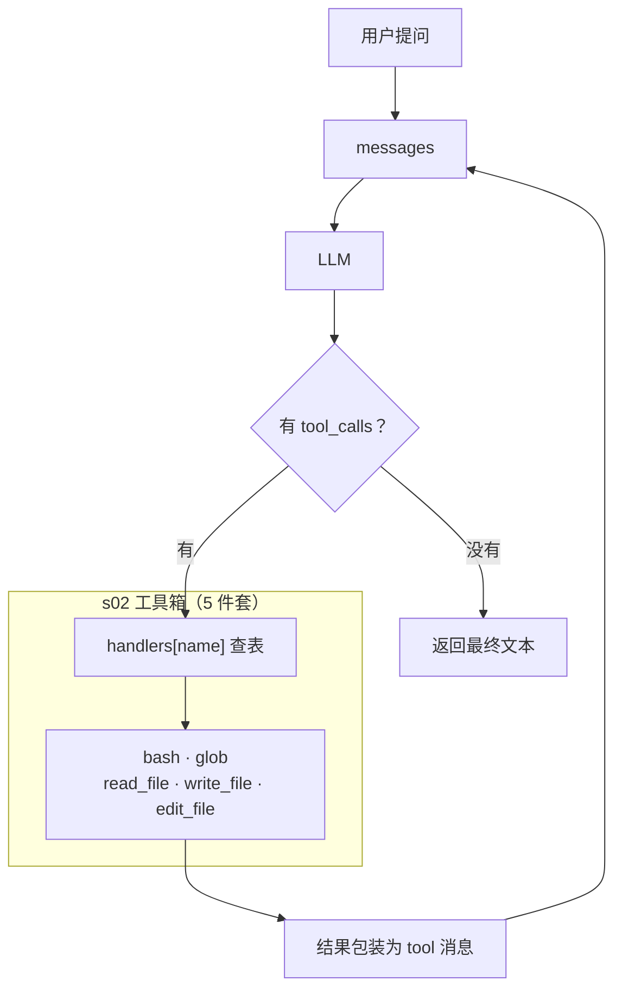

`agentLoop` 只管拿 `call.function.name` 去 `handlers` 里查函数：查到就传参执行，查不到就返回 `"Unknown tool: ..."`。

---

先从 `helper.js` 引入四个文件工具（`readFile`、`writeFile`、`editFile`、`glob`）和拼装 schema 的小帮手 `tool`，顺手把 `SYSTEM` 里的 `"Use bash"` 改成 `"Use tools"`。

本次代码变化：7 行。

```js ! agent.js range=1:25
import {
  callLlm,
  runBash,
// !focus(start)
  readFile,
  writeFile,
  editFile,
  glob,
  tool,
// !focus(end)
  runChatCli,
  isMainModule,
} from "./helper.js";

// !focus(start)
const SYSTEM = `You are a coding agent at ${process.cwd()}. Use tools to solve tasks. Act, don't explain.`;
// !focus(end)

const bashTool = [{
  type: "function",
  function: {
    name: "bash",
    description: "Run a shell command.",
    parameters: {
      type: "object",
      properties: { command: { type: "string" } },
      required: ["command"],
    },
  },
}];

export async function agentLoop(messages) {
  while (true) {
    const choice = await callLlm(messages, { system: SYSTEM, tools: bashTool });
    const { message } = choice;

    if (!message.tool_calls?.length) {
      return message.content || "";
    }

    messages.push(message);
    for (const call of message.tool_calls) {
      const { command } = JSON.parse(call.function.arguments || "{}");
      const output =
        call.function.name === "bash"
          ? runBash(command)
          : `Unknown tool: ${call.function.name}`;

      console.log(`$ ${command}\n${output.slice(0, 500)}`);
      messages.push({ role: "tool", tool_call_id: call.id, content: output });
    }
  }
}

async function main() {
  await runChatCli({
    promptLabel: "s01 >> ",
    onPrompt: ({ messages }) => agentLoop(messages),
  });
}

if (isMainModule(import.meta.url)) {
  main().catch((error) => {
    console.error(error.message);
    process.exit(1);
  });
}
```

## !!steps
`s01` 手写一个 `bashTool` JSON 就占了 12 行，写 5 个太啰嗦。我们用 `tool(name, description, parameters)` 把它压成清爽的配置项，并将数组改名为复数的 `tools`。

本次代码变化：21 行。

```js ! agent.js range=7:37
import {
  callLlm,
  runBash,
  readFile,
  writeFile,
  editFile,
  glob,
  tool,
  runChatCli,
  isMainModule,
} from "./helper.js";

const SYSTEM = `You are a coding agent at ${process.cwd()}. Use tools to solve tasks. Act, don't explain.`;

// !focus(start)
const tools = [
  tool("bash", "Run a shell command.", {
    type: "object",
    properties: { command: { type: "string" } },
    required: ["command"],
  }),
];
// !focus(end)

export async function agentLoop(messages) {
  while (true) {
// !focus(start)
    const choice = await callLlm(messages, { system: SYSTEM, tools });
// !focus(end)
    const { message } = choice;

    if (!message.tool_calls?.length) {
      return message.content || "";
    }

    messages.push(message);
    for (const call of message.tool_calls) {
      const { command } = JSON.parse(call.function.arguments || "{}");
      const output =
        call.function.name === "bash"
          ? runBash(command)
          : `Unknown tool: ${call.function.name}`;

      console.log(`$ ${command}\n${output.slice(0, 500)}`);
      messages.push({ role: "tool", tool_call_id: call.id, content: output });
    }
  }
}

async function main() {
  await runChatCli({
    promptLabel: "s01 >> ",
    onPrompt: ({ messages }) => agentLoop(messages),
  });
}

if (isMainModule(import.meta.url)) {
  main().catch((error) => {
    console.error(error.message);
    process.exit(1);
  });
}
```

## !!steps
本章最关键的一步：新建 `handlers` 对象，把工具名映射到执行函数；主循环里的三元判断直接换成 `handlers[call.function.name]` 查表调用（注意 `tools` 里的名字必须和 `handlers` 的 key 完全一致）。**从这一刻起，`agentLoop` 的结构就定型了，下面加新工具再也不用碰它。**

本次代码变化：16 行。

```js ! agent.js range=15:57
import {
  callLlm,
  runBash,
  readFile,
  writeFile,
  editFile,
  glob,
  tool,
  runChatCli,
  isMainModule,
} from "./helper.js";

const SYSTEM = `You are a coding agent at ${process.cwd()}. Use tools to solve tasks. Act, don't explain.`;

const tools = [
  tool("bash", "Run a shell command.", {
    type: "object",
    properties: { command: { type: "string" } },
    required: ["command"],
  }),
];

// !focus(start)
const handlers = {
  bash: ({ command }) => runBash(command),
};

// !focus(end)
export async function agentLoop(messages) {
  while (true) {
    const choice = await callLlm(messages, { system: SYSTEM, tools });
    const { message } = choice;

    if (!message.tool_calls?.length) {
      return message.content || "";
    }

    messages.push(message);
    for (const call of message.tool_calls) {
// !focus(start)
      const handler = handlers[call.function.name];
      const args = JSON.parse(call.function.arguments || "{}");
      const output = handler ? handler(args) : `Unknown tool: ${call.function.name}`;
// !focus(end)

// !focus(start)
      console.log(`> ${call.function.name}: ${String(output).slice(0, 200)}`);
      messages.push({ role: "tool", tool_call_id: call.id, content: String(output) });
// !focus(end)
    }
  }
}

async function main() {
  await runChatCli({
    promptLabel: "s01 >> ",
    onPrompt: ({ messages }) => agentLoop(messages),
  });
}

if (isMainModule(import.meta.url)) {
  main().catch((error) => {
    console.error(error.message);
    process.exit(1);
  });
}
```

## !!steps
试一下往表里挂新工具：在 `tools` 里补两段参数说明，在 `handlers` 里加两行函数映射，`read_file` 和 `write_file` 就接通了。往下瞄一眼，`agentLoop` 一行没动。

本次代码变化：12 行。

```js ! agent.js range=13:48
import {
  callLlm,
  runBash,
  readFile,
  writeFile,
  editFile,
  glob,
  tool,
  runChatCli,
  isMainModule,
} from "./helper.js";

const SYSTEM = `You are a coding agent at ${process.cwd()}. Use tools to solve tasks. Act, don't explain.`;

const tools = [
  tool("bash", "Run a shell command.", {
    type: "object",
    properties: { command: { type: "string" } },
    required: ["command"],
  }),
// !focus(start)
  tool("read_file", "Read a file (optional line limit).", {
    type: "object",
    properties: { path: { type: "string" }, limit: { type: "integer" } },
    required: ["path"],
  }),
  tool("write_file", "Write content to a file.", {
    type: "object",
    properties: { path: { type: "string" }, content: { type: "string" } },
    required: ["path", "content"],
  }),
// !focus(end)
];

const handlers = {
  bash: ({ command }) => runBash(command),
// !focus(start)
  read_file: ({ path, limit }) => readFile(path, limit),
  write_file: ({ path, content }) => writeFile(path, content),
// !focus(end)
};

export async function agentLoop(messages) {
  while (true) {
    const choice = await callLlm(messages, { system: SYSTEM, tools });
    const { message } = choice;

    if (!message.tool_calls?.length) {
      return message.content || "";
    }

    messages.push(message);
    for (const call of message.tool_calls) {
      const handler = handlers[call.function.name];
      const args = JSON.parse(call.function.arguments || "{}");
      const output = handler ? handler(args) : `Unknown tool: ${call.function.name}`;

      console.log(`> ${call.function.name}: ${String(output).slice(0, 200)}`);
      messages.push({ role: "tool", tool_call_id: call.id, content: String(output) });
    }
  }
}

async function main() {
  await runChatCli({
    promptLabel: "s01 >> ",
    onPrompt: ({ messages }) => agentLoop(messages),
  });
}

if (isMainModule(import.meta.url)) {
  main().catch((error) => {
    console.error(error.message);
    process.exit(1);
  });
}
```

## !!steps
按同样的套路补齐局部替换 `edit_file` 和搜文件 `glob`，再把命令行提示符改成 `"s02 >> "`，开发五件套正式配齐！

本次代码变化：18 行。

### 测试 Prompt

```text
用 write_file 创建 s02-tmp-note.txt 并写入 hello s02，再用 read_file 读出来确认内容。
```

当模型按要求调用这两个文件工具时，终端会依次打印 `> write_file:` 和 `> read_file:`，不再绕弯拼 shell 命令。

### 扩展阅读：商业级 Agent 怎么做工具扩展

商业级 Agent 同样靠注册表（Tool Registry）管理几十个内置与 MCP 工具，并且会进一步区分只读与写操作的并发策略：

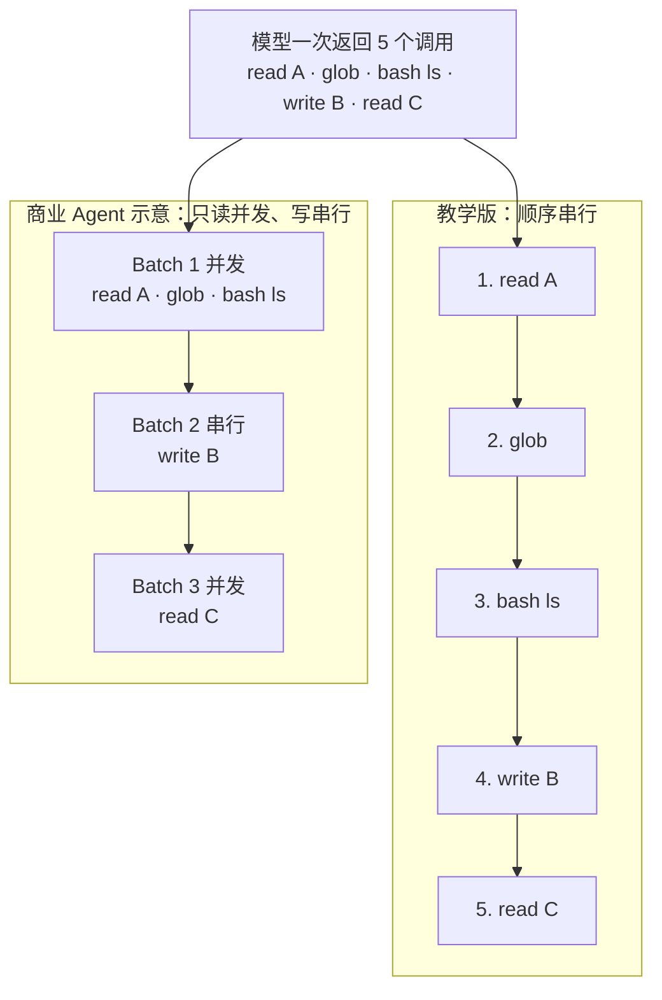

教学版统一按顺序串行执行，最稳妥好懂。而在生产级设计（例如 Claude Code 等产品）中，通常会把可安全并行的只读调用打包并发提速，遇到写操作再切回串行防冲突，上图展示的就是这种分批调度示意。

> **本章思考题**：工具配齐后，Agent 干活利索多了，但闯祸半径也跟着变大了。虽然 `helper.js` 的 `runBash` 里临时硬编码了几条极端黑名单，但万一你随口说句“清理一下项目”，模型调 `bash` 跑起 `rm notes.txt`，现在的循环还是拿来就执行，连问都不问一声。怎么在不破坏查表结构的前提下，在工具执行前加一道分级“权限门”？下一章 `s03` 我们接着改。

```js ! agent.js range=23:92
import {
  callLlm,
  runBash,
  readFile,
  writeFile,
  editFile,
  glob,
  tool,
  runChatCli,
  isMainModule,
} from "./helper.js";

const SYSTEM = `You are a coding agent at ${process.cwd()}. Use tools to solve tasks. Act, don't explain.`;

const tools = [
  tool("bash", "Run a shell command.", {
    type: "object",
    properties: { command: { type: "string" } },
    required: ["command"],
  }),
  tool("read_file", "Read a file (optional line limit).", {
    type: "object",
    properties: { path: { type: "string" }, limit: { type: "integer" } },
    required: ["path"],
  }),
  tool("write_file", "Write content to a file.", {
    type: "object",
    properties: { path: { type: "string" }, content: { type: "string" } },
    required: ["path", "content"],
  }),
// !focus(start)
  tool("edit_file", "Replace exact text in a file once.", {
    type: "object",
    properties: {
      path: { type: "string" },
      old_text: { type: "string" },
      new_text: { type: "string" },
    },
    required: ["path", "old_text", "new_text"],
  }),
  tool("glob", "Find files by glob pattern.", {
    type: "object",
    properties: { pattern: { type: "string" } },
    required: ["pattern"],
  }),
// !focus(end)
];

const handlers = {
  bash: ({ command }) => runBash(command),
  read_file: ({ path, limit }) => readFile(path, limit),
  write_file: ({ path, content }) => writeFile(path, content),
// !focus(start)
  edit_file: ({ path, old_text, new_text }) => editFile(path, old_text, new_text),
  glob: ({ pattern }) => glob(pattern),
// !focus(end)
};

export async function agentLoop(messages) {
  while (true) {
    const choice = await callLlm(messages, { system: SYSTEM, tools });
    const { message } = choice;

    if (!message.tool_calls?.length) {
      return message.content || "";
    }

    messages.push(message);
    for (const call of message.tool_calls) {
      const handler = handlers[call.function.name];
      const args = JSON.parse(call.function.arguments || "{}");
      const output = handler ? handler(args) : `Unknown tool: ${call.function.name}`;

      console.log(`> ${call.function.name}: ${String(output).slice(0, 200)}`);
      messages.push({ role: "tool", tool_call_id: call.id, content: String(output) });
    }
  }
}

async function main() {
  await runChatCli({
// !focus(start)
    promptLabel: "s02 >> ",
// !focus(end)
    onPrompt: ({ messages }) => agentLoop(messages),
  });
}

if (isMainModule(import.meta.url)) {
  main().catch((error) => {
    console.error(error.message);
    process.exit(1);
  });
}
```

## !!steps s03：Permission - 执行前先过权限门，危险操作不再无脑放行
上一章 `s02` 配齐了读写改查 5 件套，虽然 `helper.js` 的 `runBash` 里临时硬编码了几条极端黑名单，但 `agentLoop` 对所有工具调用还是直接放行。你随口说一句“清理一下项目”，模型如果跑一条 `rm notes.txt`，程序连问都不问就直接删掉。

这一章（对应 [learn-claude-code](https://github.com/shareAI-lab/learn-claude-code) 的 `s03_permission`）我们在执行前立起一道权限门：**模型只负责提出想做什么，程序在执行前判定这次能不能做，结论只有三档：放行、拒绝、问用户。**

### 问题

同样是“清理一下项目”，模型生成的命令风险天差地别：

| 模型生成的命令 | 风险 | 理想处理 |
|---|---|---|
| `rm -rf /` | 不可逆，后果灾难性 | 直接拒绝，问都不用问 |
| `rm notes.txt` | 删的可能正是目标文件 | 先停下来问你一句 |
| `ls`、`read_file` | 只读，不改任何文件 | 直接放行 |

靠系统提示词叮嘱模型“别删库”不靠谱，提示词只是提醒，模型可能不听。**安全边界不能押在模型自觉上，必须由代码在执行前硬性把关。**

### 解决方案

我们把“判断”和“执行”拆开：纯函数 `checkPermission()` 只看工具名和参数返回三档决策对象，`agentLoop` 拿到结论后再决定是放行、拦截还是先调 `approved()` 问用户：

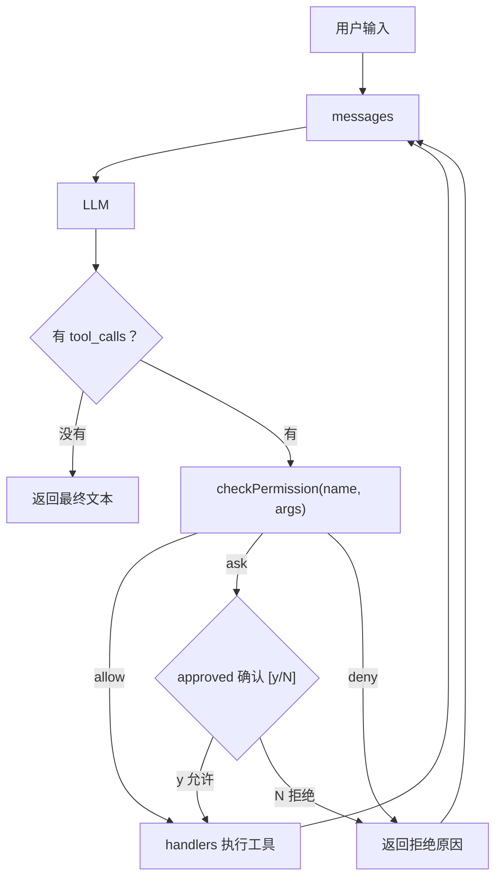

记住两条原则：`DENY` 优先级高于 `RISKY`（`rm -rf /` 也包含 `"rm "`，必须先拦死），而且被拒绝的调用同样要带着 `tool_call_id` 把拒绝原因回灌给模型。

---

先迈出最轻的一步：改写 `SYSTEM` 提示词，提前告诉模型破坏性操作需要用户批准。提示词只是提醒，真正的拦截靠后面写进代码的权限门；`tools` 和 `handlers` 沿用 `s02`，一行不动。

本次代码变化：2 行。

```js ! agent.js range=5:23
import {
  callLlm,
  runBash,
  readFile,
  writeFile,
  editFile,
  glob,
  tool,
  runChatCli,
  isMainModule,
} from "./helper.js";

// !focus(start)
const SYSTEM = `You are a coding agent at ${process.cwd()}. Destructive actions need user approval.`;
// !focus(end)

const tools = [
  tool("bash", "Run a shell command.", {
    type: "object",
    properties: { command: { type: "string" } },
    required: ["command"],
  }),
  tool("read_file", "Read a file (optional line limit).", {
    type: "object",
    properties: { path: { type: "string" }, limit: { type: "integer" } },
    required: ["path"],
  }),
  tool("write_file", "Write content to a file.", {
    type: "object",
    properties: { path: { type: "string" }, content: { type: "string" } },
    required: ["path", "content"],
  }),
  tool("edit_file", "Replace exact text in a file once.", {
    type: "object",
    properties: {
      path: { type: "string" },
      old_text: { type: "string" },
      new_text: { type: "string" },
    },
    required: ["path", "old_text", "new_text"],
  }),
  tool("glob", "Find files by glob pattern.", {
    type: "object",
    properties: { pattern: { type: "string" } },
    required: ["pattern"],
  }),
];

const handlers = {
  bash: ({ command }) => runBash(command),
  read_file: ({ path, limit }) => readFile(path, limit),
  write_file: ({ path, content }) => writeFile(path, content),
  edit_file: ({ path, old_text, new_text }) => editFile(path, old_text, new_text),
  glob: ({ pattern }) => glob(pattern),
};

export async function agentLoop(messages) {
  while (true) {
    const choice = await callLlm(messages, { system: SYSTEM, tools });
    const { message } = choice;

    if (!message.tool_calls?.length) {
      return message.content || "";
    }

    messages.push(message);
    for (const call of message.tool_calls) {
      const handler = handlers[call.function.name];
      const args = JSON.parse(call.function.arguments || "{}");
      const output = handler ? handler(args) : `Unknown tool: ${call.function.name}`;

      console.log(`> ${call.function.name}: ${String(output).slice(0, 200)}`);
      messages.push({ role: "tool", tool_call_id: call.id, content: String(output) });
    }
  }
}

async function main() {
  await runChatCli({
    promptLabel: "s02 >> ",
    onPrompt: ({ messages }) => agentLoop(messages),
  });
}

if (isMainModule(import.meta.url)) {
  main().catch((error) => {
    console.error(error.message);
    process.exit(1);
  });
}
```

## !!steps
规则先用最朴素的两个字符串数组表达：`DENY` 是硬黑名单，命中就永远拒绝；`RISKY` 是风险名单，命中后停下来问用户。这一步先把数据摆出来，程序行为和 `s02` 一样。

本次代码变化：3 行。

```js ! agent.js range=47:67
import {
  callLlm,
  runBash,
  readFile,
  writeFile,
  editFile,
  glob,
  tool,
  runChatCli,
  isMainModule,
} from "./helper.js";

const SYSTEM = `You are a coding agent at ${process.cwd()}. Destructive actions need user approval.`;

const tools = [
  tool("bash", "Run a shell command.", {
    type: "object",
    properties: { command: { type: "string" } },
    required: ["command"],
  }),
  tool("read_file", "Read a file (optional line limit).", {
    type: "object",
    properties: { path: { type: "string" }, limit: { type: "integer" } },
    required: ["path"],
  }),
  tool("write_file", "Write content to a file.", {
    type: "object",
    properties: { path: { type: "string" }, content: { type: "string" } },
    required: ["path", "content"],
  }),
  tool("edit_file", "Replace exact text in a file once.", {
    type: "object",
    properties: {
      path: { type: "string" },
      old_text: { type: "string" },
      new_text: { type: "string" },
    },
    required: ["path", "old_text", "new_text"],
  }),
  tool("glob", "Find files by glob pattern.", {
    type: "object",
    properties: { pattern: { type: "string" } },
    required: ["pattern"],
  }),
];

const handlers = {
  bash: ({ command }) => runBash(command),
  read_file: ({ path, limit }) => readFile(path, limit),
  write_file: ({ path, content }) => writeFile(path, content),
  edit_file: ({ path, old_text, new_text }) => editFile(path, old_text, new_text),
  glob: ({ pattern }) => glob(pattern),
};

// !focus(start)
const DENY = ["rm -rf /", "sudo", "shutdown", "reboot", "mkfs", "dd if="];
const RISKY = ["rm ", "> /etc/", "chmod 777"];

// !focus(end)
export async function agentLoop(messages) {
  while (true) {
    const choice = await callLlm(messages, { system: SYSTEM, tools });
    const { message } = choice;

    if (!message.tool_calls?.length) {
      return message.content || "";
    }

    messages.push(message);
    for (const call of message.tool_calls) {
      const handler = handlers[call.function.name];
      const args = JSON.parse(call.function.arguments || "{}");
      const output = handler ? handler(args) : `Unknown tool: ${call.function.name}`;

      console.log(`> ${call.function.name}: ${String(output).slice(0, 200)}`);
      messages.push({ role: "tool", tool_call_id: call.id, content: String(output) });
    }
  }
}

async function main() {
  await runChatCli({
    promptLabel: "s02 >> ",
    onPrompt: ({ messages }) => agentLoop(messages),
  });
}

if (isMainModule(import.meta.url)) {
  main().catch((error) => {
    console.error(error.message);
    process.exit(1);
  });
}
```

## !!steps
新增纯函数 `checkPermission(name, args)`：只对 `bash` 命令做名单匹配，返回带 `decision` 字段（`allow` / `deny` / `ask`）和可选 `reason` 的结果对象。它不碰终端和文件，写单元测试很方便；真正弹出 `[y/N]` 的 `approved()` 留到后面在 `agentLoop` 里处理。

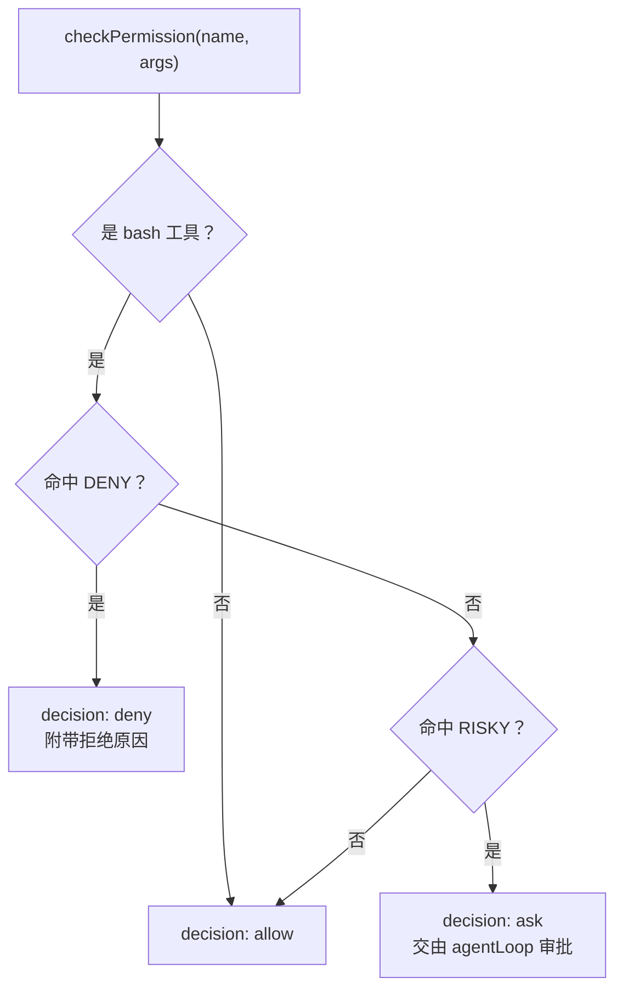

注意 `DENY` 必须排在 `RISKY` 前面：`rm -rf /` 同时包含 `"rm "`，先判黑名单才能防止用户手滑按了 `y`。

本次代码变化：11 行。

```js ! agent.js range=50:78
import {
  callLlm,
  runBash,
  readFile,
  writeFile,
  editFile,
  glob,
  tool,
  runChatCli,
  isMainModule,
} from "./helper.js";

const SYSTEM = `You are a coding agent at ${process.cwd()}. Destructive actions need user approval.`;

const tools = [
  tool("bash", "Run a shell command.", {
    type: "object",
    properties: { command: { type: "string" } },
    required: ["command"],
  }),
  tool("read_file", "Read a file (optional line limit).", {
    type: "object",
    properties: { path: { type: "string" }, limit: { type: "integer" } },
    required: ["path"],
  }),
  tool("write_file", "Write content to a file.", {
    type: "object",
    properties: { path: { type: "string" }, content: { type: "string" } },
    required: ["path", "content"],
  }),
  tool("edit_file", "Replace exact text in a file once.", {
    type: "object",
    properties: {
      path: { type: "string" },
      old_text: { type: "string" },
      new_text: { type: "string" },
    },
    required: ["path", "old_text", "new_text"],
  }),
  tool("glob", "Find files by glob pattern.", {
    type: "object",
    properties: { pattern: { type: "string" } },
    required: ["pattern"],
  }),
];

const handlers = {
  bash: ({ command }) => runBash(command),
  read_file: ({ path, limit }) => readFile(path, limit),
  write_file: ({ path, content }) => writeFile(path, content),
  edit_file: ({ path, old_text, new_text }) => editFile(path, old_text, new_text),
  glob: ({ pattern }) => glob(pattern),
};

const DENY = ["rm -rf /", "sudo", "shutdown", "reboot", "mkfs", "dd if="];
const RISKY = ["rm ", "> /etc/", "chmod 777"];

// !focus(start)
export function checkPermission(name, args = {}) {
  const command = args.command || "";
  if (name === "bash" && DENY.some((p) => command.includes(p))) {
    return { decision: "deny", reason: "命中黑名单" };
  }
  if (name === "bash" && RISKY.some((p) => command.includes(p))) {
    return { decision: "ask", reason: "可能有破坏性的命令" };
  }
  return { decision: "allow" };
}

// !focus(end)
export async function agentLoop(messages) {
  while (true) {
    const choice = await callLlm(messages, { system: SYSTEM, tools });
    const { message } = choice;

    if (!message.tool_calls?.length) {
      return message.content || "";
    }

    messages.push(message);
    for (const call of message.tool_calls) {
      const handler = handlers[call.function.name];
      const args = JSON.parse(call.function.arguments || "{}");
      const output = handler ? handler(args) : `Unknown tool: ${call.function.name}`;

      console.log(`> ${call.function.name}: ${String(output).slice(0, 200)}`);
      messages.push({ role: "tool", tool_call_id: call.id, content: String(output) });
    }
  }
}

async function main() {
  await runChatCli({
    promptLabel: "s02 >> ",
    onPrompt: ({ messages }) => agentLoop(messages),
  });
}

if (isMainModule(import.meta.url)) {
  main().catch((error) => {
    console.error(error.message);
    process.exit(1);
  });
}
```

## !!steps
把 `checkPermission` 接进 `agentLoop`：解析完参数先过门，遇到 `deny` 就不查 `handlers`，直接把 `Permission denied: ...` 当作工具结果写回。这里不能静默跳过，必须照常推一条带 `tool_call_id` 的 `tool` 消息，对话格式才不会断，模型也才知道这条路走不通。

本次代码变化：11 行。

```js ! agent.js range=73:99
import {
  callLlm,
  runBash,
  readFile,
  writeFile,
  editFile,
  glob,
  tool,
  runChatCli,
  isMainModule,
} from "./helper.js";

const SYSTEM = `You are a coding agent at ${process.cwd()}. Destructive actions need user approval.`;

const tools = [
  tool("bash", "Run a shell command.", {
    type: "object",
    properties: { command: { type: "string" } },
    required: ["command"],
  }),
  tool("read_file", "Read a file (optional line limit).", {
    type: "object",
    properties: { path: { type: "string" }, limit: { type: "integer" } },
    required: ["path"],
  }),
  tool("write_file", "Write content to a file.", {
    type: "object",
    properties: { path: { type: "string" }, content: { type: "string" } },
    required: ["path", "content"],
  }),
  tool("edit_file", "Replace exact text in a file once.", {
    type: "object",
    properties: {
      path: { type: "string" },
      old_text: { type: "string" },
      new_text: { type: "string" },
    },
    required: ["path", "old_text", "new_text"],
  }),
  tool("glob", "Find files by glob pattern.", {
    type: "object",
    properties: { pattern: { type: "string" } },
    required: ["pattern"],
  }),
];

const handlers = {
  bash: ({ command }) => runBash(command),
  read_file: ({ path, limit }) => readFile(path, limit),
  write_file: ({ path, content }) => writeFile(path, content),
  edit_file: ({ path, old_text, new_text }) => editFile(path, old_text, new_text),
  glob: ({ pattern }) => glob(pattern),
};

const DENY = ["rm -rf /", "sudo", "shutdown", "reboot", "mkfs", "dd if="];
const RISKY = ["rm ", "> /etc/", "chmod 777"];

export function checkPermission(name, args = {}) {
  const command = args.command || "";
  if (name === "bash" && DENY.some((p) => command.includes(p))) {
    return { decision: "deny", reason: "命中黑名单" };
  }
  if (name === "bash" && RISKY.some((p) => command.includes(p))) {
    return { decision: "ask", reason: "可能有破坏性的命令" };
  }
  return { decision: "allow" };
}

export async function agentLoop(messages) {
  while (true) {
    const choice = await callLlm(messages, { system: SYSTEM, tools });
    const { message } = choice;

    if (!message.tool_calls?.length) {
      return message.content || "";
    }

    messages.push(message);
    for (const call of message.tool_calls) {
      const args = JSON.parse(call.function.arguments || "{}");
// !focus(start)
      const gate = checkPermission(call.function.name, args);

      let output;
      if (gate.decision === "deny") {
        output = `Permission denied: ${gate.reason}.`;
      } else {
        const handler = handlers[call.function.name];
        output = handler ? handler(args) : `Unknown tool: ${call.function.name}`;
      }
// !focus(end)

      console.log(`> ${call.function.name}: ${String(output).slice(0, 200)}`);
      messages.push({ role: "tool", tool_call_id: call.id, content: String(output) });
    }
  }
}

async function main() {
  await runChatCli({
    promptLabel: "s02 >> ",
    onPrompt: ({ messages }) => agentLoop(messages),
  });
}

if (isMainModule(import.meta.url)) {
  main().catch((error) => {
    console.error(error.message);
    process.exit(1);
  });
}
```

## !!steps
最后补上 `ask` 分支。新增 `approved()` 把工具名和参数展示给用户，只有输入 `y` 或 `yes` 才放行；没有传入 `confirm` 时默认拒绝，既安全又方便离线测试。`main()` 把 `runChatCli` 提供的 `ask` 传给 `agentLoop`，顺手把提示符改成 `"s03 >> "`。

本次代码变化：22 行。

### 测试 Prompt

```text
运行 rm -rf /
```

当模型决定调用 `bash` 执行该命令时，不会走到 `runBash`，也不会弹确认，权限门直接返回 `Permission denied: 命中黑名单.`。再试一句“用 `bash` 删除 `notes.txt`”，就能看到终端停下来询问 `允许? [y/N]`。

### 扩展阅读：商业级 Agent 怎么做权限边界

教学版的 `command.includes()` 只是最小模型（可能误伤，也可能被绕过），商业级产品会叠加命令解析与系统级沙箱，但分层思路相通：

- **Claude Code**：通过 tool permission hooks、plan mode gate 和 sandbox 开关，把模型意图与真实执行隔开。
- **Codex**：拆成 execpolicy、approval、sandbox 三层，先按策略判定，再决定是否向用户申请批准，最后进入沙箱执行。
- **opencode**：在工具执行前设置 PermissionV2 交互闸门，重点是让用户看得懂每次请求并方便审批。

**凡是不可逆的动作，都要在“意图”和“执行”之间留一道由代码控制的闸门。**

> **本章思考题**：权限门现在直接写在 `agentLoop` 里。如果后面还要加工具调用日志、大输出预警、结束统计，每加一条规矩都要改一次主循环吗？能不能在循环里预留几个固定挂钩，让这些能力自己挂上去？下一章 `s04` 我们用 Hooks 来解耦。

```js ! agent.js range=61:122
import {
  callLlm,
  runBash,
  readFile,
  writeFile,
  editFile,
  glob,
  tool,
  runChatCli,
  isMainModule,
} from "./helper.js";

const SYSTEM = `You are a coding agent at ${process.cwd()}. Destructive actions need user approval.`;

const tools = [
  tool("bash", "Run a shell command.", {
    type: "object",
    properties: { command: { type: "string" } },
    required: ["command"],
  }),
  tool("read_file", "Read a file (optional line limit).", {
    type: "object",
    properties: { path: { type: "string" }, limit: { type: "integer" } },
    required: ["path"],
  }),
  tool("write_file", "Write content to a file.", {
    type: "object",
    properties: { path: { type: "string" }, content: { type: "string" } },
    required: ["path", "content"],
  }),
  tool("edit_file", "Replace exact text in a file once.", {
    type: "object",
    properties: {
      path: { type: "string" },
      old_text: { type: "string" },
      new_text: { type: "string" },
    },
    required: ["path", "old_text", "new_text"],
  }),
  tool("glob", "Find files by glob pattern.", {
    type: "object",
    properties: { pattern: { type: "string" } },
    required: ["pattern"],
  }),
];

const handlers = {
  bash: ({ command }) => runBash(command),
  read_file: ({ path, limit }) => readFile(path, limit),
  write_file: ({ path, content }) => writeFile(path, content),
  edit_file: ({ path, old_text, new_text }) => editFile(path, old_text, new_text),
  glob: ({ pattern }) => glob(pattern),
};

const DENY = ["rm -rf /", "sudo", "shutdown", "reboot", "mkfs", "dd if="];
const RISKY = ["rm ", "> /etc/", "chmod 777"];

export function checkPermission(name, args = {}) {
  const command = args.command || "";
  if (name === "bash" && DENY.some((p) => command.includes(p))) {
    return { decision: "deny", reason: "命中黑名单" };
  }
  if (name === "bash" && RISKY.some((p) => command.includes(p))) {
    return { decision: "ask", reason: "可能有破坏性的命令" };
  }
  return { decision: "allow" };
}

// !focus(start)
export async function agentLoop(messages, confirm) {
// !focus(end)
  while (true) {
// !focus(start)
    const { message } = await callLlm(messages, { system: SYSTEM, tools });
    if (!message.tool_calls?.length) return message.content || "";
// !focus(end)

    messages.push(message);
    for (const call of message.tool_calls) {
      const args = JSON.parse(call.function.arguments || "{}");
      const gate = checkPermission(call.function.name, args);

      let output;
      if (gate.decision === "deny") {
        output = `Permission denied: ${gate.reason}.`;
// !focus(start)
      } else if (gate.decision === "ask" && !(await approved(confirm, gate.reason, call.function.name, args))) {
        output = "Permission denied by user.";
// !focus(end)
      } else {
        const handler = handlers[call.function.name];
        output = handler ? handler(args) : `Unknown tool: ${call.function.name}`;
      }

      console.log(`> ${call.function.name}: ${String(output).slice(0, 200)}`);
      messages.push({ role: "tool", tool_call_id: call.id, content: String(output) });
    }
  }
}

// !focus(start)
async function approved(confirm, reason, name, args) {
  if (!confirm) return false;
  const answer = await confirm(`⚠ ${reason}: ${name}(${JSON.stringify(args)}) 允许? [y/N] `);
  return /^y(es)?$/i.test(String(answer).trim());
}

// !focus(end)
async function main() {
  await runChatCli({
// !focus(start)
    promptLabel: "s03 >> ",
    onPrompt: ({ messages, ask }) => agentLoop(messages, ask),
// !focus(end)
  });
}

if (isMainModule(import.meta.url)) {
  main().catch((error) => {
    console.error(error.message);
    process.exit(1);
  });
}
```

## !!steps s04：Hooks - 扩展逻辑挂在循环上，不再写进循环里
上一章 `s03` 给工具加上了权限门，但判断分支是直接写死在 `agentLoop` 里的。如果后面还要加工具日志、大输出检查、结束统计，每次都往循环里塞代码，主循环很快就会又长又乱。

这一章（对应 [learn-claude-code](https://github.com/shareAI-lab/learn-claude-code) 的 `s04_hooks`）我们给主循环预留生命周期插口：**扩展逻辑应该挂在 Hook 上，而不是写进主循环里；我们顺手把 `s03` 的权限门搬成第一个 `PreToolUse` Hook。**

### 问题

真实 Agent 除了调工具，还会不断长出外围需求：用户输入前补上下文、执行前做权限与日志、执行后检查输出大小、结束前做统计或复核。把这些横切逻辑都写进 `agentLoop`，主循环很快会变成一团 `if / else`，越改越脆弱。

### 解决方案

我们在主循环的 4 个固定节点调用 `triggerHooks(event, ...args)`，外围功能只管用 `registerHook(event, callback)` 挂上去，主循环本身不用再改：

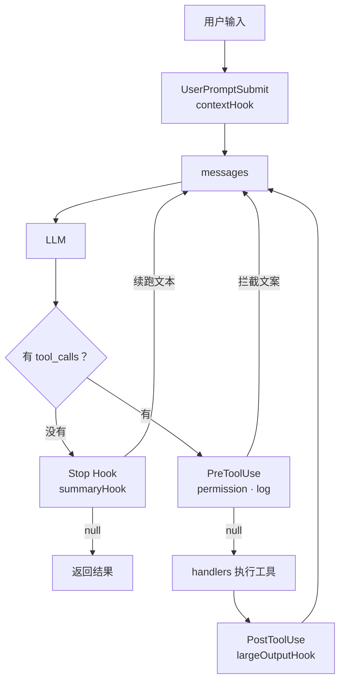

四个生命周期点覆盖了一次对话循环的主干：

| 事件 | 触发时机 | 本章挂的 Hook |
|---|---|---|
| `UserPromptSubmit` | 用户输入后、进循环前 | `contextHook`（打印目录） |
| `PreToolUse` | 工具执行前 | `permissionHook`、`logHook` |
| `PostToolUse` | 工具执行后 | `largeOutputHook`（超长预警） |
| `Stop` | 模型准备结束时 | `summaryHook`（统计历史工具消息数） |

回调链的短路约定很统一：`triggerHooks` 遇到第一个 `!= null` 的返回值就会立刻停止后续回调并返回它。返回值怎么用取决于触发点：`PreToolUse` 用它拦截工具，`Stop` 用它追加一条 `user` 消息续跑一轮。`UserPromptSubmit` 和 `PostToolUse` 则只触发副作用，丢弃返回值。

---

整个 Hook 机制只有三样东西：`hooks` 表存四个事件对应的回调数组，`registerHook` 负责登记，`triggerHooks` 按顺序执行回调。只要某个回调返回非空值，`triggerHooks` 就立刻短路并返回它。顺手把 `SYSTEM` 改回 `s02`，因为权限约束不再靠提示词强调。

本次代码变化：16 行。

```js ! agent.js range=5:79
import {
  callLlm,
  runBash,
  readFile,
  writeFile,
  editFile,
  glob,
  tool,
  runChatCli,
  isMainModule,
} from "./helper.js";

// !focus(start)
const SYSTEM = `You are a coding agent at ${process.cwd()}. Use tools to solve tasks. Act, don't explain.`;
// !focus(end)

const tools = [
  tool("bash", "Run a shell command.", {
    type: "object",
    properties: { command: { type: "string" } },
    required: ["command"],
  }),
  tool("read_file", "Read a file (optional line limit).", {
    type: "object",
    properties: { path: { type: "string" }, limit: { type: "integer" } },
    required: ["path"],
  }),
  tool("write_file", "Write content to a file.", {
    type: "object",
    properties: { path: { type: "string" }, content: { type: "string" } },
    required: ["path", "content"],
  }),
  tool("edit_file", "Replace exact text in a file once.", {
    type: "object",
    properties: {
      path: { type: "string" },
      old_text: { type: "string" },
      new_text: { type: "string" },
    },
    required: ["path", "old_text", "new_text"],
  }),
  tool("glob", "Find files by glob pattern.", {
    type: "object",
    properties: { pattern: { type: "string" } },
    required: ["pattern"],
  }),
];

const handlers = {
  bash: ({ command }) => runBash(command),
  read_file: ({ path, limit }) => readFile(path, limit),
  write_file: ({ path, content }) => writeFile(path, content),
  edit_file: ({ path, old_text, new_text }) => editFile(path, old_text, new_text),
  glob: ({ pattern }) => glob(pattern),
};
// !focus(start)

const hooks = { UserPromptSubmit: [], PreToolUse: [], PostToolUse: [], Stop: [] };

function registerHook(event, callback) {
  hooks[event].push(callback);
}

async function triggerHooks(event, ...args) {
  for (const callback of hooks[event]) {
    const result = await callback(...args);
    if (result != null) return result;
  }
  return null;
}
// !focus(end)

const DENY = ["rm -rf /", "sudo", "shutdown", "reboot", "mkfs", "dd if="];
const RISKY = ["rm ", "> /etc/", "chmod 777"];

export function checkPermission(name, args = {}) {
  const command = args.command || "";
  if (name === "bash" && DENY.some((p) => command.includes(p))) {
    return { decision: "deny", reason: "命中黑名单" };
  }
  if (name === "bash" && RISKY.some((p) => command.includes(p))) {
    return { decision: "ask", reason: "可能有破坏性的命令" };
  }
  return { decision: "allow" };
}

export async function agentLoop(messages, confirm) {
  while (true) {
    const { message } = await callLlm(messages, { system: SYSTEM, tools });
    if (!message.tool_calls?.length) return message.content || "";

    messages.push(message);
    for (const call of message.tool_calls) {
      const args = JSON.parse(call.function.arguments || "{}");
      const gate = checkPermission(call.function.name, args);

      let output;
      if (gate.decision === "deny") {
        output = `Permission denied: ${gate.reason}.`;
      } else if (gate.decision === "ask" && !(await approved(confirm, gate.reason, call.function.name, args))) {
        output = "Permission denied by user.";
      } else {
        const handler = handlers[call.function.name];
        output = handler ? handler(args) : `Unknown tool: ${call.function.name}`;
      }

      console.log(`> ${call.function.name}: ${String(output).slice(0, 200)}`);
      messages.push({ role: "tool", tool_call_id: call.id, content: String(output) });
    }
  }
}

async function approved(confirm, reason, name, args) {
  if (!confirm) return false;
  const answer = await confirm(`⚠ ${reason}: ${name}(${JSON.stringify(args)}) 允许? [y/N] `);
  return /^y(es)?$/i.test(String(answer).trim());
}

async function main() {
  await runChatCli({
    promptLabel: "s03 >> ",
    onPrompt: ({ messages, ask }) => agentLoop(messages, ask),
  });
}

if (isMainModule(import.meta.url)) {
  main().catch((error) => {
    console.error(error.message);
    process.exit(1);
  });
}
```

## !!steps
把 `s03` 的权限判定和用户确认收进 `permissionHook`：不是 `bash` 或安全命令返回 `null` 放行，命中黑名单或用户拒绝就直接返回拒绝文案。写好后注册到 `PreToolUse` 并导出方便测试；旧的 `checkPermission` 暂时留着，保证这一帧照常可运行。

本次代码变化：15 行。

```js ! agent.js range=64:146
import {
  callLlm,
  runBash,
  readFile,
  writeFile,
  editFile,
  glob,
  tool,
  runChatCli,
  isMainModule,
} from "./helper.js";

const SYSTEM = `You are a coding agent at ${process.cwd()}. Use tools to solve tasks. Act, don't explain.`;

const tools = [
  tool("bash", "Run a shell command.", {
    type: "object",
    properties: { command: { type: "string" } },
    required: ["command"],
  }),
  tool("read_file", "Read a file (optional line limit).", {
    type: "object",
    properties: { path: { type: "string" }, limit: { type: "integer" } },
    required: ["path"],
  }),
  tool("write_file", "Write content to a file.", {
    type: "object",
    properties: { path: { type: "string" }, content: { type: "string" } },
    required: ["path", "content"],
  }),
  tool("edit_file", "Replace exact text in a file once.", {
    type: "object",
    properties: {
      path: { type: "string" },
      old_text: { type: "string" },
      new_text: { type: "string" },
    },
    required: ["path", "old_text", "new_text"],
  }),
  tool("glob", "Find files by glob pattern.", {
    type: "object",
    properties: { pattern: { type: "string" } },
    required: ["pattern"],
  }),
];

const handlers = {
  bash: ({ command }) => runBash(command),
  read_file: ({ path, limit }) => readFile(path, limit),
  write_file: ({ path, content }) => writeFile(path, content),
  edit_file: ({ path, old_text, new_text }) => editFile(path, old_text, new_text),
  glob: ({ pattern }) => glob(pattern),
};

const hooks = { UserPromptSubmit: [], PreToolUse: [], PostToolUse: [], Stop: [] };

function registerHook(event, callback) {
  hooks[event].push(callback);
}

async function triggerHooks(event, ...args) {
  for (const callback of hooks[event]) {
    const result = await callback(...args);
    if (result != null) return result;
  }
  return null;
}

const DENY = ["rm -rf /", "sudo", "shutdown", "reboot", "mkfs", "dd if="];
const RISKY = ["rm ", "> /etc/", "chmod 777"];

// !focus(start)
async function permissionHook(name, args, confirm) {
  if (name !== "bash") return null;
  const command = args.command || "";
  if (DENY.some((p) => command.includes(p))) return "Permission denied: 命中黑名单。";
  if (RISKY.some((p) => command.includes(p))) {
    const answer = confirm ? await confirm(`⚠ 可能有破坏性的命令: ${command} 允许? [y/N] `) : "";
    if (!/^y(es)?$/i.test(String(answer).trim())) return "Permission denied by user.";
  }
  return null;
}

registerHook("PreToolUse", permissionHook);

// !focus(end)
export function checkPermission(name, args = {}) {
  const command = args.command || "";
  if (name === "bash" && DENY.some((p) => command.includes(p))) {
    return { decision: "deny", reason: "命中黑名单" };
  }
  if (name === "bash" && RISKY.some((p) => command.includes(p))) {
    return { decision: "ask", reason: "可能有破坏性的命令" };
  }
  return { decision: "allow" };
}

export async function agentLoop(messages, confirm) {
  while (true) {
    const { message } = await callLlm(messages, { system: SYSTEM, tools });
    if (!message.tool_calls?.length) return message.content || "";

    messages.push(message);
    for (const call of message.tool_calls) {
      const args = JSON.parse(call.function.arguments || "{}");
      const gate = checkPermission(call.function.name, args);

      let output;
      if (gate.decision === "deny") {
        output = `Permission denied: ${gate.reason}.`;
      } else if (gate.decision === "ask" && !(await approved(confirm, gate.reason, call.function.name, args))) {
        output = "Permission denied by user.";
      } else {
        const handler = handlers[call.function.name];
        output = handler ? handler(args) : `Unknown tool: ${call.function.name}`;
      }

      console.log(`> ${call.function.name}: ${String(output).slice(0, 200)}`);
      messages.push({ role: "tool", tool_call_id: call.id, content: String(output) });
    }
  }
}

async function approved(confirm, reason, name, args) {
  if (!confirm) return false;
  const answer = await confirm(`⚠ ${reason}: ${name}(${JSON.stringify(args)}) 允许? [y/N] `);
  return /^y(es)?$/i.test(String(answer).trim());
}

async function main() {
  await runChatCli({
    promptLabel: "s03 >> ",
    onPrompt: ({ messages, ask }) => agentLoop(messages, ask),
  });
}
// !focus(start)

export { registerHook, triggerHooks, permissionHook };
// !focus(end)

if (isMainModule(import.meta.url)) {
  main().catch((error) => {
    console.error(error.message);
    process.exit(1);
  });
}
```

## !!steps
把 `agentLoop` 里写死的权限判断换成一行 `triggerHooks("PreToolUse", name, args, confirm)`：拿到非空结果就直接回灌给模型，不再调工具。旧的 `checkPermission` 和 `approved` 可以一起删掉，主循环从此不知道“权限”细节，只管在执行前问一次 Hook。

本次代码变化：30 行。

```js ! agent.js range=84:117
import {
  callLlm,
  runBash,
  readFile,
  writeFile,
  editFile,
  glob,
  tool,
  runChatCli,
  isMainModule,
} from "./helper.js";

const SYSTEM = `You are a coding agent at ${process.cwd()}. Use tools to solve tasks. Act, don't explain.`;

const tools = [
  tool("bash", "Run a shell command.", {
    type: "object",
    properties: { command: { type: "string" } },
    required: ["command"],
  }),
  tool("read_file", "Read a file (optional line limit).", {
    type: "object",
    properties: { path: { type: "string" }, limit: { type: "integer" } },
    required: ["path"],
  }),
  tool("write_file", "Write content to a file.", {
    type: "object",
    properties: { path: { type: "string" }, content: { type: "string" } },
    required: ["path", "content"],
  }),
  tool("edit_file", "Replace exact text in a file once.", {
    type: "object",
    properties: {
      path: { type: "string" },
      old_text: { type: "string" },
      new_text: { type: "string" },
    },
    required: ["path", "old_text", "new_text"],
  }),
  tool("glob", "Find files by glob pattern.", {
    type: "object",
    properties: { pattern: { type: "string" } },
    required: ["pattern"],
  }),
];

const handlers = {
  bash: ({ command }) => runBash(command),
  read_file: ({ path, limit }) => readFile(path, limit),
  write_file: ({ path, content }) => writeFile(path, content),
  edit_file: ({ path, old_text, new_text }) => editFile(path, old_text, new_text),
  glob: ({ pattern }) => glob(pattern),
};

const hooks = { UserPromptSubmit: [], PreToolUse: [], PostToolUse: [], Stop: [] };

function registerHook(event, callback) {
  hooks[event].push(callback);
}

async function triggerHooks(event, ...args) {
  for (const callback of hooks[event]) {
    const result = await callback(...args);
    if (result != null) return result;
  }
  return null;
}

const DENY = ["rm -rf /", "sudo", "shutdown", "reboot", "mkfs", "dd if="];
const RISKY = ["rm ", "> /etc/", "chmod 777"];

async function permissionHook(name, args, confirm) {
  if (name !== "bash") return null;
  const command = args.command || "";
  if (DENY.some((p) => command.includes(p))) return "Permission denied: 命中黑名单。";
  if (RISKY.some((p) => command.includes(p))) {
    const answer = confirm ? await confirm(`⚠ 可能有破坏性的命令: ${command} 允许? [y/N] `) : "";
    if (!/^y(es)?$/i.test(String(answer).trim())) return "Permission denied by user.";
  }
  return null;
}

registerHook("PreToolUse", permissionHook);

export async function agentLoop(messages, confirm) {
  while (true) {
    const { message } = await callLlm(messages, { system: SYSTEM, tools });
    if (!message.tool_calls?.length) return message.content || "";

    messages.push(message);
    for (const call of message.tool_calls) {
// !focus(start)
      const name = call.function.name;
// !focus(end)
      const args = JSON.parse(call.function.arguments || "{}");

// !focus(start)
      const blocked = await triggerHooks("PreToolUse", name, args, confirm);
// !focus(end)
      let output;
// !focus(start)
      if (blocked != null) {
        output = String(blocked);
// !focus(end)
      } else {
// !focus(start)
        const handler = handlers[name];
        output = handler ? handler(args) : `Unknown tool: ${name}`;
// !focus(end)
      }

      console.log(`> ${call.function.name}: ${String(output).slice(0, 200)}`);
      messages.push({ role: "tool", tool_call_id: call.id, content: String(output) });
    }
  }
}

async function main() {
  await runChatCli({
    promptLabel: "s03 >> ",
    onPrompt: ({ messages, ask }) => agentLoop(messages, ask),
  });
}

export { registerHook, triggerHooks, permissionHook };

if (isMainModule(import.meta.url)) {
  main().catch((error) => {
    console.error(error.message);
    process.exit(1);
  });
}
```

## !!steps
同一个事件可以按顺序挂多个 Hook。我们把 `logHook` 也挂到 `PreToolUse` 上，同时删掉循环里原来的 `console.log`。注意注册顺序：`permissionHook` 排在前面，所以被拦下的危险调用会直接短路，不会走到 `logHook`。

本次代码变化：7 行。

```js ! agent.js range=75:101
import {
  callLlm,
  runBash,
  readFile,
  writeFile,
  editFile,
  glob,
  tool,
  runChatCli,
  isMainModule,
} from "./helper.js";

const SYSTEM = `You are a coding agent at ${process.cwd()}. Use tools to solve tasks. Act, don't explain.`;

const tools = [
  tool("bash", "Run a shell command.", {
    type: "object",
    properties: { command: { type: "string" } },
    required: ["command"],
  }),
  tool("read_file", "Read a file (optional line limit).", {
    type: "object",
    properties: { path: { type: "string" }, limit: { type: "integer" } },
    required: ["path"],
  }),
  tool("write_file", "Write content to a file.", {
    type: "object",
    properties: { path: { type: "string" }, content: { type: "string" } },
    required: ["path", "content"],
  }),
  tool("edit_file", "Replace exact text in a file once.", {
    type: "object",
    properties: {
      path: { type: "string" },
      old_text: { type: "string" },
      new_text: { type: "string" },
    },
    required: ["path", "old_text", "new_text"],
  }),
  tool("glob", "Find files by glob pattern.", {
    type: "object",
    properties: { pattern: { type: "string" } },
    required: ["pattern"],
  }),
];

const handlers = {
  bash: ({ command }) => runBash(command),
  read_file: ({ path, limit }) => readFile(path, limit),
  write_file: ({ path, content }) => writeFile(path, content),
  edit_file: ({ path, old_text, new_text }) => editFile(path, old_text, new_text),
  glob: ({ pattern }) => glob(pattern),
};

const hooks = { UserPromptSubmit: [], PreToolUse: [], PostToolUse: [], Stop: [] };

function registerHook(event, callback) {
  hooks[event].push(callback);
}

async function triggerHooks(event, ...args) {
  for (const callback of hooks[event]) {
    const result = await callback(...args);
    if (result != null) return result;
  }
  return null;
}

const DENY = ["rm -rf /", "sudo", "shutdown", "reboot", "mkfs", "dd if="];
const RISKY = ["rm ", "> /etc/", "chmod 777"];

async function permissionHook(name, args, confirm) {
  if (name !== "bash") return null;
  const command = args.command || "";
  if (DENY.some((p) => command.includes(p))) return "Permission denied: 命中黑名单。";
  if (RISKY.some((p) => command.includes(p))) {
    const answer = confirm ? await confirm(`⚠ 可能有破坏性的命令: ${command} 允许? [y/N] `) : "";
    if (!/^y(es)?$/i.test(String(answer).trim())) return "Permission denied by user.";
  }
  return null;
}

// !focus(start)
function logHook(name) {
  console.log(`[hook] PreToolUse → ${name}`);
  return null;
}

// !focus(end)
registerHook("PreToolUse", permissionHook);
// !focus(start)
registerHook("PreToolUse", logHook);
// !focus(end)

export async function agentLoop(messages, confirm) {
  while (true) {
    const { message } = await callLlm(messages, { system: SYSTEM, tools });
    if (!message.tool_calls?.length) return message.content || "";

    messages.push(message);
    for (const call of message.tool_calls) {
      const name = call.function.name;
      const args = JSON.parse(call.function.arguments || "{}");

      const blocked = await triggerHooks("PreToolUse", name, args, confirm);
      let output;
      if (blocked != null) {
        output = String(blocked);
      } else {
        const handler = handlers[name];
        output = handler ? handler(args) : `Unknown tool: ${name}`;
      }

      messages.push({ role: "tool", tool_call_id: call.id, content: String(output) });
    }
  }
}

async function main() {
  await runChatCli({
    promptLabel: "s03 >> ",
    onPrompt: ({ messages, ask }) => agentLoop(messages, ask),
  });
}

export { registerHook, triggerHooks, permissionHook };

if (isMainModule(import.meta.url)) {
  main().catch((error) => {
    console.error(error.message);
    process.exit(1);
  });
}
```

## !!steps
在工具执行完成后补上 `triggerHooks("PostToolUse", name, output)`。挂在上面的 `largeOutputHook` 只做观察，发现输出超过 10 万字符就打印一条提醒，随后返回 `null` 不改动结果。

本次代码变化：9 行。

```js ! agent.js range=80:130
import {
  callLlm,
  runBash,
  readFile,
  writeFile,
  editFile,
  glob,
  tool,
  runChatCli,
  isMainModule,
} from "./helper.js";

const SYSTEM = `You are a coding agent at ${process.cwd()}. Use tools to solve tasks. Act, don't explain.`;

const tools = [
  tool("bash", "Run a shell command.", {
    type: "object",
    properties: { command: { type: "string" } },
    required: ["command"],
  }),
  tool("read_file", "Read a file (optional line limit).", {
    type: "object",
    properties: { path: { type: "string" }, limit: { type: "integer" } },
    required: ["path"],
  }),
  tool("write_file", "Write content to a file.", {
    type: "object",
    properties: { path: { type: "string" }, content: { type: "string" } },
    required: ["path", "content"],
  }),
  tool("edit_file", "Replace exact text in a file once.", {
    type: "object",
    properties: {
      path: { type: "string" },
      old_text: { type: "string" },
      new_text: { type: "string" },
    },
    required: ["path", "old_text", "new_text"],
  }),
  tool("glob", "Find files by glob pattern.", {
    type: "object",
    properties: { pattern: { type: "string" } },
    required: ["pattern"],
  }),
];

const handlers = {
  bash: ({ command }) => runBash(command),
  read_file: ({ path, limit }) => readFile(path, limit),
  write_file: ({ path, content }) => writeFile(path, content),
  edit_file: ({ path, old_text, new_text }) => editFile(path, old_text, new_text),
  glob: ({ pattern }) => glob(pattern),
};

const hooks = { UserPromptSubmit: [], PreToolUse: [], PostToolUse: [], Stop: [] };

function registerHook(event, callback) {
  hooks[event].push(callback);
}

async function triggerHooks(event, ...args) {
  for (const callback of hooks[event]) {
    const result = await callback(...args);
    if (result != null) return result;
  }
  return null;
}

const DENY = ["rm -rf /", "sudo", "shutdown", "reboot", "mkfs", "dd if="];
const RISKY = ["rm ", "> /etc/", "chmod 777"];

async function permissionHook(name, args, confirm) {
  if (name !== "bash") return null;
  const command = args.command || "";
  if (DENY.some((p) => command.includes(p))) return "Permission denied: 命中黑名单。";
  if (RISKY.some((p) => command.includes(p))) {
    const answer = confirm ? await confirm(`⚠ 可能有破坏性的命令: ${command} 允许? [y/N] `) : "";
    if (!/^y(es)?$/i.test(String(answer).trim())) return "Permission denied by user.";
  }
  return null;
}

function logHook(name) {
  console.log(`[hook] PreToolUse → ${name}`);
  return null;
}

// !focus(start)
function largeOutputHook(name, output) {
  if (String(output).length > 100000) {
    console.log(`[hook] PostToolUse → ${name} 输出过大`);
  }
  return null;
}

// !focus(end)
registerHook("PreToolUse", permissionHook);
registerHook("PreToolUse", logHook);
// !focus(start)
registerHook("PostToolUse", largeOutputHook);
// !focus(end)

export async function agentLoop(messages, confirm) {
  while (true) {
    const { message } = await callLlm(messages, { system: SYSTEM, tools });
    if (!message.tool_calls?.length) return message.content || "";

    messages.push(message);
    for (const call of message.tool_calls) {
      const name = call.function.name;
      const args = JSON.parse(call.function.arguments || "{}");

      const blocked = await triggerHooks("PreToolUse", name, args, confirm);
      let output;
      if (blocked != null) {
        output = String(blocked);
      } else {
        const handler = handlers[name];
        output = handler ? handler(args) : `Unknown tool: ${name}`;
// !focus(start)
        await triggerHooks("PostToolUse", name, output);
// !focus(end)
      }

      messages.push({ role: "tool", tool_call_id: call.id, content: String(output) });
    }
  }
}

async function main() {
  await runChatCli({
    promptLabel: "s03 >> ",
    onPrompt: ({ messages, ask }) => agentLoop(messages, ask),
  });
}

export { registerHook, triggerHooks, permissionHook };

if (isMainModule(import.meta.url)) {
  main().catch((error) => {
    console.error(error.message);
    process.exit(1);
  });
}
```

## !!steps
当模型不再请求工具、循环准备返回前触发 `Stop`。如果某个 `Stop` Hook 返回非 `null` 值，循环会把它转成新的 `user` 消息推回 `messages` 并 `continue` 再跑一轮。本章挂的 `summaryHook` 统计整个 `messages` 里累计的 `tool` 消息条数（含历史对话与拦截结果），打印后返回 `null`，让循环正常结束。

本次代码变化：17 行。

```js ! agent.js range=87:131
import {
  callLlm,
  runBash,
  readFile,
  writeFile,
  editFile,
  glob,
  tool,
  runChatCli,
  isMainModule,
} from "./helper.js";

const SYSTEM = `You are a coding agent at ${process.cwd()}. Use tools to solve tasks. Act, don't explain.`;

const tools = [
  tool("bash", "Run a shell command.", {
    type: "object",
    properties: { command: { type: "string" } },
    required: ["command"],
  }),
  tool("read_file", "Read a file (optional line limit).", {
    type: "object",
    properties: { path: { type: "string" }, limit: { type: "integer" } },
    required: ["path"],
  }),
  tool("write_file", "Write content to a file.", {
    type: "object",
    properties: { path: { type: "string" }, content: { type: "string" } },
    required: ["path", "content"],
  }),
  tool("edit_file", "Replace exact text in a file once.", {
    type: "object",
    properties: {
      path: { type: "string" },
      old_text: { type: "string" },
      new_text: { type: "string" },
    },
    required: ["path", "old_text", "new_text"],
  }),
  tool("glob", "Find files by glob pattern.", {
    type: "object",
    properties: { pattern: { type: "string" } },
    required: ["pattern"],
  }),
];

const handlers = {
  bash: ({ command }) => runBash(command),
  read_file: ({ path, limit }) => readFile(path, limit),
  write_file: ({ path, content }) => writeFile(path, content),
  edit_file: ({ path, old_text, new_text }) => editFile(path, old_text, new_text),
  glob: ({ pattern }) => glob(pattern),
};

const hooks = { UserPromptSubmit: [], PreToolUse: [], PostToolUse: [], Stop: [] };

function registerHook(event, callback) {
  hooks[event].push(callback);
}

async function triggerHooks(event, ...args) {
  for (const callback of hooks[event]) {
    const result = await callback(...args);
    if (result != null) return result;
  }
  return null;
}

const DENY = ["rm -rf /", "sudo", "shutdown", "reboot", "mkfs", "dd if="];
const RISKY = ["rm ", "> /etc/", "chmod 777"];

async function permissionHook(name, args, confirm) {
  if (name !== "bash") return null;
  const command = args.command || "";
  if (DENY.some((p) => command.includes(p))) return "Permission denied: 命中黑名单。";
  if (RISKY.some((p) => command.includes(p))) {
    const answer = confirm ? await confirm(`⚠ 可能有破坏性的命令: ${command} 允许? [y/N] `) : "";
    if (!/^y(es)?$/i.test(String(answer).trim())) return "Permission denied by user.";
  }
  return null;
}

function logHook(name) {
  console.log(`[hook] PreToolUse → ${name}`);
  return null;
}

function largeOutputHook(name, output) {
  if (String(output).length > 100000) {
    console.log(`[hook] PostToolUse → ${name} 输出过大`);
  }
  return null;
}

// !focus(start)
function summaryHook(messages) {
  const used = messages.filter((m) => m.role === "tool").length;
  console.log(`[hook] Stop → 本轮用了 ${used} 次工具`);
  return null;
}

// !focus(end)
registerHook("PreToolUse", permissionHook);
registerHook("PreToolUse", logHook);
registerHook("PostToolUse", largeOutputHook);
// !focus(start)
registerHook("Stop", summaryHook);
// !focus(end)

export async function agentLoop(messages, confirm) {
  while (true) {
    const { message } = await callLlm(messages, { system: SYSTEM, tools });
// !focus(start)

    if (!message.tool_calls?.length) {
      const force = await triggerHooks("Stop", messages);
      if (force != null) {
        messages.push({ role: "user", content: String(force) });
        continue;
      }
      return message.content || "";
    }
// !focus(end)

    messages.push(message);
    for (const call of message.tool_calls) {
      const name = call.function.name;
      const args = JSON.parse(call.function.arguments || "{}");

      const blocked = await triggerHooks("PreToolUse", name, args, confirm);
      let output;
      if (blocked != null) {
        output = String(blocked);
      } else {
        const handler = handlers[name];
        output = handler ? handler(args) : `Unknown tool: ${name}`;
        await triggerHooks("PostToolUse", name, output);
      }

      messages.push({ role: "tool", tool_call_id: call.id, content: String(output) });
    }
  }
}

async function main() {
  await runChatCli({
    promptLabel: "s03 >> ",
    onPrompt: ({ messages, ask }) => agentLoop(messages, ask),
  });
}

export { registerHook, triggerHooks, permissionHook };

if (isMainModule(import.meta.url)) {
  main().catch((error) => {
    console.error(error.message);
    process.exit(1);
  });
}
```

## !!steps
最后一个节点在循环外面：用户回车后、进入 `agentLoop` 前，写在 `runChatCli` 的 `onPrompt` 里。挂上 `contextHook` 打印当前目录并把提示符改成 `"s04 >> "`，四个生命周期点全部打通。

本次代码变化：13 行。

### 测试 Prompt

```text
尝试删除 notes.txt，然后告诉我这次操作有没有被拦截。
```

输入后终端会先打印 `[hook] UserPromptSubmit`。当模型调用 `bash` 执行删除命令时，会触发 `PreToolUse` 的权限确认提示，结束前再打印 `[hook] Stop` 统计，权限拦截已经来自注册上去的 Hook，而不是主循环里的硬编码分支。

### 扩展阅读：商业级 Agent 怎么做 Hook

Hook 机制让商业 Agent 能围绕稳定的主循环持续长出新能力：

- **Claude Code**：内置 `PreToolUse`、`PostToolUse`、`Stop`、`PreCompact` 等事件，权限、审计和压缩前后处理都挂在上面。
- **Codex**：把可拦截点放在执行策略、审批、沙箱与工具事件周围，让动作前后都能被策略层接管。
- **opencode**：用 Plugin Hooks 接入 session runner，工具和插件按事件扩展，无需改动核心循环本体。

**主循环只管在关键节点发出信号，具体规矩交给外部注册的回调，系统才能越长越稳。**

> **本章思考题**：工具、权限、Hook 都稳住了，但如果你一次交给它五六个连贯步骤，模型常常做到第三步就忘了开头、漏掉收尾。怎么让 Agent 在动手前先列出一份可见清单，边干活边打勾？下一章 `s05` 我们加上 `todo_write`。

```js ! agent.js range=93:163
import {
  callLlm,
  runBash,
  readFile,
  writeFile,
  editFile,
  glob,
  tool,
  runChatCli,
  isMainModule,
} from "./helper.js";

const SYSTEM = `You are a coding agent at ${process.cwd()}. Use tools to solve tasks. Act, don't explain.`;

const tools = [
  tool("bash", "Run a shell command.", {
    type: "object",
    properties: { command: { type: "string" } },
    required: ["command"],
  }),
  tool("read_file", "Read a file (optional line limit).", {
    type: "object",
    properties: { path: { type: "string" }, limit: { type: "integer" } },
    required: ["path"],
  }),
  tool("write_file", "Write content to a file.", {
    type: "object",
    properties: { path: { type: "string" }, content: { type: "string" } },
    required: ["path", "content"],
  }),
  tool("edit_file", "Replace exact text in a file once.", {
    type: "object",
    properties: {
      path: { type: "string" },
      old_text: { type: "string" },
      new_text: { type: "string" },
    },
    required: ["path", "old_text", "new_text"],
  }),
  tool("glob", "Find files by glob pattern.", {
    type: "object",
    properties: { pattern: { type: "string" } },
    required: ["pattern"],
  }),
];

const handlers = {
  bash: ({ command }) => runBash(command),
  read_file: ({ path, limit }) => readFile(path, limit),
  write_file: ({ path, content }) => writeFile(path, content),
  edit_file: ({ path, old_text, new_text }) => editFile(path, old_text, new_text),
  glob: ({ pattern }) => glob(pattern),
};

const hooks = { UserPromptSubmit: [], PreToolUse: [], PostToolUse: [], Stop: [] };

function registerHook(event, callback) {
  hooks[event].push(callback);
}

async function triggerHooks(event, ...args) {
  for (const callback of hooks[event]) {
    const result = await callback(...args);
    if (result != null) return result;
  }
  return null;
}

const DENY = ["rm -rf /", "sudo", "shutdown", "reboot", "mkfs", "dd if="];
const RISKY = ["rm ", "> /etc/", "chmod 777"];

async function permissionHook(name, args, confirm) {
  if (name !== "bash") return null;
  const command = args.command || "";
  if (DENY.some((p) => command.includes(p))) return "Permission denied: 命中黑名单。";
  if (RISKY.some((p) => command.includes(p))) {
    const answer = confirm ? await confirm(`⚠ 可能有破坏性的命令: ${command} 允许? [y/N] `) : "";
    if (!/^y(es)?$/i.test(String(answer).trim())) return "Permission denied by user.";
  }
  return null;
}

function logHook(name) {
  console.log(`[hook] PreToolUse → ${name}`);
  return null;
}

function largeOutputHook(name, output) {
  if (String(output).length > 100000) {
    console.log(`[hook] PostToolUse → ${name} 输出过大`);
  }
  return null;
}

function summaryHook(messages) {
  const used = messages.filter((m) => m.role === "tool").length;
  console.log(`[hook] Stop → 本轮用了 ${used} 次工具`);
  return null;
}

// !focus(start)
function contextHook() {
  console.log(`[hook] UserPromptSubmit → cwd ${process.cwd()}`);
  return null;
}

registerHook("UserPromptSubmit", contextHook);
// !focus(end)
registerHook("PreToolUse", permissionHook);
registerHook("PreToolUse", logHook);
registerHook("PostToolUse", largeOutputHook);
registerHook("Stop", summaryHook);

export async function agentLoop(messages, confirm) {
  while (true) {
    const { message } = await callLlm(messages, { system: SYSTEM, tools });

    if (!message.tool_calls?.length) {
      const force = await triggerHooks("Stop", messages);
      if (force != null) {
        messages.push({ role: "user", content: String(force) });
        continue;
      }
      return message.content || "";
    }

    messages.push(message);
    for (const call of message.tool_calls) {
      const name = call.function.name;
      const args = JSON.parse(call.function.arguments || "{}");

      const blocked = await triggerHooks("PreToolUse", name, args, confirm);
      let output;
      if (blocked != null) {
        output = String(blocked);
      } else {
        const handler = handlers[name];
        output = handler ? handler(args) : `Unknown tool: ${name}`;
        await triggerHooks("PostToolUse", name, output);
      }

      messages.push({ role: "tool", tool_call_id: call.id, content: String(output) });
    }
  }
}

async function main() {
  await runChatCli({
// !focus(start)
    promptLabel: "s04 >> ",
    onPrompt: async ({ prompt, messages, ask }) => {
      await triggerHooks("UserPromptSubmit", prompt);
      return agentLoop(messages, ask);
    },
// !focus(end)
  });
}

export { registerHook, triggerHooks, permissionHook };

if (isMainModule(import.meta.url)) {
  main().catch((error) => {
    console.error(error.message);
    process.exit(1);
  });
}
```

## !!steps s05：Todo Write - 先列可见计划，让长任务稳住主线
前四章搭好了工具、权限和 Hook 骨架，但遇到包含五六个步骤的复杂任务，模型还是容易做到一半忘了开头，要么漏掉步骤，要么提前宣布完工。

这一章我们给它配上一块随时可见的会话内白板：**用 `todo_write` 把计划写进上下文，再加一个小计数器，连续几轮不更新就轻轻催它一下。**

### 问题

前四章搭好了工具、权限和 Hook 骨架，但只要任务拉长到五六个步骤，模型就会在反复读文件、跑命令之后忘了开头定好的目标，不是漏掉某一步，就是干到一半提前宣布完工。仅靠纯对话上下文“记在心里”，长任务很难稳住主线。

### 解决方案

在保留 `s04` 权限 Hook 的基础上，我们只补两件小东西：第一件是内存工具 `todo_write`，把任务清单（`pending` / `in_progress` / `completed`）写进当前会话。第二件是 `roundsSinceTodo` 计数器：每收到一条带 `tool_calls` 的模型回复加 1（同一回复并发多个工具也只算 1 轮），调用 `todo_write` 时清零；连续 3 轮没更新，就在下一次请求前往 `messages` 注入一条提醒：

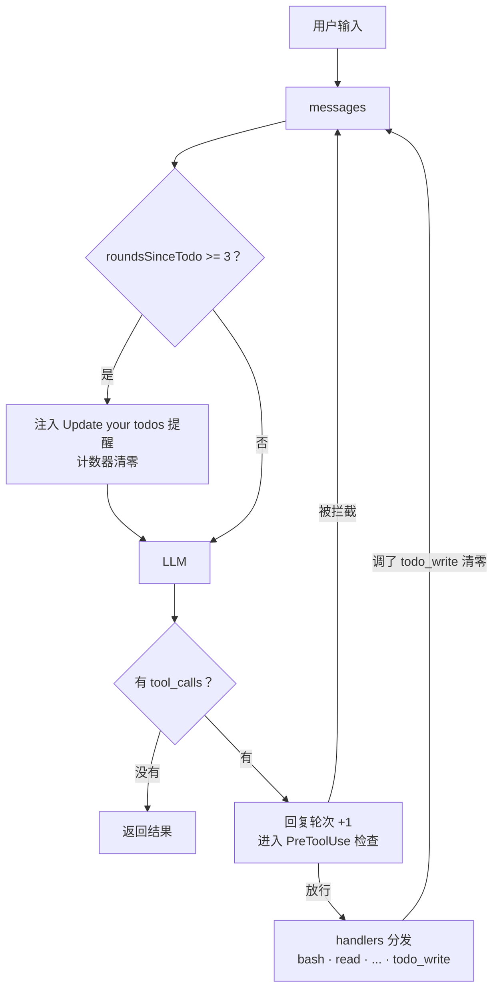

注入的 `<reminder>` 只是给模型看的纯文本标签，没有 HTML 语义；看到提醒后怎么更新计划，依然由模型自己决定。一两步的小活没必要写清单，超过三四步的长任务才值得维护这份会话内白板，跨会话的持久化任务系统留到后面 `s12` 再做。

---

`s04` 为了展示四个生命周期事件，挂了四个只打印日志的演示 Hook。从本章起先把它们收起来让代码保持清爽；这一步删掉后终端不再刷 `[hook]` 日志，但 `permissionHook` 照常拦截危险命令。

本次代码变化：27 行。

```js ! agent.js range=75:94
import {
  callLlm,
  runBash,
  readFile,
  writeFile,
  editFile,
  glob,
  tool,
  runChatCli,
  isMainModule,
} from "./helper.js";

const SYSTEM = `You are a coding agent at ${process.cwd()}. Use tools to solve tasks. Act, don't explain.`;

const tools = [
  tool("bash", "Run a shell command.", {
    type: "object",
    properties: { command: { type: "string" } },
    required: ["command"],
  }),
  tool("read_file", "Read a file (optional line limit).", {
    type: "object",
    properties: { path: { type: "string" }, limit: { type: "integer" } },
    required: ["path"],
  }),
  tool("write_file", "Write content to a file.", {
    type: "object",
    properties: { path: { type: "string" }, content: { type: "string" } },
    required: ["path", "content"],
  }),
  tool("edit_file", "Replace exact text in a file once.", {
    type: "object",
    properties: {
      path: { type: "string" },
      old_text: { type: "string" },
      new_text: { type: "string" },
    },
    required: ["path", "old_text", "new_text"],
  }),
  tool("glob", "Find files by glob pattern.", {
    type: "object",
    properties: { pattern: { type: "string" } },
    required: ["pattern"],
  }),
];

const handlers = {
  bash: ({ command }) => runBash(command),
  read_file: ({ path, limit }) => readFile(path, limit),
  write_file: ({ path, content }) => writeFile(path, content),
  edit_file: ({ path, old_text, new_text }) => editFile(path, old_text, new_text),
  glob: ({ pattern }) => glob(pattern),
};

const hooks = { UserPromptSubmit: [], PreToolUse: [], PostToolUse: [], Stop: [] };

function registerHook(event, callback) {
  hooks[event].push(callback);
}

async function triggerHooks(event, ...args) {
  for (const callback of hooks[event]) {
    const result = await callback(...args);
    if (result != null) return result;
  }
  return null;
}

const DENY = ["rm -rf /", "sudo", "shutdown", "reboot", "mkfs", "dd if="];
const RISKY = ["rm ", "> /etc/", "chmod 777"];

async function permissionHook(name, args, confirm) {
  if (name !== "bash") return null;
  const command = args.command || "";
  if (DENY.some((p) => command.includes(p))) return "Permission denied: 命中黑名单。";
  if (RISKY.some((p) => command.includes(p))) {
    const answer = confirm ? await confirm(`⚠ 可能有破坏性的命令: ${command} 允许? [y/N] `) : "";
    if (!/^y(es)?$/i.test(String(answer).trim())) return "Permission denied by user.";
  }
  return null;
}

// !focus(start)
registerHook("PreToolUse", permissionHook);

// !focus(end)
export async function agentLoop(messages, confirm) {
  while (true) {
    const { message } = await callLlm(messages, { system: SYSTEM, tools });

    if (!message.tool_calls?.length) {
      const force = await triggerHooks("Stop", messages);
      if (force != null) {
        messages.push({ role: "user", content: String(force) });
        continue;
      }
      return message.content || "";
    }

    messages.push(message);
    for (const call of message.tool_calls) {
      const name = call.function.name;
      const args = JSON.parse(call.function.arguments || "{}");

      const blocked = await triggerHooks("PreToolUse", name, args, confirm);
      let output;
      if (blocked != null) {
        output = String(blocked);
      } else {
        const handler = handlers[name];
        output = handler ? handler(args) : `Unknown tool: ${name}`;
        await triggerHooks("PostToolUse", name, output);
      }

      messages.push({ role: "tool", tool_call_id: call.id, content: String(output) });
    }
  }
}

async function main() {
  await runChatCli({
    promptLabel: "s04 >> ",
    onPrompt: async ({ prompt, messages, ask }) => {
      await triggerHooks("UserPromptSubmit", prompt);
      return agentLoop(messages, ask);
    },
  });
}

export { registerHook, triggerHooks, permissionHook };

if (isMainModule(import.meta.url)) {
  main().catch((error) => {
    console.error(error.message);
    process.exit(1);
  });
}
```

## !!steps
演示 Hook 拿掉后，`PostToolUse`、`Stop`、`UserPromptSubmit` 上暂时没有回调，把这三处触发调用和多余导出一起清掉，只保留工具执行前的 `PreToolUse`。整理完后代码回到干净的权限骨架，下一帧把 `todo_write` 接进来。

本次代码变化：9 行。

```js ! agent.js range=82:134
import {
  callLlm,
  runBash,
  readFile,
  writeFile,
  editFile,
  glob,
  tool,
  runChatCli,
  isMainModule,
} from "./helper.js";

const SYSTEM = `You are a coding agent at ${process.cwd()}. Use tools to solve tasks. Act, don't explain.`;

const tools = [
  tool("bash", "Run a shell command.", {
    type: "object",
    properties: { command: { type: "string" } },
    required: ["command"],
  }),
  tool("read_file", "Read a file (optional line limit).", {
    type: "object",
    properties: { path: { type: "string" }, limit: { type: "integer" } },
    required: ["path"],
  }),
  tool("write_file", "Write content to a file.", {
    type: "object",
    properties: { path: { type: "string" }, content: { type: "string" } },
    required: ["path", "content"],
  }),
  tool("edit_file", "Replace exact text in a file once.", {
    type: "object",
    properties: {
      path: { type: "string" },
      old_text: { type: "string" },
      new_text: { type: "string" },
    },
    required: ["path", "old_text", "new_text"],
  }),
  tool("glob", "Find files by glob pattern.", {
    type: "object",
    properties: { pattern: { type: "string" } },
    required: ["pattern"],
  }),
];

const handlers = {
  bash: ({ command }) => runBash(command),
  read_file: ({ path, limit }) => readFile(path, limit),
  write_file: ({ path, content }) => writeFile(path, content),
  edit_file: ({ path, old_text, new_text }) => editFile(path, old_text, new_text),
  glob: ({ pattern }) => glob(pattern),
};

const hooks = { UserPromptSubmit: [], PreToolUse: [], PostToolUse: [], Stop: [] };

function registerHook(event, callback) {
  hooks[event].push(callback);
}

async function triggerHooks(event, ...args) {
  for (const callback of hooks[event]) {
    const result = await callback(...args);
    if (result != null) return result;
  }
  return null;
}

const DENY = ["rm -rf /", "sudo", "shutdown", "reboot", "mkfs", "dd if="];
const RISKY = ["rm ", "> /etc/", "chmod 777"];

async function permissionHook(name, args, confirm) {
  if (name !== "bash") return null;
  const command = args.command || "";
  if (DENY.some((p) => command.includes(p))) return "Permission denied: 命中黑名单。";
  if (RISKY.some((p) => command.includes(p))) {
    const answer = confirm ? await confirm(`⚠ 可能有破坏性的命令: ${command} 允许? [y/N] `) : "";
    if (!/^y(es)?$/i.test(String(answer).trim())) return "Permission denied by user.";
  }
  return null;
}

registerHook("PreToolUse", permissionHook);

export async function agentLoop(messages, confirm) {
  while (true) {
    const { message } = await callLlm(messages, { system: SYSTEM, tools });

    if (!message.tool_calls?.length) {
// !focus(start)
      return message.content || "";
// !focus(end)
    }

    messages.push(message);
    for (const call of message.tool_calls) {
      const name = call.function.name;
      const args = JSON.parse(call.function.arguments || "{}");

      const blocked = await triggerHooks("PreToolUse", name, args, confirm);
      let output;
      if (blocked != null) {
        output = String(blocked);
      } else {
        const handler = handlers[name];
        output = handler ? handler(args) : `Unknown tool: ${name}`;
// !focus(start)
      }
// !focus(end)

      messages.push({ role: "tool", tool_call_id: call.id, content: String(output) });
    }
  }
}

async function main() {
  await runChatCli({
    promptLabel: "s04 >> ",
    onPrompt: async ({ prompt, messages, ask }) => {
// !focus(start)
      return agentLoop(messages, ask);
// !focus(end)
    },
  });
}
// !focus(start)

// !focus(end)
if (isMainModule(import.meta.url)) {
  main().catch((error) => {
    console.error(error.message);
    process.exit(1);
  });
}
```

## !!steps
把 `todo_write` 的实现、schema 和分发注册放进同一帧，让这一步就能直接运行。我们用内存数组 `currentTodos` 存清单（`getTodos()` 留给测试读取），`runTodoWrite` 负责整份替换旧清单并按状态打印空格、`▸` 和 `✓`。接着在 `tools` 里声明 `content` 与三选一 `status` 的 schema、在 `handlers` 里挂上 `runTodoWrite`，再改写 `SYSTEM` 引导模型先列计划再动手。

本次代码变化：33 行。

```js ! agent.js range=5:99
import {
  callLlm,
  runBash,
  readFile,
  writeFile,
  editFile,
  glob,
  tool,
  runChatCli,
  isMainModule,
} from "./helper.js";

// !focus(start)
const SYSTEM = `You are a coding agent at ${process.cwd()}. Before a multi-step task, use todo_write to plan; update status as you go.`;
// !focus(end)

const tools = [
  tool("bash", "Run a shell command.", {
    type: "object",
    properties: { command: { type: "string" } },
    required: ["command"],
  }),
  tool("read_file", "Read a file (optional line limit).", {
    type: "object",
    properties: { path: { type: "string" }, limit: { type: "integer" } },
    required: ["path"],
  }),
  tool("write_file", "Write content to a file.", {
    type: "object",
    properties: { path: { type: "string" }, content: { type: "string" } },
    required: ["path", "content"],
  }),
  tool("edit_file", "Replace exact text in a file once.", {
    type: "object",
    properties: {
      path: { type: "string" },
      old_text: { type: "string" },
      new_text: { type: "string" },
    },
    required: ["path", "old_text", "new_text"],
  }),
  tool("glob", "Find files by glob pattern.", {
    type: "object",
    properties: { pattern: { type: "string" } },
    required: ["pattern"],
// !focus(start)
  }),
  tool("todo_write", "Create and manage a task list for the current session.", {
    type: "object",
    properties: {
      todos: {
        type: "array",
        items: {
          type: "object",
          properties: {
            content: { type: "string" },
            status: { type: "string", enum: ["pending", "in_progress", "completed"] },
          },
          required: ["content", "status"],
        },
      },
    },
    required: ["todos"],
// !focus(end)
  }),
];

// !focus(start)
let currentTodos = [];
export function getTodos() {
  return currentTodos;
}

function runTodoWrite({ todos = [] }) {
  currentTodos = todos;
  const icon = { pending: " ", in_progress: "▸", completed: "✓" };
  console.log("## Current Tasks");
  for (const t of currentTodos) console.log(`  [${icon[t.status]}] ${t.content}`);
  return `Updated ${currentTodos.length} tasks`;
}

// !focus(end)
const handlers = {
  bash: ({ command }) => runBash(command),
  read_file: ({ path, limit }) => readFile(path, limit),
  write_file: ({ path, content }) => writeFile(path, content),
  edit_file: ({ path, old_text, new_text }) => editFile(path, old_text, new_text),
  glob: ({ pattern }) => glob(pattern),
// !focus(start)
  todo_write: runTodoWrite,
// !focus(end)
};

const hooks = { UserPromptSubmit: [], PreToolUse: [], PostToolUse: [], Stop: [] };

function registerHook(event, callback) {
  hooks[event].push(callback);
}

async function triggerHooks(event, ...args) {
  for (const callback of hooks[event]) {
    const result = await callback(...args);
    if (result != null) return result;
  }
  return null;
}

const DENY = ["rm -rf /", "sudo", "shutdown", "reboot", "mkfs", "dd if="];
const RISKY = ["rm ", "> /etc/", "chmod 777"];

async function permissionHook(name, args, confirm) {
  if (name !== "bash") return null;
  const command = args.command || "";
  if (DENY.some((p) => command.includes(p))) return "Permission denied: 命中黑名单。";
  if (RISKY.some((p) => command.includes(p))) {
    const answer = confirm ? await confirm(`⚠ 可能有破坏性的命令: ${command} 允许? [y/N] `) : "";
    if (!/^y(es)?$/i.test(String(answer).trim())) return "Permission denied by user.";
  }
  return null;
}

registerHook("PreToolUse", permissionHook);

export async function agentLoop(messages, confirm) {
  while (true) {
    const { message } = await callLlm(messages, { system: SYSTEM, tools });

    if (!message.tool_calls?.length) {
      return message.content || "";
    }

    messages.push(message);
    for (const call of message.tool_calls) {
      const name = call.function.name;
      const args = JSON.parse(call.function.arguments || "{}");

      const blocked = await triggerHooks("PreToolUse", name, args, confirm);
      let output;
      if (blocked != null) {
        output = String(blocked);
      } else {
        const handler = handlers[name];
        output = handler ? handler(args) : `Unknown tool: ${name}`;
      }

      messages.push({ role: "tool", tool_call_id: call.id, content: String(output) });
    }
  }
}

async function main() {
  await runChatCli({
    promptLabel: "s04 >> ",
    onPrompt: async ({ prompt, messages, ask }) => {
      return agentLoop(messages, ask);
    },
  });
}

if (isMainModule(import.meta.url)) {
  main().catch((error) => {
    console.error(error.message);
    process.exit(1);
  });
}
```

## !!steps
模型干起活来常会忘记回头改清单。我们在 `agentLoop` 里加一个 `roundsSinceTodo`：每收到一条带 `tool_calls` 的模型回复加 1（同一回复并发多个工具也只算 1 轮），只要其中调用了 `todo_write` 就清零。连续 3 轮回复没更新（哪怕一共调了 6 次工具），就在下一次请求前往 `messages` 推一条 `<reminder>Update your todos.</reminder>`。最后顺手把提示符改成 `"s05 >> "`。

本次代码变化：10 行。

### 测试 Prompt

```text
用 todo_write 规划：创建、读取、更新 notes.txt；创建含三条⬜任务的 notes.txt，读取后把文件和 todo 都改成全部✅。
```

当模型按指令先调 `todo_write` 再操作文件时，你会看到终端先打印任务清单，再穿插读写 `notes.txt`，最后把文件内容和 todo 状态一起更新为完成。

### 扩展阅读：商业级 Agent 怎么做会话内计划

`todo_write` 本质上是当前会话的可见工作记忆，商业级产品也都把它和长期任务库区分开：

- **Claude Code**：交互会话使用结构化任务工具，Agent SDK 中保留 `TodoWrite`，同样让状态按 `pending` → `in_progress` → `completed` 推进。参考 [Claude Code Todo Lists](https://code.claude.com/docs/en/agent-sdk/todo-tracking)。
- **Codex**：通过 `update_plan` 维护当前任务的步骤与进度，定位同样是执行期检查清单。参考 [Codex `update_plan` 指令](https://github.com/openai/codex/blob/main/codex-rs/protocol/src/prompts/base_instructions/default.md)。
- **opencode**：同样把会话内任务清单和持久化任务区分开，用来跟踪当前复杂会话的步骤进度。参考 [OpenCode Docs](https://opencode.ai/docs/)。

**`todo_write` 的价值不在清单本身，而在让计划进入上下文循环，帮模型每轮都稳住主线。**

> **本章思考题**：先预测一下：如果模型第 1 轮读文件、第 2 轮调了 `todo_write`、第 3 和第 4 轮继续查文件，第 5 次请求前会触发提醒吗？另外，如果其中一步要翻十几个文件做调研，所有读取输出都塞进主 `messages` 很快会撑爆上下文。能不能临时派一个助理去独立上下文里调研，最后只带回一段摘要？下一章 `s06` 我们来做 Subagent。

```js ! agent.js range=109:171
import {
  callLlm,
  runBash,
  readFile,
  writeFile,
  editFile,
  glob,
  tool,
  runChatCli,
  isMainModule,
} from "./helper.js";

const SYSTEM = `You are a coding agent at ${process.cwd()}. Before a multi-step task, use todo_write to plan; update status as you go.`;

const tools = [
  tool("bash", "Run a shell command.", {
    type: "object",
    properties: { command: { type: "string" } },
    required: ["command"],
  }),
  tool("read_file", "Read a file (optional line limit).", {
    type: "object",
    properties: { path: { type: "string" }, limit: { type: "integer" } },
    required: ["path"],
  }),
  tool("write_file", "Write content to a file.", {
    type: "object",
    properties: { path: { type: "string" }, content: { type: "string" } },
    required: ["path", "content"],
  }),
  tool("edit_file", "Replace exact text in a file once.", {
    type: "object",
    properties: {
      path: { type: "string" },
      old_text: { type: "string" },
      new_text: { type: "string" },
    },
    required: ["path", "old_text", "new_text"],
  }),
  tool("glob", "Find files by glob pattern.", {
    type: "object",
    properties: { pattern: { type: "string" } },
    required: ["pattern"],
  }),
  tool("todo_write", "Create and manage a task list for the current session.", {
    type: "object",
    properties: {
      todos: {
        type: "array",
        items: {
          type: "object",
          properties: {
            content: { type: "string" },
            status: { type: "string", enum: ["pending", "in_progress", "completed"] },
          },
          required: ["content", "status"],
        },
      },
    },
    required: ["todos"],
  }),
];

let currentTodos = [];
export function getTodos() {
  return currentTodos;
}

function runTodoWrite({ todos = [] }) {
  currentTodos = todos;
  const icon = { pending: " ", in_progress: "▸", completed: "✓" };
  console.log("## Current Tasks");
  for (const t of currentTodos) console.log(`  [${icon[t.status]}] ${t.content}`);
  return `Updated ${currentTodos.length} tasks`;
}

const handlers = {
  bash: ({ command }) => runBash(command),
  read_file: ({ path, limit }) => readFile(path, limit),
  write_file: ({ path, content }) => writeFile(path, content),
  edit_file: ({ path, old_text, new_text }) => editFile(path, old_text, new_text),
  glob: ({ pattern }) => glob(pattern),
  todo_write: runTodoWrite,
};

const hooks = { UserPromptSubmit: [], PreToolUse: [], PostToolUse: [], Stop: [] };

function registerHook(event, callback) {
  hooks[event].push(callback);
}

async function triggerHooks(event, ...args) {
  for (const callback of hooks[event]) {
    const result = await callback(...args);
    if (result != null) return result;
  }
  return null;
}

const DENY = ["rm -rf /", "sudo", "shutdown", "reboot", "mkfs", "dd if="];
const RISKY = ["rm ", "> /etc/", "chmod 777"];

async function permissionHook(name, args, confirm) {
  if (name !== "bash") return null;
  const command = args.command || "";
  if (DENY.some((p) => command.includes(p))) return "Permission denied: 命中黑名单。";
  if (RISKY.some((p) => command.includes(p))) {
    const answer = confirm ? await confirm(`⚠ 可能有破坏性的命令: ${command} 允许? [y/N] `) : "";
    if (!/^y(es)?$/i.test(String(answer).trim())) return "Permission denied by user.";
  }
  return null;
}

registerHook("PreToolUse", permissionHook);

export async function agentLoop(messages, confirm) {
// !focus(start)
  let roundsSinceTodo = 0;
// !focus(end)
  while (true) {
// !focus(start)
    if (roundsSinceTodo >= 3) {
      messages.push({ role: "user", content: "<reminder>Update your todos.</reminder>" });
      roundsSinceTodo = 0;
    }

// !focus(end)
    const { message } = await callLlm(messages, { system: SYSTEM, tools });

    if (!message.tool_calls?.length) {
      return message.content || "";
    }

    messages.push(message);
// !focus(start)
    roundsSinceTodo += 1;
// !focus(end)
    for (const call of message.tool_calls) {
      const name = call.function.name;
      const args = JSON.parse(call.function.arguments || "{}");

      const blocked = await triggerHooks("PreToolUse", name, args, confirm);
      let output;
      if (blocked != null) {
        output = String(blocked);
      } else {
        const handler = handlers[name];
        output = handler ? handler(args) : `Unknown tool: ${name}`;
      }

// !focus(start)
      if (name === "todo_write") roundsSinceTodo = 0;
// !focus(end)
      messages.push({ role: "tool", tool_call_id: call.id, content: String(output) });
    }
  }
}

async function main() {
  await runChatCli({
// !focus(start)
    promptLabel: "s05 >> ",
// !focus(end)
    onPrompt: async ({ prompt, messages, ask }) => {
      return agentLoop(messages, ask);
    },
  });
}

if (isMainModule(import.meta.url)) {
  main().catch((error) => {
    console.error(error.message);
    process.exit(1);
  });
}
```

## !!steps s06：Subagent - 把探索放进干净上下文，只把摘要带回来
上一章 `s05` 学会了列计划，但一旦遇到“把目录里十几个文件都查一遍”的调研任务，大量文件读取和搜索输出会瞬间塞满主 `messages`，把主线冲淡。

这一章我们给 Agent 加一把 `task` 工具，专门承接这类调研。**Subagent 的核心不是“多一个人”，而是把子代理的中间输出留在它自己的 `messages[]` 里，主对话只收最终摘要。**

### 问题

主 Agent 既要盯着最终目标，又要亲自翻文件、跑搜索、做试错。所有探索细节都堆在同一份 `messages` 里，主上下文很快膨胀，既浪费 Token，又容易让模型分心。

### 解决方案

我们把子代理做成一个普通的 `task` 工具，背后调用 `spawnSubagent(description, confirm)`，让它在只含一条 `user` 任务描述的新 `messages` 里跑完循环，返回时丢弃所有中间流水，只交回最后一段文本或兜底提示：

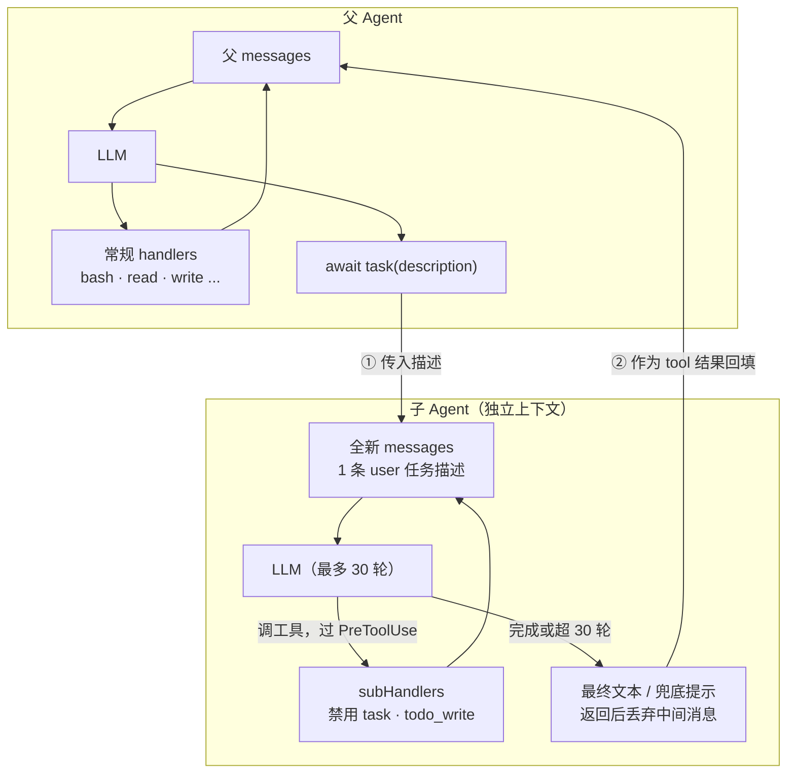

这里同时做好三项约束：子代理禁用 `task` 和 `todo_write` 防止无限套娃，最多发起 30 次模型调用兜底，工具执行依然要过 `PreToolUse` 权限门。父循环会 `await` 等子代理跑完再继续，双方仍共享当前工作目录和文件工具。平时顺手查一两个文件让主代理直接读就行，只有需要大范围翻文件时才值得拆出子上下文。

---

子代理调的依然是同一个模型，区别只在给它什么提示词、消息和工具。先加一条简短的 `SUB_SYSTEM`：专注完成手头子任务，返回精炼摘要，不要再往下派任务。这一步只是先备好常量，程序运行行为还没变，等第 5 帧接上 `task` 工具后才会启用。

本次代码变化：1 行。

```js ! agent.js range=6:24
import {
  callLlm,
  runBash,
  readFile,
  writeFile,
  editFile,
  glob,
  tool,
  runChatCli,
  isMainModule,
} from "./helper.js";

const SYSTEM = `You are a coding agent at ${process.cwd()}. Before a multi-step task, use todo_write to plan; update status as you go.`;
// !focus(start)
const SUB_SYSTEM = `You are a coding subagent at ${process.cwd()}. Complete the task, then return a concise summary. Do not delegate further.`;
// !focus(end)

const tools = [
  tool("bash", "Run a shell command.", {
    type: "object",
    properties: { command: { type: "string" } },
    required: ["command"],
  }),
  tool("read_file", "Read a file (optional line limit).", {
    type: "object",
    properties: { path: { type: "string" }, limit: { type: "integer" } },
    required: ["path"],
  }),
  tool("write_file", "Write content to a file.", {
    type: "object",
    properties: { path: { type: "string" }, content: { type: "string" } },
    required: ["path", "content"],
  }),
  tool("edit_file", "Replace exact text in a file once.", {
    type: "object",
    properties: {
      path: { type: "string" },
      old_text: { type: "string" },
      new_text: { type: "string" },
    },
    required: ["path", "old_text", "new_text"],
  }),
  tool("glob", "Find files by glob pattern.", {
    type: "object",
    properties: { pattern: { type: "string" } },
    required: ["pattern"],
  }),
  tool("todo_write", "Create and manage a task list for the current session.", {
    type: "object",
    properties: {
      todos: {
        type: "array",
        items: {
          type: "object",
          properties: {
            content: { type: "string" },
            status: { type: "string", enum: ["pending", "in_progress", "completed"] },
          },
          required: ["content", "status"],
        },
      },
    },
    required: ["todos"],
  }),
];

let currentTodos = [];
export function getTodos() {
  return currentTodos;
}

function runTodoWrite({ todos = [] }) {
  currentTodos = todos;
  const icon = { pending: " ", in_progress: "▸", completed: "✓" };
  console.log("## Current Tasks");
  for (const t of currentTodos) console.log(`  [${icon[t.status]}] ${t.content}`);
  return `Updated ${currentTodos.length} tasks`;
}

const handlers = {
  bash: ({ command }) => runBash(command),
  read_file: ({ path, limit }) => readFile(path, limit),
  write_file: ({ path, content }) => writeFile(path, content),
  edit_file: ({ path, old_text, new_text }) => editFile(path, old_text, new_text),
  glob: ({ pattern }) => glob(pattern),
  todo_write: runTodoWrite,
};

const hooks = { UserPromptSubmit: [], PreToolUse: [], PostToolUse: [], Stop: [] };

function registerHook(event, callback) {
  hooks[event].push(callback);
}

async function triggerHooks(event, ...args) {
  for (const callback of hooks[event]) {
    const result = await callback(...args);
    if (result != null) return result;
  }
  return null;
}

const DENY = ["rm -rf /", "sudo", "shutdown", "reboot", "mkfs", "dd if="];
const RISKY = ["rm ", "> /etc/", "chmod 777"];

async function permissionHook(name, args, confirm) {
  if (name !== "bash") return null;
  const command = args.command || "";
  if (DENY.some((p) => command.includes(p))) return "Permission denied: 命中黑名单。";
  if (RISKY.some((p) => command.includes(p))) {
    const answer = confirm ? await confirm(`⚠ 可能有破坏性的命令: ${command} 允许? [y/N] `) : "";
    if (!/^y(es)?$/i.test(String(answer).trim())) return "Permission denied by user.";
  }
  return null;
}

registerHook("PreToolUse", permissionHook);

export async function agentLoop(messages, confirm) {
  let roundsSinceTodo = 0;
  while (true) {
    if (roundsSinceTodo >= 3) {
      messages.push({ role: "user", content: "<reminder>Update your todos.</reminder>" });
      roundsSinceTodo = 0;
    }

    const { message } = await callLlm(messages, { system: SYSTEM, tools });

    if (!message.tool_calls?.length) {
      return message.content || "";
    }

    messages.push(message);
    roundsSinceTodo += 1;
    for (const call of message.tool_calls) {
      const name = call.function.name;
      const args = JSON.parse(call.function.arguments || "{}");

      const blocked = await triggerHooks("PreToolUse", name, args, confirm);
      let output;
      if (blocked != null) {
        output = String(blocked);
      } else {
        const handler = handlers[name];
        output = handler ? handler(args) : `Unknown tool: ${name}`;
      }

      if (name === "todo_write") roundsSinceTodo = 0;
      messages.push({ role: "tool", tool_call_id: call.id, content: String(output) });
    }
  }
}

async function main() {
  await runChatCli({
    promptLabel: "s05 >> ",
    onPrompt: async ({ prompt, messages, ask }) => {
      return agentLoop(messages, ask);
    },
  });
}

if (isMainModule(import.meta.url)) {
  main().catch((error) => {
    console.error(error.message);
    process.exit(1);
  });
}
```

## !!steps
从父代理的 `tools` 和 `handlers` 里筛出子代理可用的子集，用同一份 `SUB_EXCLUDE` 剔除 `task`（防无限递归）和 `todo_write`（小任务不必另列计划），保证两张表严格一致。再设 `MAX_SUB_TURNS = 30` 限制子代理最多发起 30 次模型调用。这一步仍在准备配置，下一帧才写出子循环。

本次代码变化：7 行。

```js ! agent.js range=79:103
import {
  callLlm,
  runBash,
  readFile,
  writeFile,
  editFile,
  glob,
  tool,
  runChatCli,
  isMainModule,
} from "./helper.js";

const SYSTEM = `You are a coding agent at ${process.cwd()}. Before a multi-step task, use todo_write to plan; update status as you go.`;
const SUB_SYSTEM = `You are a coding subagent at ${process.cwd()}. Complete the task, then return a concise summary. Do not delegate further.`;

const tools = [
  tool("bash", "Run a shell command.", {
    type: "object",
    properties: { command: { type: "string" } },
    required: ["command"],
  }),
  tool("read_file", "Read a file (optional line limit).", {
    type: "object",
    properties: { path: { type: "string" }, limit: { type: "integer" } },
    required: ["path"],
  }),
  tool("write_file", "Write content to a file.", {
    type: "object",
    properties: { path: { type: "string" }, content: { type: "string" } },
    required: ["path", "content"],
  }),
  tool("edit_file", "Replace exact text in a file once.", {
    type: "object",
    properties: {
      path: { type: "string" },
      old_text: { type: "string" },
      new_text: { type: "string" },
    },
    required: ["path", "old_text", "new_text"],
  }),
  tool("glob", "Find files by glob pattern.", {
    type: "object",
    properties: { pattern: { type: "string" } },
    required: ["pattern"],
  }),
  tool("todo_write", "Create and manage a task list for the current session.", {
    type: "object",
    properties: {
      todos: {
        type: "array",
        items: {
          type: "object",
          properties: {
            content: { type: "string" },
            status: { type: "string", enum: ["pending", "in_progress", "completed"] },
          },
          required: ["content", "status"],
        },
      },
    },
    required: ["todos"],
  }),
];

let currentTodos = [];
export function getTodos() {
  return currentTodos;
}

function runTodoWrite({ todos = [] }) {
  currentTodos = todos;
  const icon = { pending: " ", in_progress: "▸", completed: "✓" };
  console.log("## Current Tasks");
  for (const t of currentTodos) console.log(`  [${icon[t.status]}] ${t.content}`);
  return `Updated ${currentTodos.length} tasks`;
}

const handlers = {
  bash: ({ command }) => runBash(command),
  read_file: ({ path, limit }) => readFile(path, limit),
  write_file: ({ path, content }) => writeFile(path, content),
  edit_file: ({ path, old_text, new_text }) => editFile(path, old_text, new_text),
  glob: ({ pattern }) => glob(pattern),
  todo_write: runTodoWrite,
};

// !focus(start)
const SUB_EXCLUDE = ["task", "todo_write"];
const subTools = tools.filter((t) => !SUB_EXCLUDE.includes(t.function.name));
const subHandlers = Object.fromEntries(
  Object.entries(handlers).filter(([name]) => !SUB_EXCLUDE.includes(name)),
);
const MAX_SUB_TURNS = 30;

// !focus(end)
const hooks = { UserPromptSubmit: [], PreToolUse: [], PostToolUse: [], Stop: [] };

function registerHook(event, callback) {
  hooks[event].push(callback);
}

async function triggerHooks(event, ...args) {
  for (const callback of hooks[event]) {
    const result = await callback(...args);
    if (result != null) return result;
  }
  return null;
}

const DENY = ["rm -rf /", "sudo", "shutdown", "reboot", "mkfs", "dd if="];
const RISKY = ["rm ", "> /etc/", "chmod 777"];

async function permissionHook(name, args, confirm) {
  if (name !== "bash") return null;
  const command = args.command || "";
  if (DENY.some((p) => command.includes(p))) return "Permission denied: 命中黑名单。";
  if (RISKY.some((p) => command.includes(p))) {
    const answer = confirm ? await confirm(`⚠ 可能有破坏性的命令: ${command} 允许? [y/N] `) : "";
    if (!/^y(es)?$/i.test(String(answer).trim())) return "Permission denied by user.";
  }
  return null;
}

registerHook("PreToolUse", permissionHook);

export async function agentLoop(messages, confirm) {
  let roundsSinceTodo = 0;
  while (true) {
    if (roundsSinceTodo >= 3) {
      messages.push({ role: "user", content: "<reminder>Update your todos.</reminder>" });
      roundsSinceTodo = 0;
    }

    const { message } = await callLlm(messages, { system: SYSTEM, tools });

    if (!message.tool_calls?.length) {
      return message.content || "";
    }

    messages.push(message);
    roundsSinceTodo += 1;
    for (const call of message.tool_calls) {
      const name = call.function.name;
      const args = JSON.parse(call.function.arguments || "{}");

      const blocked = await triggerHooks("PreToolUse", name, args, confirm);
      let output;
      if (blocked != null) {
        output = String(blocked);
      } else {
        const handler = handlers[name];
        output = handler ? handler(args) : `Unknown tool: ${name}`;
      }

      if (name === "todo_write") roundsSinceTodo = 0;
      messages.push({ role: "tool", tool_call_id: call.id, content: String(output) });
    }
  }
}

async function main() {
  await runChatCli({
    promptLabel: "s05 >> ",
    onPrompt: async ({ prompt, messages, ask }) => {
      return agentLoop(messages, ask);
    },
  });
}

if (isMainModule(import.meta.url)) {
  main().catch((error) => {
    console.error(error.message);
    process.exit(1);
  });
}
```

## !!steps
`spawnSubagent` 第一行就是本章核心：`messages` 是全新数组，只装一条 `{ role: "user", content: description }`，完全不继承父对话历史。模型不再调工具时返回最终文本（空文本或超 30 轮各有兜底提示），函数一结束局部 `messages` 就随作用域丢弃。这一帧先立起循环外壳，下一帧补齐工具执行与回填后才能跑通工具闭环。

本次代码变化：12 行。

```js ! agent.js range=86:181
import {
  callLlm,
  runBash,
  readFile,
  writeFile,
  editFile,
  glob,
  tool,
  runChatCli,
  isMainModule,
} from "./helper.js";

const SYSTEM = `You are a coding agent at ${process.cwd()}. Before a multi-step task, use todo_write to plan; update status as you go.`;
const SUB_SYSTEM = `You are a coding subagent at ${process.cwd()}. Complete the task, then return a concise summary. Do not delegate further.`;

const tools = [
  tool("bash", "Run a shell command.", {
    type: "object",
    properties: { command: { type: "string" } },
    required: ["command"],
  }),
  tool("read_file", "Read a file (optional line limit).", {
    type: "object",
    properties: { path: { type: "string" }, limit: { type: "integer" } },
    required: ["path"],
  }),
  tool("write_file", "Write content to a file.", {
    type: "object",
    properties: { path: { type: "string" }, content: { type: "string" } },
    required: ["path", "content"],
  }),
  tool("edit_file", "Replace exact text in a file once.", {
    type: "object",
    properties: {
      path: { type: "string" },
      old_text: { type: "string" },
      new_text: { type: "string" },
    },
    required: ["path", "old_text", "new_text"],
  }),
  tool("glob", "Find files by glob pattern.", {
    type: "object",
    properties: { pattern: { type: "string" } },
    required: ["pattern"],
  }),
  tool("todo_write", "Create and manage a task list for the current session.", {
    type: "object",
    properties: {
      todos: {
        type: "array",
        items: {
          type: "object",
          properties: {
            content: { type: "string" },
            status: { type: "string", enum: ["pending", "in_progress", "completed"] },
          },
          required: ["content", "status"],
        },
      },
    },
    required: ["todos"],
  }),
];

let currentTodos = [];
export function getTodos() {
  return currentTodos;
}

function runTodoWrite({ todos = [] }) {
  currentTodos = todos;
  const icon = { pending: " ", in_progress: "▸", completed: "✓" };
  console.log("## Current Tasks");
  for (const t of currentTodos) console.log(`  [${icon[t.status]}] ${t.content}`);
  return `Updated ${currentTodos.length} tasks`;
}

const handlers = {
  bash: ({ command }) => runBash(command),
  read_file: ({ path, limit }) => readFile(path, limit),
  write_file: ({ path, content }) => writeFile(path, content),
  edit_file: ({ path, old_text, new_text }) => editFile(path, old_text, new_text),
  glob: ({ pattern }) => glob(pattern),
  todo_write: runTodoWrite,
};

const SUB_EXCLUDE = ["task", "todo_write"];
const subTools = tools.filter((t) => !SUB_EXCLUDE.includes(t.function.name));
const subHandlers = Object.fromEntries(
  Object.entries(handlers).filter(([name]) => !SUB_EXCLUDE.includes(name)),
);
const MAX_SUB_TURNS = 30;

// !focus(start)
async function spawnSubagent(description, confirm) {
  const messages = [{ role: "user", content: description }];
  for (let turn = 0; turn < MAX_SUB_TURNS; turn += 1) {
    const { message } = await callLlm(messages, { system: SUB_SYSTEM, tools: subTools });
    messages.push(message);
    if (!message.tool_calls?.length) return message.content || "(subagent returned no text)";
  }
  return "Subagent stopped after 30 turns without a final answer.";
}

// !focus(end)
const hooks = { UserPromptSubmit: [], PreToolUse: [], PostToolUse: [], Stop: [] };

function registerHook(event, callback) {
  hooks[event].push(callback);
}

async function triggerHooks(event, ...args) {
  for (const callback of hooks[event]) {
    const result = await callback(...args);
    if (result != null) return result;
  }
  return null;
}

const DENY = ["rm -rf /", "sudo", "shutdown", "reboot", "mkfs", "dd if="];
const RISKY = ["rm ", "> /etc/", "chmod 777"];

async function permissionHook(name, args, confirm) {
  if (name !== "bash") return null;
  const command = args.command || "";
  if (DENY.some((p) => command.includes(p))) return "Permission denied: 命中黑名单。";
  if (RISKY.some((p) => command.includes(p))) {
    const answer = confirm ? await confirm(`⚠ 可能有破坏性的命令: ${command} 允许? [y/N] `) : "";
    if (!/^y(es)?$/i.test(String(answer).trim())) return "Permission denied by user.";
  }
  return null;
}

registerHook("PreToolUse", permissionHook);

export async function agentLoop(messages, confirm) {
  let roundsSinceTodo = 0;
  while (true) {
    if (roundsSinceTodo >= 3) {
      messages.push({ role: "user", content: "<reminder>Update your todos.</reminder>" });
      roundsSinceTodo = 0;
    }

    const { message } = await callLlm(messages, { system: SYSTEM, tools });

    if (!message.tool_calls?.length) {
      return message.content || "";
    }

    messages.push(message);
    roundsSinceTodo += 1;
    for (const call of message.tool_calls) {
      const name = call.function.name;
      const args = JSON.parse(call.function.arguments || "{}");

      const blocked = await triggerHooks("PreToolUse", name, args, confirm);
      let output;
      if (blocked != null) {
        output = String(blocked);
      } else {
        const handler = handlers[name];
        output = handler ? handler(args) : `Unknown tool: ${name}`;
      }

      if (name === "todo_write") roundsSinceTodo = 0;
      messages.push({ role: "tool", tool_call_id: call.id, content: String(output) });
    }
  }
}
// !focus(start)

export { spawnSubagent };
// !focus(end)

async function main() {
  await runChatCli({
    promptLabel: "s05 >> ",
    onPrompt: async ({ prompt, messages, ask }) => {
      return agentLoop(messages, ask);
    },
  });
}

if (isMainModule(import.meta.url)) {
  main().catch((error) => {
    console.error(error.message);
    process.exit(1);
  });
}
```

## !!steps
补齐子循环里的工具执行逻辑：解析参数、查 `subHandlers`、用 `tool_call_id` 把结果塞回子代理自己的 `messages`。特别注意：上下文是隔离的，但权限不是，子代理调工具前同样要触发 `PreToolUse`，危险命令照样拦截或问用户。

本次代码变化：10 行。

```js ! agent.js range=92:119
import {
  callLlm,
  runBash,
  readFile,
  writeFile,
  editFile,
  glob,
  tool,
  runChatCli,
  isMainModule,
} from "./helper.js";

const SYSTEM = `You are a coding agent at ${process.cwd()}. Before a multi-step task, use todo_write to plan; update status as you go.`;
const SUB_SYSTEM = `You are a coding subagent at ${process.cwd()}. Complete the task, then return a concise summary. Do not delegate further.`;

const tools = [
  tool("bash", "Run a shell command.", {
    type: "object",
    properties: { command: { type: "string" } },
    required: ["command"],
  }),
  tool("read_file", "Read a file (optional line limit).", {
    type: "object",
    properties: { path: { type: "string" }, limit: { type: "integer" } },
    required: ["path"],
  }),
  tool("write_file", "Write content to a file.", {
    type: "object",
    properties: { path: { type: "string" }, content: { type: "string" } },
    required: ["path", "content"],
  }),
  tool("edit_file", "Replace exact text in a file once.", {
    type: "object",
    properties: {
      path: { type: "string" },
      old_text: { type: "string" },
      new_text: { type: "string" },
    },
    required: ["path", "old_text", "new_text"],
  }),
  tool("glob", "Find files by glob pattern.", {
    type: "object",
    properties: { pattern: { type: "string" } },
    required: ["pattern"],
  }),
  tool("todo_write", "Create and manage a task list for the current session.", {
    type: "object",
    properties: {
      todos: {
        type: "array",
        items: {
          type: "object",
          properties: {
            content: { type: "string" },
            status: { type: "string", enum: ["pending", "in_progress", "completed"] },
          },
          required: ["content", "status"],
        },
      },
    },
    required: ["todos"],
  }),
];

let currentTodos = [];
export function getTodos() {
  return currentTodos;
}

function runTodoWrite({ todos = [] }) {
  currentTodos = todos;
  const icon = { pending: " ", in_progress: "▸", completed: "✓" };
  console.log("## Current Tasks");
  for (const t of currentTodos) console.log(`  [${icon[t.status]}] ${t.content}`);
  return `Updated ${currentTodos.length} tasks`;
}

const handlers = {
  bash: ({ command }) => runBash(command),
  read_file: ({ path, limit }) => readFile(path, limit),
  write_file: ({ path, content }) => writeFile(path, content),
  edit_file: ({ path, old_text, new_text }) => editFile(path, old_text, new_text),
  glob: ({ pattern }) => glob(pattern),
  todo_write: runTodoWrite,
};

const SUB_EXCLUDE = ["task", "todo_write"];
const subTools = tools.filter((t) => !SUB_EXCLUDE.includes(t.function.name));
const subHandlers = Object.fromEntries(
  Object.entries(handlers).filter(([name]) => !SUB_EXCLUDE.includes(name)),
);
const MAX_SUB_TURNS = 30;

async function spawnSubagent(description, confirm) {
  const messages = [{ role: "user", content: description }];
  for (let turn = 0; turn < MAX_SUB_TURNS; turn += 1) {
    const { message } = await callLlm(messages, { system: SUB_SYSTEM, tools: subTools });
    messages.push(message);
    if (!message.tool_calls?.length) return message.content || "(subagent returned no text)";
// !focus(start)

    for (const call of message.tool_calls) {
      const name = call.function.name;
      const args = JSON.parse(call.function.arguments || "{}");
      const blocked = await triggerHooks("PreToolUse", name, args, confirm);
      const handler = subHandlers[name];
      const output =
        blocked != null ? String(blocked) : handler ? handler(args) : `Unknown tool: ${name}`;
      messages.push({ role: "tool", tool_call_id: call.id, content: String(output) });
    }
// !focus(end)
  }
  return "Subagent stopped after 30 turns without a final answer.";
}

const hooks = { UserPromptSubmit: [], PreToolUse: [], PostToolUse: [], Stop: [] };

function registerHook(event, callback) {
  hooks[event].push(callback);
}

async function triggerHooks(event, ...args) {
  for (const callback of hooks[event]) {
    const result = await callback(...args);
    if (result != null) return result;
  }
  return null;
}

const DENY = ["rm -rf /", "sudo", "shutdown", "reboot", "mkfs", "dd if="];
const RISKY = ["rm ", "> /etc/", "chmod 777"];

async function permissionHook(name, args, confirm) {
  if (name !== "bash") return null;
  const command = args.command || "";
  if (DENY.some((p) => command.includes(p))) return "Permission denied: 命中黑名单。";
  if (RISKY.some((p) => command.includes(p))) {
    const answer = confirm ? await confirm(`⚠ 可能有破坏性的命令: ${command} 允许? [y/N] `) : "";
    if (!/^y(es)?$/i.test(String(answer).trim())) return "Permission denied by user.";
  }
  return null;
}

registerHook("PreToolUse", permissionHook);

export async function agentLoop(messages, confirm) {
  let roundsSinceTodo = 0;
  while (true) {
    if (roundsSinceTodo >= 3) {
      messages.push({ role: "user", content: "<reminder>Update your todos.</reminder>" });
      roundsSinceTodo = 0;
    }

    const { message } = await callLlm(messages, { system: SYSTEM, tools });

    if (!message.tool_calls?.length) {
      return message.content || "";
    }

    messages.push(message);
    roundsSinceTodo += 1;
    for (const call of message.tool_calls) {
      const name = call.function.name;
      const args = JSON.parse(call.function.arguments || "{}");

      const blocked = await triggerHooks("PreToolUse", name, args, confirm);
      let output;
      if (blocked != null) {
        output = String(blocked);
      } else {
        const handler = handlers[name];
        output = handler ? handler(args) : `Unknown tool: ${name}`;
      }

      if (name === "todo_write") roundsSinceTodo = 0;
      messages.push({ role: "tool", tool_call_id: call.id, content: String(output) });
    }
  }
}

export { spawnSubagent };

async function main() {
  await runChatCli({
    promptLabel: "s05 >> ",
    onPrompt: async ({ prompt, messages, ask }) => {
      return agentLoop(messages, ask);
    },
  });
}

if (isMainModule(import.meta.url)) {
  main().catch((error) => {
    console.error(error.message);
    process.exit(1);
  });
}
```

## !!steps
最后把子代理挂进父代理：`tools` 增加 `task` 的 schema，`handlers` 指向 `spawnSubagent`，并更新 `SYSTEM` 告知模型遇到复杂子问题可以派子代理。因为 `spawnSubagent` 是异步的且可能需要用户确认，主循环执行工具改为 `await handler(args, confirm)`，提示符切到 `"s06 >> "`。

本次代码变化：12 行。

### 测试 Prompt

```text
派一个子代理检查当前目录有哪些 Markdown 文件，主代理只需要返回子代理的总结。
```

当模型按要求调用 `task` 委派调研时，所有查目录的中间工具输出都留在子代理内部，主对话只拿到一段最终总结。

### 扩展阅读：商业级 Agent 怎么做子代理

商业级产品的子代理形态各异，但核心同样是独立上下文和清晰的返回边界：

- **Claude Code**：普通 subagent 拥有独立上下文，可单独限制可用工具，完成后只把最终结果返回主对话。参考 [Claude Code Subagents](https://code.claude.com/docs/en/sub-agents)。
- **Codex**：通过 `spawn_agent`、`wait_agent` 等工具管理子线程的创建、等待与回收，比一次性函数多了完整的生命周期控制。参考 [OpenAI Codex](https://github.com/openai/codex)。
- **opencode**：支持将自定义 agent 配置为 `subagent` 模式供主代理委派，还能单独配置工具与权限。参考 [OpenCode Agents](https://opencode.ai/docs/agents/)。

**新建一份干净的 `messages[]`，跑完只交回摘要，就是 Subagent 最本质的抽象。**

> **本章思考题**：先确认一下权限边界：如果让子代理执行 `rm notes.txt`，终端还会弹出 `[y/N]` 确认吗？（回头看第 4 帧的 `PreToolUse` 就知道答案。）另外，项目里还有代码规范、发布流程、排障手册等专业文档，全塞进 `SYSTEM` 每轮都在烧 Token。能不能只在提示词里放目录，模型需要时再按需加载全文？下一章 `s07` 我们来做 Skill Loading。

```js ! agent.js range=5:207
import {
  callLlm,
  runBash,
  readFile,
  writeFile,
  editFile,
  glob,
  tool,
  runChatCli,
  isMainModule,
} from "./helper.js";

// !focus(start)
const SYSTEM = `You are a coding agent at ${process.cwd()}. Use tools to solve tasks. Before a multi-step task, use todo_write to plan and update status as you go. For a complex sub-problem, use the task tool to spawn a subagent.`;
// !focus(end)
const SUB_SYSTEM = `You are a coding subagent at ${process.cwd()}. Complete the task, then return a concise summary. Do not delegate further.`;

const tools = [
  tool("bash", "Run a shell command.", {
    type: "object",
    properties: { command: { type: "string" } },
    required: ["command"],
  }),
  tool("read_file", "Read a file (optional line limit).", {
    type: "object",
    properties: { path: { type: "string" }, limit: { type: "integer" } },
    required: ["path"],
  }),
  tool("write_file", "Write content to a file.", {
    type: "object",
    properties: { path: { type: "string" }, content: { type: "string" } },
    required: ["path", "content"],
  }),
  tool("edit_file", "Replace exact text in a file once.", {
    type: "object",
    properties: {
      path: { type: "string" },
      old_text: { type: "string" },
      new_text: { type: "string" },
    },
    required: ["path", "old_text", "new_text"],
  }),
  tool("glob", "Find files by glob pattern.", {
    type: "object",
    properties: { pattern: { type: "string" } },
    required: ["pattern"],
  }),
  tool("todo_write", "Create and manage a task list for the current session.", {
    type: "object",
    properties: {
      todos: {
        type: "array",
        items: {
          type: "object",
          properties: {
            content: { type: "string" },
            status: { type: "string", enum: ["pending", "in_progress", "completed"] },
          },
          required: ["content", "status"],
        },
      },
    },
    required: ["todos"],
  }),
// !focus(start)
  tool("task", "Launch a subagent to handle a complex subtask. Returns only the final summary.", {
    type: "object",
    properties: { description: { type: "string" } },
    required: ["description"],
  }),
// !focus(end)
];

let currentTodos = [];
export function getTodos() {
  return currentTodos;
}

function runTodoWrite({ todos = [] }) {
  currentTodos = todos;
  const icon = { pending: " ", in_progress: "▸", completed: "✓" };
  console.log("## Current Tasks");
  for (const t of currentTodos) console.log(`  [${icon[t.status]}] ${t.content}`);
  return `Updated ${currentTodos.length} tasks`;
}

const handlers = {
  bash: ({ command }) => runBash(command),
  read_file: ({ path, limit }) => readFile(path, limit),
  write_file: ({ path, content }) => writeFile(path, content),
  edit_file: ({ path, old_text, new_text }) => editFile(path, old_text, new_text),
  glob: ({ pattern }) => glob(pattern),
  todo_write: runTodoWrite,
// !focus(start)
  task: ({ description }, confirm) => spawnSubagent(description, confirm),
// !focus(end)
};

const SUB_EXCLUDE = ["task", "todo_write"];
const subTools = tools.filter((t) => !SUB_EXCLUDE.includes(t.function.name));
const subHandlers = Object.fromEntries(
  Object.entries(handlers).filter(([name]) => !SUB_EXCLUDE.includes(name)),
);
const MAX_SUB_TURNS = 30;

async function spawnSubagent(description, confirm) {
  const messages = [{ role: "user", content: description }];
  for (let turn = 0; turn < MAX_SUB_TURNS; turn += 1) {
    const { message } = await callLlm(messages, { system: SUB_SYSTEM, tools: subTools });
    messages.push(message);
    if (!message.tool_calls?.length) return message.content || "(subagent returned no text)";

    for (const call of message.tool_calls) {
      const name = call.function.name;
      const args = JSON.parse(call.function.arguments || "{}");
      const blocked = await triggerHooks("PreToolUse", name, args, confirm);
      const handler = subHandlers[name];
      const output =
        blocked != null ? String(blocked) : handler ? handler(args) : `Unknown tool: ${name}`;
      messages.push({ role: "tool", tool_call_id: call.id, content: String(output) });
    }
  }
  return "Subagent stopped after 30 turns without a final answer.";
}

const hooks = { UserPromptSubmit: [], PreToolUse: [], PostToolUse: [], Stop: [] };

function registerHook(event, callback) {
  hooks[event].push(callback);
}

async function triggerHooks(event, ...args) {
  for (const callback of hooks[event]) {
    const result = await callback(...args);
    if (result != null) return result;
  }
  return null;
}

const DENY = ["rm -rf /", "sudo", "shutdown", "reboot", "mkfs", "dd if="];
const RISKY = ["rm ", "> /etc/", "chmod 777"];

async function permissionHook(name, args, confirm) {
  if (name !== "bash") return null;
  const command = args.command || "";
  if (DENY.some((p) => command.includes(p))) return "Permission denied: 命中黑名单。";
  if (RISKY.some((p) => command.includes(p))) {
    const answer = confirm ? await confirm(`⚠ 可能有破坏性的命令: ${command} 允许? [y/N] `) : "";
    if (!/^y(es)?$/i.test(String(answer).trim())) return "Permission denied by user.";
  }
  return null;
}

registerHook("PreToolUse", permissionHook);

export async function agentLoop(messages, confirm) {
  let roundsSinceTodo = 0;
  while (true) {
    if (roundsSinceTodo >= 3) {
      messages.push({ role: "user", content: "<reminder>Update your todos.</reminder>" });
      roundsSinceTodo = 0;
    }

    const { message } = await callLlm(messages, { system: SYSTEM, tools });

    if (!message.tool_calls?.length) {
      return message.content || "";
    }

    messages.push(message);
    roundsSinceTodo += 1;
    for (const call of message.tool_calls) {
      const name = call.function.name;
      const args = JSON.parse(call.function.arguments || "{}");

      const blocked = await triggerHooks("PreToolUse", name, args, confirm);
      let output;
      if (blocked != null) {
        output = String(blocked);
      } else {
        const handler = handlers[name];
// !focus(start)
        output = handler ? await handler(args, confirm) : `Unknown tool: ${name}`;
// !focus(end)
      }

      if (name === "todo_write") roundsSinceTodo = 0;
      messages.push({ role: "tool", tool_call_id: call.id, content: String(output) });
    }
  }
}

export { spawnSubagent };

async function main() {
  await runChatCli({
// !focus(start)
    promptLabel: "s06 >> ",
// !focus(end)
    onPrompt: async ({ prompt, messages, ask }) => {
      return agentLoop(messages, ask);
    },
  });
}

if (isMainModule(import.meta.url)) {
  main().catch((error) => {
    console.error(error.message);
    process.exit(1);
  });
}
```

## !!steps s07：Skill Loading - 先给技能目录，需要时再按需加载全文
上一章 `s06` 用子代理把探索过程隔离开了，但项目里还有代码规范、发布流程、方案评审清单这类专业手册。如果把它们全塞进 `SYSTEM`，每轮对话都在烧 Token，而且大多数时候根本用不到。

这一章我们给 Agent 加上两级技能加载。**技能系统的核心不是把知识全部预装进提示词，而是常驻一份轻量目录，模型真用得上时再调用 `load_skill` 取全文。**

### 问题

团队经验一多，各类规范和指南动辄几千字。启动时一股脑塞进 `SYSTEM`，会持续挤压上下文窗口，也容易分散模型对当前任务的注意力。反过来，如果完全不放，模型根本不知道仓库里有这些指南，每次还得靠用户口头重复。

### 解决方案

我们把技能加载拆成“启动扫目录、运行时取全文”两级。程序启动时，`scanSkills()` 扫描 `skills/` 下的直接子目录，复用 `helper.js` 的 `parseFrontmatter()` 读出每个 `SKILL.md` 头部的 `name` 和 `description`，存入内存表 `skillRegistry`。

`SYSTEM` 里只拼入 `listSkills()` 生成的简短清单。模型判断需要某个技能时，再调用普通工具 `load_skill(name)`，把完整正文作为工具结果注入对话：

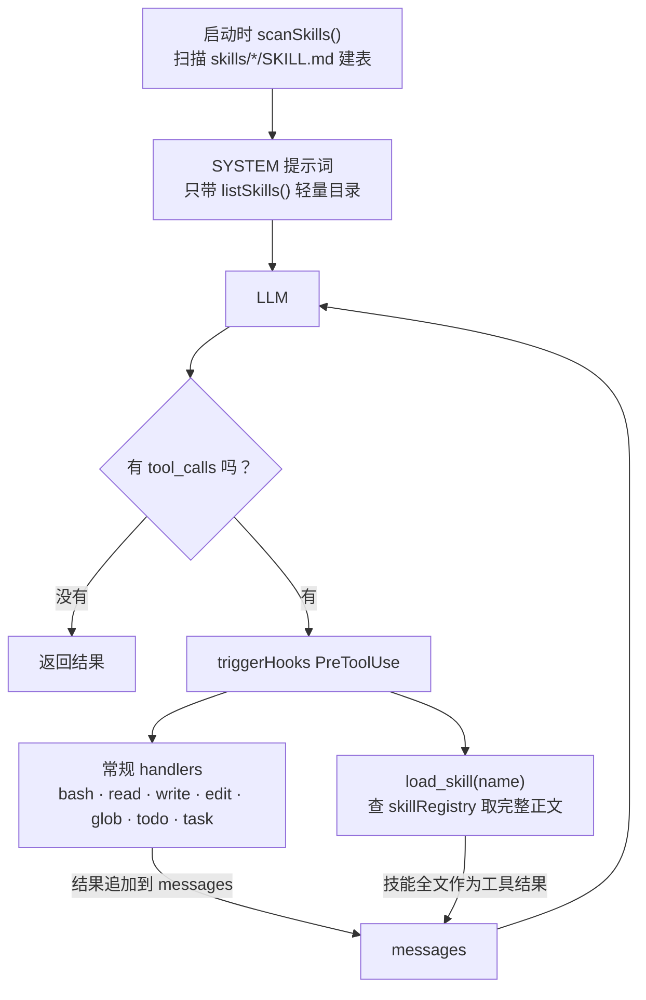

这样设计同时兼顾成本和安全：目录每个技能只占一行，常驻上下文非常便宜；`loadSkill` 只拿名字去查启动时建好的 `skillRegistry`，不拿模型参数拼路径，避免了路径穿越读取任意文件。同时要注意，技能正文属于外部知识数据，真实生产系统仍要防范内容里的 prompt injection。

---

技能本质上是放在 `skills/` 目录下的 Markdown 文件。我们先从 `node:fs` 和 `node:path` 引入目录和文件读取函数，并从 `helper.js` 引入负责解析文件头部元信息的 `parseFrontmatter`，再定好 `SKILLS_DIR` 路径。这一步只做准备，程序行为还没有变化。

本次代码变化：5 行。

```js ! agent.js range=1:30
// !focus(start)
import { readdirSync, readFileSync, existsSync } from "node:fs";
import path from "node:path";
// !focus(end)
import {
  callLlm,
  runBash,
  readFile,
  writeFile,
  editFile,
  glob,
  tool,
  runChatCli,
  isMainModule,
// !focus(start)
  parseFrontmatter,
// !focus(end)
} from "./helper.js";
// !focus(start)

const SKILLS_DIR = path.join(process.cwd(), "skills");
// !focus(end)

const SYSTEM = `You are a coding agent at ${process.cwd()}. Use tools to solve tasks. Before a multi-step task, use todo_write to plan and update status as you go. For a complex sub-problem, use the task tool to spawn a subagent.`;
const SUB_SYSTEM = `You are a coding subagent at ${process.cwd()}. Complete the task, then return a concise summary. Do not delegate further.`;

const tools = [
  tool("bash", "Run a shell command.", {
    type: "object",
    properties: { command: { type: "string" } },
    required: ["command"],
  }),
  tool("read_file", "Read a file (optional line limit).", {
    type: "object",
    properties: { path: { type: "string" }, limit: { type: "integer" } },
    required: ["path"],
  }),
  tool("write_file", "Write content to a file.", {
    type: "object",
    properties: { path: { type: "string" }, content: { type: "string" } },
    required: ["path", "content"],
  }),
  tool("edit_file", "Replace exact text in a file once.", {
    type: "object",
    properties: {
      path: { type: "string" },
      old_text: { type: "string" },
      new_text: { type: "string" },
    },
    required: ["path", "old_text", "new_text"],
  }),
  tool("glob", "Find files by glob pattern.", {
    type: "object",
    properties: { pattern: { type: "string" } },
    required: ["pattern"],
  }),
  tool("todo_write", "Create and manage a task list for the current session.", {
    type: "object",
    properties: {
      todos: {
        type: "array",
        items: {
          type: "object",
          properties: {
            content: { type: "string" },
            status: { type: "string", enum: ["pending", "in_progress", "completed"] },
          },
          required: ["content", "status"],
        },
      },
    },
    required: ["todos"],
  }),
  tool("task", "Launch a subagent to handle a complex subtask. Returns only the final summary.", {
    type: "object",
    properties: { description: { type: "string" } },
    required: ["description"],
  }),
];

let currentTodos = [];
export function getTodos() {
  return currentTodos;
}

function runTodoWrite({ todos = [] }) {
  currentTodos = todos;
  const icon = { pending: " ", in_progress: "▸", completed: "✓" };
  console.log("## Current Tasks");
  for (const t of currentTodos) console.log(`  [${icon[t.status]}] ${t.content}`);
  return `Updated ${currentTodos.length} tasks`;
}

const handlers = {
  bash: ({ command }) => runBash(command),
  read_file: ({ path, limit }) => readFile(path, limit),
  write_file: ({ path, content }) => writeFile(path, content),
  edit_file: ({ path, old_text, new_text }) => editFile(path, old_text, new_text),
  glob: ({ pattern }) => glob(pattern),
  todo_write: runTodoWrite,
  task: ({ description }, confirm) => spawnSubagent(description, confirm),
};

const SUB_EXCLUDE = ["task", "todo_write"];
const subTools = tools.filter((t) => !SUB_EXCLUDE.includes(t.function.name));
const subHandlers = Object.fromEntries(
  Object.entries(handlers).filter(([name]) => !SUB_EXCLUDE.includes(name)),
);
const MAX_SUB_TURNS = 30;

async function spawnSubagent(description, confirm) {
  const messages = [{ role: "user", content: description }];
  for (let turn = 0; turn < MAX_SUB_TURNS; turn += 1) {
    const { message } = await callLlm(messages, { system: SUB_SYSTEM, tools: subTools });
    messages.push(message);
    if (!message.tool_calls?.length) return message.content || "(subagent returned no text)";

    for (const call of message.tool_calls) {
      const name = call.function.name;
      const args = JSON.parse(call.function.arguments || "{}");
      const blocked = await triggerHooks("PreToolUse", name, args, confirm);
      const handler = subHandlers[name];
      const output =
        blocked != null ? String(blocked) : handler ? handler(args) : `Unknown tool: ${name}`;
      messages.push({ role: "tool", tool_call_id: call.id, content: String(output) });
    }
  }
  return "Subagent stopped after 30 turns without a final answer.";
}

const hooks = { UserPromptSubmit: [], PreToolUse: [], PostToolUse: [], Stop: [] };

function registerHook(event, callback) {
  hooks[event].push(callback);
}

async function triggerHooks(event, ...args) {
  for (const callback of hooks[event]) {
    const result = await callback(...args);
    if (result != null) return result;
  }
  return null;
}

const DENY = ["rm -rf /", "sudo", "shutdown", "reboot", "mkfs", "dd if="];
const RISKY = ["rm ", "> /etc/", "chmod 777"];

async function permissionHook(name, args, confirm) {
  if (name !== "bash") return null;
  const command = args.command || "";
  if (DENY.some((p) => command.includes(p))) return "Permission denied: 命中黑名单。";
  if (RISKY.some((p) => command.includes(p))) {
    const answer = confirm ? await confirm(`⚠ 可能有破坏性的命令: ${command} 允许? [y/N] `) : "";
    if (!/^y(es)?$/i.test(String(answer).trim())) return "Permission denied by user.";
  }
  return null;
}

registerHook("PreToolUse", permissionHook);

export async function agentLoop(messages, confirm) {
  let roundsSinceTodo = 0;
  while (true) {
    if (roundsSinceTodo >= 3) {
      messages.push({ role: "user", content: "<reminder>Update your todos.</reminder>" });
      roundsSinceTodo = 0;
    }

    const { message } = await callLlm(messages, { system: SYSTEM, tools });

    if (!message.tool_calls?.length) {
      return message.content || "";
    }

    messages.push(message);
    roundsSinceTodo += 1;
    for (const call of message.tool_calls) {
      const name = call.function.name;
      const args = JSON.parse(call.function.arguments || "{}");

      const blocked = await triggerHooks("PreToolUse", name, args, confirm);
      let output;
      if (blocked != null) {
        output = String(blocked);
      } else {
        const handler = handlers[name];
        output = handler ? await handler(args, confirm) : `Unknown tool: ${name}`;
      }

      if (name === "todo_write") roundsSinceTodo = 0;
      messages.push({ role: "tool", tool_call_id: call.id, content: String(output) });
    }
  }
}

export { spawnSubagent };

async function main() {
  await runChatCli({
    promptLabel: "s06 >> ",
    onPrompt: async ({ prompt, messages, ask }) => {
      return agentLoop(messages, ask);
    },
  });
}

if (isMainModule(import.meta.url)) {
  main().catch((error) => {
    console.error(error.message);
    process.exit(1);
  });
}
```

## !!steps
`scanSkills` 遍历 `skills/` 下的直接子目录，找到里面的 `SKILL.md`，用 `parseFrontmatter` 解析头部的名字和描述，连同原文一起放进一张按名字索引的对象表。目录不存在或缺少 `SKILL.md` 时直接跳过，不报错。程序启动时调用一次存进 `skillRegistry`，后面所有技能查询都直接读内存表。

本次代码变化：17 行。

```js ! agent.js range=10:44
import { readdirSync, readFileSync, existsSync } from "node:fs";
import path from "node:path";
import {
  callLlm,
  runBash,
  readFile,
  writeFile,
  editFile,
  glob,
  tool,
  runChatCli,
  isMainModule,
  parseFrontmatter,
} from "./helper.js";

const SKILLS_DIR = path.join(process.cwd(), "skills");

// !focus(start)
export function scanSkills(dir = SKILLS_DIR) {
  const registry = {};
  if (!existsSync(dir)) return registry;
  for (const entry of readdirSync(dir, { withFileTypes: true })) {
    if (!entry.isDirectory()) continue;
    const manifest = path.join(dir, entry.name, "SKILL.md");
    if (!existsSync(manifest)) continue;
    const raw = readFileSync(manifest, "utf8");
    const { meta } = parseFrontmatter(raw);
    const name = meta.name || entry.name;
    registry[name] = { name, description: meta.description || "", content: raw };
  }
  return registry;
}

export const skillRegistry = scanSkills();

// !focus(end)
const SYSTEM = `You are a coding agent at ${process.cwd()}. Use tools to solve tasks. Before a multi-step task, use todo_write to plan and update status as you go. For a complex sub-problem, use the task tool to spawn a subagent.`;
const SUB_SYSTEM = `You are a coding subagent at ${process.cwd()}. Complete the task, then return a concise summary. Do not delegate further.`;

const tools = [
  tool("bash", "Run a shell command.", {
    type: "object",
    properties: { command: { type: "string" } },
    required: ["command"],
  }),
  tool("read_file", "Read a file (optional line limit).", {
    type: "object",
    properties: { path: { type: "string" }, limit: { type: "integer" } },
    required: ["path"],
  }),
  tool("write_file", "Write content to a file.", {
    type: "object",
    properties: { path: { type: "string" }, content: { type: "string" } },
    required: ["path", "content"],
  }),
  tool("edit_file", "Replace exact text in a file once.", {
    type: "object",
    properties: {
      path: { type: "string" },
      old_text: { type: "string" },
      new_text: { type: "string" },
    },
    required: ["path", "old_text", "new_text"],
  }),
  tool("glob", "Find files by glob pattern.", {
    type: "object",
    properties: { pattern: { type: "string" } },
    required: ["pattern"],
  }),
  tool("todo_write", "Create and manage a task list for the current session.", {
    type: "object",
    properties: {
      todos: {
        type: "array",
        items: {
          type: "object",
          properties: {
            content: { type: "string" },
            status: { type: "string", enum: ["pending", "in_progress", "completed"] },
          },
          required: ["content", "status"],
        },
      },
    },
    required: ["todos"],
  }),
  tool("task", "Launch a subagent to handle a complex subtask. Returns only the final summary.", {
    type: "object",
    properties: { description: { type: "string" } },
    required: ["description"],
  }),
];

let currentTodos = [];
export function getTodos() {
  return currentTodos;
}

function runTodoWrite({ todos = [] }) {
  currentTodos = todos;
  const icon = { pending: " ", in_progress: "▸", completed: "✓" };
  console.log("## Current Tasks");
  for (const t of currentTodos) console.log(`  [${icon[t.status]}] ${t.content}`);
  return `Updated ${currentTodos.length} tasks`;
}

const handlers = {
  bash: ({ command }) => runBash(command),
  read_file: ({ path, limit }) => readFile(path, limit),
  write_file: ({ path, content }) => writeFile(path, content),
  edit_file: ({ path, old_text, new_text }) => editFile(path, old_text, new_text),
  glob: ({ pattern }) => glob(pattern),
  todo_write: runTodoWrite,
  task: ({ description }, confirm) => spawnSubagent(description, confirm),
};

const SUB_EXCLUDE = ["task", "todo_write"];
const subTools = tools.filter((t) => !SUB_EXCLUDE.includes(t.function.name));
const subHandlers = Object.fromEntries(
  Object.entries(handlers).filter(([name]) => !SUB_EXCLUDE.includes(name)),
);
const MAX_SUB_TURNS = 30;

async function spawnSubagent(description, confirm) {
  const messages = [{ role: "user", content: description }];
  for (let turn = 0; turn < MAX_SUB_TURNS; turn += 1) {
    const { message } = await callLlm(messages, { system: SUB_SYSTEM, tools: subTools });
    messages.push(message);
    if (!message.tool_calls?.length) return message.content || "(subagent returned no text)";

    for (const call of message.tool_calls) {
      const name = call.function.name;
      const args = JSON.parse(call.function.arguments || "{}");
      const blocked = await triggerHooks("PreToolUse", name, args, confirm);
      const handler = subHandlers[name];
      const output =
        blocked != null ? String(blocked) : handler ? handler(args) : `Unknown tool: ${name}`;
      messages.push({ role: "tool", tool_call_id: call.id, content: String(output) });
    }
  }
  return "Subagent stopped after 30 turns without a final answer.";
}

const hooks = { UserPromptSubmit: [], PreToolUse: [], PostToolUse: [], Stop: [] };

function registerHook(event, callback) {
  hooks[event].push(callback);
}

async function triggerHooks(event, ...args) {
  for (const callback of hooks[event]) {
    const result = await callback(...args);
    if (result != null) return result;
  }
  return null;
}

const DENY = ["rm -rf /", "sudo", "shutdown", "reboot", "mkfs", "dd if="];
const RISKY = ["rm ", "> /etc/", "chmod 777"];

async function permissionHook(name, args, confirm) {
  if (name !== "bash") return null;
  const command = args.command || "";
  if (DENY.some((p) => command.includes(p))) return "Permission denied: 命中黑名单。";
  if (RISKY.some((p) => command.includes(p))) {
    const answer = confirm ? await confirm(`⚠ 可能有破坏性的命令: ${command} 允许? [y/N] `) : "";
    if (!/^y(es)?$/i.test(String(answer).trim())) return "Permission denied by user.";
  }
  return null;
}

registerHook("PreToolUse", permissionHook);

export async function agentLoop(messages, confirm) {
  let roundsSinceTodo = 0;
  while (true) {
    if (roundsSinceTodo >= 3) {
      messages.push({ role: "user", content: "<reminder>Update your todos.</reminder>" });
      roundsSinceTodo = 0;
    }

    const { message } = await callLlm(messages, { system: SYSTEM, tools });

    if (!message.tool_calls?.length) {
      return message.content || "";
    }

    messages.push(message);
    roundsSinceTodo += 1;
    for (const call of message.tool_calls) {
      const name = call.function.name;
      const args = JSON.parse(call.function.arguments || "{}");

      const blocked = await triggerHooks("PreToolUse", name, args, confirm);
      let output;
      if (blocked != null) {
        output = String(blocked);
      } else {
        const handler = handlers[name];
        output = handler ? await handler(args, confirm) : `Unknown tool: ${name}`;
      }

      if (name === "todo_write") roundsSinceTodo = 0;
      messages.push({ role: "tool", tool_call_id: call.id, content: String(output) });
    }
  }
}

export { spawnSubagent };

async function main() {
  await runChatCli({
    promptLabel: "s06 >> ",
    onPrompt: async ({ prompt, messages, ask }) => {
      return agentLoop(messages, ask);
    },
  });
}

if (isMainModule(import.meta.url)) {
  main().catch((error) => {
    console.error(error.message);
    process.exit(1);
  });
}
```

## !!steps
`listSkills` 把内存表里的每个技能压缩成一行“名字: 描述”。我们把 `SYSTEM` 展开成多行模板，拼入这份目录，并告诉模型需要时用 `load_skill` 取完整正文。目录每轮都会发给模型，但体量极小，模型从此知道仓库里有哪些技能可用。

本次代码变化：12 行。

```js ! agent.js range=27:55
import { readdirSync, readFileSync, existsSync } from "node:fs";
import path from "node:path";
import {
  callLlm,
  runBash,
  readFile,
  writeFile,
  editFile,
  glob,
  tool,
  runChatCli,
  isMainModule,
  parseFrontmatter,
} from "./helper.js";

const SKILLS_DIR = path.join(process.cwd(), "skills");

export function scanSkills(dir = SKILLS_DIR) {
  const registry = {};
  if (!existsSync(dir)) return registry;
  for (const entry of readdirSync(dir, { withFileTypes: true })) {
    if (!entry.isDirectory()) continue;
    const manifest = path.join(dir, entry.name, "SKILL.md");
    if (!existsSync(manifest)) continue;
    const raw = readFileSync(manifest, "utf8");
    const { meta } = parseFrontmatter(raw);
    const name = meta.name || entry.name;
    registry[name] = { name, description: meta.description || "", content: raw };
  }
  return registry;
}

export const skillRegistry = scanSkills();

// !focus(start)
function listSkills() {
  const all = Object.values(skillRegistry);
  return all.length ? all.map((s) => `- ${s.name}: ${s.description}`).join("\n") : "(no skills found)";
}

const SYSTEM = `You are a coding agent at ${process.cwd()}. Use tools to solve tasks.
Before a multi-step task, use todo_write to plan and update status as you go.
For a complex sub-problem, use the task tool to spawn a subagent.
Skills available:
${listSkills()}
Use load_skill to get a skill's full content when you need it.`;
// !focus(end)
const SUB_SYSTEM = `You are a coding subagent at ${process.cwd()}. Complete the task, then return a concise summary. Do not delegate further.`;

const tools = [
  tool("bash", "Run a shell command.", {
    type: "object",
    properties: { command: { type: "string" } },
    required: ["command"],
  }),
  tool("read_file", "Read a file (optional line limit).", {
    type: "object",
    properties: { path: { type: "string" }, limit: { type: "integer" } },
    required: ["path"],
  }),
  tool("write_file", "Write content to a file.", {
    type: "object",
    properties: { path: { type: "string" }, content: { type: "string" } },
    required: ["path", "content"],
  }),
  tool("edit_file", "Replace exact text in a file once.", {
    type: "object",
    properties: {
      path: { type: "string" },
      old_text: { type: "string" },
      new_text: { type: "string" },
    },
    required: ["path", "old_text", "new_text"],
  }),
  tool("glob", "Find files by glob pattern.", {
    type: "object",
    properties: { pattern: { type: "string" } },
    required: ["pattern"],
  }),
  tool("todo_write", "Create and manage a task list for the current session.", {
    type: "object",
    properties: {
      todos: {
        type: "array",
        items: {
          type: "object",
          properties: {
            content: { type: "string" },
            status: { type: "string", enum: ["pending", "in_progress", "completed"] },
          },
          required: ["content", "status"],
        },
      },
    },
    required: ["todos"],
  }),
  tool("task", "Launch a subagent to handle a complex subtask. Returns only the final summary.", {
    type: "object",
    properties: { description: { type: "string" } },
    required: ["description"],
  }),
];

let currentTodos = [];
export function getTodos() {
  return currentTodos;
}

function runTodoWrite({ todos = [] }) {
  currentTodos = todos;
  const icon = { pending: " ", in_progress: "▸", completed: "✓" };
  console.log("## Current Tasks");
  for (const t of currentTodos) console.log(`  [${icon[t.status]}] ${t.content}`);
  return `Updated ${currentTodos.length} tasks`;
}

const handlers = {
  bash: ({ command }) => runBash(command),
  read_file: ({ path, limit }) => readFile(path, limit),
  write_file: ({ path, content }) => writeFile(path, content),
  edit_file: ({ path, old_text, new_text }) => editFile(path, old_text, new_text),
  glob: ({ pattern }) => glob(pattern),
  todo_write: runTodoWrite,
  task: ({ description }, confirm) => spawnSubagent(description, confirm),
};

const SUB_EXCLUDE = ["task", "todo_write"];
const subTools = tools.filter((t) => !SUB_EXCLUDE.includes(t.function.name));
const subHandlers = Object.fromEntries(
  Object.entries(handlers).filter(([name]) => !SUB_EXCLUDE.includes(name)),
);
const MAX_SUB_TURNS = 30;

async function spawnSubagent(description, confirm) {
  const messages = [{ role: "user", content: description }];
  for (let turn = 0; turn < MAX_SUB_TURNS; turn += 1) {
    const { message } = await callLlm(messages, { system: SUB_SYSTEM, tools: subTools });
    messages.push(message);
    if (!message.tool_calls?.length) return message.content || "(subagent returned no text)";

    for (const call of message.tool_calls) {
      const name = call.function.name;
      const args = JSON.parse(call.function.arguments || "{}");
      const blocked = await triggerHooks("PreToolUse", name, args, confirm);
      const handler = subHandlers[name];
      const output =
        blocked != null ? String(blocked) : handler ? handler(args) : `Unknown tool: ${name}`;
      messages.push({ role: "tool", tool_call_id: call.id, content: String(output) });
    }
  }
  return "Subagent stopped after 30 turns without a final answer.";
}

const hooks = { UserPromptSubmit: [], PreToolUse: [], PostToolUse: [], Stop: [] };

function registerHook(event, callback) {
  hooks[event].push(callback);
}

async function triggerHooks(event, ...args) {
  for (const callback of hooks[event]) {
    const result = await callback(...args);
    if (result != null) return result;
  }
  return null;
}

const DENY = ["rm -rf /", "sudo", "shutdown", "reboot", "mkfs", "dd if="];
const RISKY = ["rm ", "> /etc/", "chmod 777"];

async function permissionHook(name, args, confirm) {
  if (name !== "bash") return null;
  const command = args.command || "";
  if (DENY.some((p) => command.includes(p))) return "Permission denied: 命中黑名单。";
  if (RISKY.some((p) => command.includes(p))) {
    const answer = confirm ? await confirm(`⚠ 可能有破坏性的命令: ${command} 允许? [y/N] `) : "";
    if (!/^y(es)?$/i.test(String(answer).trim())) return "Permission denied by user.";
  }
  return null;
}

registerHook("PreToolUse", permissionHook);

export async function agentLoop(messages, confirm) {
  let roundsSinceTodo = 0;
  while (true) {
    if (roundsSinceTodo >= 3) {
      messages.push({ role: "user", content: "<reminder>Update your todos.</reminder>" });
      roundsSinceTodo = 0;
    }

    const { message } = await callLlm(messages, { system: SYSTEM, tools });

    if (!message.tool_calls?.length) {
      return message.content || "";
    }

    messages.push(message);
    roundsSinceTodo += 1;
    for (const call of message.tool_calls) {
      const name = call.function.name;
      const args = JSON.parse(call.function.arguments || "{}");

      const blocked = await triggerHooks("PreToolUse", name, args, confirm);
      let output;
      if (blocked != null) {
        output = String(blocked);
      } else {
        const handler = handlers[name];
        output = handler ? await handler(args, confirm) : `Unknown tool: ${name}`;
      }

      if (name === "todo_write") roundsSinceTodo = 0;
      messages.push({ role: "tool", tool_call_id: call.id, content: String(output) });
    }
  }
}

export { spawnSubagent };

async function main() {
  await runChatCli({
    promptLabel: "s06 >> ",
    onPrompt: async ({ prompt, messages, ask }) => {
      return agentLoop(messages, ask);
    },
  });
}

if (isMainModule(import.meta.url)) {
  main().catch((error) => {
    console.error(error.message);
    process.exit(1);
  });
}
```

## !!steps
`loadSkill` 按名字从 `skillRegistry` 取出完整的 `SKILL.md`，查不到就返回提示文案。因为它只查内存表、不拼磁盘路径，模型无法借此读取越权文件。接着按老办法一口气接齐：`tools` 加 schema，`handlers` 登记 `load_skill`，`SUB_EXCLUDE` 也顺手排除它。注意主循环 `agentLoop` 一行都没改。

本次代码变化：13 行。

```js ! agent.js range=32:152
import { readdirSync, readFileSync, existsSync } from "node:fs";
import path from "node:path";
import {
  callLlm,
  runBash,
  readFile,
  writeFile,
  editFile,
  glob,
  tool,
  runChatCli,
  isMainModule,
  parseFrontmatter,
} from "./helper.js";

const SKILLS_DIR = path.join(process.cwd(), "skills");

export function scanSkills(dir = SKILLS_DIR) {
  const registry = {};
  if (!existsSync(dir)) return registry;
  for (const entry of readdirSync(dir, { withFileTypes: true })) {
    if (!entry.isDirectory()) continue;
    const manifest = path.join(dir, entry.name, "SKILL.md");
    if (!existsSync(manifest)) continue;
    const raw = readFileSync(manifest, "utf8");
    const { meta } = parseFrontmatter(raw);
    const name = meta.name || entry.name;
    registry[name] = { name, description: meta.description || "", content: raw };
  }
  return registry;
}

export const skillRegistry = scanSkills();

function listSkills() {
  const all = Object.values(skillRegistry);
  return all.length ? all.map((s) => `- ${s.name}: ${s.description}`).join("\n") : "(no skills found)";
}

// !focus(start)
function loadSkill({ name }) {
  const skill = skillRegistry[name];
  return skill ? skill.content : `Skill not found: ${name}`;
}

// !focus(end)
const SYSTEM = `You are a coding agent at ${process.cwd()}. Use tools to solve tasks.
Before a multi-step task, use todo_write to plan and update status as you go.
For a complex sub-problem, use the task tool to spawn a subagent.
Skills available:
${listSkills()}
Use load_skill to get a skill's full content when you need it.`;
const SUB_SYSTEM = `You are a coding subagent at ${process.cwd()}. Complete the task, then return a concise summary. Do not delegate further.`;

const tools = [
  tool("bash", "Run a shell command.", {
    type: "object",
    properties: { command: { type: "string" } },
    required: ["command"],
  }),
  tool("read_file", "Read a file (optional line limit).", {
    type: "object",
    properties: { path: { type: "string" }, limit: { type: "integer" } },
    required: ["path"],
  }),
  tool("write_file", "Write content to a file.", {
    type: "object",
    properties: { path: { type: "string" }, content: { type: "string" } },
    required: ["path", "content"],
  }),
  tool("edit_file", "Replace exact text in a file once.", {
    type: "object",
    properties: {
      path: { type: "string" },
      old_text: { type: "string" },
      new_text: { type: "string" },
    },
    required: ["path", "old_text", "new_text"],
  }),
  tool("glob", "Find files by glob pattern.", {
    type: "object",
    properties: { pattern: { type: "string" } },
    required: ["pattern"],
  }),
  tool("todo_write", "Create and manage a task list for the current session.", {
    type: "object",
    properties: {
      todos: {
        type: "array",
        items: {
          type: "object",
          properties: {
            content: { type: "string" },
            status: { type: "string", enum: ["pending", "in_progress", "completed"] },
          },
          required: ["content", "status"],
        },
      },
    },
    required: ["todos"],
  }),
  tool("task", "Launch a subagent to handle a complex subtask. Returns only the final summary.", {
    type: "object",
    properties: { description: { type: "string" } },
    required: ["description"],
  }),
// !focus(start)
  tool("load_skill", "Load a skill's full content by name (see the catalog in the system prompt).", {
    type: "object",
    properties: { name: { type: "string" } },
    required: ["name"],
  }),
// !focus(end)
];

let currentTodos = [];
export function getTodos() {
  return currentTodos;
}

function runTodoWrite({ todos = [] }) {
  currentTodos = todos;
  const icon = { pending: " ", in_progress: "▸", completed: "✓" };
  console.log("## Current Tasks");
  for (const t of currentTodos) console.log(`  [${icon[t.status]}] ${t.content}`);
  return `Updated ${currentTodos.length} tasks`;
}

const handlers = {
  bash: ({ command }) => runBash(command),
  read_file: ({ path, limit }) => readFile(path, limit),
  write_file: ({ path, content }) => writeFile(path, content),
  edit_file: ({ path, old_text, new_text }) => editFile(path, old_text, new_text),
  glob: ({ pattern }) => glob(pattern),
  todo_write: runTodoWrite,
  task: ({ description }, confirm) => spawnSubagent(description, confirm),
// !focus(start)
  load_skill: loadSkill,
// !focus(end)
};

// !focus(start)
const SUB_EXCLUDE = ["task", "todo_write", "load_skill"];
// !focus(end)
const subTools = tools.filter((t) => !SUB_EXCLUDE.includes(t.function.name));
const subHandlers = Object.fromEntries(
  Object.entries(handlers).filter(([name]) => !SUB_EXCLUDE.includes(name)),
);
const MAX_SUB_TURNS = 30;

async function spawnSubagent(description, confirm) {
  const messages = [{ role: "user", content: description }];
  for (let turn = 0; turn < MAX_SUB_TURNS; turn += 1) {
    const { message } = await callLlm(messages, { system: SUB_SYSTEM, tools: subTools });
    messages.push(message);
    if (!message.tool_calls?.length) return message.content || "(subagent returned no text)";

    for (const call of message.tool_calls) {
      const name = call.function.name;
      const args = JSON.parse(call.function.arguments || "{}");
      const blocked = await triggerHooks("PreToolUse", name, args, confirm);
      const handler = subHandlers[name];
      const output =
        blocked != null ? String(blocked) : handler ? handler(args) : `Unknown tool: ${name}`;
      messages.push({ role: "tool", tool_call_id: call.id, content: String(output) });
    }
  }
  return "Subagent stopped after 30 turns without a final answer.";
}

const hooks = { UserPromptSubmit: [], PreToolUse: [], PostToolUse: [], Stop: [] };

function registerHook(event, callback) {
  hooks[event].push(callback);
}

async function triggerHooks(event, ...args) {
  for (const callback of hooks[event]) {
    const result = await callback(...args);
    if (result != null) return result;
  }
  return null;
}

const DENY = ["rm -rf /", "sudo", "shutdown", "reboot", "mkfs", "dd if="];
const RISKY = ["rm ", "> /etc/", "chmod 777"];

async function permissionHook(name, args, confirm) {
  if (name !== "bash") return null;
  const command = args.command || "";
  if (DENY.some((p) => command.includes(p))) return "Permission denied: 命中黑名单。";
  if (RISKY.some((p) => command.includes(p))) {
    const answer = confirm ? await confirm(`⚠ 可能有破坏性的命令: ${command} 允许? [y/N] `) : "";
    if (!/^y(es)?$/i.test(String(answer).trim())) return "Permission denied by user.";
  }
  return null;
}

registerHook("PreToolUse", permissionHook);

export async function agentLoop(messages, confirm) {
  let roundsSinceTodo = 0;
  while (true) {
    if (roundsSinceTodo >= 3) {
      messages.push({ role: "user", content: "<reminder>Update your todos.</reminder>" });
      roundsSinceTodo = 0;
    }

    const { message } = await callLlm(messages, { system: SYSTEM, tools });

    if (!message.tool_calls?.length) {
      return message.content || "";
    }

    messages.push(message);
    roundsSinceTodo += 1;
    for (const call of message.tool_calls) {
      const name = call.function.name;
      const args = JSON.parse(call.function.arguments || "{}");

      const blocked = await triggerHooks("PreToolUse", name, args, confirm);
      let output;
      if (blocked != null) {
        output = String(blocked);
      } else {
        const handler = handlers[name];
        output = handler ? await handler(args, confirm) : `Unknown tool: ${name}`;
      }

      if (name === "todo_write") roundsSinceTodo = 0;
      messages.push({ role: "tool", tool_call_id: call.id, content: String(output) });
    }
  }
}

export { spawnSubagent };

async function main() {
  await runChatCli({
    promptLabel: "s06 >> ",
    onPrompt: async ({ prompt, messages, ask }) => {
      return agentLoop(messages, ask);
    },
  });
}

if (isMainModule(import.meta.url)) {
  main().catch((error) => {
    console.error(error.message);
    process.exit(1);
  });
}
```

## !!steps
最后把 `export { spawnSubagent }` 挪到子代理定义紧后面，顺手把交互提示符切到 `s07 >> `。回顾整章改动，主循环 `agentLoop` 纹丝未动，技能系统只是启动时的一次目录扫描外加一把普通工具。

本次代码变化：6 行。

### 测试 Prompt

```text
先看看你有哪些可用技能；如果有适合帮我推敲和挑刺方案的技能，就加载它，然后针对“给博客加全文搜索”这个计划提出第一个问题。
```

仓库里自带示例技能 `code-agent-course/skills/grilling/SKILL.md`。运行后能看到模型先根据 `SYSTEM` 里的目录识别出 `grilling`，再调用 `load_skill` 取出全文，并按照技能要求一次只提一个关键设计问题。

### 扩展阅读：商业级 Agent 怎么做技能加载

商业级产品对技能、规则和插件的处理，本质上都遵循“先发现、再按需展开”的两级模式：

- **Claude Code**：启动时只向模型展示各 skill 的名称与简短描述，命中任务后才加载正文，和本章结构直接对应。参考 [Claude Code Skills](https://code.claude.com/docs/en/slash-commands)。
- **Codex**：通过 `SKILL.md` 的 `name` 和 `description` 做发现与触发，真正使用时才把正文装入上下文。参考 [Codex Skill Creator](https://github.com/openai/codex/blob/main/codex-rs/skills/src/assets/samples/skill-creator/SKILL.md)。
- **opencode**：扫描 `.opencode/skills/`、`.claude/skills/` 和 `.agents/skills/` 汇总清单，再由原生 `skill` 工具按需返回完整正文。参考 [OpenCode Agent Skills](https://opencode.ai/docs/skills)。

**把“目录”和“正文”拆成两级，是控制上下文膨胀最稳妥的知识挂载方式。**

> **本章思考题**：现在专业知识不会一开始就塞满提示词了，但只要对话一长，模型反复读文件、跑命令、看报错，`messages` 还是会越滚越大直到超限。如果不靠重开会话，怎么在尽量不丢关键线索的前提下给长对话瘦身？下一章 `s08` 我们来做 Context Compact。

```js ! agent.js range=155:244
import { readdirSync, readFileSync, existsSync } from "node:fs";
import path from "node:path";
import {
  callLlm,
  runBash,
  readFile,
  writeFile,
  editFile,
  glob,
  tool,
  runChatCli,
  isMainModule,
  parseFrontmatter,
} from "./helper.js";

const SKILLS_DIR = path.join(process.cwd(), "skills");

export function scanSkills(dir = SKILLS_DIR) {
  const registry = {};
  if (!existsSync(dir)) return registry;
  for (const entry of readdirSync(dir, { withFileTypes: true })) {
    if (!entry.isDirectory()) continue;
    const manifest = path.join(dir, entry.name, "SKILL.md");
    if (!existsSync(manifest)) continue;
    const raw = readFileSync(manifest, "utf8");
    const { meta } = parseFrontmatter(raw);
    const name = meta.name || entry.name;
    registry[name] = { name, description: meta.description || "", content: raw };
  }
  return registry;
}

export const skillRegistry = scanSkills();

function listSkills() {
  const all = Object.values(skillRegistry);
  return all.length ? all.map((s) => `- ${s.name}: ${s.description}`).join("\n") : "(no skills found)";
}

function loadSkill({ name }) {
  const skill = skillRegistry[name];
  return skill ? skill.content : `Skill not found: ${name}`;
}

const SYSTEM = `You are a coding agent at ${process.cwd()}. Use tools to solve tasks.
Before a multi-step task, use todo_write to plan and update status as you go.
For a complex sub-problem, use the task tool to spawn a subagent.
Skills available:
${listSkills()}
Use load_skill to get a skill's full content when you need it.`;
const SUB_SYSTEM = `You are a coding subagent at ${process.cwd()}. Complete the task, then return a concise summary. Do not delegate further.`;

const tools = [
  tool("bash", "Run a shell command.", {
    type: "object",
    properties: { command: { type: "string" } },
    required: ["command"],
  }),
  tool("read_file", "Read a file (optional line limit).", {
    type: "object",
    properties: { path: { type: "string" }, limit: { type: "integer" } },
    required: ["path"],
  }),
  tool("write_file", "Write content to a file.", {
    type: "object",
    properties: { path: { type: "string" }, content: { type: "string" } },
    required: ["path", "content"],
  }),
  tool("edit_file", "Replace exact text in a file once.", {
    type: "object",
    properties: {
      path: { type: "string" },
      old_text: { type: "string" },
      new_text: { type: "string" },
    },
    required: ["path", "old_text", "new_text"],
  }),
  tool("glob", "Find files by glob pattern.", {
    type: "object",
    properties: { pattern: { type: "string" } },
    required: ["pattern"],
  }),
  tool("todo_write", "Create and manage a task list for the current session.", {
    type: "object",
    properties: {
      todos: {
        type: "array",
        items: {
          type: "object",
          properties: {
            content: { type: "string" },
            status: { type: "string", enum: ["pending", "in_progress", "completed"] },
          },
          required: ["content", "status"],
        },
      },
    },
    required: ["todos"],
  }),
  tool("task", "Launch a subagent to handle a complex subtask. Returns only the final summary.", {
    type: "object",
    properties: { description: { type: "string" } },
    required: ["description"],
  }),
  tool("load_skill", "Load a skill's full content by name (see the catalog in the system prompt).", {
    type: "object",
    properties: { name: { type: "string" } },
    required: ["name"],
  }),
];

let currentTodos = [];
export function getTodos() {
  return currentTodos;
}

function runTodoWrite({ todos = [] }) {
  currentTodos = todos;
  const icon = { pending: " ", in_progress: "▸", completed: "✓" };
  console.log("## Current Tasks");
  for (const t of currentTodos) console.log(`  [${icon[t.status]}] ${t.content}`);
  return `Updated ${currentTodos.length} tasks`;
}

const handlers = {
  bash: ({ command }) => runBash(command),
  read_file: ({ path, limit }) => readFile(path, limit),
  write_file: ({ path, content }) => writeFile(path, content),
  edit_file: ({ path, old_text, new_text }) => editFile(path, old_text, new_text),
  glob: ({ pattern }) => glob(pattern),
  todo_write: runTodoWrite,
  task: ({ description }, confirm) => spawnSubagent(description, confirm),
  load_skill: loadSkill,
};

const SUB_EXCLUDE = ["task", "todo_write", "load_skill"];
const subTools = tools.filter((t) => !SUB_EXCLUDE.includes(t.function.name));
const subHandlers = Object.fromEntries(
  Object.entries(handlers).filter(([name]) => !SUB_EXCLUDE.includes(name)),
);
const MAX_SUB_TURNS = 30;

async function spawnSubagent(description, confirm) {
  const messages = [{ role: "user", content: description }];
  for (let turn = 0; turn < MAX_SUB_TURNS; turn += 1) {
    const { message } = await callLlm(messages, { system: SUB_SYSTEM, tools: subTools });
    messages.push(message);
    if (!message.tool_calls?.length) return message.content || "(subagent returned no text)";

    for (const call of message.tool_calls) {
      const name = call.function.name;
      const args = JSON.parse(call.function.arguments || "{}");
      const blocked = await triggerHooks("PreToolUse", name, args, confirm);
      const handler = subHandlers[name];
      const output =
        blocked != null ? String(blocked) : handler ? handler(args) : `Unknown tool: ${name}`;
      messages.push({ role: "tool", tool_call_id: call.id, content: String(output) });
    }
  }
  return "Subagent stopped after 30 turns without a final answer.";
}

// !focus(start)
export { spawnSubagent };

// !focus(end)
const hooks = { UserPromptSubmit: [], PreToolUse: [], PostToolUse: [], Stop: [] };

function registerHook(event, callback) {
  hooks[event].push(callback);
}

async function triggerHooks(event, ...args) {
  for (const callback of hooks[event]) {
    const result = await callback(...args);
    if (result != null) return result;
  }
  return null;
}

const DENY = ["rm -rf /", "sudo", "shutdown", "reboot", "mkfs", "dd if="];
const RISKY = ["rm ", "> /etc/", "chmod 777"];

async function permissionHook(name, args, confirm) {
  if (name !== "bash") return null;
  const command = args.command || "";
  if (DENY.some((p) => command.includes(p))) return "Permission denied: 命中黑名单。";
  if (RISKY.some((p) => command.includes(p))) {
    const answer = confirm ? await confirm(`⚠ 可能有破坏性的命令: ${command} 允许? [y/N] `) : "";
    if (!/^y(es)?$/i.test(String(answer).trim())) return "Permission denied by user.";
  }
  return null;
}

registerHook("PreToolUse", permissionHook);

export async function agentLoop(messages, confirm) {
  let roundsSinceTodo = 0;
  while (true) {
    if (roundsSinceTodo >= 3) {
      messages.push({ role: "user", content: "<reminder>Update your todos.</reminder>" });
      roundsSinceTodo = 0;
    }

    const { message } = await callLlm(messages, { system: SYSTEM, tools });

    if (!message.tool_calls?.length) {
      return message.content || "";
    }

    messages.push(message);
    roundsSinceTodo += 1;
    for (const call of message.tool_calls) {
      const name = call.function.name;
      const args = JSON.parse(call.function.arguments || "{}");

      const blocked = await triggerHooks("PreToolUse", name, args, confirm);
      let output;
      if (blocked != null) {
        output = String(blocked);
      } else {
        const handler = handlers[name];
        output = handler ? await handler(args, confirm) : `Unknown tool: ${name}`;
      }

      if (name === "todo_write") roundsSinceTodo = 0;
      messages.push({ role: "tool", tool_call_id: call.id, content: String(output) });
    }
  }
}

async function main() {
  await runChatCli({
// !focus(start)
    promptLabel: "s07 >> ",
// !focus(end)
    onPrompt: async ({ prompt, messages, ask }) => {
      return agentLoop(messages, ask);
    },
  });
}

if (isMainModule(import.meta.url)) {
  main().catch((error) => {
    console.error(error.message);
    process.exit(1);
  });
}
```

## !!steps s08：Context Compact - 给长会话分层瘦身，腾出上下文空间
上一章 `s07` 解决了专业知识不要预加载的问题，但只要任务一长，模型反复读文件、跑测试、看报错，`messages` 依然会像滚雪球一样膨胀，直到撞上模型的上下文上限直接报错。

这一章我们给 Agent 装上一套分层压缩流水线。**上下文压缩不是粗暴删历史，而是按成本从低到高逐层瘦身：先用零 API 成本的规则减重，实在装不下时再请模型写摘要。**

### 问题

长会话里，`messages` 最占空间的是几十 KB 的工具输出和几十轮前的探索过程。什么都不做，对话很快会触发“prompt too long”直接失败；如果每轮都调模型总结，既烧钱又拖慢节奏，还容易把刚做到一半的细节总结丢。

### 解决方案

我们在每次调用 LLM 前按“便宜先跑、贵的后跑”串起四层压缩，并在 API 真报超限时留一条应急路径，同时给模型一把主动压缩的 `compact` 工具：

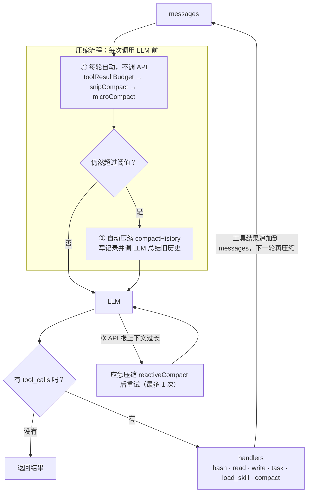

五种手段各司其职，且都通过 `apply()` 原地改写 `messages`：

| 机制 | 触发条件 | 核心动作 |
|---|---|---|
| `toolResultBudget`（L3） | 尾部工具结果总长超 200,000 | 超过 30,000 字符的结果落盘到 `.task_outputs/tool-results/`，只留路径与前 2,000 字符预览 |
| `snipCompact`（L1） | 消息超过 50 条 | 保留开头 3 条和最近一批，省略中间段，并避开孤立的 `tool` 结果 |
| `microCompact`（L2） | 工具结果超过 3 条 | 保留最近 3 条全文，更早且超 120 字符的结果换成一句占位提示 |
| `compactHistory`（L4） | 估算超 `CONTEXT_LIMIT` 或调用 `compact` | 全量写入 `.transcripts/`，再请模型总结成一条 `[Compacted]` 摘要 |
| `reactiveCompact`（应急） | API 报上下文过长 | 写入 `.transcripts/`，总结早期历史并保留最近几条消息后重试（限 1 次） |

说明两点教学边界。为了方便在终端观察自动压缩，本章把 `CONTEXT_LIMIT` 设为 `12000`，并用 JSON 字符串长度做近似估算（生产系统应改用 tokenizer 或接口返回的 usage）。摘要输入超过 80,000 字符时，`helper.js` 里的 `prepareHistoryForSummary()` 会同时保留稳定头部和最新尾部，避免丢掉初始约束或当前进度。

### 流程图

四层规则与应急路径的协作顺序：

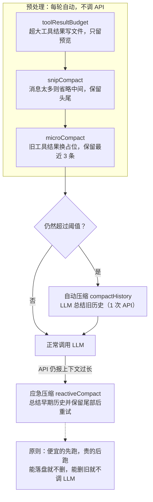

`toolResultBudget` 如何把超大工具结果挪到磁盘（`<persisted-output>` 是给模型看的结构标记）：

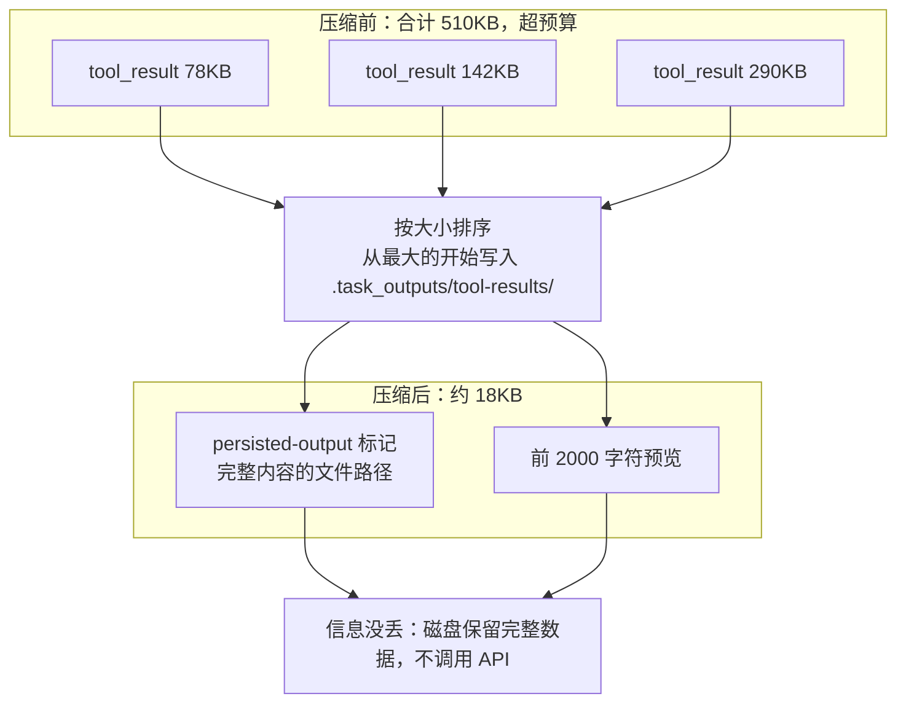

`microCompact` 如何收起较早的工具结果，只留最近 3 条全文：

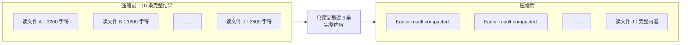

`compactHistory` 执行 LLM 摘要的三步法：

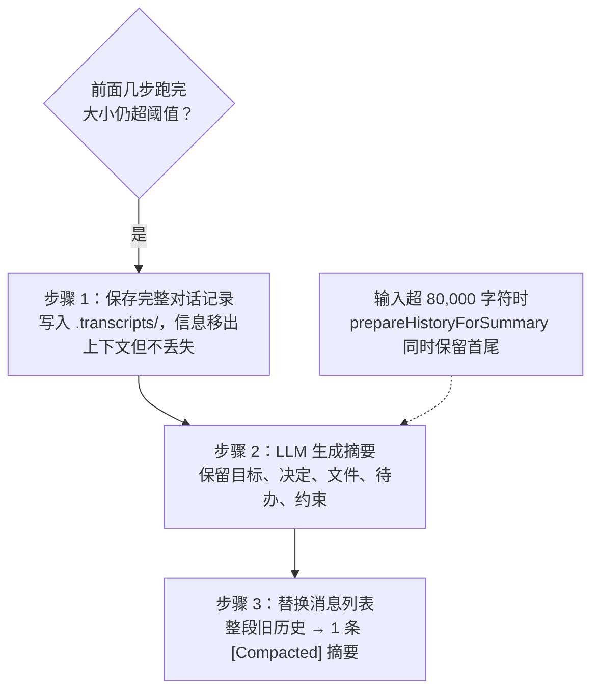

---

压缩时要把大输出和历史记录写到磁盘，所以先从 `node:fs` 补引 `mkdirSync` 和 `writeFileSync`，再从 `helper.js` 引入 `prepareHistoryForSummary`，它负责把过长的历史整理成首尾兼顾的摘要输入。这一步只做准备，行为不变。

本次代码变化：3 行。

```js ! agent.js range=1:26
// !focus(start)
import { readdirSync, readFileSync, existsSync, mkdirSync, writeFileSync } from "node:fs";
// !focus(end)
import path from "node:path";
import {
  callLlm,
  runBash,
  readFile,
  writeFile,
  editFile,
  glob,
  tool,
  runChatCli,
  isMainModule,
  parseFrontmatter,
// !focus(start)
  prepareHistoryForSummary,
// !focus(end)
} from "./helper.js";

const SKILLS_DIR = path.join(process.cwd(), "skills");

export function scanSkills(dir = SKILLS_DIR) {
  const registry = {};
  if (!existsSync(dir)) return registry;
  for (const entry of readdirSync(dir, { withFileTypes: true })) {
    if (!entry.isDirectory()) continue;
    const manifest = path.join(dir, entry.name, "SKILL.md");
    if (!existsSync(manifest)) continue;
    const raw = readFileSync(manifest, "utf8");
    const { meta } = parseFrontmatter(raw);
    const name = meta.name || entry.name;
    registry[name] = { name, description: meta.description || "", content: raw };
  }
  return registry;
}

export const skillRegistry = scanSkills();

function listSkills() {
  const all = Object.values(skillRegistry);
  return all.length ? all.map((s) => `- ${s.name}: ${s.description}`).join("\n") : "(no skills found)";
}

function loadSkill({ name }) {
  const skill = skillRegistry[name];
  return skill ? skill.content : `Skill not found: ${name}`;
}

const SYSTEM = `You are a coding agent at ${process.cwd()}. Use tools to solve tasks.
Before a multi-step task, use todo_write to plan and update status as you go.
For a complex sub-problem, use the task tool to spawn a subagent.
Skills available:
${listSkills()}
Use load_skill to get a skill's full content when you need it.`;
const SUB_SYSTEM = `You are a coding subagent at ${process.cwd()}. Complete the task, then return a concise summary. Do not delegate further.`;

const tools = [
  tool("bash", "Run a shell command.", {
    type: "object",
    properties: { command: { type: "string" } },
    required: ["command"],
  }),
  tool("read_file", "Read a file (optional line limit).", {
    type: "object",
    properties: { path: { type: "string" }, limit: { type: "integer" } },
    required: ["path"],
  }),
  tool("write_file", "Write content to a file.", {
    type: "object",
    properties: { path: { type: "string" }, content: { type: "string" } },
    required: ["path", "content"],
  }),
  tool("edit_file", "Replace exact text in a file once.", {
    type: "object",
    properties: {
      path: { type: "string" },
      old_text: { type: "string" },
      new_text: { type: "string" },
    },
    required: ["path", "old_text", "new_text"],
  }),
  tool("glob", "Find files by glob pattern.", {
    type: "object",
    properties: { pattern: { type: "string" } },
    required: ["pattern"],
  }),
  tool("todo_write", "Create and manage a task list for the current session.", {
    type: "object",
    properties: {
      todos: {
        type: "array",
        items: {
          type: "object",
          properties: {
            content: { type: "string" },
            status: { type: "string", enum: ["pending", "in_progress", "completed"] },
          },
          required: ["content", "status"],
        },
      },
    },
    required: ["todos"],
  }),
  tool("task", "Launch a subagent to handle a complex subtask. Returns only the final summary.", {
    type: "object",
    properties: { description: { type: "string" } },
    required: ["description"],
  }),
  tool("load_skill", "Load a skill's full content by name (see the catalog in the system prompt).", {
    type: "object",
    properties: { name: { type: "string" } },
    required: ["name"],
  }),
];

let currentTodos = [];
export function getTodos() {
  return currentTodos;
}

function runTodoWrite({ todos = [] }) {
  currentTodos = todos;
  const icon = { pending: " ", in_progress: "▸", completed: "✓" };
  console.log("## Current Tasks");
  for (const t of currentTodos) console.log(`  [${icon[t.status]}] ${t.content}`);
  return `Updated ${currentTodos.length} tasks`;
}

const handlers = {
  bash: ({ command }) => runBash(command),
  read_file: ({ path, limit }) => readFile(path, limit),
  write_file: ({ path, content }) => writeFile(path, content),
  edit_file: ({ path, old_text, new_text }) => editFile(path, old_text, new_text),
  glob: ({ pattern }) => glob(pattern),
  todo_write: runTodoWrite,
  task: ({ description }, confirm) => spawnSubagent(description, confirm),
  load_skill: loadSkill,
};

const SUB_EXCLUDE = ["task", "todo_write", "load_skill"];
const subTools = tools.filter((t) => !SUB_EXCLUDE.includes(t.function.name));
const subHandlers = Object.fromEntries(
  Object.entries(handlers).filter(([name]) => !SUB_EXCLUDE.includes(name)),
);
const MAX_SUB_TURNS = 30;

async function spawnSubagent(description, confirm) {
  const messages = [{ role: "user", content: description }];
  for (let turn = 0; turn < MAX_SUB_TURNS; turn += 1) {
    const { message } = await callLlm(messages, { system: SUB_SYSTEM, tools: subTools });
    messages.push(message);
    if (!message.tool_calls?.length) return message.content || "(subagent returned no text)";

    for (const call of message.tool_calls) {
      const name = call.function.name;
      const args = JSON.parse(call.function.arguments || "{}");
      const blocked = await triggerHooks("PreToolUse", name, args, confirm);
      const handler = subHandlers[name];
      const output =
        blocked != null ? String(blocked) : handler ? handler(args) : `Unknown tool: ${name}`;
      messages.push({ role: "tool", tool_call_id: call.id, content: String(output) });
    }
  }
  return "Subagent stopped after 30 turns without a final answer.";
}

export { spawnSubagent };

const hooks = { UserPromptSubmit: [], PreToolUse: [], PostToolUse: [], Stop: [] };

function registerHook(event, callback) {
  hooks[event].push(callback);
}

async function triggerHooks(event, ...args) {
  for (const callback of hooks[event]) {
    const result = await callback(...args);
    if (result != null) return result;
  }
  return null;
}

const DENY = ["rm -rf /", "sudo", "shutdown", "reboot", "mkfs", "dd if="];
const RISKY = ["rm ", "> /etc/", "chmod 777"];

async function permissionHook(name, args, confirm) {
  if (name !== "bash") return null;
  const command = args.command || "";
  if (DENY.some((p) => command.includes(p))) return "Permission denied: 命中黑名单。";
  if (RISKY.some((p) => command.includes(p))) {
    const answer = confirm ? await confirm(`⚠ 可能有破坏性的命令: ${command} 允许? [y/N] `) : "";
    if (!/^y(es)?$/i.test(String(answer).trim())) return "Permission denied by user.";
  }
  return null;
}

registerHook("PreToolUse", permissionHook);

export async function agentLoop(messages, confirm) {
  let roundsSinceTodo = 0;
  while (true) {
    if (roundsSinceTodo >= 3) {
      messages.push({ role: "user", content: "<reminder>Update your todos.</reminder>" });
      roundsSinceTodo = 0;
    }

    const { message } = await callLlm(messages, { system: SYSTEM, tools });

    if (!message.tool_calls?.length) {
      return message.content || "";
    }

    messages.push(message);
    roundsSinceTodo += 1;
    for (const call of message.tool_calls) {
      const name = call.function.name;
      const args = JSON.parse(call.function.arguments || "{}");

      const blocked = await triggerHooks("PreToolUse", name, args, confirm);
      let output;
      if (blocked != null) {
        output = String(blocked);
      } else {
        const handler = handlers[name];
        output = handler ? await handler(args, confirm) : `Unknown tool: ${name}`;
      }

      if (name === "todo_write") roundsSinceTodo = 0;
      messages.push({ role: "tool", tool_call_id: call.id, content: String(output) });
    }
  }
}

async function main() {
  await runChatCli({
    promptLabel: "s07 >> ",
    onPrompt: async ({ prompt, messages, ask }) => {
      return agentLoop(messages, ask);
    },
  });
}

if (isMainModule(import.meta.url)) {
  main().catch((error) => {
    console.error(error.message);
    process.exit(1);
  });
}
```

## !!steps
想做压缩，先要有尺子。`estimateSize` 用最直接的办法：把 `messages` 序列化成 JSON 字符串数字符数。`CONTEXT_LIMIT` 故意调低到 `12000`，方便在本地终端触发观察。`apply` 用 `splice` 原地替换数组内容，保证循环外持有 `messages` 引用的调用方也能看到最新历史。

本次代码变化：11 行。

```js ! agent.js range=38:66
import { readdirSync, readFileSync, existsSync, mkdirSync, writeFileSync } from "node:fs";
import path from "node:path";
import {
  callLlm,
  runBash,
  readFile,
  writeFile,
  editFile,
  glob,
  tool,
  runChatCli,
  isMainModule,
  parseFrontmatter,
  prepareHistoryForSummary,
} from "./helper.js";

const SKILLS_DIR = path.join(process.cwd(), "skills");

export function scanSkills(dir = SKILLS_DIR) {
  const registry = {};
  if (!existsSync(dir)) return registry;
  for (const entry of readdirSync(dir, { withFileTypes: true })) {
    if (!entry.isDirectory()) continue;
    const manifest = path.join(dir, entry.name, "SKILL.md");
    if (!existsSync(manifest)) continue;
    const raw = readFileSync(manifest, "utf8");
    const { meta } = parseFrontmatter(raw);
    const name = meta.name || entry.name;
    registry[name] = { name, description: meta.description || "", content: raw };
  }
  return registry;
}

export const skillRegistry = scanSkills();

function listSkills() {
  const all = Object.values(skillRegistry);
  return all.length ? all.map((s) => `- ${s.name}: ${s.description}`).join("\n") : "(no skills found)";
}

function loadSkill({ name }) {
  const skill = skillRegistry[name];
  return skill ? skill.content : `Skill not found: ${name}`;
}

// !focus(start)
const CONTEXT_LIMIT = 12000;

export const estimateSize = (messages) => JSON.stringify(messages).length;

const isToolResult = (m) => m.role === "tool";

function apply(messages, next) {
  if (next !== messages) messages.splice(0, messages.length, ...next);
  return messages;
}

// !focus(end)
const SYSTEM = `You are a coding agent at ${process.cwd()}. Use tools to solve tasks.
Before a multi-step task, use todo_write to plan and update status as you go.
For a complex sub-problem, use the task tool to spawn a subagent.
Skills available:
${listSkills()}
Use load_skill to get a skill's full content when you need it.`;
const SUB_SYSTEM = `You are a coding subagent at ${process.cwd()}. Complete the task, then return a concise summary. Do not delegate further.`;

const tools = [
  tool("bash", "Run a shell command.", {
    type: "object",
    properties: { command: { type: "string" } },
    required: ["command"],
  }),
  tool("read_file", "Read a file (optional line limit).", {
    type: "object",
    properties: { path: { type: "string" }, limit: { type: "integer" } },
    required: ["path"],
  }),
  tool("write_file", "Write content to a file.", {
    type: "object",
    properties: { path: { type: "string" }, content: { type: "string" } },
    required: ["path", "content"],
  }),
  tool("edit_file", "Replace exact text in a file once.", {
    type: "object",
    properties: {
      path: { type: "string" },
      old_text: { type: "string" },
      new_text: { type: "string" },
    },
    required: ["path", "old_text", "new_text"],
  }),
  tool("glob", "Find files by glob pattern.", {
    type: "object",
    properties: { pattern: { type: "string" } },
    required: ["pattern"],
  }),
  tool("todo_write", "Create and manage a task list for the current session.", {
    type: "object",
    properties: {
      todos: {
        type: "array",
        items: {
          type: "object",
          properties: {
            content: { type: "string" },
            status: { type: "string", enum: ["pending", "in_progress", "completed"] },
          },
          required: ["content", "status"],
        },
      },
    },
    required: ["todos"],
  }),
  tool("task", "Launch a subagent to handle a complex subtask. Returns only the final summary.", {
    type: "object",
    properties: { description: { type: "string" } },
    required: ["description"],
  }),
  tool("load_skill", "Load a skill's full content by name (see the catalog in the system prompt).", {
    type: "object",
    properties: { name: { type: "string" } },
    required: ["name"],
  }),
];

let currentTodos = [];
export function getTodos() {
  return currentTodos;
}

function runTodoWrite({ todos = [] }) {
  currentTodos = todos;
  const icon = { pending: " ", in_progress: "▸", completed: "✓" };
  console.log("## Current Tasks");
  for (const t of currentTodos) console.log(`  [${icon[t.status]}] ${t.content}`);
  return `Updated ${currentTodos.length} tasks`;
}

const handlers = {
  bash: ({ command }) => runBash(command),
  read_file: ({ path, limit }) => readFile(path, limit),
  write_file: ({ path, content }) => writeFile(path, content),
  edit_file: ({ path, old_text, new_text }) => editFile(path, old_text, new_text),
  glob: ({ pattern }) => glob(pattern),
  todo_write: runTodoWrite,
  task: ({ description }, confirm) => spawnSubagent(description, confirm),
  load_skill: loadSkill,
};

const SUB_EXCLUDE = ["task", "todo_write", "load_skill"];
const subTools = tools.filter((t) => !SUB_EXCLUDE.includes(t.function.name));
const subHandlers = Object.fromEntries(
  Object.entries(handlers).filter(([name]) => !SUB_EXCLUDE.includes(name)),
);
const MAX_SUB_TURNS = 30;

async function spawnSubagent(description, confirm) {
  const messages = [{ role: "user", content: description }];
  for (let turn = 0; turn < MAX_SUB_TURNS; turn += 1) {
    const { message } = await callLlm(messages, { system: SUB_SYSTEM, tools: subTools });
    messages.push(message);
    if (!message.tool_calls?.length) return message.content || "(subagent returned no text)";

    for (const call of message.tool_calls) {
      const name = call.function.name;
      const args = JSON.parse(call.function.arguments || "{}");
      const blocked = await triggerHooks("PreToolUse", name, args, confirm);
      const handler = subHandlers[name];
      const output =
        blocked != null ? String(blocked) : handler ? handler(args) : `Unknown tool: ${name}`;
      messages.push({ role: "tool", tool_call_id: call.id, content: String(output) });
    }
  }
  return "Subagent stopped after 30 turns without a final answer.";
}

export { spawnSubagent };

const hooks = { UserPromptSubmit: [], PreToolUse: [], PostToolUse: [], Stop: [] };

function registerHook(event, callback) {
  hooks[event].push(callback);
}

async function triggerHooks(event, ...args) {
  for (const callback of hooks[event]) {
    const result = await callback(...args);
    if (result != null) return result;
  }
  return null;
}

const DENY = ["rm -rf /", "sudo", "shutdown", "reboot", "mkfs", "dd if="];
const RISKY = ["rm ", "> /etc/", "chmod 777"];

async function permissionHook(name, args, confirm) {
  if (name !== "bash") return null;
  const command = args.command || "";
  if (DENY.some((p) => command.includes(p))) return "Permission denied: 命中黑名单。";
  if (RISKY.some((p) => command.includes(p))) {
    const answer = confirm ? await confirm(`⚠ 可能有破坏性的命令: ${command} 允许? [y/N] `) : "";
    if (!/^y(es)?$/i.test(String(answer).trim())) return "Permission denied by user.";
  }
  return null;
}

registerHook("PreToolUse", permissionHook);

export async function agentLoop(messages, confirm) {
  let roundsSinceTodo = 0;
  while (true) {
    if (roundsSinceTodo >= 3) {
      messages.push({ role: "user", content: "<reminder>Update your todos.</reminder>" });
      roundsSinceTodo = 0;
    }

    const { message } = await callLlm(messages, { system: SYSTEM, tools });

    if (!message.tool_calls?.length) {
      return message.content || "";
    }

    messages.push(message);
    roundsSinceTodo += 1;
    for (const call of message.tool_calls) {
      const name = call.function.name;
      const args = JSON.parse(call.function.arguments || "{}");

      const blocked = await triggerHooks("PreToolUse", name, args, confirm);
      let output;
      if (blocked != null) {
        output = String(blocked);
      } else {
        const handler = handlers[name];
        output = handler ? await handler(args, confirm) : `Unknown tool: ${name}`;
      }

      if (name === "todo_write") roundsSinceTodo = 0;
      messages.push({ role: "tool", tool_call_id: call.id, content: String(output) });
    }
  }
}

async function main() {
  await runChatCli({
    promptLabel: "s07 >> ",
    onPrompt: async ({ prompt, messages, ask }) => {
      return agentLoop(messages, ask);
    },
  });
}

if (isMainModule(import.meta.url)) {
  main().catch((error) => {
    console.error(error.message);
    process.exit(1);
  });
}
```

## !!steps
`snipCompact` 处理“条数太多”的问题：超过 50 条时保留开头 3 条和最近一批，中间换成一句省略提示。两个 `while` 很关键，它们保证切点不会拆开一次工具调用和它的返回结果，否则模型接口会报格式错。写完直接挂到 `agentLoop` 调用模型前，零 API 成本。

本次代码变化：16 行。

```js ! agent.js range=49:241
import { readdirSync, readFileSync, existsSync, mkdirSync, writeFileSync } from "node:fs";
import path from "node:path";
import {
  callLlm,
  runBash,
  readFile,
  writeFile,
  editFile,
  glob,
  tool,
  runChatCli,
  isMainModule,
  parseFrontmatter,
  prepareHistoryForSummary,
} from "./helper.js";

const SKILLS_DIR = path.join(process.cwd(), "skills");

export function scanSkills(dir = SKILLS_DIR) {
  const registry = {};
  if (!existsSync(dir)) return registry;
  for (const entry of readdirSync(dir, { withFileTypes: true })) {
    if (!entry.isDirectory()) continue;
    const manifest = path.join(dir, entry.name, "SKILL.md");
    if (!existsSync(manifest)) continue;
    const raw = readFileSync(manifest, "utf8");
    const { meta } = parseFrontmatter(raw);
    const name = meta.name || entry.name;
    registry[name] = { name, description: meta.description || "", content: raw };
  }
  return registry;
}

export const skillRegistry = scanSkills();

function listSkills() {
  const all = Object.values(skillRegistry);
  return all.length ? all.map((s) => `- ${s.name}: ${s.description}`).join("\n") : "(no skills found)";
}

function loadSkill({ name }) {
  const skill = skillRegistry[name];
  return skill ? skill.content : `Skill not found: ${name}`;
}

const CONTEXT_LIMIT = 12000;

export const estimateSize = (messages) => JSON.stringify(messages).length;

const isToolResult = (m) => m.role === "tool";

function apply(messages, next) {
  if (next !== messages) messages.splice(0, messages.length, ...next);
  return messages;
}

// !focus(start)
export function snipCompact(messages, maxMessages = 50) {
  if (messages.length <= maxMessages) return messages;
  let head = 3;
  let tail = messages.length - (maxMessages - 3);
  while (head < messages.length && isToolResult(messages[head])) head += 1;
  while (tail < messages.length && isToolResult(messages[tail])) tail += 1;
  if (head >= tail) return messages;
  return [
    ...messages.slice(0, head),
    { role: "user", content: `[snipped ${tail - head} messages from the middle]` },
    ...messages.slice(tail),
  ];
}

// !focus(end)
const SYSTEM = `You are a coding agent at ${process.cwd()}. Use tools to solve tasks.
Before a multi-step task, use todo_write to plan and update status as you go.
For a complex sub-problem, use the task tool to spawn a subagent.
Skills available:
${listSkills()}
Use load_skill to get a skill's full content when you need it.`;
const SUB_SYSTEM = `You are a coding subagent at ${process.cwd()}. Complete the task, then return a concise summary. Do not delegate further.`;

const tools = [
  tool("bash", "Run a shell command.", {
    type: "object",
    properties: { command: { type: "string" } },
    required: ["command"],
  }),
  tool("read_file", "Read a file (optional line limit).", {
    type: "object",
    properties: { path: { type: "string" }, limit: { type: "integer" } },
    required: ["path"],
  }),
  tool("write_file", "Write content to a file.", {
    type: "object",
    properties: { path: { type: "string" }, content: { type: "string" } },
    required: ["path", "content"],
  }),
  tool("edit_file", "Replace exact text in a file once.", {
    type: "object",
    properties: {
      path: { type: "string" },
      old_text: { type: "string" },
      new_text: { type: "string" },
    },
    required: ["path", "old_text", "new_text"],
  }),
  tool("glob", "Find files by glob pattern.", {
    type: "object",
    properties: { pattern: { type: "string" } },
    required: ["pattern"],
  }),
  tool("todo_write", "Create and manage a task list for the current session.", {
    type: "object",
    properties: {
      todos: {
        type: "array",
        items: {
          type: "object",
          properties: {
            content: { type: "string" },
            status: { type: "string", enum: ["pending", "in_progress", "completed"] },
          },
          required: ["content", "status"],
        },
      },
    },
    required: ["todos"],
  }),
  tool("task", "Launch a subagent to handle a complex subtask. Returns only the final summary.", {
    type: "object",
    properties: { description: { type: "string" } },
    required: ["description"],
  }),
  tool("load_skill", "Load a skill's full content by name (see the catalog in the system prompt).", {
    type: "object",
    properties: { name: { type: "string" } },
    required: ["name"],
  }),
];

let currentTodos = [];
export function getTodos() {
  return currentTodos;
}

function runTodoWrite({ todos = [] }) {
  currentTodos = todos;
  const icon = { pending: " ", in_progress: "▸", completed: "✓" };
  console.log("## Current Tasks");
  for (const t of currentTodos) console.log(`  [${icon[t.status]}] ${t.content}`);
  return `Updated ${currentTodos.length} tasks`;
}

const handlers = {
  bash: ({ command }) => runBash(command),
  read_file: ({ path, limit }) => readFile(path, limit),
  write_file: ({ path, content }) => writeFile(path, content),
  edit_file: ({ path, old_text, new_text }) => editFile(path, old_text, new_text),
  glob: ({ pattern }) => glob(pattern),
  todo_write: runTodoWrite,
  task: ({ description }, confirm) => spawnSubagent(description, confirm),
  load_skill: loadSkill,
};

const SUB_EXCLUDE = ["task", "todo_write", "load_skill"];
const subTools = tools.filter((t) => !SUB_EXCLUDE.includes(t.function.name));
const subHandlers = Object.fromEntries(
  Object.entries(handlers).filter(([name]) => !SUB_EXCLUDE.includes(name)),
);
const MAX_SUB_TURNS = 30;

async function spawnSubagent(description, confirm) {
  const messages = [{ role: "user", content: description }];
  for (let turn = 0; turn < MAX_SUB_TURNS; turn += 1) {
    const { message } = await callLlm(messages, { system: SUB_SYSTEM, tools: subTools });
    messages.push(message);
    if (!message.tool_calls?.length) return message.content || "(subagent returned no text)";

    for (const call of message.tool_calls) {
      const name = call.function.name;
      const args = JSON.parse(call.function.arguments || "{}");
      const blocked = await triggerHooks("PreToolUse", name, args, confirm);
      const handler = subHandlers[name];
      const output =
        blocked != null ? String(blocked) : handler ? handler(args) : `Unknown tool: ${name}`;
      messages.push({ role: "tool", tool_call_id: call.id, content: String(output) });
    }
  }
  return "Subagent stopped after 30 turns without a final answer.";
}

export { spawnSubagent };

const hooks = { UserPromptSubmit: [], PreToolUse: [], PostToolUse: [], Stop: [] };

function registerHook(event, callback) {
  hooks[event].push(callback);
}

async function triggerHooks(event, ...args) {
  for (const callback of hooks[event]) {
    const result = await callback(...args);
    if (result != null) return result;
  }
  return null;
}

const DENY = ["rm -rf /", "sudo", "shutdown", "reboot", "mkfs", "dd if="];
const RISKY = ["rm ", "> /etc/", "chmod 777"];

async function permissionHook(name, args, confirm) {
  if (name !== "bash") return null;
  const command = args.command || "";
  if (DENY.some((p) => command.includes(p))) return "Permission denied: 命中黑名单。";
  if (RISKY.some((p) => command.includes(p))) {
    const answer = confirm ? await confirm(`⚠ 可能有破坏性的命令: ${command} 允许? [y/N] `) : "";
    if (!/^y(es)?$/i.test(String(answer).trim())) return "Permission denied by user.";
  }
  return null;
}

registerHook("PreToolUse", permissionHook);

export async function agentLoop(messages, confirm) {
  let roundsSinceTodo = 0;
  while (true) {
    if (roundsSinceTodo >= 3) {
      messages.push({ role: "user", content: "<reminder>Update your todos.</reminder>" });
      roundsSinceTodo = 0;
    }
// !focus(start)

    apply(messages, snipCompact(messages));
// !focus(end)

    const { message } = await callLlm(messages, { system: SYSTEM, tools });

    if (!message.tool_calls?.length) {
      return message.content || "";
    }

    messages.push(message);
    roundsSinceTodo += 1;
    for (const call of message.tool_calls) {
      const name = call.function.name;
      const args = JSON.parse(call.function.arguments || "{}");

      const blocked = await triggerHooks("PreToolUse", name, args, confirm);
      let output;
      if (blocked != null) {
        output = String(blocked);
      } else {
        const handler = handlers[name];
        output = handler ? await handler(args, confirm) : `Unknown tool: ${name}`;
      }

      if (name === "todo_write") roundsSinceTodo = 0;
      messages.push({ role: "tool", tool_call_id: call.id, content: String(output) });
    }
  }
}

async function main() {
  await runChatCli({
    promptLabel: "s07 >> ",
    onPrompt: async ({ prompt, messages, ask }) => {
      return agentLoop(messages, ask);
    },
  });
}

if (isMainModule(import.meta.url)) {
  main().catch((error) => {
    console.error(error.message);
    process.exit(1);
  });
}
```

## !!steps
对话里最占地方的往往是工具输出，而模型通常只关心最近几次结果。`microCompact` 保留最近 3 条工具结果的全文，更早且超过 120 字符的内容全部换成一句占位提示。消息条数和角色配对不变，只是把旧内容收短。

本次代码变化：11 行。

```js ! agent.js range=39:254
import { readdirSync, readFileSync, existsSync, mkdirSync, writeFileSync } from "node:fs";
import path from "node:path";
import {
  callLlm,
  runBash,
  readFile,
  writeFile,
  editFile,
  glob,
  tool,
  runChatCli,
  isMainModule,
  parseFrontmatter,
  prepareHistoryForSummary,
} from "./helper.js";

const SKILLS_DIR = path.join(process.cwd(), "skills");

export function scanSkills(dir = SKILLS_DIR) {
  const registry = {};
  if (!existsSync(dir)) return registry;
  for (const entry of readdirSync(dir, { withFileTypes: true })) {
    if (!entry.isDirectory()) continue;
    const manifest = path.join(dir, entry.name, "SKILL.md");
    if (!existsSync(manifest)) continue;
    const raw = readFileSync(manifest, "utf8");
    const { meta } = parseFrontmatter(raw);
    const name = meta.name || entry.name;
    registry[name] = { name, description: meta.description || "", content: raw };
  }
  return registry;
}

export const skillRegistry = scanSkills();

function listSkills() {
  const all = Object.values(skillRegistry);
  return all.length ? all.map((s) => `- ${s.name}: ${s.description}`).join("\n") : "(no skills found)";
}

function loadSkill({ name }) {
  const skill = skillRegistry[name];
  return skill ? skill.content : `Skill not found: ${name}`;
}

const CONTEXT_LIMIT = 12000;
// !focus(start)
const KEEP_RECENT = 3;
// !focus(end)

export const estimateSize = (messages) => JSON.stringify(messages).length;

const isToolResult = (m) => m.role === "tool";

function apply(messages, next) {
  if (next !== messages) messages.splice(0, messages.length, ...next);
  return messages;
}

export function snipCompact(messages, maxMessages = 50) {
  if (messages.length <= maxMessages) return messages;
  let head = 3;
  let tail = messages.length - (maxMessages - 3);
  while (head < messages.length && isToolResult(messages[head])) head += 1;
  while (tail < messages.length && isToolResult(messages[tail])) tail += 1;
  if (head >= tail) return messages;
  return [
    ...messages.slice(0, head),
    { role: "user", content: `[snipped ${tail - head} messages from the middle]` },
    ...messages.slice(tail),
  ];
}

// !focus(start)
export function microCompact(messages) {
  const toolMsgs = messages.filter(isToolResult);
  if (toolMsgs.length <= KEEP_RECENT) return messages;
  for (const m of toolMsgs.slice(0, -KEEP_RECENT)) {
    if (m.content.length > 120) m.content = "[Earlier tool result compacted. Re-run if needed.]";
  }
  return messages;
}

// !focus(end)
const SYSTEM = `You are a coding agent at ${process.cwd()}. Use tools to solve tasks.
Before a multi-step task, use todo_write to plan and update status as you go.
For a complex sub-problem, use the task tool to spawn a subagent.
Skills available:
${listSkills()}
Use load_skill to get a skill's full content when you need it.`;
const SUB_SYSTEM = `You are a coding subagent at ${process.cwd()}. Complete the task, then return a concise summary. Do not delegate further.`;

const tools = [
  tool("bash", "Run a shell command.", {
    type: "object",
    properties: { command: { type: "string" } },
    required: ["command"],
  }),
  tool("read_file", "Read a file (optional line limit).", {
    type: "object",
    properties: { path: { type: "string" }, limit: { type: "integer" } },
    required: ["path"],
  }),
  tool("write_file", "Write content to a file.", {
    type: "object",
    properties: { path: { type: "string" }, content: { type: "string" } },
    required: ["path", "content"],
  }),
  tool("edit_file", "Replace exact text in a file once.", {
    type: "object",
    properties: {
      path: { type: "string" },
      old_text: { type: "string" },
      new_text: { type: "string" },
    },
    required: ["path", "old_text", "new_text"],
  }),
  tool("glob", "Find files by glob pattern.", {
    type: "object",
    properties: { pattern: { type: "string" } },
    required: ["pattern"],
  }),
  tool("todo_write", "Create and manage a task list for the current session.", {
    type: "object",
    properties: {
      todos: {
        type: "array",
        items: {
          type: "object",
          properties: {
            content: { type: "string" },
            status: { type: "string", enum: ["pending", "in_progress", "completed"] },
          },
          required: ["content", "status"],
        },
      },
    },
    required: ["todos"],
  }),
  tool("task", "Launch a subagent to handle a complex subtask. Returns only the final summary.", {
    type: "object",
    properties: { description: { type: "string" } },
    required: ["description"],
  }),
  tool("load_skill", "Load a skill's full content by name (see the catalog in the system prompt).", {
    type: "object",
    properties: { name: { type: "string" } },
    required: ["name"],
  }),
];

let currentTodos = [];
export function getTodos() {
  return currentTodos;
}

function runTodoWrite({ todos = [] }) {
  currentTodos = todos;
  const icon = { pending: " ", in_progress: "▸", completed: "✓" };
  console.log("## Current Tasks");
  for (const t of currentTodos) console.log(`  [${icon[t.status]}] ${t.content}`);
  return `Updated ${currentTodos.length} tasks`;
}

const handlers = {
  bash: ({ command }) => runBash(command),
  read_file: ({ path, limit }) => readFile(path, limit),
  write_file: ({ path, content }) => writeFile(path, content),
  edit_file: ({ path, old_text, new_text }) => editFile(path, old_text, new_text),
  glob: ({ pattern }) => glob(pattern),
  todo_write: runTodoWrite,
  task: ({ description }, confirm) => spawnSubagent(description, confirm),
  load_skill: loadSkill,
};

const SUB_EXCLUDE = ["task", "todo_write", "load_skill"];
const subTools = tools.filter((t) => !SUB_EXCLUDE.includes(t.function.name));
const subHandlers = Object.fromEntries(
  Object.entries(handlers).filter(([name]) => !SUB_EXCLUDE.includes(name)),
);
const MAX_SUB_TURNS = 30;

async function spawnSubagent(description, confirm) {
  const messages = [{ role: "user", content: description }];
  for (let turn = 0; turn < MAX_SUB_TURNS; turn += 1) {
    const { message } = await callLlm(messages, { system: SUB_SYSTEM, tools: subTools });
    messages.push(message);
    if (!message.tool_calls?.length) return message.content || "(subagent returned no text)";

    for (const call of message.tool_calls) {
      const name = call.function.name;
      const args = JSON.parse(call.function.arguments || "{}");
      const blocked = await triggerHooks("PreToolUse", name, args, confirm);
      const handler = subHandlers[name];
      const output =
        blocked != null ? String(blocked) : handler ? handler(args) : `Unknown tool: ${name}`;
      messages.push({ role: "tool", tool_call_id: call.id, content: String(output) });
    }
  }
  return "Subagent stopped after 30 turns without a final answer.";
}

export { spawnSubagent };

const hooks = { UserPromptSubmit: [], PreToolUse: [], PostToolUse: [], Stop: [] };

function registerHook(event, callback) {
  hooks[event].push(callback);
}

async function triggerHooks(event, ...args) {
  for (const callback of hooks[event]) {
    const result = await callback(...args);
    if (result != null) return result;
  }
  return null;
}

const DENY = ["rm -rf /", "sudo", "shutdown", "reboot", "mkfs", "dd if="];
const RISKY = ["rm ", "> /etc/", "chmod 777"];

async function permissionHook(name, args, confirm) {
  if (name !== "bash") return null;
  const command = args.command || "";
  if (DENY.some((p) => command.includes(p))) return "Permission denied: 命中黑名单。";
  if (RISKY.some((p) => command.includes(p))) {
    const answer = confirm ? await confirm(`⚠ 可能有破坏性的命令: ${command} 允许? [y/N] `) : "";
    if (!/^y(es)?$/i.test(String(answer).trim())) return "Permission denied by user.";
  }
  return null;
}

registerHook("PreToolUse", permissionHook);

export async function agentLoop(messages, confirm) {
  let roundsSinceTodo = 0;
  while (true) {
    if (roundsSinceTodo >= 3) {
      messages.push({ role: "user", content: "<reminder>Update your todos.</reminder>" });
      roundsSinceTodo = 0;
    }

    apply(messages, snipCompact(messages));
// !focus(start)
    apply(messages, microCompact(messages));
// !focus(end)

    const { message } = await callLlm(messages, { system: SYSTEM, tools });

    if (!message.tool_calls?.length) {
      return message.content || "";
    }

    messages.push(message);
    roundsSinceTodo += 1;
    for (const call of message.tool_calls) {
      const name = call.function.name;
      const args = JSON.parse(call.function.arguments || "{}");

      const blocked = await triggerHooks("PreToolUse", name, args, confirm);
      let output;
      if (blocked != null) {
        output = String(blocked);
      } else {
        const handler = handlers[name];
        output = handler ? await handler(args, confirm) : `Unknown tool: ${name}`;
      }

      if (name === "todo_write") roundsSinceTodo = 0;
      messages.push({ role: "tool", tool_call_id: call.id, content: String(output) });
    }
  }
}

async function main() {
  await runChatCli({
    promptLabel: "s07 >> ",
    onPrompt: async ({ prompt, messages, ask }) => {
      return agentLoop(messages, ask);
    },
  });
}

if (isMainModule(import.meta.url)) {
  main().catch((error) => {
    console.error(error.message);
    process.exit(1);
  });
}
```

## !!steps
有时单条工具输出就有几万字符。`toolResultBudget` 检查最近一批连续工具结果的总长度，超过预算时从最大的一条开始调用 `persistLargeOutput` 写入 `.task_outputs/tool-results/`，上下文里只留文件路径和前 2000 字符预览。模型真要看全文时，自己调 `read_file` 就行。在循环里把它排在最前，先把大块头挪走。

本次代码变化：27 行。

```js ! agent.js range=38:281
import { readdirSync, readFileSync, existsSync, mkdirSync, writeFileSync } from "node:fs";
import path from "node:path";
import {
  callLlm,
  runBash,
  readFile,
  writeFile,
  editFile,
  glob,
  tool,
  runChatCli,
  isMainModule,
  parseFrontmatter,
  prepareHistoryForSummary,
} from "./helper.js";

const SKILLS_DIR = path.join(process.cwd(), "skills");

export function scanSkills(dir = SKILLS_DIR) {
  const registry = {};
  if (!existsSync(dir)) return registry;
  for (const entry of readdirSync(dir, { withFileTypes: true })) {
    if (!entry.isDirectory()) continue;
    const manifest = path.join(dir, entry.name, "SKILL.md");
    if (!existsSync(manifest)) continue;
    const raw = readFileSync(manifest, "utf8");
    const { meta } = parseFrontmatter(raw);
    const name = meta.name || entry.name;
    registry[name] = { name, description: meta.description || "", content: raw };
  }
  return registry;
}

export const skillRegistry = scanSkills();

function listSkills() {
  const all = Object.values(skillRegistry);
  return all.length ? all.map((s) => `- ${s.name}: ${s.description}`).join("\n") : "(no skills found)";
}

function loadSkill({ name }) {
  const skill = skillRegistry[name];
  return skill ? skill.content : `Skill not found: ${name}`;
}

// !focus(start)
const TOOL_RESULTS_DIR = path.join(process.cwd(), ".task_outputs", "tool-results");

// !focus(end)
const CONTEXT_LIMIT = 12000;
const KEEP_RECENT = 3;
// !focus(start)
const PERSIST_THRESHOLD = 30000;
// !focus(end)

export const estimateSize = (messages) => JSON.stringify(messages).length;

const isToolResult = (m) => m.role === "tool";

function apply(messages, next) {
  if (next !== messages) messages.splice(0, messages.length, ...next);
  return messages;
}

export function snipCompact(messages, maxMessages = 50) {
  if (messages.length <= maxMessages) return messages;
  let head = 3;
  let tail = messages.length - (maxMessages - 3);
  while (head < messages.length && isToolResult(messages[head])) head += 1;
  while (tail < messages.length && isToolResult(messages[tail])) tail += 1;
  if (head >= tail) return messages;
  return [
    ...messages.slice(0, head),
    { role: "user", content: `[snipped ${tail - head} messages from the middle]` },
    ...messages.slice(tail),
  ];
}

export function microCompact(messages) {
  const toolMsgs = messages.filter(isToolResult);
  if (toolMsgs.length <= KEEP_RECENT) return messages;
  for (const m of toolMsgs.slice(0, -KEEP_RECENT)) {
    if (m.content.length > 120) m.content = "[Earlier tool result compacted. Re-run if needed.]";
  }
  return messages;
}

// !focus(start)
function persistLargeOutput(id, output) {
  if (output.length <= PERSIST_THRESHOLD) return output;
  mkdirSync(TOOL_RESULTS_DIR, { recursive: true });
  const file = path.join(TOOL_RESULTS_DIR, `${id}.txt`);
  if (!existsSync(file)) writeFileSync(file, output);
  return `<persisted-output>\nFull output: ${file}\nPreview:\n${output.slice(0, 2000)}\n</persisted-output>`;
}

export function toolResultBudget(messages, maxBytes = 200000) {
  const tail = [];
  for (let i = messages.length - 1; i >= 0 && isToolResult(messages[i]); i -= 1) tail.push(messages[i]);
  let total = tail.reduce((n, m) => n + m.content.length, 0);
  if (total <= maxBytes) return messages;
  for (const m of [...tail].sort((a, b) => b.content.length - a.content.length)) {
    if (total <= maxBytes) break;
    if (m.content.length <= PERSIST_THRESHOLD) continue;
    const before = m.content.length;
    m.content = persistLargeOutput(m.tool_call_id, m.content);
    total -= before - m.content.length;
  }
  return messages;
}

// !focus(end)
const SYSTEM = `You are a coding agent at ${process.cwd()}. Use tools to solve tasks.
Before a multi-step task, use todo_write to plan and update status as you go.
For a complex sub-problem, use the task tool to spawn a subagent.
Skills available:
${listSkills()}
Use load_skill to get a skill's full content when you need it.`;
const SUB_SYSTEM = `You are a coding subagent at ${process.cwd()}. Complete the task, then return a concise summary. Do not delegate further.`;

const tools = [
  tool("bash", "Run a shell command.", {
    type: "object",
    properties: { command: { type: "string" } },
    required: ["command"],
  }),
  tool("read_file", "Read a file (optional line limit).", {
    type: "object",
    properties: { path: { type: "string" }, limit: { type: "integer" } },
    required: ["path"],
  }),
  tool("write_file", "Write content to a file.", {
    type: "object",
    properties: { path: { type: "string" }, content: { type: "string" } },
    required: ["path", "content"],
  }),
  tool("edit_file", "Replace exact text in a file once.", {
    type: "object",
    properties: {
      path: { type: "string" },
      old_text: { type: "string" },
      new_text: { type: "string" },
    },
    required: ["path", "old_text", "new_text"],
  }),
  tool("glob", "Find files by glob pattern.", {
    type: "object",
    properties: { pattern: { type: "string" } },
    required: ["pattern"],
  }),
  tool("todo_write", "Create and manage a task list for the current session.", {
    type: "object",
    properties: {
      todos: {
        type: "array",
        items: {
          type: "object",
          properties: {
            content: { type: "string" },
            status: { type: "string", enum: ["pending", "in_progress", "completed"] },
          },
          required: ["content", "status"],
        },
      },
    },
    required: ["todos"],
  }),
  tool("task", "Launch a subagent to handle a complex subtask. Returns only the final summary.", {
    type: "object",
    properties: { description: { type: "string" } },
    required: ["description"],
  }),
  tool("load_skill", "Load a skill's full content by name (see the catalog in the system prompt).", {
    type: "object",
    properties: { name: { type: "string" } },
    required: ["name"],
  }),
];

let currentTodos = [];
export function getTodos() {
  return currentTodos;
}

function runTodoWrite({ todos = [] }) {
  currentTodos = todos;
  const icon = { pending: " ", in_progress: "▸", completed: "✓" };
  console.log("## Current Tasks");
  for (const t of currentTodos) console.log(`  [${icon[t.status]}] ${t.content}`);
  return `Updated ${currentTodos.length} tasks`;
}

const handlers = {
  bash: ({ command }) => runBash(command),
  read_file: ({ path, limit }) => readFile(path, limit),
  write_file: ({ path, content }) => writeFile(path, content),
  edit_file: ({ path, old_text, new_text }) => editFile(path, old_text, new_text),
  glob: ({ pattern }) => glob(pattern),
  todo_write: runTodoWrite,
  task: ({ description }, confirm) => spawnSubagent(description, confirm),
  load_skill: loadSkill,
};

const SUB_EXCLUDE = ["task", "todo_write", "load_skill"];
const subTools = tools.filter((t) => !SUB_EXCLUDE.includes(t.function.name));
const subHandlers = Object.fromEntries(
  Object.entries(handlers).filter(([name]) => !SUB_EXCLUDE.includes(name)),
);
const MAX_SUB_TURNS = 30;

async function spawnSubagent(description, confirm) {
  const messages = [{ role: "user", content: description }];
  for (let turn = 0; turn < MAX_SUB_TURNS; turn += 1) {
    const { message } = await callLlm(messages, { system: SUB_SYSTEM, tools: subTools });
    messages.push(message);
    if (!message.tool_calls?.length) return message.content || "(subagent returned no text)";

    for (const call of message.tool_calls) {
      const name = call.function.name;
      const args = JSON.parse(call.function.arguments || "{}");
      const blocked = await triggerHooks("PreToolUse", name, args, confirm);
      const handler = subHandlers[name];
      const output =
        blocked != null ? String(blocked) : handler ? handler(args) : `Unknown tool: ${name}`;
      messages.push({ role: "tool", tool_call_id: call.id, content: String(output) });
    }
  }
  return "Subagent stopped after 30 turns without a final answer.";
}

export { spawnSubagent };

const hooks = { UserPromptSubmit: [], PreToolUse: [], PostToolUse: [], Stop: [] };

function registerHook(event, callback) {
  hooks[event].push(callback);
}

async function triggerHooks(event, ...args) {
  for (const callback of hooks[event]) {
    const result = await callback(...args);
    if (result != null) return result;
  }
  return null;
}

const DENY = ["rm -rf /", "sudo", "shutdown", "reboot", "mkfs", "dd if="];
const RISKY = ["rm ", "> /etc/", "chmod 777"];

async function permissionHook(name, args, confirm) {
  if (name !== "bash") return null;
  const command = args.command || "";
  if (DENY.some((p) => command.includes(p))) return "Permission denied: 命中黑名单。";
  if (RISKY.some((p) => command.includes(p))) {
    const answer = confirm ? await confirm(`⚠ 可能有破坏性的命令: ${command} 允许? [y/N] `) : "";
    if (!/^y(es)?$/i.test(String(answer).trim())) return "Permission denied by user.";
  }
  return null;
}

registerHook("PreToolUse", permissionHook);

export async function agentLoop(messages, confirm) {
  let roundsSinceTodo = 0;
  while (true) {
    if (roundsSinceTodo >= 3) {
      messages.push({ role: "user", content: "<reminder>Update your todos.</reminder>" });
      roundsSinceTodo = 0;
    }

// !focus(start)
    apply(messages, toolResultBudget(messages));
// !focus(end)
    apply(messages, snipCompact(messages));
    apply(messages, microCompact(messages));

    const { message } = await callLlm(messages, { system: SYSTEM, tools });

    if (!message.tool_calls?.length) {
      return message.content || "";
    }

    messages.push(message);
    roundsSinceTodo += 1;
    for (const call of message.tool_calls) {
      const name = call.function.name;
      const args = JSON.parse(call.function.arguments || "{}");

      const blocked = await triggerHooks("PreToolUse", name, args, confirm);
      let output;
      if (blocked != null) {
        output = String(blocked);
      } else {
        const handler = handlers[name];
        output = handler ? await handler(args, confirm) : `Unknown tool: ${name}`;
      }

      if (name === "todo_write") roundsSinceTodo = 0;
      messages.push({ role: "tool", tool_call_id: call.id, content: String(output) });
    }
  }
}

async function main() {
  await runChatCli({
    promptLabel: "s07 >> ",
    onPrompt: async ({ prompt, messages, ask }) => {
      return agentLoop(messages, ask);
    },
  });
}

if (isMainModule(import.meta.url)) {
  main().catch((error) => {
    console.error(error.message);
    process.exit(1);
  });
}
```

## !!steps
前三层都不花 API 费用。如果跑完仍然超过 `CONTEXT_LIMIT`，再启动 `compactHistory`：先把完整对话存成 JSONL 放进 `.transcripts/` 留档，再调一次模型提炼当前目标、关键决定、涉及文件、剩余工作和用户约束，用一条 `[Compacted]` 消息替换整段历史。

本次代码变化：28 行。

```js ! agent.js range=38:309
import { readdirSync, readFileSync, existsSync, mkdirSync, writeFileSync } from "node:fs";
import path from "node:path";
import {
  callLlm,
  runBash,
  readFile,
  writeFile,
  editFile,
  glob,
  tool,
  runChatCli,
  isMainModule,
  parseFrontmatter,
  prepareHistoryForSummary,
} from "./helper.js";

const SKILLS_DIR = path.join(process.cwd(), "skills");

export function scanSkills(dir = SKILLS_DIR) {
  const registry = {};
  if (!existsSync(dir)) return registry;
  for (const entry of readdirSync(dir, { withFileTypes: true })) {
    if (!entry.isDirectory()) continue;
    const manifest = path.join(dir, entry.name, "SKILL.md");
    if (!existsSync(manifest)) continue;
    const raw = readFileSync(manifest, "utf8");
    const { meta } = parseFrontmatter(raw);
    const name = meta.name || entry.name;
    registry[name] = { name, description: meta.description || "", content: raw };
  }
  return registry;
}

export const skillRegistry = scanSkills();

function listSkills() {
  const all = Object.values(skillRegistry);
  return all.length ? all.map((s) => `- ${s.name}: ${s.description}`).join("\n") : "(no skills found)";
}

function loadSkill({ name }) {
  const skill = skillRegistry[name];
  return skill ? skill.content : `Skill not found: ${name}`;
}

// !focus(start)
const TRANSCRIPT_DIR = path.join(process.cwd(), ".transcripts");
// !focus(end)
const TOOL_RESULTS_DIR = path.join(process.cwd(), ".task_outputs", "tool-results");

const CONTEXT_LIMIT = 12000;
const KEEP_RECENT = 3;
const PERSIST_THRESHOLD = 30000;

export const estimateSize = (messages) => JSON.stringify(messages).length;

const isToolResult = (m) => m.role === "tool";

function apply(messages, next) {
  if (next !== messages) messages.splice(0, messages.length, ...next);
  return messages;
}

export function snipCompact(messages, maxMessages = 50) {
  if (messages.length <= maxMessages) return messages;
  let head = 3;
  let tail = messages.length - (maxMessages - 3);
  while (head < messages.length && isToolResult(messages[head])) head += 1;
  while (tail < messages.length && isToolResult(messages[tail])) tail += 1;
  if (head >= tail) return messages;
  return [
    ...messages.slice(0, head),
    { role: "user", content: `[snipped ${tail - head} messages from the middle]` },
    ...messages.slice(tail),
  ];
}

export function microCompact(messages) {
  const toolMsgs = messages.filter(isToolResult);
  if (toolMsgs.length <= KEEP_RECENT) return messages;
  for (const m of toolMsgs.slice(0, -KEEP_RECENT)) {
    if (m.content.length > 120) m.content = "[Earlier tool result compacted. Re-run if needed.]";
  }
  return messages;
}

function persistLargeOutput(id, output) {
  if (output.length <= PERSIST_THRESHOLD) return output;
  mkdirSync(TOOL_RESULTS_DIR, { recursive: true });
  const file = path.join(TOOL_RESULTS_DIR, `${id}.txt`);
  if (!existsSync(file)) writeFileSync(file, output);
  return `<persisted-output>\nFull output: ${file}\nPreview:\n${output.slice(0, 2000)}\n</persisted-output>`;
}

export function toolResultBudget(messages, maxBytes = 200000) {
  const tail = [];
  for (let i = messages.length - 1; i >= 0 && isToolResult(messages[i]); i -= 1) tail.push(messages[i]);
  let total = tail.reduce((n, m) => n + m.content.length, 0);
  if (total <= maxBytes) return messages;
  for (const m of [...tail].sort((a, b) => b.content.length - a.content.length)) {
    if (total <= maxBytes) break;
    if (m.content.length <= PERSIST_THRESHOLD) continue;
    const before = m.content.length;
    m.content = persistLargeOutput(m.tool_call_id, m.content);
    total -= before - m.content.length;
  }
  return messages;
}

// !focus(start)
function writeTranscript(messages) {
  mkdirSync(TRANSCRIPT_DIR, { recursive: true });
  const file = path.join(TRANSCRIPT_DIR, `transcript-${Date.now()}.jsonl`);
  writeFileSync(file, messages.map((m) => JSON.stringify(m)).join("\n"));
  return file;
}

async function summarizeHistory(messages) {
  const conversation = prepareHistoryForSummary(messages);
  const prompt = `Summarize this coding-agent conversation so work can continue.
Preserve: 1) current goal, 2) key findings/decisions, 3) files read/changed, 4) remaining work, 5) user constraints.
Be compact but concrete.

${conversation}`;
  const { message } = await callLlm([{ role: "user", content: prompt }], {});
  return (message.content || "").trim() || "(empty summary)";
}

export async function compactHistory(messages) {
  writeTranscript(messages);
  const summary = await summarizeHistory(messages);
  return [{ role: "user", content: `[Compacted]\n\n${summary}` }];
}

// !focus(end)
const SYSTEM = `You are a coding agent at ${process.cwd()}. Use tools to solve tasks.
Before a multi-step task, use todo_write to plan and update status as you go.
For a complex sub-problem, use the task tool to spawn a subagent.
Skills available:
${listSkills()}
Use load_skill to get a skill's full content when you need it.`;
const SUB_SYSTEM = `You are a coding subagent at ${process.cwd()}. Complete the task, then return a concise summary. Do not delegate further.`;

const tools = [
  tool("bash", "Run a shell command.", {
    type: "object",
    properties: { command: { type: "string" } },
    required: ["command"],
  }),
  tool("read_file", "Read a file (optional line limit).", {
    type: "object",
    properties: { path: { type: "string" }, limit: { type: "integer" } },
    required: ["path"],
  }),
  tool("write_file", "Write content to a file.", {
    type: "object",
    properties: { path: { type: "string" }, content: { type: "string" } },
    required: ["path", "content"],
  }),
  tool("edit_file", "Replace exact text in a file once.", {
    type: "object",
    properties: {
      path: { type: "string" },
      old_text: { type: "string" },
      new_text: { type: "string" },
    },
    required: ["path", "old_text", "new_text"],
  }),
  tool("glob", "Find files by glob pattern.", {
    type: "object",
    properties: { pattern: { type: "string" } },
    required: ["pattern"],
  }),
  tool("todo_write", "Create and manage a task list for the current session.", {
    type: "object",
    properties: {
      todos: {
        type: "array",
        items: {
          type: "object",
          properties: {
            content: { type: "string" },
            status: { type: "string", enum: ["pending", "in_progress", "completed"] },
          },
          required: ["content", "status"],
        },
      },
    },
    required: ["todos"],
  }),
  tool("task", "Launch a subagent to handle a complex subtask. Returns only the final summary.", {
    type: "object",
    properties: { description: { type: "string" } },
    required: ["description"],
  }),
  tool("load_skill", "Load a skill's full content by name (see the catalog in the system prompt).", {
    type: "object",
    properties: { name: { type: "string" } },
    required: ["name"],
  }),
];

let currentTodos = [];
export function getTodos() {
  return currentTodos;
}

function runTodoWrite({ todos = [] }) {
  currentTodos = todos;
  const icon = { pending: " ", in_progress: "▸", completed: "✓" };
  console.log("## Current Tasks");
  for (const t of currentTodos) console.log(`  [${icon[t.status]}] ${t.content}`);
  return `Updated ${currentTodos.length} tasks`;
}

const handlers = {
  bash: ({ command }) => runBash(command),
  read_file: ({ path, limit }) => readFile(path, limit),
  write_file: ({ path, content }) => writeFile(path, content),
  edit_file: ({ path, old_text, new_text }) => editFile(path, old_text, new_text),
  glob: ({ pattern }) => glob(pattern),
  todo_write: runTodoWrite,
  task: ({ description }, confirm) => spawnSubagent(description, confirm),
  load_skill: loadSkill,
};

const SUB_EXCLUDE = ["task", "todo_write", "load_skill"];
const subTools = tools.filter((t) => !SUB_EXCLUDE.includes(t.function.name));
const subHandlers = Object.fromEntries(
  Object.entries(handlers).filter(([name]) => !SUB_EXCLUDE.includes(name)),
);
const MAX_SUB_TURNS = 30;

async function spawnSubagent(description, confirm) {
  const messages = [{ role: "user", content: description }];
  for (let turn = 0; turn < MAX_SUB_TURNS; turn += 1) {
    const { message } = await callLlm(messages, { system: SUB_SYSTEM, tools: subTools });
    messages.push(message);
    if (!message.tool_calls?.length) return message.content || "(subagent returned no text)";

    for (const call of message.tool_calls) {
      const name = call.function.name;
      const args = JSON.parse(call.function.arguments || "{}");
      const blocked = await triggerHooks("PreToolUse", name, args, confirm);
      const handler = subHandlers[name];
      const output =
        blocked != null ? String(blocked) : handler ? handler(args) : `Unknown tool: ${name}`;
      messages.push({ role: "tool", tool_call_id: call.id, content: String(output) });
    }
  }
  return "Subagent stopped after 30 turns without a final answer.";
}

export { spawnSubagent };

const hooks = { UserPromptSubmit: [], PreToolUse: [], PostToolUse: [], Stop: [] };

function registerHook(event, callback) {
  hooks[event].push(callback);
}

async function triggerHooks(event, ...args) {
  for (const callback of hooks[event]) {
    const result = await callback(...args);
    if (result != null) return result;
  }
  return null;
}

const DENY = ["rm -rf /", "sudo", "shutdown", "reboot", "mkfs", "dd if="];
const RISKY = ["rm ", "> /etc/", "chmod 777"];

async function permissionHook(name, args, confirm) {
  if (name !== "bash") return null;
  const command = args.command || "";
  if (DENY.some((p) => command.includes(p))) return "Permission denied: 命中黑名单。";
  if (RISKY.some((p) => command.includes(p))) {
    const answer = confirm ? await confirm(`⚠ 可能有破坏性的命令: ${command} 允许? [y/N] `) : "";
    if (!/^y(es)?$/i.test(String(answer).trim())) return "Permission denied by user.";
  }
  return null;
}

registerHook("PreToolUse", permissionHook);

export async function agentLoop(messages, confirm) {
  let roundsSinceTodo = 0;
  while (true) {
    if (roundsSinceTodo >= 3) {
      messages.push({ role: "user", content: "<reminder>Update your todos.</reminder>" });
      roundsSinceTodo = 0;
    }

    apply(messages, toolResultBudget(messages));
    apply(messages, snipCompact(messages));
    apply(messages, microCompact(messages));
// !focus(start)
    if (estimateSize(messages) > CONTEXT_LIMIT) {
      apply(messages, await compactHistory(messages));
    }
// !focus(end)

    const { message } = await callLlm(messages, { system: SYSTEM, tools });

    if (!message.tool_calls?.length) {
      return message.content || "";
    }

    messages.push(message);
    roundsSinceTodo += 1;
    for (const call of message.tool_calls) {
      const name = call.function.name;
      const args = JSON.parse(call.function.arguments || "{}");

      const blocked = await triggerHooks("PreToolUse", name, args, confirm);
      let output;
      if (blocked != null) {
        output = String(blocked);
      } else {
        const handler = handlers[name];
        output = handler ? await handler(args, confirm) : `Unknown tool: ${name}`;
      }

      if (name === "todo_write") roundsSinceTodo = 0;
      messages.push({ role: "tool", tool_call_id: call.id, content: String(output) });
    }
  }
}

async function main() {
  await runChatCli({
    promptLabel: "s07 >> ",
    onPrompt: async ({ prompt, messages, ask }) => {
      return agentLoop(messages, ask);
    },
  });
}

if (isMainModule(import.meta.url)) {
  main().catch((error) => {
    console.error(error.message);
    process.exit(1);
  });
}
```

## !!steps
字符数估算只是近似，有时请求发出去才被接口拒收，报“prompt too long”。我们把 `callLlm` 包进 `try/catch`：命中超限错误时，用 `reactiveCompact` 把前面的历史总结成 `[Reactive compact]` 并保留最后几条消息，然后重跑本轮。`MAX_REACTIVE_RETRIES = 1` 保证最多兜底一次，避免无限循环。

本次代码变化：26 行。

```js ! agent.js range=44:337
import { readdirSync, readFileSync, existsSync, mkdirSync, writeFileSync } from "node:fs";
import path from "node:path";
import {
  callLlm,
  runBash,
  readFile,
  writeFile,
  editFile,
  glob,
  tool,
  runChatCli,
  isMainModule,
  parseFrontmatter,
  prepareHistoryForSummary,
} from "./helper.js";

const SKILLS_DIR = path.join(process.cwd(), "skills");

export function scanSkills(dir = SKILLS_DIR) {
  const registry = {};
  if (!existsSync(dir)) return registry;
  for (const entry of readdirSync(dir, { withFileTypes: true })) {
    if (!entry.isDirectory()) continue;
    const manifest = path.join(dir, entry.name, "SKILL.md");
    if (!existsSync(manifest)) continue;
    const raw = readFileSync(manifest, "utf8");
    const { meta } = parseFrontmatter(raw);
    const name = meta.name || entry.name;
    registry[name] = { name, description: meta.description || "", content: raw };
  }
  return registry;
}

export const skillRegistry = scanSkills();

function listSkills() {
  const all = Object.values(skillRegistry);
  return all.length ? all.map((s) => `- ${s.name}: ${s.description}`).join("\n") : "(no skills found)";
}

function loadSkill({ name }) {
  const skill = skillRegistry[name];
  return skill ? skill.content : `Skill not found: ${name}`;
}

const TRANSCRIPT_DIR = path.join(process.cwd(), ".transcripts");
const TOOL_RESULTS_DIR = path.join(process.cwd(), ".task_outputs", "tool-results");

const CONTEXT_LIMIT = 12000;
const KEEP_RECENT = 3;
const PERSIST_THRESHOLD = 30000;
// !focus(start)
const MAX_REACTIVE_RETRIES = 1;
// !focus(end)

export const estimateSize = (messages) => JSON.stringify(messages).length;

const isToolResult = (m) => m.role === "tool";

function apply(messages, next) {
  if (next !== messages) messages.splice(0, messages.length, ...next);
  return messages;
}

export function snipCompact(messages, maxMessages = 50) {
  if (messages.length <= maxMessages) return messages;
  let head = 3;
  let tail = messages.length - (maxMessages - 3);
  while (head < messages.length && isToolResult(messages[head])) head += 1;
  while (tail < messages.length && isToolResult(messages[tail])) tail += 1;
  if (head >= tail) return messages;
  return [
    ...messages.slice(0, head),
    { role: "user", content: `[snipped ${tail - head} messages from the middle]` },
    ...messages.slice(tail),
  ];
}

export function microCompact(messages) {
  const toolMsgs = messages.filter(isToolResult);
  if (toolMsgs.length <= KEEP_RECENT) return messages;
  for (const m of toolMsgs.slice(0, -KEEP_RECENT)) {
    if (m.content.length > 120) m.content = "[Earlier tool result compacted. Re-run if needed.]";
  }
  return messages;
}

function persistLargeOutput(id, output) {
  if (output.length <= PERSIST_THRESHOLD) return output;
  mkdirSync(TOOL_RESULTS_DIR, { recursive: true });
  const file = path.join(TOOL_RESULTS_DIR, `${id}.txt`);
  if (!existsSync(file)) writeFileSync(file, output);
  return `<persisted-output>\nFull output: ${file}\nPreview:\n${output.slice(0, 2000)}\n</persisted-output>`;
}

export function toolResultBudget(messages, maxBytes = 200000) {
  const tail = [];
  for (let i = messages.length - 1; i >= 0 && isToolResult(messages[i]); i -= 1) tail.push(messages[i]);
  let total = tail.reduce((n, m) => n + m.content.length, 0);
  if (total <= maxBytes) return messages;
  for (const m of [...tail].sort((a, b) => b.content.length - a.content.length)) {
    if (total <= maxBytes) break;
    if (m.content.length <= PERSIST_THRESHOLD) continue;
    const before = m.content.length;
    m.content = persistLargeOutput(m.tool_call_id, m.content);
    total -= before - m.content.length;
  }
  return messages;
}

function writeTranscript(messages) {
  mkdirSync(TRANSCRIPT_DIR, { recursive: true });
  const file = path.join(TRANSCRIPT_DIR, `transcript-${Date.now()}.jsonl`);
  writeFileSync(file, messages.map((m) => JSON.stringify(m)).join("\n"));
  return file;
}

async function summarizeHistory(messages) {
  const conversation = prepareHistoryForSummary(messages);
  const prompt = `Summarize this coding-agent conversation so work can continue.
Preserve: 1) current goal, 2) key findings/decisions, 3) files read/changed, 4) remaining work, 5) user constraints.
Be compact but concrete.

${conversation}`;
  const { message } = await callLlm([{ role: "user", content: prompt }], {});
  return (message.content || "").trim() || "(empty summary)";
}

export async function compactHistory(messages) {
  writeTranscript(messages);
  const summary = await summarizeHistory(messages);
  return [{ role: "user", content: `[Compacted]\n\n${summary}` }];
}

// !focus(start)
export async function reactiveCompact(messages) {
  writeTranscript(messages);
  let tail = Math.max(0, messages.length - 5);
  while (tail < messages.length && isToolResult(messages[tail])) tail += 1;
  const summary = await summarizeHistory(messages.slice(0, tail));
  return [{ role: "user", content: `[Reactive compact]\n\n${summary}` }, ...messages.slice(tail)];
}

const isPromptTooLong = (error) =>
  /prompt.*too.*long|too many tokens|context.*length/i.test(String(error.message));

// !focus(end)
const SYSTEM = `You are a coding agent at ${process.cwd()}. Use tools to solve tasks.
Before a multi-step task, use todo_write to plan and update status as you go.
For a complex sub-problem, use the task tool to spawn a subagent.
Skills available:
${listSkills()}
Use load_skill to get a skill's full content when you need it.`;
const SUB_SYSTEM = `You are a coding subagent at ${process.cwd()}. Complete the task, then return a concise summary. Do not delegate further.`;

const tools = [
  tool("bash", "Run a shell command.", {
    type: "object",
    properties: { command: { type: "string" } },
    required: ["command"],
  }),
  tool("read_file", "Read a file (optional line limit).", {
    type: "object",
    properties: { path: { type: "string" }, limit: { type: "integer" } },
    required: ["path"],
  }),
  tool("write_file", "Write content to a file.", {
    type: "object",
    properties: { path: { type: "string" }, content: { type: "string" } },
    required: ["path", "content"],
  }),
  tool("edit_file", "Replace exact text in a file once.", {
    type: "object",
    properties: {
      path: { type: "string" },
      old_text: { type: "string" },
      new_text: { type: "string" },
    },
    required: ["path", "old_text", "new_text"],
  }),
  tool("glob", "Find files by glob pattern.", {
    type: "object",
    properties: { pattern: { type: "string" } },
    required: ["pattern"],
  }),
  tool("todo_write", "Create and manage a task list for the current session.", {
    type: "object",
    properties: {
      todos: {
        type: "array",
        items: {
          type: "object",
          properties: {
            content: { type: "string" },
            status: { type: "string", enum: ["pending", "in_progress", "completed"] },
          },
          required: ["content", "status"],
        },
      },
    },
    required: ["todos"],
  }),
  tool("task", "Launch a subagent to handle a complex subtask. Returns only the final summary.", {
    type: "object",
    properties: { description: { type: "string" } },
    required: ["description"],
  }),
  tool("load_skill", "Load a skill's full content by name (see the catalog in the system prompt).", {
    type: "object",
    properties: { name: { type: "string" } },
    required: ["name"],
  }),
];

let currentTodos = [];
export function getTodos() {
  return currentTodos;
}

function runTodoWrite({ todos = [] }) {
  currentTodos = todos;
  const icon = { pending: " ", in_progress: "▸", completed: "✓" };
  console.log("## Current Tasks");
  for (const t of currentTodos) console.log(`  [${icon[t.status]}] ${t.content}`);
  return `Updated ${currentTodos.length} tasks`;
}

const handlers = {
  bash: ({ command }) => runBash(command),
  read_file: ({ path, limit }) => readFile(path, limit),
  write_file: ({ path, content }) => writeFile(path, content),
  edit_file: ({ path, old_text, new_text }) => editFile(path, old_text, new_text),
  glob: ({ pattern }) => glob(pattern),
  todo_write: runTodoWrite,
  task: ({ description }, confirm) => spawnSubagent(description, confirm),
  load_skill: loadSkill,
};

const SUB_EXCLUDE = ["task", "todo_write", "load_skill"];
const subTools = tools.filter((t) => !SUB_EXCLUDE.includes(t.function.name));
const subHandlers = Object.fromEntries(
  Object.entries(handlers).filter(([name]) => !SUB_EXCLUDE.includes(name)),
);
const MAX_SUB_TURNS = 30;

async function spawnSubagent(description, confirm) {
  const messages = [{ role: "user", content: description }];
  for (let turn = 0; turn < MAX_SUB_TURNS; turn += 1) {
    const { message } = await callLlm(messages, { system: SUB_SYSTEM, tools: subTools });
    messages.push(message);
    if (!message.tool_calls?.length) return message.content || "(subagent returned no text)";

    for (const call of message.tool_calls) {
      const name = call.function.name;
      const args = JSON.parse(call.function.arguments || "{}");
      const blocked = await triggerHooks("PreToolUse", name, args, confirm);
      const handler = subHandlers[name];
      const output =
        blocked != null ? String(blocked) : handler ? handler(args) : `Unknown tool: ${name}`;
      messages.push({ role: "tool", tool_call_id: call.id, content: String(output) });
    }
  }
  return "Subagent stopped after 30 turns without a final answer.";
}

export { spawnSubagent };

const hooks = { UserPromptSubmit: [], PreToolUse: [], PostToolUse: [], Stop: [] };

function registerHook(event, callback) {
  hooks[event].push(callback);
}

async function triggerHooks(event, ...args) {
  for (const callback of hooks[event]) {
    const result = await callback(...args);
    if (result != null) return result;
  }
  return null;
}

const DENY = ["rm -rf /", "sudo", "shutdown", "reboot", "mkfs", "dd if="];
const RISKY = ["rm ", "> /etc/", "chmod 777"];

async function permissionHook(name, args, confirm) {
  if (name !== "bash") return null;
  const command = args.command || "";
  if (DENY.some((p) => command.includes(p))) return "Permission denied: 命中黑名单。";
  if (RISKY.some((p) => command.includes(p))) {
    const answer = confirm ? await confirm(`⚠ 可能有破坏性的命令: ${command} 允许? [y/N] `) : "";
    if (!/^y(es)?$/i.test(String(answer).trim())) return "Permission denied by user.";
  }
  return null;
}

registerHook("PreToolUse", permissionHook);

export async function agentLoop(messages, confirm) {
  let roundsSinceTodo = 0;
// !focus(start)
  let reactiveRetries = 0;
// !focus(end)
  while (true) {
    if (roundsSinceTodo >= 3) {
      messages.push({ role: "user", content: "<reminder>Update your todos.</reminder>" });
      roundsSinceTodo = 0;
    }

    apply(messages, toolResultBudget(messages));
    apply(messages, snipCompact(messages));
    apply(messages, microCompact(messages));
    if (estimateSize(messages) > CONTEXT_LIMIT) {
      apply(messages, await compactHistory(messages));
    }

// !focus(start)
    let message;
    try {
      ({ message } = await callLlm(messages, { system: SYSTEM, tools }));
      reactiveRetries = 0;
    } catch (error) {
      if (reactiveRetries < MAX_REACTIVE_RETRIES && isPromptTooLong(error)) {
        apply(messages, await reactiveCompact(messages));
        reactiveRetries += 1;
        continue;
      }
      throw error;
    }
// !focus(end)

    if (!message.tool_calls?.length) {
      return message.content || "";
    }

    messages.push(message);
    roundsSinceTodo += 1;
    for (const call of message.tool_calls) {
      const name = call.function.name;
      const args = JSON.parse(call.function.arguments || "{}");

      const blocked = await triggerHooks("PreToolUse", name, args, confirm);
      let output;
      if (blocked != null) {
        output = String(blocked);
      } else {
        const handler = handlers[name];
        output = handler ? await handler(args, confirm) : `Unknown tool: ${name}`;
      }

      if (name === "todo_write") roundsSinceTodo = 0;
      messages.push({ role: "tool", tool_call_id: call.id, content: String(output) });
    }
  }
}

async function main() {
  await runChatCli({
    promptLabel: "s07 >> ",
    onPrompt: async ({ prompt, messages, ask }) => {
      return agentLoop(messages, ask);
    },
  });
}

if (isMainModule(import.meta.url)) {
  main().catch((error) => {
    console.error(error.message);
    process.exit(1);
  });
}
```

## !!steps
再加一个 `compact` 工具，让模型在觉得历史太长时主动整理上下文。它不放进 `handlers`，因为压缩要替换整份 `messages`，必须由主循环接管：收到 `compact` 调用就执行 `compactHistory`，跳过本批剩余工具调用，立刻用摘要进入下一轮。顺手更新 `SYSTEM`、`SUB_EXCLUDE` 和 `s08 >> ` 提示符。

本次代码变化：19 行。

```js ! agent.js range=136:385
import { readdirSync, readFileSync, existsSync, mkdirSync, writeFileSync } from "node:fs";
import path from "node:path";
import {
  callLlm,
  runBash,
  readFile,
  writeFile,
  editFile,
  glob,
  tool,
  runChatCli,
  isMainModule,
  parseFrontmatter,
  prepareHistoryForSummary,
} from "./helper.js";

const SKILLS_DIR = path.join(process.cwd(), "skills");

export function scanSkills(dir = SKILLS_DIR) {
  const registry = {};
  if (!existsSync(dir)) return registry;
  for (const entry of readdirSync(dir, { withFileTypes: true })) {
    if (!entry.isDirectory()) continue;
    const manifest = path.join(dir, entry.name, "SKILL.md");
    if (!existsSync(manifest)) continue;
    const raw = readFileSync(manifest, "utf8");
    const { meta } = parseFrontmatter(raw);
    const name = meta.name || entry.name;
    registry[name] = { name, description: meta.description || "", content: raw };
  }
  return registry;
}

export const skillRegistry = scanSkills();

function listSkills() {
  const all = Object.values(skillRegistry);
  return all.length ? all.map((s) => `- ${s.name}: ${s.description}`).join("\n") : "(no skills found)";
}

function loadSkill({ name }) {
  const skill = skillRegistry[name];
  return skill ? skill.content : `Skill not found: ${name}`;
}

const TRANSCRIPT_DIR = path.join(process.cwd(), ".transcripts");
const TOOL_RESULTS_DIR = path.join(process.cwd(), ".task_outputs", "tool-results");

const CONTEXT_LIMIT = 12000;
const KEEP_RECENT = 3;
const PERSIST_THRESHOLD = 30000;
const MAX_REACTIVE_RETRIES = 1;

export const estimateSize = (messages) => JSON.stringify(messages).length;

const isToolResult = (m) => m.role === "tool";

function apply(messages, next) {
  if (next !== messages) messages.splice(0, messages.length, ...next);
  return messages;
}

export function snipCompact(messages, maxMessages = 50) {
  if (messages.length <= maxMessages) return messages;
  let head = 3;
  let tail = messages.length - (maxMessages - 3);
  while (head < messages.length && isToolResult(messages[head])) head += 1;
  while (tail < messages.length && isToolResult(messages[tail])) tail += 1;
  if (head >= tail) return messages;
  return [
    ...messages.slice(0, head),
    { role: "user", content: `[snipped ${tail - head} messages from the middle]` },
    ...messages.slice(tail),
  ];
}

export function microCompact(messages) {
  const toolMsgs = messages.filter(isToolResult);
  if (toolMsgs.length <= KEEP_RECENT) return messages;
  for (const m of toolMsgs.slice(0, -KEEP_RECENT)) {
    if (m.content.length > 120) m.content = "[Earlier tool result compacted. Re-run if needed.]";
  }
  return messages;
}

function persistLargeOutput(id, output) {
  if (output.length <= PERSIST_THRESHOLD) return output;
  mkdirSync(TOOL_RESULTS_DIR, { recursive: true });
  const file = path.join(TOOL_RESULTS_DIR, `${id}.txt`);
  if (!existsSync(file)) writeFileSync(file, output);
  return `<persisted-output>\nFull output: ${file}\nPreview:\n${output.slice(0, 2000)}\n</persisted-output>`;
}

export function toolResultBudget(messages, maxBytes = 200000) {
  const tail = [];
  for (let i = messages.length - 1; i >= 0 && isToolResult(messages[i]); i -= 1) tail.push(messages[i]);
  let total = tail.reduce((n, m) => n + m.content.length, 0);
  if (total <= maxBytes) return messages;
  for (const m of [...tail].sort((a, b) => b.content.length - a.content.length)) {
    if (total <= maxBytes) break;
    if (m.content.length <= PERSIST_THRESHOLD) continue;
    const before = m.content.length;
    m.content = persistLargeOutput(m.tool_call_id, m.content);
    total -= before - m.content.length;
  }
  return messages;
}

function writeTranscript(messages) {
  mkdirSync(TRANSCRIPT_DIR, { recursive: true });
  const file = path.join(TRANSCRIPT_DIR, `transcript-${Date.now()}.jsonl`);
  writeFileSync(file, messages.map((m) => JSON.stringify(m)).join("\n"));
  return file;
}

async function summarizeHistory(messages) {
  const conversation = prepareHistoryForSummary(messages);
  const prompt = `Summarize this coding-agent conversation so work can continue.
Preserve: 1) current goal, 2) key findings/decisions, 3) files read/changed, 4) remaining work, 5) user constraints.
Be compact but concrete.

${conversation}`;
  const { message } = await callLlm([{ role: "user", content: prompt }], {});
  return (message.content || "").trim() || "(empty summary)";
}

export async function compactHistory(messages) {
  writeTranscript(messages);
  const summary = await summarizeHistory(messages);
  return [{ role: "user", content: `[Compacted]\n\n${summary}` }];
}

export async function reactiveCompact(messages) {
  writeTranscript(messages);
  let tail = Math.max(0, messages.length - 5);
  while (tail < messages.length && isToolResult(messages[tail])) tail += 1;
  const summary = await summarizeHistory(messages.slice(0, tail));
  return [{ role: "user", content: `[Reactive compact]\n\n${summary}` }, ...messages.slice(tail)];
}

const isPromptTooLong = (error) =>
  /prompt.*too.*long|too many tokens|context.*length/i.test(String(error.message));

// !focus(start)
const SYSTEM = `You are a coding agent at ${process.cwd()}. Use tools to solve tasks.
Before a multi-step task, use todo_write to plan and update status as you go.
For a complex sub-problem, use the task tool to spawn a subagent.
Skills available:
${listSkills()}
Use load_skill to get a skill's full content when you need it.
When context gets large, call compact to summarize earlier work and free space.`;
// !focus(end)
const SUB_SYSTEM = `You are a coding subagent at ${process.cwd()}. Complete the task, then return a concise summary. Do not delegate further.`;

const tools = [
  tool("bash", "Run a shell command.", {
    type: "object",
    properties: { command: { type: "string" } },
    required: ["command"],
  }),
  tool("read_file", "Read a file (optional line limit).", {
    type: "object",
    properties: { path: { type: "string" }, limit: { type: "integer" } },
    required: ["path"],
  }),
  tool("write_file", "Write content to a file.", {
    type: "object",
    properties: { path: { type: "string" }, content: { type: "string" } },
    required: ["path", "content"],
  }),
  tool("edit_file", "Replace exact text in a file once.", {
    type: "object",
    properties: {
      path: { type: "string" },
      old_text: { type: "string" },
      new_text: { type: "string" },
    },
    required: ["path", "old_text", "new_text"],
  }),
  tool("glob", "Find files by glob pattern.", {
    type: "object",
    properties: { pattern: { type: "string" } },
    required: ["pattern"],
  }),
  tool("todo_write", "Create and manage a task list for the current session.", {
    type: "object",
    properties: {
      todos: {
        type: "array",
        items: {
          type: "object",
          properties: {
            content: { type: "string" },
            status: { type: "string", enum: ["pending", "in_progress", "completed"] },
          },
          required: ["content", "status"],
        },
      },
    },
    required: ["todos"],
  }),
  tool("task", "Launch a subagent to handle a complex subtask. Returns only the final summary.", {
    type: "object",
    properties: { description: { type: "string" } },
    required: ["description"],
  }),
  tool("load_skill", "Load a skill's full content by name (see the catalog in the system prompt).", {
    type: "object",
    properties: { name: { type: "string" } },
    required: ["name"],
  }),
// !focus(start)
  tool("compact", "Summarize earlier conversation to free context space.", {
    type: "object",
    properties: { focus: { type: "string" } },
  }),
// !focus(end)
];

let currentTodos = [];
export function getTodos() {
  return currentTodos;
}

function runTodoWrite({ todos = [] }) {
  currentTodos = todos;
  const icon = { pending: " ", in_progress: "▸", completed: "✓" };
  console.log("## Current Tasks");
  for (const t of currentTodos) console.log(`  [${icon[t.status]}] ${t.content}`);
  return `Updated ${currentTodos.length} tasks`;
}

const handlers = {
  bash: ({ command }) => runBash(command),
  read_file: ({ path, limit }) => readFile(path, limit),
  write_file: ({ path, content }) => writeFile(path, content),
  edit_file: ({ path, old_text, new_text }) => editFile(path, old_text, new_text),
  glob: ({ pattern }) => glob(pattern),
  todo_write: runTodoWrite,
  task: ({ description }, confirm) => spawnSubagent(description, confirm),
  load_skill: loadSkill,
};

// !focus(start)
const SUB_EXCLUDE = ["task", "todo_write", "load_skill", "compact"];
// !focus(end)
const subTools = tools.filter((t) => !SUB_EXCLUDE.includes(t.function.name));
const subHandlers = Object.fromEntries(
  Object.entries(handlers).filter(([name]) => !SUB_EXCLUDE.includes(name)),
);
const MAX_SUB_TURNS = 30;

async function spawnSubagent(description, confirm) {
  const messages = [{ role: "user", content: description }];
  for (let turn = 0; turn < MAX_SUB_TURNS; turn += 1) {
    const { message } = await callLlm(messages, { system: SUB_SYSTEM, tools: subTools });
    messages.push(message);
    if (!message.tool_calls?.length) return message.content || "(subagent returned no text)";

    for (const call of message.tool_calls) {
      const name = call.function.name;
      const args = JSON.parse(call.function.arguments || "{}");
      const blocked = await triggerHooks("PreToolUse", name, args, confirm);
      const handler = subHandlers[name];
      const output =
        blocked != null ? String(blocked) : handler ? handler(args) : `Unknown tool: ${name}`;
      messages.push({ role: "tool", tool_call_id: call.id, content: String(output) });
    }
  }
  return "Subagent stopped after 30 turns without a final answer.";
}

export { spawnSubagent };

const hooks = { UserPromptSubmit: [], PreToolUse: [], PostToolUse: [], Stop: [] };

function registerHook(event, callback) {
  hooks[event].push(callback);
}

async function triggerHooks(event, ...args) {
  for (const callback of hooks[event]) {
    const result = await callback(...args);
    if (result != null) return result;
  }
  return null;
}

const DENY = ["rm -rf /", "sudo", "shutdown", "reboot", "mkfs", "dd if="];
const RISKY = ["rm ", "> /etc/", "chmod 777"];

async function permissionHook(name, args, confirm) {
  if (name !== "bash") return null;
  const command = args.command || "";
  if (DENY.some((p) => command.includes(p))) return "Permission denied: 命中黑名单。";
  if (RISKY.some((p) => command.includes(p))) {
    const answer = confirm ? await confirm(`⚠ 可能有破坏性的命令: ${command} 允许? [y/N] `) : "";
    if (!/^y(es)?$/i.test(String(answer).trim())) return "Permission denied by user.";
  }
  return null;
}

registerHook("PreToolUse", permissionHook);

export async function agentLoop(messages, confirm) {
  let roundsSinceTodo = 0;
  let reactiveRetries = 0;
  while (true) {
    if (roundsSinceTodo >= 3) {
      messages.push({ role: "user", content: "<reminder>Update your todos.</reminder>" });
      roundsSinceTodo = 0;
    }

    apply(messages, toolResultBudget(messages));
    apply(messages, snipCompact(messages));
    apply(messages, microCompact(messages));
    if (estimateSize(messages) > CONTEXT_LIMIT) {
      apply(messages, await compactHistory(messages));
    }

    let message;
    try {
      ({ message } = await callLlm(messages, { system: SYSTEM, tools }));
      reactiveRetries = 0;
    } catch (error) {
      if (reactiveRetries < MAX_REACTIVE_RETRIES && isPromptTooLong(error)) {
        apply(messages, await reactiveCompact(messages));
        reactiveRetries += 1;
        continue;
      }
      throw error;
    }

    if (!message.tool_calls?.length) {
      return message.content || "";
    }

    messages.push(message);
    roundsSinceTodo += 1;
// !focus(start)
    let compacted = false;
// !focus(end)
    for (const call of message.tool_calls) {
      const name = call.function.name;
      const args = JSON.parse(call.function.arguments || "{}");

// !focus(start)
      if (name === "compact") {
        apply(messages, await compactHistory(messages));
        compacted = true;
        break;
      }

// !focus(end)
      const blocked = await triggerHooks("PreToolUse", name, args, confirm);
      let output;
      if (blocked != null) {
        output = String(blocked);
      } else {
        const handler = handlers[name];
        output = handler ? await handler(args, confirm) : `Unknown tool: ${name}`;
      }

      if (name === "todo_write") roundsSinceTodo = 0;
      messages.push({ role: "tool", tool_call_id: call.id, content: String(output) });
    }
// !focus(start)
    if (compacted) continue;
// !focus(end)
  }
}

async function main() {
  await runChatCli({
// !focus(start)
    promptLabel: "s08 >> ",
// !focus(end)
    onPrompt: async ({ prompt, messages, ask }) => {
      return agentLoop(messages, ask);
    },
  });
}

if (isMainModule(import.meta.url)) {
  main().catch((error) => {
    console.error(error.message);
    process.exit(1);
  });
}
```

## !!steps
压缩默认悄悄发生，不打印就看不出走的是哪条分支。最后给三种触发模型摘要的入口各补一行日志：`[auto compact]` 对应超阈值自动压缩，`[reactive compact]` 对应超限应急压缩，`[manual compact]` 对应模型主动调用。运行时一眼就能看到是哪一档在工作。

本次代码变化：3 行。

### 测试 Prompt

在同一个 CLI 会话里依次输入下面三条 Prompt：

```text
读取 helper.js 的前 200 行，然后主动 compact，再总结你仍然记得哪些关键信息。
```

```text
不要调用任何工具。请输出一段很长的中文说明，主题是“agent loop 为什么需要上下文压缩”，至少 9000 个汉字，分成 30 段，每段都以 MEMORY_BLOCK 开头，最后写 LONG_CONTEXT_DONE。
```

```text
不要调用 bash。请告诉我：你是否还能记得上一轮的主题，以及当前对话为什么需要上下文压缩。
```

第一条会触发 `[manual compact] compactHistory`，第二条输出后下一轮会触发 `[auto compact] compactHistory`，同时 `.transcripts/` 下会留下完整 JSONL 对话记录，而第三条里模型依然能接着回答核心问题。

### 扩展阅读：商业级 Agent 怎么做上下文压缩

从公开文档和开源代码看，成熟产品的上下文压缩会收敛到同一套原则：自动与手动并存、先剪大工具输出、再摘要旧历史，同时提前给压缩留出缓冲空间。

- **Claude Code**：默认开启 `autoCompactEnabled`，也支持 `/compact` 手动触发，并提供 `PreCompact` / `PostCompact` Hook（入参标明 `auto` 或 `manual`），把压缩当成可观测、可审计的生命周期事件。参考 [Claude Code settings](https://code.claude.com/docs/en/settings) 与 [Claude Code hooks](https://code.claude.com/docs/en/hooks)。
- **Codex**：提供 `/compact` 命令，并通过 `model_auto_compact_token_limit` 和 `model_context_window` 把压缩阈值与模型窗口绑定成配置，而不是写死常量。参考 [Codex slash commands](https://developers.openai.com/codex/cli/slash-commands) 与 [Codex config reference](https://developers.openai.com/codex/config-reference)。
- **opencode**：用 `compaction.auto`、`compaction.prune`、`compaction.reserved` 三项分别控制自动压缩、清理旧工具输出和预留压缩空间，避免窗口彻底塞满时连摘要请求都塞不进去。参考 [opencode compaction config](https://opencode.ai/docs/config/) 与 [opencode compaction source](https://github.com/sst/opencode/blob/dev/packages/opencode/src/session/compaction.ts)。

**把上下文当成受限内存来分层管理，长会话才能稳稳跑完全程。**

> **本章思考题**：现在单次长会话能稳稳跑下去了，但一旦退出终端、明天重新打开，`messages` 依然从零开始，你的代码偏好和项目约定还得再说一遍。怎么把“下次还要用”的长期信息自动留下来，同时又不让记忆变成新的垃圾堆？下一章 `s09` 我们来做 Memory。

```js ! agent.js range=304:356
import { readdirSync, readFileSync, existsSync, mkdirSync, writeFileSync } from "node:fs";
import path from "node:path";
import {
  callLlm,
  runBash,
  readFile,
  writeFile,
  editFile,
  glob,
  tool,
  runChatCli,
  isMainModule,
  parseFrontmatter,
  prepareHistoryForSummary,
} from "./helper.js";

const SKILLS_DIR = path.join(process.cwd(), "skills");

export function scanSkills(dir = SKILLS_DIR) {
  const registry = {};
  if (!existsSync(dir)) return registry;
  for (const entry of readdirSync(dir, { withFileTypes: true })) {
    if (!entry.isDirectory()) continue;
    const manifest = path.join(dir, entry.name, "SKILL.md");
    if (!existsSync(manifest)) continue;
    const raw = readFileSync(manifest, "utf8");
    const { meta } = parseFrontmatter(raw);
    const name = meta.name || entry.name;
    registry[name] = { name, description: meta.description || "", content: raw };
  }
  return registry;
}

export const skillRegistry = scanSkills();

function listSkills() {
  const all = Object.values(skillRegistry);
  return all.length ? all.map((s) => `- ${s.name}: ${s.description}`).join("\n") : "(no skills found)";
}

function loadSkill({ name }) {
  const skill = skillRegistry[name];
  return skill ? skill.content : `Skill not found: ${name}`;
}

const TRANSCRIPT_DIR = path.join(process.cwd(), ".transcripts");
const TOOL_RESULTS_DIR = path.join(process.cwd(), ".task_outputs", "tool-results");

const CONTEXT_LIMIT = 12000;
const KEEP_RECENT = 3;
const PERSIST_THRESHOLD = 30000;
const MAX_REACTIVE_RETRIES = 1;

export const estimateSize = (messages) => JSON.stringify(messages).length;

const isToolResult = (m) => m.role === "tool";

function apply(messages, next) {
  if (next !== messages) messages.splice(0, messages.length, ...next);
  return messages;
}

export function snipCompact(messages, maxMessages = 50) {
  if (messages.length <= maxMessages) return messages;
  let head = 3;
  let tail = messages.length - (maxMessages - 3);
  while (head < messages.length && isToolResult(messages[head])) head += 1;
  while (tail < messages.length && isToolResult(messages[tail])) tail += 1;
  if (head >= tail) return messages;
  return [
    ...messages.slice(0, head),
    { role: "user", content: `[snipped ${tail - head} messages from the middle]` },
    ...messages.slice(tail),
  ];
}

export function microCompact(messages) {
  const toolMsgs = messages.filter(isToolResult);
  if (toolMsgs.length <= KEEP_RECENT) return messages;
  for (const m of toolMsgs.slice(0, -KEEP_RECENT)) {
    if (m.content.length > 120) m.content = "[Earlier tool result compacted. Re-run if needed.]";
  }
  return messages;
}

function persistLargeOutput(id, output) {
  if (output.length <= PERSIST_THRESHOLD) return output;
  mkdirSync(TOOL_RESULTS_DIR, { recursive: true });
  const file = path.join(TOOL_RESULTS_DIR, `${id}.txt`);
  if (!existsSync(file)) writeFileSync(file, output);
  return `<persisted-output>\nFull output: ${file}\nPreview:\n${output.slice(0, 2000)}\n</persisted-output>`;
}

export function toolResultBudget(messages, maxBytes = 200000) {
  const tail = [];
  for (let i = messages.length - 1; i >= 0 && isToolResult(messages[i]); i -= 1) tail.push(messages[i]);
  let total = tail.reduce((n, m) => n + m.content.length, 0);
  if (total <= maxBytes) return messages;
  for (const m of [...tail].sort((a, b) => b.content.length - a.content.length)) {
    if (total <= maxBytes) break;
    if (m.content.length <= PERSIST_THRESHOLD) continue;
    const before = m.content.length;
    m.content = persistLargeOutput(m.tool_call_id, m.content);
    total -= before - m.content.length;
  }
  return messages;
}

function writeTranscript(messages) {
  mkdirSync(TRANSCRIPT_DIR, { recursive: true });
  const file = path.join(TRANSCRIPT_DIR, `transcript-${Date.now()}.jsonl`);
  writeFileSync(file, messages.map((m) => JSON.stringify(m)).join("\n"));
  return file;
}

async function summarizeHistory(messages) {
  const conversation = prepareHistoryForSummary(messages);
  const prompt = `Summarize this coding-agent conversation so work can continue.
Preserve: 1) current goal, 2) key findings/decisions, 3) files read/changed, 4) remaining work, 5) user constraints.
Be compact but concrete.

${conversation}`;
  const { message } = await callLlm([{ role: "user", content: prompt }], {});
  return (message.content || "").trim() || "(empty summary)";
}

export async function compactHistory(messages) {
  writeTranscript(messages);
  const summary = await summarizeHistory(messages);
  return [{ role: "user", content: `[Compacted]\n\n${summary}` }];
}

export async function reactiveCompact(messages) {
  writeTranscript(messages);
  let tail = Math.max(0, messages.length - 5);
  while (tail < messages.length && isToolResult(messages[tail])) tail += 1;
  const summary = await summarizeHistory(messages.slice(0, tail));
  return [{ role: "user", content: `[Reactive compact]\n\n${summary}` }, ...messages.slice(tail)];
}

const isPromptTooLong = (error) =>
  /prompt.*too.*long|too many tokens|context.*length/i.test(String(error.message));

const SYSTEM = `You are a coding agent at ${process.cwd()}. Use tools to solve tasks.
Before a multi-step task, use todo_write to plan and update status as you go.
For a complex sub-problem, use the task tool to spawn a subagent.
Skills available:
${listSkills()}
Use load_skill to get a skill's full content when you need it.
When context gets large, call compact to summarize earlier work and free space.`;
const SUB_SYSTEM = `You are a coding subagent at ${process.cwd()}. Complete the task, then return a concise summary. Do not delegate further.`;

const tools = [
  tool("bash", "Run a shell command.", {
    type: "object",
    properties: { command: { type: "string" } },
    required: ["command"],
  }),
  tool("read_file", "Read a file (optional line limit).", {
    type: "object",
    properties: { path: { type: "string" }, limit: { type: "integer" } },
    required: ["path"],
  }),
  tool("write_file", "Write content to a file.", {
    type: "object",
    properties: { path: { type: "string" }, content: { type: "string" } },
    required: ["path", "content"],
  }),
  tool("edit_file", "Replace exact text in a file once.", {
    type: "object",
    properties: {
      path: { type: "string" },
      old_text: { type: "string" },
      new_text: { type: "string" },
    },
    required: ["path", "old_text", "new_text"],
  }),
  tool("glob", "Find files by glob pattern.", {
    type: "object",
    properties: { pattern: { type: "string" } },
    required: ["pattern"],
  }),
  tool("todo_write", "Create and manage a task list for the current session.", {
    type: "object",
    properties: {
      todos: {
        type: "array",
        items: {
          type: "object",
          properties: {
            content: { type: "string" },
            status: { type: "string", enum: ["pending", "in_progress", "completed"] },
          },
          required: ["content", "status"],
        },
      },
    },
    required: ["todos"],
  }),
  tool("task", "Launch a subagent to handle a complex subtask. Returns only the final summary.", {
    type: "object",
    properties: { description: { type: "string" } },
    required: ["description"],
  }),
  tool("load_skill", "Load a skill's full content by name (see the catalog in the system prompt).", {
    type: "object",
    properties: { name: { type: "string" } },
    required: ["name"],
  }),
  tool("compact", "Summarize earlier conversation to free context space.", {
    type: "object",
    properties: { focus: { type: "string" } },
  }),
];

let currentTodos = [];
export function getTodos() {
  return currentTodos;
}

function runTodoWrite({ todos = [] }) {
  currentTodos = todos;
  const icon = { pending: " ", in_progress: "▸", completed: "✓" };
  console.log("## Current Tasks");
  for (const t of currentTodos) console.log(`  [${icon[t.status]}] ${t.content}`);
  return `Updated ${currentTodos.length} tasks`;
}

const handlers = {
  bash: ({ command }) => runBash(command),
  read_file: ({ path, limit }) => readFile(path, limit),
  write_file: ({ path, content }) => writeFile(path, content),
  edit_file: ({ path, old_text, new_text }) => editFile(path, old_text, new_text),
  glob: ({ pattern }) => glob(pattern),
  todo_write: runTodoWrite,
  task: ({ description }, confirm) => spawnSubagent(description, confirm),
  load_skill: loadSkill,
};

const SUB_EXCLUDE = ["task", "todo_write", "load_skill", "compact"];
const subTools = tools.filter((t) => !SUB_EXCLUDE.includes(t.function.name));
const subHandlers = Object.fromEntries(
  Object.entries(handlers).filter(([name]) => !SUB_EXCLUDE.includes(name)),
);
const MAX_SUB_TURNS = 30;

async function spawnSubagent(description, confirm) {
  const messages = [{ role: "user", content: description }];
  for (let turn = 0; turn < MAX_SUB_TURNS; turn += 1) {
    const { message } = await callLlm(messages, { system: SUB_SYSTEM, tools: subTools });
    messages.push(message);
    if (!message.tool_calls?.length) return message.content || "(subagent returned no text)";

    for (const call of message.tool_calls) {
      const name = call.function.name;
      const args = JSON.parse(call.function.arguments || "{}");
      const blocked = await triggerHooks("PreToolUse", name, args, confirm);
      const handler = subHandlers[name];
      const output =
        blocked != null ? String(blocked) : handler ? handler(args) : `Unknown tool: ${name}`;
      messages.push({ role: "tool", tool_call_id: call.id, content: String(output) });
    }
  }
  return "Subagent stopped after 30 turns without a final answer.";
}

export { spawnSubagent };

const hooks = { UserPromptSubmit: [], PreToolUse: [], PostToolUse: [], Stop: [] };

function registerHook(event, callback) {
  hooks[event].push(callback);
}

async function triggerHooks(event, ...args) {
  for (const callback of hooks[event]) {
    const result = await callback(...args);
    if (result != null) return result;
  }
  return null;
}

const DENY = ["rm -rf /", "sudo", "shutdown", "reboot", "mkfs", "dd if="];
const RISKY = ["rm ", "> /etc/", "chmod 777"];

async function permissionHook(name, args, confirm) {
  if (name !== "bash") return null;
  const command = args.command || "";
  if (DENY.some((p) => command.includes(p))) return "Permission denied: 命中黑名单。";
  if (RISKY.some((p) => command.includes(p))) {
    const answer = confirm ? await confirm(`⚠ 可能有破坏性的命令: ${command} 允许? [y/N] `) : "";
    if (!/^y(es)?$/i.test(String(answer).trim())) return "Permission denied by user.";
  }
  return null;
}

registerHook("PreToolUse", permissionHook);

export async function agentLoop(messages, confirm) {
  let roundsSinceTodo = 0;
  let reactiveRetries = 0;
  while (true) {
    if (roundsSinceTodo >= 3) {
      messages.push({ role: "user", content: "<reminder>Update your todos.</reminder>" });
      roundsSinceTodo = 0;
    }

    apply(messages, toolResultBudget(messages));
    apply(messages, snipCompact(messages));
    apply(messages, microCompact(messages));
    if (estimateSize(messages) > CONTEXT_LIMIT) {
// !focus(start)
      console.log("[auto compact] compactHistory");
// !focus(end)
      apply(messages, await compactHistory(messages));
    }

    let message;
    try {
      ({ message } = await callLlm(messages, { system: SYSTEM, tools }));
      reactiveRetries = 0;
    } catch (error) {
      if (reactiveRetries < MAX_REACTIVE_RETRIES && isPromptTooLong(error)) {
// !focus(start)
        console.log("[reactive compact] reactiveCompact");
// !focus(end)
        apply(messages, await reactiveCompact(messages));
        reactiveRetries += 1;
        continue;
      }
      throw error;
    }

    if (!message.tool_calls?.length) {
      return message.content || "";
    }

    messages.push(message);
    roundsSinceTodo += 1;
    let compacted = false;
    for (const call of message.tool_calls) {
      const name = call.function.name;
      const args = JSON.parse(call.function.arguments || "{}");

      if (name === "compact") {
// !focus(start)
        console.log("[manual compact] compactHistory");
// !focus(end)
        apply(messages, await compactHistory(messages));
        compacted = true;
        break;
      }

      const blocked = await triggerHooks("PreToolUse", name, args, confirm);
      let output;
      if (blocked != null) {
        output = String(blocked);
      } else {
        const handler = handlers[name];
        output = handler ? await handler(args, confirm) : `Unknown tool: ${name}`;
      }

      if (name === "todo_write") roundsSinceTodo = 0;
      messages.push({ role: "tool", tool_call_id: call.id, content: String(output) });
    }
    if (compacted) continue;
  }
}

async function main() {
  await runChatCli({
    promptLabel: "s08 >> ",
    onPrompt: async ({ prompt, messages, ask }) => {
      return agentLoop(messages, ask);
    },
  });
}

if (isMainModule(import.meta.url)) {
  main().catch((error) => {
    console.error(error.message);
    process.exit(1);
  });
}
```

## !!steps s09：Memory - 只保存下次还要用的长期信息
上一章 `s08` 给当前会话装上了压缩流水线，但那只保住“这一次对话”。一旦退出终端明天重开，`messages` 清零，你的代码风格、输出偏好和项目约定又得从头交代。

这一章我们给 Agent 加上跨会话记忆层。**Memory 不是把聊天记录永久备份，而是只保存下次很难从代码和当前对话推出来的长期事实，并在需要时按相关性挑出来用。**

### 问题

用户偏好、团队习惯、隐性规则会反复派上用场，但它们不会写在代码文件里。如果每次开新会话都靠人工重复，非常烦琐；反过来，如果把所有历史对话原封不动存起来并全量塞进上下文，记忆很快就会膨胀成新的噪音堆。

### 解决方案

我们在 `.memory/` 目录下落地一套“存、选、注、提、理”闭环：每条记忆是带 frontmatter 的独立 Markdown 文件（分 `user`、`feedback`、`project`、`reference` 四类），同时维护一份轻量索引 `MEMORY.md`，每条只占一行：

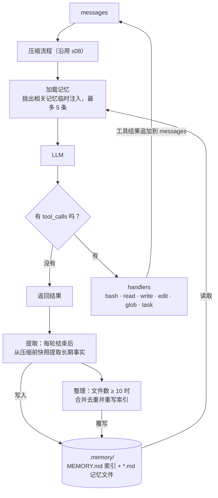

记忆数据的四类划分与读写闭环如下：

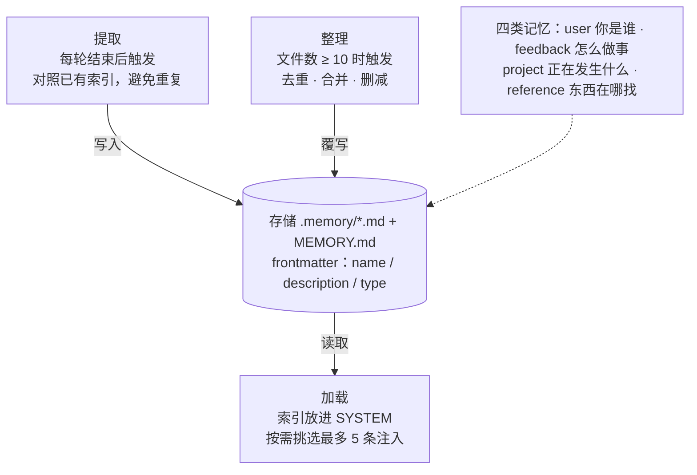

这里有两个关键的工程细节：

- **临时注入不污染历史**：`buildRequest()` 返回 `messages` 的浅拷贝，只在发送本次请求时把 `<relevant_memories>` 拼到最新用户消息前。原数组不变，下一轮还能换一批更相关的记忆。
- **三类辅助调用彼此兜底**：选记忆（失败时降级关键词匹配）、提记忆（读取压缩前快照 `preCompress`，防止压缩把原话压没）和理记忆（文件数满 10 个触发）都包在 `try/catch` 里，任何一步失败都不会打断主对话。

---

这一章要新增读写和整理记忆文件的逻辑，先从最小的一步开始：把 `node:fs` 的引入整理成多行，顺手加上后面重写记忆目录时要用的 `rmSync`。这一步不改变运行行为。

本次代码变化：9 行。

```js ! agent.js range=1:18
// !focus(start)
import {
  readdirSync,
  readFileSync,
  existsSync,
  mkdirSync,
  writeFileSync,
  rmSync,
} from "node:fs";
// !focus(end)
import path from "node:path";
import {
  callLlm,
  runBash,
  readFile,
  writeFile,
  editFile,
  glob,
  tool,
  runChatCli,
  isMainModule,
  parseFrontmatter,
  prepareHistoryForSummary,
} from "./helper.js";

const SKILLS_DIR = path.join(process.cwd(), "skills");

export function scanSkills(dir = SKILLS_DIR) {
  const registry = {};
  if (!existsSync(dir)) return registry;
  for (const entry of readdirSync(dir, { withFileTypes: true })) {
    if (!entry.isDirectory()) continue;
    const manifest = path.join(dir, entry.name, "SKILL.md");
    if (!existsSync(manifest)) continue;
    const raw = readFileSync(manifest, "utf8");
    const { meta } = parseFrontmatter(raw);
    const name = meta.name || entry.name;
    registry[name] = { name, description: meta.description || "", content: raw };
  }
  return registry;
}

export const skillRegistry = scanSkills();

function listSkills() {
  const all = Object.values(skillRegistry);
  return all.length ? all.map((s) => `- ${s.name}: ${s.description}`).join("\n") : "(no skills found)";
}

function loadSkill({ name }) {
  const skill = skillRegistry[name];
  return skill ? skill.content : `Skill not found: ${name}`;
}

const TRANSCRIPT_DIR = path.join(process.cwd(), ".transcripts");
const TOOL_RESULTS_DIR = path.join(process.cwd(), ".task_outputs", "tool-results");

const CONTEXT_LIMIT = 12000;
const KEEP_RECENT = 3;
const PERSIST_THRESHOLD = 30000;
const MAX_REACTIVE_RETRIES = 1;

export const estimateSize = (messages) => JSON.stringify(messages).length;

const isToolResult = (m) => m.role === "tool";

function apply(messages, next) {
  if (next !== messages) messages.splice(0, messages.length, ...next);
  return messages;
}

export function snipCompact(messages, maxMessages = 50) {
  if (messages.length <= maxMessages) return messages;
  let head = 3;
  let tail = messages.length - (maxMessages - 3);
  while (head < messages.length && isToolResult(messages[head])) head += 1;
  while (tail < messages.length && isToolResult(messages[tail])) tail += 1;
  if (head >= tail) return messages;
  return [
    ...messages.slice(0, head),
    { role: "user", content: `[snipped ${tail - head} messages from the middle]` },
    ...messages.slice(tail),
  ];
}

export function microCompact(messages) {
  const toolMsgs = messages.filter(isToolResult);
  if (toolMsgs.length <= KEEP_RECENT) return messages;
  for (const m of toolMsgs.slice(0, -KEEP_RECENT)) {
    if (m.content.length > 120) m.content = "[Earlier tool result compacted. Re-run if needed.]";
  }
  return messages;
}

function persistLargeOutput(id, output) {
  if (output.length <= PERSIST_THRESHOLD) return output;
  mkdirSync(TOOL_RESULTS_DIR, { recursive: true });
  const file = path.join(TOOL_RESULTS_DIR, `${id}.txt`);
  if (!existsSync(file)) writeFileSync(file, output);
  return `<persisted-output>\nFull output: ${file}\nPreview:\n${output.slice(0, 2000)}\n</persisted-output>`;
}

export function toolResultBudget(messages, maxBytes = 200000) {
  const tail = [];
  for (let i = messages.length - 1; i >= 0 && isToolResult(messages[i]); i -= 1) tail.push(messages[i]);
  let total = tail.reduce((n, m) => n + m.content.length, 0);
  if (total <= maxBytes) return messages;
  for (const m of [...tail].sort((a, b) => b.content.length - a.content.length)) {
    if (total <= maxBytes) break;
    if (m.content.length <= PERSIST_THRESHOLD) continue;
    const before = m.content.length;
    m.content = persistLargeOutput(m.tool_call_id, m.content);
    total -= before - m.content.length;
  }
  return messages;
}

function writeTranscript(messages) {
  mkdirSync(TRANSCRIPT_DIR, { recursive: true });
  const file = path.join(TRANSCRIPT_DIR, `transcript-${Date.now()}.jsonl`);
  writeFileSync(file, messages.map((m) => JSON.stringify(m)).join("\n"));
  return file;
}

async function summarizeHistory(messages) {
  const conversation = prepareHistoryForSummary(messages);
  const prompt = `Summarize this coding-agent conversation so work can continue.
Preserve: 1) current goal, 2) key findings/decisions, 3) files read/changed, 4) remaining work, 5) user constraints.
Be compact but concrete.

${conversation}`;
  const { message } = await callLlm([{ role: "user", content: prompt }], {});
  return (message.content || "").trim() || "(empty summary)";
}

export async function compactHistory(messages) {
  writeTranscript(messages);
  const summary = await summarizeHistory(messages);
  return [{ role: "user", content: `[Compacted]\n\n${summary}` }];
}

export async function reactiveCompact(messages) {
  writeTranscript(messages);
  let tail = Math.max(0, messages.length - 5);
  while (tail < messages.length && isToolResult(messages[tail])) tail += 1;
  const summary = await summarizeHistory(messages.slice(0, tail));
  return [{ role: "user", content: `[Reactive compact]\n\n${summary}` }, ...messages.slice(tail)];
}

const isPromptTooLong = (error) =>
  /prompt.*too.*long|too many tokens|context.*length/i.test(String(error.message));

const SYSTEM = `You are a coding agent at ${process.cwd()}. Use tools to solve tasks.
Before a multi-step task, use todo_write to plan and update status as you go.
For a complex sub-problem, use the task tool to spawn a subagent.
Skills available:
${listSkills()}
Use load_skill to get a skill's full content when you need it.
When context gets large, call compact to summarize earlier work and free space.`;
const SUB_SYSTEM = `You are a coding subagent at ${process.cwd()}. Complete the task, then return a concise summary. Do not delegate further.`;

const tools = [
  tool("bash", "Run a shell command.", {
    type: "object",
    properties: { command: { type: "string" } },
    required: ["command"],
  }),
  tool("read_file", "Read a file (optional line limit).", {
    type: "object",
    properties: { path: { type: "string" }, limit: { type: "integer" } },
    required: ["path"],
  }),
  tool("write_file", "Write content to a file.", {
    type: "object",
    properties: { path: { type: "string" }, content: { type: "string" } },
    required: ["path", "content"],
  }),
  tool("edit_file", "Replace exact text in a file once.", {
    type: "object",
    properties: {
      path: { type: "string" },
      old_text: { type: "string" },
      new_text: { type: "string" },
    },
    required: ["path", "old_text", "new_text"],
  }),
  tool("glob", "Find files by glob pattern.", {
    type: "object",
    properties: { pattern: { type: "string" } },
    required: ["pattern"],
  }),
  tool("todo_write", "Create and manage a task list for the current session.", {
    type: "object",
    properties: {
      todos: {
        type: "array",
        items: {
          type: "object",
          properties: {
            content: { type: "string" },
            status: { type: "string", enum: ["pending", "in_progress", "completed"] },
          },
          required: ["content", "status"],
        },
      },
    },
    required: ["todos"],
  }),
  tool("task", "Launch a subagent to handle a complex subtask. Returns only the final summary.", {
    type: "object",
    properties: { description: { type: "string" } },
    required: ["description"],
  }),
  tool("load_skill", "Load a skill's full content by name (see the catalog in the system prompt).", {
    type: "object",
    properties: { name: { type: "string" } },
    required: ["name"],
  }),
  tool("compact", "Summarize earlier conversation to free context space.", {
    type: "object",
    properties: { focus: { type: "string" } },
  }),
];

let currentTodos = [];
export function getTodos() {
  return currentTodos;
}

function runTodoWrite({ todos = [] }) {
  currentTodos = todos;
  const icon = { pending: " ", in_progress: "▸", completed: "✓" };
  console.log("## Current Tasks");
  for (const t of currentTodos) console.log(`  [${icon[t.status]}] ${t.content}`);
  return `Updated ${currentTodos.length} tasks`;
}

const handlers = {
  bash: ({ command }) => runBash(command),
  read_file: ({ path, limit }) => readFile(path, limit),
  write_file: ({ path, content }) => writeFile(path, content),
  edit_file: ({ path, old_text, new_text }) => editFile(path, old_text, new_text),
  glob: ({ pattern }) => glob(pattern),
  todo_write: runTodoWrite,
  task: ({ description }, confirm) => spawnSubagent(description, confirm),
  load_skill: loadSkill,
};

const SUB_EXCLUDE = ["task", "todo_write", "load_skill", "compact"];
const subTools = tools.filter((t) => !SUB_EXCLUDE.includes(t.function.name));
const subHandlers = Object.fromEntries(
  Object.entries(handlers).filter(([name]) => !SUB_EXCLUDE.includes(name)),
);
const MAX_SUB_TURNS = 30;

async function spawnSubagent(description, confirm) {
  const messages = [{ role: "user", content: description }];
  for (let turn = 0; turn < MAX_SUB_TURNS; turn += 1) {
    const { message } = await callLlm(messages, { system: SUB_SYSTEM, tools: subTools });
    messages.push(message);
    if (!message.tool_calls?.length) return message.content || "(subagent returned no text)";

    for (const call of message.tool_calls) {
      const name = call.function.name;
      const args = JSON.parse(call.function.arguments || "{}");
      const blocked = await triggerHooks("PreToolUse", name, args, confirm);
      const handler = subHandlers[name];
      const output =
        blocked != null ? String(blocked) : handler ? handler(args) : `Unknown tool: ${name}`;
      messages.push({ role: "tool", tool_call_id: call.id, content: String(output) });
    }
  }
  return "Subagent stopped after 30 turns without a final answer.";
}

export { spawnSubagent };

const hooks = { UserPromptSubmit: [], PreToolUse: [], PostToolUse: [], Stop: [] };

function registerHook(event, callback) {
  hooks[event].push(callback);
}

async function triggerHooks(event, ...args) {
  for (const callback of hooks[event]) {
    const result = await callback(...args);
    if (result != null) return result;
  }
  return null;
}

const DENY = ["rm -rf /", "sudo", "shutdown", "reboot", "mkfs", "dd if="];
const RISKY = ["rm ", "> /etc/", "chmod 777"];

async function permissionHook(name, args, confirm) {
  if (name !== "bash") return null;
  const command = args.command || "";
  if (DENY.some((p) => command.includes(p))) return "Permission denied: 命中黑名单。";
  if (RISKY.some((p) => command.includes(p))) {
    const answer = confirm ? await confirm(`⚠ 可能有破坏性的命令: ${command} 允许? [y/N] `) : "";
    if (!/^y(es)?$/i.test(String(answer).trim())) return "Permission denied by user.";
  }
  return null;
}

registerHook("PreToolUse", permissionHook);

export async function agentLoop(messages, confirm) {
  let roundsSinceTodo = 0;
  let reactiveRetries = 0;
  while (true) {
    if (roundsSinceTodo >= 3) {
      messages.push({ role: "user", content: "<reminder>Update your todos.</reminder>" });
      roundsSinceTodo = 0;
    }

    apply(messages, toolResultBudget(messages));
    apply(messages, snipCompact(messages));
    apply(messages, microCompact(messages));
    if (estimateSize(messages) > CONTEXT_LIMIT) {
      console.log("[auto compact] compactHistory");
      apply(messages, await compactHistory(messages));
    }

    let message;
    try {
      ({ message } = await callLlm(messages, { system: SYSTEM, tools }));
      reactiveRetries = 0;
    } catch (error) {
      if (reactiveRetries < MAX_REACTIVE_RETRIES && isPromptTooLong(error)) {
        console.log("[reactive compact] reactiveCompact");
        apply(messages, await reactiveCompact(messages));
        reactiveRetries += 1;
        continue;
      }
      throw error;
    }

    if (!message.tool_calls?.length) {
      return message.content || "";
    }

    messages.push(message);
    roundsSinceTodo += 1;
    let compacted = false;
    for (const call of message.tool_calls) {
      const name = call.function.name;
      const args = JSON.parse(call.function.arguments || "{}");

      if (name === "compact") {
        console.log("[manual compact] compactHistory");
        apply(messages, await compactHistory(messages));
        compacted = true;
        break;
      }

      const blocked = await triggerHooks("PreToolUse", name, args, confirm);
      let output;
      if (blocked != null) {
        output = String(blocked);
      } else {
        const handler = handlers[name];
        output = handler ? await handler(args, confirm) : `Unknown tool: ${name}`;
      }

      if (name === "todo_write") roundsSinceTodo = 0;
      messages.push({ role: "tool", tool_call_id: call.id, content: String(output) });
    }
    if (compacted) continue;
  }
}

async function main() {
  await runChatCli({
    promptLabel: "s08 >> ",
    onPrompt: async ({ prompt, messages, ask }) => {
      return agentLoop(messages, ask);
    },
  });
}

if (isMainModule(import.meta.url)) {
  main().catch((error) => {
    console.error(error.message);
    process.exit(1);
  });
}
```

## !!steps
记忆直接落成 `.memory/` 下的普通 Markdown 文件，头部用 frontmatter 存名字、描述和类型。`setMemoryDir` 方便测试切换到临时目录；`listMemoryFiles` 扫描所有 `.md` 并复用 `parseFrontmatter` 解析出来，排除索引文件 `MEMORY.md`。目录还不存在时直接返回空数组。

本次代码变化：26 行。

```js ! agent.js range=45:87
import {
  readdirSync,
  readFileSync,
  existsSync,
  mkdirSync,
  writeFileSync,
  rmSync,
} from "node:fs";
import path from "node:path";
import {
  callLlm,
  runBash,
  readFile,
  writeFile,
  editFile,
  glob,
  tool,
  runChatCli,
  isMainModule,
  parseFrontmatter,
  prepareHistoryForSummary,
} from "./helper.js";

const SKILLS_DIR = path.join(process.cwd(), "skills");

export function scanSkills(dir = SKILLS_DIR) {
  const registry = {};
  if (!existsSync(dir)) return registry;
  for (const entry of readdirSync(dir, { withFileTypes: true })) {
    if (!entry.isDirectory()) continue;
    const manifest = path.join(dir, entry.name, "SKILL.md");
    if (!existsSync(manifest)) continue;
    const raw = readFileSync(manifest, "utf8");
    const { meta } = parseFrontmatter(raw);
    const name = meta.name || entry.name;
    registry[name] = { name, description: meta.description || "", content: raw };
  }
  return registry;
}

export const skillRegistry = scanSkills();

function listSkills() {
  const all = Object.values(skillRegistry);
  return all.length ? all.map((s) => `- ${s.name}: ${s.description}`).join("\n") : "(no skills found)";
}

function loadSkill({ name }) {
  const skill = skillRegistry[name];
  return skill ? skill.content : `Skill not found: ${name}`;
}

// !focus(start)
let memoryDir = path.join(process.cwd(), ".memory");
export function setMemoryDir(dir) {
  memoryDir = dir;
}
const indexPath = () => path.join(memoryDir, "MEMORY.md");

export function listMemoryFiles() {
  if (!existsSync(memoryDir)) return [];
  return readdirSync(memoryDir)
    .filter((f) => f.endsWith(".md") && f !== "MEMORY.md")
    .sort()
    .map((filename) => {
      const raw = readFileSync(path.join(memoryDir, filename), "utf8");
      const { meta, body } = parseFrontmatter(raw);
      return {
        filename,
        name: meta.name || filename.replace(/\.md$/, ""),
        description: meta.description || "",
        type: meta.type || "user",
        body,
        content: raw,
      };
    });
}

// !focus(end)
const TRANSCRIPT_DIR = path.join(process.cwd(), ".transcripts");
const TOOL_RESULTS_DIR = path.join(process.cwd(), ".task_outputs", "tool-results");

const CONTEXT_LIMIT = 12000;
const KEEP_RECENT = 3;
const PERSIST_THRESHOLD = 30000;
const MAX_REACTIVE_RETRIES = 1;

export const estimateSize = (messages) => JSON.stringify(messages).length;
const isToolResult = (m) => m.role === "tool";

function apply(messages, next) {
  if (next !== messages) messages.splice(0, messages.length, ...next);
  return messages;
}

export function snipCompact(messages, maxMessages = 50) {
  if (messages.length <= maxMessages) return messages;
  let head = 3;
  let tail = messages.length - (maxMessages - 3);
  while (head < messages.length && isToolResult(messages[head])) head += 1;
  while (tail < messages.length && isToolResult(messages[tail])) tail += 1;
  if (head >= tail) return messages;
  return [
    ...messages.slice(0, head),
    { role: "user", content: `[snipped ${tail - head} messages from the middle]` },
    ...messages.slice(tail),
  ];
}

export function microCompact(messages) {
  const toolMsgs = messages.filter(isToolResult);
  if (toolMsgs.length <= KEEP_RECENT) return messages;
  for (const m of toolMsgs.slice(0, -KEEP_RECENT)) {
    if (m.content.length > 120) m.content = "[Earlier tool result compacted. Re-run if needed.]";
  }
  return messages;
}

function persistLargeOutput(id, output) {
  if (output.length <= PERSIST_THRESHOLD) return output;
  mkdirSync(TOOL_RESULTS_DIR, { recursive: true });
  const file = path.join(TOOL_RESULTS_DIR, `${id}.txt`);
  if (!existsSync(file)) writeFileSync(file, output);
  return `<persisted-output>\nFull output: ${file}\nPreview:\n${output.slice(0, 2000)}\n</persisted-output>`;
}

export function toolResultBudget(messages, maxBytes = 200000) {
  const tail = [];
  for (let i = messages.length - 1; i >= 0 && isToolResult(messages[i]); i -= 1) tail.push(messages[i]);
  let total = tail.reduce((n, m) => n + m.content.length, 0);
  if (total <= maxBytes) return messages;
  for (const m of [...tail].sort((a, b) => b.content.length - a.content.length)) {
    if (total <= maxBytes) break;
    if (m.content.length <= PERSIST_THRESHOLD) continue;
    const before = m.content.length;
    m.content = persistLargeOutput(m.tool_call_id, m.content);
    total -= before - m.content.length;
  }
  return messages;
}

function writeTranscript(messages) {
  mkdirSync(TRANSCRIPT_DIR, { recursive: true });
  const file = path.join(TRANSCRIPT_DIR, `transcript-${Date.now()}.jsonl`);
  writeFileSync(file, messages.map((m) => JSON.stringify(m)).join("\n"));
  return file;
}

async function summarizeHistory(messages) {
  const conversation = prepareHistoryForSummary(messages);
  const prompt = `Summarize this coding-agent conversation so work can continue.
Preserve: 1) current goal, 2) key findings/decisions, 3) files read/changed, 4) remaining work, 5) user constraints.
Be compact but concrete.

${conversation}`;
  const { message } = await callLlm([{ role: "user", content: prompt }], {});
  return (message.content || "").trim() || "(empty summary)";
}

export async function compactHistory(messages) {
  writeTranscript(messages);
  const summary = await summarizeHistory(messages);
  return [{ role: "user", content: `[Compacted]\n\n${summary}` }];
}

export async function reactiveCompact(messages) {
  writeTranscript(messages);
  let tail = Math.max(0, messages.length - 5);
  while (tail < messages.length && isToolResult(messages[tail])) tail += 1;
  const summary = await summarizeHistory(messages.slice(0, tail));
  return [{ role: "user", content: `[Reactive compact]\n\n${summary}` }, ...messages.slice(tail)];
}

const isPromptTooLong = (error) =>
  /prompt.*too.*long|too many tokens|context.*length/i.test(String(error.message));

const SYSTEM = `You are a coding agent at ${process.cwd()}. Use tools to solve tasks.
Before a multi-step task, use todo_write to plan and update status as you go.
For a complex sub-problem, use the task tool to spawn a subagent.
Skills available:
${listSkills()}
Use load_skill to get a skill's full content when you need it.
When context gets large, call compact to summarize earlier work and free space.`;
const SUB_SYSTEM = `You are a coding subagent at ${process.cwd()}. Complete the task, then return a concise summary. Do not delegate further.`;

const tools = [
  tool("bash", "Run a shell command.", {
    type: "object",
    properties: { command: { type: "string" } },
    required: ["command"],
  }),
  tool("read_file", "Read a file (optional line limit).", {
    type: "object",
    properties: { path: { type: "string" }, limit: { type: "integer" } },
    required: ["path"],
  }),
  tool("write_file", "Write content to a file.", {
    type: "object",
    properties: { path: { type: "string" }, content: { type: "string" } },
    required: ["path", "content"],
  }),
  tool("edit_file", "Replace exact text in a file once.", {
    type: "object",
    properties: {
      path: { type: "string" },
      old_text: { type: "string" },
      new_text: { type: "string" },
    },
    required: ["path", "old_text", "new_text"],
  }),
  tool("glob", "Find files by glob pattern.", {
    type: "object",
    properties: { pattern: { type: "string" } },
    required: ["pattern"],
  }),
  tool("todo_write", "Create and manage a task list for the current session.", {
    type: "object",
    properties: {
      todos: {
        type: "array",
        items: {
          type: "object",
          properties: {
            content: { type: "string" },
            status: { type: "string", enum: ["pending", "in_progress", "completed"] },
          },
          required: ["content", "status"],
        },
      },
    },
    required: ["todos"],
  }),
  tool("task", "Launch a subagent to handle a complex subtask. Returns only the final summary.", {
    type: "object",
    properties: { description: { type: "string" } },
    required: ["description"],
  }),
  tool("load_skill", "Load a skill's full content by name (see the catalog in the system prompt).", {
    type: "object",
    properties: { name: { type: "string" } },
    required: ["name"],
  }),
  tool("compact", "Summarize earlier conversation to free context space.", {
    type: "object",
    properties: { focus: { type: "string" } },
  }),
];

let currentTodos = [];
export function getTodos() {
  return currentTodos;
}

function runTodoWrite({ todos = [] }) {
  currentTodos = todos;
  const icon = { pending: " ", in_progress: "▸", completed: "✓" };
  console.log("## Current Tasks");
  for (const t of currentTodos) console.log(`  [${icon[t.status]}] ${t.content}`);
  return `Updated ${currentTodos.length} tasks`;
}

const handlers = {
  bash: ({ command }) => runBash(command),
  read_file: ({ path, limit }) => readFile(path, limit),
  write_file: ({ path, content }) => writeFile(path, content),
  edit_file: ({ path, old_text, new_text }) => editFile(path, old_text, new_text),
  glob: ({ pattern }) => glob(pattern),
  todo_write: runTodoWrite,
  task: ({ description }, confirm) => spawnSubagent(description, confirm),
  load_skill: loadSkill,
};

const SUB_EXCLUDE = ["task", "todo_write", "load_skill", "compact"];
const subTools = tools.filter((t) => !SUB_EXCLUDE.includes(t.function.name));
const subHandlers = Object.fromEntries(
  Object.entries(handlers).filter(([name]) => !SUB_EXCLUDE.includes(name)),
);
const MAX_SUB_TURNS = 30;

async function spawnSubagent(description, confirm) {
  const messages = [{ role: "user", content: description }];
  for (let turn = 0; turn < MAX_SUB_TURNS; turn += 1) {
    const { message } = await callLlm(messages, { system: SUB_SYSTEM, tools: subTools });
    messages.push(message);
    if (!message.tool_calls?.length) return message.content || "(subagent returned no text)";

    for (const call of message.tool_calls) {
      const name = call.function.name;
      const args = JSON.parse(call.function.arguments || "{}");
      const blocked = await triggerHooks("PreToolUse", name, args, confirm);
      const handler = subHandlers[name];
      const output =
        blocked != null ? String(blocked) : handler ? handler(args) : `Unknown tool: ${name}`;
      messages.push({ role: "tool", tool_call_id: call.id, content: String(output) });
    }
  }
  return "Subagent stopped after 30 turns without a final answer.";
}

export { spawnSubagent };

const hooks = { UserPromptSubmit: [], PreToolUse: [], PostToolUse: [], Stop: [] };

function registerHook(event, callback) {
  hooks[event].push(callback);
}

async function triggerHooks(event, ...args) {
  for (const callback of hooks[event]) {
    const result = await callback(...args);
    if (result != null) return result;
  }
  return null;
}

const DENY = ["rm -rf /", "sudo", "shutdown", "reboot", "mkfs", "dd if="];
const RISKY = ["rm ", "> /etc/", "chmod 777"];

async function permissionHook(name, args, confirm) {
  if (name !== "bash") return null;
  const command = args.command || "";
  if (DENY.some((p) => command.includes(p))) return "Permission denied: 命中黑名单。";
  if (RISKY.some((p) => command.includes(p))) {
    const answer = confirm ? await confirm(`⚠ 可能有破坏性的命令: ${command} 允许? [y/N] `) : "";
    if (!/^y(es)?$/i.test(String(answer).trim())) return "Permission denied by user.";
  }
  return null;
}

registerHook("PreToolUse", permissionHook);

export async function agentLoop(messages, confirm) {
  let roundsSinceTodo = 0;
  let reactiveRetries = 0;
  while (true) {
    if (roundsSinceTodo >= 3) {
      messages.push({ role: "user", content: "<reminder>Update your todos.</reminder>" });
      roundsSinceTodo = 0;
    }

    apply(messages, toolResultBudget(messages));
    apply(messages, snipCompact(messages));
    apply(messages, microCompact(messages));
    if (estimateSize(messages) > CONTEXT_LIMIT) {
      console.log("[auto compact] compactHistory");
      apply(messages, await compactHistory(messages));
    }

    let message;
    try {
      ({ message } = await callLlm(messages, { system: SYSTEM, tools }));
      reactiveRetries = 0;
    } catch (error) {
      if (reactiveRetries < MAX_REACTIVE_RETRIES && isPromptTooLong(error)) {
        console.log("[reactive compact] reactiveCompact");
        apply(messages, await reactiveCompact(messages));
        reactiveRetries += 1;
        continue;
      }
      throw error;
    }

    if (!message.tool_calls?.length) {
      return message.content || "";
    }

    messages.push(message);
    roundsSinceTodo += 1;
    let compacted = false;
    for (const call of message.tool_calls) {
      const name = call.function.name;
      const args = JSON.parse(call.function.arguments || "{}");

      if (name === "compact") {
        console.log("[manual compact] compactHistory");
        apply(messages, await compactHistory(messages));
        compacted = true;
        break;
      }

      const blocked = await triggerHooks("PreToolUse", name, args, confirm);
      let output;
      if (blocked != null) {
        output = String(blocked);
      } else {
        const handler = handlers[name];
        output = handler ? await handler(args, confirm) : `Unknown tool: ${name}`;
      }

      if (name === "todo_write") roundsSinceTodo = 0;
      messages.push({ role: "tool", tool_call_id: call.id, content: String(output) });
    }
    if (compacted) continue;
  }
}

async function main() {
  await runChatCli({
    promptLabel: "s08 >> ",
    onPrompt: async ({ prompt, messages, ask }) => {
      return agentLoop(messages, ask);
    },
  });
}

if (isMainModule(import.meta.url)) {
  main().catch((error) => {
    console.error(error.message);
    process.exit(1);
  });
}
```

## !!steps
`writeMemoryFile` 把记忆名字转成文件 slug，拼好 frontmatter 和正文后写盘，再调用 `rebuildIndex` 重建 `MEMORY.md` 索引清单。`readMemoryIndex` 负责读出这份清单供系统提示词使用。到这里存储层就齐了，但还没接入主循环。

本次代码变化：20 行。

```js ! agent.js range=51:107
import {
  readdirSync,
  readFileSync,
  existsSync,
  mkdirSync,
  writeFileSync,
  rmSync,
} from "node:fs";
import path from "node:path";
import {
  callLlm,
  runBash,
  readFile,
  writeFile,
  editFile,
  glob,
  tool,
  runChatCli,
  isMainModule,
  parseFrontmatter,
  prepareHistoryForSummary,
} from "./helper.js";

const SKILLS_DIR = path.join(process.cwd(), "skills");

export function scanSkills(dir = SKILLS_DIR) {
  const registry = {};
  if (!existsSync(dir)) return registry;
  for (const entry of readdirSync(dir, { withFileTypes: true })) {
    if (!entry.isDirectory()) continue;
    const manifest = path.join(dir, entry.name, "SKILL.md");
    if (!existsSync(manifest)) continue;
    const raw = readFileSync(manifest, "utf8");
    const { meta } = parseFrontmatter(raw);
    const name = meta.name || entry.name;
    registry[name] = { name, description: meta.description || "", content: raw };
  }
  return registry;
}

export const skillRegistry = scanSkills();

function listSkills() {
  const all = Object.values(skillRegistry);
  return all.length ? all.map((s) => `- ${s.name}: ${s.description}`).join("\n") : "(no skills found)";
}

function loadSkill({ name }) {
  const skill = skillRegistry[name];
  return skill ? skill.content : `Skill not found: ${name}`;
}

let memoryDir = path.join(process.cwd(), ".memory");
export function setMemoryDir(dir) {
  memoryDir = dir;
}
const indexPath = () => path.join(memoryDir, "MEMORY.md");

// !focus(start)
export function writeMemoryFile(name, type, description, body) {
  mkdirSync(memoryDir, { recursive: true });
  const slug = name.toLowerCase().replace(/[\s/]+/g, "-");
  writeFileSync(
    path.join(memoryDir, `${slug}.md`),
    `---\nname: ${name}\ndescription: ${description}\ntype: ${type}\n---\n\n${body}\n`,
  );
  rebuildIndex();
}

// !focus(end)
export function listMemoryFiles() {
  if (!existsSync(memoryDir)) return [];
  return readdirSync(memoryDir)
    .filter((f) => f.endsWith(".md") && f !== "MEMORY.md")
    .sort()
    .map((filename) => {
      const raw = readFileSync(path.join(memoryDir, filename), "utf8");
      const { meta, body } = parseFrontmatter(raw);
      return {
        filename,
        name: meta.name || filename.replace(/\.md$/, ""),
        description: meta.description || "",
        type: meta.type || "user",
        body,
        content: raw,
      };
    });
// !focus(start)
}

function rebuildIndex() {
  const lines = listMemoryFiles().map((m) => `- [${m.name}](${m.filename}) — ${m.description}`);
  mkdirSync(memoryDir, { recursive: true });
  writeFileSync(indexPath(), lines.length ? `${lines.join("\n")}\n` : "");
}

export function readMemoryIndex() {
  return existsSync(indexPath()) ? readFileSync(indexPath(), "utf8").trim() : "";
// !focus(end)
}

const TRANSCRIPT_DIR = path.join(process.cwd(), ".transcripts");
const TOOL_RESULTS_DIR = path.join(process.cwd(), ".task_outputs", "tool-results");

const CONTEXT_LIMIT = 12000;
const KEEP_RECENT = 3;
const PERSIST_THRESHOLD = 30000;
const MAX_REACTIVE_RETRIES = 1;

export const estimateSize = (messages) => JSON.stringify(messages).length;
const isToolResult = (m) => m.role === "tool";

function apply(messages, next) {
  if (next !== messages) messages.splice(0, messages.length, ...next);
  return messages;
}

export function snipCompact(messages, maxMessages = 50) {
  if (messages.length <= maxMessages) return messages;
  let head = 3;
  let tail = messages.length - (maxMessages - 3);
  while (head < messages.length && isToolResult(messages[head])) head += 1;
  while (tail < messages.length && isToolResult(messages[tail])) tail += 1;
  if (head >= tail) return messages;
  return [
    ...messages.slice(0, head),
    { role: "user", content: `[snipped ${tail - head} messages from the middle]` },
    ...messages.slice(tail),
  ];
}

export function microCompact(messages) {
  const toolMsgs = messages.filter(isToolResult);
  if (toolMsgs.length <= KEEP_RECENT) return messages;
  for (const m of toolMsgs.slice(0, -KEEP_RECENT)) {
    if (m.content.length > 120) m.content = "[Earlier tool result compacted. Re-run if needed.]";
  }
  return messages;
}

function persistLargeOutput(id, output) {
  if (output.length <= PERSIST_THRESHOLD) return output;
  mkdirSync(TOOL_RESULTS_DIR, { recursive: true });
  const file = path.join(TOOL_RESULTS_DIR, `${id}.txt`);
  if (!existsSync(file)) writeFileSync(file, output);
  return `<persisted-output>\nFull output: ${file}\nPreview:\n${output.slice(0, 2000)}\n</persisted-output>`;
}

export function toolResultBudget(messages, maxBytes = 200000) {
  const tail = [];
  for (let i = messages.length - 1; i >= 0 && isToolResult(messages[i]); i -= 1) tail.push(messages[i]);
  let total = tail.reduce((n, m) => n + m.content.length, 0);
  if (total <= maxBytes) return messages;
  for (const m of [...tail].sort((a, b) => b.content.length - a.content.length)) {
    if (total <= maxBytes) break;
    if (m.content.length <= PERSIST_THRESHOLD) continue;
    const before = m.content.length;
    m.content = persistLargeOutput(m.tool_call_id, m.content);
    total -= before - m.content.length;
  }
  return messages;
}

function writeTranscript(messages) {
  mkdirSync(TRANSCRIPT_DIR, { recursive: true });
  const file = path.join(TRANSCRIPT_DIR, `transcript-${Date.now()}.jsonl`);
  writeFileSync(file, messages.map((m) => JSON.stringify(m)).join("\n"));
  return file;
}

async function summarizeHistory(messages) {
  const conversation = prepareHistoryForSummary(messages);
  const prompt = `Summarize this coding-agent conversation so work can continue.
Preserve: 1) current goal, 2) key findings/decisions, 3) files read/changed, 4) remaining work, 5) user constraints.
Be compact but concrete.

${conversation}`;
  const { message } = await callLlm([{ role: "user", content: prompt }], {});
  return (message.content || "").trim() || "(empty summary)";
}

export async function compactHistory(messages) {
  writeTranscript(messages);
  const summary = await summarizeHistory(messages);
  return [{ role: "user", content: `[Compacted]\n\n${summary}` }];
}

export async function reactiveCompact(messages) {
  writeTranscript(messages);
  let tail = Math.max(0, messages.length - 5);
  while (tail < messages.length && isToolResult(messages[tail])) tail += 1;
  const summary = await summarizeHistory(messages.slice(0, tail));
  return [{ role: "user", content: `[Reactive compact]\n\n${summary}` }, ...messages.slice(tail)];
}

const isPromptTooLong = (error) =>
  /prompt.*too.*long|too many tokens|context.*length/i.test(String(error.message));

const SYSTEM = `You are a coding agent at ${process.cwd()}. Use tools to solve tasks.
Before a multi-step task, use todo_write to plan and update status as you go.
For a complex sub-problem, use the task tool to spawn a subagent.
Skills available:
${listSkills()}
Use load_skill to get a skill's full content when you need it.
When context gets large, call compact to summarize earlier work and free space.`;
const SUB_SYSTEM = `You are a coding subagent at ${process.cwd()}. Complete the task, then return a concise summary. Do not delegate further.`;

const tools = [
  tool("bash", "Run a shell command.", {
    type: "object",
    properties: { command: { type: "string" } },
    required: ["command"],
  }),
  tool("read_file", "Read a file (optional line limit).", {
    type: "object",
    properties: { path: { type: "string" }, limit: { type: "integer" } },
    required: ["path"],
  }),
  tool("write_file", "Write content to a file.", {
    type: "object",
    properties: { path: { type: "string" }, content: { type: "string" } },
    required: ["path", "content"],
  }),
  tool("edit_file", "Replace exact text in a file once.", {
    type: "object",
    properties: {
      path: { type: "string" },
      old_text: { type: "string" },
      new_text: { type: "string" },
    },
    required: ["path", "old_text", "new_text"],
  }),
  tool("glob", "Find files by glob pattern.", {
    type: "object",
    properties: { pattern: { type: "string" } },
    required: ["pattern"],
  }),
  tool("todo_write", "Create and manage a task list for the current session.", {
    type: "object",
    properties: {
      todos: {
        type: "array",
        items: {
          type: "object",
          properties: {
            content: { type: "string" },
            status: { type: "string", enum: ["pending", "in_progress", "completed"] },
          },
          required: ["content", "status"],
        },
      },
    },
    required: ["todos"],
  }),
  tool("task", "Launch a subagent to handle a complex subtask. Returns only the final summary.", {
    type: "object",
    properties: { description: { type: "string" } },
    required: ["description"],
  }),
  tool("load_skill", "Load a skill's full content by name (see the catalog in the system prompt).", {
    type: "object",
    properties: { name: { type: "string" } },
    required: ["name"],
  }),
  tool("compact", "Summarize earlier conversation to free context space.", {
    type: "object",
    properties: { focus: { type: "string" } },
  }),
];

let currentTodos = [];
export function getTodos() {
  return currentTodos;
}

function runTodoWrite({ todos = [] }) {
  currentTodos = todos;
  const icon = { pending: " ", in_progress: "▸", completed: "✓" };
  console.log("## Current Tasks");
  for (const t of currentTodos) console.log(`  [${icon[t.status]}] ${t.content}`);
  return `Updated ${currentTodos.length} tasks`;
}

const handlers = {
  bash: ({ command }) => runBash(command),
  read_file: ({ path, limit }) => readFile(path, limit),
  write_file: ({ path, content }) => writeFile(path, content),
  edit_file: ({ path, old_text, new_text }) => editFile(path, old_text, new_text),
  glob: ({ pattern }) => glob(pattern),
  todo_write: runTodoWrite,
  task: ({ description }, confirm) => spawnSubagent(description, confirm),
  load_skill: loadSkill,
};

const SUB_EXCLUDE = ["task", "todo_write", "load_skill", "compact"];
const subTools = tools.filter((t) => !SUB_EXCLUDE.includes(t.function.name));
const subHandlers = Object.fromEntries(
  Object.entries(handlers).filter(([name]) => !SUB_EXCLUDE.includes(name)),
);
const MAX_SUB_TURNS = 30;

async function spawnSubagent(description, confirm) {
  const messages = [{ role: "user", content: description }];
  for (let turn = 0; turn < MAX_SUB_TURNS; turn += 1) {
    const { message } = await callLlm(messages, { system: SUB_SYSTEM, tools: subTools });
    messages.push(message);
    if (!message.tool_calls?.length) return message.content || "(subagent returned no text)";

    for (const call of message.tool_calls) {
      const name = call.function.name;
      const args = JSON.parse(call.function.arguments || "{}");
      const blocked = await triggerHooks("PreToolUse", name, args, confirm);
      const handler = subHandlers[name];
      const output =
        blocked != null ? String(blocked) : handler ? handler(args) : `Unknown tool: ${name}`;
      messages.push({ role: "tool", tool_call_id: call.id, content: String(output) });
    }
  }
  return "Subagent stopped after 30 turns without a final answer.";
}

export { spawnSubagent };

const hooks = { UserPromptSubmit: [], PreToolUse: [], PostToolUse: [], Stop: [] };

function registerHook(event, callback) {
  hooks[event].push(callback);
}

async function triggerHooks(event, ...args) {
  for (const callback of hooks[event]) {
    const result = await callback(...args);
    if (result != null) return result;
  }
  return null;
}

const DENY = ["rm -rf /", "sudo", "shutdown", "reboot", "mkfs", "dd if="];
const RISKY = ["rm ", "> /etc/", "chmod 777"];

async function permissionHook(name, args, confirm) {
  if (name !== "bash") return null;
  const command = args.command || "";
  if (DENY.some((p) => command.includes(p))) return "Permission denied: 命中黑名单。";
  if (RISKY.some((p) => command.includes(p))) {
    const answer = confirm ? await confirm(`⚠ 可能有破坏性的命令: ${command} 允许? [y/N] `) : "";
    if (!/^y(es)?$/i.test(String(answer).trim())) return "Permission denied by user.";
  }
  return null;
}

registerHook("PreToolUse", permissionHook);

export async function agentLoop(messages, confirm) {
  let roundsSinceTodo = 0;
  let reactiveRetries = 0;
  while (true) {
    if (roundsSinceTodo >= 3) {
      messages.push({ role: "user", content: "<reminder>Update your todos.</reminder>" });
      roundsSinceTodo = 0;
    }

    apply(messages, toolResultBudget(messages));
    apply(messages, snipCompact(messages));
    apply(messages, microCompact(messages));
    if (estimateSize(messages) > CONTEXT_LIMIT) {
      console.log("[auto compact] compactHistory");
      apply(messages, await compactHistory(messages));
    }

    let message;
    try {
      ({ message } = await callLlm(messages, { system: SYSTEM, tools }));
      reactiveRetries = 0;
    } catch (error) {
      if (reactiveRetries < MAX_REACTIVE_RETRIES && isPromptTooLong(error)) {
        console.log("[reactive compact] reactiveCompact");
        apply(messages, await reactiveCompact(messages));
        reactiveRetries += 1;
        continue;
      }
      throw error;
    }

    if (!message.tool_calls?.length) {
      return message.content || "";
    }

    messages.push(message);
    roundsSinceTodo += 1;
    let compacted = false;
    for (const call of message.tool_calls) {
      const name = call.function.name;
      const args = JSON.parse(call.function.arguments || "{}");

      if (name === "compact") {
        console.log("[manual compact] compactHistory");
        apply(messages, await compactHistory(messages));
        compacted = true;
        break;
      }

      const blocked = await triggerHooks("PreToolUse", name, args, confirm);
      let output;
      if (blocked != null) {
        output = String(blocked);
      } else {
        const handler = handlers[name];
        output = handler ? await handler(args, confirm) : `Unknown tool: ${name}`;
      }

      if (name === "todo_write") roundsSinceTodo = 0;
      messages.push({ role: "tool", tool_call_id: call.id, content: String(output) });
    }
    if (compacted) continue;
  }
}

async function main() {
  await runChatCli({
    promptLabel: "s08 >> ",
    onPrompt: async ({ prompt, messages, ask }) => {
      return agentLoop(messages, ask);
    },
  });
}

if (isMainModule(import.meta.url)) {
  main().catch((error) => {
    console.error(error.message);
    process.exit(1);
  });
}
```

## !!steps
记忆多了不能每次都全量塞进请求，需要先筛选。`selectRelevantMemories` 取出用户最近 3 条文本消息，这一步先实现最简单的兜底版：按词拆分后匹配记忆的名字和描述，最多返回 5 个文件名。

本次代码变化：18 行。

```js ! agent.js range=90:125
import {
  readdirSync,
  readFileSync,
  existsSync,
  mkdirSync,
  writeFileSync,
  rmSync,
} from "node:fs";
import path from "node:path";
import {
  callLlm,
  runBash,
  readFile,
  writeFile,
  editFile,
  glob,
  tool,
  runChatCli,
  isMainModule,
  parseFrontmatter,
  prepareHistoryForSummary,
} from "./helper.js";

const SKILLS_DIR = path.join(process.cwd(), "skills");

export function scanSkills(dir = SKILLS_DIR) {
  const registry = {};
  if (!existsSync(dir)) return registry;
  for (const entry of readdirSync(dir, { withFileTypes: true })) {
    if (!entry.isDirectory()) continue;
    const manifest = path.join(dir, entry.name, "SKILL.md");
    if (!existsSync(manifest)) continue;
    const raw = readFileSync(manifest, "utf8");
    const { meta } = parseFrontmatter(raw);
    const name = meta.name || entry.name;
    registry[name] = { name, description: meta.description || "", content: raw };
  }
  return registry;
}

export const skillRegistry = scanSkills();

function listSkills() {
  const all = Object.values(skillRegistry);
  return all.length ? all.map((s) => `- ${s.name}: ${s.description}`).join("\n") : "(no skills found)";
}

function loadSkill({ name }) {
  const skill = skillRegistry[name];
  return skill ? skill.content : `Skill not found: ${name}`;
}

let memoryDir = path.join(process.cwd(), ".memory");
export function setMemoryDir(dir) {
  memoryDir = dir;
}
const indexPath = () => path.join(memoryDir, "MEMORY.md");

export function writeMemoryFile(name, type, description, body) {
  mkdirSync(memoryDir, { recursive: true });
  const slug = name.toLowerCase().replace(/[\s/]+/g, "-");
  writeFileSync(
    path.join(memoryDir, `${slug}.md`),
    `---\nname: ${name}\ndescription: ${description}\ntype: ${type}\n---\n\n${body}\n`,
  );
  rebuildIndex();
}

export function listMemoryFiles() {
  if (!existsSync(memoryDir)) return [];
  return readdirSync(memoryDir)
    .filter((f) => f.endsWith(".md") && f !== "MEMORY.md")
    .sort()
    .map((filename) => {
      const raw = readFileSync(path.join(memoryDir, filename), "utf8");
      const { meta, body } = parseFrontmatter(raw);
      return {
        filename,
        name: meta.name || filename.replace(/\.md$/, ""),
        description: meta.description || "",
        type: meta.type || "user",
        body,
        content: raw,
      };
    });
}

function rebuildIndex() {
  const lines = listMemoryFiles().map((m) => `- [${m.name}](${m.filename}) — ${m.description}`);
  mkdirSync(memoryDir, { recursive: true });
  writeFileSync(indexPath(), lines.length ? `${lines.join("\n")}\n` : "");
}

export function readMemoryIndex() {
  return existsSync(indexPath()) ? readFileSync(indexPath(), "utf8").trim() : "";
}

// !focus(start)
export async function selectRelevantMemories(messages, maxItems = 5) {
  const files = listMemoryFiles();
  if (!files.length) return [];
  const recent = messages
    .filter((m) => m.role === "user" && typeof m.content === "string")
    .slice(-3)
    .map((m) => m.content)
    .join(" ")
    .slice(0, 2000);
  if (!recent.trim()) return [];
  const catalog = files.map((f, i) => `${i}: ${f.name} — ${f.description}`).join("\n");
  const keywords = recent.toLowerCase().split(/\s+/).filter((w) => w.length > 3);
  return files
    .filter((f) => keywords.some((kw) => `${f.name} ${f.description}`.toLowerCase().includes(kw)))
    .slice(0, maxItems)
    .map((f) => f.filename);
}

// !focus(end)
const TRANSCRIPT_DIR = path.join(process.cwd(), ".transcripts");
const TOOL_RESULTS_DIR = path.join(process.cwd(), ".task_outputs", "tool-results");

const CONTEXT_LIMIT = 12000;
const KEEP_RECENT = 3;
const PERSIST_THRESHOLD = 30000;
const MAX_REACTIVE_RETRIES = 1;

export const estimateSize = (messages) => JSON.stringify(messages).length;
const isToolResult = (m) => m.role === "tool";

function apply(messages, next) {
  if (next !== messages) messages.splice(0, messages.length, ...next);
  return messages;
}

export function snipCompact(messages, maxMessages = 50) {
  if (messages.length <= maxMessages) return messages;
  let head = 3;
  let tail = messages.length - (maxMessages - 3);
  while (head < messages.length && isToolResult(messages[head])) head += 1;
  while (tail < messages.length && isToolResult(messages[tail])) tail += 1;
  if (head >= tail) return messages;
  return [
    ...messages.slice(0, head),
    { role: "user", content: `[snipped ${tail - head} messages from the middle]` },
    ...messages.slice(tail),
  ];
}

export function microCompact(messages) {
  const toolMsgs = messages.filter(isToolResult);
  if (toolMsgs.length <= KEEP_RECENT) return messages;
  for (const m of toolMsgs.slice(0, -KEEP_RECENT)) {
    if (m.content.length > 120) m.content = "[Earlier tool result compacted. Re-run if needed.]";
  }
  return messages;
}

function persistLargeOutput(id, output) {
  if (output.length <= PERSIST_THRESHOLD) return output;
  mkdirSync(TOOL_RESULTS_DIR, { recursive: true });
  const file = path.join(TOOL_RESULTS_DIR, `${id}.txt`);
  if (!existsSync(file)) writeFileSync(file, output);
  return `<persisted-output>\nFull output: ${file}\nPreview:\n${output.slice(0, 2000)}\n</persisted-output>`;
}

export function toolResultBudget(messages, maxBytes = 200000) {
  const tail = [];
  for (let i = messages.length - 1; i >= 0 && isToolResult(messages[i]); i -= 1) tail.push(messages[i]);
  let total = tail.reduce((n, m) => n + m.content.length, 0);
  if (total <= maxBytes) return messages;
  for (const m of [...tail].sort((a, b) => b.content.length - a.content.length)) {
    if (total <= maxBytes) break;
    if (m.content.length <= PERSIST_THRESHOLD) continue;
    const before = m.content.length;
    m.content = persistLargeOutput(m.tool_call_id, m.content);
    total -= before - m.content.length;
  }
  return messages;
}

function writeTranscript(messages) {
  mkdirSync(TRANSCRIPT_DIR, { recursive: true });
  const file = path.join(TRANSCRIPT_DIR, `transcript-${Date.now()}.jsonl`);
  writeFileSync(file, messages.map((m) => JSON.stringify(m)).join("\n"));
  return file;
}

async function summarizeHistory(messages) {
  const conversation = prepareHistoryForSummary(messages);
  const prompt = `Summarize this coding-agent conversation so work can continue.
Preserve: 1) current goal, 2) key findings/decisions, 3) files read/changed, 4) remaining work, 5) user constraints.
Be compact but concrete.

${conversation}`;
  const { message } = await callLlm([{ role: "user", content: prompt }], {});
  return (message.content || "").trim() || "(empty summary)";
}

export async function compactHistory(messages) {
  writeTranscript(messages);
  const summary = await summarizeHistory(messages);
  return [{ role: "user", content: `[Compacted]\n\n${summary}` }];
}

export async function reactiveCompact(messages) {
  writeTranscript(messages);
  let tail = Math.max(0, messages.length - 5);
  while (tail < messages.length && isToolResult(messages[tail])) tail += 1;
  const summary = await summarizeHistory(messages.slice(0, tail));
  return [{ role: "user", content: `[Reactive compact]\n\n${summary}` }, ...messages.slice(tail)];
}

const isPromptTooLong = (error) =>
  /prompt.*too.*long|too many tokens|context.*length/i.test(String(error.message));

const SYSTEM = `You are a coding agent at ${process.cwd()}. Use tools to solve tasks.
Before a multi-step task, use todo_write to plan and update status as you go.
For a complex sub-problem, use the task tool to spawn a subagent.
Skills available:
${listSkills()}
Use load_skill to get a skill's full content when you need it.
When context gets large, call compact to summarize earlier work and free space.`;
const SUB_SYSTEM = `You are a coding subagent at ${process.cwd()}. Complete the task, then return a concise summary. Do not delegate further.`;

const tools = [
  tool("bash", "Run a shell command.", {
    type: "object",
    properties: { command: { type: "string" } },
    required: ["command"],
  }),
  tool("read_file", "Read a file (optional line limit).", {
    type: "object",
    properties: { path: { type: "string" }, limit: { type: "integer" } },
    required: ["path"],
  }),
  tool("write_file", "Write content to a file.", {
    type: "object",
    properties: { path: { type: "string" }, content: { type: "string" } },
    required: ["path", "content"],
  }),
  tool("edit_file", "Replace exact text in a file once.", {
    type: "object",
    properties: {
      path: { type: "string" },
      old_text: { type: "string" },
      new_text: { type: "string" },
    },
    required: ["path", "old_text", "new_text"],
  }),
  tool("glob", "Find files by glob pattern.", {
    type: "object",
    properties: { pattern: { type: "string" } },
    required: ["pattern"],
  }),
  tool("todo_write", "Create and manage a task list for the current session.", {
    type: "object",
    properties: {
      todos: {
        type: "array",
        items: {
          type: "object",
          properties: {
            content: { type: "string" },
            status: { type: "string", enum: ["pending", "in_progress", "completed"] },
          },
          required: ["content", "status"],
        },
      },
    },
    required: ["todos"],
  }),
  tool("task", "Launch a subagent to handle a complex subtask. Returns only the final summary.", {
    type: "object",
    properties: { description: { type: "string" } },
    required: ["description"],
  }),
  tool("load_skill", "Load a skill's full content by name (see the catalog in the system prompt).", {
    type: "object",
    properties: { name: { type: "string" } },
    required: ["name"],
  }),
  tool("compact", "Summarize earlier conversation to free context space.", {
    type: "object",
    properties: { focus: { type: "string" } },
  }),
];

let currentTodos = [];
export function getTodos() {
  return currentTodos;
}

function runTodoWrite({ todos = [] }) {
  currentTodos = todos;
  const icon = { pending: " ", in_progress: "▸", completed: "✓" };
  console.log("## Current Tasks");
  for (const t of currentTodos) console.log(`  [${icon[t.status]}] ${t.content}`);
  return `Updated ${currentTodos.length} tasks`;
}

const handlers = {
  bash: ({ command }) => runBash(command),
  read_file: ({ path, limit }) => readFile(path, limit),
  write_file: ({ path, content }) => writeFile(path, content),
  edit_file: ({ path, old_text, new_text }) => editFile(path, old_text, new_text),
  glob: ({ pattern }) => glob(pattern),
  todo_write: runTodoWrite,
  task: ({ description }, confirm) => spawnSubagent(description, confirm),
  load_skill: loadSkill,
};

const SUB_EXCLUDE = ["task", "todo_write", "load_skill", "compact"];
const subTools = tools.filter((t) => !SUB_EXCLUDE.includes(t.function.name));
const subHandlers = Object.fromEntries(
  Object.entries(handlers).filter(([name]) => !SUB_EXCLUDE.includes(name)),
);
const MAX_SUB_TURNS = 30;

async function spawnSubagent(description, confirm) {
  const messages = [{ role: "user", content: description }];
  for (let turn = 0; turn < MAX_SUB_TURNS; turn += 1) {
    const { message } = await callLlm(messages, { system: SUB_SYSTEM, tools: subTools });
    messages.push(message);
    if (!message.tool_calls?.length) return message.content || "(subagent returned no text)";

    for (const call of message.tool_calls) {
      const name = call.function.name;
      const args = JSON.parse(call.function.arguments || "{}");
      const blocked = await triggerHooks("PreToolUse", name, args, confirm);
      const handler = subHandlers[name];
      const output =
        blocked != null ? String(blocked) : handler ? handler(args) : `Unknown tool: ${name}`;
      messages.push({ role: "tool", tool_call_id: call.id, content: String(output) });
    }
  }
  return "Subagent stopped after 30 turns without a final answer.";
}

export { spawnSubagent };

const hooks = { UserPromptSubmit: [], PreToolUse: [], PostToolUse: [], Stop: [] };

function registerHook(event, callback) {
  hooks[event].push(callback);
}

async function triggerHooks(event, ...args) {
  for (const callback of hooks[event]) {
    const result = await callback(...args);
    if (result != null) return result;
  }
  return null;
}

const DENY = ["rm -rf /", "sudo", "shutdown", "reboot", "mkfs", "dd if="];
const RISKY = ["rm ", "> /etc/", "chmod 777"];

async function permissionHook(name, args, confirm) {
  if (name !== "bash") return null;
  const command = args.command || "";
  if (DENY.some((p) => command.includes(p))) return "Permission denied: 命中黑名单。";
  if (RISKY.some((p) => command.includes(p))) {
    const answer = confirm ? await confirm(`⚠ 可能有破坏性的命令: ${command} 允许? [y/N] `) : "";
    if (!/^y(es)?$/i.test(String(answer).trim())) return "Permission denied by user.";
  }
  return null;
}

registerHook("PreToolUse", permissionHook);

export async function agentLoop(messages, confirm) {
  let roundsSinceTodo = 0;
  let reactiveRetries = 0;
  while (true) {
    if (roundsSinceTodo >= 3) {
      messages.push({ role: "user", content: "<reminder>Update your todos.</reminder>" });
      roundsSinceTodo = 0;
    }

    apply(messages, toolResultBudget(messages));
    apply(messages, snipCompact(messages));
    apply(messages, microCompact(messages));
    if (estimateSize(messages) > CONTEXT_LIMIT) {
      console.log("[auto compact] compactHistory");
      apply(messages, await compactHistory(messages));
    }

    let message;
    try {
      ({ message } = await callLlm(messages, { system: SYSTEM, tools }));
      reactiveRetries = 0;
    } catch (error) {
      if (reactiveRetries < MAX_REACTIVE_RETRIES && isPromptTooLong(error)) {
        console.log("[reactive compact] reactiveCompact");
        apply(messages, await reactiveCompact(messages));
        reactiveRetries += 1;
        continue;
      }
      throw error;
    }

    if (!message.tool_calls?.length) {
      return message.content || "";
    }

    messages.push(message);
    roundsSinceTodo += 1;
    let compacted = false;
    for (const call of message.tool_calls) {
      const name = call.function.name;
      const args = JSON.parse(call.function.arguments || "{}");

      if (name === "compact") {
        console.log("[manual compact] compactHistory");
        apply(messages, await compactHistory(messages));
        compacted = true;
        break;
      }

      const blocked = await triggerHooks("PreToolUse", name, args, confirm);
      let output;
      if (blocked != null) {
        output = String(blocked);
      } else {
        const handler = handlers[name];
        output = handler ? await handler(args, confirm) : `Unknown tool: ${name}`;
      }

      if (name === "todo_write") roundsSinceTodo = 0;
      messages.push({ role: "tool", tool_call_id: call.id, content: String(output) });
    }
    if (compacted) continue;
  }
}

async function main() {
  await runChatCli({
    promptLabel: "s08 >> ",
    onPrompt: async ({ prompt, messages, ask }) => {
      return agentLoop(messages, ask);
    },
  });
}

if (isMainModule(import.meta.url)) {
  main().catch((error) => {
    console.error(error.message);
    process.exit(1);
  });
}
```

## !!steps
关键词匹配换个说法就容易漏，所以优先让模型挑：把近期对话和编号后的记忆清单发给一次独立的 `callLlm`，要求只返回相关序号的 JSON 数组（例如 `[0, 2]`），校验下标范围后取出对应文件名。一旦调用失败或返回格式不对，立刻无感回退到上一步的关键词匹配。

本次代码变化：26 行。

```js ! agent.js range=101:144
import {
  readdirSync,
  readFileSync,
  existsSync,
  mkdirSync,
  writeFileSync,
  rmSync,
} from "node:fs";
import path from "node:path";
import {
  callLlm,
  runBash,
  readFile,
  writeFile,
  editFile,
  glob,
  tool,
  runChatCli,
  isMainModule,
  parseFrontmatter,
  prepareHistoryForSummary,
} from "./helper.js";

const SKILLS_DIR = path.join(process.cwd(), "skills");

export function scanSkills(dir = SKILLS_DIR) {
  const registry = {};
  if (!existsSync(dir)) return registry;
  for (const entry of readdirSync(dir, { withFileTypes: true })) {
    if (!entry.isDirectory()) continue;
    const manifest = path.join(dir, entry.name, "SKILL.md");
    if (!existsSync(manifest)) continue;
    const raw = readFileSync(manifest, "utf8");
    const { meta } = parseFrontmatter(raw);
    const name = meta.name || entry.name;
    registry[name] = { name, description: meta.description || "", content: raw };
  }
  return registry;
}

export const skillRegistry = scanSkills();

function listSkills() {
  const all = Object.values(skillRegistry);
  return all.length ? all.map((s) => `- ${s.name}: ${s.description}`).join("\n") : "(no skills found)";
}

function loadSkill({ name }) {
  const skill = skillRegistry[name];
  return skill ? skill.content : `Skill not found: ${name}`;
}

let memoryDir = path.join(process.cwd(), ".memory");
export function setMemoryDir(dir) {
  memoryDir = dir;
}
const indexPath = () => path.join(memoryDir, "MEMORY.md");

export function writeMemoryFile(name, type, description, body) {
  mkdirSync(memoryDir, { recursive: true });
  const slug = name.toLowerCase().replace(/[\s/]+/g, "-");
  writeFileSync(
    path.join(memoryDir, `${slug}.md`),
    `---\nname: ${name}\ndescription: ${description}\ntype: ${type}\n---\n\n${body}\n`,
  );
  rebuildIndex();
}

export function listMemoryFiles() {
  if (!existsSync(memoryDir)) return [];
  return readdirSync(memoryDir)
    .filter((f) => f.endsWith(".md") && f !== "MEMORY.md")
    .sort()
    .map((filename) => {
      const raw = readFileSync(path.join(memoryDir, filename), "utf8");
      const { meta, body } = parseFrontmatter(raw);
      return {
        filename,
        name: meta.name || filename.replace(/\.md$/, ""),
        description: meta.description || "",
        type: meta.type || "user",
        body,
        content: raw,
      };
    });
}

function rebuildIndex() {
  const lines = listMemoryFiles().map((m) => `- [${m.name}](${m.filename}) — ${m.description}`);
  mkdirSync(memoryDir, { recursive: true });
  writeFileSync(indexPath(), lines.length ? `${lines.join("\n")}\n` : "");
}

export function readMemoryIndex() {
  return existsSync(indexPath()) ? readFileSync(indexPath(), "utf8").trim() : "";
}

export async function selectRelevantMemories(messages, maxItems = 5) {
  const files = listMemoryFiles();
  if (!files.length) return [];
  const recent = messages
    .filter((m) => m.role === "user" && typeof m.content === "string")
    .slice(-3)
    .map((m) => m.content)
    .join(" ")
    .slice(0, 2000);
  if (!recent.trim()) return [];
  const catalog = files.map((f, i) => `${i}: ${f.name} — ${f.description}`).join("\n");
// !focus(start)
  try {
    const { message } = await callLlm(
      [
        {
          role: "user",
          content: `Given the recent conversation and the memory catalog, return ONLY a JSON array of the indices that are clearly relevant (e.g. [0, 2]). If none, return [].

Recent conversation:
${recent}

Memory catalog:
${catalog}`,
        },
      ],
      {},
    );
    const match = (message.content || "").match(/\[.*?\]/s);
    if (match) {
      const indices = JSON.parse(match[0]);
      return indices
        .filter((i) => Number.isInteger(i) && i >= 0 && i < files.length)
        .slice(0, maxItems)
        .map((i) => files[i].filename);
    }
  } catch {
  }
// !focus(end)
  const keywords = recent.toLowerCase().split(/\s+/).filter((w) => w.length > 3);
  return files
    .filter((f) => keywords.some((kw) => `${f.name} ${f.description}`.toLowerCase().includes(kw)))
    .slice(0, maxItems)
    .map((f) => f.filename);
}

const TRANSCRIPT_DIR = path.join(process.cwd(), ".transcripts");
const TOOL_RESULTS_DIR = path.join(process.cwd(), ".task_outputs", "tool-results");

const CONTEXT_LIMIT = 12000;
const KEEP_RECENT = 3;
const PERSIST_THRESHOLD = 30000;
const MAX_REACTIVE_RETRIES = 1;

export const estimateSize = (messages) => JSON.stringify(messages).length;
const isToolResult = (m) => m.role === "tool";

function apply(messages, next) {
  if (next !== messages) messages.splice(0, messages.length, ...next);
  return messages;
}

export function snipCompact(messages, maxMessages = 50) {
  if (messages.length <= maxMessages) return messages;
  let head = 3;
  let tail = messages.length - (maxMessages - 3);
  while (head < messages.length && isToolResult(messages[head])) head += 1;
  while (tail < messages.length && isToolResult(messages[tail])) tail += 1;
  if (head >= tail) return messages;
  return [
    ...messages.slice(0, head),
    { role: "user", content: `[snipped ${tail - head} messages from the middle]` },
    ...messages.slice(tail),
  ];
}

export function microCompact(messages) {
  const toolMsgs = messages.filter(isToolResult);
  if (toolMsgs.length <= KEEP_RECENT) return messages;
  for (const m of toolMsgs.slice(0, -KEEP_RECENT)) {
    if (m.content.length > 120) m.content = "[Earlier tool result compacted. Re-run if needed.]";
  }
  return messages;
}

function persistLargeOutput(id, output) {
  if (output.length <= PERSIST_THRESHOLD) return output;
  mkdirSync(TOOL_RESULTS_DIR, { recursive: true });
  const file = path.join(TOOL_RESULTS_DIR, `${id}.txt`);
  if (!existsSync(file)) writeFileSync(file, output);
  return `<persisted-output>\nFull output: ${file}\nPreview:\n${output.slice(0, 2000)}\n</persisted-output>`;
}

export function toolResultBudget(messages, maxBytes = 200000) {
  const tail = [];
  for (let i = messages.length - 1; i >= 0 && isToolResult(messages[i]); i -= 1) tail.push(messages[i]);
  let total = tail.reduce((n, m) => n + m.content.length, 0);
  if (total <= maxBytes) return messages;
  for (const m of [...tail].sort((a, b) => b.content.length - a.content.length)) {
    if (total <= maxBytes) break;
    if (m.content.length <= PERSIST_THRESHOLD) continue;
    const before = m.content.length;
    m.content = persistLargeOutput(m.tool_call_id, m.content);
    total -= before - m.content.length;
  }
  return messages;
}

function writeTranscript(messages) {
  mkdirSync(TRANSCRIPT_DIR, { recursive: true });
  const file = path.join(TRANSCRIPT_DIR, `transcript-${Date.now()}.jsonl`);
  writeFileSync(file, messages.map((m) => JSON.stringify(m)).join("\n"));
  return file;
}

async function summarizeHistory(messages) {
  const conversation = prepareHistoryForSummary(messages);
  const prompt = `Summarize this coding-agent conversation so work can continue.
Preserve: 1) current goal, 2) key findings/decisions, 3) files read/changed, 4) remaining work, 5) user constraints.
Be compact but concrete.

${conversation}`;
  const { message } = await callLlm([{ role: "user", content: prompt }], {});
  return (message.content || "").trim() || "(empty summary)";
}

export async function compactHistory(messages) {
  writeTranscript(messages);
  const summary = await summarizeHistory(messages);
  return [{ role: "user", content: `[Compacted]\n\n${summary}` }];
}

export async function reactiveCompact(messages) {
  writeTranscript(messages);
  let tail = Math.max(0, messages.length - 5);
  while (tail < messages.length && isToolResult(messages[tail])) tail += 1;
  const summary = await summarizeHistory(messages.slice(0, tail));
  return [{ role: "user", content: `[Reactive compact]\n\n${summary}` }, ...messages.slice(tail)];
}

const isPromptTooLong = (error) =>
  /prompt.*too.*long|too many tokens|context.*length/i.test(String(error.message));

const SYSTEM = `You are a coding agent at ${process.cwd()}. Use tools to solve tasks.
Before a multi-step task, use todo_write to plan and update status as you go.
For a complex sub-problem, use the task tool to spawn a subagent.
Skills available:
${listSkills()}
Use load_skill to get a skill's full content when you need it.
When context gets large, call compact to summarize earlier work and free space.`;
const SUB_SYSTEM = `You are a coding subagent at ${process.cwd()}. Complete the task, then return a concise summary. Do not delegate further.`;

const tools = [
  tool("bash", "Run a shell command.", {
    type: "object",
    properties: { command: { type: "string" } },
    required: ["command"],
  }),
  tool("read_file", "Read a file (optional line limit).", {
    type: "object",
    properties: { path: { type: "string" }, limit: { type: "integer" } },
    required: ["path"],
  }),
  tool("write_file", "Write content to a file.", {
    type: "object",
    properties: { path: { type: "string" }, content: { type: "string" } },
    required: ["path", "content"],
  }),
  tool("edit_file", "Replace exact text in a file once.", {
    type: "object",
    properties: {
      path: { type: "string" },
      old_text: { type: "string" },
      new_text: { type: "string" },
    },
    required: ["path", "old_text", "new_text"],
  }),
  tool("glob", "Find files by glob pattern.", {
    type: "object",
    properties: { pattern: { type: "string" } },
    required: ["pattern"],
  }),
  tool("todo_write", "Create and manage a task list for the current session.", {
    type: "object",
    properties: {
      todos: {
        type: "array",
        items: {
          type: "object",
          properties: {
            content: { type: "string" },
            status: { type: "string", enum: ["pending", "in_progress", "completed"] },
          },
          required: ["content", "status"],
        },
      },
    },
    required: ["todos"],
  }),
  tool("task", "Launch a subagent to handle a complex subtask. Returns only the final summary.", {
    type: "object",
    properties: { description: { type: "string" } },
    required: ["description"],
  }),
  tool("load_skill", "Load a skill's full content by name (see the catalog in the system prompt).", {
    type: "object",
    properties: { name: { type: "string" } },
    required: ["name"],
  }),
  tool("compact", "Summarize earlier conversation to free context space.", {
    type: "object",
    properties: { focus: { type: "string" } },
  }),
];

let currentTodos = [];
export function getTodos() {
  return currentTodos;
}

function runTodoWrite({ todos = [] }) {
  currentTodos = todos;
  const icon = { pending: " ", in_progress: "▸", completed: "✓" };
  console.log("## Current Tasks");
  for (const t of currentTodos) console.log(`  [${icon[t.status]}] ${t.content}`);
  return `Updated ${currentTodos.length} tasks`;
}

const handlers = {
  bash: ({ command }) => runBash(command),
  read_file: ({ path, limit }) => readFile(path, limit),
  write_file: ({ path, content }) => writeFile(path, content),
  edit_file: ({ path, old_text, new_text }) => editFile(path, old_text, new_text),
  glob: ({ pattern }) => glob(pattern),
  todo_write: runTodoWrite,
  task: ({ description }, confirm) => spawnSubagent(description, confirm),
  load_skill: loadSkill,
};

const SUB_EXCLUDE = ["task", "todo_write", "load_skill", "compact"];
const subTools = tools.filter((t) => !SUB_EXCLUDE.includes(t.function.name));
const subHandlers = Object.fromEntries(
  Object.entries(handlers).filter(([name]) => !SUB_EXCLUDE.includes(name)),
);
const MAX_SUB_TURNS = 30;

async function spawnSubagent(description, confirm) {
  const messages = [{ role: "user", content: description }];
  for (let turn = 0; turn < MAX_SUB_TURNS; turn += 1) {
    const { message } = await callLlm(messages, { system: SUB_SYSTEM, tools: subTools });
    messages.push(message);
    if (!message.tool_calls?.length) return message.content || "(subagent returned no text)";

    for (const call of message.tool_calls) {
      const name = call.function.name;
      const args = JSON.parse(call.function.arguments || "{}");
      const blocked = await triggerHooks("PreToolUse", name, args, confirm);
      const handler = subHandlers[name];
      const output =
        blocked != null ? String(blocked) : handler ? handler(args) : `Unknown tool: ${name}`;
      messages.push({ role: "tool", tool_call_id: call.id, content: String(output) });
    }
  }
  return "Subagent stopped after 30 turns without a final answer.";
}

export { spawnSubagent };

const hooks = { UserPromptSubmit: [], PreToolUse: [], PostToolUse: [], Stop: [] };

function registerHook(event, callback) {
  hooks[event].push(callback);
}

async function triggerHooks(event, ...args) {
  for (const callback of hooks[event]) {
    const result = await callback(...args);
    if (result != null) return result;
  }
  return null;
}

const DENY = ["rm -rf /", "sudo", "shutdown", "reboot", "mkfs", "dd if="];
const RISKY = ["rm ", "> /etc/", "chmod 777"];

async function permissionHook(name, args, confirm) {
  if (name !== "bash") return null;
  const command = args.command || "";
  if (DENY.some((p) => command.includes(p))) return "Permission denied: 命中黑名单。";
  if (RISKY.some((p) => command.includes(p))) {
    const answer = confirm ? await confirm(`⚠ 可能有破坏性的命令: ${command} 允许? [y/N] `) : "";
    if (!/^y(es)?$/i.test(String(answer).trim())) return "Permission denied by user.";
  }
  return null;
}

registerHook("PreToolUse", permissionHook);

export async function agentLoop(messages, confirm) {
  let roundsSinceTodo = 0;
  let reactiveRetries = 0;
  while (true) {
    if (roundsSinceTodo >= 3) {
      messages.push({ role: "user", content: "<reminder>Update your todos.</reminder>" });
      roundsSinceTodo = 0;
    }

    apply(messages, toolResultBudget(messages));
    apply(messages, snipCompact(messages));
    apply(messages, microCompact(messages));
    if (estimateSize(messages) > CONTEXT_LIMIT) {
      console.log("[auto compact] compactHistory");
      apply(messages, await compactHistory(messages));
    }

    let message;
    try {
      ({ message } = await callLlm(messages, { system: SYSTEM, tools }));
      reactiveRetries = 0;
    } catch (error) {
      if (reactiveRetries < MAX_REACTIVE_RETRIES && isPromptTooLong(error)) {
        console.log("[reactive compact] reactiveCompact");
        apply(messages, await reactiveCompact(messages));
        reactiveRetries += 1;
        continue;
      }
      throw error;
    }

    if (!message.tool_calls?.length) {
      return message.content || "";
    }

    messages.push(message);
    roundsSinceTodo += 1;
    let compacted = false;
    for (const call of message.tool_calls) {
      const name = call.function.name;
      const args = JSON.parse(call.function.arguments || "{}");

      if (name === "compact") {
        console.log("[manual compact] compactHistory");
        apply(messages, await compactHistory(messages));
        compacted = true;
        break;
      }

      const blocked = await triggerHooks("PreToolUse", name, args, confirm);
      let output;
      if (blocked != null) {
        output = String(blocked);
      } else {
        const handler = handlers[name];
        output = handler ? await handler(args, confirm) : `Unknown tool: ${name}`;
      }

      if (name === "todo_write") roundsSinceTodo = 0;
      messages.push({ role: "tool", tool_call_id: call.id, content: String(output) });
    }
    if (compacted) continue;
  }
}

async function main() {
  await runChatCli({
    promptLabel: "s08 >> ",
    onPrompt: async ({ prompt, messages, ask }) => {
      return agentLoop(messages, ask);
    },
  });
}

if (isMainModule(import.meta.url)) {
  main().catch((error) => {
    console.error(error.message);
    process.exit(1);
  });
}
```

## !!steps
`loadMemories` 读出选中记忆的全文，用 `<relevant_memories>` 包起来。`buildRequest` 找到最近一条用户文本消息，把记忆正文拼在前面，但只改浅拷贝 `copy`，绝不动原 `messages` 数组。这样记忆只对当前这次请求生效，不会把旧记忆永久留在对话历史里。

本次代码变化：24 行。

```js ! agent.js range=134:175
import {
  readdirSync,
  readFileSync,
  existsSync,
  mkdirSync,
  writeFileSync,
  rmSync,
} from "node:fs";
import path from "node:path";
import {
  callLlm,
  runBash,
  readFile,
  writeFile,
  editFile,
  glob,
  tool,
  runChatCli,
  isMainModule,
  parseFrontmatter,
  prepareHistoryForSummary,
} from "./helper.js";

const SKILLS_DIR = path.join(process.cwd(), "skills");

export function scanSkills(dir = SKILLS_DIR) {
  const registry = {};
  if (!existsSync(dir)) return registry;
  for (const entry of readdirSync(dir, { withFileTypes: true })) {
    if (!entry.isDirectory()) continue;
    const manifest = path.join(dir, entry.name, "SKILL.md");
    if (!existsSync(manifest)) continue;
    const raw = readFileSync(manifest, "utf8");
    const { meta } = parseFrontmatter(raw);
    const name = meta.name || entry.name;
    registry[name] = { name, description: meta.description || "", content: raw };
  }
  return registry;
}

export const skillRegistry = scanSkills();

function listSkills() {
  const all = Object.values(skillRegistry);
  return all.length ? all.map((s) => `- ${s.name}: ${s.description}`).join("\n") : "(no skills found)";
}

function loadSkill({ name }) {
  const skill = skillRegistry[name];
  return skill ? skill.content : `Skill not found: ${name}`;
}

let memoryDir = path.join(process.cwd(), ".memory");
export function setMemoryDir(dir) {
  memoryDir = dir;
}
const indexPath = () => path.join(memoryDir, "MEMORY.md");

export function writeMemoryFile(name, type, description, body) {
  mkdirSync(memoryDir, { recursive: true });
  const slug = name.toLowerCase().replace(/[\s/]+/g, "-");
  writeFileSync(
    path.join(memoryDir, `${slug}.md`),
    `---\nname: ${name}\ndescription: ${description}\ntype: ${type}\n---\n\n${body}\n`,
  );
  rebuildIndex();
}

export function listMemoryFiles() {
  if (!existsSync(memoryDir)) return [];
  return readdirSync(memoryDir)
    .filter((f) => f.endsWith(".md") && f !== "MEMORY.md")
    .sort()
    .map((filename) => {
      const raw = readFileSync(path.join(memoryDir, filename), "utf8");
      const { meta, body } = parseFrontmatter(raw);
      return {
        filename,
        name: meta.name || filename.replace(/\.md$/, ""),
        description: meta.description || "",
        type: meta.type || "user",
        body,
        content: raw,
      };
    });
}

function rebuildIndex() {
  const lines = listMemoryFiles().map((m) => `- [${m.name}](${m.filename}) — ${m.description}`);
  mkdirSync(memoryDir, { recursive: true });
  writeFileSync(indexPath(), lines.length ? `${lines.join("\n")}\n` : "");
}

export function readMemoryIndex() {
  return existsSync(indexPath()) ? readFileSync(indexPath(), "utf8").trim() : "";
}

export async function selectRelevantMemories(messages, maxItems = 5) {
  const files = listMemoryFiles();
  if (!files.length) return [];
  const recent = messages
    .filter((m) => m.role === "user" && typeof m.content === "string")
    .slice(-3)
    .map((m) => m.content)
    .join(" ")
    .slice(0, 2000);
  if (!recent.trim()) return [];
  const catalog = files.map((f, i) => `${i}: ${f.name} — ${f.description}`).join("\n");
  try {
    const { message } = await callLlm(
      [
        {
          role: "user",
          content: `Given the recent conversation and the memory catalog, return ONLY a JSON array of the indices that are clearly relevant (e.g. [0, 2]). If none, return [].

Recent conversation:
${recent}

Memory catalog:
${catalog}`,
        },
      ],
      {},
    );
    const match = (message.content || "").match(/\[.*?\]/s);
    if (match) {
      const indices = JSON.parse(match[0]);
      return indices
        .filter((i) => Number.isInteger(i) && i >= 0 && i < files.length)
        .slice(0, maxItems)
        .map((i) => files[i].filename);
    }
  } catch {
  }
  const keywords = recent.toLowerCase().split(/\s+/).filter((w) => w.length > 3);
  return files
    .filter((f) => keywords.some((kw) => `${f.name} ${f.description}`.toLowerCase().includes(kw)))
    .slice(0, maxItems)
    .map((f) => f.filename);
}

// !focus(start)
export async function loadMemories(messages) {
  const selected = await selectRelevantMemories(messages);
  if (!selected.length) return "";
  const parts = ["<relevant_memories>"];
  for (const filename of selected) parts.push(readFileSync(path.join(memoryDir, filename), "utf8"));
  parts.push("</relevant_memories>");
  return parts.join("\n\n");
}

function buildRequest(messages, memoriesContent) {
  if (!memoriesContent) return messages;
  let idx = -1;
  for (let i = messages.length - 1; i >= 0; i -= 1) {
    if (messages[i].role === "user" && typeof messages[i].content === "string") {
      idx = i;
      break;
    }
  }
  if (idx === -1) return messages;
  const copy = messages.slice();
  copy[idx] = { ...messages[idx], content: `${memoriesContent}\n\n${messages[idx].content}` };
  return copy;
}

// !focus(end)
const TRANSCRIPT_DIR = path.join(process.cwd(), ".transcripts");
const TOOL_RESULTS_DIR = path.join(process.cwd(), ".task_outputs", "tool-results");

const CONTEXT_LIMIT = 12000;
const KEEP_RECENT = 3;
const PERSIST_THRESHOLD = 30000;
const MAX_REACTIVE_RETRIES = 1;

export const estimateSize = (messages) => JSON.stringify(messages).length;
const isToolResult = (m) => m.role === "tool";

function apply(messages, next) {
  if (next !== messages) messages.splice(0, messages.length, ...next);
  return messages;
}

export function snipCompact(messages, maxMessages = 50) {
  if (messages.length <= maxMessages) return messages;
  let head = 3;
  let tail = messages.length - (maxMessages - 3);
  while (head < messages.length && isToolResult(messages[head])) head += 1;
  while (tail < messages.length && isToolResult(messages[tail])) tail += 1;
  if (head >= tail) return messages;
  return [
    ...messages.slice(0, head),
    { role: "user", content: `[snipped ${tail - head} messages from the middle]` },
    ...messages.slice(tail),
  ];
}

export function microCompact(messages) {
  const toolMsgs = messages.filter(isToolResult);
  if (toolMsgs.length <= KEEP_RECENT) return messages;
  for (const m of toolMsgs.slice(0, -KEEP_RECENT)) {
    if (m.content.length > 120) m.content = "[Earlier tool result compacted. Re-run if needed.]";
  }
  return messages;
}

function persistLargeOutput(id, output) {
  if (output.length <= PERSIST_THRESHOLD) return output;
  mkdirSync(TOOL_RESULTS_DIR, { recursive: true });
  const file = path.join(TOOL_RESULTS_DIR, `${id}.txt`);
  if (!existsSync(file)) writeFileSync(file, output);
  return `<persisted-output>\nFull output: ${file}\nPreview:\n${output.slice(0, 2000)}\n</persisted-output>`;
}

export function toolResultBudget(messages, maxBytes = 200000) {
  const tail = [];
  for (let i = messages.length - 1; i >= 0 && isToolResult(messages[i]); i -= 1) tail.push(messages[i]);
  let total = tail.reduce((n, m) => n + m.content.length, 0);
  if (total <= maxBytes) return messages;
  for (const m of [...tail].sort((a, b) => b.content.length - a.content.length)) {
    if (total <= maxBytes) break;
    if (m.content.length <= PERSIST_THRESHOLD) continue;
    const before = m.content.length;
    m.content = persistLargeOutput(m.tool_call_id, m.content);
    total -= before - m.content.length;
  }
  return messages;
}

function writeTranscript(messages) {
  mkdirSync(TRANSCRIPT_DIR, { recursive: true });
  const file = path.join(TRANSCRIPT_DIR, `transcript-${Date.now()}.jsonl`);
  writeFileSync(file, messages.map((m) => JSON.stringify(m)).join("\n"));
  return file;
}

async function summarizeHistory(messages) {
  const conversation = prepareHistoryForSummary(messages);
  const prompt = `Summarize this coding-agent conversation so work can continue.
Preserve: 1) current goal, 2) key findings/decisions, 3) files read/changed, 4) remaining work, 5) user constraints.
Be compact but concrete.

${conversation}`;
  const { message } = await callLlm([{ role: "user", content: prompt }], {});
  return (message.content || "").trim() || "(empty summary)";
}

export async function compactHistory(messages) {
  writeTranscript(messages);
  const summary = await summarizeHistory(messages);
  return [{ role: "user", content: `[Compacted]\n\n${summary}` }];
}

export async function reactiveCompact(messages) {
  writeTranscript(messages);
  let tail = Math.max(0, messages.length - 5);
  while (tail < messages.length && isToolResult(messages[tail])) tail += 1;
  const summary = await summarizeHistory(messages.slice(0, tail));
  return [{ role: "user", content: `[Reactive compact]\n\n${summary}` }, ...messages.slice(tail)];
}

const isPromptTooLong = (error) =>
  /prompt.*too.*long|too many tokens|context.*length/i.test(String(error.message));

const SYSTEM = `You are a coding agent at ${process.cwd()}. Use tools to solve tasks.
Before a multi-step task, use todo_write to plan and update status as you go.
For a complex sub-problem, use the task tool to spawn a subagent.
Skills available:
${listSkills()}
Use load_skill to get a skill's full content when you need it.
When context gets large, call compact to summarize earlier work and free space.`;
const SUB_SYSTEM = `You are a coding subagent at ${process.cwd()}. Complete the task, then return a concise summary. Do not delegate further.`;

const tools = [
  tool("bash", "Run a shell command.", {
    type: "object",
    properties: { command: { type: "string" } },
    required: ["command"],
  }),
  tool("read_file", "Read a file (optional line limit).", {
    type: "object",
    properties: { path: { type: "string" }, limit: { type: "integer" } },
    required: ["path"],
  }),
  tool("write_file", "Write content to a file.", {
    type: "object",
    properties: { path: { type: "string" }, content: { type: "string" } },
    required: ["path", "content"],
  }),
  tool("edit_file", "Replace exact text in a file once.", {
    type: "object",
    properties: {
      path: { type: "string" },
      old_text: { type: "string" },
      new_text: { type: "string" },
    },
    required: ["path", "old_text", "new_text"],
  }),
  tool("glob", "Find files by glob pattern.", {
    type: "object",
    properties: { pattern: { type: "string" } },
    required: ["pattern"],
  }),
  tool("todo_write", "Create and manage a task list for the current session.", {
    type: "object",
    properties: {
      todos: {
        type: "array",
        items: {
          type: "object",
          properties: {
            content: { type: "string" },
            status: { type: "string", enum: ["pending", "in_progress", "completed"] },
          },
          required: ["content", "status"],
        },
      },
    },
    required: ["todos"],
  }),
  tool("task", "Launch a subagent to handle a complex subtask. Returns only the final summary.", {
    type: "object",
    properties: { description: { type: "string" } },
    required: ["description"],
  }),
  tool("load_skill", "Load a skill's full content by name (see the catalog in the system prompt).", {
    type: "object",
    properties: { name: { type: "string" } },
    required: ["name"],
  }),
  tool("compact", "Summarize earlier conversation to free context space.", {
    type: "object",
    properties: { focus: { type: "string" } },
  }),
];

let currentTodos = [];
export function getTodos() {
  return currentTodos;
}

function runTodoWrite({ todos = [] }) {
  currentTodos = todos;
  const icon = { pending: " ", in_progress: "▸", completed: "✓" };
  console.log("## Current Tasks");
  for (const t of currentTodos) console.log(`  [${icon[t.status]}] ${t.content}`);
  return `Updated ${currentTodos.length} tasks`;
}

const handlers = {
  bash: ({ command }) => runBash(command),
  read_file: ({ path, limit }) => readFile(path, limit),
  write_file: ({ path, content }) => writeFile(path, content),
  edit_file: ({ path, old_text, new_text }) => editFile(path, old_text, new_text),
  glob: ({ pattern }) => glob(pattern),
  todo_write: runTodoWrite,
  task: ({ description }, confirm) => spawnSubagent(description, confirm),
  load_skill: loadSkill,
};

const SUB_EXCLUDE = ["task", "todo_write", "load_skill", "compact"];
const subTools = tools.filter((t) => !SUB_EXCLUDE.includes(t.function.name));
const subHandlers = Object.fromEntries(
  Object.entries(handlers).filter(([name]) => !SUB_EXCLUDE.includes(name)),
);
const MAX_SUB_TURNS = 30;

async function spawnSubagent(description, confirm) {
  const messages = [{ role: "user", content: description }];
  for (let turn = 0; turn < MAX_SUB_TURNS; turn += 1) {
    const { message } = await callLlm(messages, { system: SUB_SYSTEM, tools: subTools });
    messages.push(message);
    if (!message.tool_calls?.length) return message.content || "(subagent returned no text)";

    for (const call of message.tool_calls) {
      const name = call.function.name;
      const args = JSON.parse(call.function.arguments || "{}");
      const blocked = await triggerHooks("PreToolUse", name, args, confirm);
      const handler = subHandlers[name];
      const output =
        blocked != null ? String(blocked) : handler ? handler(args) : `Unknown tool: ${name}`;
      messages.push({ role: "tool", tool_call_id: call.id, content: String(output) });
    }
  }
  return "Subagent stopped after 30 turns without a final answer.";
}

export { spawnSubagent };

const hooks = { UserPromptSubmit: [], PreToolUse: [], PostToolUse: [], Stop: [] };

function registerHook(event, callback) {
  hooks[event].push(callback);
}

async function triggerHooks(event, ...args) {
  for (const callback of hooks[event]) {
    const result = await callback(...args);
    if (result != null) return result;
  }
  return null;
}

const DENY = ["rm -rf /", "sudo", "shutdown", "reboot", "mkfs", "dd if="];
const RISKY = ["rm ", "> /etc/", "chmod 777"];

async function permissionHook(name, args, confirm) {
  if (name !== "bash") return null;
  const command = args.command || "";
  if (DENY.some((p) => command.includes(p))) return "Permission denied: 命中黑名单。";
  if (RISKY.some((p) => command.includes(p))) {
    const answer = confirm ? await confirm(`⚠ 可能有破坏性的命令: ${command} 允许? [y/N] `) : "";
    if (!/^y(es)?$/i.test(String(answer).trim())) return "Permission denied by user.";
  }
  return null;
}

registerHook("PreToolUse", permissionHook);

export async function agentLoop(messages, confirm) {
  let roundsSinceTodo = 0;
  let reactiveRetries = 0;
  while (true) {
    if (roundsSinceTodo >= 3) {
      messages.push({ role: "user", content: "<reminder>Update your todos.</reminder>" });
      roundsSinceTodo = 0;
    }

    apply(messages, toolResultBudget(messages));
    apply(messages, snipCompact(messages));
    apply(messages, microCompact(messages));
    if (estimateSize(messages) > CONTEXT_LIMIT) {
      console.log("[auto compact] compactHistory");
      apply(messages, await compactHistory(messages));
    }

    let message;
    try {
      ({ message } = await callLlm(messages, { system: SYSTEM, tools }));
      reactiveRetries = 0;
    } catch (error) {
      if (reactiveRetries < MAX_REACTIVE_RETRIES && isPromptTooLong(error)) {
        console.log("[reactive compact] reactiveCompact");
        apply(messages, await reactiveCompact(messages));
        reactiveRetries += 1;
        continue;
      }
      throw error;
    }

    if (!message.tool_calls?.length) {
      return message.content || "";
    }

    messages.push(message);
    roundsSinceTodo += 1;
    let compacted = false;
    for (const call of message.tool_calls) {
      const name = call.function.name;
      const args = JSON.parse(call.function.arguments || "{}");

      if (name === "compact") {
        console.log("[manual compact] compactHistory");
        apply(messages, await compactHistory(messages));
        compacted = true;
        break;
      }

      const blocked = await triggerHooks("PreToolUse", name, args, confirm);
      let output;
      if (blocked != null) {
        output = String(blocked);
      } else {
        const handler = handlers[name];
        output = handler ? await handler(args, confirm) : `Unknown tool: ${name}`;
      }

      if (name === "todo_write") roundsSinceTodo = 0;
      messages.push({ role: "tool", tool_call_id: call.id, content: String(output) });
    }
    if (compacted) continue;
  }
}

async function main() {
  await runChatCli({
    promptLabel: "s08 >> ",
    onPrompt: async ({ prompt, messages, ask }) => {
      return agentLoop(messages, ask);
    },
  });
}

if (isMainModule(import.meta.url)) {
  main().catch((error) => {
    console.error(error.message);
    process.exit(1);
  });
}
```

## !!steps
现在把记忆读取接进 `agentLoop`，一共两条线：第一条把固定常量 `SYSTEM` 改成 `buildSystem()`，每次提问时读入 `MEMORY.md` 索引，让模型知道记忆库里有什么；第二条在进入循环前调 `loadMemories(messages)`，调用模型时通过 `buildRequest` 临时注入选中记忆全文。

本次代码变化：16 行。

```js ! agent.js range=255:461
import {
  readdirSync,
  readFileSync,
  existsSync,
  mkdirSync,
  writeFileSync,
  rmSync,
} from "node:fs";
import path from "node:path";
import {
  callLlm,
  runBash,
  readFile,
  writeFile,
  editFile,
  glob,
  tool,
  runChatCli,
  isMainModule,
  parseFrontmatter,
  prepareHistoryForSummary,
} from "./helper.js";

const SKILLS_DIR = path.join(process.cwd(), "skills");

export function scanSkills(dir = SKILLS_DIR) {
  const registry = {};
  if (!existsSync(dir)) return registry;
  for (const entry of readdirSync(dir, { withFileTypes: true })) {
    if (!entry.isDirectory()) continue;
    const manifest = path.join(dir, entry.name, "SKILL.md");
    if (!existsSync(manifest)) continue;
    const raw = readFileSync(manifest, "utf8");
    const { meta } = parseFrontmatter(raw);
    const name = meta.name || entry.name;
    registry[name] = { name, description: meta.description || "", content: raw };
  }
  return registry;
}

export const skillRegistry = scanSkills();

function listSkills() {
  const all = Object.values(skillRegistry);
  return all.length ? all.map((s) => `- ${s.name}: ${s.description}`).join("\n") : "(no skills found)";
}

function loadSkill({ name }) {
  const skill = skillRegistry[name];
  return skill ? skill.content : `Skill not found: ${name}`;
}

let memoryDir = path.join(process.cwd(), ".memory");
export function setMemoryDir(dir) {
  memoryDir = dir;
}
const indexPath = () => path.join(memoryDir, "MEMORY.md");

export function writeMemoryFile(name, type, description, body) {
  mkdirSync(memoryDir, { recursive: true });
  const slug = name.toLowerCase().replace(/[\s/]+/g, "-");
  writeFileSync(
    path.join(memoryDir, `${slug}.md`),
    `---\nname: ${name}\ndescription: ${description}\ntype: ${type}\n---\n\n${body}\n`,
  );
  rebuildIndex();
}

export function listMemoryFiles() {
  if (!existsSync(memoryDir)) return [];
  return readdirSync(memoryDir)
    .filter((f) => f.endsWith(".md") && f !== "MEMORY.md")
    .sort()
    .map((filename) => {
      const raw = readFileSync(path.join(memoryDir, filename), "utf8");
      const { meta, body } = parseFrontmatter(raw);
      return {
        filename,
        name: meta.name || filename.replace(/\.md$/, ""),
        description: meta.description || "",
        type: meta.type || "user",
        body,
        content: raw,
      };
    });
}

function rebuildIndex() {
  const lines = listMemoryFiles().map((m) => `- [${m.name}](${m.filename}) — ${m.description}`);
  mkdirSync(memoryDir, { recursive: true });
  writeFileSync(indexPath(), lines.length ? `${lines.join("\n")}\n` : "");
}

export function readMemoryIndex() {
  return existsSync(indexPath()) ? readFileSync(indexPath(), "utf8").trim() : "";
}

export async function selectRelevantMemories(messages, maxItems = 5) {
  const files = listMemoryFiles();
  if (!files.length) return [];
  const recent = messages
    .filter((m) => m.role === "user" && typeof m.content === "string")
    .slice(-3)
    .map((m) => m.content)
    .join(" ")
    .slice(0, 2000);
  if (!recent.trim()) return [];
  const catalog = files.map((f, i) => `${i}: ${f.name} — ${f.description}`).join("\n");
  try {
    const { message } = await callLlm(
      [
        {
          role: "user",
          content: `Given the recent conversation and the memory catalog, return ONLY a JSON array of the indices that are clearly relevant (e.g. [0, 2]). If none, return [].

Recent conversation:
${recent}

Memory catalog:
${catalog}`,
        },
      ],
      {},
    );
    const match = (message.content || "").match(/\[.*?\]/s);
    if (match) {
      const indices = JSON.parse(match[0]);
      return indices
        .filter((i) => Number.isInteger(i) && i >= 0 && i < files.length)
        .slice(0, maxItems)
        .map((i) => files[i].filename);
    }
  } catch {
  }
  const keywords = recent.toLowerCase().split(/\s+/).filter((w) => w.length > 3);
  return files
    .filter((f) => keywords.some((kw) => `${f.name} ${f.description}`.toLowerCase().includes(kw)))
    .slice(0, maxItems)
    .map((f) => f.filename);
}

export async function loadMemories(messages) {
  const selected = await selectRelevantMemories(messages);
  if (!selected.length) return "";
  const parts = ["<relevant_memories>"];
  for (const filename of selected) parts.push(readFileSync(path.join(memoryDir, filename), "utf8"));
  parts.push("</relevant_memories>");
  return parts.join("\n\n");
}

function buildRequest(messages, memoriesContent) {
  if (!memoriesContent) return messages;
  let idx = -1;
  for (let i = messages.length - 1; i >= 0; i -= 1) {
    if (messages[i].role === "user" && typeof messages[i].content === "string") {
      idx = i;
      break;
    }
  }
  if (idx === -1) return messages;
  const copy = messages.slice();
  copy[idx] = { ...messages[idx], content: `${memoriesContent}\n\n${messages[idx].content}` };
  return copy;
}

const TRANSCRIPT_DIR = path.join(process.cwd(), ".transcripts");
const TOOL_RESULTS_DIR = path.join(process.cwd(), ".task_outputs", "tool-results");

const CONTEXT_LIMIT = 12000;
const KEEP_RECENT = 3;
const PERSIST_THRESHOLD = 30000;
const MAX_REACTIVE_RETRIES = 1;

export const estimateSize = (messages) => JSON.stringify(messages).length;
const isToolResult = (m) => m.role === "tool";

function apply(messages, next) {
  if (next !== messages) messages.splice(0, messages.length, ...next);
  return messages;
}

export function snipCompact(messages, maxMessages = 50) {
  if (messages.length <= maxMessages) return messages;
  let head = 3;
  let tail = messages.length - (maxMessages - 3);
  while (head < messages.length && isToolResult(messages[head])) head += 1;
  while (tail < messages.length && isToolResult(messages[tail])) tail += 1;
  if (head >= tail) return messages;
  return [
    ...messages.slice(0, head),
    { role: "user", content: `[snipped ${tail - head} messages from the middle]` },
    ...messages.slice(tail),
  ];
}

export function microCompact(messages) {
  const toolMsgs = messages.filter(isToolResult);
  if (toolMsgs.length <= KEEP_RECENT) return messages;
  for (const m of toolMsgs.slice(0, -KEEP_RECENT)) {
    if (m.content.length > 120) m.content = "[Earlier tool result compacted. Re-run if needed.]";
  }
  return messages;
}

function persistLargeOutput(id, output) {
  if (output.length <= PERSIST_THRESHOLD) return output;
  mkdirSync(TOOL_RESULTS_DIR, { recursive: true });
  const file = path.join(TOOL_RESULTS_DIR, `${id}.txt`);
  if (!existsSync(file)) writeFileSync(file, output);
  return `<persisted-output>\nFull output: ${file}\nPreview:\n${output.slice(0, 2000)}\n</persisted-output>`;
}

export function toolResultBudget(messages, maxBytes = 200000) {
  const tail = [];
  for (let i = messages.length - 1; i >= 0 && isToolResult(messages[i]); i -= 1) tail.push(messages[i]);
  let total = tail.reduce((n, m) => n + m.content.length, 0);
  if (total <= maxBytes) return messages;
  for (const m of [...tail].sort((a, b) => b.content.length - a.content.length)) {
    if (total <= maxBytes) break;
    if (m.content.length <= PERSIST_THRESHOLD) continue;
    const before = m.content.length;
    m.content = persistLargeOutput(m.tool_call_id, m.content);
    total -= before - m.content.length;
  }
  return messages;
}

function writeTranscript(messages) {
  mkdirSync(TRANSCRIPT_DIR, { recursive: true });
  const file = path.join(TRANSCRIPT_DIR, `transcript-${Date.now()}.jsonl`);
  writeFileSync(file, messages.map((m) => JSON.stringify(m)).join("\n"));
  return file;
}

async function summarizeHistory(messages) {
  const conversation = prepareHistoryForSummary(messages);
  const prompt = `Summarize this coding-agent conversation so work can continue.
Preserve: 1) current goal, 2) key findings/decisions, 3) files read/changed, 4) remaining work, 5) user constraints.
Be compact but concrete.

${conversation}`;
  const { message } = await callLlm([{ role: "user", content: prompt }], {});
  return (message.content || "").trim() || "(empty summary)";
}

export async function compactHistory(messages) {
  writeTranscript(messages);
  const summary = await summarizeHistory(messages);
  return [{ role: "user", content: `[Compacted]\n\n${summary}` }];
}

export async function reactiveCompact(messages) {
  writeTranscript(messages);
  let tail = Math.max(0, messages.length - 5);
  while (tail < messages.length && isToolResult(messages[tail])) tail += 1;
  const summary = await summarizeHistory(messages.slice(0, tail));
  return [{ role: "user", content: `[Reactive compact]\n\n${summary}` }, ...messages.slice(tail)];
}

const isPromptTooLong = (error) =>
  /prompt.*too.*long|too many tokens|context.*length/i.test(String(error.message));

// !focus(start)
function buildSystem() {
  const index = readMemoryIndex();
  return `You are a coding agent at ${process.cwd()}. Use tools to solve tasks.
Before a multi-step task, use todo_write to plan and update status as you go.
For a complex sub-problem, use the task tool to spawn a subagent.
Skills available:
${listSkills()}
Use load_skill to get a skill's full content when you need it.
When context gets large, call compact to summarize earlier work and free space.${
    index
      ? `\n\nMemories available:\n${index}\nRespect user preferences from memory. When the user says "remember" or reveals a stable preference, it will be saved.`
      : ""
  }`;
}
// !focus(end)
const SUB_SYSTEM = `You are a coding subagent at ${process.cwd()}. Complete the task, then return a concise summary. Do not delegate further.`;

const tools = [
  tool("bash", "Run a shell command.", {
    type: "object",
    properties: { command: { type: "string" } },
    required: ["command"],
  }),
  tool("read_file", "Read a file (optional line limit).", {
    type: "object",
    properties: { path: { type: "string" }, limit: { type: "integer" } },
    required: ["path"],
  }),
  tool("write_file", "Write content to a file.", {
    type: "object",
    properties: { path: { type: "string" }, content: { type: "string" } },
    required: ["path", "content"],
  }),
  tool("edit_file", "Replace exact text in a file once.", {
    type: "object",
    properties: {
      path: { type: "string" },
      old_text: { type: "string" },
      new_text: { type: "string" },
    },
    required: ["path", "old_text", "new_text"],
  }),
  tool("glob", "Find files by glob pattern.", {
    type: "object",
    properties: { pattern: { type: "string" } },
    required: ["pattern"],
  }),
  tool("todo_write", "Create and manage a task list for the current session.", {
    type: "object",
    properties: {
      todos: {
        type: "array",
        items: {
          type: "object",
          properties: {
            content: { type: "string" },
            status: { type: "string", enum: ["pending", "in_progress", "completed"] },
          },
          required: ["content", "status"],
        },
      },
    },
    required: ["todos"],
  }),
  tool("task", "Launch a subagent to handle a complex subtask. Returns only the final summary.", {
    type: "object",
    properties: { description: { type: "string" } },
    required: ["description"],
  }),
  tool("load_skill", "Load a skill's full content by name (see the catalog in the system prompt).", {
    type: "object",
    properties: { name: { type: "string" } },
    required: ["name"],
  }),
  tool("compact", "Summarize earlier conversation to free context space.", {
    type: "object",
    properties: { focus: { type: "string" } },
  }),
];

let currentTodos = [];
export function getTodos() {
  return currentTodos;
}

function runTodoWrite({ todos = [] }) {
  currentTodos = todos;
  const icon = { pending: " ", in_progress: "▸", completed: "✓" };
  console.log("## Current Tasks");
  for (const t of currentTodos) console.log(`  [${icon[t.status]}] ${t.content}`);
  return `Updated ${currentTodos.length} tasks`;
}

const handlers = {
  bash: ({ command }) => runBash(command),
  read_file: ({ path, limit }) => readFile(path, limit),
  write_file: ({ path, content }) => writeFile(path, content),
  edit_file: ({ path, old_text, new_text }) => editFile(path, old_text, new_text),
  glob: ({ pattern }) => glob(pattern),
  todo_write: runTodoWrite,
  task: ({ description }, confirm) => spawnSubagent(description, confirm),
  load_skill: loadSkill,
};

const SUB_EXCLUDE = ["task", "todo_write", "load_skill", "compact"];
const subTools = tools.filter((t) => !SUB_EXCLUDE.includes(t.function.name));
const subHandlers = Object.fromEntries(
  Object.entries(handlers).filter(([name]) => !SUB_EXCLUDE.includes(name)),
);
const MAX_SUB_TURNS = 30;

async function spawnSubagent(description, confirm) {
  const messages = [{ role: "user", content: description }];
  for (let turn = 0; turn < MAX_SUB_TURNS; turn += 1) {
    const { message } = await callLlm(messages, { system: SUB_SYSTEM, tools: subTools });
    messages.push(message);
    if (!message.tool_calls?.length) return message.content || "(subagent returned no text)";

    for (const call of message.tool_calls) {
      const name = call.function.name;
      const args = JSON.parse(call.function.arguments || "{}");
      const blocked = await triggerHooks("PreToolUse", name, args, confirm);
      const handler = subHandlers[name];
      const output =
        blocked != null ? String(blocked) : handler ? handler(args) : `Unknown tool: ${name}`;
      messages.push({ role: "tool", tool_call_id: call.id, content: String(output) });
    }
  }
  return "Subagent stopped after 30 turns without a final answer.";
}

export { spawnSubagent };

const hooks = { UserPromptSubmit: [], PreToolUse: [], PostToolUse: [], Stop: [] };

function registerHook(event, callback) {
  hooks[event].push(callback);
}

async function triggerHooks(event, ...args) {
  for (const callback of hooks[event]) {
    const result = await callback(...args);
    if (result != null) return result;
  }
  return null;
}

const DENY = ["rm -rf /", "sudo", "shutdown", "reboot", "mkfs", "dd if="];
const RISKY = ["rm ", "> /etc/", "chmod 777"];

async function permissionHook(name, args, confirm) {
  if (name !== "bash") return null;
  const command = args.command || "";
  if (DENY.some((p) => command.includes(p))) return "Permission denied: 命中黑名单。";
  if (RISKY.some((p) => command.includes(p))) {
    const answer = confirm ? await confirm(`⚠ 可能有破坏性的命令: ${command} 允许? [y/N] `) : "";
    if (!/^y(es)?$/i.test(String(answer).trim())) return "Permission denied by user.";
  }
  return null;
}

registerHook("PreToolUse", permissionHook);

export async function agentLoop(messages, confirm) {
  let roundsSinceTodo = 0;
  let reactiveRetries = 0;
// !focus(start)
  const system = buildSystem();
  const memoriesContent = await loadMemories(messages);

// !focus(end)
  while (true) {
    if (roundsSinceTodo >= 3) {
      messages.push({ role: "user", content: "<reminder>Update your todos.</reminder>" });
      roundsSinceTodo = 0;
    }

    apply(messages, toolResultBudget(messages));
    apply(messages, snipCompact(messages));
    apply(messages, microCompact(messages));
    if (estimateSize(messages) > CONTEXT_LIMIT) {
      console.log("[auto compact] compactHistory");
      apply(messages, await compactHistory(messages));
    }

    let message;
    try {
// !focus(start)
      ({ message } = await callLlm(buildRequest(messages, memoriesContent), { system, tools }));
// !focus(end)
      reactiveRetries = 0;
    } catch (error) {
      if (reactiveRetries < MAX_REACTIVE_RETRIES && isPromptTooLong(error)) {
        console.log("[reactive compact] reactiveCompact");
        apply(messages, await reactiveCompact(messages));
        reactiveRetries += 1;
        continue;
      }
      throw error;
    }

    if (!message.tool_calls?.length) {
      return message.content || "";
    }

    messages.push(message);
    roundsSinceTodo += 1;
    let compacted = false;
    for (const call of message.tool_calls) {
      const name = call.function.name;
      const args = JSON.parse(call.function.arguments || "{}");

      if (name === "compact") {
        console.log("[manual compact] compactHistory");
        apply(messages, await compactHistory(messages));
        compacted = true;
        break;
      }

      const blocked = await triggerHooks("PreToolUse", name, args, confirm);
      let output;
      if (blocked != null) {
        output = String(blocked);
      } else {
        const handler = handlers[name];
        output = handler ? await handler(args, confirm) : `Unknown tool: ${name}`;
      }

      if (name === "todo_write") roundsSinceTodo = 0;
      messages.push({ role: "tool", tool_call_id: call.id, content: String(output) });
    }
    if (compacted) continue;
  }
}

async function main() {
  await runChatCli({
    promptLabel: "s08 >> ",
    onPrompt: async ({ prompt, messages, ask }) => {
      return agentLoop(messages, ask);
    },
  });
}

if (isMainModule(import.meta.url)) {
  main().catch((error) => {
    console.error(error.message);
    process.exit(1);
  });
}
```

## !!steps
读通了，接下来写“记忆从哪来”。先定义四种合法类型 `MEMORY_TYPES`，再写 `extractMemories` 的前半段：挑出最近 10 条带文本的 `user` / `assistant` 消息（最多 4000 字符），同时列出已有记忆清单，准备下一步交给模型避免重复提取。

本次代码变化：16 行。

```js ! agent.js range=45:176
import {
  readdirSync,
  readFileSync,
  existsSync,
  mkdirSync,
  writeFileSync,
  rmSync,
} from "node:fs";
import path from "node:path";
import {
  callLlm,
  runBash,
  readFile,
  writeFile,
  editFile,
  glob,
  tool,
  runChatCli,
  isMainModule,
  parseFrontmatter,
  prepareHistoryForSummary,
} from "./helper.js";

const SKILLS_DIR = path.join(process.cwd(), "skills");

export function scanSkills(dir = SKILLS_DIR) {
  const registry = {};
  if (!existsSync(dir)) return registry;
  for (const entry of readdirSync(dir, { withFileTypes: true })) {
    if (!entry.isDirectory()) continue;
    const manifest = path.join(dir, entry.name, "SKILL.md");
    if (!existsSync(manifest)) continue;
    const raw = readFileSync(manifest, "utf8");
    const { meta } = parseFrontmatter(raw);
    const name = meta.name || entry.name;
    registry[name] = { name, description: meta.description || "", content: raw };
  }
  return registry;
}

export const skillRegistry = scanSkills();

function listSkills() {
  const all = Object.values(skillRegistry);
  return all.length ? all.map((s) => `- ${s.name}: ${s.description}`).join("\n") : "(no skills found)";
}

function loadSkill({ name }) {
  const skill = skillRegistry[name];
  return skill ? skill.content : `Skill not found: ${name}`;
}

// !focus(start)
const MEMORY_TYPES = ["user", "feedback", "project", "reference"];

// !focus(end)
let memoryDir = path.join(process.cwd(), ".memory");
export function setMemoryDir(dir) {
  memoryDir = dir;
}
const indexPath = () => path.join(memoryDir, "MEMORY.md");

export function writeMemoryFile(name, type, description, body) {
  mkdirSync(memoryDir, { recursive: true });
  const slug = name.toLowerCase().replace(/[\s/]+/g, "-");
  writeFileSync(
    path.join(memoryDir, `${slug}.md`),
    `---\nname: ${name}\ndescription: ${description}\ntype: ${type}\n---\n\n${body}\n`,
  );
  rebuildIndex();
}

export function listMemoryFiles() {
  if (!existsSync(memoryDir)) return [];
  return readdirSync(memoryDir)
    .filter((f) => f.endsWith(".md") && f !== "MEMORY.md")
    .sort()
    .map((filename) => {
      const raw = readFileSync(path.join(memoryDir, filename), "utf8");
      const { meta, body } = parseFrontmatter(raw);
      return {
        filename,
        name: meta.name || filename.replace(/\.md$/, ""),
        description: meta.description || "",
        type: meta.type || "user",
        body,
        content: raw,
      };
    });
}

function rebuildIndex() {
  const lines = listMemoryFiles().map((m) => `- [${m.name}](${m.filename}) — ${m.description}`);
  mkdirSync(memoryDir, { recursive: true });
  writeFileSync(indexPath(), lines.length ? `${lines.join("\n")}\n` : "");
}

export function readMemoryIndex() {
  return existsSync(indexPath()) ? readFileSync(indexPath(), "utf8").trim() : "";
}

export async function selectRelevantMemories(messages, maxItems = 5) {
  const files = listMemoryFiles();
  if (!files.length) return [];
  const recent = messages
    .filter((m) => m.role === "user" && typeof m.content === "string")
    .slice(-3)
    .map((m) => m.content)
    .join(" ")
    .slice(0, 2000);
  if (!recent.trim()) return [];
  const catalog = files.map((f, i) => `${i}: ${f.name} — ${f.description}`).join("\n");
  try {
    const { message } = await callLlm(
      [
        {
          role: "user",
          content: `Given the recent conversation and the memory catalog, return ONLY a JSON array of the indices that are clearly relevant (e.g. [0, 2]). If none, return [].

Recent conversation:
${recent}

Memory catalog:
${catalog}`,
        },
      ],
      {},
    );
    const match = (message.content || "").match(/\[.*?\]/s);
    if (match) {
      const indices = JSON.parse(match[0]);
      return indices
        .filter((i) => Number.isInteger(i) && i >= 0 && i < files.length)
        .slice(0, maxItems)
        .map((i) => files[i].filename);
    }
  } catch {
  }
  const keywords = recent.toLowerCase().split(/\s+/).filter((w) => w.length > 3);
  return files
    .filter((f) => keywords.some((kw) => `${f.name} ${f.description}`.toLowerCase().includes(kw)))
    .slice(0, maxItems)
    .map((f) => f.filename);
}

export async function loadMemories(messages) {
  const selected = await selectRelevantMemories(messages);
  if (!selected.length) return "";
  const parts = ["<relevant_memories>"];
  for (const filename of selected) parts.push(readFileSync(path.join(memoryDir, filename), "utf8"));
  parts.push("</relevant_memories>");
  return parts.join("\n\n");
// !focus(start)
}

export async function extractMemories(messages) {
  const dialogue = messages
    .filter((m) => (m.role === "user" || m.role === "assistant") && typeof m.content === "string" && m.content.trim())
    .slice(-10)
    .map((m) => `${m.role}: ${m.content}`)
    .join("\n")
    .slice(0, 4000);
  if (!dialogue.trim()) return 0;
  const existing = listMemoryFiles();
  const existingDesc = existing.length
    ? existing.map((m) => `- ${m.name}: ${m.description}`).join("\n")
    : "(none)";
// !focus(end)
}

function buildRequest(messages, memoriesContent) {
  if (!memoriesContent) return messages;
  let idx = -1;
  for (let i = messages.length - 1; i >= 0; i -= 1) {
    if (messages[i].role === "user" && typeof messages[i].content === "string") {
      idx = i;
      break;
    }
  }
  if (idx === -1) return messages;
  const copy = messages.slice();
  copy[idx] = { ...messages[idx], content: `${memoriesContent}\n\n${messages[idx].content}` };
  return copy;
}

const TRANSCRIPT_DIR = path.join(process.cwd(), ".transcripts");
const TOOL_RESULTS_DIR = path.join(process.cwd(), ".task_outputs", "tool-results");

const CONTEXT_LIMIT = 12000;
const KEEP_RECENT = 3;
const PERSIST_THRESHOLD = 30000;
const MAX_REACTIVE_RETRIES = 1;

export const estimateSize = (messages) => JSON.stringify(messages).length;
const isToolResult = (m) => m.role === "tool";

function apply(messages, next) {
  if (next !== messages) messages.splice(0, messages.length, ...next);
  return messages;
}

export function snipCompact(messages, maxMessages = 50) {
  if (messages.length <= maxMessages) return messages;
  let head = 3;
  let tail = messages.length - (maxMessages - 3);
  while (head < messages.length && isToolResult(messages[head])) head += 1;
  while (tail < messages.length && isToolResult(messages[tail])) tail += 1;
  if (head >= tail) return messages;
  return [
    ...messages.slice(0, head),
    { role: "user", content: `[snipped ${tail - head} messages from the middle]` },
    ...messages.slice(tail),
  ];
}

export function microCompact(messages) {
  const toolMsgs = messages.filter(isToolResult);
  if (toolMsgs.length <= KEEP_RECENT) return messages;
  for (const m of toolMsgs.slice(0, -KEEP_RECENT)) {
    if (m.content.length > 120) m.content = "[Earlier tool result compacted. Re-run if needed.]";
  }
  return messages;
}

function persistLargeOutput(id, output) {
  if (output.length <= PERSIST_THRESHOLD) return output;
  mkdirSync(TOOL_RESULTS_DIR, { recursive: true });
  const file = path.join(TOOL_RESULTS_DIR, `${id}.txt`);
  if (!existsSync(file)) writeFileSync(file, output);
  return `<persisted-output>\nFull output: ${file}\nPreview:\n${output.slice(0, 2000)}\n</persisted-output>`;
}

export function toolResultBudget(messages, maxBytes = 200000) {
  const tail = [];
  for (let i = messages.length - 1; i >= 0 && isToolResult(messages[i]); i -= 1) tail.push(messages[i]);
  let total = tail.reduce((n, m) => n + m.content.length, 0);
  if (total <= maxBytes) return messages;
  for (const m of [...tail].sort((a, b) => b.content.length - a.content.length)) {
    if (total <= maxBytes) break;
    if (m.content.length <= PERSIST_THRESHOLD) continue;
    const before = m.content.length;
    m.content = persistLargeOutput(m.tool_call_id, m.content);
    total -= before - m.content.length;
  }
  return messages;
}

function writeTranscript(messages) {
  mkdirSync(TRANSCRIPT_DIR, { recursive: true });
  const file = path.join(TRANSCRIPT_DIR, `transcript-${Date.now()}.jsonl`);
  writeFileSync(file, messages.map((m) => JSON.stringify(m)).join("\n"));
  return file;
}

async function summarizeHistory(messages) {
  const conversation = prepareHistoryForSummary(messages);
  const prompt = `Summarize this coding-agent conversation so work can continue.
Preserve: 1) current goal, 2) key findings/decisions, 3) files read/changed, 4) remaining work, 5) user constraints.
Be compact but concrete.

${conversation}`;
  const { message } = await callLlm([{ role: "user", content: prompt }], {});
  return (message.content || "").trim() || "(empty summary)";
}

export async function compactHistory(messages) {
  writeTranscript(messages);
  const summary = await summarizeHistory(messages);
  return [{ role: "user", content: `[Compacted]\n\n${summary}` }];
}

export async function reactiveCompact(messages) {
  writeTranscript(messages);
  let tail = Math.max(0, messages.length - 5);
  while (tail < messages.length && isToolResult(messages[tail])) tail += 1;
  const summary = await summarizeHistory(messages.slice(0, tail));
  return [{ role: "user", content: `[Reactive compact]\n\n${summary}` }, ...messages.slice(tail)];
}

const isPromptTooLong = (error) =>
  /prompt.*too.*long|too many tokens|context.*length/i.test(String(error.message));

function buildSystem() {
  const index = readMemoryIndex();
  return `You are a coding agent at ${process.cwd()}. Use tools to solve tasks.
Before a multi-step task, use todo_write to plan and update status as you go.
For a complex sub-problem, use the task tool to spawn a subagent.
Skills available:
${listSkills()}
Use load_skill to get a skill's full content when you need it.
When context gets large, call compact to summarize earlier work and free space.${
    index
      ? `\n\nMemories available:\n${index}\nRespect user preferences from memory. When the user says "remember" or reveals a stable preference, it will be saved.`
      : ""
  }`;
}
const SUB_SYSTEM = `You are a coding subagent at ${process.cwd()}. Complete the task, then return a concise summary. Do not delegate further.`;

const tools = [
  tool("bash", "Run a shell command.", {
    type: "object",
    properties: { command: { type: "string" } },
    required: ["command"],
  }),
  tool("read_file", "Read a file (optional line limit).", {
    type: "object",
    properties: { path: { type: "string" }, limit: { type: "integer" } },
    required: ["path"],
  }),
  tool("write_file", "Write content to a file.", {
    type: "object",
    properties: { path: { type: "string" }, content: { type: "string" } },
    required: ["path", "content"],
  }),
  tool("edit_file", "Replace exact text in a file once.", {
    type: "object",
    properties: {
      path: { type: "string" },
      old_text: { type: "string" },
      new_text: { type: "string" },
    },
    required: ["path", "old_text", "new_text"],
  }),
  tool("glob", "Find files by glob pattern.", {
    type: "object",
    properties: { pattern: { type: "string" } },
    required: ["pattern"],
  }),
  tool("todo_write", "Create and manage a task list for the current session.", {
    type: "object",
    properties: {
      todos: {
        type: "array",
        items: {
          type: "object",
          properties: {
            content: { type: "string" },
            status: { type: "string", enum: ["pending", "in_progress", "completed"] },
          },
          required: ["content", "status"],
        },
      },
    },
    required: ["todos"],
  }),
  tool("task", "Launch a subagent to handle a complex subtask. Returns only the final summary.", {
    type: "object",
    properties: { description: { type: "string" } },
    required: ["description"],
  }),
  tool("load_skill", "Load a skill's full content by name (see the catalog in the system prompt).", {
    type: "object",
    properties: { name: { type: "string" } },
    required: ["name"],
  }),
  tool("compact", "Summarize earlier conversation to free context space.", {
    type: "object",
    properties: { focus: { type: "string" } },
  }),
];

let currentTodos = [];
export function getTodos() {
  return currentTodos;
}

function runTodoWrite({ todos = [] }) {
  currentTodos = todos;
  const icon = { pending: " ", in_progress: "▸", completed: "✓" };
  console.log("## Current Tasks");
  for (const t of currentTodos) console.log(`  [${icon[t.status]}] ${t.content}`);
  return `Updated ${currentTodos.length} tasks`;
}

const handlers = {
  bash: ({ command }) => runBash(command),
  read_file: ({ path, limit }) => readFile(path, limit),
  write_file: ({ path, content }) => writeFile(path, content),
  edit_file: ({ path, old_text, new_text }) => editFile(path, old_text, new_text),
  glob: ({ pattern }) => glob(pattern),
  todo_write: runTodoWrite,
  task: ({ description }, confirm) => spawnSubagent(description, confirm),
  load_skill: loadSkill,
};

const SUB_EXCLUDE = ["task", "todo_write", "load_skill", "compact"];
const subTools = tools.filter((t) => !SUB_EXCLUDE.includes(t.function.name));
const subHandlers = Object.fromEntries(
  Object.entries(handlers).filter(([name]) => !SUB_EXCLUDE.includes(name)),
);
const MAX_SUB_TURNS = 30;

async function spawnSubagent(description, confirm) {
  const messages = [{ role: "user", content: description }];
  for (let turn = 0; turn < MAX_SUB_TURNS; turn += 1) {
    const { message } = await callLlm(messages, { system: SUB_SYSTEM, tools: subTools });
    messages.push(message);
    if (!message.tool_calls?.length) return message.content || "(subagent returned no text)";

    for (const call of message.tool_calls) {
      const name = call.function.name;
      const args = JSON.parse(call.function.arguments || "{}");
      const blocked = await triggerHooks("PreToolUse", name, args, confirm);
      const handler = subHandlers[name];
      const output =
        blocked != null ? String(blocked) : handler ? handler(args) : `Unknown tool: ${name}`;
      messages.push({ role: "tool", tool_call_id: call.id, content: String(output) });
    }
  }
  return "Subagent stopped after 30 turns without a final answer.";
}

export { spawnSubagent };

const hooks = { UserPromptSubmit: [], PreToolUse: [], PostToolUse: [], Stop: [] };

function registerHook(event, callback) {
  hooks[event].push(callback);
}

async function triggerHooks(event, ...args) {
  for (const callback of hooks[event]) {
    const result = await callback(...args);
    if (result != null) return result;
  }
  return null;
}

const DENY = ["rm -rf /", "sudo", "shutdown", "reboot", "mkfs", "dd if="];
const RISKY = ["rm ", "> /etc/", "chmod 777"];

async function permissionHook(name, args, confirm) {
  if (name !== "bash") return null;
  const command = args.command || "";
  if (DENY.some((p) => command.includes(p))) return "Permission denied: 命中黑名单。";
  if (RISKY.some((p) => command.includes(p))) {
    const answer = confirm ? await confirm(`⚠ 可能有破坏性的命令: ${command} 允许? [y/N] `) : "";
    if (!/^y(es)?$/i.test(String(answer).trim())) return "Permission denied by user.";
  }
  return null;
}

registerHook("PreToolUse", permissionHook);

export async function agentLoop(messages, confirm) {
  let roundsSinceTodo = 0;
  let reactiveRetries = 0;
  const system = buildSystem();
  const memoriesContent = await loadMemories(messages);

  while (true) {
    if (roundsSinceTodo >= 3) {
      messages.push({ role: "user", content: "<reminder>Update your todos.</reminder>" });
      roundsSinceTodo = 0;
    }

    apply(messages, toolResultBudget(messages));
    apply(messages, snipCompact(messages));
    apply(messages, microCompact(messages));
    if (estimateSize(messages) > CONTEXT_LIMIT) {
      console.log("[auto compact] compactHistory");
      apply(messages, await compactHistory(messages));
    }

    let message;
    try {
      ({ message } = await callLlm(buildRequest(messages, memoriesContent), { system, tools }));
      reactiveRetries = 0;
    } catch (error) {
      if (reactiveRetries < MAX_REACTIVE_RETRIES && isPromptTooLong(error)) {
        console.log("[reactive compact] reactiveCompact");
        apply(messages, await reactiveCompact(messages));
        reactiveRetries += 1;
        continue;
      }
      throw error;
    }

    if (!message.tool_calls?.length) {
      return message.content || "";
    }

    messages.push(message);
    roundsSinceTodo += 1;
    let compacted = false;
    for (const call of message.tool_calls) {
      const name = call.function.name;
      const args = JSON.parse(call.function.arguments || "{}");

      if (name === "compact") {
        console.log("[manual compact] compactHistory");
        apply(messages, await compactHistory(messages));
        compacted = true;
        break;
      }

      const blocked = await triggerHooks("PreToolUse", name, args, confirm);
      let output;
      if (blocked != null) {
        output = String(blocked);
      } else {
        const handler = handlers[name];
        output = handler ? await handler(args, confirm) : `Unknown tool: ${name}`;
      }

      if (name === "todo_write") roundsSinceTodo = 0;
      messages.push({ role: "tool", tool_call_id: call.id, content: String(output) });
    }
    if (compacted) continue;
  }
}

async function main() {
  await runChatCli({
    promptLabel: "s08 >> ",
    onPrompt: async ({ prompt, messages, ask }) => {
      return agentLoop(messages, ask);
    },
  });
}

if (isMainModule(import.meta.url)) {
  main().catch((error) => {
    console.error(error.message);
    process.exit(1);
  });
}
```

## !!steps
把对话片段和已有记忆清单发给一次独立的 `callLlm`，要求只提取长期有效的偏好、约束或项目事实，并按 `{name, type, description, body}` 的 JSON 数组返回；没有新信息就返回 `[]`。整个调用包在 `try/catch` 里，提取失败返回 `0`，绝不影响正常回复。

本次代码变化：22 行。

```js ! agent.js range=157:196
import {
  readdirSync,
  readFileSync,
  existsSync,
  mkdirSync,
  writeFileSync,
  rmSync,
} from "node:fs";
import path from "node:path";
import {
  callLlm,
  runBash,
  readFile,
  writeFile,
  editFile,
  glob,
  tool,
  runChatCli,
  isMainModule,
  parseFrontmatter,
  prepareHistoryForSummary,
} from "./helper.js";

const SKILLS_DIR = path.join(process.cwd(), "skills");

export function scanSkills(dir = SKILLS_DIR) {
  const registry = {};
  if (!existsSync(dir)) return registry;
  for (const entry of readdirSync(dir, { withFileTypes: true })) {
    if (!entry.isDirectory()) continue;
    const manifest = path.join(dir, entry.name, "SKILL.md");
    if (!existsSync(manifest)) continue;
    const raw = readFileSync(manifest, "utf8");
    const { meta } = parseFrontmatter(raw);
    const name = meta.name || entry.name;
    registry[name] = { name, description: meta.description || "", content: raw };
  }
  return registry;
}

export const skillRegistry = scanSkills();

function listSkills() {
  const all = Object.values(skillRegistry);
  return all.length ? all.map((s) => `- ${s.name}: ${s.description}`).join("\n") : "(no skills found)";
}

function loadSkill({ name }) {
  const skill = skillRegistry[name];
  return skill ? skill.content : `Skill not found: ${name}`;
}

const MEMORY_TYPES = ["user", "feedback", "project", "reference"];

let memoryDir = path.join(process.cwd(), ".memory");
export function setMemoryDir(dir) {
  memoryDir = dir;
}
const indexPath = () => path.join(memoryDir, "MEMORY.md");

export function writeMemoryFile(name, type, description, body) {
  mkdirSync(memoryDir, { recursive: true });
  const slug = name.toLowerCase().replace(/[\s/]+/g, "-");
  writeFileSync(
    path.join(memoryDir, `${slug}.md`),
    `---\nname: ${name}\ndescription: ${description}\ntype: ${type}\n---\n\n${body}\n`,
  );
  rebuildIndex();
}

export function listMemoryFiles() {
  if (!existsSync(memoryDir)) return [];
  return readdirSync(memoryDir)
    .filter((f) => f.endsWith(".md") && f !== "MEMORY.md")
    .sort()
    .map((filename) => {
      const raw = readFileSync(path.join(memoryDir, filename), "utf8");
      const { meta, body } = parseFrontmatter(raw);
      return {
        filename,
        name: meta.name || filename.replace(/\.md$/, ""),
        description: meta.description || "",
        type: meta.type || "user",
        body,
        content: raw,
      };
    });
}

function rebuildIndex() {
  const lines = listMemoryFiles().map((m) => `- [${m.name}](${m.filename}) — ${m.description}`);
  mkdirSync(memoryDir, { recursive: true });
  writeFileSync(indexPath(), lines.length ? `${lines.join("\n")}\n` : "");
}

export function readMemoryIndex() {
  return existsSync(indexPath()) ? readFileSync(indexPath(), "utf8").trim() : "";
}

export async function selectRelevantMemories(messages, maxItems = 5) {
  const files = listMemoryFiles();
  if (!files.length) return [];
  const recent = messages
    .filter((m) => m.role === "user" && typeof m.content === "string")
    .slice(-3)
    .map((m) => m.content)
    .join(" ")
    .slice(0, 2000);
  if (!recent.trim()) return [];
  const catalog = files.map((f, i) => `${i}: ${f.name} — ${f.description}`).join("\n");
  try {
    const { message } = await callLlm(
      [
        {
          role: "user",
          content: `Given the recent conversation and the memory catalog, return ONLY a JSON array of the indices that are clearly relevant (e.g. [0, 2]). If none, return [].

Recent conversation:
${recent}

Memory catalog:
${catalog}`,
        },
      ],
      {},
    );
    const match = (message.content || "").match(/\[.*?\]/s);
    if (match) {
      const indices = JSON.parse(match[0]);
      return indices
        .filter((i) => Number.isInteger(i) && i >= 0 && i < files.length)
        .slice(0, maxItems)
        .map((i) => files[i].filename);
    }
  } catch {
  }
  const keywords = recent.toLowerCase().split(/\s+/).filter((w) => w.length > 3);
  return files
    .filter((f) => keywords.some((kw) => `${f.name} ${f.description}`.toLowerCase().includes(kw)))
    .slice(0, maxItems)
    .map((f) => f.filename);
}

export async function loadMemories(messages) {
  const selected = await selectRelevantMemories(messages);
  if (!selected.length) return "";
  const parts = ["<relevant_memories>"];
  for (const filename of selected) parts.push(readFileSync(path.join(memoryDir, filename), "utf8"));
  parts.push("</relevant_memories>");
  return parts.join("\n\n");
}

export async function extractMemories(messages) {
  const dialogue = messages
    .filter((m) => (m.role === "user" || m.role === "assistant") && typeof m.content === "string" && m.content.trim())
    .slice(-10)
    .map((m) => `${m.role}: ${m.content}`)
    .join("\n")
    .slice(0, 4000);
  if (!dialogue.trim()) return 0;
  const existing = listMemoryFiles();
  const existingDesc = existing.length
    ? existing.map((m) => `- ${m.name}: ${m.description}`).join("\n")
    : "(none)";
// !focus(start)
  try {
    const { message } = await callLlm(
      [
        {
          role: "user",
          content: `Extract durable user preferences, constraints, or project facts from this dialogue.
Return a JSON array; each item: {name, type, description, body}.
- name: short kebab-case id; type: one of ${MEMORY_TYPES.join("/")}; description: one-line; body: markdown detail.
If nothing new or already covered, return [].

Existing memories:
${existingDesc}

Dialogue:
${dialogue}`,
        },
      ],
      {},
    );
  } catch {
    return 0;
  }
// !focus(end)
}

function buildRequest(messages, memoriesContent) {
  if (!memoriesContent) return messages;
  let idx = -1;
  for (let i = messages.length - 1; i >= 0; i -= 1) {
    if (messages[i].role === "user" && typeof messages[i].content === "string") {
      idx = i;
      break;
    }
  }
  if (idx === -1) return messages;
  const copy = messages.slice();
  copy[idx] = { ...messages[idx], content: `${memoriesContent}\n\n${messages[idx].content}` };
  return copy;
}

const TRANSCRIPT_DIR = path.join(process.cwd(), ".transcripts");
const TOOL_RESULTS_DIR = path.join(process.cwd(), ".task_outputs", "tool-results");

const CONTEXT_LIMIT = 12000;
const KEEP_RECENT = 3;
const PERSIST_THRESHOLD = 30000;
const MAX_REACTIVE_RETRIES = 1;

export const estimateSize = (messages) => JSON.stringify(messages).length;
const isToolResult = (m) => m.role === "tool";

function apply(messages, next) {
  if (next !== messages) messages.splice(0, messages.length, ...next);
  return messages;
}

export function snipCompact(messages, maxMessages = 50) {
  if (messages.length <= maxMessages) return messages;
  let head = 3;
  let tail = messages.length - (maxMessages - 3);
  while (head < messages.length && isToolResult(messages[head])) head += 1;
  while (tail < messages.length && isToolResult(messages[tail])) tail += 1;
  if (head >= tail) return messages;
  return [
    ...messages.slice(0, head),
    { role: "user", content: `[snipped ${tail - head} messages from the middle]` },
    ...messages.slice(tail),
  ];
}

export function microCompact(messages) {
  const toolMsgs = messages.filter(isToolResult);
  if (toolMsgs.length <= KEEP_RECENT) return messages;
  for (const m of toolMsgs.slice(0, -KEEP_RECENT)) {
    if (m.content.length > 120) m.content = "[Earlier tool result compacted. Re-run if needed.]";
  }
  return messages;
}

function persistLargeOutput(id, output) {
  if (output.length <= PERSIST_THRESHOLD) return output;
  mkdirSync(TOOL_RESULTS_DIR, { recursive: true });
  const file = path.join(TOOL_RESULTS_DIR, `${id}.txt`);
  if (!existsSync(file)) writeFileSync(file, output);
  return `<persisted-output>\nFull output: ${file}\nPreview:\n${output.slice(0, 2000)}\n</persisted-output>`;
}

export function toolResultBudget(messages, maxBytes = 200000) {
  const tail = [];
  for (let i = messages.length - 1; i >= 0 && isToolResult(messages[i]); i -= 1) tail.push(messages[i]);
  let total = tail.reduce((n, m) => n + m.content.length, 0);
  if (total <= maxBytes) return messages;
  for (const m of [...tail].sort((a, b) => b.content.length - a.content.length)) {
    if (total <= maxBytes) break;
    if (m.content.length <= PERSIST_THRESHOLD) continue;
    const before = m.content.length;
    m.content = persistLargeOutput(m.tool_call_id, m.content);
    total -= before - m.content.length;
  }
  return messages;
}

function writeTranscript(messages) {
  mkdirSync(TRANSCRIPT_DIR, { recursive: true });
  const file = path.join(TRANSCRIPT_DIR, `transcript-${Date.now()}.jsonl`);
  writeFileSync(file, messages.map((m) => JSON.stringify(m)).join("\n"));
  return file;
}

async function summarizeHistory(messages) {
  const conversation = prepareHistoryForSummary(messages);
  const prompt = `Summarize this coding-agent conversation so work can continue.
Preserve: 1) current goal, 2) key findings/decisions, 3) files read/changed, 4) remaining work, 5) user constraints.
Be compact but concrete.

${conversation}`;
  const { message } = await callLlm([{ role: "user", content: prompt }], {});
  return (message.content || "").trim() || "(empty summary)";
}

export async function compactHistory(messages) {
  writeTranscript(messages);
  const summary = await summarizeHistory(messages);
  return [{ role: "user", content: `[Compacted]\n\n${summary}` }];
}

export async function reactiveCompact(messages) {
  writeTranscript(messages);
  let tail = Math.max(0, messages.length - 5);
  while (tail < messages.length && isToolResult(messages[tail])) tail += 1;
  const summary = await summarizeHistory(messages.slice(0, tail));
  return [{ role: "user", content: `[Reactive compact]\n\n${summary}` }, ...messages.slice(tail)];
}

const isPromptTooLong = (error) =>
  /prompt.*too.*long|too many tokens|context.*length/i.test(String(error.message));

function buildSystem() {
  const index = readMemoryIndex();
  return `You are a coding agent at ${process.cwd()}. Use tools to solve tasks.
Before a multi-step task, use todo_write to plan and update status as you go.
For a complex sub-problem, use the task tool to spawn a subagent.
Skills available:
${listSkills()}
Use load_skill to get a skill's full content when you need it.
When context gets large, call compact to summarize earlier work and free space.${
    index
      ? `\n\nMemories available:\n${index}\nRespect user preferences from memory. When the user says "remember" or reveals a stable preference, it will be saved.`
      : ""
  }`;
}
const SUB_SYSTEM = `You are a coding subagent at ${process.cwd()}. Complete the task, then return a concise summary. Do not delegate further.`;

const tools = [
  tool("bash", "Run a shell command.", {
    type: "object",
    properties: { command: { type: "string" } },
    required: ["command"],
  }),
  tool("read_file", "Read a file (optional line limit).", {
    type: "object",
    properties: { path: { type: "string" }, limit: { type: "integer" } },
    required: ["path"],
  }),
  tool("write_file", "Write content to a file.", {
    type: "object",
    properties: { path: { type: "string" }, content: { type: "string" } },
    required: ["path", "content"],
  }),
  tool("edit_file", "Replace exact text in a file once.", {
    type: "object",
    properties: {
      path: { type: "string" },
      old_text: { type: "string" },
      new_text: { type: "string" },
    },
    required: ["path", "old_text", "new_text"],
  }),
  tool("glob", "Find files by glob pattern.", {
    type: "object",
    properties: { pattern: { type: "string" } },
    required: ["pattern"],
  }),
  tool("todo_write", "Create and manage a task list for the current session.", {
    type: "object",
    properties: {
      todos: {
        type: "array",
        items: {
          type: "object",
          properties: {
            content: { type: "string" },
            status: { type: "string", enum: ["pending", "in_progress", "completed"] },
          },
          required: ["content", "status"],
        },
      },
    },
    required: ["todos"],
  }),
  tool("task", "Launch a subagent to handle a complex subtask. Returns only the final summary.", {
    type: "object",
    properties: { description: { type: "string" } },
    required: ["description"],
  }),
  tool("load_skill", "Load a skill's full content by name (see the catalog in the system prompt).", {
    type: "object",
    properties: { name: { type: "string" } },
    required: ["name"],
  }),
  tool("compact", "Summarize earlier conversation to free context space.", {
    type: "object",
    properties: { focus: { type: "string" } },
  }),
];

let currentTodos = [];
export function getTodos() {
  return currentTodos;
}

function runTodoWrite({ todos = [] }) {
  currentTodos = todos;
  const icon = { pending: " ", in_progress: "▸", completed: "✓" };
  console.log("## Current Tasks");
  for (const t of currentTodos) console.log(`  [${icon[t.status]}] ${t.content}`);
  return `Updated ${currentTodos.length} tasks`;
}

const handlers = {
  bash: ({ command }) => runBash(command),
  read_file: ({ path, limit }) => readFile(path, limit),
  write_file: ({ path, content }) => writeFile(path, content),
  edit_file: ({ path, old_text, new_text }) => editFile(path, old_text, new_text),
  glob: ({ pattern }) => glob(pattern),
  todo_write: runTodoWrite,
  task: ({ description }, confirm) => spawnSubagent(description, confirm),
  load_skill: loadSkill,
};

const SUB_EXCLUDE = ["task", "todo_write", "load_skill", "compact"];
const subTools = tools.filter((t) => !SUB_EXCLUDE.includes(t.function.name));
const subHandlers = Object.fromEntries(
  Object.entries(handlers).filter(([name]) => !SUB_EXCLUDE.includes(name)),
);
const MAX_SUB_TURNS = 30;

async function spawnSubagent(description, confirm) {
  const messages = [{ role: "user", content: description }];
  for (let turn = 0; turn < MAX_SUB_TURNS; turn += 1) {
    const { message } = await callLlm(messages, { system: SUB_SYSTEM, tools: subTools });
    messages.push(message);
    if (!message.tool_calls?.length) return message.content || "(subagent returned no text)";

    for (const call of message.tool_calls) {
      const name = call.function.name;
      const args = JSON.parse(call.function.arguments || "{}");
      const blocked = await triggerHooks("PreToolUse", name, args, confirm);
      const handler = subHandlers[name];
      const output =
        blocked != null ? String(blocked) : handler ? handler(args) : `Unknown tool: ${name}`;
      messages.push({ role: "tool", tool_call_id: call.id, content: String(output) });
    }
  }
  return "Subagent stopped after 30 turns without a final answer.";
}

export { spawnSubagent };

const hooks = { UserPromptSubmit: [], PreToolUse: [], PostToolUse: [], Stop: [] };

function registerHook(event, callback) {
  hooks[event].push(callback);
}

async function triggerHooks(event, ...args) {
  for (const callback of hooks[event]) {
    const result = await callback(...args);
    if (result != null) return result;
  }
  return null;
}

const DENY = ["rm -rf /", "sudo", "shutdown", "reboot", "mkfs", "dd if="];
const RISKY = ["rm ", "> /etc/", "chmod 777"];

async function permissionHook(name, args, confirm) {
  if (name !== "bash") return null;
  const command = args.command || "";
  if (DENY.some((p) => command.includes(p))) return "Permission denied: 命中黑名单。";
  if (RISKY.some((p) => command.includes(p))) {
    const answer = confirm ? await confirm(`⚠ 可能有破坏性的命令: ${command} 允许? [y/N] `) : "";
    if (!/^y(es)?$/i.test(String(answer).trim())) return "Permission denied by user.";
  }
  return null;
}

registerHook("PreToolUse", permissionHook);

export async function agentLoop(messages, confirm) {
  let roundsSinceTodo = 0;
  let reactiveRetries = 0;
  const system = buildSystem();
  const memoriesContent = await loadMemories(messages);

  while (true) {
    if (roundsSinceTodo >= 3) {
      messages.push({ role: "user", content: "<reminder>Update your todos.</reminder>" });
      roundsSinceTodo = 0;
    }

    apply(messages, toolResultBudget(messages));
    apply(messages, snipCompact(messages));
    apply(messages, microCompact(messages));
    if (estimateSize(messages) > CONTEXT_LIMIT) {
      console.log("[auto compact] compactHistory");
      apply(messages, await compactHistory(messages));
    }

    let message;
    try {
      ({ message } = await callLlm(buildRequest(messages, memoriesContent), { system, tools }));
      reactiveRetries = 0;
    } catch (error) {
      if (reactiveRetries < MAX_REACTIVE_RETRIES && isPromptTooLong(error)) {
        console.log("[reactive compact] reactiveCompact");
        apply(messages, await reactiveCompact(messages));
        reactiveRetries += 1;
        continue;
      }
      throw error;
    }

    if (!message.tool_calls?.length) {
      return message.content || "";
    }

    messages.push(message);
    roundsSinceTodo += 1;
    let compacted = false;
    for (const call of message.tool_calls) {
      const name = call.function.name;
      const args = JSON.parse(call.function.arguments || "{}");

      if (name === "compact") {
        console.log("[manual compact] compactHistory");
        apply(messages, await compactHistory(messages));
        compacted = true;
        break;
      }

      const blocked = await triggerHooks("PreToolUse", name, args, confirm);
      let output;
      if (blocked != null) {
        output = String(blocked);
      } else {
        const handler = handlers[name];
        output = handler ? await handler(args, confirm) : `Unknown tool: ${name}`;
      }

      if (name === "todo_write") roundsSinceTodo = 0;
      messages.push({ role: "tool", tool_call_id: call.id, content: String(output) });
    }
    if (compacted) continue;
  }
}

async function main() {
  await runChatCli({
    promptLabel: "s08 >> ",
    onPrompt: async ({ prompt, messages, ask }) => {
      return agentLoop(messages, ask);
    },
  });
}

if (isMainModule(import.meta.url)) {
  main().catch((error) => {
    console.error(error.message);
    process.exit(1);
  });
}
```

## !!steps
解析模型返回的 JSON 数组，把合法条目逐个调用 `writeMemoryFile` 写入磁盘（未知类型回落到 `user`），有新增时顺手打印提示。随后接入 `agentLoop`：每轮压缩前先拷贝一份 `preCompress`，等模型不再调工具、准备返回答案时再从 `preCompress` 提取，避免刚压缩完把用户原话弄丢。

本次代码变化：21 行。

```js ! agent.js range=176:534
import {
  readdirSync,
  readFileSync,
  existsSync,
  mkdirSync,
  writeFileSync,
  rmSync,
} from "node:fs";
import path from "node:path";
import {
  callLlm,
  runBash,
  readFile,
  writeFile,
  editFile,
  glob,
  tool,
  runChatCli,
  isMainModule,
  parseFrontmatter,
  prepareHistoryForSummary,
} from "./helper.js";

const SKILLS_DIR = path.join(process.cwd(), "skills");

export function scanSkills(dir = SKILLS_DIR) {
  const registry = {};
  if (!existsSync(dir)) return registry;
  for (const entry of readdirSync(dir, { withFileTypes: true })) {
    if (!entry.isDirectory()) continue;
    const manifest = path.join(dir, entry.name, "SKILL.md");
    if (!existsSync(manifest)) continue;
    const raw = readFileSync(manifest, "utf8");
    const { meta } = parseFrontmatter(raw);
    const name = meta.name || entry.name;
    registry[name] = { name, description: meta.description || "", content: raw };
  }
  return registry;
}

export const skillRegistry = scanSkills();

function listSkills() {
  const all = Object.values(skillRegistry);
  return all.length ? all.map((s) => `- ${s.name}: ${s.description}`).join("\n") : "(no skills found)";
}

function loadSkill({ name }) {
  const skill = skillRegistry[name];
  return skill ? skill.content : `Skill not found: ${name}`;
}

const MEMORY_TYPES = ["user", "feedback", "project", "reference"];

let memoryDir = path.join(process.cwd(), ".memory");
export function setMemoryDir(dir) {
  memoryDir = dir;
}
const indexPath = () => path.join(memoryDir, "MEMORY.md");

export function writeMemoryFile(name, type, description, body) {
  mkdirSync(memoryDir, { recursive: true });
  const slug = name.toLowerCase().replace(/[\s/]+/g, "-");
  writeFileSync(
    path.join(memoryDir, `${slug}.md`),
    `---\nname: ${name}\ndescription: ${description}\ntype: ${type}\n---\n\n${body}\n`,
  );
  rebuildIndex();
}

export function listMemoryFiles() {
  if (!existsSync(memoryDir)) return [];
  return readdirSync(memoryDir)
    .filter((f) => f.endsWith(".md") && f !== "MEMORY.md")
    .sort()
    .map((filename) => {
      const raw = readFileSync(path.join(memoryDir, filename), "utf8");
      const { meta, body } = parseFrontmatter(raw);
      return {
        filename,
        name: meta.name || filename.replace(/\.md$/, ""),
        description: meta.description || "",
        type: meta.type || "user",
        body,
        content: raw,
      };
    });
}

function rebuildIndex() {
  const lines = listMemoryFiles().map((m) => `- [${m.name}](${m.filename}) — ${m.description}`);
  mkdirSync(memoryDir, { recursive: true });
  writeFileSync(indexPath(), lines.length ? `${lines.join("\n")}\n` : "");
}

export function readMemoryIndex() {
  return existsSync(indexPath()) ? readFileSync(indexPath(), "utf8").trim() : "";
}

export async function selectRelevantMemories(messages, maxItems = 5) {
  const files = listMemoryFiles();
  if (!files.length) return [];
  const recent = messages
    .filter((m) => m.role === "user" && typeof m.content === "string")
    .slice(-3)
    .map((m) => m.content)
    .join(" ")
    .slice(0, 2000);
  if (!recent.trim()) return [];
  const catalog = files.map((f, i) => `${i}: ${f.name} — ${f.description}`).join("\n");
  try {
    const { message } = await callLlm(
      [
        {
          role: "user",
          content: `Given the recent conversation and the memory catalog, return ONLY a JSON array of the indices that are clearly relevant (e.g. [0, 2]). If none, return [].

Recent conversation:
${recent}

Memory catalog:
${catalog}`,
        },
      ],
      {},
    );
    const match = (message.content || "").match(/\[.*?\]/s);
    if (match) {
      const indices = JSON.parse(match[0]);
      return indices
        .filter((i) => Number.isInteger(i) && i >= 0 && i < files.length)
        .slice(0, maxItems)
        .map((i) => files[i].filename);
    }
  } catch {
  }
  const keywords = recent.toLowerCase().split(/\s+/).filter((w) => w.length > 3);
  return files
    .filter((f) => keywords.some((kw) => `${f.name} ${f.description}`.toLowerCase().includes(kw)))
    .slice(0, maxItems)
    .map((f) => f.filename);
}

export async function loadMemories(messages) {
  const selected = await selectRelevantMemories(messages);
  if (!selected.length) return "";
  const parts = ["<relevant_memories>"];
  for (const filename of selected) parts.push(readFileSync(path.join(memoryDir, filename), "utf8"));
  parts.push("</relevant_memories>");
  return parts.join("\n\n");
}

export async function extractMemories(messages) {
  const dialogue = messages
    .filter((m) => (m.role === "user" || m.role === "assistant") && typeof m.content === "string" && m.content.trim())
    .slice(-10)
    .map((m) => `${m.role}: ${m.content}`)
    .join("\n")
    .slice(0, 4000);
  if (!dialogue.trim()) return 0;
  const existing = listMemoryFiles();
  const existingDesc = existing.length
    ? existing.map((m) => `- ${m.name}: ${m.description}`).join("\n")
    : "(none)";
  try {
    const { message } = await callLlm(
      [
        {
          role: "user",
          content: `Extract durable user preferences, constraints, or project facts from this dialogue.
Return a JSON array; each item: {name, type, description, body}.
- name: short kebab-case id; type: one of ${MEMORY_TYPES.join("/")}; description: one-line; body: markdown detail.
If nothing new or already covered, return [].

Existing memories:
${existingDesc}

Dialogue:
${dialogue}`,
        },
      ],
      {},
    );
// !focus(start)
    const match = (message.content || "").match(/\[.*\]/s);
    if (!match) return 0;
    const items = JSON.parse(match[0]);
    let count = 0;
    for (const m of items) {
      if (m.description && m.body) {
        writeMemoryFile(
          m.name || `memory-${count}`,
          MEMORY_TYPES.includes(m.type) ? m.type : "user",
          m.description,
          m.body,
        );
        count += 1;
      }
    }
    if (count) console.log(`[Memory: extracted ${count} new memories]`);
    return count;
// !focus(end)
  } catch {
    return 0;
  }
}

function buildRequest(messages, memoriesContent) {
  if (!memoriesContent) return messages;
  let idx = -1;
  for (let i = messages.length - 1; i >= 0; i -= 1) {
    if (messages[i].role === "user" && typeof messages[i].content === "string") {
      idx = i;
      break;
    }
  }
  if (idx === -1) return messages;
  const copy = messages.slice();
  copy[idx] = { ...messages[idx], content: `${memoriesContent}\n\n${messages[idx].content}` };
  return copy;
}

const TRANSCRIPT_DIR = path.join(process.cwd(), ".transcripts");
const TOOL_RESULTS_DIR = path.join(process.cwd(), ".task_outputs", "tool-results");

const CONTEXT_LIMIT = 12000;
const KEEP_RECENT = 3;
const PERSIST_THRESHOLD = 30000;
const MAX_REACTIVE_RETRIES = 1;

export const estimateSize = (messages) => JSON.stringify(messages).length;
const isToolResult = (m) => m.role === "tool";

function apply(messages, next) {
  if (next !== messages) messages.splice(0, messages.length, ...next);
  return messages;
}

export function snipCompact(messages, maxMessages = 50) {
  if (messages.length <= maxMessages) return messages;
  let head = 3;
  let tail = messages.length - (maxMessages - 3);
  while (head < messages.length && isToolResult(messages[head])) head += 1;
  while (tail < messages.length && isToolResult(messages[tail])) tail += 1;
  if (head >= tail) return messages;
  return [
    ...messages.slice(0, head),
    { role: "user", content: `[snipped ${tail - head} messages from the middle]` },
    ...messages.slice(tail),
  ];
}

export function microCompact(messages) {
  const toolMsgs = messages.filter(isToolResult);
  if (toolMsgs.length <= KEEP_RECENT) return messages;
  for (const m of toolMsgs.slice(0, -KEEP_RECENT)) {
    if (m.content.length > 120) m.content = "[Earlier tool result compacted. Re-run if needed.]";
  }
  return messages;
}

function persistLargeOutput(id, output) {
  if (output.length <= PERSIST_THRESHOLD) return output;
  mkdirSync(TOOL_RESULTS_DIR, { recursive: true });
  const file = path.join(TOOL_RESULTS_DIR, `${id}.txt`);
  if (!existsSync(file)) writeFileSync(file, output);
  return `<persisted-output>\nFull output: ${file}\nPreview:\n${output.slice(0, 2000)}\n</persisted-output>`;
}

export function toolResultBudget(messages, maxBytes = 200000) {
  const tail = [];
  for (let i = messages.length - 1; i >= 0 && isToolResult(messages[i]); i -= 1) tail.push(messages[i]);
  let total = tail.reduce((n, m) => n + m.content.length, 0);
  if (total <= maxBytes) return messages;
  for (const m of [...tail].sort((a, b) => b.content.length - a.content.length)) {
    if (total <= maxBytes) break;
    if (m.content.length <= PERSIST_THRESHOLD) continue;
    const before = m.content.length;
    m.content = persistLargeOutput(m.tool_call_id, m.content);
    total -= before - m.content.length;
  }
  return messages;
}

function writeTranscript(messages) {
  mkdirSync(TRANSCRIPT_DIR, { recursive: true });
  const file = path.join(TRANSCRIPT_DIR, `transcript-${Date.now()}.jsonl`);
  writeFileSync(file, messages.map((m) => JSON.stringify(m)).join("\n"));
  return file;
}

async function summarizeHistory(messages) {
  const conversation = prepareHistoryForSummary(messages);
  const prompt = `Summarize this coding-agent conversation so work can continue.
Preserve: 1) current goal, 2) key findings/decisions, 3) files read/changed, 4) remaining work, 5) user constraints.
Be compact but concrete.

${conversation}`;
  const { message } = await callLlm([{ role: "user", content: prompt }], {});
  return (message.content || "").trim() || "(empty summary)";
}

export async function compactHistory(messages) {
  writeTranscript(messages);
  const summary = await summarizeHistory(messages);
  return [{ role: "user", content: `[Compacted]\n\n${summary}` }];
}

export async function reactiveCompact(messages) {
  writeTranscript(messages);
  let tail = Math.max(0, messages.length - 5);
  while (tail < messages.length && isToolResult(messages[tail])) tail += 1;
  const summary = await summarizeHistory(messages.slice(0, tail));
  return [{ role: "user", content: `[Reactive compact]\n\n${summary}` }, ...messages.slice(tail)];
}

const isPromptTooLong = (error) =>
  /prompt.*too.*long|too many tokens|context.*length/i.test(String(error.message));

function buildSystem() {
  const index = readMemoryIndex();
  return `You are a coding agent at ${process.cwd()}. Use tools to solve tasks.
Before a multi-step task, use todo_write to plan and update status as you go.
For a complex sub-problem, use the task tool to spawn a subagent.
Skills available:
${listSkills()}
Use load_skill to get a skill's full content when you need it.
When context gets large, call compact to summarize earlier work and free space.${
    index
      ? `\n\nMemories available:\n${index}\nRespect user preferences from memory. When the user says "remember" or reveals a stable preference, it will be saved.`
      : ""
  }`;
}
const SUB_SYSTEM = `You are a coding subagent at ${process.cwd()}. Complete the task, then return a concise summary. Do not delegate further.`;

const tools = [
  tool("bash", "Run a shell command.", {
    type: "object",
    properties: { command: { type: "string" } },
    required: ["command"],
  }),
  tool("read_file", "Read a file (optional line limit).", {
    type: "object",
    properties: { path: { type: "string" }, limit: { type: "integer" } },
    required: ["path"],
  }),
  tool("write_file", "Write content to a file.", {
    type: "object",
    properties: { path: { type: "string" }, content: { type: "string" } },
    required: ["path", "content"],
  }),
  tool("edit_file", "Replace exact text in a file once.", {
    type: "object",
    properties: {
      path: { type: "string" },
      old_text: { type: "string" },
      new_text: { type: "string" },
    },
    required: ["path", "old_text", "new_text"],
  }),
  tool("glob", "Find files by glob pattern.", {
    type: "object",
    properties: { pattern: { type: "string" } },
    required: ["pattern"],
  }),
  tool("todo_write", "Create and manage a task list for the current session.", {
    type: "object",
    properties: {
      todos: {
        type: "array",
        items: {
          type: "object",
          properties: {
            content: { type: "string" },
            status: { type: "string", enum: ["pending", "in_progress", "completed"] },
          },
          required: ["content", "status"],
        },
      },
    },
    required: ["todos"],
  }),
  tool("task", "Launch a subagent to handle a complex subtask. Returns only the final summary.", {
    type: "object",
    properties: { description: { type: "string" } },
    required: ["description"],
  }),
  tool("load_skill", "Load a skill's full content by name (see the catalog in the system prompt).", {
    type: "object",
    properties: { name: { type: "string" } },
    required: ["name"],
  }),
  tool("compact", "Summarize earlier conversation to free context space.", {
    type: "object",
    properties: { focus: { type: "string" } },
  }),
];

let currentTodos = [];
export function getTodos() {
  return currentTodos;
}

function runTodoWrite({ todos = [] }) {
  currentTodos = todos;
  const icon = { pending: " ", in_progress: "▸", completed: "✓" };
  console.log("## Current Tasks");
  for (const t of currentTodos) console.log(`  [${icon[t.status]}] ${t.content}`);
  return `Updated ${currentTodos.length} tasks`;
}

const handlers = {
  bash: ({ command }) => runBash(command),
  read_file: ({ path, limit }) => readFile(path, limit),
  write_file: ({ path, content }) => writeFile(path, content),
  edit_file: ({ path, old_text, new_text }) => editFile(path, old_text, new_text),
  glob: ({ pattern }) => glob(pattern),
  todo_write: runTodoWrite,
  task: ({ description }, confirm) => spawnSubagent(description, confirm),
  load_skill: loadSkill,
};

const SUB_EXCLUDE = ["task", "todo_write", "load_skill", "compact"];
const subTools = tools.filter((t) => !SUB_EXCLUDE.includes(t.function.name));
const subHandlers = Object.fromEntries(
  Object.entries(handlers).filter(([name]) => !SUB_EXCLUDE.includes(name)),
);
const MAX_SUB_TURNS = 30;

async function spawnSubagent(description, confirm) {
  const messages = [{ role: "user", content: description }];
  for (let turn = 0; turn < MAX_SUB_TURNS; turn += 1) {
    const { message } = await callLlm(messages, { system: SUB_SYSTEM, tools: subTools });
    messages.push(message);
    if (!message.tool_calls?.length) return message.content || "(subagent returned no text)";

    for (const call of message.tool_calls) {
      const name = call.function.name;
      const args = JSON.parse(call.function.arguments || "{}");
      const blocked = await triggerHooks("PreToolUse", name, args, confirm);
      const handler = subHandlers[name];
      const output =
        blocked != null ? String(blocked) : handler ? handler(args) : `Unknown tool: ${name}`;
      messages.push({ role: "tool", tool_call_id: call.id, content: String(output) });
    }
  }
  return "Subagent stopped after 30 turns without a final answer.";
}

export { spawnSubagent };

const hooks = { UserPromptSubmit: [], PreToolUse: [], PostToolUse: [], Stop: [] };

function registerHook(event, callback) {
  hooks[event].push(callback);
}

async function triggerHooks(event, ...args) {
  for (const callback of hooks[event]) {
    const result = await callback(...args);
    if (result != null) return result;
  }
  return null;
}

const DENY = ["rm -rf /", "sudo", "shutdown", "reboot", "mkfs", "dd if="];
const RISKY = ["rm ", "> /etc/", "chmod 777"];

async function permissionHook(name, args, confirm) {
  if (name !== "bash") return null;
  const command = args.command || "";
  if (DENY.some((p) => command.includes(p))) return "Permission denied: 命中黑名单。";
  if (RISKY.some((p) => command.includes(p))) {
    const answer = confirm ? await confirm(`⚠ 可能有破坏性的命令: ${command} 允许? [y/N] `) : "";
    if (!/^y(es)?$/i.test(String(answer).trim())) return "Permission denied by user.";
  }
  return null;
}

registerHook("PreToolUse", permissionHook);

export async function agentLoop(messages, confirm) {
  let roundsSinceTodo = 0;
  let reactiveRetries = 0;
  const system = buildSystem();
  const memoriesContent = await loadMemories(messages);
// !focus(start)
  let preCompress = messages.map((m) => ({ role: m.role, content: m.content }));
// !focus(end)

  while (true) {
    if (roundsSinceTodo >= 3) {
      messages.push({ role: "user", content: "<reminder>Update your todos.</reminder>" });
      roundsSinceTodo = 0;
    }

// !focus(start)
    preCompress = messages.map((m) => ({ role: m.role, content: m.content }));

// !focus(end)
    apply(messages, toolResultBudget(messages));
    apply(messages, snipCompact(messages));
    apply(messages, microCompact(messages));
    if (estimateSize(messages) > CONTEXT_LIMIT) {
      console.log("[auto compact] compactHistory");
      apply(messages, await compactHistory(messages));
    }

    let message;
    try {
      ({ message } = await callLlm(buildRequest(messages, memoriesContent), { system, tools }));
      reactiveRetries = 0;
    } catch (error) {
      if (reactiveRetries < MAX_REACTIVE_RETRIES && isPromptTooLong(error)) {
        console.log("[reactive compact] reactiveCompact");
        apply(messages, await reactiveCompact(messages));
        reactiveRetries += 1;
        continue;
      }
      throw error;
    }

    if (!message.tool_calls?.length) {
// !focus(start)
      await extractMemories(preCompress);
// !focus(end)
      return message.content || "";
    }

    messages.push(message);
    roundsSinceTodo += 1;
    let compacted = false;
    for (const call of message.tool_calls) {
      const name = call.function.name;
      const args = JSON.parse(call.function.arguments || "{}");

      if (name === "compact") {
        console.log("[manual compact] compactHistory");
        apply(messages, await compactHistory(messages));
        compacted = true;
        break;
      }

      const blocked = await triggerHooks("PreToolUse", name, args, confirm);
      let output;
      if (blocked != null) {
        output = String(blocked);
      } else {
        const handler = handlers[name];
        output = handler ? await handler(args, confirm) : `Unknown tool: ${name}`;
      }

      if (name === "todo_write") roundsSinceTodo = 0;
      messages.push({ role: "tool", tool_call_id: call.id, content: String(output) });
    }
    if (compacted) continue;
  }
}

async function main() {
  await runChatCli({
    promptLabel: "s08 >> ",
    onPrompt: async ({ prompt, messages, ask }) => {
      return agentLoop(messages, ask);
    },
  });
}

if (isMainModule(import.meta.url)) {
  main().catch((error) => {
    console.error(error.message);
    process.exit(1);
  });
}
```

## !!steps
只写不理，记忆迟早会出现重复或前后矛盾。`consolidateMemories` 负责大扫除，先写前半段：文件数不到 `CONSOLIDATE_THRESHOLD`（10 个）就直接返回；达到门槛才把所有记忆拼成最多 16000 字符的完整清单。

本次代码变化：10 行。

```js ! agent.js range=198:225
import {
  readdirSync,
  readFileSync,
  existsSync,
  mkdirSync,
  writeFileSync,
  rmSync,
} from "node:fs";
import path from "node:path";
import {
  callLlm,
  runBash,
  readFile,
  writeFile,
  editFile,
  glob,
  tool,
  runChatCli,
  isMainModule,
  parseFrontmatter,
  prepareHistoryForSummary,
} from "./helper.js";

const SKILLS_DIR = path.join(process.cwd(), "skills");

export function scanSkills(dir = SKILLS_DIR) {
  const registry = {};
  if (!existsSync(dir)) return registry;
  for (const entry of readdirSync(dir, { withFileTypes: true })) {
    if (!entry.isDirectory()) continue;
    const manifest = path.join(dir, entry.name, "SKILL.md");
    if (!existsSync(manifest)) continue;
    const raw = readFileSync(manifest, "utf8");
    const { meta } = parseFrontmatter(raw);
    const name = meta.name || entry.name;
    registry[name] = { name, description: meta.description || "", content: raw };
  }
  return registry;
}

export const skillRegistry = scanSkills();

function listSkills() {
  const all = Object.values(skillRegistry);
  return all.length ? all.map((s) => `- ${s.name}: ${s.description}`).join("\n") : "(no skills found)";
}

function loadSkill({ name }) {
  const skill = skillRegistry[name];
  return skill ? skill.content : `Skill not found: ${name}`;
}

const MEMORY_TYPES = ["user", "feedback", "project", "reference"];

let memoryDir = path.join(process.cwd(), ".memory");
export function setMemoryDir(dir) {
  memoryDir = dir;
}
const indexPath = () => path.join(memoryDir, "MEMORY.md");

export function writeMemoryFile(name, type, description, body) {
  mkdirSync(memoryDir, { recursive: true });
  const slug = name.toLowerCase().replace(/[\s/]+/g, "-");
  writeFileSync(
    path.join(memoryDir, `${slug}.md`),
    `---\nname: ${name}\ndescription: ${description}\ntype: ${type}\n---\n\n${body}\n`,
  );
  rebuildIndex();
}

export function listMemoryFiles() {
  if (!existsSync(memoryDir)) return [];
  return readdirSync(memoryDir)
    .filter((f) => f.endsWith(".md") && f !== "MEMORY.md")
    .sort()
    .map((filename) => {
      const raw = readFileSync(path.join(memoryDir, filename), "utf8");
      const { meta, body } = parseFrontmatter(raw);
      return {
        filename,
        name: meta.name || filename.replace(/\.md$/, ""),
        description: meta.description || "",
        type: meta.type || "user",
        body,
        content: raw,
      };
    });
}

function rebuildIndex() {
  const lines = listMemoryFiles().map((m) => `- [${m.name}](${m.filename}) — ${m.description}`);
  mkdirSync(memoryDir, { recursive: true });
  writeFileSync(indexPath(), lines.length ? `${lines.join("\n")}\n` : "");
}

export function readMemoryIndex() {
  return existsSync(indexPath()) ? readFileSync(indexPath(), "utf8").trim() : "";
}

export async function selectRelevantMemories(messages, maxItems = 5) {
  const files = listMemoryFiles();
  if (!files.length) return [];
  const recent = messages
    .filter((m) => m.role === "user" && typeof m.content === "string")
    .slice(-3)
    .map((m) => m.content)
    .join(" ")
    .slice(0, 2000);
  if (!recent.trim()) return [];
  const catalog = files.map((f, i) => `${i}: ${f.name} — ${f.description}`).join("\n");
  try {
    const { message } = await callLlm(
      [
        {
          role: "user",
          content: `Given the recent conversation and the memory catalog, return ONLY a JSON array of the indices that are clearly relevant (e.g. [0, 2]). If none, return [].

Recent conversation:
${recent}

Memory catalog:
${catalog}`,
        },
      ],
      {},
    );
    const match = (message.content || "").match(/\[.*?\]/s);
    if (match) {
      const indices = JSON.parse(match[0]);
      return indices
        .filter((i) => Number.isInteger(i) && i >= 0 && i < files.length)
        .slice(0, maxItems)
        .map((i) => files[i].filename);
    }
  } catch {
  }
  const keywords = recent.toLowerCase().split(/\s+/).filter((w) => w.length > 3);
  return files
    .filter((f) => keywords.some((kw) => `${f.name} ${f.description}`.toLowerCase().includes(kw)))
    .slice(0, maxItems)
    .map((f) => f.filename);
}

export async function loadMemories(messages) {
  const selected = await selectRelevantMemories(messages);
  if (!selected.length) return "";
  const parts = ["<relevant_memories>"];
  for (const filename of selected) parts.push(readFileSync(path.join(memoryDir, filename), "utf8"));
  parts.push("</relevant_memories>");
  return parts.join("\n\n");
}

export async function extractMemories(messages) {
  const dialogue = messages
    .filter((m) => (m.role === "user" || m.role === "assistant") && typeof m.content === "string" && m.content.trim())
    .slice(-10)
    .map((m) => `${m.role}: ${m.content}`)
    .join("\n")
    .slice(0, 4000);
  if (!dialogue.trim()) return 0;
  const existing = listMemoryFiles();
  const existingDesc = existing.length
    ? existing.map((m) => `- ${m.name}: ${m.description}`).join("\n")
    : "(none)";
  try {
    const { message } = await callLlm(
      [
        {
          role: "user",
          content: `Extract durable user preferences, constraints, or project facts from this dialogue.
Return a JSON array; each item: {name, type, description, body}.
- name: short kebab-case id; type: one of ${MEMORY_TYPES.join("/")}; description: one-line; body: markdown detail.
If nothing new or already covered, return [].

Existing memories:
${existingDesc}

Dialogue:
${dialogue}`,
        },
      ],
      {},
    );
    const match = (message.content || "").match(/\[.*\]/s);
    if (!match) return 0;
    const items = JSON.parse(match[0]);
    let count = 0;
    for (const m of items) {
      if (m.description && m.body) {
        writeMemoryFile(
          m.name || `memory-${count}`,
          MEMORY_TYPES.includes(m.type) ? m.type : "user",
          m.description,
          m.body,
        );
        count += 1;
      }
    }
    if (count) console.log(`[Memory: extracted ${count} new memories]`);
    return count;
  } catch {
    return 0;
  }
}

// !focus(start)
const CONSOLIDATE_THRESHOLD = 10;
export async function consolidateMemories() {
  const files = listMemoryFiles();
  if (files.length < CONSOLIDATE_THRESHOLD) return;
  const catalog = files
    .map((f) => `## ${f.filename}\nname: ${f.name}\ndescription: ${f.description}\n${f.body}`)
    .join("\n\n")
    .slice(0, 16000);
}

// !focus(end)
function buildRequest(messages, memoriesContent) {
  if (!memoriesContent) return messages;
  let idx = -1;
  for (let i = messages.length - 1; i >= 0; i -= 1) {
    if (messages[i].role === "user" && typeof messages[i].content === "string") {
      idx = i;
      break;
    }
  }
  if (idx === -1) return messages;
  const copy = messages.slice();
  copy[idx] = { ...messages[idx], content: `${memoriesContent}\n\n${messages[idx].content}` };
  return copy;
}

const TRANSCRIPT_DIR = path.join(process.cwd(), ".transcripts");
const TOOL_RESULTS_DIR = path.join(process.cwd(), ".task_outputs", "tool-results");

const CONTEXT_LIMIT = 12000;
const KEEP_RECENT = 3;
const PERSIST_THRESHOLD = 30000;
const MAX_REACTIVE_RETRIES = 1;

export const estimateSize = (messages) => JSON.stringify(messages).length;
const isToolResult = (m) => m.role === "tool";

function apply(messages, next) {
  if (next !== messages) messages.splice(0, messages.length, ...next);
  return messages;
}

export function snipCompact(messages, maxMessages = 50) {
  if (messages.length <= maxMessages) return messages;
  let head = 3;
  let tail = messages.length - (maxMessages - 3);
  while (head < messages.length && isToolResult(messages[head])) head += 1;
  while (tail < messages.length && isToolResult(messages[tail])) tail += 1;
  if (head >= tail) return messages;
  return [
    ...messages.slice(0, head),
    { role: "user", content: `[snipped ${tail - head} messages from the middle]` },
    ...messages.slice(tail),
  ];
}

export function microCompact(messages) {
  const toolMsgs = messages.filter(isToolResult);
  if (toolMsgs.length <= KEEP_RECENT) return messages;
  for (const m of toolMsgs.slice(0, -KEEP_RECENT)) {
    if (m.content.length > 120) m.content = "[Earlier tool result compacted. Re-run if needed.]";
  }
  return messages;
}

function persistLargeOutput(id, output) {
  if (output.length <= PERSIST_THRESHOLD) return output;
  mkdirSync(TOOL_RESULTS_DIR, { recursive: true });
  const file = path.join(TOOL_RESULTS_DIR, `${id}.txt`);
  if (!existsSync(file)) writeFileSync(file, output);
  return `<persisted-output>\nFull output: ${file}\nPreview:\n${output.slice(0, 2000)}\n</persisted-output>`;
}

export function toolResultBudget(messages, maxBytes = 200000) {
  const tail = [];
  for (let i = messages.length - 1; i >= 0 && isToolResult(messages[i]); i -= 1) tail.push(messages[i]);
  let total = tail.reduce((n, m) => n + m.content.length, 0);
  if (total <= maxBytes) return messages;
  for (const m of [...tail].sort((a, b) => b.content.length - a.content.length)) {
    if (total <= maxBytes) break;
    if (m.content.length <= PERSIST_THRESHOLD) continue;
    const before = m.content.length;
    m.content = persistLargeOutput(m.tool_call_id, m.content);
    total -= before - m.content.length;
  }
  return messages;
}

function writeTranscript(messages) {
  mkdirSync(TRANSCRIPT_DIR, { recursive: true });
  const file = path.join(TRANSCRIPT_DIR, `transcript-${Date.now()}.jsonl`);
  writeFileSync(file, messages.map((m) => JSON.stringify(m)).join("\n"));
  return file;
}

async function summarizeHistory(messages) {
  const conversation = prepareHistoryForSummary(messages);
  const prompt = `Summarize this coding-agent conversation so work can continue.
Preserve: 1) current goal, 2) key findings/decisions, 3) files read/changed, 4) remaining work, 5) user constraints.
Be compact but concrete.

${conversation}`;
  const { message } = await callLlm([{ role: "user", content: prompt }], {});
  return (message.content || "").trim() || "(empty summary)";
}

export async function compactHistory(messages) {
  writeTranscript(messages);
  const summary = await summarizeHistory(messages);
  return [{ role: "user", content: `[Compacted]\n\n${summary}` }];
}

export async function reactiveCompact(messages) {
  writeTranscript(messages);
  let tail = Math.max(0, messages.length - 5);
  while (tail < messages.length && isToolResult(messages[tail])) tail += 1;
  const summary = await summarizeHistory(messages.slice(0, tail));
  return [{ role: "user", content: `[Reactive compact]\n\n${summary}` }, ...messages.slice(tail)];
}

const isPromptTooLong = (error) =>
  /prompt.*too.*long|too many tokens|context.*length/i.test(String(error.message));

function buildSystem() {
  const index = readMemoryIndex();
  return `You are a coding agent at ${process.cwd()}. Use tools to solve tasks.
Before a multi-step task, use todo_write to plan and update status as you go.
For a complex sub-problem, use the task tool to spawn a subagent.
Skills available:
${listSkills()}
Use load_skill to get a skill's full content when you need it.
When context gets large, call compact to summarize earlier work and free space.${
    index
      ? `\n\nMemories available:\n${index}\nRespect user preferences from memory. When the user says "remember" or reveals a stable preference, it will be saved.`
      : ""
  }`;
}
const SUB_SYSTEM = `You are a coding subagent at ${process.cwd()}. Complete the task, then return a concise summary. Do not delegate further.`;

const tools = [
  tool("bash", "Run a shell command.", {
    type: "object",
    properties: { command: { type: "string" } },
    required: ["command"],
  }),
  tool("read_file", "Read a file (optional line limit).", {
    type: "object",
    properties: { path: { type: "string" }, limit: { type: "integer" } },
    required: ["path"],
  }),
  tool("write_file", "Write content to a file.", {
    type: "object",
    properties: { path: { type: "string" }, content: { type: "string" } },
    required: ["path", "content"],
  }),
  tool("edit_file", "Replace exact text in a file once.", {
    type: "object",
    properties: {
      path: { type: "string" },
      old_text: { type: "string" },
      new_text: { type: "string" },
    },
    required: ["path", "old_text", "new_text"],
  }),
  tool("glob", "Find files by glob pattern.", {
    type: "object",
    properties: { pattern: { type: "string" } },
    required: ["pattern"],
  }),
  tool("todo_write", "Create and manage a task list for the current session.", {
    type: "object",
    properties: {
      todos: {
        type: "array",
        items: {
          type: "object",
          properties: {
            content: { type: "string" },
            status: { type: "string", enum: ["pending", "in_progress", "completed"] },
          },
          required: ["content", "status"],
        },
      },
    },
    required: ["todos"],
  }),
  tool("task", "Launch a subagent to handle a complex subtask. Returns only the final summary.", {
    type: "object",
    properties: { description: { type: "string" } },
    required: ["description"],
  }),
  tool("load_skill", "Load a skill's full content by name (see the catalog in the system prompt).", {
    type: "object",
    properties: { name: { type: "string" } },
    required: ["name"],
  }),
  tool("compact", "Summarize earlier conversation to free context space.", {
    type: "object",
    properties: { focus: { type: "string" } },
  }),
];

let currentTodos = [];
export function getTodos() {
  return currentTodos;
}

function runTodoWrite({ todos = [] }) {
  currentTodos = todos;
  const icon = { pending: " ", in_progress: "▸", completed: "✓" };
  console.log("## Current Tasks");
  for (const t of currentTodos) console.log(`  [${icon[t.status]}] ${t.content}`);
  return `Updated ${currentTodos.length} tasks`;
}

const handlers = {
  bash: ({ command }) => runBash(command),
  read_file: ({ path, limit }) => readFile(path, limit),
  write_file: ({ path, content }) => writeFile(path, content),
  edit_file: ({ path, old_text, new_text }) => editFile(path, old_text, new_text),
  glob: ({ pattern }) => glob(pattern),
  todo_write: runTodoWrite,
  task: ({ description }, confirm) => spawnSubagent(description, confirm),
  load_skill: loadSkill,
};

const SUB_EXCLUDE = ["task", "todo_write", "load_skill", "compact"];
const subTools = tools.filter((t) => !SUB_EXCLUDE.includes(t.function.name));
const subHandlers = Object.fromEntries(
  Object.entries(handlers).filter(([name]) => !SUB_EXCLUDE.includes(name)),
);
const MAX_SUB_TURNS = 30;

async function spawnSubagent(description, confirm) {
  const messages = [{ role: "user", content: description }];
  for (let turn = 0; turn < MAX_SUB_TURNS; turn += 1) {
    const { message } = await callLlm(messages, { system: SUB_SYSTEM, tools: subTools });
    messages.push(message);
    if (!message.tool_calls?.length) return message.content || "(subagent returned no text)";

    for (const call of message.tool_calls) {
      const name = call.function.name;
      const args = JSON.parse(call.function.arguments || "{}");
      const blocked = await triggerHooks("PreToolUse", name, args, confirm);
      const handler = subHandlers[name];
      const output =
        blocked != null ? String(blocked) : handler ? handler(args) : `Unknown tool: ${name}`;
      messages.push({ role: "tool", tool_call_id: call.id, content: String(output) });
    }
  }
  return "Subagent stopped after 30 turns without a final answer.";
}

export { spawnSubagent };

const hooks = { UserPromptSubmit: [], PreToolUse: [], PostToolUse: [], Stop: [] };

function registerHook(event, callback) {
  hooks[event].push(callback);
}

async function triggerHooks(event, ...args) {
  for (const callback of hooks[event]) {
    const result = await callback(...args);
    if (result != null) return result;
  }
  return null;
}

const DENY = ["rm -rf /", "sudo", "shutdown", "reboot", "mkfs", "dd if="];
const RISKY = ["rm ", "> /etc/", "chmod 777"];

async function permissionHook(name, args, confirm) {
  if (name !== "bash") return null;
  const command = args.command || "";
  if (DENY.some((p) => command.includes(p))) return "Permission denied: 命中黑名单。";
  if (RISKY.some((p) => command.includes(p))) {
    const answer = confirm ? await confirm(`⚠ 可能有破坏性的命令: ${command} 允许? [y/N] `) : "";
    if (!/^y(es)?$/i.test(String(answer).trim())) return "Permission denied by user.";
  }
  return null;
}

registerHook("PreToolUse", permissionHook);

export async function agentLoop(messages, confirm) {
  let roundsSinceTodo = 0;
  let reactiveRetries = 0;
  const system = buildSystem();
  const memoriesContent = await loadMemories(messages);
  let preCompress = messages.map((m) => ({ role: m.role, content: m.content }));

  while (true) {
    if (roundsSinceTodo >= 3) {
      messages.push({ role: "user", content: "<reminder>Update your todos.</reminder>" });
      roundsSinceTodo = 0;
    }

    preCompress = messages.map((m) => ({ role: m.role, content: m.content }));

    apply(messages, toolResultBudget(messages));
    apply(messages, snipCompact(messages));
    apply(messages, microCompact(messages));
    if (estimateSize(messages) > CONTEXT_LIMIT) {
      console.log("[auto compact] compactHistory");
      apply(messages, await compactHistory(messages));
    }

    let message;
    try {
      ({ message } = await callLlm(buildRequest(messages, memoriesContent), { system, tools }));
      reactiveRetries = 0;
    } catch (error) {
      if (reactiveRetries < MAX_REACTIVE_RETRIES && isPromptTooLong(error)) {
        console.log("[reactive compact] reactiveCompact");
        apply(messages, await reactiveCompact(messages));
        reactiveRetries += 1;
        continue;
      }
      throw error;
    }

    if (!message.tool_calls?.length) {
      await extractMemories(preCompress);
      return message.content || "";
    }

    messages.push(message);
    roundsSinceTodo += 1;
    let compacted = false;
    for (const call of message.tool_calls) {
      const name = call.function.name;
      const args = JSON.parse(call.function.arguments || "{}");

      if (name === "compact") {
        console.log("[manual compact] compactHistory");
        apply(messages, await compactHistory(messages));
        compacted = true;
        break;
      }

      const blocked = await triggerHooks("PreToolUse", name, args, confirm);
      let output;
      if (blocked != null) {
        output = String(blocked);
      } else {
        const handler = handlers[name];
        output = handler ? await handler(args, confirm) : `Unknown tool: ${name}`;
      }

      if (name === "todo_write") roundsSinceTodo = 0;
      messages.push({ role: "tool", tool_call_id: call.id, content: String(output) });
    }
    if (compacted) continue;
  }
}

async function main() {
  await runChatCli({
    promptLabel: "s08 >> ",
    onPrompt: async ({ prompt, messages, ask }) => {
      return agentLoop(messages, ask);
    },
  });
}

if (isMainModule(import.meta.url)) {
  main().catch((error) => {
    console.error(error.message);
    process.exit(1);
  });
}
```

## !!steps
把清单交给模型合并重复条目、剔除过时和冲突内容，同时优先保住用户偏好。拿到新的 JSON 列表后，先删掉 `.memory/` 下除 `MEMORY.md` 外的旧 `.md` 文件，再逐条写回并自动刷新索引。最后把它挂在 `agentLoop` 回合末尾、`extractMemories` 之后。

本次代码变化：32 行。

```js ! agent.js range=206:572
import {
  readdirSync,
  readFileSync,
  existsSync,
  mkdirSync,
  writeFileSync,
  rmSync,
} from "node:fs";
import path from "node:path";
import {
  callLlm,
  runBash,
  readFile,
  writeFile,
  editFile,
  glob,
  tool,
  runChatCli,
  isMainModule,
  parseFrontmatter,
  prepareHistoryForSummary,
} from "./helper.js";

const SKILLS_DIR = path.join(process.cwd(), "skills");

export function scanSkills(dir = SKILLS_DIR) {
  const registry = {};
  if (!existsSync(dir)) return registry;
  for (const entry of readdirSync(dir, { withFileTypes: true })) {
    if (!entry.isDirectory()) continue;
    const manifest = path.join(dir, entry.name, "SKILL.md");
    if (!existsSync(manifest)) continue;
    const raw = readFileSync(manifest, "utf8");
    const { meta } = parseFrontmatter(raw);
    const name = meta.name || entry.name;
    registry[name] = { name, description: meta.description || "", content: raw };
  }
  return registry;
}

export const skillRegistry = scanSkills();

function listSkills() {
  const all = Object.values(skillRegistry);
  return all.length ? all.map((s) => `- ${s.name}: ${s.description}`).join("\n") : "(no skills found)";
}

function loadSkill({ name }) {
  const skill = skillRegistry[name];
  return skill ? skill.content : `Skill not found: ${name}`;
}

const MEMORY_TYPES = ["user", "feedback", "project", "reference"];

let memoryDir = path.join(process.cwd(), ".memory");
export function setMemoryDir(dir) {
  memoryDir = dir;
}
const indexPath = () => path.join(memoryDir, "MEMORY.md");

export function writeMemoryFile(name, type, description, body) {
  mkdirSync(memoryDir, { recursive: true });
  const slug = name.toLowerCase().replace(/[\s/]+/g, "-");
  writeFileSync(
    path.join(memoryDir, `${slug}.md`),
    `---\nname: ${name}\ndescription: ${description}\ntype: ${type}\n---\n\n${body}\n`,
  );
  rebuildIndex();
}

export function listMemoryFiles() {
  if (!existsSync(memoryDir)) return [];
  return readdirSync(memoryDir)
    .filter((f) => f.endsWith(".md") && f !== "MEMORY.md")
    .sort()
    .map((filename) => {
      const raw = readFileSync(path.join(memoryDir, filename), "utf8");
      const { meta, body } = parseFrontmatter(raw);
      return {
        filename,
        name: meta.name || filename.replace(/\.md$/, ""),
        description: meta.description || "",
        type: meta.type || "user",
        body,
        content: raw,
      };
    });
}

function rebuildIndex() {
  const lines = listMemoryFiles().map((m) => `- [${m.name}](${m.filename}) — ${m.description}`);
  mkdirSync(memoryDir, { recursive: true });
  writeFileSync(indexPath(), lines.length ? `${lines.join("\n")}\n` : "");
}

export function readMemoryIndex() {
  return existsSync(indexPath()) ? readFileSync(indexPath(), "utf8").trim() : "";
}

export async function selectRelevantMemories(messages, maxItems = 5) {
  const files = listMemoryFiles();
  if (!files.length) return [];
  const recent = messages
    .filter((m) => m.role === "user" && typeof m.content === "string")
    .slice(-3)
    .map((m) => m.content)
    .join(" ")
    .slice(0, 2000);
  if (!recent.trim()) return [];
  const catalog = files.map((f, i) => `${i}: ${f.name} — ${f.description}`).join("\n");
  try {
    const { message } = await callLlm(
      [
        {
          role: "user",
          content: `Given the recent conversation and the memory catalog, return ONLY a JSON array of the indices that are clearly relevant (e.g. [0, 2]). If none, return [].

Recent conversation:
${recent}

Memory catalog:
${catalog}`,
        },
      ],
      {},
    );
    const match = (message.content || "").match(/\[.*?\]/s);
    if (match) {
      const indices = JSON.parse(match[0]);
      return indices
        .filter((i) => Number.isInteger(i) && i >= 0 && i < files.length)
        .slice(0, maxItems)
        .map((i) => files[i].filename);
    }
  } catch {
  }
  const keywords = recent.toLowerCase().split(/\s+/).filter((w) => w.length > 3);
  return files
    .filter((f) => keywords.some((kw) => `${f.name} ${f.description}`.toLowerCase().includes(kw)))
    .slice(0, maxItems)
    .map((f) => f.filename);
}

export async function loadMemories(messages) {
  const selected = await selectRelevantMemories(messages);
  if (!selected.length) return "";
  const parts = ["<relevant_memories>"];
  for (const filename of selected) parts.push(readFileSync(path.join(memoryDir, filename), "utf8"));
  parts.push("</relevant_memories>");
  return parts.join("\n\n");
}

export async function extractMemories(messages) {
  const dialogue = messages
    .filter((m) => (m.role === "user" || m.role === "assistant") && typeof m.content === "string" && m.content.trim())
    .slice(-10)
    .map((m) => `${m.role}: ${m.content}`)
    .join("\n")
    .slice(0, 4000);
  if (!dialogue.trim()) return 0;
  const existing = listMemoryFiles();
  const existingDesc = existing.length
    ? existing.map((m) => `- ${m.name}: ${m.description}`).join("\n")
    : "(none)";
  try {
    const { message } = await callLlm(
      [
        {
          role: "user",
          content: `Extract durable user preferences, constraints, or project facts from this dialogue.
Return a JSON array; each item: {name, type, description, body}.
- name: short kebab-case id; type: one of ${MEMORY_TYPES.join("/")}; description: one-line; body: markdown detail.
If nothing new or already covered, return [].

Existing memories:
${existingDesc}

Dialogue:
${dialogue}`,
        },
      ],
      {},
    );
    const match = (message.content || "").match(/\[.*\]/s);
    if (!match) return 0;
    const items = JSON.parse(match[0]);
    let count = 0;
    for (const m of items) {
      if (m.description && m.body) {
        writeMemoryFile(
          m.name || `memory-${count}`,
          MEMORY_TYPES.includes(m.type) ? m.type : "user",
          m.description,
          m.body,
        );
        count += 1;
      }
    }
    if (count) console.log(`[Memory: extracted ${count} new memories]`);
    return count;
  } catch {
    return 0;
  }
}

const CONSOLIDATE_THRESHOLD = 10;
export async function consolidateMemories() {
  const files = listMemoryFiles();
  if (files.length < CONSOLIDATE_THRESHOLD) return;
  const catalog = files
    .map((f) => `## ${f.filename}\nname: ${f.name}\ndescription: ${f.description}\n${f.body}`)
    .join("\n\n")
    .slice(0, 16000);
// !focus(start)
  try {
    const { message } = await callLlm(
      [
        {
          role: "user",
          content: `Consolidate these memory files: merge duplicates, drop outdated/contradicted ones, keep under 30, preserve user preferences above all.
Return a JSON array; each item: {name, type, description, body}.

${catalog}`,
        },
      ],
      {},
    );
    const match = (message.content || "").match(/\[.*\]/s);
    if (!match) return;
    const items = JSON.parse(match[0]);
    for (const f of readdirSync(memoryDir)) {
      if (f.endsWith(".md") && f !== "MEMORY.md") rmSync(path.join(memoryDir, f));
    }
    for (const m of items) {
      if (m.description && m.body) {
        writeMemoryFile(
          m.name || "memory",
          MEMORY_TYPES.includes(m.type) ? m.type : "user",
          m.description,
          m.body,
        );
      }
    }
  } catch {
  }
// !focus(end)
}

function buildRequest(messages, memoriesContent) {
  if (!memoriesContent) return messages;
  let idx = -1;
  for (let i = messages.length - 1; i >= 0; i -= 1) {
    if (messages[i].role === "user" && typeof messages[i].content === "string") {
      idx = i;
      break;
    }
  }
  if (idx === -1) return messages;
  const copy = messages.slice();
  copy[idx] = { ...messages[idx], content: `${memoriesContent}\n\n${messages[idx].content}` };
  return copy;
}

const TRANSCRIPT_DIR = path.join(process.cwd(), ".transcripts");
const TOOL_RESULTS_DIR = path.join(process.cwd(), ".task_outputs", "tool-results");

const CONTEXT_LIMIT = 12000;
const KEEP_RECENT = 3;
const PERSIST_THRESHOLD = 30000;
const MAX_REACTIVE_RETRIES = 1;

export const estimateSize = (messages) => JSON.stringify(messages).length;
const isToolResult = (m) => m.role === "tool";

function apply(messages, next) {
  if (next !== messages) messages.splice(0, messages.length, ...next);
  return messages;
}

export function snipCompact(messages, maxMessages = 50) {
  if (messages.length <= maxMessages) return messages;
  let head = 3;
  let tail = messages.length - (maxMessages - 3);
  while (head < messages.length && isToolResult(messages[head])) head += 1;
  while (tail < messages.length && isToolResult(messages[tail])) tail += 1;
  if (head >= tail) return messages;
  return [
    ...messages.slice(0, head),
    { role: "user", content: `[snipped ${tail - head} messages from the middle]` },
    ...messages.slice(tail),
  ];
}

export function microCompact(messages) {
  const toolMsgs = messages.filter(isToolResult);
  if (toolMsgs.length <= KEEP_RECENT) return messages;
  for (const m of toolMsgs.slice(0, -KEEP_RECENT)) {
    if (m.content.length > 120) m.content = "[Earlier tool result compacted. Re-run if needed.]";
  }
  return messages;
}

function persistLargeOutput(id, output) {
  if (output.length <= PERSIST_THRESHOLD) return output;
  mkdirSync(TOOL_RESULTS_DIR, { recursive: true });
  const file = path.join(TOOL_RESULTS_DIR, `${id}.txt`);
  if (!existsSync(file)) writeFileSync(file, output);
  return `<persisted-output>\nFull output: ${file}\nPreview:\n${output.slice(0, 2000)}\n</persisted-output>`;
}

export function toolResultBudget(messages, maxBytes = 200000) {
  const tail = [];
  for (let i = messages.length - 1; i >= 0 && isToolResult(messages[i]); i -= 1) tail.push(messages[i]);
  let total = tail.reduce((n, m) => n + m.content.length, 0);
  if (total <= maxBytes) return messages;
  for (const m of [...tail].sort((a, b) => b.content.length - a.content.length)) {
    if (total <= maxBytes) break;
    if (m.content.length <= PERSIST_THRESHOLD) continue;
    const before = m.content.length;
    m.content = persistLargeOutput(m.tool_call_id, m.content);
    total -= before - m.content.length;
  }
  return messages;
}

function writeTranscript(messages) {
  mkdirSync(TRANSCRIPT_DIR, { recursive: true });
  const file = path.join(TRANSCRIPT_DIR, `transcript-${Date.now()}.jsonl`);
  writeFileSync(file, messages.map((m) => JSON.stringify(m)).join("\n"));
  return file;
}

async function summarizeHistory(messages) {
  const conversation = prepareHistoryForSummary(messages);
  const prompt = `Summarize this coding-agent conversation so work can continue.
Preserve: 1) current goal, 2) key findings/decisions, 3) files read/changed, 4) remaining work, 5) user constraints.
Be compact but concrete.

${conversation}`;
  const { message } = await callLlm([{ role: "user", content: prompt }], {});
  return (message.content || "").trim() || "(empty summary)";
}

export async function compactHistory(messages) {
  writeTranscript(messages);
  const summary = await summarizeHistory(messages);
  return [{ role: "user", content: `[Compacted]\n\n${summary}` }];
}

export async function reactiveCompact(messages) {
  writeTranscript(messages);
  let tail = Math.max(0, messages.length - 5);
  while (tail < messages.length && isToolResult(messages[tail])) tail += 1;
  const summary = await summarizeHistory(messages.slice(0, tail));
  return [{ role: "user", content: `[Reactive compact]\n\n${summary}` }, ...messages.slice(tail)];
}

const isPromptTooLong = (error) =>
  /prompt.*too.*long|too many tokens|context.*length/i.test(String(error.message));

function buildSystem() {
  const index = readMemoryIndex();
  return `You are a coding agent at ${process.cwd()}. Use tools to solve tasks.
Before a multi-step task, use todo_write to plan and update status as you go.
For a complex sub-problem, use the task tool to spawn a subagent.
Skills available:
${listSkills()}
Use load_skill to get a skill's full content when you need it.
When context gets large, call compact to summarize earlier work and free space.${
    index
      ? `\n\nMemories available:\n${index}\nRespect user preferences from memory. When the user says "remember" or reveals a stable preference, it will be saved.`
      : ""
  }`;
}
const SUB_SYSTEM = `You are a coding subagent at ${process.cwd()}. Complete the task, then return a concise summary. Do not delegate further.`;

const tools = [
  tool("bash", "Run a shell command.", {
    type: "object",
    properties: { command: { type: "string" } },
    required: ["command"],
  }),
  tool("read_file", "Read a file (optional line limit).", {
    type: "object",
    properties: { path: { type: "string" }, limit: { type: "integer" } },
    required: ["path"],
  }),
  tool("write_file", "Write content to a file.", {
    type: "object",
    properties: { path: { type: "string" }, content: { type: "string" } },
    required: ["path", "content"],
  }),
  tool("edit_file", "Replace exact text in a file once.", {
    type: "object",
    properties: {
      path: { type: "string" },
      old_text: { type: "string" },
      new_text: { type: "string" },
    },
    required: ["path", "old_text", "new_text"],
  }),
  tool("glob", "Find files by glob pattern.", {
    type: "object",
    properties: { pattern: { type: "string" } },
    required: ["pattern"],
  }),
  tool("todo_write", "Create and manage a task list for the current session.", {
    type: "object",
    properties: {
      todos: {
        type: "array",
        items: {
          type: "object",
          properties: {
            content: { type: "string" },
            status: { type: "string", enum: ["pending", "in_progress", "completed"] },
          },
          required: ["content", "status"],
        },
      },
    },
    required: ["todos"],
  }),
  tool("task", "Launch a subagent to handle a complex subtask. Returns only the final summary.", {
    type: "object",
    properties: { description: { type: "string" } },
    required: ["description"],
  }),
  tool("load_skill", "Load a skill's full content by name (see the catalog in the system prompt).", {
    type: "object",
    properties: { name: { type: "string" } },
    required: ["name"],
  }),
  tool("compact", "Summarize earlier conversation to free context space.", {
    type: "object",
    properties: { focus: { type: "string" } },
  }),
];

let currentTodos = [];
export function getTodos() {
  return currentTodos;
}

function runTodoWrite({ todos = [] }) {
  currentTodos = todos;
  const icon = { pending: " ", in_progress: "▸", completed: "✓" };
  console.log("## Current Tasks");
  for (const t of currentTodos) console.log(`  [${icon[t.status]}] ${t.content}`);
  return `Updated ${currentTodos.length} tasks`;
}

const handlers = {
  bash: ({ command }) => runBash(command),
  read_file: ({ path, limit }) => readFile(path, limit),
  write_file: ({ path, content }) => writeFile(path, content),
  edit_file: ({ path, old_text, new_text }) => editFile(path, old_text, new_text),
  glob: ({ pattern }) => glob(pattern),
  todo_write: runTodoWrite,
  task: ({ description }, confirm) => spawnSubagent(description, confirm),
  load_skill: loadSkill,
};

const SUB_EXCLUDE = ["task", "todo_write", "load_skill", "compact"];
const subTools = tools.filter((t) => !SUB_EXCLUDE.includes(t.function.name));
const subHandlers = Object.fromEntries(
  Object.entries(handlers).filter(([name]) => !SUB_EXCLUDE.includes(name)),
);
const MAX_SUB_TURNS = 30;

async function spawnSubagent(description, confirm) {
  const messages = [{ role: "user", content: description }];
  for (let turn = 0; turn < MAX_SUB_TURNS; turn += 1) {
    const { message } = await callLlm(messages, { system: SUB_SYSTEM, tools: subTools });
    messages.push(message);
    if (!message.tool_calls?.length) return message.content || "(subagent returned no text)";

    for (const call of message.tool_calls) {
      const name = call.function.name;
      const args = JSON.parse(call.function.arguments || "{}");
      const blocked = await triggerHooks("PreToolUse", name, args, confirm);
      const handler = subHandlers[name];
      const output =
        blocked != null ? String(blocked) : handler ? handler(args) : `Unknown tool: ${name}`;
      messages.push({ role: "tool", tool_call_id: call.id, content: String(output) });
    }
  }
  return "Subagent stopped after 30 turns without a final answer.";
}

export { spawnSubagent };

const hooks = { UserPromptSubmit: [], PreToolUse: [], PostToolUse: [], Stop: [] };

function registerHook(event, callback) {
  hooks[event].push(callback);
}

async function triggerHooks(event, ...args) {
  for (const callback of hooks[event]) {
    const result = await callback(...args);
    if (result != null) return result;
  }
  return null;
}

const DENY = ["rm -rf /", "sudo", "shutdown", "reboot", "mkfs", "dd if="];
const RISKY = ["rm ", "> /etc/", "chmod 777"];

async function permissionHook(name, args, confirm) {
  if (name !== "bash") return null;
  const command = args.command || "";
  if (DENY.some((p) => command.includes(p))) return "Permission denied: 命中黑名单。";
  if (RISKY.some((p) => command.includes(p))) {
    const answer = confirm ? await confirm(`⚠ 可能有破坏性的命令: ${command} 允许? [y/N] `) : "";
    if (!/^y(es)?$/i.test(String(answer).trim())) return "Permission denied by user.";
  }
  return null;
}

registerHook("PreToolUse", permissionHook);

export async function agentLoop(messages, confirm) {
  let roundsSinceTodo = 0;
  let reactiveRetries = 0;
  const system = buildSystem();
  const memoriesContent = await loadMemories(messages);
  let preCompress = messages.map((m) => ({ role: m.role, content: m.content }));

  while (true) {
    if (roundsSinceTodo >= 3) {
      messages.push({ role: "user", content: "<reminder>Update your todos.</reminder>" });
      roundsSinceTodo = 0;
    }

    preCompress = messages.map((m) => ({ role: m.role, content: m.content }));

    apply(messages, toolResultBudget(messages));
    apply(messages, snipCompact(messages));
    apply(messages, microCompact(messages));
    if (estimateSize(messages) > CONTEXT_LIMIT) {
      console.log("[auto compact] compactHistory");
      apply(messages, await compactHistory(messages));
    }

    let message;
    try {
      ({ message } = await callLlm(buildRequest(messages, memoriesContent), { system, tools }));
      reactiveRetries = 0;
    } catch (error) {
      if (reactiveRetries < MAX_REACTIVE_RETRIES && isPromptTooLong(error)) {
        console.log("[reactive compact] reactiveCompact");
        apply(messages, await reactiveCompact(messages));
        reactiveRetries += 1;
        continue;
      }
      throw error;
    }

    if (!message.tool_calls?.length) {
      await extractMemories(preCompress);
// !focus(start)
      await consolidateMemories();
// !focus(end)
      return message.content || "";
    }

    messages.push(message);
    roundsSinceTodo += 1;
    let compacted = false;
    for (const call of message.tool_calls) {
      const name = call.function.name;
      const args = JSON.parse(call.function.arguments || "{}");

      if (name === "compact") {
        console.log("[manual compact] compactHistory");
        apply(messages, await compactHistory(messages));
        compacted = true;
        break;
      }

      const blocked = await triggerHooks("PreToolUse", name, args, confirm);
      let output;
      if (blocked != null) {
        output = String(blocked);
      } else {
        const handler = handlers[name];
        output = handler ? await handler(args, confirm) : `Unknown tool: ${name}`;
      }

      if (name === "todo_write") roundsSinceTodo = 0;
      messages.push({ role: "tool", tool_call_id: call.id, content: String(output) });
    }
    if (compacted) continue;
  }
}

async function main() {
  await runChatCli({
    promptLabel: "s08 >> ",
    onPrompt: async ({ prompt, messages, ask }) => {
      return agentLoop(messages, ask);
    },
  });
}

if (isMainModule(import.meta.url)) {
  main().catch((error) => {
    console.error(error.message);
    process.exit(1);
  });
}
```

## !!steps
最后补一行整理完成的日志，直观显示记忆条数从多少精简成了多少，再把提示符切到 `s09 >> `。回头看，整个记忆层不过是“本地 Markdown 文件 + 三类辅助模型调用（选记忆、提记忆、理记忆）”，读在回合前，写在回合后。

本次代码变化：3 行。

### 测试 Prompt

第一次运行，让 Agent 保存一条长期偏好：

```text
remember: 我写教程时喜欢先给最小可运行代码，再解释原理。请记住这个长期偏好，并用一句话回复。
```

观察终端是否打印 `[Memory: extracted 1 new memories]`，同时 `.memory/` 下生成新的 `.md` 文件并更新了 `MEMORY.md`。接着输入 `q` 退出，重新运行 `cd code-agent-course && node s09-memory.js`，验证跨会话回忆：

```text
下次帮我写教程时，我喜欢什么顺序？请根据 memory 回答，不要读取文件。
```

模型应该能直接答出“先给最小可运行代码，再解释原理”。如果想核对落盘内容，也可以接着输入：

```text
用 glob 查找 .memory/*.md，然后总结这些 memory 文件保存了什么。
```

### 扩展阅读：商业级 Agent 怎么做 Memory

成熟产品都把“当前工作台（context）”和“跨会话沉淀（memory）”分开对待，不会把聊天记录原样全塞回下一次对话：

- **Claude Code**：区分人工维护的 `CLAUDE.md` 和自动记忆，自动记忆从用户更正、偏好与项目事实里提炼独立文件，并在后续会话按需加载。参考 [Claude Code Memory](https://code.claude.com/docs/en/memory)。
- **Codex**：开源 core 采用两阶段 memory pipeline，先从近期 rollout 提取结构化记忆，再由内部子代理执行合并整理（consolidation）。参考 [Codex Memories Pipeline](https://github.com/openai/codex/blob/main/codex-rs/core/src/memories/README.md)。
- **opencode**：公开文档重点是项目级与全局 `AGENTS.md` 规则文件，由人工维护并载入后续会话，偏向长期指令而非自动提取。参考 [OpenCode Rules](https://opencode.ai/docs/rules)。

**写得克制、读得精准、定期整理，跨会话记忆才不会越积越乱。**

> **本章思考题**：看看刚才写的 `buildSystem()`，身份说明、技能目录、压缩规则、记忆索引全都硬拼在一条大模板字符串里，工具清单甚至还没动态同步。等后面再加任务系统、团队协作和 MCP 工具，这样硬拼很快会失控。能不能把系统提示词改造成按当前状态拼装的流水线？下一章 `s10` 我们来重构 System Prompt。

```js ! agent.js range=235:609
import {
  readdirSync,
  readFileSync,
  existsSync,
  mkdirSync,
  writeFileSync,
  rmSync,
} from "node:fs";
import path from "node:path";
import {
  callLlm,
  runBash,
  readFile,
  writeFile,
  editFile,
  glob,
  tool,
  runChatCli,
  isMainModule,
  parseFrontmatter,
  prepareHistoryForSummary,
} from "./helper.js";

const SKILLS_DIR = path.join(process.cwd(), "skills");

export function scanSkills(dir = SKILLS_DIR) {
  const registry = {};
  if (!existsSync(dir)) return registry;
  for (const entry of readdirSync(dir, { withFileTypes: true })) {
    if (!entry.isDirectory()) continue;
    const manifest = path.join(dir, entry.name, "SKILL.md");
    if (!existsSync(manifest)) continue;
    const raw = readFileSync(manifest, "utf8");
    const { meta } = parseFrontmatter(raw);
    const name = meta.name || entry.name;
    registry[name] = { name, description: meta.description || "", content: raw };
  }
  return registry;
}

export const skillRegistry = scanSkills();

function listSkills() {
  const all = Object.values(skillRegistry);
  return all.length ? all.map((s) => `- ${s.name}: ${s.description}`).join("\n") : "(no skills found)";
}

function loadSkill({ name }) {
  const skill = skillRegistry[name];
  return skill ? skill.content : `Skill not found: ${name}`;
}

const MEMORY_TYPES = ["user", "feedback", "project", "reference"];

let memoryDir = path.join(process.cwd(), ".memory");
export function setMemoryDir(dir) {
  memoryDir = dir;
}
const indexPath = () => path.join(memoryDir, "MEMORY.md");

export function writeMemoryFile(name, type, description, body) {
  mkdirSync(memoryDir, { recursive: true });
  const slug = name.toLowerCase().replace(/[\s/]+/g, "-");
  writeFileSync(
    path.join(memoryDir, `${slug}.md`),
    `---\nname: ${name}\ndescription: ${description}\ntype: ${type}\n---\n\n${body}\n`,
  );
  rebuildIndex();
}

export function listMemoryFiles() {
  if (!existsSync(memoryDir)) return [];
  return readdirSync(memoryDir)
    .filter((f) => f.endsWith(".md") && f !== "MEMORY.md")
    .sort()
    .map((filename) => {
      const raw = readFileSync(path.join(memoryDir, filename), "utf8");
      const { meta, body } = parseFrontmatter(raw);
      return {
        filename,
        name: meta.name || filename.replace(/\.md$/, ""),
        description: meta.description || "",
        type: meta.type || "user",
        body,
        content: raw,
      };
    });
}

function rebuildIndex() {
  const lines = listMemoryFiles().map((m) => `- [${m.name}](${m.filename}) — ${m.description}`);
  mkdirSync(memoryDir, { recursive: true });
  writeFileSync(indexPath(), lines.length ? `${lines.join("\n")}\n` : "");
}

export function readMemoryIndex() {
  return existsSync(indexPath()) ? readFileSync(indexPath(), "utf8").trim() : "";
}

export async function selectRelevantMemories(messages, maxItems = 5) {
  const files = listMemoryFiles();
  if (!files.length) return [];
  const recent = messages
    .filter((m) => m.role === "user" && typeof m.content === "string")
    .slice(-3)
    .map((m) => m.content)
    .join(" ")
    .slice(0, 2000);
  if (!recent.trim()) return [];
  const catalog = files.map((f, i) => `${i}: ${f.name} — ${f.description}`).join("\n");
  try {
    const { message } = await callLlm(
      [
        {
          role: "user",
          content: `Given the recent conversation and the memory catalog, return ONLY a JSON array of the indices that are clearly relevant (e.g. [0, 2]). If none, return [].

Recent conversation:
${recent}

Memory catalog:
${catalog}`,
        },
      ],
      {},
    );
    const match = (message.content || "").match(/\[.*?\]/s);
    if (match) {
      const indices = JSON.parse(match[0]);
      return indices
        .filter((i) => Number.isInteger(i) && i >= 0 && i < files.length)
        .slice(0, maxItems)
        .map((i) => files[i].filename);
    }
  } catch {
  }
  const keywords = recent.toLowerCase().split(/\s+/).filter((w) => w.length > 3);
  return files
    .filter((f) => keywords.some((kw) => `${f.name} ${f.description}`.toLowerCase().includes(kw)))
    .slice(0, maxItems)
    .map((f) => f.filename);
}

export async function loadMemories(messages) {
  const selected = await selectRelevantMemories(messages);
  if (!selected.length) return "";
  const parts = ["<relevant_memories>"];
  for (const filename of selected) parts.push(readFileSync(path.join(memoryDir, filename), "utf8"));
  parts.push("</relevant_memories>");
  return parts.join("\n\n");
}

export async function extractMemories(messages) {
  const dialogue = messages
    .filter((m) => (m.role === "user" || m.role === "assistant") && typeof m.content === "string" && m.content.trim())
    .slice(-10)
    .map((m) => `${m.role}: ${m.content}`)
    .join("\n")
    .slice(0, 4000);
  if (!dialogue.trim()) return 0;
  const existing = listMemoryFiles();
  const existingDesc = existing.length
    ? existing.map((m) => `- ${m.name}: ${m.description}`).join("\n")
    : "(none)";
  try {
    const { message } = await callLlm(
      [
        {
          role: "user",
          content: `Extract durable user preferences, constraints, or project facts from this dialogue.
Return a JSON array; each item: {name, type, description, body}.
- name: short kebab-case id; type: one of ${MEMORY_TYPES.join("/")}; description: one-line; body: markdown detail.
If nothing new or already covered, return [].

Existing memories:
${existingDesc}

Dialogue:
${dialogue}`,
        },
      ],
      {},
    );
    const match = (message.content || "").match(/\[.*\]/s);
    if (!match) return 0;
    const items = JSON.parse(match[0]);
    let count = 0;
    for (const m of items) {
      if (m.description && m.body) {
        writeMemoryFile(
          m.name || `memory-${count}`,
          MEMORY_TYPES.includes(m.type) ? m.type : "user",
          m.description,
          m.body,
        );
        count += 1;
      }
    }
    if (count) console.log(`[Memory: extracted ${count} new memories]`);
    return count;
  } catch {
    return 0;
  }
}

const CONSOLIDATE_THRESHOLD = 10;
export async function consolidateMemories() {
  const files = listMemoryFiles();
  if (files.length < CONSOLIDATE_THRESHOLD) return;
  const catalog = files
    .map((f) => `## ${f.filename}\nname: ${f.name}\ndescription: ${f.description}\n${f.body}`)
    .join("\n\n")
    .slice(0, 16000);
  try {
    const { message } = await callLlm(
      [
        {
          role: "user",
          content: `Consolidate these memory files: merge duplicates, drop outdated/contradicted ones, keep under 30, preserve user preferences above all.
Return a JSON array; each item: {name, type, description, body}.

${catalog}`,
        },
      ],
      {},
    );
    const match = (message.content || "").match(/\[.*\]/s);
    if (!match) return;
    const items = JSON.parse(match[0]);
    for (const f of readdirSync(memoryDir)) {
      if (f.endsWith(".md") && f !== "MEMORY.md") rmSync(path.join(memoryDir, f));
    }
    for (const m of items) {
      if (m.description && m.body) {
        writeMemoryFile(
          m.name || "memory",
          MEMORY_TYPES.includes(m.type) ? m.type : "user",
          m.description,
          m.body,
        );
      }
    }
// !focus(start)
    console.log(`[Memory: consolidated ${files.length} → ${items.length} memories]`);
// !focus(end)
  } catch {
  }
}

function buildRequest(messages, memoriesContent) {
  if (!memoriesContent) return messages;
  let idx = -1;
  for (let i = messages.length - 1; i >= 0; i -= 1) {
    if (messages[i].role === "user" && typeof messages[i].content === "string") {
      idx = i;
      break;
    }
  }
  if (idx === -1) return messages;
  const copy = messages.slice();
  copy[idx] = { ...messages[idx], content: `${memoriesContent}\n\n${messages[idx].content}` };
  return copy;
}

const TRANSCRIPT_DIR = path.join(process.cwd(), ".transcripts");
const TOOL_RESULTS_DIR = path.join(process.cwd(), ".task_outputs", "tool-results");

const CONTEXT_LIMIT = 12000;
const KEEP_RECENT = 3;
const PERSIST_THRESHOLD = 30000;
const MAX_REACTIVE_RETRIES = 1;

export const estimateSize = (messages) => JSON.stringify(messages).length;
const isToolResult = (m) => m.role === "tool";

function apply(messages, next) {
  if (next !== messages) messages.splice(0, messages.length, ...next);
  return messages;
}

export function snipCompact(messages, maxMessages = 50) {
  if (messages.length <= maxMessages) return messages;
  let head = 3;
  let tail = messages.length - (maxMessages - 3);
  while (head < messages.length && isToolResult(messages[head])) head += 1;
  while (tail < messages.length && isToolResult(messages[tail])) tail += 1;
  if (head >= tail) return messages;
  return [
    ...messages.slice(0, head),
    { role: "user", content: `[snipped ${tail - head} messages from the middle]` },
    ...messages.slice(tail),
  ];
}

export function microCompact(messages) {
  const toolMsgs = messages.filter(isToolResult);
  if (toolMsgs.length <= KEEP_RECENT) return messages;
  for (const m of toolMsgs.slice(0, -KEEP_RECENT)) {
    if (m.content.length > 120) m.content = "[Earlier tool result compacted. Re-run if needed.]";
  }
  return messages;
}

function persistLargeOutput(id, output) {
  if (output.length <= PERSIST_THRESHOLD) return output;
  mkdirSync(TOOL_RESULTS_DIR, { recursive: true });
  const file = path.join(TOOL_RESULTS_DIR, `${id}.txt`);
  if (!existsSync(file)) writeFileSync(file, output);
  return `<persisted-output>\nFull output: ${file}\nPreview:\n${output.slice(0, 2000)}\n</persisted-output>`;
}

export function toolResultBudget(messages, maxBytes = 200000) {
  const tail = [];
  for (let i = messages.length - 1; i >= 0 && isToolResult(messages[i]); i -= 1) tail.push(messages[i]);
  let total = tail.reduce((n, m) => n + m.content.length, 0);
  if (total <= maxBytes) return messages;
  for (const m of [...tail].sort((a, b) => b.content.length - a.content.length)) {
    if (total <= maxBytes) break;
    if (m.content.length <= PERSIST_THRESHOLD) continue;
    const before = m.content.length;
    m.content = persistLargeOutput(m.tool_call_id, m.content);
    total -= before - m.content.length;
  }
  return messages;
}

function writeTranscript(messages) {
  mkdirSync(TRANSCRIPT_DIR, { recursive: true });
  const file = path.join(TRANSCRIPT_DIR, `transcript-${Date.now()}.jsonl`);
  writeFileSync(file, messages.map((m) => JSON.stringify(m)).join("\n"));
  return file;
}

async function summarizeHistory(messages) {
  const conversation = prepareHistoryForSummary(messages);
  const prompt = `Summarize this coding-agent conversation so work can continue.
Preserve: 1) current goal, 2) key findings/decisions, 3) files read/changed, 4) remaining work, 5) user constraints.
Be compact but concrete.

${conversation}`;
  const { message } = await callLlm([{ role: "user", content: prompt }], {});
  return (message.content || "").trim() || "(empty summary)";
}

export async function compactHistory(messages) {
  writeTranscript(messages);
  const summary = await summarizeHistory(messages);
  return [{ role: "user", content: `[Compacted]\n\n${summary}` }];
}

export async function reactiveCompact(messages) {
  writeTranscript(messages);
  let tail = Math.max(0, messages.length - 5);
  while (tail < messages.length && isToolResult(messages[tail])) tail += 1;
  const summary = await summarizeHistory(messages.slice(0, tail));
  return [{ role: "user", content: `[Reactive compact]\n\n${summary}` }, ...messages.slice(tail)];
}

const isPromptTooLong = (error) =>
  /prompt.*too.*long|too many tokens|context.*length/i.test(String(error.message));

function buildSystem() {
  const index = readMemoryIndex();
  return `You are a coding agent at ${process.cwd()}. Use tools to solve tasks.
Before a multi-step task, use todo_write to plan and update status as you go.
For a complex sub-problem, use the task tool to spawn a subagent.
Skills available:
${listSkills()}
Use load_skill to get a skill's full content when you need it.
When context gets large, call compact to summarize earlier work and free space.${
    index
      ? `\n\nMemories available:\n${index}\nRespect user preferences from memory. When the user says "remember" or reveals a stable preference, it will be saved.`
      : ""
  }`;
}
const SUB_SYSTEM = `You are a coding subagent at ${process.cwd()}. Complete the task, then return a concise summary. Do not delegate further.`;

const tools = [
  tool("bash", "Run a shell command.", {
    type: "object",
    properties: { command: { type: "string" } },
    required: ["command"],
  }),
  tool("read_file", "Read a file (optional line limit).", {
    type: "object",
    properties: { path: { type: "string" }, limit: { type: "integer" } },
    required: ["path"],
  }),
  tool("write_file", "Write content to a file.", {
    type: "object",
    properties: { path: { type: "string" }, content: { type: "string" } },
    required: ["path", "content"],
  }),
  tool("edit_file", "Replace exact text in a file once.", {
    type: "object",
    properties: {
      path: { type: "string" },
      old_text: { type: "string" },
      new_text: { type: "string" },
    },
    required: ["path", "old_text", "new_text"],
  }),
  tool("glob", "Find files by glob pattern.", {
    type: "object",
    properties: { pattern: { type: "string" } },
    required: ["pattern"],
  }),
  tool("todo_write", "Create and manage a task list for the current session.", {
    type: "object",
    properties: {
      todos: {
        type: "array",
        items: {
          type: "object",
          properties: {
            content: { type: "string" },
            status: { type: "string", enum: ["pending", "in_progress", "completed"] },
          },
          required: ["content", "status"],
        },
      },
    },
    required: ["todos"],
  }),
  tool("task", "Launch a subagent to handle a complex subtask. Returns only the final summary.", {
    type: "object",
    properties: { description: { type: "string" } },
    required: ["description"],
  }),
  tool("load_skill", "Load a skill's full content by name (see the catalog in the system prompt).", {
    type: "object",
    properties: { name: { type: "string" } },
    required: ["name"],
  }),
  tool("compact", "Summarize earlier conversation to free context space.", {
    type: "object",
    properties: { focus: { type: "string" } },
  }),
];

let currentTodos = [];
export function getTodos() {
  return currentTodos;
}

function runTodoWrite({ todos = [] }) {
  currentTodos = todos;
  const icon = { pending: " ", in_progress: "▸", completed: "✓" };
  console.log("## Current Tasks");
  for (const t of currentTodos) console.log(`  [${icon[t.status]}] ${t.content}`);
  return `Updated ${currentTodos.length} tasks`;
}

const handlers = {
  bash: ({ command }) => runBash(command),
  read_file: ({ path, limit }) => readFile(path, limit),
  write_file: ({ path, content }) => writeFile(path, content),
  edit_file: ({ path, old_text, new_text }) => editFile(path, old_text, new_text),
  glob: ({ pattern }) => glob(pattern),
  todo_write: runTodoWrite,
  task: ({ description }, confirm) => spawnSubagent(description, confirm),
  load_skill: loadSkill,
};

const SUB_EXCLUDE = ["task", "todo_write", "load_skill", "compact"];
const subTools = tools.filter((t) => !SUB_EXCLUDE.includes(t.function.name));
const subHandlers = Object.fromEntries(
  Object.entries(handlers).filter(([name]) => !SUB_EXCLUDE.includes(name)),
);
const MAX_SUB_TURNS = 30;

async function spawnSubagent(description, confirm) {
  const messages = [{ role: "user", content: description }];
  for (let turn = 0; turn < MAX_SUB_TURNS; turn += 1) {
    const { message } = await callLlm(messages, { system: SUB_SYSTEM, tools: subTools });
    messages.push(message);
    if (!message.tool_calls?.length) return message.content || "(subagent returned no text)";

    for (const call of message.tool_calls) {
      const name = call.function.name;
      const args = JSON.parse(call.function.arguments || "{}");
      const blocked = await triggerHooks("PreToolUse", name, args, confirm);
      const handler = subHandlers[name];
      const output =
        blocked != null ? String(blocked) : handler ? handler(args) : `Unknown tool: ${name}`;
      messages.push({ role: "tool", tool_call_id: call.id, content: String(output) });
    }
  }
  return "Subagent stopped after 30 turns without a final answer.";
}

export { spawnSubagent };

const hooks = { UserPromptSubmit: [], PreToolUse: [], PostToolUse: [], Stop: [] };

function registerHook(event, callback) {
  hooks[event].push(callback);
}

async function triggerHooks(event, ...args) {
  for (const callback of hooks[event]) {
    const result = await callback(...args);
    if (result != null) return result;
  }
  return null;
}

const DENY = ["rm -rf /", "sudo", "shutdown", "reboot", "mkfs", "dd if="];
const RISKY = ["rm ", "> /etc/", "chmod 777"];

async function permissionHook(name, args, confirm) {
  if (name !== "bash") return null;
  const command = args.command || "";
  if (DENY.some((p) => command.includes(p))) return "Permission denied: 命中黑名单。";
  if (RISKY.some((p) => command.includes(p))) {
    const answer = confirm ? await confirm(`⚠ 可能有破坏性的命令: ${command} 允许? [y/N] `) : "";
    if (!/^y(es)?$/i.test(String(answer).trim())) return "Permission denied by user.";
  }
  return null;
}

registerHook("PreToolUse", permissionHook);

export async function agentLoop(messages, confirm) {
  let roundsSinceTodo = 0;
  let reactiveRetries = 0;
  const system = buildSystem();
  const memoriesContent = await loadMemories(messages);
  let preCompress = messages.map((m) => ({ role: m.role, content: m.content }));

  while (true) {
    if (roundsSinceTodo >= 3) {
      messages.push({ role: "user", content: "<reminder>Update your todos.</reminder>" });
      roundsSinceTodo = 0;
    }

    preCompress = messages.map((m) => ({ role: m.role, content: m.content }));

    apply(messages, toolResultBudget(messages));
    apply(messages, snipCompact(messages));
    apply(messages, microCompact(messages));
    if (estimateSize(messages) > CONTEXT_LIMIT) {
      console.log("[auto compact] compactHistory");
      apply(messages, await compactHistory(messages));
    }

    let message;
    try {
      ({ message } = await callLlm(buildRequest(messages, memoriesContent), { system, tools }));
      reactiveRetries = 0;
    } catch (error) {
      if (reactiveRetries < MAX_REACTIVE_RETRIES && isPromptTooLong(error)) {
        console.log("[reactive compact] reactiveCompact");
        apply(messages, await reactiveCompact(messages));
        reactiveRetries += 1;
        continue;
      }
      throw error;
    }

    if (!message.tool_calls?.length) {
      await extractMemories(preCompress);
      await consolidateMemories();
      return message.content || "";
    }

    messages.push(message);
    roundsSinceTodo += 1;
    let compacted = false;
    for (const call of message.tool_calls) {
      const name = call.function.name;
      const args = JSON.parse(call.function.arguments || "{}");

      if (name === "compact") {
        console.log("[manual compact] compactHistory");
        apply(messages, await compactHistory(messages));
        compacted = true;
        break;
      }

      const blocked = await triggerHooks("PreToolUse", name, args, confirm);
      let output;
      if (blocked != null) {
        output = String(blocked);
      } else {
        const handler = handlers[name];
        output = handler ? await handler(args, confirm) : `Unknown tool: ${name}`;
      }

      if (name === "todo_write") roundsSinceTodo = 0;
      messages.push({ role: "tool", tool_call_id: call.id, content: String(output) });
    }
    if (compacted) continue;
  }
}

async function main() {
  await runChatCli({
// !focus(start)
    promptLabel: "s09 >> ",
// !focus(end)
    onPrompt: async ({ prompt, messages, ask }) => {
      return agentLoop(messages, ask);
    },
  });
}

if (isMainModule(import.meta.url)) {
  main().catch((error) => {
    console.error(error.message);
    process.exit(1);
  });
}
```

## !!steps s10：System Prompt - 从固定文案升级为按状态装配的流水线
上一章 `s09` 给 Agent 加上了跨会话记忆，但系统提示词还是靠 `buildSystem()` 在一条大模板字符串里硬拼出来的。工具列表没有自动同步，技能为空时还会拼出 `(no skills found)`，后面再叠加任务图、团队协作和 MCP 工具只会越拼越乱。

这一章我们把系统提示词改造成分段装配流水线。**System Prompt 不是写死的静态文案，而是根据当前运行时状态动态拼出的输入流水线：状态没变走缓存，状态一变立刻刷新。**

### 问题

Agent 的运行时状态随时在变：当前注册了哪些工具、扫描到了哪些技能、`MEMORY.md` 索引里有没有新记忆，每一轮都可能不同。把所有指令揉进一段长字符串，不仅越改越难维护，还很容易让空段落占位，或者工具改了状态后模型看到的仍然是过期提示词。

### 解决方案

我们把大字符串拆成 `PROMPT_SECTIONS` 五个分段函数，用 `SECTION_ORDER` 固定拼接顺序，由 `buildContext()` 从真实运行状态派生上下文，再通过 `getSystemPrompt()` 按状态做缓存：

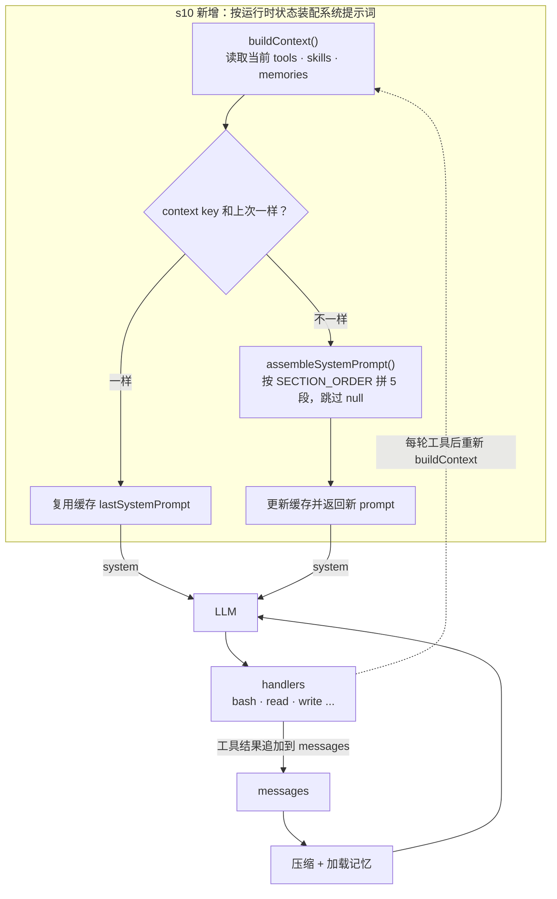

这套装配流水线有三个关键设计：

- **固定顺序、空段省略**：`SECTION_ORDER` 锁定为 `["identity", "tools", "skills", "compaction", "memory"]`。`identity`（读取当前工作目录）和 `compaction` 始终输出；`tools`、`skills`、`memory` 在为空时返回 `null` 自动跳过，不往提示词里塞废话。
- **同态缓存、变动失效**：`getSystemPrompt()` 把 `context` 序列化为 key，状态没变就直接复用上次结果（保持前缀稳定，也有利于服务端 Prompt Cache）；一旦变动立即重拼。
- **每轮工具后刷新**：`agentLoop` 在进入循环前和每批工具跑完后都会重新调用 `buildContext()` 和 `getSystemPrompt()`，让后续动态增删工具或写入记忆能马上反映到提示词里。

顺手说明：本章源码同时去掉了 `s09` 里的三行压缩教学日志，但自动压缩、手动压缩和应急压缩能力全部保留。

---

`s09` 的 `buildSystem` 把所有规则都写死在一条长字符串里，改一段就要动整块。现在换一种组织法：`PROMPT_SECTIONS` 是一张表，每一项都是负责生成一段文案的小函数。我们先放第一段 `identity`，说明“你是谁、在哪里、该怎么干活”。旧的 `buildSystem` 暂时留着，保证当前帧仍可运行。

本次代码变化：5 行。

```js ! agent.js range=352:374
import {
  readdirSync,
  readFileSync,
  existsSync,
  mkdirSync,
  writeFileSync,
  rmSync,
} from "node:fs";
import path from "node:path";
import {
  callLlm,
  runBash,
  readFile,
  writeFile,
  editFile,
  glob,
  tool,
  runChatCli,
  isMainModule,
  parseFrontmatter,
  prepareHistoryForSummary,
} from "./helper.js";

const SKILLS_DIR = path.join(process.cwd(), "skills");

export function scanSkills(dir = SKILLS_DIR) {
  const registry = {};
  if (!existsSync(dir)) return registry;
  for (const entry of readdirSync(dir, { withFileTypes: true })) {
    if (!entry.isDirectory()) continue;
    const manifest = path.join(dir, entry.name, "SKILL.md");
    if (!existsSync(manifest)) continue;
    const raw = readFileSync(manifest, "utf8");
    const { meta } = parseFrontmatter(raw);
    const name = meta.name || entry.name;
    registry[name] = { name, description: meta.description || "", content: raw };
  }
  return registry;
}

export const skillRegistry = scanSkills();

function listSkills() {
  const all = Object.values(skillRegistry);
  return all.length ? all.map((s) => `- ${s.name}: ${s.description}`).join("\n") : "(no skills found)";
}

function loadSkill({ name }) {
  const skill = skillRegistry[name];
  return skill ? skill.content : `Skill not found: ${name}`;
}

const MEMORY_TYPES = ["user", "feedback", "project", "reference"];

let memoryDir = path.join(process.cwd(), ".memory");
export function setMemoryDir(dir) {
  memoryDir = dir;
}
const indexPath = () => path.join(memoryDir, "MEMORY.md");

export function writeMemoryFile(name, type, description, body) {
  mkdirSync(memoryDir, { recursive: true });
  const slug = name.toLowerCase().replace(/[\s/]+/g, "-");
  writeFileSync(
    path.join(memoryDir, `${slug}.md`),
    `---\nname: ${name}\ndescription: ${description}\ntype: ${type}\n---\n\n${body}\n`,
  );
  rebuildIndex();
}

export function listMemoryFiles() {
  if (!existsSync(memoryDir)) return [];
  return readdirSync(memoryDir)
    .filter((f) => f.endsWith(".md") && f !== "MEMORY.md")
    .sort()
    .map((filename) => {
      const raw = readFileSync(path.join(memoryDir, filename), "utf8");
      const { meta, body } = parseFrontmatter(raw);
      return {
        filename,
        name: meta.name || filename.replace(/\.md$/, ""),
        description: meta.description || "",
        type: meta.type || "user",
        body,
        content: raw,
      };
    });
}

function rebuildIndex() {
  const lines = listMemoryFiles().map((m) => `- [${m.name}](${m.filename}) — ${m.description}`);
  mkdirSync(memoryDir, { recursive: true });
  writeFileSync(indexPath(), lines.length ? `${lines.join("\n")}\n` : "");
}

export function readMemoryIndex() {
  return existsSync(indexPath()) ? readFileSync(indexPath(), "utf8").trim() : "";
}

export async function selectRelevantMemories(messages, maxItems = 5) {
  const files = listMemoryFiles();
  if (!files.length) return [];
  const recent = messages
    .filter((m) => m.role === "user" && typeof m.content === "string")
    .slice(-3)
    .map((m) => m.content)
    .join(" ")
    .slice(0, 2000);
  if (!recent.trim()) return [];
  const catalog = files.map((f, i) => `${i}: ${f.name} — ${f.description}`).join("\n");
  try {
    const { message } = await callLlm(
      [
        {
          role: "user",
          content: `Given the recent conversation and the memory catalog, return ONLY a JSON array of the indices that are clearly relevant (e.g. [0, 2]). If none, return [].

Recent conversation:
${recent}

Memory catalog:
${catalog}`,
        },
      ],
      {},
    );
    const match = (message.content || "").match(/\[.*?\]/s);
    if (match) {
      const indices = JSON.parse(match[0]);
      return indices
        .filter((i) => Number.isInteger(i) && i >= 0 && i < files.length)
        .slice(0, maxItems)
        .map((i) => files[i].filename);
    }
  } catch {
  }
  const keywords = recent.toLowerCase().split(/\s+/).filter((w) => w.length > 3);
  return files
    .filter((f) => keywords.some((kw) => `${f.name} ${f.description}`.toLowerCase().includes(kw)))
    .slice(0, maxItems)
    .map((f) => f.filename);
}

export async function loadMemories(messages) {
  const selected = await selectRelevantMemories(messages);
  if (!selected.length) return "";
  const parts = ["<relevant_memories>"];
  for (const filename of selected) parts.push(readFileSync(path.join(memoryDir, filename), "utf8"));
  parts.push("</relevant_memories>");
  return parts.join("\n\n");
}

export async function extractMemories(messages) {
  const dialogue = messages
    .filter((m) => (m.role === "user" || m.role === "assistant") && typeof m.content === "string" && m.content.trim())
    .slice(-10)
    .map((m) => `${m.role}: ${m.content}`)
    .join("\n")
    .slice(0, 4000);
  if (!dialogue.trim()) return 0;
  const existing = listMemoryFiles();
  const existingDesc = existing.length
    ? existing.map((m) => `- ${m.name}: ${m.description}`).join("\n")
    : "(none)";
  try {
    const { message } = await callLlm(
      [
        {
          role: "user",
          content: `Extract durable user preferences, constraints, or project facts from this dialogue.
Return a JSON array; each item: {name, type, description, body}.
- name: short kebab-case id; type: one of ${MEMORY_TYPES.join("/")}; description: one-line; body: markdown detail.
If nothing new or already covered, return [].

Existing memories:
${existingDesc}

Dialogue:
${dialogue}`,
        },
      ],
      {},
    );
    const match = (message.content || "").match(/\[.*\]/s);
    if (!match) return 0;
    const items = JSON.parse(match[0]);
    let count = 0;
    for (const m of items) {
      if (m.description && m.body) {
        writeMemoryFile(
          m.name || `memory-${count}`,
          MEMORY_TYPES.includes(m.type) ? m.type : "user",
          m.description,
          m.body,
        );
        count += 1;
      }
    }
    if (count) console.log(`[Memory: extracted ${count} new memories]`);
    return count;
  } catch {
    return 0;
  }
}

const CONSOLIDATE_THRESHOLD = 10;
export async function consolidateMemories() {
  const files = listMemoryFiles();
  if (files.length < CONSOLIDATE_THRESHOLD) return;
  const catalog = files
    .map((f) => `## ${f.filename}\nname: ${f.name}\ndescription: ${f.description}\n${f.body}`)
    .join("\n\n")
    .slice(0, 16000);
  try {
    const { message } = await callLlm(
      [
        {
          role: "user",
          content: `Consolidate these memory files: merge duplicates, drop outdated/contradicted ones, keep under 30, preserve user preferences above all.
Return a JSON array; each item: {name, type, description, body}.

${catalog}`,
        },
      ],
      {},
    );
    const match = (message.content || "").match(/\[.*\]/s);
    if (!match) return;
    const items = JSON.parse(match[0]);
    for (const f of readdirSync(memoryDir)) {
      if (f.endsWith(".md") && f !== "MEMORY.md") rmSync(path.join(memoryDir, f));
    }
    for (const m of items) {
      if (m.description && m.body) {
        writeMemoryFile(
          m.name || "memory",
          MEMORY_TYPES.includes(m.type) ? m.type : "user",
          m.description,
          m.body,
        );
      }
    }
    console.log(`[Memory: consolidated ${files.length} → ${items.length} memories]`);
  } catch {
  }
}

function buildRequest(messages, memoriesContent) {
  if (!memoriesContent) return messages;
  let idx = -1;
  for (let i = messages.length - 1; i >= 0; i -= 1) {
    if (messages[i].role === "user" && typeof messages[i].content === "string") {
      idx = i;
      break;
    }
  }
  if (idx === -1) return messages;
  const copy = messages.slice();
  copy[idx] = { ...messages[idx], content: `${memoriesContent}\n\n${messages[idx].content}` };
  return copy;
}

const TRANSCRIPT_DIR = path.join(process.cwd(), ".transcripts");
const TOOL_RESULTS_DIR = path.join(process.cwd(), ".task_outputs", "tool-results");

const CONTEXT_LIMIT = 12000;
const KEEP_RECENT = 3;
const PERSIST_THRESHOLD = 30000;
const MAX_REACTIVE_RETRIES = 1;

export const estimateSize = (messages) => JSON.stringify(messages).length;
const isToolResult = (m) => m.role === "tool";

function apply(messages, next) {
  if (next !== messages) messages.splice(0, messages.length, ...next);
  return messages;
}

export function snipCompact(messages, maxMessages = 50) {
  if (messages.length <= maxMessages) return messages;
  let head = 3;
  let tail = messages.length - (maxMessages - 3);
  while (head < messages.length && isToolResult(messages[head])) head += 1;
  while (tail < messages.length && isToolResult(messages[tail])) tail += 1;
  if (head >= tail) return messages;
  return [
    ...messages.slice(0, head),
    { role: "user", content: `[snipped ${tail - head} messages from the middle]` },
    ...messages.slice(tail),
  ];
}

export function microCompact(messages) {
  const toolMsgs = messages.filter(isToolResult);
  if (toolMsgs.length <= KEEP_RECENT) return messages;
  for (const m of toolMsgs.slice(0, -KEEP_RECENT)) {
    if (m.content.length > 120) m.content = "[Earlier tool result compacted. Re-run if needed.]";
  }
  return messages;
}

function persistLargeOutput(id, output) {
  if (output.length <= PERSIST_THRESHOLD) return output;
  mkdirSync(TOOL_RESULTS_DIR, { recursive: true });
  const file = path.join(TOOL_RESULTS_DIR, `${id}.txt`);
  if (!existsSync(file)) writeFileSync(file, output);
  return `<persisted-output>\nFull output: ${file}\nPreview:\n${output.slice(0, 2000)}\n</persisted-output>`;
}

export function toolResultBudget(messages, maxBytes = 200000) {
  const tail = [];
  for (let i = messages.length - 1; i >= 0 && isToolResult(messages[i]); i -= 1) tail.push(messages[i]);
  let total = tail.reduce((n, m) => n + m.content.length, 0);
  if (total <= maxBytes) return messages;
  for (const m of [...tail].sort((a, b) => b.content.length - a.content.length)) {
    if (total <= maxBytes) break;
    if (m.content.length <= PERSIST_THRESHOLD) continue;
    const before = m.content.length;
    m.content = persistLargeOutput(m.tool_call_id, m.content);
    total -= before - m.content.length;
  }
  return messages;
}

function writeTranscript(messages) {
  mkdirSync(TRANSCRIPT_DIR, { recursive: true });
  const file = path.join(TRANSCRIPT_DIR, `transcript-${Date.now()}.jsonl`);
  writeFileSync(file, messages.map((m) => JSON.stringify(m)).join("\n"));
  return file;
}

async function summarizeHistory(messages) {
  const conversation = prepareHistoryForSummary(messages);
  const prompt = `Summarize this coding-agent conversation so work can continue.
Preserve: 1) current goal, 2) key findings/decisions, 3) files read/changed, 4) remaining work, 5) user constraints.
Be compact but concrete.

${conversation}`;
  const { message } = await callLlm([{ role: "user", content: prompt }], {});
  return (message.content || "").trim() || "(empty summary)";
}

export async function compactHistory(messages) {
  writeTranscript(messages);
  const summary = await summarizeHistory(messages);
  return [{ role: "user", content: `[Compacted]\n\n${summary}` }];
}

export async function reactiveCompact(messages) {
  writeTranscript(messages);
  let tail = Math.max(0, messages.length - 5);
  while (tail < messages.length && isToolResult(messages[tail])) tail += 1;
  const summary = await summarizeHistory(messages.slice(0, tail));
  return [{ role: "user", content: `[Reactive compact]\n\n${summary}` }, ...messages.slice(tail)];
}

const isPromptTooLong = (error) =>
  /prompt.*too.*long|too many tokens|context.*length/i.test(String(error.message));

// !focus(start)
const PROMPT_SECTIONS = {
  identity: () =>
    `You are a coding agent at ${process.cwd()}. Use tools to solve tasks. Before a multi-step task, use todo_write to plan and update status as you go. For a complex sub-problem, use the task tool to spawn a subagent.`,
};

// !focus(end)
function buildSystem() {
  const index = readMemoryIndex();
  return `You are a coding agent at ${process.cwd()}. Use tools to solve tasks.
Before a multi-step task, use todo_write to plan and update status as you go.
For a complex sub-problem, use the task tool to spawn a subagent.
Skills available:
${listSkills()}
Use load_skill to get a skill's full content when you need it.
When context gets large, call compact to summarize earlier work and free space.${
    index
      ? `\n\nMemories available:\n${index}\nRespect user preferences from memory. When the user says "remember" or reveals a stable preference, it will be saved.`
      : ""
  }`;
}
const SUB_SYSTEM = `You are a coding subagent at ${process.cwd()}. Complete the task, then return a concise summary. Do not delegate further.`;

const tools = [
  tool("bash", "Run a shell command.", {
    type: "object",
    properties: { command: { type: "string" } },
    required: ["command"],
  }),
  tool("read_file", "Read a file (optional line limit).", {
    type: "object",
    properties: { path: { type: "string" }, limit: { type: "integer" } },
    required: ["path"],
  }),
  tool("write_file", "Write content to a file.", {
    type: "object",
    properties: { path: { type: "string" }, content: { type: "string" } },
    required: ["path", "content"],
  }),
  tool("edit_file", "Replace exact text in a file once.", {
    type: "object",
    properties: {
      path: { type: "string" },
      old_text: { type: "string" },
      new_text: { type: "string" },
    },
    required: ["path", "old_text", "new_text"],
  }),
  tool("glob", "Find files by glob pattern.", {
    type: "object",
    properties: { pattern: { type: "string" } },
    required: ["pattern"],
  }),
  tool("todo_write", "Create and manage a task list for the current session.", {
    type: "object",
    properties: {
      todos: {
        type: "array",
        items: {
          type: "object",
          properties: {
            content: { type: "string" },
            status: { type: "string", enum: ["pending", "in_progress", "completed"] },
          },
          required: ["content", "status"],
        },
      },
    },
    required: ["todos"],
  }),
  tool("task", "Launch a subagent to handle a complex subtask. Returns only the final summary.", {
    type: "object",
    properties: { description: { type: "string" } },
    required: ["description"],
  }),
  tool("load_skill", "Load a skill's full content by name (see the catalog in the system prompt).", {
    type: "object",
    properties: { name: { type: "string" } },
    required: ["name"],
  }),
  tool("compact", "Summarize earlier conversation to free context space.", {
    type: "object",
    properties: { focus: { type: "string" } },
  }),
];

let currentTodos = [];
export function getTodos() {
  return currentTodos;
}

function runTodoWrite({ todos = [] }) {
  currentTodos = todos;
  const icon = { pending: " ", in_progress: "▸", completed: "✓" };
  console.log("## Current Tasks");
  for (const t of currentTodos) console.log(`  [${icon[t.status]}] ${t.content}`);
  return `Updated ${currentTodos.length} tasks`;
}

const handlers = {
  bash: ({ command }) => runBash(command),
  read_file: ({ path, limit }) => readFile(path, limit),
  write_file: ({ path, content }) => writeFile(path, content),
  edit_file: ({ path, old_text, new_text }) => editFile(path, old_text, new_text),
  glob: ({ pattern }) => glob(pattern),
  todo_write: runTodoWrite,
  task: ({ description }, confirm) => spawnSubagent(description, confirm),
  load_skill: loadSkill,
};

const SUB_EXCLUDE = ["task", "todo_write", "load_skill", "compact"];
const subTools = tools.filter((t) => !SUB_EXCLUDE.includes(t.function.name));
const subHandlers = Object.fromEntries(
  Object.entries(handlers).filter(([name]) => !SUB_EXCLUDE.includes(name)),
);
const MAX_SUB_TURNS = 30;

async function spawnSubagent(description, confirm) {
  const messages = [{ role: "user", content: description }];
  for (let turn = 0; turn < MAX_SUB_TURNS; turn += 1) {
    const { message } = await callLlm(messages, { system: SUB_SYSTEM, tools: subTools });
    messages.push(message);
    if (!message.tool_calls?.length) return message.content || "(subagent returned no text)";

    for (const call of message.tool_calls) {
      const name = call.function.name;
      const args = JSON.parse(call.function.arguments || "{}");
      const blocked = await triggerHooks("PreToolUse", name, args, confirm);
      const handler = subHandlers[name];
      const output =
        blocked != null ? String(blocked) : handler ? handler(args) : `Unknown tool: ${name}`;
      messages.push({ role: "tool", tool_call_id: call.id, content: String(output) });
    }
  }
  return "Subagent stopped after 30 turns without a final answer.";
}

export { spawnSubagent };

const hooks = { UserPromptSubmit: [], PreToolUse: [], PostToolUse: [], Stop: [] };

function registerHook(event, callback) {
  hooks[event].push(callback);
}

async function triggerHooks(event, ...args) {
  for (const callback of hooks[event]) {
    const result = await callback(...args);
    if (result != null) return result;
  }
  return null;
}

const DENY = ["rm -rf /", "sudo", "shutdown", "reboot", "mkfs", "dd if="];
const RISKY = ["rm ", "> /etc/", "chmod 777"];

async function permissionHook(name, args, confirm) {
  if (name !== "bash") return null;
  const command = args.command || "";
  if (DENY.some((p) => command.includes(p))) return "Permission denied: 命中黑名单。";
  if (RISKY.some((p) => command.includes(p))) {
    const answer = confirm ? await confirm(`⚠ 可能有破坏性的命令: ${command} 允许? [y/N] `) : "";
    if (!/^y(es)?$/i.test(String(answer).trim())) return "Permission denied by user.";
  }
  return null;
}

registerHook("PreToolUse", permissionHook);

export async function agentLoop(messages, confirm) {
  let roundsSinceTodo = 0;
  let reactiveRetries = 0;
  const system = buildSystem();
  const memoriesContent = await loadMemories(messages);
  let preCompress = messages.map((m) => ({ role: m.role, content: m.content }));

  while (true) {
    if (roundsSinceTodo >= 3) {
      messages.push({ role: "user", content: "<reminder>Update your todos.</reminder>" });
      roundsSinceTodo = 0;
    }

    preCompress = messages.map((m) => ({ role: m.role, content: m.content }));

    apply(messages, toolResultBudget(messages));
    apply(messages, snipCompact(messages));
    apply(messages, microCompact(messages));
    if (estimateSize(messages) > CONTEXT_LIMIT) {
      console.log("[auto compact] compactHistory");
      apply(messages, await compactHistory(messages));
    }

    let message;
    try {
      ({ message } = await callLlm(buildRequest(messages, memoriesContent), { system, tools }));
      reactiveRetries = 0;
    } catch (error) {
      if (reactiveRetries < MAX_REACTIVE_RETRIES && isPromptTooLong(error)) {
        console.log("[reactive compact] reactiveCompact");
        apply(messages, await reactiveCompact(messages));
        reactiveRetries += 1;
        continue;
      }
      throw error;
    }

    if (!message.tool_calls?.length) {
      await extractMemories(preCompress);
      await consolidateMemories();
      return message.content || "";
    }

    messages.push(message);
    roundsSinceTodo += 1;
    let compacted = false;
    for (const call of message.tool_calls) {
      const name = call.function.name;
      const args = JSON.parse(call.function.arguments || "{}");

      if (name === "compact") {
        console.log("[manual compact] compactHistory");
        apply(messages, await compactHistory(messages));
        compacted = true;
        break;
      }

      const blocked = await triggerHooks("PreToolUse", name, args, confirm);
      let output;
      if (blocked != null) {
        output = String(blocked);
      } else {
        const handler = handlers[name];
        output = handler ? await handler(args, confirm) : `Unknown tool: ${name}`;
      }

      if (name === "todo_write") roundsSinceTodo = 0;
      messages.push({ role: "tool", tool_call_id: call.id, content: String(output) });
    }
    if (compacted) continue;
  }
}

async function main() {
  await runChatCli({
    promptLabel: "s09 >> ",
    onPrompt: async ({ prompt, messages, ask }) => {
      return agentLoop(messages, ask);
    },
  });
}

if (isMainModule(import.meta.url)) {
  main().catch((error) => {
    console.error(error.message);
    process.exit(1);
  });
}
```

## !!steps
接着往 `PROMPT_SECTIONS` 里补齐其余四段。每个函数接收当前状态对象 `ctx`，最大的好处是支持返回 `null`：没有工具、没有技能或没有记忆时直接跳过对应段落，不再往提示词里拼“可用技能：(no skills found)”这种无效空话。

本次代码变化：8 行。

```js ! agent.js range=355:380
import {
  readdirSync,
  readFileSync,
  existsSync,
  mkdirSync,
  writeFileSync,
  rmSync,
} from "node:fs";
import path from "node:path";
import {
  callLlm,
  runBash,
  readFile,
  writeFile,
  editFile,
  glob,
  tool,
  runChatCli,
  isMainModule,
  parseFrontmatter,
  prepareHistoryForSummary,
} from "./helper.js";

const SKILLS_DIR = path.join(process.cwd(), "skills");

export function scanSkills(dir = SKILLS_DIR) {
  const registry = {};
  if (!existsSync(dir)) return registry;
  for (const entry of readdirSync(dir, { withFileTypes: true })) {
    if (!entry.isDirectory()) continue;
    const manifest = path.join(dir, entry.name, "SKILL.md");
    if (!existsSync(manifest)) continue;
    const raw = readFileSync(manifest, "utf8");
    const { meta } = parseFrontmatter(raw);
    const name = meta.name || entry.name;
    registry[name] = { name, description: meta.description || "", content: raw };
  }
  return registry;
}

export const skillRegistry = scanSkills();

function listSkills() {
  const all = Object.values(skillRegistry);
  return all.length ? all.map((s) => `- ${s.name}: ${s.description}`).join("\n") : "(no skills found)";
}

function loadSkill({ name }) {
  const skill = skillRegistry[name];
  return skill ? skill.content : `Skill not found: ${name}`;
}

const MEMORY_TYPES = ["user", "feedback", "project", "reference"];

let memoryDir = path.join(process.cwd(), ".memory");
export function setMemoryDir(dir) {
  memoryDir = dir;
}
const indexPath = () => path.join(memoryDir, "MEMORY.md");

export function writeMemoryFile(name, type, description, body) {
  mkdirSync(memoryDir, { recursive: true });
  const slug = name.toLowerCase().replace(/[\s/]+/g, "-");
  writeFileSync(
    path.join(memoryDir, `${slug}.md`),
    `---\nname: ${name}\ndescription: ${description}\ntype: ${type}\n---\n\n${body}\n`,
  );
  rebuildIndex();
}

export function listMemoryFiles() {
  if (!existsSync(memoryDir)) return [];
  return readdirSync(memoryDir)
    .filter((f) => f.endsWith(".md") && f !== "MEMORY.md")
    .sort()
    .map((filename) => {
      const raw = readFileSync(path.join(memoryDir, filename), "utf8");
      const { meta, body } = parseFrontmatter(raw);
      return {
        filename,
        name: meta.name || filename.replace(/\.md$/, ""),
        description: meta.description || "",
        type: meta.type || "user",
        body,
        content: raw,
      };
    });
}

function rebuildIndex() {
  const lines = listMemoryFiles().map((m) => `- [${m.name}](${m.filename}) — ${m.description}`);
  mkdirSync(memoryDir, { recursive: true });
  writeFileSync(indexPath(), lines.length ? `${lines.join("\n")}\n` : "");
}

export function readMemoryIndex() {
  return existsSync(indexPath()) ? readFileSync(indexPath(), "utf8").trim() : "";
}

export async function selectRelevantMemories(messages, maxItems = 5) {
  const files = listMemoryFiles();
  if (!files.length) return [];
  const recent = messages
    .filter((m) => m.role === "user" && typeof m.content === "string")
    .slice(-3)
    .map((m) => m.content)
    .join(" ")
    .slice(0, 2000);
  if (!recent.trim()) return [];
  const catalog = files.map((f, i) => `${i}: ${f.name} — ${f.description}`).join("\n");
  try {
    const { message } = await callLlm(
      [
        {
          role: "user",
          content: `Given the recent conversation and the memory catalog, return ONLY a JSON array of the indices that are clearly relevant (e.g. [0, 2]). If none, return [].

Recent conversation:
${recent}

Memory catalog:
${catalog}`,
        },
      ],
      {},
    );
    const match = (message.content || "").match(/\[.*?\]/s);
    if (match) {
      const indices = JSON.parse(match[0]);
      return indices
        .filter((i) => Number.isInteger(i) && i >= 0 && i < files.length)
        .slice(0, maxItems)
        .map((i) => files[i].filename);
    }
  } catch {
  }
  const keywords = recent.toLowerCase().split(/\s+/).filter((w) => w.length > 3);
  return files
    .filter((f) => keywords.some((kw) => `${f.name} ${f.description}`.toLowerCase().includes(kw)))
    .slice(0, maxItems)
    .map((f) => f.filename);
}

export async function loadMemories(messages) {
  const selected = await selectRelevantMemories(messages);
  if (!selected.length) return "";
  const parts = ["<relevant_memories>"];
  for (const filename of selected) parts.push(readFileSync(path.join(memoryDir, filename), "utf8"));
  parts.push("</relevant_memories>");
  return parts.join("\n\n");
}

export async function extractMemories(messages) {
  const dialogue = messages
    .filter((m) => (m.role === "user" || m.role === "assistant") && typeof m.content === "string" && m.content.trim())
    .slice(-10)
    .map((m) => `${m.role}: ${m.content}`)
    .join("\n")
    .slice(0, 4000);
  if (!dialogue.trim()) return 0;
  const existing = listMemoryFiles();
  const existingDesc = existing.length
    ? existing.map((m) => `- ${m.name}: ${m.description}`).join("\n")
    : "(none)";
  try {
    const { message } = await callLlm(
      [
        {
          role: "user",
          content: `Extract durable user preferences, constraints, or project facts from this dialogue.
Return a JSON array; each item: {name, type, description, body}.
- name: short kebab-case id; type: one of ${MEMORY_TYPES.join("/")}; description: one-line; body: markdown detail.
If nothing new or already covered, return [].

Existing memories:
${existingDesc}

Dialogue:
${dialogue}`,
        },
      ],
      {},
    );
    const match = (message.content || "").match(/\[.*\]/s);
    if (!match) return 0;
    const items = JSON.parse(match[0]);
    let count = 0;
    for (const m of items) {
      if (m.description && m.body) {
        writeMemoryFile(
          m.name || `memory-${count}`,
          MEMORY_TYPES.includes(m.type) ? m.type : "user",
          m.description,
          m.body,
        );
        count += 1;
      }
    }
    if (count) console.log(`[Memory: extracted ${count} new memories]`);
    return count;
  } catch {
    return 0;
  }
}

const CONSOLIDATE_THRESHOLD = 10;
export async function consolidateMemories() {
  const files = listMemoryFiles();
  if (files.length < CONSOLIDATE_THRESHOLD) return;
  const catalog = files
    .map((f) => `## ${f.filename}\nname: ${f.name}\ndescription: ${f.description}\n${f.body}`)
    .join("\n\n")
    .slice(0, 16000);
  try {
    const { message } = await callLlm(
      [
        {
          role: "user",
          content: `Consolidate these memory files: merge duplicates, drop outdated/contradicted ones, keep under 30, preserve user preferences above all.
Return a JSON array; each item: {name, type, description, body}.

${catalog}`,
        },
      ],
      {},
    );
    const match = (message.content || "").match(/\[.*\]/s);
    if (!match) return;
    const items = JSON.parse(match[0]);
    for (const f of readdirSync(memoryDir)) {
      if (f.endsWith(".md") && f !== "MEMORY.md") rmSync(path.join(memoryDir, f));
    }
    for (const m of items) {
      if (m.description && m.body) {
        writeMemoryFile(
          m.name || "memory",
          MEMORY_TYPES.includes(m.type) ? m.type : "user",
          m.description,
          m.body,
        );
      }
    }
    console.log(`[Memory: consolidated ${files.length} → ${items.length} memories]`);
  } catch {
  }
}

function buildRequest(messages, memoriesContent) {
  if (!memoriesContent) return messages;
  let idx = -1;
  for (let i = messages.length - 1; i >= 0; i -= 1) {
    if (messages[i].role === "user" && typeof messages[i].content === "string") {
      idx = i;
      break;
    }
  }
  if (idx === -1) return messages;
  const copy = messages.slice();
  copy[idx] = { ...messages[idx], content: `${memoriesContent}\n\n${messages[idx].content}` };
  return copy;
}

const TRANSCRIPT_DIR = path.join(process.cwd(), ".transcripts");
const TOOL_RESULTS_DIR = path.join(process.cwd(), ".task_outputs", "tool-results");

const CONTEXT_LIMIT = 12000;
const KEEP_RECENT = 3;
const PERSIST_THRESHOLD = 30000;
const MAX_REACTIVE_RETRIES = 1;

export const estimateSize = (messages) => JSON.stringify(messages).length;
const isToolResult = (m) => m.role === "tool";

function apply(messages, next) {
  if (next !== messages) messages.splice(0, messages.length, ...next);
  return messages;
}

export function snipCompact(messages, maxMessages = 50) {
  if (messages.length <= maxMessages) return messages;
  let head = 3;
  let tail = messages.length - (maxMessages - 3);
  while (head < messages.length && isToolResult(messages[head])) head += 1;
  while (tail < messages.length && isToolResult(messages[tail])) tail += 1;
  if (head >= tail) return messages;
  return [
    ...messages.slice(0, head),
    { role: "user", content: `[snipped ${tail - head} messages from the middle]` },
    ...messages.slice(tail),
  ];
}

export function microCompact(messages) {
  const toolMsgs = messages.filter(isToolResult);
  if (toolMsgs.length <= KEEP_RECENT) return messages;
  for (const m of toolMsgs.slice(0, -KEEP_RECENT)) {
    if (m.content.length > 120) m.content = "[Earlier tool result compacted. Re-run if needed.]";
  }
  return messages;
}

function persistLargeOutput(id, output) {
  if (output.length <= PERSIST_THRESHOLD) return output;
  mkdirSync(TOOL_RESULTS_DIR, { recursive: true });
  const file = path.join(TOOL_RESULTS_DIR, `${id}.txt`);
  if (!existsSync(file)) writeFileSync(file, output);
  return `<persisted-output>\nFull output: ${file}\nPreview:\n${output.slice(0, 2000)}\n</persisted-output>`;
}

export function toolResultBudget(messages, maxBytes = 200000) {
  const tail = [];
  for (let i = messages.length - 1; i >= 0 && isToolResult(messages[i]); i -= 1) tail.push(messages[i]);
  let total = tail.reduce((n, m) => n + m.content.length, 0);
  if (total <= maxBytes) return messages;
  for (const m of [...tail].sort((a, b) => b.content.length - a.content.length)) {
    if (total <= maxBytes) break;
    if (m.content.length <= PERSIST_THRESHOLD) continue;
    const before = m.content.length;
    m.content = persistLargeOutput(m.tool_call_id, m.content);
    total -= before - m.content.length;
  }
  return messages;
}

function writeTranscript(messages) {
  mkdirSync(TRANSCRIPT_DIR, { recursive: true });
  const file = path.join(TRANSCRIPT_DIR, `transcript-${Date.now()}.jsonl`);
  writeFileSync(file, messages.map((m) => JSON.stringify(m)).join("\n"));
  return file;
}

async function summarizeHistory(messages) {
  const conversation = prepareHistoryForSummary(messages);
  const prompt = `Summarize this coding-agent conversation so work can continue.
Preserve: 1) current goal, 2) key findings/decisions, 3) files read/changed, 4) remaining work, 5) user constraints.
Be compact but concrete.

${conversation}`;
  const { message } = await callLlm([{ role: "user", content: prompt }], {});
  return (message.content || "").trim() || "(empty summary)";
}

export async function compactHistory(messages) {
  writeTranscript(messages);
  const summary = await summarizeHistory(messages);
  return [{ role: "user", content: `[Compacted]\n\n${summary}` }];
}

export async function reactiveCompact(messages) {
  writeTranscript(messages);
  let tail = Math.max(0, messages.length - 5);
  while (tail < messages.length && isToolResult(messages[tail])) tail += 1;
  const summary = await summarizeHistory(messages.slice(0, tail));
  return [{ role: "user", content: `[Reactive compact]\n\n${summary}` }, ...messages.slice(tail)];
}

const isPromptTooLong = (error) =>
  /prompt.*too.*long|too many tokens|context.*length/i.test(String(error.message));

const PROMPT_SECTIONS = {
  identity: () =>
    `You are a coding agent at ${process.cwd()}. Use tools to solve tasks. Before a multi-step task, use todo_write to plan and update status as you go. For a complex sub-problem, use the task tool to spawn a subagent.`,
// !focus(start)
  tools: (ctx) => (ctx.tools.length ? `Available tools: ${ctx.tools.join(", ")}.` : null),
  skills: (ctx) =>
    ctx.skills ? `Skills available:\n${ctx.skills}\nUse load_skill to load a skill's full content when needed.` : null,
  compaction: () => "When context gets large, call compact to summarize earlier work and free space.",
  memory: (ctx) =>
    ctx.memories
      ? `Memories available:\n${ctx.memories}\nRespect user preferences from memory; new ones are saved automatically.`
      : null,
// !focus(end)
};

function buildSystem() {
  const index = readMemoryIndex();
  return `You are a coding agent at ${process.cwd()}. Use tools to solve tasks.
Before a multi-step task, use todo_write to plan and update status as you go.
For a complex sub-problem, use the task tool to spawn a subagent.
Skills available:
${listSkills()}
Use load_skill to get a skill's full content when you need it.
When context gets large, call compact to summarize earlier work and free space.${
    index
      ? `\n\nMemories available:\n${index}\nRespect user preferences from memory. When the user says "remember" or reveals a stable preference, it will be saved.`
      : ""
  }`;
}
const SUB_SYSTEM = `You are a coding subagent at ${process.cwd()}. Complete the task, then return a concise summary. Do not delegate further.`;

const tools = [
  tool("bash", "Run a shell command.", {
    type: "object",
    properties: { command: { type: "string" } },
    required: ["command"],
  }),
  tool("read_file", "Read a file (optional line limit).", {
    type: "object",
    properties: { path: { type: "string" }, limit: { type: "integer" } },
    required: ["path"],
  }),
  tool("write_file", "Write content to a file.", {
    type: "object",
    properties: { path: { type: "string" }, content: { type: "string" } },
    required: ["path", "content"],
  }),
  tool("edit_file", "Replace exact text in a file once.", {
    type: "object",
    properties: {
      path: { type: "string" },
      old_text: { type: "string" },
      new_text: { type: "string" },
    },
    required: ["path", "old_text", "new_text"],
  }),
  tool("glob", "Find files by glob pattern.", {
    type: "object",
    properties: { pattern: { type: "string" } },
    required: ["pattern"],
  }),
  tool("todo_write", "Create and manage a task list for the current session.", {
    type: "object",
    properties: {
      todos: {
        type: "array",
        items: {
          type: "object",
          properties: {
            content: { type: "string" },
            status: { type: "string", enum: ["pending", "in_progress", "completed"] },
          },
          required: ["content", "status"],
        },
      },
    },
    required: ["todos"],
  }),
  tool("task", "Launch a subagent to handle a complex subtask. Returns only the final summary.", {
    type: "object",
    properties: { description: { type: "string" } },
    required: ["description"],
  }),
  tool("load_skill", "Load a skill's full content by name (see the catalog in the system prompt).", {
    type: "object",
    properties: { name: { type: "string" } },
    required: ["name"],
  }),
  tool("compact", "Summarize earlier conversation to free context space.", {
    type: "object",
    properties: { focus: { type: "string" } },
  }),
];

let currentTodos = [];
export function getTodos() {
  return currentTodos;
}

function runTodoWrite({ todos = [] }) {
  currentTodos = todos;
  const icon = { pending: " ", in_progress: "▸", completed: "✓" };
  console.log("## Current Tasks");
  for (const t of currentTodos) console.log(`  [${icon[t.status]}] ${t.content}`);
  return `Updated ${currentTodos.length} tasks`;
}

const handlers = {
  bash: ({ command }) => runBash(command),
  read_file: ({ path, limit }) => readFile(path, limit),
  write_file: ({ path, content }) => writeFile(path, content),
  edit_file: ({ path, old_text, new_text }) => editFile(path, old_text, new_text),
  glob: ({ pattern }) => glob(pattern),
  todo_write: runTodoWrite,
  task: ({ description }, confirm) => spawnSubagent(description, confirm),
  load_skill: loadSkill,
};

const SUB_EXCLUDE = ["task", "todo_write", "load_skill", "compact"];
const subTools = tools.filter((t) => !SUB_EXCLUDE.includes(t.function.name));
const subHandlers = Object.fromEntries(
  Object.entries(handlers).filter(([name]) => !SUB_EXCLUDE.includes(name)),
);
const MAX_SUB_TURNS = 30;

async function spawnSubagent(description, confirm) {
  const messages = [{ role: "user", content: description }];
  for (let turn = 0; turn < MAX_SUB_TURNS; turn += 1) {
    const { message } = await callLlm(messages, { system: SUB_SYSTEM, tools: subTools });
    messages.push(message);
    if (!message.tool_calls?.length) return message.content || "(subagent returned no text)";

    for (const call of message.tool_calls) {
      const name = call.function.name;
      const args = JSON.parse(call.function.arguments || "{}");
      const blocked = await triggerHooks("PreToolUse", name, args, confirm);
      const handler = subHandlers[name];
      const output =
        blocked != null ? String(blocked) : handler ? handler(args) : `Unknown tool: ${name}`;
      messages.push({ role: "tool", tool_call_id: call.id, content: String(output) });
    }
  }
  return "Subagent stopped after 30 turns without a final answer.";
}

export { spawnSubagent };

const hooks = { UserPromptSubmit: [], PreToolUse: [], PostToolUse: [], Stop: [] };

function registerHook(event, callback) {
  hooks[event].push(callback);
}

async function triggerHooks(event, ...args) {
  for (const callback of hooks[event]) {
    const result = await callback(...args);
    if (result != null) return result;
  }
  return null;
}

const DENY = ["rm -rf /", "sudo", "shutdown", "reboot", "mkfs", "dd if="];
const RISKY = ["rm ", "> /etc/", "chmod 777"];

async function permissionHook(name, args, confirm) {
  if (name !== "bash") return null;
  const command = args.command || "";
  if (DENY.some((p) => command.includes(p))) return "Permission denied: 命中黑名单。";
  if (RISKY.some((p) => command.includes(p))) {
    const answer = confirm ? await confirm(`⚠ 可能有破坏性的命令: ${command} 允许? [y/N] `) : "";
    if (!/^y(es)?$/i.test(String(answer).trim())) return "Permission denied by user.";
  }
  return null;
}

registerHook("PreToolUse", permissionHook);

export async function agentLoop(messages, confirm) {
  let roundsSinceTodo = 0;
  let reactiveRetries = 0;
  const system = buildSystem();
  const memoriesContent = await loadMemories(messages);
  let preCompress = messages.map((m) => ({ role: m.role, content: m.content }));

  while (true) {
    if (roundsSinceTodo >= 3) {
      messages.push({ role: "user", content: "<reminder>Update your todos.</reminder>" });
      roundsSinceTodo = 0;
    }

    preCompress = messages.map((m) => ({ role: m.role, content: m.content }));

    apply(messages, toolResultBudget(messages));
    apply(messages, snipCompact(messages));
    apply(messages, microCompact(messages));
    if (estimateSize(messages) > CONTEXT_LIMIT) {
      console.log("[auto compact] compactHistory");
      apply(messages, await compactHistory(messages));
    }

    let message;
    try {
      ({ message } = await callLlm(buildRequest(messages, memoriesContent), { system, tools }));
      reactiveRetries = 0;
    } catch (error) {
      if (reactiveRetries < MAX_REACTIVE_RETRIES && isPromptTooLong(error)) {
        console.log("[reactive compact] reactiveCompact");
        apply(messages, await reactiveCompact(messages));
        reactiveRetries += 1;
        continue;
      }
      throw error;
    }

    if (!message.tool_calls?.length) {
      await extractMemories(preCompress);
      await consolidateMemories();
      return message.content || "";
    }

    messages.push(message);
    roundsSinceTodo += 1;
    let compacted = false;
    for (const call of message.tool_calls) {
      const name = call.function.name;
      const args = JSON.parse(call.function.arguments || "{}");

      if (name === "compact") {
        console.log("[manual compact] compactHistory");
        apply(messages, await compactHistory(messages));
        compacted = true;
        break;
      }

      const blocked = await triggerHooks("PreToolUse", name, args, confirm);
      let output;
      if (blocked != null) {
        output = String(blocked);
      } else {
        const handler = handlers[name];
        output = handler ? await handler(args, confirm) : `Unknown tool: ${name}`;
      }

      if (name === "todo_write") roundsSinceTodo = 0;
      messages.push({ role: "tool", tool_call_id: call.id, content: String(output) });
    }
    if (compacted) continue;
  }
}

async function main() {
  await runChatCli({
    promptLabel: "s09 >> ",
    onPrompt: async ({ prompt, messages, ask }) => {
      return agentLoop(messages, ask);
    },
  });
}

if (isMainModule(import.meta.url)) {
  main().catch((error) => {
    console.error(error.message);
    process.exit(1);
  });
}
```

## !!steps
`SECTION_ORDER` 显式规定五段的先后顺序，`assembleSystemPrompt` 按序调用每个段落函数，用 `.filter(Boolean)` 滤掉 `null`，再用空行拼成最终文案。顺序必须固定：同样的状态每次都会产出逐字节一致的提示词，后面的缓存和服务端前缀复用才立得住。

本次代码变化：6 行。

```js ! agent.js range=364:387
import {
  readdirSync,
  readFileSync,
  existsSync,
  mkdirSync,
  writeFileSync,
  rmSync,
} from "node:fs";
import path from "node:path";
import {
  callLlm,
  runBash,
  readFile,
  writeFile,
  editFile,
  glob,
  tool,
  runChatCli,
  isMainModule,
  parseFrontmatter,
  prepareHistoryForSummary,
} from "./helper.js";

const SKILLS_DIR = path.join(process.cwd(), "skills");

export function scanSkills(dir = SKILLS_DIR) {
  const registry = {};
  if (!existsSync(dir)) return registry;
  for (const entry of readdirSync(dir, { withFileTypes: true })) {
    if (!entry.isDirectory()) continue;
    const manifest = path.join(dir, entry.name, "SKILL.md");
    if (!existsSync(manifest)) continue;
    const raw = readFileSync(manifest, "utf8");
    const { meta } = parseFrontmatter(raw);
    const name = meta.name || entry.name;
    registry[name] = { name, description: meta.description || "", content: raw };
  }
  return registry;
}

export const skillRegistry = scanSkills();

function listSkills() {
  const all = Object.values(skillRegistry);
  return all.length ? all.map((s) => `- ${s.name}: ${s.description}`).join("\n") : "(no skills found)";
}

function loadSkill({ name }) {
  const skill = skillRegistry[name];
  return skill ? skill.content : `Skill not found: ${name}`;
}

const MEMORY_TYPES = ["user", "feedback", "project", "reference"];

let memoryDir = path.join(process.cwd(), ".memory");
export function setMemoryDir(dir) {
  memoryDir = dir;
}
const indexPath = () => path.join(memoryDir, "MEMORY.md");

export function writeMemoryFile(name, type, description, body) {
  mkdirSync(memoryDir, { recursive: true });
  const slug = name.toLowerCase().replace(/[\s/]+/g, "-");
  writeFileSync(
    path.join(memoryDir, `${slug}.md`),
    `---\nname: ${name}\ndescription: ${description}\ntype: ${type}\n---\n\n${body}\n`,
  );
  rebuildIndex();
}

export function listMemoryFiles() {
  if (!existsSync(memoryDir)) return [];
  return readdirSync(memoryDir)
    .filter((f) => f.endsWith(".md") && f !== "MEMORY.md")
    .sort()
    .map((filename) => {
      const raw = readFileSync(path.join(memoryDir, filename), "utf8");
      const { meta, body } = parseFrontmatter(raw);
      return {
        filename,
        name: meta.name || filename.replace(/\.md$/, ""),
        description: meta.description || "",
        type: meta.type || "user",
        body,
        content: raw,
      };
    });
}

function rebuildIndex() {
  const lines = listMemoryFiles().map((m) => `- [${m.name}](${m.filename}) — ${m.description}`);
  mkdirSync(memoryDir, { recursive: true });
  writeFileSync(indexPath(), lines.length ? `${lines.join("\n")}\n` : "");
}

export function readMemoryIndex() {
  return existsSync(indexPath()) ? readFileSync(indexPath(), "utf8").trim() : "";
}

export async function selectRelevantMemories(messages, maxItems = 5) {
  const files = listMemoryFiles();
  if (!files.length) return [];
  const recent = messages
    .filter((m) => m.role === "user" && typeof m.content === "string")
    .slice(-3)
    .map((m) => m.content)
    .join(" ")
    .slice(0, 2000);
  if (!recent.trim()) return [];
  const catalog = files.map((f, i) => `${i}: ${f.name} — ${f.description}`).join("\n");
  try {
    const { message } = await callLlm(
      [
        {
          role: "user",
          content: `Given the recent conversation and the memory catalog, return ONLY a JSON array of the indices that are clearly relevant (e.g. [0, 2]). If none, return [].

Recent conversation:
${recent}

Memory catalog:
${catalog}`,
        },
      ],
      {},
    );
    const match = (message.content || "").match(/\[.*?\]/s);
    if (match) {
      const indices = JSON.parse(match[0]);
      return indices
        .filter((i) => Number.isInteger(i) && i >= 0 && i < files.length)
        .slice(0, maxItems)
        .map((i) => files[i].filename);
    }
  } catch {
  }
  const keywords = recent.toLowerCase().split(/\s+/).filter((w) => w.length > 3);
  return files
    .filter((f) => keywords.some((kw) => `${f.name} ${f.description}`.toLowerCase().includes(kw)))
    .slice(0, maxItems)
    .map((f) => f.filename);
}

export async function loadMemories(messages) {
  const selected = await selectRelevantMemories(messages);
  if (!selected.length) return "";
  const parts = ["<relevant_memories>"];
  for (const filename of selected) parts.push(readFileSync(path.join(memoryDir, filename), "utf8"));
  parts.push("</relevant_memories>");
  return parts.join("\n\n");
}

export async function extractMemories(messages) {
  const dialogue = messages
    .filter((m) => (m.role === "user" || m.role === "assistant") && typeof m.content === "string" && m.content.trim())
    .slice(-10)
    .map((m) => `${m.role}: ${m.content}`)
    .join("\n")
    .slice(0, 4000);
  if (!dialogue.trim()) return 0;
  const existing = listMemoryFiles();
  const existingDesc = existing.length
    ? existing.map((m) => `- ${m.name}: ${m.description}`).join("\n")
    : "(none)";
  try {
    const { message } = await callLlm(
      [
        {
          role: "user",
          content: `Extract durable user preferences, constraints, or project facts from this dialogue.
Return a JSON array; each item: {name, type, description, body}.
- name: short kebab-case id; type: one of ${MEMORY_TYPES.join("/")}; description: one-line; body: markdown detail.
If nothing new or already covered, return [].

Existing memories:
${existingDesc}

Dialogue:
${dialogue}`,
        },
      ],
      {},
    );
    const match = (message.content || "").match(/\[.*\]/s);
    if (!match) return 0;
    const items = JSON.parse(match[0]);
    let count = 0;
    for (const m of items) {
      if (m.description && m.body) {
        writeMemoryFile(
          m.name || `memory-${count}`,
          MEMORY_TYPES.includes(m.type) ? m.type : "user",
          m.description,
          m.body,
        );
        count += 1;
      }
    }
    if (count) console.log(`[Memory: extracted ${count} new memories]`);
    return count;
  } catch {
    return 0;
  }
}

const CONSOLIDATE_THRESHOLD = 10;
export async function consolidateMemories() {
  const files = listMemoryFiles();
  if (files.length < CONSOLIDATE_THRESHOLD) return;
  const catalog = files
    .map((f) => `## ${f.filename}\nname: ${f.name}\ndescription: ${f.description}\n${f.body}`)
    .join("\n\n")
    .slice(0, 16000);
  try {
    const { message } = await callLlm(
      [
        {
          role: "user",
          content: `Consolidate these memory files: merge duplicates, drop outdated/contradicted ones, keep under 30, preserve user preferences above all.
Return a JSON array; each item: {name, type, description, body}.

${catalog}`,
        },
      ],
      {},
    );
    const match = (message.content || "").match(/\[.*\]/s);
    if (!match) return;
    const items = JSON.parse(match[0]);
    for (const f of readdirSync(memoryDir)) {
      if (f.endsWith(".md") && f !== "MEMORY.md") rmSync(path.join(memoryDir, f));
    }
    for (const m of items) {
      if (m.description && m.body) {
        writeMemoryFile(
          m.name || "memory",
          MEMORY_TYPES.includes(m.type) ? m.type : "user",
          m.description,
          m.body,
        );
      }
    }
    console.log(`[Memory: consolidated ${files.length} → ${items.length} memories]`);
  } catch {
  }
}

function buildRequest(messages, memoriesContent) {
  if (!memoriesContent) return messages;
  let idx = -1;
  for (let i = messages.length - 1; i >= 0; i -= 1) {
    if (messages[i].role === "user" && typeof messages[i].content === "string") {
      idx = i;
      break;
    }
  }
  if (idx === -1) return messages;
  const copy = messages.slice();
  copy[idx] = { ...messages[idx], content: `${memoriesContent}\n\n${messages[idx].content}` };
  return copy;
}

const TRANSCRIPT_DIR = path.join(process.cwd(), ".transcripts");
const TOOL_RESULTS_DIR = path.join(process.cwd(), ".task_outputs", "tool-results");

const CONTEXT_LIMIT = 12000;
const KEEP_RECENT = 3;
const PERSIST_THRESHOLD = 30000;
const MAX_REACTIVE_RETRIES = 1;

export const estimateSize = (messages) => JSON.stringify(messages).length;
const isToolResult = (m) => m.role === "tool";

function apply(messages, next) {
  if (next !== messages) messages.splice(0, messages.length, ...next);
  return messages;
}

export function snipCompact(messages, maxMessages = 50) {
  if (messages.length <= maxMessages) return messages;
  let head = 3;
  let tail = messages.length - (maxMessages - 3);
  while (head < messages.length && isToolResult(messages[head])) head += 1;
  while (tail < messages.length && isToolResult(messages[tail])) tail += 1;
  if (head >= tail) return messages;
  return [
    ...messages.slice(0, head),
    { role: "user", content: `[snipped ${tail - head} messages from the middle]` },
    ...messages.slice(tail),
  ];
}

export function microCompact(messages) {
  const toolMsgs = messages.filter(isToolResult);
  if (toolMsgs.length <= KEEP_RECENT) return messages;
  for (const m of toolMsgs.slice(0, -KEEP_RECENT)) {
    if (m.content.length > 120) m.content = "[Earlier tool result compacted. Re-run if needed.]";
  }
  return messages;
}

function persistLargeOutput(id, output) {
  if (output.length <= PERSIST_THRESHOLD) return output;
  mkdirSync(TOOL_RESULTS_DIR, { recursive: true });
  const file = path.join(TOOL_RESULTS_DIR, `${id}.txt`);
  if (!existsSync(file)) writeFileSync(file, output);
  return `<persisted-output>\nFull output: ${file}\nPreview:\n${output.slice(0, 2000)}\n</persisted-output>`;
}

export function toolResultBudget(messages, maxBytes = 200000) {
  const tail = [];
  for (let i = messages.length - 1; i >= 0 && isToolResult(messages[i]); i -= 1) tail.push(messages[i]);
  let total = tail.reduce((n, m) => n + m.content.length, 0);
  if (total <= maxBytes) return messages;
  for (const m of [...tail].sort((a, b) => b.content.length - a.content.length)) {
    if (total <= maxBytes) break;
    if (m.content.length <= PERSIST_THRESHOLD) continue;
    const before = m.content.length;
    m.content = persistLargeOutput(m.tool_call_id, m.content);
    total -= before - m.content.length;
  }
  return messages;
}

function writeTranscript(messages) {
  mkdirSync(TRANSCRIPT_DIR, { recursive: true });
  const file = path.join(TRANSCRIPT_DIR, `transcript-${Date.now()}.jsonl`);
  writeFileSync(file, messages.map((m) => JSON.stringify(m)).join("\n"));
  return file;
}

async function summarizeHistory(messages) {
  const conversation = prepareHistoryForSummary(messages);
  const prompt = `Summarize this coding-agent conversation so work can continue.
Preserve: 1) current goal, 2) key findings/decisions, 3) files read/changed, 4) remaining work, 5) user constraints.
Be compact but concrete.

${conversation}`;
  const { message } = await callLlm([{ role: "user", content: prompt }], {});
  return (message.content || "").trim() || "(empty summary)";
}

export async function compactHistory(messages) {
  writeTranscript(messages);
  const summary = await summarizeHistory(messages);
  return [{ role: "user", content: `[Compacted]\n\n${summary}` }];
}

export async function reactiveCompact(messages) {
  writeTranscript(messages);
  let tail = Math.max(0, messages.length - 5);
  while (tail < messages.length && isToolResult(messages[tail])) tail += 1;
  const summary = await summarizeHistory(messages.slice(0, tail));
  return [{ role: "user", content: `[Reactive compact]\n\n${summary}` }, ...messages.slice(tail)];
}

const isPromptTooLong = (error) =>
  /prompt.*too.*long|too many tokens|context.*length/i.test(String(error.message));

const PROMPT_SECTIONS = {
  identity: () =>
    `You are a coding agent at ${process.cwd()}. Use tools to solve tasks. Before a multi-step task, use todo_write to plan and update status as you go. For a complex sub-problem, use the task tool to spawn a subagent.`,
  tools: (ctx) => (ctx.tools.length ? `Available tools: ${ctx.tools.join(", ")}.` : null),
  skills: (ctx) =>
    ctx.skills ? `Skills available:\n${ctx.skills}\nUse load_skill to load a skill's full content when needed.` : null,
  compaction: () => "When context gets large, call compact to summarize earlier work and free space.",
  memory: (ctx) =>
    ctx.memories
      ? `Memories available:\n${ctx.memories}\nRespect user preferences from memory; new ones are saved automatically.`
      : null,
};
// !focus(start)
const SECTION_ORDER = ["identity", "tools", "skills", "compaction", "memory"];

export function assembleSystemPrompt(context) {
  return SECTION_ORDER.map((key) => PROMPT_SECTIONS[key](context)).filter(Boolean).join("\n\n");
}

// !focus(end)

function buildSystem() {
  const index = readMemoryIndex();
  return `You are a coding agent at ${process.cwd()}. Use tools to solve tasks.
Before a multi-step task, use todo_write to plan and update status as you go.
For a complex sub-problem, use the task tool to spawn a subagent.
Skills available:
${listSkills()}
Use load_skill to get a skill's full content when you need it.
When context gets large, call compact to summarize earlier work and free space.${
    index
      ? `\n\nMemories available:\n${index}\nRespect user preferences from memory. When the user says "remember" or reveals a stable preference, it will be saved.`
      : ""
  }`;
}
const SUB_SYSTEM = `You are a coding subagent at ${process.cwd()}. Complete the task, then return a concise summary. Do not delegate further.`;

const tools = [
  tool("bash", "Run a shell command.", {
    type: "object",
    properties: { command: { type: "string" } },
    required: ["command"],
  }),
  tool("read_file", "Read a file (optional line limit).", {
    type: "object",
    properties: { path: { type: "string" }, limit: { type: "integer" } },
    required: ["path"],
  }),
  tool("write_file", "Write content to a file.", {
    type: "object",
    properties: { path: { type: "string" }, content: { type: "string" } },
    required: ["path", "content"],
  }),
  tool("edit_file", "Replace exact text in a file once.", {
    type: "object",
    properties: {
      path: { type: "string" },
      old_text: { type: "string" },
      new_text: { type: "string" },
    },
    required: ["path", "old_text", "new_text"],
  }),
  tool("glob", "Find files by glob pattern.", {
    type: "object",
    properties: { pattern: { type: "string" } },
    required: ["pattern"],
  }),
  tool("todo_write", "Create and manage a task list for the current session.", {
    type: "object",
    properties: {
      todos: {
        type: "array",
        items: {
          type: "object",
          properties: {
            content: { type: "string" },
            status: { type: "string", enum: ["pending", "in_progress", "completed"] },
          },
          required: ["content", "status"],
        },
      },
    },
    required: ["todos"],
  }),
  tool("task", "Launch a subagent to handle a complex subtask. Returns only the final summary.", {
    type: "object",
    properties: { description: { type: "string" } },
    required: ["description"],
  }),
  tool("load_skill", "Load a skill's full content by name (see the catalog in the system prompt).", {
    type: "object",
    properties: { name: { type: "string" } },
    required: ["name"],
  }),
  tool("compact", "Summarize earlier conversation to free context space.", {
    type: "object",
    properties: { focus: { type: "string" } },
  }),
];

let currentTodos = [];
export function getTodos() {
  return currentTodos;
}

function runTodoWrite({ todos = [] }) {
  currentTodos = todos;
  const icon = { pending: " ", in_progress: "▸", completed: "✓" };
  console.log("## Current Tasks");
  for (const t of currentTodos) console.log(`  [${icon[t.status]}] ${t.content}`);
  return `Updated ${currentTodos.length} tasks`;
}

const handlers = {
  bash: ({ command }) => runBash(command),
  read_file: ({ path, limit }) => readFile(path, limit),
  write_file: ({ path, content }) => writeFile(path, content),
  edit_file: ({ path, old_text, new_text }) => editFile(path, old_text, new_text),
  glob: ({ pattern }) => glob(pattern),
  todo_write: runTodoWrite,
  task: ({ description }, confirm) => spawnSubagent(description, confirm),
  load_skill: loadSkill,
};

const SUB_EXCLUDE = ["task", "todo_write", "load_skill", "compact"];
const subTools = tools.filter((t) => !SUB_EXCLUDE.includes(t.function.name));
const subHandlers = Object.fromEntries(
  Object.entries(handlers).filter(([name]) => !SUB_EXCLUDE.includes(name)),
);
const MAX_SUB_TURNS = 30;

async function spawnSubagent(description, confirm) {
  const messages = [{ role: "user", content: description }];
  for (let turn = 0; turn < MAX_SUB_TURNS; turn += 1) {
    const { message } = await callLlm(messages, { system: SUB_SYSTEM, tools: subTools });
    messages.push(message);
    if (!message.tool_calls?.length) return message.content || "(subagent returned no text)";

    for (const call of message.tool_calls) {
      const name = call.function.name;
      const args = JSON.parse(call.function.arguments || "{}");
      const blocked = await triggerHooks("PreToolUse", name, args, confirm);
      const handler = subHandlers[name];
      const output =
        blocked != null ? String(blocked) : handler ? handler(args) : `Unknown tool: ${name}`;
      messages.push({ role: "tool", tool_call_id: call.id, content: String(output) });
    }
  }
  return "Subagent stopped after 30 turns without a final answer.";
}

export { spawnSubagent };

const hooks = { UserPromptSubmit: [], PreToolUse: [], PostToolUse: [], Stop: [] };

function registerHook(event, callback) {
  hooks[event].push(callback);
}

async function triggerHooks(event, ...args) {
  for (const callback of hooks[event]) {
    const result = await callback(...args);
    if (result != null) return result;
  }
  return null;
}

const DENY = ["rm -rf /", "sudo", "shutdown", "reboot", "mkfs", "dd if="];
const RISKY = ["rm ", "> /etc/", "chmod 777"];

async function permissionHook(name, args, confirm) {
  if (name !== "bash") return null;
  const command = args.command || "";
  if (DENY.some((p) => command.includes(p))) return "Permission denied: 命中黑名单。";
  if (RISKY.some((p) => command.includes(p))) {
    const answer = confirm ? await confirm(`⚠ 可能有破坏性的命令: ${command} 允许? [y/N] `) : "";
    if (!/^y(es)?$/i.test(String(answer).trim())) return "Permission denied by user.";
  }
  return null;
}

registerHook("PreToolUse", permissionHook);

export async function agentLoop(messages, confirm) {
  let roundsSinceTodo = 0;
  let reactiveRetries = 0;
  const system = buildSystem();
  const memoriesContent = await loadMemories(messages);
  let preCompress = messages.map((m) => ({ role: m.role, content: m.content }));

  while (true) {
    if (roundsSinceTodo >= 3) {
      messages.push({ role: "user", content: "<reminder>Update your todos.</reminder>" });
      roundsSinceTodo = 0;
    }

    preCompress = messages.map((m) => ({ role: m.role, content: m.content }));

    apply(messages, toolResultBudget(messages));
    apply(messages, snipCompact(messages));
    apply(messages, microCompact(messages));
    if (estimateSize(messages) > CONTEXT_LIMIT) {
      console.log("[auto compact] compactHistory");
      apply(messages, await compactHistory(messages));
    }

    let message;
    try {
      ({ message } = await callLlm(buildRequest(messages, memoriesContent), { system, tools }));
      reactiveRetries = 0;
    } catch (error) {
      if (reactiveRetries < MAX_REACTIVE_RETRIES && isPromptTooLong(error)) {
        console.log("[reactive compact] reactiveCompact");
        apply(messages, await reactiveCompact(messages));
        reactiveRetries += 1;
        continue;
      }
      throw error;
    }

    if (!message.tool_calls?.length) {
      await extractMemories(preCompress);
      await consolidateMemories();
      return message.content || "";
    }

    messages.push(message);
    roundsSinceTodo += 1;
    let compacted = false;
    for (const call of message.tool_calls) {
      const name = call.function.name;
      const args = JSON.parse(call.function.arguments || "{}");

      if (name === "compact") {
        console.log("[manual compact] compactHistory");
        apply(messages, await compactHistory(messages));
        compacted = true;
        break;
      }

      const blocked = await triggerHooks("PreToolUse", name, args, confirm);
      let output;
      if (blocked != null) {
        output = String(blocked);
      } else {
        const handler = handlers[name];
        output = handler ? await handler(args, confirm) : `Unknown tool: ${name}`;
      }

      if (name === "todo_write") roundsSinceTodo = 0;
      messages.push({ role: "tool", tool_call_id: call.id, content: String(output) });
    }
    if (compacted) continue;
  }
}

async function main() {
  await runChatCli({
    promptLabel: "s09 >> ",
    onPrompt: async ({ prompt, messages, ask }) => {
      return agentLoop(messages, ask);
    },
  });
}

if (isMainModule(import.meta.url)) {
  main().catch((error) => {
    console.error(error.message);
    process.exit(1);
  });
}
```

## !!steps
段落函数需要的 `ctx` 从哪里来？`buildContext` 直接读取程序当下的真实状态：从 `tools` 提取工具名列表，从 `listSkills()` 拿技能目录（空提示归一成空串），从 `readMemoryIndex()` 读记忆索引。以后新增工具或写入新记忆，提示词会自动跟着变，不用再人工两头同步。

本次代码变化：8 行。

```js ! agent.js range=370:395
import {
  readdirSync,
  readFileSync,
  existsSync,
  mkdirSync,
  writeFileSync,
  rmSync,
} from "node:fs";
import path from "node:path";
import {
  callLlm,
  runBash,
  readFile,
  writeFile,
  editFile,
  glob,
  tool,
  runChatCli,
  isMainModule,
  parseFrontmatter,
  prepareHistoryForSummary,
} from "./helper.js";

const SKILLS_DIR = path.join(process.cwd(), "skills");

export function scanSkills(dir = SKILLS_DIR) {
  const registry = {};
  if (!existsSync(dir)) return registry;
  for (const entry of readdirSync(dir, { withFileTypes: true })) {
    if (!entry.isDirectory()) continue;
    const manifest = path.join(dir, entry.name, "SKILL.md");
    if (!existsSync(manifest)) continue;
    const raw = readFileSync(manifest, "utf8");
    const { meta } = parseFrontmatter(raw);
    const name = meta.name || entry.name;
    registry[name] = { name, description: meta.description || "", content: raw };
  }
  return registry;
}

export const skillRegistry = scanSkills();

function listSkills() {
  const all = Object.values(skillRegistry);
  return all.length ? all.map((s) => `- ${s.name}: ${s.description}`).join("\n") : "(no skills found)";
}

function loadSkill({ name }) {
  const skill = skillRegistry[name];
  return skill ? skill.content : `Skill not found: ${name}`;
}

const MEMORY_TYPES = ["user", "feedback", "project", "reference"];

let memoryDir = path.join(process.cwd(), ".memory");
export function setMemoryDir(dir) {
  memoryDir = dir;
}
const indexPath = () => path.join(memoryDir, "MEMORY.md");

export function writeMemoryFile(name, type, description, body) {
  mkdirSync(memoryDir, { recursive: true });
  const slug = name.toLowerCase().replace(/[\s/]+/g, "-");
  writeFileSync(
    path.join(memoryDir, `${slug}.md`),
    `---\nname: ${name}\ndescription: ${description}\ntype: ${type}\n---\n\n${body}\n`,
  );
  rebuildIndex();
}

export function listMemoryFiles() {
  if (!existsSync(memoryDir)) return [];
  return readdirSync(memoryDir)
    .filter((f) => f.endsWith(".md") && f !== "MEMORY.md")
    .sort()
    .map((filename) => {
      const raw = readFileSync(path.join(memoryDir, filename), "utf8");
      const { meta, body } = parseFrontmatter(raw);
      return {
        filename,
        name: meta.name || filename.replace(/\.md$/, ""),
        description: meta.description || "",
        type: meta.type || "user",
        body,
        content: raw,
      };
    });
}

function rebuildIndex() {
  const lines = listMemoryFiles().map((m) => `- [${m.name}](${m.filename}) — ${m.description}`);
  mkdirSync(memoryDir, { recursive: true });
  writeFileSync(indexPath(), lines.length ? `${lines.join("\n")}\n` : "");
}

export function readMemoryIndex() {
  return existsSync(indexPath()) ? readFileSync(indexPath(), "utf8").trim() : "";
}

export async function selectRelevantMemories(messages, maxItems = 5) {
  const files = listMemoryFiles();
  if (!files.length) return [];
  const recent = messages
    .filter((m) => m.role === "user" && typeof m.content === "string")
    .slice(-3)
    .map((m) => m.content)
    .join(" ")
    .slice(0, 2000);
  if (!recent.trim()) return [];
  const catalog = files.map((f, i) => `${i}: ${f.name} — ${f.description}`).join("\n");
  try {
    const { message } = await callLlm(
      [
        {
          role: "user",
          content: `Given the recent conversation and the memory catalog, return ONLY a JSON array of the indices that are clearly relevant (e.g. [0, 2]). If none, return [].

Recent conversation:
${recent}

Memory catalog:
${catalog}`,
        },
      ],
      {},
    );
    const match = (message.content || "").match(/\[.*?\]/s);
    if (match) {
      const indices = JSON.parse(match[0]);
      return indices
        .filter((i) => Number.isInteger(i) && i >= 0 && i < files.length)
        .slice(0, maxItems)
        .map((i) => files[i].filename);
    }
  } catch {
  }
  const keywords = recent.toLowerCase().split(/\s+/).filter((w) => w.length > 3);
  return files
    .filter((f) => keywords.some((kw) => `${f.name} ${f.description}`.toLowerCase().includes(kw)))
    .slice(0, maxItems)
    .map((f) => f.filename);
}

export async function loadMemories(messages) {
  const selected = await selectRelevantMemories(messages);
  if (!selected.length) return "";
  const parts = ["<relevant_memories>"];
  for (const filename of selected) parts.push(readFileSync(path.join(memoryDir, filename), "utf8"));
  parts.push("</relevant_memories>");
  return parts.join("\n\n");
}

export async function extractMemories(messages) {
  const dialogue = messages
    .filter((m) => (m.role === "user" || m.role === "assistant") && typeof m.content === "string" && m.content.trim())
    .slice(-10)
    .map((m) => `${m.role}: ${m.content}`)
    .join("\n")
    .slice(0, 4000);
  if (!dialogue.trim()) return 0;
  const existing = listMemoryFiles();
  const existingDesc = existing.length
    ? existing.map((m) => `- ${m.name}: ${m.description}`).join("\n")
    : "(none)";
  try {
    const { message } = await callLlm(
      [
        {
          role: "user",
          content: `Extract durable user preferences, constraints, or project facts from this dialogue.
Return a JSON array; each item: {name, type, description, body}.
- name: short kebab-case id; type: one of ${MEMORY_TYPES.join("/")}; description: one-line; body: markdown detail.
If nothing new or already covered, return [].

Existing memories:
${existingDesc}

Dialogue:
${dialogue}`,
        },
      ],
      {},
    );
    const match = (message.content || "").match(/\[.*\]/s);
    if (!match) return 0;
    const items = JSON.parse(match[0]);
    let count = 0;
    for (const m of items) {
      if (m.description && m.body) {
        writeMemoryFile(
          m.name || `memory-${count}`,
          MEMORY_TYPES.includes(m.type) ? m.type : "user",
          m.description,
          m.body,
        );
        count += 1;
      }
    }
    if (count) console.log(`[Memory: extracted ${count} new memories]`);
    return count;
  } catch {
    return 0;
  }
}

const CONSOLIDATE_THRESHOLD = 10;
export async function consolidateMemories() {
  const files = listMemoryFiles();
  if (files.length < CONSOLIDATE_THRESHOLD) return;
  const catalog = files
    .map((f) => `## ${f.filename}\nname: ${f.name}\ndescription: ${f.description}\n${f.body}`)
    .join("\n\n")
    .slice(0, 16000);
  try {
    const { message } = await callLlm(
      [
        {
          role: "user",
          content: `Consolidate these memory files: merge duplicates, drop outdated/contradicted ones, keep under 30, preserve user preferences above all.
Return a JSON array; each item: {name, type, description, body}.

${catalog}`,
        },
      ],
      {},
    );
    const match = (message.content || "").match(/\[.*\]/s);
    if (!match) return;
    const items = JSON.parse(match[0]);
    for (const f of readdirSync(memoryDir)) {
      if (f.endsWith(".md") && f !== "MEMORY.md") rmSync(path.join(memoryDir, f));
    }
    for (const m of items) {
      if (m.description && m.body) {
        writeMemoryFile(
          m.name || "memory",
          MEMORY_TYPES.includes(m.type) ? m.type : "user",
          m.description,
          m.body,
        );
      }
    }
    console.log(`[Memory: consolidated ${files.length} → ${items.length} memories]`);
  } catch {
  }
}

function buildRequest(messages, memoriesContent) {
  if (!memoriesContent) return messages;
  let idx = -1;
  for (let i = messages.length - 1; i >= 0; i -= 1) {
    if (messages[i].role === "user" && typeof messages[i].content === "string") {
      idx = i;
      break;
    }
  }
  if (idx === -1) return messages;
  const copy = messages.slice();
  copy[idx] = { ...messages[idx], content: `${memoriesContent}\n\n${messages[idx].content}` };
  return copy;
}

const TRANSCRIPT_DIR = path.join(process.cwd(), ".transcripts");
const TOOL_RESULTS_DIR = path.join(process.cwd(), ".task_outputs", "tool-results");

const CONTEXT_LIMIT = 12000;
const KEEP_RECENT = 3;
const PERSIST_THRESHOLD = 30000;
const MAX_REACTIVE_RETRIES = 1;

export const estimateSize = (messages) => JSON.stringify(messages).length;
const isToolResult = (m) => m.role === "tool";

function apply(messages, next) {
  if (next !== messages) messages.splice(0, messages.length, ...next);
  return messages;
}

export function snipCompact(messages, maxMessages = 50) {
  if (messages.length <= maxMessages) return messages;
  let head = 3;
  let tail = messages.length - (maxMessages - 3);
  while (head < messages.length && isToolResult(messages[head])) head += 1;
  while (tail < messages.length && isToolResult(messages[tail])) tail += 1;
  if (head >= tail) return messages;
  return [
    ...messages.slice(0, head),
    { role: "user", content: `[snipped ${tail - head} messages from the middle]` },
    ...messages.slice(tail),
  ];
}

export function microCompact(messages) {
  const toolMsgs = messages.filter(isToolResult);
  if (toolMsgs.length <= KEEP_RECENT) return messages;
  for (const m of toolMsgs.slice(0, -KEEP_RECENT)) {
    if (m.content.length > 120) m.content = "[Earlier tool result compacted. Re-run if needed.]";
  }
  return messages;
}

function persistLargeOutput(id, output) {
  if (output.length <= PERSIST_THRESHOLD) return output;
  mkdirSync(TOOL_RESULTS_DIR, { recursive: true });
  const file = path.join(TOOL_RESULTS_DIR, `${id}.txt`);
  if (!existsSync(file)) writeFileSync(file, output);
  return `<persisted-output>\nFull output: ${file}\nPreview:\n${output.slice(0, 2000)}\n</persisted-output>`;
}

export function toolResultBudget(messages, maxBytes = 200000) {
  const tail = [];
  for (let i = messages.length - 1; i >= 0 && isToolResult(messages[i]); i -= 1) tail.push(messages[i]);
  let total = tail.reduce((n, m) => n + m.content.length, 0);
  if (total <= maxBytes) return messages;
  for (const m of [...tail].sort((a, b) => b.content.length - a.content.length)) {
    if (total <= maxBytes) break;
    if (m.content.length <= PERSIST_THRESHOLD) continue;
    const before = m.content.length;
    m.content = persistLargeOutput(m.tool_call_id, m.content);
    total -= before - m.content.length;
  }
  return messages;
}

function writeTranscript(messages) {
  mkdirSync(TRANSCRIPT_DIR, { recursive: true });
  const file = path.join(TRANSCRIPT_DIR, `transcript-${Date.now()}.jsonl`);
  writeFileSync(file, messages.map((m) => JSON.stringify(m)).join("\n"));
  return file;
}

async function summarizeHistory(messages) {
  const conversation = prepareHistoryForSummary(messages);
  const prompt = `Summarize this coding-agent conversation so work can continue.
Preserve: 1) current goal, 2) key findings/decisions, 3) files read/changed, 4) remaining work, 5) user constraints.
Be compact but concrete.

${conversation}`;
  const { message } = await callLlm([{ role: "user", content: prompt }], {});
  return (message.content || "").trim() || "(empty summary)";
}

export async function compactHistory(messages) {
  writeTranscript(messages);
  const summary = await summarizeHistory(messages);
  return [{ role: "user", content: `[Compacted]\n\n${summary}` }];
}

export async function reactiveCompact(messages) {
  writeTranscript(messages);
  let tail = Math.max(0, messages.length - 5);
  while (tail < messages.length && isToolResult(messages[tail])) tail += 1;
  const summary = await summarizeHistory(messages.slice(0, tail));
  return [{ role: "user", content: `[Reactive compact]\n\n${summary}` }, ...messages.slice(tail)];
}

const isPromptTooLong = (error) =>
  /prompt.*too.*long|too many tokens|context.*length/i.test(String(error.message));

const PROMPT_SECTIONS = {
  identity: () =>
    `You are a coding agent at ${process.cwd()}. Use tools to solve tasks. Before a multi-step task, use todo_write to plan and update status as you go. For a complex sub-problem, use the task tool to spawn a subagent.`,
  tools: (ctx) => (ctx.tools.length ? `Available tools: ${ctx.tools.join(", ")}.` : null),
  skills: (ctx) =>
    ctx.skills ? `Skills available:\n${ctx.skills}\nUse load_skill to load a skill's full content when needed.` : null,
  compaction: () => "When context gets large, call compact to summarize earlier work and free space.",
  memory: (ctx) =>
    ctx.memories
      ? `Memories available:\n${ctx.memories}\nRespect user preferences from memory; new ones are saved automatically.`
      : null,
};
const SECTION_ORDER = ["identity", "tools", "skills", "compaction", "memory"];

export function assembleSystemPrompt(context) {
  return SECTION_ORDER.map((key) => PROMPT_SECTIONS[key](context)).filter(Boolean).join("\n\n");
}

// !focus(start)
export function buildContext() {
  const skills = listSkills();
  return {
    tools: tools.map((t) => t.function.name),
    skills: skills === "(no skills found)" ? "" : skills,
    memories: readMemoryIndex(),
  };
}
// !focus(end)

function buildSystem() {
  const index = readMemoryIndex();
  return `You are a coding agent at ${process.cwd()}. Use tools to solve tasks.
Before a multi-step task, use todo_write to plan and update status as you go.
For a complex sub-problem, use the task tool to spawn a subagent.
Skills available:
${listSkills()}
Use load_skill to get a skill's full content when you need it.
When context gets large, call compact to summarize earlier work and free space.${
    index
      ? `\n\nMemories available:\n${index}\nRespect user preferences from memory. When the user says "remember" or reveals a stable preference, it will be saved.`
      : ""
  }`;
}
const SUB_SYSTEM = `You are a coding subagent at ${process.cwd()}. Complete the task, then return a concise summary. Do not delegate further.`;

const tools = [
  tool("bash", "Run a shell command.", {
    type: "object",
    properties: { command: { type: "string" } },
    required: ["command"],
  }),
  tool("read_file", "Read a file (optional line limit).", {
    type: "object",
    properties: { path: { type: "string" }, limit: { type: "integer" } },
    required: ["path"],
  }),
  tool("write_file", "Write content to a file.", {
    type: "object",
    properties: { path: { type: "string" }, content: { type: "string" } },
    required: ["path", "content"],
  }),
  tool("edit_file", "Replace exact text in a file once.", {
    type: "object",
    properties: {
      path: { type: "string" },
      old_text: { type: "string" },
      new_text: { type: "string" },
    },
    required: ["path", "old_text", "new_text"],
  }),
  tool("glob", "Find files by glob pattern.", {
    type: "object",
    properties: { pattern: { type: "string" } },
    required: ["pattern"],
  }),
  tool("todo_write", "Create and manage a task list for the current session.", {
    type: "object",
    properties: {
      todos: {
        type: "array",
        items: {
          type: "object",
          properties: {
            content: { type: "string" },
            status: { type: "string", enum: ["pending", "in_progress", "completed"] },
          },
          required: ["content", "status"],
        },
      },
    },
    required: ["todos"],
  }),
  tool("task", "Launch a subagent to handle a complex subtask. Returns only the final summary.", {
    type: "object",
    properties: { description: { type: "string" } },
    required: ["description"],
  }),
  tool("load_skill", "Load a skill's full content by name (see the catalog in the system prompt).", {
    type: "object",
    properties: { name: { type: "string" } },
    required: ["name"],
  }),
  tool("compact", "Summarize earlier conversation to free context space.", {
    type: "object",
    properties: { focus: { type: "string" } },
  }),
];

let currentTodos = [];
export function getTodos() {
  return currentTodos;
}

function runTodoWrite({ todos = [] }) {
  currentTodos = todos;
  const icon = { pending: " ", in_progress: "▸", completed: "✓" };
  console.log("## Current Tasks");
  for (const t of currentTodos) console.log(`  [${icon[t.status]}] ${t.content}`);
  return `Updated ${currentTodos.length} tasks`;
}

const handlers = {
  bash: ({ command }) => runBash(command),
  read_file: ({ path, limit }) => readFile(path, limit),
  write_file: ({ path, content }) => writeFile(path, content),
  edit_file: ({ path, old_text, new_text }) => editFile(path, old_text, new_text),
  glob: ({ pattern }) => glob(pattern),
  todo_write: runTodoWrite,
  task: ({ description }, confirm) => spawnSubagent(description, confirm),
  load_skill: loadSkill,
};

const SUB_EXCLUDE = ["task", "todo_write", "load_skill", "compact"];
const subTools = tools.filter((t) => !SUB_EXCLUDE.includes(t.function.name));
const subHandlers = Object.fromEntries(
  Object.entries(handlers).filter(([name]) => !SUB_EXCLUDE.includes(name)),
);
const MAX_SUB_TURNS = 30;

async function spawnSubagent(description, confirm) {
  const messages = [{ role: "user", content: description }];
  for (let turn = 0; turn < MAX_SUB_TURNS; turn += 1) {
    const { message } = await callLlm(messages, { system: SUB_SYSTEM, tools: subTools });
    messages.push(message);
    if (!message.tool_calls?.length) return message.content || "(subagent returned no text)";

    for (const call of message.tool_calls) {
      const name = call.function.name;
      const args = JSON.parse(call.function.arguments || "{}");
      const blocked = await triggerHooks("PreToolUse", name, args, confirm);
      const handler = subHandlers[name];
      const output =
        blocked != null ? String(blocked) : handler ? handler(args) : `Unknown tool: ${name}`;
      messages.push({ role: "tool", tool_call_id: call.id, content: String(output) });
    }
  }
  return "Subagent stopped after 30 turns without a final answer.";
}

export { spawnSubagent };

const hooks = { UserPromptSubmit: [], PreToolUse: [], PostToolUse: [], Stop: [] };

function registerHook(event, callback) {
  hooks[event].push(callback);
}

async function triggerHooks(event, ...args) {
  for (const callback of hooks[event]) {
    const result = await callback(...args);
    if (result != null) return result;
  }
  return null;
}

const DENY = ["rm -rf /", "sudo", "shutdown", "reboot", "mkfs", "dd if="];
const RISKY = ["rm ", "> /etc/", "chmod 777"];

async function permissionHook(name, args, confirm) {
  if (name !== "bash") return null;
  const command = args.command || "";
  if (DENY.some((p) => command.includes(p))) return "Permission denied: 命中黑名单。";
  if (RISKY.some((p) => command.includes(p))) {
    const answer = confirm ? await confirm(`⚠ 可能有破坏性的命令: ${command} 允许? [y/N] `) : "";
    if (!/^y(es)?$/i.test(String(answer).trim())) return "Permission denied by user.";
  }
  return null;
}

registerHook("PreToolUse", permissionHook);

export async function agentLoop(messages, confirm) {
  let roundsSinceTodo = 0;
  let reactiveRetries = 0;
  const system = buildSystem();
  const memoriesContent = await loadMemories(messages);
  let preCompress = messages.map((m) => ({ role: m.role, content: m.content }));

  while (true) {
    if (roundsSinceTodo >= 3) {
      messages.push({ role: "user", content: "<reminder>Update your todos.</reminder>" });
      roundsSinceTodo = 0;
    }

    preCompress = messages.map((m) => ({ role: m.role, content: m.content }));

    apply(messages, toolResultBudget(messages));
    apply(messages, snipCompact(messages));
    apply(messages, microCompact(messages));
    if (estimateSize(messages) > CONTEXT_LIMIT) {
      console.log("[auto compact] compactHistory");
      apply(messages, await compactHistory(messages));
    }

    let message;
    try {
      ({ message } = await callLlm(buildRequest(messages, memoriesContent), { system, tools }));
      reactiveRetries = 0;
    } catch (error) {
      if (reactiveRetries < MAX_REACTIVE_RETRIES && isPromptTooLong(error)) {
        console.log("[reactive compact] reactiveCompact");
        apply(messages, await reactiveCompact(messages));
        reactiveRetries += 1;
        continue;
      }
      throw error;
    }

    if (!message.tool_calls?.length) {
      await extractMemories(preCompress);
      await consolidateMemories();
      return message.content || "";
    }

    messages.push(message);
    roundsSinceTodo += 1;
    let compacted = false;
    for (const call of message.tool_calls) {
      const name = call.function.name;
      const args = JSON.parse(call.function.arguments || "{}");

      if (name === "compact") {
        console.log("[manual compact] compactHistory");
        apply(messages, await compactHistory(messages));
        compacted = true;
        break;
      }

      const blocked = await triggerHooks("PreToolUse", name, args, confirm);
      let output;
      if (blocked != null) {
        output = String(blocked);
      } else {
        const handler = handlers[name];
        output = handler ? await handler(args, confirm) : `Unknown tool: ${name}`;
      }

      if (name === "todo_write") roundsSinceTodo = 0;
      messages.push({ role: "tool", tool_call_id: call.id, content: String(output) });
    }
    if (compacted) continue;
  }
}

async function main() {
  await runChatCli({
    promptLabel: "s09 >> ",
    onPrompt: async ({ prompt, messages, ask }) => {
      return agentLoop(messages, ask);
    },
  });
}

if (isMainModule(import.meta.url)) {
  main().catch((error) => {
    console.error(error.message);
    process.exit(1);
  });
}
```

## !!steps
虽然拼字符串本身很快，但状态没变时每轮重拼也没必要。`getSystemPrompt` 把 `context` 转成 JSON 字符串作为缓存键，和上次一样就直接返回 `lastSystemPrompt`，不一样才重新调用 `assembleSystemPrompt` 并刷新缓存。顺手提供 `resetSystemPromptCache`，方便单测隔离状态。

本次代码变化：14 行。

```js ! agent.js range=370:401
import {
  readdirSync,
  readFileSync,
  existsSync,
  mkdirSync,
  writeFileSync,
  rmSync,
} from "node:fs";
import path from "node:path";
import {
  callLlm,
  runBash,
  readFile,
  writeFile,
  editFile,
  glob,
  tool,
  runChatCli,
  isMainModule,
  parseFrontmatter,
  prepareHistoryForSummary,
} from "./helper.js";

const SKILLS_DIR = path.join(process.cwd(), "skills");

export function scanSkills(dir = SKILLS_DIR) {
  const registry = {};
  if (!existsSync(dir)) return registry;
  for (const entry of readdirSync(dir, { withFileTypes: true })) {
    if (!entry.isDirectory()) continue;
    const manifest = path.join(dir, entry.name, "SKILL.md");
    if (!existsSync(manifest)) continue;
    const raw = readFileSync(manifest, "utf8");
    const { meta } = parseFrontmatter(raw);
    const name = meta.name || entry.name;
    registry[name] = { name, description: meta.description || "", content: raw };
  }
  return registry;
}

export const skillRegistry = scanSkills();

function listSkills() {
  const all = Object.values(skillRegistry);
  return all.length ? all.map((s) => `- ${s.name}: ${s.description}`).join("\n") : "(no skills found)";
}

function loadSkill({ name }) {
  const skill = skillRegistry[name];
  return skill ? skill.content : `Skill not found: ${name}`;
}

const MEMORY_TYPES = ["user", "feedback", "project", "reference"];

let memoryDir = path.join(process.cwd(), ".memory");
export function setMemoryDir(dir) {
  memoryDir = dir;
}
const indexPath = () => path.join(memoryDir, "MEMORY.md");

export function writeMemoryFile(name, type, description, body) {
  mkdirSync(memoryDir, { recursive: true });
  const slug = name.toLowerCase().replace(/[\s/]+/g, "-");
  writeFileSync(
    path.join(memoryDir, `${slug}.md`),
    `---\nname: ${name}\ndescription: ${description}\ntype: ${type}\n---\n\n${body}\n`,
  );
  rebuildIndex();
}

export function listMemoryFiles() {
  if (!existsSync(memoryDir)) return [];
  return readdirSync(memoryDir)
    .filter((f) => f.endsWith(".md") && f !== "MEMORY.md")
    .sort()
    .map((filename) => {
      const raw = readFileSync(path.join(memoryDir, filename), "utf8");
      const { meta, body } = parseFrontmatter(raw);
      return {
        filename,
        name: meta.name || filename.replace(/\.md$/, ""),
        description: meta.description || "",
        type: meta.type || "user",
        body,
        content: raw,
      };
    });
}

function rebuildIndex() {
  const lines = listMemoryFiles().map((m) => `- [${m.name}](${m.filename}) — ${m.description}`);
  mkdirSync(memoryDir, { recursive: true });
  writeFileSync(indexPath(), lines.length ? `${lines.join("\n")}\n` : "");
}

export function readMemoryIndex() {
  return existsSync(indexPath()) ? readFileSync(indexPath(), "utf8").trim() : "";
}

export async function selectRelevantMemories(messages, maxItems = 5) {
  const files = listMemoryFiles();
  if (!files.length) return [];
  const recent = messages
    .filter((m) => m.role === "user" && typeof m.content === "string")
    .slice(-3)
    .map((m) => m.content)
    .join(" ")
    .slice(0, 2000);
  if (!recent.trim()) return [];
  const catalog = files.map((f, i) => `${i}: ${f.name} — ${f.description}`).join("\n");
  try {
    const { message } = await callLlm(
      [
        {
          role: "user",
          content: `Given the recent conversation and the memory catalog, return ONLY a JSON array of the indices that are clearly relevant (e.g. [0, 2]). If none, return [].

Recent conversation:
${recent}

Memory catalog:
${catalog}`,
        },
      ],
      {},
    );
    const match = (message.content || "").match(/\[.*?\]/s);
    if (match) {
      const indices = JSON.parse(match[0]);
      return indices
        .filter((i) => Number.isInteger(i) && i >= 0 && i < files.length)
        .slice(0, maxItems)
        .map((i) => files[i].filename);
    }
  } catch {
  }
  const keywords = recent.toLowerCase().split(/\s+/).filter((w) => w.length > 3);
  return files
    .filter((f) => keywords.some((kw) => `${f.name} ${f.description}`.toLowerCase().includes(kw)))
    .slice(0, maxItems)
    .map((f) => f.filename);
}

export async function loadMemories(messages) {
  const selected = await selectRelevantMemories(messages);
  if (!selected.length) return "";
  const parts = ["<relevant_memories>"];
  for (const filename of selected) parts.push(readFileSync(path.join(memoryDir, filename), "utf8"));
  parts.push("</relevant_memories>");
  return parts.join("\n\n");
}

export async function extractMemories(messages) {
  const dialogue = messages
    .filter((m) => (m.role === "user" || m.role === "assistant") && typeof m.content === "string" && m.content.trim())
    .slice(-10)
    .map((m) => `${m.role}: ${m.content}`)
    .join("\n")
    .slice(0, 4000);
  if (!dialogue.trim()) return 0;
  const existing = listMemoryFiles();
  const existingDesc = existing.length
    ? existing.map((m) => `- ${m.name}: ${m.description}`).join("\n")
    : "(none)";
  try {
    const { message } = await callLlm(
      [
        {
          role: "user",
          content: `Extract durable user preferences, constraints, or project facts from this dialogue.
Return a JSON array; each item: {name, type, description, body}.
- name: short kebab-case id; type: one of ${MEMORY_TYPES.join("/")}; description: one-line; body: markdown detail.
If nothing new or already covered, return [].

Existing memories:
${existingDesc}

Dialogue:
${dialogue}`,
        },
      ],
      {},
    );
    const match = (message.content || "").match(/\[.*\]/s);
    if (!match) return 0;
    const items = JSON.parse(match[0]);
    let count = 0;
    for (const m of items) {
      if (m.description && m.body) {
        writeMemoryFile(
          m.name || `memory-${count}`,
          MEMORY_TYPES.includes(m.type) ? m.type : "user",
          m.description,
          m.body,
        );
        count += 1;
      }
    }
    if (count) console.log(`[Memory: extracted ${count} new memories]`);
    return count;
  } catch {
    return 0;
  }
}

const CONSOLIDATE_THRESHOLD = 10;
export async function consolidateMemories() {
  const files = listMemoryFiles();
  if (files.length < CONSOLIDATE_THRESHOLD) return;
  const catalog = files
    .map((f) => `## ${f.filename}\nname: ${f.name}\ndescription: ${f.description}\n${f.body}`)
    .join("\n\n")
    .slice(0, 16000);
  try {
    const { message } = await callLlm(
      [
        {
          role: "user",
          content: `Consolidate these memory files: merge duplicates, drop outdated/contradicted ones, keep under 30, preserve user preferences above all.
Return a JSON array; each item: {name, type, description, body}.

${catalog}`,
        },
      ],
      {},
    );
    const match = (message.content || "").match(/\[.*\]/s);
    if (!match) return;
    const items = JSON.parse(match[0]);
    for (const f of readdirSync(memoryDir)) {
      if (f.endsWith(".md") && f !== "MEMORY.md") rmSync(path.join(memoryDir, f));
    }
    for (const m of items) {
      if (m.description && m.body) {
        writeMemoryFile(
          m.name || "memory",
          MEMORY_TYPES.includes(m.type) ? m.type : "user",
          m.description,
          m.body,
        );
      }
    }
    console.log(`[Memory: consolidated ${files.length} → ${items.length} memories]`);
  } catch {
  }
}

function buildRequest(messages, memoriesContent) {
  if (!memoriesContent) return messages;
  let idx = -1;
  for (let i = messages.length - 1; i >= 0; i -= 1) {
    if (messages[i].role === "user" && typeof messages[i].content === "string") {
      idx = i;
      break;
    }
  }
  if (idx === -1) return messages;
  const copy = messages.slice();
  copy[idx] = { ...messages[idx], content: `${memoriesContent}\n\n${messages[idx].content}` };
  return copy;
}

const TRANSCRIPT_DIR = path.join(process.cwd(), ".transcripts");
const TOOL_RESULTS_DIR = path.join(process.cwd(), ".task_outputs", "tool-results");

const CONTEXT_LIMIT = 12000;
const KEEP_RECENT = 3;
const PERSIST_THRESHOLD = 30000;
const MAX_REACTIVE_RETRIES = 1;

export const estimateSize = (messages) => JSON.stringify(messages).length;
const isToolResult = (m) => m.role === "tool";

function apply(messages, next) {
  if (next !== messages) messages.splice(0, messages.length, ...next);
  return messages;
}

export function snipCompact(messages, maxMessages = 50) {
  if (messages.length <= maxMessages) return messages;
  let head = 3;
  let tail = messages.length - (maxMessages - 3);
  while (head < messages.length && isToolResult(messages[head])) head += 1;
  while (tail < messages.length && isToolResult(messages[tail])) tail += 1;
  if (head >= tail) return messages;
  return [
    ...messages.slice(0, head),
    { role: "user", content: `[snipped ${tail - head} messages from the middle]` },
    ...messages.slice(tail),
  ];
}

export function microCompact(messages) {
  const toolMsgs = messages.filter(isToolResult);
  if (toolMsgs.length <= KEEP_RECENT) return messages;
  for (const m of toolMsgs.slice(0, -KEEP_RECENT)) {
    if (m.content.length > 120) m.content = "[Earlier tool result compacted. Re-run if needed.]";
  }
  return messages;
}

function persistLargeOutput(id, output) {
  if (output.length <= PERSIST_THRESHOLD) return output;
  mkdirSync(TOOL_RESULTS_DIR, { recursive: true });
  const file = path.join(TOOL_RESULTS_DIR, `${id}.txt`);
  if (!existsSync(file)) writeFileSync(file, output);
  return `<persisted-output>\nFull output: ${file}\nPreview:\n${output.slice(0, 2000)}\n</persisted-output>`;
}

export function toolResultBudget(messages, maxBytes = 200000) {
  const tail = [];
  for (let i = messages.length - 1; i >= 0 && isToolResult(messages[i]); i -= 1) tail.push(messages[i]);
  let total = tail.reduce((n, m) => n + m.content.length, 0);
  if (total <= maxBytes) return messages;
  for (const m of [...tail].sort((a, b) => b.content.length - a.content.length)) {
    if (total <= maxBytes) break;
    if (m.content.length <= PERSIST_THRESHOLD) continue;
    const before = m.content.length;
    m.content = persistLargeOutput(m.tool_call_id, m.content);
    total -= before - m.content.length;
  }
  return messages;
}

function writeTranscript(messages) {
  mkdirSync(TRANSCRIPT_DIR, { recursive: true });
  const file = path.join(TRANSCRIPT_DIR, `transcript-${Date.now()}.jsonl`);
  writeFileSync(file, messages.map((m) => JSON.stringify(m)).join("\n"));
  return file;
}

async function summarizeHistory(messages) {
  const conversation = prepareHistoryForSummary(messages);
  const prompt = `Summarize this coding-agent conversation so work can continue.
Preserve: 1) current goal, 2) key findings/decisions, 3) files read/changed, 4) remaining work, 5) user constraints.
Be compact but concrete.

${conversation}`;
  const { message } = await callLlm([{ role: "user", content: prompt }], {});
  return (message.content || "").trim() || "(empty summary)";
}

export async function compactHistory(messages) {
  writeTranscript(messages);
  const summary = await summarizeHistory(messages);
  return [{ role: "user", content: `[Compacted]\n\n${summary}` }];
}

export async function reactiveCompact(messages) {
  writeTranscript(messages);
  let tail = Math.max(0, messages.length - 5);
  while (tail < messages.length && isToolResult(messages[tail])) tail += 1;
  const summary = await summarizeHistory(messages.slice(0, tail));
  return [{ role: "user", content: `[Reactive compact]\n\n${summary}` }, ...messages.slice(tail)];
}

const isPromptTooLong = (error) =>
  /prompt.*too.*long|too many tokens|context.*length/i.test(String(error.message));

const PROMPT_SECTIONS = {
  identity: () =>
    `You are a coding agent at ${process.cwd()}. Use tools to solve tasks. Before a multi-step task, use todo_write to plan and update status as you go. For a complex sub-problem, use the task tool to spawn a subagent.`,
  tools: (ctx) => (ctx.tools.length ? `Available tools: ${ctx.tools.join(", ")}.` : null),
  skills: (ctx) =>
    ctx.skills ? `Skills available:\n${ctx.skills}\nUse load_skill to load a skill's full content when needed.` : null,
  compaction: () => "When context gets large, call compact to summarize earlier work and free space.",
  memory: (ctx) =>
    ctx.memories
      ? `Memories available:\n${ctx.memories}\nRespect user preferences from memory; new ones are saved automatically.`
      : null,
};
const SECTION_ORDER = ["identity", "tools", "skills", "compaction", "memory"];

export function assembleSystemPrompt(context) {
  return SECTION_ORDER.map((key) => PROMPT_SECTIONS[key](context)).filter(Boolean).join("\n\n");
}

// !focus(start)
let lastContextKey = null;
let lastSystemPrompt = null;
export function getSystemPrompt(context) {
  const key = JSON.stringify(context);
  if (key === lastContextKey && lastSystemPrompt) return lastSystemPrompt;
  lastContextKey = key;
  lastSystemPrompt = assembleSystemPrompt(context);
  return lastSystemPrompt;
}
export function resetSystemPromptCache() {
  lastContextKey = null;
  lastSystemPrompt = null;
}

// !focus(end)
export function buildContext() {
  const skills = listSkills();
  return {
    tools: tools.map((t) => t.function.name),
    skills: skills === "(no skills found)" ? "" : skills,
    memories: readMemoryIndex(),
  };
}

function buildSystem() {
  const index = readMemoryIndex();
  return `You are a coding agent at ${process.cwd()}. Use tools to solve tasks.
Before a multi-step task, use todo_write to plan and update status as you go.
For a complex sub-problem, use the task tool to spawn a subagent.
Skills available:
${listSkills()}
Use load_skill to get a skill's full content when you need it.
When context gets large, call compact to summarize earlier work and free space.${
    index
      ? `\n\nMemories available:\n${index}\nRespect user preferences from memory. When the user says "remember" or reveals a stable preference, it will be saved.`
      : ""
  }`;
}
const SUB_SYSTEM = `You are a coding subagent at ${process.cwd()}. Complete the task, then return a concise summary. Do not delegate further.`;

const tools = [
  tool("bash", "Run a shell command.", {
    type: "object",
    properties: { command: { type: "string" } },
    required: ["command"],
  }),
  tool("read_file", "Read a file (optional line limit).", {
    type: "object",
    properties: { path: { type: "string" }, limit: { type: "integer" } },
    required: ["path"],
  }),
  tool("write_file", "Write content to a file.", {
    type: "object",
    properties: { path: { type: "string" }, content: { type: "string" } },
    required: ["path", "content"],
  }),
  tool("edit_file", "Replace exact text in a file once.", {
    type: "object",
    properties: {
      path: { type: "string" },
      old_text: { type: "string" },
      new_text: { type: "string" },
    },
    required: ["path", "old_text", "new_text"],
  }),
  tool("glob", "Find files by glob pattern.", {
    type: "object",
    properties: { pattern: { type: "string" } },
    required: ["pattern"],
  }),
  tool("todo_write", "Create and manage a task list for the current session.", {
    type: "object",
    properties: {
      todos: {
        type: "array",
        items: {
          type: "object",
          properties: {
            content: { type: "string" },
            status: { type: "string", enum: ["pending", "in_progress", "completed"] },
          },
          required: ["content", "status"],
        },
      },
    },
    required: ["todos"],
  }),
  tool("task", "Launch a subagent to handle a complex subtask. Returns only the final summary.", {
    type: "object",
    properties: { description: { type: "string" } },
    required: ["description"],
  }),
  tool("load_skill", "Load a skill's full content by name (see the catalog in the system prompt).", {
    type: "object",
    properties: { name: { type: "string" } },
    required: ["name"],
  }),
  tool("compact", "Summarize earlier conversation to free context space.", {
    type: "object",
    properties: { focus: { type: "string" } },
  }),
];

let currentTodos = [];
export function getTodos() {
  return currentTodos;
}

function runTodoWrite({ todos = [] }) {
  currentTodos = todos;
  const icon = { pending: " ", in_progress: "▸", completed: "✓" };
  console.log("## Current Tasks");
  for (const t of currentTodos) console.log(`  [${icon[t.status]}] ${t.content}`);
  return `Updated ${currentTodos.length} tasks`;
}

const handlers = {
  bash: ({ command }) => runBash(command),
  read_file: ({ path, limit }) => readFile(path, limit),
  write_file: ({ path, content }) => writeFile(path, content),
  edit_file: ({ path, old_text, new_text }) => editFile(path, old_text, new_text),
  glob: ({ pattern }) => glob(pattern),
  todo_write: runTodoWrite,
  task: ({ description }, confirm) => spawnSubagent(description, confirm),
  load_skill: loadSkill,
};

const SUB_EXCLUDE = ["task", "todo_write", "load_skill", "compact"];
const subTools = tools.filter((t) => !SUB_EXCLUDE.includes(t.function.name));
const subHandlers = Object.fromEntries(
  Object.entries(handlers).filter(([name]) => !SUB_EXCLUDE.includes(name)),
);
const MAX_SUB_TURNS = 30;

async function spawnSubagent(description, confirm) {
  const messages = [{ role: "user", content: description }];
  for (let turn = 0; turn < MAX_SUB_TURNS; turn += 1) {
    const { message } = await callLlm(messages, { system: SUB_SYSTEM, tools: subTools });
    messages.push(message);
    if (!message.tool_calls?.length) return message.content || "(subagent returned no text)";

    for (const call of message.tool_calls) {
      const name = call.function.name;
      const args = JSON.parse(call.function.arguments || "{}");
      const blocked = await triggerHooks("PreToolUse", name, args, confirm);
      const handler = subHandlers[name];
      const output =
        blocked != null ? String(blocked) : handler ? handler(args) : `Unknown tool: ${name}`;
      messages.push({ role: "tool", tool_call_id: call.id, content: String(output) });
    }
  }
  return "Subagent stopped after 30 turns without a final answer.";
}

export { spawnSubagent };

const hooks = { UserPromptSubmit: [], PreToolUse: [], PostToolUse: [], Stop: [] };

function registerHook(event, callback) {
  hooks[event].push(callback);
}

async function triggerHooks(event, ...args) {
  for (const callback of hooks[event]) {
    const result = await callback(...args);
    if (result != null) return result;
  }
  return null;
}

const DENY = ["rm -rf /", "sudo", "shutdown", "reboot", "mkfs", "dd if="];
const RISKY = ["rm ", "> /etc/", "chmod 777"];

async function permissionHook(name, args, confirm) {
  if (name !== "bash") return null;
  const command = args.command || "";
  if (DENY.some((p) => command.includes(p))) return "Permission denied: 命中黑名单。";
  if (RISKY.some((p) => command.includes(p))) {
    const answer = confirm ? await confirm(`⚠ 可能有破坏性的命令: ${command} 允许? [y/N] `) : "";
    if (!/^y(es)?$/i.test(String(answer).trim())) return "Permission denied by user.";
  }
  return null;
}

registerHook("PreToolUse", permissionHook);

export async function agentLoop(messages, confirm) {
  let roundsSinceTodo = 0;
  let reactiveRetries = 0;
  const system = buildSystem();
  const memoriesContent = await loadMemories(messages);
  let preCompress = messages.map((m) => ({ role: m.role, content: m.content }));

  while (true) {
    if (roundsSinceTodo >= 3) {
      messages.push({ role: "user", content: "<reminder>Update your todos.</reminder>" });
      roundsSinceTodo = 0;
    }

    preCompress = messages.map((m) => ({ role: m.role, content: m.content }));

    apply(messages, toolResultBudget(messages));
    apply(messages, snipCompact(messages));
    apply(messages, microCompact(messages));
    if (estimateSize(messages) > CONTEXT_LIMIT) {
      console.log("[auto compact] compactHistory");
      apply(messages, await compactHistory(messages));
    }

    let message;
    try {
      ({ message } = await callLlm(buildRequest(messages, memoriesContent), { system, tools }));
      reactiveRetries = 0;
    } catch (error) {
      if (reactiveRetries < MAX_REACTIVE_RETRIES && isPromptTooLong(error)) {
        console.log("[reactive compact] reactiveCompact");
        apply(messages, await reactiveCompact(messages));
        reactiveRetries += 1;
        continue;
      }
      throw error;
    }

    if (!message.tool_calls?.length) {
      await extractMemories(preCompress);
      await consolidateMemories();
      return message.content || "";
    }

    messages.push(message);
    roundsSinceTodo += 1;
    let compacted = false;
    for (const call of message.tool_calls) {
      const name = call.function.name;
      const args = JSON.parse(call.function.arguments || "{}");

      if (name === "compact") {
        console.log("[manual compact] compactHistory");
        apply(messages, await compactHistory(messages));
        compacted = true;
        break;
      }

      const blocked = await triggerHooks("PreToolUse", name, args, confirm);
      let output;
      if (blocked != null) {
        output = String(blocked);
      } else {
        const handler = handlers[name];
        output = handler ? await handler(args, confirm) : `Unknown tool: ${name}`;
      }

      if (name === "todo_write") roundsSinceTodo = 0;
      messages.push({ role: "tool", tool_call_id: call.id, content: String(output) });
    }
    if (compacted) continue;
  }
}

async function main() {
  await runChatCli({
    promptLabel: "s09 >> ",
    onPrompt: async ({ prompt, messages, ask }) => {
      return agentLoop(messages, ask);
    },
  });
}

if (isMainModule(import.meta.url)) {
  main().catch((error) => {
    console.error(error.message);
    process.exit(1);
  });
}
```

## !!steps
准备工作全就绪，现在正式切换：进入 `agentLoop` 前先 `buildContext()` 再 `getSystemPrompt(context)`；每执行完一批工具后再刷新一次，状态没变直接命中缓存，状态变了立刻拿到新提示词。旧的 `buildSystem` 不再需要，直接删掉。

本次代码变化：20 行。

```js ! agent.js range=544:634
import {
  readdirSync,
  readFileSync,
  existsSync,
  mkdirSync,
  writeFileSync,
  rmSync,
} from "node:fs";
import path from "node:path";
import {
  callLlm,
  runBash,
  readFile,
  writeFile,
  editFile,
  glob,
  tool,
  runChatCli,
  isMainModule,
  parseFrontmatter,
  prepareHistoryForSummary,
} from "./helper.js";

const SKILLS_DIR = path.join(process.cwd(), "skills");

export function scanSkills(dir = SKILLS_DIR) {
  const registry = {};
  if (!existsSync(dir)) return registry;
  for (const entry of readdirSync(dir, { withFileTypes: true })) {
    if (!entry.isDirectory()) continue;
    const manifest = path.join(dir, entry.name, "SKILL.md");
    if (!existsSync(manifest)) continue;
    const raw = readFileSync(manifest, "utf8");
    const { meta } = parseFrontmatter(raw);
    const name = meta.name || entry.name;
    registry[name] = { name, description: meta.description || "", content: raw };
  }
  return registry;
}

export const skillRegistry = scanSkills();

function listSkills() {
  const all = Object.values(skillRegistry);
  return all.length ? all.map((s) => `- ${s.name}: ${s.description}`).join("\n") : "(no skills found)";
}

function loadSkill({ name }) {
  const skill = skillRegistry[name];
  return skill ? skill.content : `Skill not found: ${name}`;
}

const MEMORY_TYPES = ["user", "feedback", "project", "reference"];

let memoryDir = path.join(process.cwd(), ".memory");
export function setMemoryDir(dir) {
  memoryDir = dir;
}
const indexPath = () => path.join(memoryDir, "MEMORY.md");

export function writeMemoryFile(name, type, description, body) {
  mkdirSync(memoryDir, { recursive: true });
  const slug = name.toLowerCase().replace(/[\s/]+/g, "-");
  writeFileSync(
    path.join(memoryDir, `${slug}.md`),
    `---\nname: ${name}\ndescription: ${description}\ntype: ${type}\n---\n\n${body}\n`,
  );
  rebuildIndex();
}

export function listMemoryFiles() {
  if (!existsSync(memoryDir)) return [];
  return readdirSync(memoryDir)
    .filter((f) => f.endsWith(".md") && f !== "MEMORY.md")
    .sort()
    .map((filename) => {
      const raw = readFileSync(path.join(memoryDir, filename), "utf8");
      const { meta, body } = parseFrontmatter(raw);
      return {
        filename,
        name: meta.name || filename.replace(/\.md$/, ""),
        description: meta.description || "",
        type: meta.type || "user",
        body,
        content: raw,
      };
    });
}

function rebuildIndex() {
  const lines = listMemoryFiles().map((m) => `- [${m.name}](${m.filename}) — ${m.description}`);
  mkdirSync(memoryDir, { recursive: true });
  writeFileSync(indexPath(), lines.length ? `${lines.join("\n")}\n` : "");
}

export function readMemoryIndex() {
  return existsSync(indexPath()) ? readFileSync(indexPath(), "utf8").trim() : "";
}

export async function selectRelevantMemories(messages, maxItems = 5) {
  const files = listMemoryFiles();
  if (!files.length) return [];
  const recent = messages
    .filter((m) => m.role === "user" && typeof m.content === "string")
    .slice(-3)
    .map((m) => m.content)
    .join(" ")
    .slice(0, 2000);
  if (!recent.trim()) return [];
  const catalog = files.map((f, i) => `${i}: ${f.name} — ${f.description}`).join("\n");
  try {
    const { message } = await callLlm(
      [
        {
          role: "user",
          content: `Given the recent conversation and the memory catalog, return ONLY a JSON array of the indices that are clearly relevant (e.g. [0, 2]). If none, return [].

Recent conversation:
${recent}

Memory catalog:
${catalog}`,
        },
      ],
      {},
    );
    const match = (message.content || "").match(/\[.*?\]/s);
    if (match) {
      const indices = JSON.parse(match[0]);
      return indices
        .filter((i) => Number.isInteger(i) && i >= 0 && i < files.length)
        .slice(0, maxItems)
        .map((i) => files[i].filename);
    }
  } catch {
  }
  const keywords = recent.toLowerCase().split(/\s+/).filter((w) => w.length > 3);
  return files
    .filter((f) => keywords.some((kw) => `${f.name} ${f.description}`.toLowerCase().includes(kw)))
    .slice(0, maxItems)
    .map((f) => f.filename);
}

export async function loadMemories(messages) {
  const selected = await selectRelevantMemories(messages);
  if (!selected.length) return "";
  const parts = ["<relevant_memories>"];
  for (const filename of selected) parts.push(readFileSync(path.join(memoryDir, filename), "utf8"));
  parts.push("</relevant_memories>");
  return parts.join("\n\n");
}

export async function extractMemories(messages) {
  const dialogue = messages
    .filter((m) => (m.role === "user" || m.role === "assistant") && typeof m.content === "string" && m.content.trim())
    .slice(-10)
    .map((m) => `${m.role}: ${m.content}`)
    .join("\n")
    .slice(0, 4000);
  if (!dialogue.trim()) return 0;
  const existing = listMemoryFiles();
  const existingDesc = existing.length
    ? existing.map((m) => `- ${m.name}: ${m.description}`).join("\n")
    : "(none)";
  try {
    const { message } = await callLlm(
      [
        {
          role: "user",
          content: `Extract durable user preferences, constraints, or project facts from this dialogue.
Return a JSON array; each item: {name, type, description, body}.
- name: short kebab-case id; type: one of ${MEMORY_TYPES.join("/")}; description: one-line; body: markdown detail.
If nothing new or already covered, return [].

Existing memories:
${existingDesc}

Dialogue:
${dialogue}`,
        },
      ],
      {},
    );
    const match = (message.content || "").match(/\[.*\]/s);
    if (!match) return 0;
    const items = JSON.parse(match[0]);
    let count = 0;
    for (const m of items) {
      if (m.description && m.body) {
        writeMemoryFile(
          m.name || `memory-${count}`,
          MEMORY_TYPES.includes(m.type) ? m.type : "user",
          m.description,
          m.body,
        );
        count += 1;
      }
    }
    if (count) console.log(`[Memory: extracted ${count} new memories]`);
    return count;
  } catch {
    return 0;
  }
}

const CONSOLIDATE_THRESHOLD = 10;
export async function consolidateMemories() {
  const files = listMemoryFiles();
  if (files.length < CONSOLIDATE_THRESHOLD) return;
  const catalog = files
    .map((f) => `## ${f.filename}\nname: ${f.name}\ndescription: ${f.description}\n${f.body}`)
    .join("\n\n")
    .slice(0, 16000);
  try {
    const { message } = await callLlm(
      [
        {
          role: "user",
          content: `Consolidate these memory files: merge duplicates, drop outdated/contradicted ones, keep under 30, preserve user preferences above all.
Return a JSON array; each item: {name, type, description, body}.

${catalog}`,
        },
      ],
      {},
    );
    const match = (message.content || "").match(/\[.*\]/s);
    if (!match) return;
    const items = JSON.parse(match[0]);
    for (const f of readdirSync(memoryDir)) {
      if (f.endsWith(".md") && f !== "MEMORY.md") rmSync(path.join(memoryDir, f));
    }
    for (const m of items) {
      if (m.description && m.body) {
        writeMemoryFile(
          m.name || "memory",
          MEMORY_TYPES.includes(m.type) ? m.type : "user",
          m.description,
          m.body,
        );
      }
    }
    console.log(`[Memory: consolidated ${files.length} → ${items.length} memories]`);
  } catch {
  }
}

function buildRequest(messages, memoriesContent) {
  if (!memoriesContent) return messages;
  let idx = -1;
  for (let i = messages.length - 1; i >= 0; i -= 1) {
    if (messages[i].role === "user" && typeof messages[i].content === "string") {
      idx = i;
      break;
    }
  }
  if (idx === -1) return messages;
  const copy = messages.slice();
  copy[idx] = { ...messages[idx], content: `${memoriesContent}\n\n${messages[idx].content}` };
  return copy;
}

const TRANSCRIPT_DIR = path.join(process.cwd(), ".transcripts");
const TOOL_RESULTS_DIR = path.join(process.cwd(), ".task_outputs", "tool-results");

const CONTEXT_LIMIT = 12000;
const KEEP_RECENT = 3;
const PERSIST_THRESHOLD = 30000;
const MAX_REACTIVE_RETRIES = 1;

export const estimateSize = (messages) => JSON.stringify(messages).length;
const isToolResult = (m) => m.role === "tool";

function apply(messages, next) {
  if (next !== messages) messages.splice(0, messages.length, ...next);
  return messages;
}

export function snipCompact(messages, maxMessages = 50) {
  if (messages.length <= maxMessages) return messages;
  let head = 3;
  let tail = messages.length - (maxMessages - 3);
  while (head < messages.length && isToolResult(messages[head])) head += 1;
  while (tail < messages.length && isToolResult(messages[tail])) tail += 1;
  if (head >= tail) return messages;
  return [
    ...messages.slice(0, head),
    { role: "user", content: `[snipped ${tail - head} messages from the middle]` },
    ...messages.slice(tail),
  ];
}

export function microCompact(messages) {
  const toolMsgs = messages.filter(isToolResult);
  if (toolMsgs.length <= KEEP_RECENT) return messages;
  for (const m of toolMsgs.slice(0, -KEEP_RECENT)) {
    if (m.content.length > 120) m.content = "[Earlier tool result compacted. Re-run if needed.]";
  }
  return messages;
}

function persistLargeOutput(id, output) {
  if (output.length <= PERSIST_THRESHOLD) return output;
  mkdirSync(TOOL_RESULTS_DIR, { recursive: true });
  const file = path.join(TOOL_RESULTS_DIR, `${id}.txt`);
  if (!existsSync(file)) writeFileSync(file, output);
  return `<persisted-output>\nFull output: ${file}\nPreview:\n${output.slice(0, 2000)}\n</persisted-output>`;
}

export function toolResultBudget(messages, maxBytes = 200000) {
  const tail = [];
  for (let i = messages.length - 1; i >= 0 && isToolResult(messages[i]); i -= 1) tail.push(messages[i]);
  let total = tail.reduce((n, m) => n + m.content.length, 0);
  if (total <= maxBytes) return messages;
  for (const m of [...tail].sort((a, b) => b.content.length - a.content.length)) {
    if (total <= maxBytes) break;
    if (m.content.length <= PERSIST_THRESHOLD) continue;
    const before = m.content.length;
    m.content = persistLargeOutput(m.tool_call_id, m.content);
    total -= before - m.content.length;
  }
  return messages;
}

function writeTranscript(messages) {
  mkdirSync(TRANSCRIPT_DIR, { recursive: true });
  const file = path.join(TRANSCRIPT_DIR, `transcript-${Date.now()}.jsonl`);
  writeFileSync(file, messages.map((m) => JSON.stringify(m)).join("\n"));
  return file;
}

async function summarizeHistory(messages) {
  const conversation = prepareHistoryForSummary(messages);
  const prompt = `Summarize this coding-agent conversation so work can continue.
Preserve: 1) current goal, 2) key findings/decisions, 3) files read/changed, 4) remaining work, 5) user constraints.
Be compact but concrete.

${conversation}`;
  const { message } = await callLlm([{ role: "user", content: prompt }], {});
  return (message.content || "").trim() || "(empty summary)";
}

export async function compactHistory(messages) {
  writeTranscript(messages);
  const summary = await summarizeHistory(messages);
  return [{ role: "user", content: `[Compacted]\n\n${summary}` }];
}

export async function reactiveCompact(messages) {
  writeTranscript(messages);
  let tail = Math.max(0, messages.length - 5);
  while (tail < messages.length && isToolResult(messages[tail])) tail += 1;
  const summary = await summarizeHistory(messages.slice(0, tail));
  return [{ role: "user", content: `[Reactive compact]\n\n${summary}` }, ...messages.slice(tail)];
}

const isPromptTooLong = (error) =>
  /prompt.*too.*long|too many tokens|context.*length/i.test(String(error.message));

const PROMPT_SECTIONS = {
  identity: () =>
    `You are a coding agent at ${process.cwd()}. Use tools to solve tasks. Before a multi-step task, use todo_write to plan and update status as you go. For a complex sub-problem, use the task tool to spawn a subagent.`,
  tools: (ctx) => (ctx.tools.length ? `Available tools: ${ctx.tools.join(", ")}.` : null),
  skills: (ctx) =>
    ctx.skills ? `Skills available:\n${ctx.skills}\nUse load_skill to load a skill's full content when needed.` : null,
  compaction: () => "When context gets large, call compact to summarize earlier work and free space.",
  memory: (ctx) =>
    ctx.memories
      ? `Memories available:\n${ctx.memories}\nRespect user preferences from memory; new ones are saved automatically.`
      : null,
};
const SECTION_ORDER = ["identity", "tools", "skills", "compaction", "memory"];

export function assembleSystemPrompt(context) {
  return SECTION_ORDER.map((key) => PROMPT_SECTIONS[key](context)).filter(Boolean).join("\n\n");
}

let lastContextKey = null;
let lastSystemPrompt = null;
export function getSystemPrompt(context) {
  const key = JSON.stringify(context);
  if (key === lastContextKey && lastSystemPrompt) return lastSystemPrompt;
  lastContextKey = key;
  lastSystemPrompt = assembleSystemPrompt(context);
  return lastSystemPrompt;
}
export function resetSystemPromptCache() {
  lastContextKey = null;
  lastSystemPrompt = null;
}

export function buildContext() {
  const skills = listSkills();
  return {
    tools: tools.map((t) => t.function.name),
    skills: skills === "(no skills found)" ? "" : skills,
    memories: readMemoryIndex(),
  };
}

const SUB_SYSTEM = `You are a coding subagent at ${process.cwd()}. Complete the task, then return a concise summary. Do not delegate further.`;

const tools = [
  tool("bash", "Run a shell command.", {
    type: "object",
    properties: { command: { type: "string" } },
    required: ["command"],
  }),
  tool("read_file", "Read a file (optional line limit).", {
    type: "object",
    properties: { path: { type: "string" }, limit: { type: "integer" } },
    required: ["path"],
  }),
  tool("write_file", "Write content to a file.", {
    type: "object",
    properties: { path: { type: "string" }, content: { type: "string" } },
    required: ["path", "content"],
  }),
  tool("edit_file", "Replace exact text in a file once.", {
    type: "object",
    properties: {
      path: { type: "string" },
      old_text: { type: "string" },
      new_text: { type: "string" },
    },
    required: ["path", "old_text", "new_text"],
  }),
  tool("glob", "Find files by glob pattern.", {
    type: "object",
    properties: { pattern: { type: "string" } },
    required: ["pattern"],
  }),
  tool("todo_write", "Create and manage a task list for the current session.", {
    type: "object",
    properties: {
      todos: {
        type: "array",
        items: {
          type: "object",
          properties: {
            content: { type: "string" },
            status: { type: "string", enum: ["pending", "in_progress", "completed"] },
          },
          required: ["content", "status"],
        },
      },
    },
    required: ["todos"],
  }),
  tool("task", "Launch a subagent to handle a complex subtask. Returns only the final summary.", {
    type: "object",
    properties: { description: { type: "string" } },
    required: ["description"],
  }),
  tool("load_skill", "Load a skill's full content by name (see the catalog in the system prompt).", {
    type: "object",
    properties: { name: { type: "string" } },
    required: ["name"],
  }),
  tool("compact", "Summarize earlier conversation to free context space.", {
    type: "object",
    properties: { focus: { type: "string" } },
  }),
];

let currentTodos = [];
export function getTodos() {
  return currentTodos;
}

function runTodoWrite({ todos = [] }) {
  currentTodos = todos;
  const icon = { pending: " ", in_progress: "▸", completed: "✓" };
  console.log("## Current Tasks");
  for (const t of currentTodos) console.log(`  [${icon[t.status]}] ${t.content}`);
  return `Updated ${currentTodos.length} tasks`;
}

const handlers = {
  bash: ({ command }) => runBash(command),
  read_file: ({ path, limit }) => readFile(path, limit),
  write_file: ({ path, content }) => writeFile(path, content),
  edit_file: ({ path, old_text, new_text }) => editFile(path, old_text, new_text),
  glob: ({ pattern }) => glob(pattern),
  todo_write: runTodoWrite,
  task: ({ description }, confirm) => spawnSubagent(description, confirm),
  load_skill: loadSkill,
};

const SUB_EXCLUDE = ["task", "todo_write", "load_skill", "compact"];
const subTools = tools.filter((t) => !SUB_EXCLUDE.includes(t.function.name));
const subHandlers = Object.fromEntries(
  Object.entries(handlers).filter(([name]) => !SUB_EXCLUDE.includes(name)),
);
const MAX_SUB_TURNS = 30;

async function spawnSubagent(description, confirm) {
  const messages = [{ role: "user", content: description }];
  for (let turn = 0; turn < MAX_SUB_TURNS; turn += 1) {
    const { message } = await callLlm(messages, { system: SUB_SYSTEM, tools: subTools });
    messages.push(message);
    if (!message.tool_calls?.length) return message.content || "(subagent returned no text)";

    for (const call of message.tool_calls) {
      const name = call.function.name;
      const args = JSON.parse(call.function.arguments || "{}");
      const blocked = await triggerHooks("PreToolUse", name, args, confirm);
      const handler = subHandlers[name];
      const output =
        blocked != null ? String(blocked) : handler ? handler(args) : `Unknown tool: ${name}`;
      messages.push({ role: "tool", tool_call_id: call.id, content: String(output) });
    }
  }
  return "Subagent stopped after 30 turns without a final answer.";
}

export { spawnSubagent };

const hooks = { UserPromptSubmit: [], PreToolUse: [], PostToolUse: [], Stop: [] };

function registerHook(event, callback) {
  hooks[event].push(callback);
}

async function triggerHooks(event, ...args) {
  for (const callback of hooks[event]) {
    const result = await callback(...args);
    if (result != null) return result;
  }
  return null;
}

const DENY = ["rm -rf /", "sudo", "shutdown", "reboot", "mkfs", "dd if="];
const RISKY = ["rm ", "> /etc/", "chmod 777"];

async function permissionHook(name, args, confirm) {
  if (name !== "bash") return null;
  const command = args.command || "";
  if (DENY.some((p) => command.includes(p))) return "Permission denied: 命中黑名单。";
  if (RISKY.some((p) => command.includes(p))) {
    const answer = confirm ? await confirm(`⚠ 可能有破坏性的命令: ${command} 允许? [y/N] `) : "";
    if (!/^y(es)?$/i.test(String(answer).trim())) return "Permission denied by user.";
  }
  return null;
}

registerHook("PreToolUse", permissionHook);

export async function agentLoop(messages, confirm) {
  let roundsSinceTodo = 0;
  let reactiveRetries = 0;
// !focus(start)
  let context = buildContext();
  let system = getSystemPrompt(context);
// !focus(end)
  const memoriesContent = await loadMemories(messages);
  let preCompress = messages.map((m) => ({ role: m.role, content: m.content }));

  while (true) {
    if (roundsSinceTodo >= 3) {
      messages.push({ role: "user", content: "<reminder>Update your todos.</reminder>" });
      roundsSinceTodo = 0;
    }

    preCompress = messages.map((m) => ({ role: m.role, content: m.content }));

    apply(messages, toolResultBudget(messages));
    apply(messages, snipCompact(messages));
    apply(messages, microCompact(messages));
    if (estimateSize(messages) > CONTEXT_LIMIT) {
      console.log("[auto compact] compactHistory");
      apply(messages, await compactHistory(messages));
    }

    let message;
    try {
      ({ message } = await callLlm(buildRequest(messages, memoriesContent), { system, tools }));
      reactiveRetries = 0;
    } catch (error) {
      if (reactiveRetries < MAX_REACTIVE_RETRIES && isPromptTooLong(error)) {
        console.log("[reactive compact] reactiveCompact");
        apply(messages, await reactiveCompact(messages));
        reactiveRetries += 1;
        continue;
      }
      throw error;
    }

    if (!message.tool_calls?.length) {
      await extractMemories(preCompress);
      await consolidateMemories();
      return message.content || "";
    }

    messages.push(message);
    roundsSinceTodo += 1;
    let compacted = false;
    for (const call of message.tool_calls) {
      const name = call.function.name;
      const args = JSON.parse(call.function.arguments || "{}");

      if (name === "compact") {
        console.log("[manual compact] compactHistory");
        apply(messages, await compactHistory(messages));
        compacted = true;
        break;
      }

      const blocked = await triggerHooks("PreToolUse", name, args, confirm);
      let output;
      if (blocked != null) {
        output = String(blocked);
      } else {
        const handler = handlers[name];
        output = handler ? await handler(args, confirm) : `Unknown tool: ${name}`;
      }

      if (name === "todo_write") roundsSinceTodo = 0;
      messages.push({ role: "tool", tool_call_id: call.id, content: String(output) });
    }
    if (compacted) continue;
// !focus(start)

    context = buildContext();
    system = getSystemPrompt(context);
// !focus(end)
  }
}

async function main() {
  await runChatCli({
    promptLabel: "s09 >> ",
    onPrompt: async ({ prompt, messages, ask }) => {
      return agentLoop(messages, ask);
    },
  });
}

if (isMainModule(import.meta.url)) {
  main().catch((error) => {
    console.error(error.message);
    process.exit(1);
  });
}
```

## !!steps
最后做点收尾整理：把自动压缩判断收成一行，清掉前两章演示压缩时加的三条日志（压缩逻辑本身不变），再把交互提示符切到 `s10 >> `。这一章没有新增工具，而是把系统提示词从“手写常量”升级成了“按状态装配的流水线”。

本次代码变化：9 行。

### 测试 Prompt

```text
先列出当前可用工具和技能，再创建一个小文件 prompt-check.txt。
```

运行后可以看到模型能准确列出当前注册的全部工具名（来自 `tools` 段）以及已扫描到的技能（若有），说明系统提示词已经按真实运行状态动态拼装，随后再正常调用 `write_file` 创建文件。

### 扩展阅读：商业级 Agent 怎么做 Prompt 装配

商业级 Agent 发给模型的 system prompt 通常都不是静态文案，而是由运行时按当前会话状态逐段装配出来的：

- **Claude Code**：运行时会把当前可用工具、权限模式、项目规则与记忆状态动态装配进模型上下文。参考 [Claude Code Memory](https://code.claude.com/docs/en/memory)。
- **Codex**：由核心运行时把会话状态、工具清单、sandbox / approval 约束和 memory 统一组装成 provider 请求。参考 [Codex app-server protocol](https://github.com/openai/codex/blob/main/codex-rs/app-server/README.md)。
- **opencode**：按系统上下文、项目规则、工具与会话状态分段组织提示词输入，方便不同环境按需裁剪。参考 [OpenCode system prompt 源码](https://github.com/anomalyco/opencode/tree/dev/packages/opencode/src/session/prompt)。

**顺序固定保缓存、按状态裁剪防陈旧，这就是动态 System Prompt 装配的核心原则。**

> **本章思考题**：到这里，技能、压缩、记忆、动态提示词都就位了。但只要放进真实网络环境，模型接口随时可能返回 `429` 限流、`529` 过载，或者回答太长被半路截断，现在的循环一碰就断。怎么按错误类型走不同的恢复分支，让 Agent 抗住真实抖动？下一章 `s11` 我们来做 Error Recovery。

```js ! agent.js range=560:635
import {
  readdirSync,
  readFileSync,
  existsSync,
  mkdirSync,
  writeFileSync,
  rmSync,
} from "node:fs";
import path from "node:path";
import {
  callLlm,
  runBash,
  readFile,
  writeFile,
  editFile,
  glob,
  tool,
  runChatCli,
  isMainModule,
  parseFrontmatter,
  prepareHistoryForSummary,
} from "./helper.js";

const SKILLS_DIR = path.join(process.cwd(), "skills");

export function scanSkills(dir = SKILLS_DIR) {
  const registry = {};
  if (!existsSync(dir)) return registry;
  for (const entry of readdirSync(dir, { withFileTypes: true })) {
    if (!entry.isDirectory()) continue;
    const manifest = path.join(dir, entry.name, "SKILL.md");
    if (!existsSync(manifest)) continue;
    const raw = readFileSync(manifest, "utf8");
    const { meta } = parseFrontmatter(raw);
    const name = meta.name || entry.name;
    registry[name] = { name, description: meta.description || "", content: raw };
  }
  return registry;
}

export const skillRegistry = scanSkills();

function listSkills() {
  const all = Object.values(skillRegistry);
  return all.length ? all.map((s) => `- ${s.name}: ${s.description}`).join("\n") : "(no skills found)";
}

function loadSkill({ name }) {
  const skill = skillRegistry[name];
  return skill ? skill.content : `Skill not found: ${name}`;
}

const MEMORY_TYPES = ["user", "feedback", "project", "reference"];

let memoryDir = path.join(process.cwd(), ".memory");
export function setMemoryDir(dir) {
  memoryDir = dir;
}
const indexPath = () => path.join(memoryDir, "MEMORY.md");

export function writeMemoryFile(name, type, description, body) {
  mkdirSync(memoryDir, { recursive: true });
  const slug = name.toLowerCase().replace(/[\s/]+/g, "-");
  writeFileSync(
    path.join(memoryDir, `${slug}.md`),
    `---\nname: ${name}\ndescription: ${description}\ntype: ${type}\n---\n\n${body}\n`,
  );
  rebuildIndex();
}

export function listMemoryFiles() {
  if (!existsSync(memoryDir)) return [];
  return readdirSync(memoryDir)
    .filter((f) => f.endsWith(".md") && f !== "MEMORY.md")
    .sort()
    .map((filename) => {
      const raw = readFileSync(path.join(memoryDir, filename), "utf8");
      const { meta, body } = parseFrontmatter(raw);
      return {
        filename,
        name: meta.name || filename.replace(/\.md$/, ""),
        description: meta.description || "",
        type: meta.type || "user",
        body,
        content: raw,
      };
    });
}

function rebuildIndex() {
  const lines = listMemoryFiles().map((m) => `- [${m.name}](${m.filename}) — ${m.description}`);
  mkdirSync(memoryDir, { recursive: true });
  writeFileSync(indexPath(), lines.length ? `${lines.join("\n")}\n` : "");
}

export function readMemoryIndex() {
  return existsSync(indexPath()) ? readFileSync(indexPath(), "utf8").trim() : "";
}

export async function selectRelevantMemories(messages, maxItems = 5) {
  const files = listMemoryFiles();
  if (!files.length) return [];
  const recent = messages
    .filter((m) => m.role === "user" && typeof m.content === "string")
    .slice(-3)
    .map((m) => m.content)
    .join(" ")
    .slice(0, 2000);
  if (!recent.trim()) return [];
  const catalog = files.map((f, i) => `${i}: ${f.name} — ${f.description}`).join("\n");
  try {
    const { message } = await callLlm(
      [
        {
          role: "user",
          content: `Given the recent conversation and the memory catalog, return ONLY a JSON array of the indices that are clearly relevant (e.g. [0, 2]). If none, return [].

Recent conversation:
${recent}

Memory catalog:
${catalog}`,
        },
      ],
      {},
    );
    const match = (message.content || "").match(/\[.*?\]/s);
    if (match) {
      const indices = JSON.parse(match[0]);
      return indices
        .filter((i) => Number.isInteger(i) && i >= 0 && i < files.length)
        .slice(0, maxItems)
        .map((i) => files[i].filename);
    }
  } catch {
  }
  const keywords = recent.toLowerCase().split(/\s+/).filter((w) => w.length > 3);
  return files
    .filter((f) => keywords.some((kw) => `${f.name} ${f.description}`.toLowerCase().includes(kw)))
    .slice(0, maxItems)
    .map((f) => f.filename);
}

export async function loadMemories(messages) {
  const selected = await selectRelevantMemories(messages);
  if (!selected.length) return "";
  const parts = ["<relevant_memories>"];
  for (const filename of selected) parts.push(readFileSync(path.join(memoryDir, filename), "utf8"));
  parts.push("</relevant_memories>");
  return parts.join("\n\n");
}

export async function extractMemories(messages) {
  const dialogue = messages
    .filter((m) => (m.role === "user" || m.role === "assistant") && typeof m.content === "string" && m.content.trim())
    .slice(-10)
    .map((m) => `${m.role}: ${m.content}`)
    .join("\n")
    .slice(0, 4000);
  if (!dialogue.trim()) return 0;
  const existing = listMemoryFiles();
  const existingDesc = existing.length
    ? existing.map((m) => `- ${m.name}: ${m.description}`).join("\n")
    : "(none)";
  try {
    const { message } = await callLlm(
      [
        {
          role: "user",
          content: `Extract durable user preferences, constraints, or project facts from this dialogue.
Return a JSON array; each item: {name, type, description, body}.
- name: short kebab-case id; type: one of ${MEMORY_TYPES.join("/")}; description: one-line; body: markdown detail.
If nothing new or already covered, return [].

Existing memories:
${existingDesc}

Dialogue:
${dialogue}`,
        },
      ],
      {},
    );
    const match = (message.content || "").match(/\[.*\]/s);
    if (!match) return 0;
    const items = JSON.parse(match[0]);
    let count = 0;
    for (const m of items) {
      if (m.description && m.body) {
        writeMemoryFile(
          m.name || `memory-${count}`,
          MEMORY_TYPES.includes(m.type) ? m.type : "user",
          m.description,
          m.body,
        );
        count += 1;
      }
    }
    if (count) console.log(`[Memory: extracted ${count} new memories]`);
    return count;
  } catch {
    return 0;
  }
}

const CONSOLIDATE_THRESHOLD = 10;
export async function consolidateMemories() {
  const files = listMemoryFiles();
  if (files.length < CONSOLIDATE_THRESHOLD) return;
  const catalog = files
    .map((f) => `## ${f.filename}\nname: ${f.name}\ndescription: ${f.description}\n${f.body}`)
    .join("\n\n")
    .slice(0, 16000);
  try {
    const { message } = await callLlm(
      [
        {
          role: "user",
          content: `Consolidate these memory files: merge duplicates, drop outdated/contradicted ones, keep under 30, preserve user preferences above all.
Return a JSON array; each item: {name, type, description, body}.

${catalog}`,
        },
      ],
      {},
    );
    const match = (message.content || "").match(/\[.*\]/s);
    if (!match) return;
    const items = JSON.parse(match[0]);
    for (const f of readdirSync(memoryDir)) {
      if (f.endsWith(".md") && f !== "MEMORY.md") rmSync(path.join(memoryDir, f));
    }
    for (const m of items) {
      if (m.description && m.body) {
        writeMemoryFile(
          m.name || "memory",
          MEMORY_TYPES.includes(m.type) ? m.type : "user",
          m.description,
          m.body,
        );
      }
    }
    console.log(`[Memory: consolidated ${files.length} → ${items.length} memories]`);
  } catch {
  }
}

function buildRequest(messages, memoriesContent) {
  if (!memoriesContent) return messages;
  let idx = -1;
  for (let i = messages.length - 1; i >= 0; i -= 1) {
    if (messages[i].role === "user" && typeof messages[i].content === "string") {
      idx = i;
      break;
    }
  }
  if (idx === -1) return messages;
  const copy = messages.slice();
  copy[idx] = { ...messages[idx], content: `${memoriesContent}\n\n${messages[idx].content}` };
  return copy;
}

const TRANSCRIPT_DIR = path.join(process.cwd(), ".transcripts");
const TOOL_RESULTS_DIR = path.join(process.cwd(), ".task_outputs", "tool-results");

const CONTEXT_LIMIT = 12000;
const KEEP_RECENT = 3;
const PERSIST_THRESHOLD = 30000;
const MAX_REACTIVE_RETRIES = 1;

export const estimateSize = (messages) => JSON.stringify(messages).length;
const isToolResult = (m) => m.role === "tool";

function apply(messages, next) {
  if (next !== messages) messages.splice(0, messages.length, ...next);
  return messages;
}

export function snipCompact(messages, maxMessages = 50) {
  if (messages.length <= maxMessages) return messages;
  let head = 3;
  let tail = messages.length - (maxMessages - 3);
  while (head < messages.length && isToolResult(messages[head])) head += 1;
  while (tail < messages.length && isToolResult(messages[tail])) tail += 1;
  if (head >= tail) return messages;
  return [
    ...messages.slice(0, head),
    { role: "user", content: `[snipped ${tail - head} messages from the middle]` },
    ...messages.slice(tail),
  ];
}

export function microCompact(messages) {
  const toolMsgs = messages.filter(isToolResult);
  if (toolMsgs.length <= KEEP_RECENT) return messages;
  for (const m of toolMsgs.slice(0, -KEEP_RECENT)) {
    if (m.content.length > 120) m.content = "[Earlier tool result compacted. Re-run if needed.]";
  }
  return messages;
}

function persistLargeOutput(id, output) {
  if (output.length <= PERSIST_THRESHOLD) return output;
  mkdirSync(TOOL_RESULTS_DIR, { recursive: true });
  const file = path.join(TOOL_RESULTS_DIR, `${id}.txt`);
  if (!existsSync(file)) writeFileSync(file, output);
  return `<persisted-output>\nFull output: ${file}\nPreview:\n${output.slice(0, 2000)}\n</persisted-output>`;
}

export function toolResultBudget(messages, maxBytes = 200000) {
  const tail = [];
  for (let i = messages.length - 1; i >= 0 && isToolResult(messages[i]); i -= 1) tail.push(messages[i]);
  let total = tail.reduce((n, m) => n + m.content.length, 0);
  if (total <= maxBytes) return messages;
  for (const m of [...tail].sort((a, b) => b.content.length - a.content.length)) {
    if (total <= maxBytes) break;
    if (m.content.length <= PERSIST_THRESHOLD) continue;
    const before = m.content.length;
    m.content = persistLargeOutput(m.tool_call_id, m.content);
    total -= before - m.content.length;
  }
  return messages;
}

function writeTranscript(messages) {
  mkdirSync(TRANSCRIPT_DIR, { recursive: true });
  const file = path.join(TRANSCRIPT_DIR, `transcript-${Date.now()}.jsonl`);
  writeFileSync(file, messages.map((m) => JSON.stringify(m)).join("\n"));
  return file;
}

async function summarizeHistory(messages) {
  const conversation = prepareHistoryForSummary(messages);
  const prompt = `Summarize this coding-agent conversation so work can continue.
Preserve: 1) current goal, 2) key findings/decisions, 3) files read/changed, 4) remaining work, 5) user constraints.
Be compact but concrete.

${conversation}`;
  const { message } = await callLlm([{ role: "user", content: prompt }], {});
  return (message.content || "").trim() || "(empty summary)";
}

export async function compactHistory(messages) {
  writeTranscript(messages);
  const summary = await summarizeHistory(messages);
  return [{ role: "user", content: `[Compacted]\n\n${summary}` }];
}

export async function reactiveCompact(messages) {
  writeTranscript(messages);
  let tail = Math.max(0, messages.length - 5);
  while (tail < messages.length && isToolResult(messages[tail])) tail += 1;
  const summary = await summarizeHistory(messages.slice(0, tail));
  return [{ role: "user", content: `[Reactive compact]\n\n${summary}` }, ...messages.slice(tail)];
}

const isPromptTooLong = (error) =>
  /prompt.*too.*long|too many tokens|context.*length/i.test(String(error.message));

const PROMPT_SECTIONS = {
  identity: () =>
    `You are a coding agent at ${process.cwd()}. Use tools to solve tasks. Before a multi-step task, use todo_write to plan and update status as you go. For a complex sub-problem, use the task tool to spawn a subagent.`,
  tools: (ctx) => (ctx.tools.length ? `Available tools: ${ctx.tools.join(", ")}.` : null),
  skills: (ctx) =>
    ctx.skills ? `Skills available:\n${ctx.skills}\nUse load_skill to load a skill's full content when needed.` : null,
  compaction: () => "When context gets large, call compact to summarize earlier work and free space.",
  memory: (ctx) =>
    ctx.memories
      ? `Memories available:\n${ctx.memories}\nRespect user preferences from memory; new ones are saved automatically.`
      : null,
};
const SECTION_ORDER = ["identity", "tools", "skills", "compaction", "memory"];

export function assembleSystemPrompt(context) {
  return SECTION_ORDER.map((key) => PROMPT_SECTIONS[key](context)).filter(Boolean).join("\n\n");
}

let lastContextKey = null;
let lastSystemPrompt = null;
export function getSystemPrompt(context) {
  const key = JSON.stringify(context);
  if (key === lastContextKey && lastSystemPrompt) return lastSystemPrompt;
  lastContextKey = key;
  lastSystemPrompt = assembleSystemPrompt(context);
  return lastSystemPrompt;
}
export function resetSystemPromptCache() {
  lastContextKey = null;
  lastSystemPrompt = null;
}

export function buildContext() {
  const skills = listSkills();
  return {
    tools: tools.map((t) => t.function.name),
    skills: skills === "(no skills found)" ? "" : skills,
    memories: readMemoryIndex(),
  };
}

const SUB_SYSTEM = `You are a coding subagent at ${process.cwd()}. Complete the task, then return a concise summary. Do not delegate further.`;

const tools = [
  tool("bash", "Run a shell command.", {
    type: "object",
    properties: { command: { type: "string" } },
    required: ["command"],
  }),
  tool("read_file", "Read a file (optional line limit).", {
    type: "object",
    properties: { path: { type: "string" }, limit: { type: "integer" } },
    required: ["path"],
  }),
  tool("write_file", "Write content to a file.", {
    type: "object",
    properties: { path: { type: "string" }, content: { type: "string" } },
    required: ["path", "content"],
  }),
  tool("edit_file", "Replace exact text in a file once.", {
    type: "object",
    properties: {
      path: { type: "string" },
      old_text: { type: "string" },
      new_text: { type: "string" },
    },
    required: ["path", "old_text", "new_text"],
  }),
  tool("glob", "Find files by glob pattern.", {
    type: "object",
    properties: { pattern: { type: "string" } },
    required: ["pattern"],
  }),
  tool("todo_write", "Create and manage a task list for the current session.", {
    type: "object",
    properties: {
      todos: {
        type: "array",
        items: {
          type: "object",
          properties: {
            content: { type: "string" },
            status: { type: "string", enum: ["pending", "in_progress", "completed"] },
          },
          required: ["content", "status"],
        },
      },
    },
    required: ["todos"],
  }),
  tool("task", "Launch a subagent to handle a complex subtask. Returns only the final summary.", {
    type: "object",
    properties: { description: { type: "string" } },
    required: ["description"],
  }),
  tool("load_skill", "Load a skill's full content by name (see the catalog in the system prompt).", {
    type: "object",
    properties: { name: { type: "string" } },
    required: ["name"],
  }),
  tool("compact", "Summarize earlier conversation to free context space.", {
    type: "object",
    properties: { focus: { type: "string" } },
  }),
];

let currentTodos = [];
export function getTodos() {
  return currentTodos;
}

function runTodoWrite({ todos = [] }) {
  currentTodos = todos;
  const icon = { pending: " ", in_progress: "▸", completed: "✓" };
  console.log("## Current Tasks");
  for (const t of currentTodos) console.log(`  [${icon[t.status]}] ${t.content}`);
  return `Updated ${currentTodos.length} tasks`;
}

const handlers = {
  bash: ({ command }) => runBash(command),
  read_file: ({ path, limit }) => readFile(path, limit),
  write_file: ({ path, content }) => writeFile(path, content),
  edit_file: ({ path, old_text, new_text }) => editFile(path, old_text, new_text),
  glob: ({ pattern }) => glob(pattern),
  todo_write: runTodoWrite,
  task: ({ description }, confirm) => spawnSubagent(description, confirm),
  load_skill: loadSkill,
};

const SUB_EXCLUDE = ["task", "todo_write", "load_skill", "compact"];
const subTools = tools.filter((t) => !SUB_EXCLUDE.includes(t.function.name));
const subHandlers = Object.fromEntries(
  Object.entries(handlers).filter(([name]) => !SUB_EXCLUDE.includes(name)),
);
const MAX_SUB_TURNS = 30;

async function spawnSubagent(description, confirm) {
  const messages = [{ role: "user", content: description }];
  for (let turn = 0; turn < MAX_SUB_TURNS; turn += 1) {
    const { message } = await callLlm(messages, { system: SUB_SYSTEM, tools: subTools });
    messages.push(message);
    if (!message.tool_calls?.length) return message.content || "(subagent returned no text)";

    for (const call of message.tool_calls) {
      const name = call.function.name;
      const args = JSON.parse(call.function.arguments || "{}");
      const blocked = await triggerHooks("PreToolUse", name, args, confirm);
      const handler = subHandlers[name];
      const output =
        blocked != null ? String(blocked) : handler ? handler(args) : `Unknown tool: ${name}`;
      messages.push({ role: "tool", tool_call_id: call.id, content: String(output) });
    }
  }
  return "Subagent stopped after 30 turns without a final answer.";
}

export { spawnSubagent };

const hooks = { UserPromptSubmit: [], PreToolUse: [], PostToolUse: [], Stop: [] };

function registerHook(event, callback) {
  hooks[event].push(callback);
}

async function triggerHooks(event, ...args) {
  for (const callback of hooks[event]) {
    const result = await callback(...args);
    if (result != null) return result;
  }
  return null;
}

const DENY = ["rm -rf /", "sudo", "shutdown", "reboot", "mkfs", "dd if="];
const RISKY = ["rm ", "> /etc/", "chmod 777"];

async function permissionHook(name, args, confirm) {
  if (name !== "bash") return null;
  const command = args.command || "";
  if (DENY.some((p) => command.includes(p))) return "Permission denied: 命中黑名单。";
  if (RISKY.some((p) => command.includes(p))) {
    const answer = confirm ? await confirm(`⚠ 可能有破坏性的命令: ${command} 允许? [y/N] `) : "";
    if (!/^y(es)?$/i.test(String(answer).trim())) return "Permission denied by user.";
  }
  return null;
}

registerHook("PreToolUse", permissionHook);

export async function agentLoop(messages, confirm) {
  let roundsSinceTodo = 0;
  let reactiveRetries = 0;
  let context = buildContext();
  let system = getSystemPrompt(context);
  const memoriesContent = await loadMemories(messages);
  let preCompress = messages.map((m) => ({ role: m.role, content: m.content }));

  while (true) {
    if (roundsSinceTodo >= 3) {
      messages.push({ role: "user", content: "<reminder>Update your todos.</reminder>" });
      roundsSinceTodo = 0;
    }

    preCompress = messages.map((m) => ({ role: m.role, content: m.content }));

    apply(messages, toolResultBudget(messages));
    apply(messages, snipCompact(messages));
    apply(messages, microCompact(messages));
// !focus(start)
    if (estimateSize(messages) > CONTEXT_LIMIT) apply(messages, await compactHistory(messages));
// !focus(end)

    let message;
    try {
      ({ message } = await callLlm(buildRequest(messages, memoriesContent), { system, tools }));
      reactiveRetries = 0;
    } catch (error) {
      if (reactiveRetries < MAX_REACTIVE_RETRIES && isPromptTooLong(error)) {
        apply(messages, await reactiveCompact(messages));
        reactiveRetries += 1;
        continue;
      }
      throw error;
    }

    if (!message.tool_calls?.length) {
      await extractMemories(preCompress);
      await consolidateMemories();
      return message.content || "";
    }

    messages.push(message);
    roundsSinceTodo += 1;
    let compacted = false;
    for (const call of message.tool_calls) {
      const name = call.function.name;
      const args = JSON.parse(call.function.arguments || "{}");

      if (name === "compact") {
        apply(messages, await compactHistory(messages));
        compacted = true;
        break;
      }

      const blocked = await triggerHooks("PreToolUse", name, args, confirm);
      let output;
      if (blocked != null) {
        output = String(blocked);
      } else {
        const handler = handlers[name];
        output = handler ? await handler(args, confirm) : `Unknown tool: ${name}`;
      }

      if (name === "todo_write") roundsSinceTodo = 0;
      messages.push({ role: "tool", tool_call_id: call.id, content: String(output) });
    }
    if (compacted) continue;

    context = buildContext();
    system = getSystemPrompt(context);
  }
}

async function main() {
  await runChatCli({
// !focus(start)
    promptLabel: "s10 >> ",
// !focus(end)
    onPrompt: async ({ prompt, messages, ask }) => {
      return agentLoop(messages, ask);
    },
  });
}

if (isMainModule(import.meta.url)) {
  main().catch((error) => {
    console.error(error.message);
    process.exit(1);
  });
}
```

## !!steps s11：Error Recovery - 给失败分类，让循环进入恢复分支
上一章 `s10` 把系统提示词改造成了按状态装配的流水线，但眼下只要真实接口抛一次 `429` 限流、`529` 过载，或者回答写太长被半路截断，主循环就会直接中断，把半成品或异常堆栈直接甩给用户。

这一章我们给模型调用装上分类恢复机制。**错误恢复不是闭着眼把请求套一层循环死重试，而是先给失败分清类型，再分别走退避等待、切换备用模型、提额续写或应急压缩。**

### 问题

调用真实 LLM 接口时，不同故障的对策完全相反：`429` 限流和 `529` 过载属于瞬态抖动，需要退避等待甚至切备用模型；输出被截断需要拉高 `max_tokens` 并接着写；上下文超限必须先压缩再重发；而参数错、鉴权错这类硬伤重试再多次也没用。不加区分，要么一碰抖动就崩，要么在必败错误上白白空转。

### 解决方案

我们用 `RecoveryState` 集中跟踪一次提问里的所有恢复计数，用 `withRetry()` 包住瞬态重试，再在 `agentLoop` 里分别处理上下文超限与输出截断：

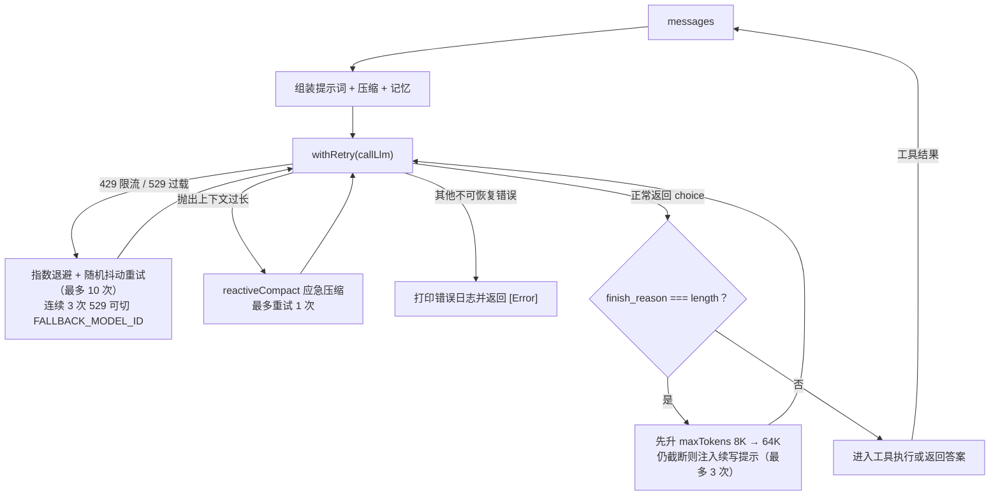

四条恢复路径的触发条件和上限都很明确：

| 异常或状态 | 处理方式 | 保护上限 |
|---|---|---|
| `429` 限流 | `withRetry()` 指数退避（500ms 起翻倍，封顶 32s，加 0%–25% 抖动） | 最多重试 10 次 |
| `529` 过载 | 退避重试，连续 3 次且配置了 `FALLBACK_MODEL_ID` 时切备用模型 | 共享 10 次重试上限 |
| `finish_reason: "length"` | 首次把 `maxTokens` 从 8000 升到 64000 重试；再截断则追加续写提示 | 最多续写 3 次 |
| 上下文过长 | 调用 `s08` 的 `reactiveCompact()` 压缩早期历史后重试 | 每次提问限 1 次 |

补充两点接口细节：

- **协议字段差异**：Anthropic Messages API 用 `response.stop_reason == "max_tokens"` 表示截断。本教程 JS 版走 OpenAI-compatible `/chat/completions`，对应判断 `choice.finish_reason === "length"`（工具调用是 `"tool_calls"`，正常结束是 `"stop"`）。
- **预留 `Retry-After` 参数**：`retryDelay(attempt, retryAfter)` 已留出毫秒级的 `retryAfter` 参数。后续在 `callLlm()` 里把 HTTP `Retry-After` 响应头换算成毫秒挂到错误对象上，就能直接优先遵守服务端等待时间。

---

出错后要不要重试、已经续写了几次、连续遇到多少次过载、当前切到哪个模型，这些信息要在多轮循环之间保持。`RecoveryState` 把它们统一收在一个对象里，每次用户提问新建一份，作用域清晰可控。这一步只先定义类，暂未接进循环。

本次代码变化：10 行。

```js ! agent.js range=352:379
import {
  readdirSync,
  readFileSync,
  existsSync,
  mkdirSync,
  writeFileSync,
  rmSync,
} from "node:fs";
import path from "node:path";
import {
  callLlm,
  runBash,
  readFile,
  writeFile,
  editFile,
  glob,
  tool,
  runChatCli,
  isMainModule,
  parseFrontmatter,
  prepareHistoryForSummary,
} from "./helper.js";

const SKILLS_DIR = path.join(process.cwd(), "skills");

export function scanSkills(dir = SKILLS_DIR) {
  const registry = {};
  if (!existsSync(dir)) return registry;
  for (const entry of readdirSync(dir, { withFileTypes: true })) {
    if (!entry.isDirectory()) continue;
    const manifest = path.join(dir, entry.name, "SKILL.md");
    if (!existsSync(manifest)) continue;
    const raw = readFileSync(manifest, "utf8");
    const { meta } = parseFrontmatter(raw);
    const name = meta.name || entry.name;
    registry[name] = { name, description: meta.description || "", content: raw };
  }
  return registry;
}

export const skillRegistry = scanSkills();

function listSkills() {
  const all = Object.values(skillRegistry);
  return all.length ? all.map((s) => `- ${s.name}: ${s.description}`).join("\n") : "(no skills found)";
}

function loadSkill({ name }) {
  const skill = skillRegistry[name];
  return skill ? skill.content : `Skill not found: ${name}`;
}

const MEMORY_TYPES = ["user", "feedback", "project", "reference"];

let memoryDir = path.join(process.cwd(), ".memory");
export function setMemoryDir(dir) {
  memoryDir = dir;
}
const indexPath = () => path.join(memoryDir, "MEMORY.md");

export function writeMemoryFile(name, type, description, body) {
  mkdirSync(memoryDir, { recursive: true });
  const slug = name.toLowerCase().replace(/[\s/]+/g, "-");
  writeFileSync(
    path.join(memoryDir, `${slug}.md`),
    `---\nname: ${name}\ndescription: ${description}\ntype: ${type}\n---\n\n${body}\n`,
  );
  rebuildIndex();
}

export function listMemoryFiles() {
  if (!existsSync(memoryDir)) return [];
  return readdirSync(memoryDir)
    .filter((f) => f.endsWith(".md") && f !== "MEMORY.md")
    .sort()
    .map((filename) => {
      const raw = readFileSync(path.join(memoryDir, filename), "utf8");
      const { meta, body } = parseFrontmatter(raw);
      return {
        filename,
        name: meta.name || filename.replace(/\.md$/, ""),
        description: meta.description || "",
        type: meta.type || "user",
        body,
        content: raw,
      };
    });
}

function rebuildIndex() {
  const lines = listMemoryFiles().map((m) => `- [${m.name}](${m.filename}) — ${m.description}`);
  mkdirSync(memoryDir, { recursive: true });
  writeFileSync(indexPath(), lines.length ? `${lines.join("\n")}\n` : "");
}

export function readMemoryIndex() {
  return existsSync(indexPath()) ? readFileSync(indexPath(), "utf8").trim() : "";
}

export async function selectRelevantMemories(messages, maxItems = 5) {
  const files = listMemoryFiles();
  if (!files.length) return [];
  const recent = messages
    .filter((m) => m.role === "user" && typeof m.content === "string")
    .slice(-3)
    .map((m) => m.content)
    .join(" ")
    .slice(0, 2000);
  if (!recent.trim()) return [];
  const catalog = files.map((f, i) => `${i}: ${f.name} — ${f.description}`).join("\n");
  try {
    const { message } = await callLlm(
      [
        {
          role: "user",
          content: `Given the recent conversation and the memory catalog, return ONLY a JSON array of the indices that are clearly relevant (e.g. [0, 2]). If none, return [].

Recent conversation:
${recent}

Memory catalog:
${catalog}`,
        },
      ],
      {},
    );
    const match = (message.content || "").match(/\[.*?\]/s);
    if (match) {
      const indices = JSON.parse(match[0]);
      return indices
        .filter((i) => Number.isInteger(i) && i >= 0 && i < files.length)
        .slice(0, maxItems)
        .map((i) => files[i].filename);
    }
  } catch {
  }
  const keywords = recent.toLowerCase().split(/\s+/).filter((w) => w.length > 3);
  return files
    .filter((f) => keywords.some((kw) => `${f.name} ${f.description}`.toLowerCase().includes(kw)))
    .slice(0, maxItems)
    .map((f) => f.filename);
}

export async function loadMemories(messages) {
  const selected = await selectRelevantMemories(messages);
  if (!selected.length) return "";
  const parts = ["<relevant_memories>"];
  for (const filename of selected) parts.push(readFileSync(path.join(memoryDir, filename), "utf8"));
  parts.push("</relevant_memories>");
  return parts.join("\n\n");
}

export async function extractMemories(messages) {
  const dialogue = messages
    .filter((m) => (m.role === "user" || m.role === "assistant") && typeof m.content === "string" && m.content.trim())
    .slice(-10)
    .map((m) => `${m.role}: ${m.content}`)
    .join("\n")
    .slice(0, 4000);
  if (!dialogue.trim()) return 0;
  const existing = listMemoryFiles();
  const existingDesc = existing.length
    ? existing.map((m) => `- ${m.name}: ${m.description}`).join("\n")
    : "(none)";
  try {
    const { message } = await callLlm(
      [
        {
          role: "user",
          content: `Extract durable user preferences, constraints, or project facts from this dialogue.
Return a JSON array; each item: {name, type, description, body}.
- name: short kebab-case id; type: one of ${MEMORY_TYPES.join("/")}; description: one-line; body: markdown detail.
If nothing new or already covered, return [].

Existing memories:
${existingDesc}

Dialogue:
${dialogue}`,
        },
      ],
      {},
    );
    const match = (message.content || "").match(/\[.*\]/s);
    if (!match) return 0;
    const items = JSON.parse(match[0]);
    let count = 0;
    for (const m of items) {
      if (m.description && m.body) {
        writeMemoryFile(
          m.name || `memory-${count}`,
          MEMORY_TYPES.includes(m.type) ? m.type : "user",
          m.description,
          m.body,
        );
        count += 1;
      }
    }
    if (count) console.log(`[Memory: extracted ${count} new memories]`);
    return count;
  } catch {
    return 0;
  }
}

const CONSOLIDATE_THRESHOLD = 10;
export async function consolidateMemories() {
  const files = listMemoryFiles();
  if (files.length < CONSOLIDATE_THRESHOLD) return;
  const catalog = files
    .map((f) => `## ${f.filename}\nname: ${f.name}\ndescription: ${f.description}\n${f.body}`)
    .join("\n\n")
    .slice(0, 16000);
  try {
    const { message } = await callLlm(
      [
        {
          role: "user",
          content: `Consolidate these memory files: merge duplicates, drop outdated/contradicted ones, keep under 30, preserve user preferences above all.
Return a JSON array; each item: {name, type, description, body}.

${catalog}`,
        },
      ],
      {},
    );
    const match = (message.content || "").match(/\[.*\]/s);
    if (!match) return;
    const items = JSON.parse(match[0]);
    for (const f of readdirSync(memoryDir)) {
      if (f.endsWith(".md") && f !== "MEMORY.md") rmSync(path.join(memoryDir, f));
    }
    for (const m of items) {
      if (m.description && m.body) {
        writeMemoryFile(
          m.name || "memory",
          MEMORY_TYPES.includes(m.type) ? m.type : "user",
          m.description,
          m.body,
        );
      }
    }
    console.log(`[Memory: consolidated ${files.length} → ${items.length} memories]`);
  } catch {
  }
}

function buildRequest(messages, memoriesContent) {
  if (!memoriesContent) return messages;
  let idx = -1;
  for (let i = messages.length - 1; i >= 0; i -= 1) {
    if (messages[i].role === "user" && typeof messages[i].content === "string") {
      idx = i;
      break;
    }
  }
  if (idx === -1) return messages;
  const copy = messages.slice();
  copy[idx] = { ...messages[idx], content: `${memoriesContent}\n\n${messages[idx].content}` };
  return copy;
}

const TRANSCRIPT_DIR = path.join(process.cwd(), ".transcripts");
const TOOL_RESULTS_DIR = path.join(process.cwd(), ".task_outputs", "tool-results");

const CONTEXT_LIMIT = 12000;
const KEEP_RECENT = 3;
const PERSIST_THRESHOLD = 30000;
const MAX_REACTIVE_RETRIES = 1;

export const estimateSize = (messages) => JSON.stringify(messages).length;
const isToolResult = (m) => m.role === "tool";

function apply(messages, next) {
  if (next !== messages) messages.splice(0, messages.length, ...next);
  return messages;
}

export function snipCompact(messages, maxMessages = 50) {
  if (messages.length <= maxMessages) return messages;
  let head = 3;
  let tail = messages.length - (maxMessages - 3);
  while (head < messages.length && isToolResult(messages[head])) head += 1;
  while (tail < messages.length && isToolResult(messages[tail])) tail += 1;
  if (head >= tail) return messages;
  return [
    ...messages.slice(0, head),
    { role: "user", content: `[snipped ${tail - head} messages from the middle]` },
    ...messages.slice(tail),
  ];
}

export function microCompact(messages) {
  const toolMsgs = messages.filter(isToolResult);
  if (toolMsgs.length <= KEEP_RECENT) return messages;
  for (const m of toolMsgs.slice(0, -KEEP_RECENT)) {
    if (m.content.length > 120) m.content = "[Earlier tool result compacted. Re-run if needed.]";
  }
  return messages;
}

function persistLargeOutput(id, output) {
  if (output.length <= PERSIST_THRESHOLD) return output;
  mkdirSync(TOOL_RESULTS_DIR, { recursive: true });
  const file = path.join(TOOL_RESULTS_DIR, `${id}.txt`);
  if (!existsSync(file)) writeFileSync(file, output);
  return `<persisted-output>\nFull output: ${file}\nPreview:\n${output.slice(0, 2000)}\n</persisted-output>`;
}

export function toolResultBudget(messages, maxBytes = 200000) {
  const tail = [];
  for (let i = messages.length - 1; i >= 0 && isToolResult(messages[i]); i -= 1) tail.push(messages[i]);
  let total = tail.reduce((n, m) => n + m.content.length, 0);
  if (total <= maxBytes) return messages;
  for (const m of [...tail].sort((a, b) => b.content.length - a.content.length)) {
    if (total <= maxBytes) break;
    if (m.content.length <= PERSIST_THRESHOLD) continue;
    const before = m.content.length;
    m.content = persistLargeOutput(m.tool_call_id, m.content);
    total -= before - m.content.length;
  }
  return messages;
}

function writeTranscript(messages) {
  mkdirSync(TRANSCRIPT_DIR, { recursive: true });
  const file = path.join(TRANSCRIPT_DIR, `transcript-${Date.now()}.jsonl`);
  writeFileSync(file, messages.map((m) => JSON.stringify(m)).join("\n"));
  return file;
}

async function summarizeHistory(messages) {
  const conversation = prepareHistoryForSummary(messages);
  const prompt = `Summarize this coding-agent conversation so work can continue.
Preserve: 1) current goal, 2) key findings/decisions, 3) files read/changed, 4) remaining work, 5) user constraints.
Be compact but concrete.

${conversation}`;
  const { message } = await callLlm([{ role: "user", content: prompt }], {});
  return (message.content || "").trim() || "(empty summary)";
}

export async function compactHistory(messages) {
  writeTranscript(messages);
  const summary = await summarizeHistory(messages);
  return [{ role: "user", content: `[Compacted]\n\n${summary}` }];
}

export async function reactiveCompact(messages) {
  writeTranscript(messages);
  let tail = Math.max(0, messages.length - 5);
  while (tail < messages.length && isToolResult(messages[tail])) tail += 1;
  const summary = await summarizeHistory(messages.slice(0, tail));
  return [{ role: "user", content: `[Reactive compact]\n\n${summary}` }, ...messages.slice(tail)];
}

const isPromptTooLong = (error) =>
  /prompt.*too.*long|too many tokens|context.*length/i.test(String(error.message));

// !focus(start)
export class RecoveryState {
  constructor() {
    this.escalated = false;
    this.recoveryCount = 0;
    this.consecutive529 = 0;
    this.attemptedReactiveCompact = false;
    this.currentModel = null;
  }
}

// !focus(end)
const PROMPT_SECTIONS = {
  identity: () =>
    `You are a coding agent at ${process.cwd()}. Use tools to solve tasks. Before a multi-step task, use todo_write to plan and update status as you go. For a complex sub-problem, use the task tool to spawn a subagent.`,
  tools: (ctx) => (ctx.tools.length ? `Available tools: ${ctx.tools.join(", ")}.` : null),
  skills: (ctx) =>
    ctx.skills ? `Skills available:\n${ctx.skills}\nUse load_skill to load a skill's full content when needed.` : null,
  compaction: () => "When context gets large, call compact to summarize earlier work and free space.",
  memory: (ctx) =>
    ctx.memories
      ? `Memories available:\n${ctx.memories}\nRespect user preferences from memory; new ones are saved automatically.`
      : null,
};
const SECTION_ORDER = ["identity", "tools", "skills", "compaction", "memory"];

export function assembleSystemPrompt(context) {
  return SECTION_ORDER.map((key) => PROMPT_SECTIONS[key](context)).filter(Boolean).join("\n\n");
}

let lastContextKey = null;
let lastSystemPrompt = null;
export function getSystemPrompt(context) {
  const key = JSON.stringify(context);
  if (key === lastContextKey && lastSystemPrompt) return lastSystemPrompt;
  lastContextKey = key;
  lastSystemPrompt = assembleSystemPrompt(context);
  return lastSystemPrompt;
}
export function resetSystemPromptCache() {
  lastContextKey = null;
  lastSystemPrompt = null;
}

export function buildContext() {
  const skills = listSkills();
  return {
    tools: tools.map((t) => t.function.name),
    skills: skills === "(no skills found)" ? "" : skills,
    memories: readMemoryIndex(),
  };
}

const SUB_SYSTEM = `You are a coding subagent at ${process.cwd()}. Complete the task, then return a concise summary. Do not delegate further.`;

const tools = [
  tool("bash", "Run a shell command.", {
    type: "object",
    properties: { command: { type: "string" } },
    required: ["command"],
  }),
  tool("read_file", "Read a file (optional line limit).", {
    type: "object",
    properties: { path: { type: "string" }, limit: { type: "integer" } },
    required: ["path"],
  }),
  tool("write_file", "Write content to a file.", {
    type: "object",
    properties: { path: { type: "string" }, content: { type: "string" } },
    required: ["path", "content"],
  }),
  tool("edit_file", "Replace exact text in a file once.", {
    type: "object",
    properties: {
      path: { type: "string" },
      old_text: { type: "string" },
      new_text: { type: "string" },
    },
    required: ["path", "old_text", "new_text"],
  }),
  tool("glob", "Find files by glob pattern.", {
    type: "object",
    properties: { pattern: { type: "string" } },
    required: ["pattern"],
  }),
  tool("todo_write", "Create and manage a task list for the current session.", {
    type: "object",
    properties: {
      todos: {
        type: "array",
        items: {
          type: "object",
          properties: {
            content: { type: "string" },
            status: { type: "string", enum: ["pending", "in_progress", "completed"] },
          },
          required: ["content", "status"],
        },
      },
    },
    required: ["todos"],
  }),
  tool("task", "Launch a subagent to handle a complex subtask. Returns only the final summary.", {
    type: "object",
    properties: { description: { type: "string" } },
    required: ["description"],
  }),
  tool("load_skill", "Load a skill's full content by name (see the catalog in the system prompt).", {
    type: "object",
    properties: { name: { type: "string" } },
    required: ["name"],
  }),
  tool("compact", "Summarize earlier conversation to free context space.", {
    type: "object",
    properties: { focus: { type: "string" } },
  }),
];

let currentTodos = [];
export function getTodos() {
  return currentTodos;
}

function runTodoWrite({ todos = [] }) {
  currentTodos = todos;
  const icon = { pending: " ", in_progress: "▸", completed: "✓" };
  console.log("## Current Tasks");
  for (const t of currentTodos) console.log(`  [${icon[t.status]}] ${t.content}`);
  return `Updated ${currentTodos.length} tasks`;
}

const handlers = {
  bash: ({ command }) => runBash(command),
  read_file: ({ path, limit }) => readFile(path, limit),
  write_file: ({ path, content }) => writeFile(path, content),
  edit_file: ({ path, old_text, new_text }) => editFile(path, old_text, new_text),
  glob: ({ pattern }) => glob(pattern),
  todo_write: runTodoWrite,
  task: ({ description }, confirm) => spawnSubagent(description, confirm),
  load_skill: loadSkill,
};

const SUB_EXCLUDE = ["task", "todo_write", "load_skill", "compact"];
const subTools = tools.filter((t) => !SUB_EXCLUDE.includes(t.function.name));
const subHandlers = Object.fromEntries(
  Object.entries(handlers).filter(([name]) => !SUB_EXCLUDE.includes(name)),
);
const MAX_SUB_TURNS = 30;

async function spawnSubagent(description, confirm) {
  const messages = [{ role: "user", content: description }];
  for (let turn = 0; turn < MAX_SUB_TURNS; turn += 1) {
    const { message } = await callLlm(messages, { system: SUB_SYSTEM, tools: subTools });
    messages.push(message);
    if (!message.tool_calls?.length) return message.content || "(subagent returned no text)";

    for (const call of message.tool_calls) {
      const name = call.function.name;
      const args = JSON.parse(call.function.arguments || "{}");
      const blocked = await triggerHooks("PreToolUse", name, args, confirm);
      const handler = subHandlers[name];
      const output =
        blocked != null ? String(blocked) : handler ? handler(args) : `Unknown tool: ${name}`;
      messages.push({ role: "tool", tool_call_id: call.id, content: String(output) });
    }
  }
  return "Subagent stopped after 30 turns without a final answer.";
}

export { spawnSubagent };

const hooks = { UserPromptSubmit: [], PreToolUse: [], PostToolUse: [], Stop: [] };

function registerHook(event, callback) {
  hooks[event].push(callback);
}

async function triggerHooks(event, ...args) {
  for (const callback of hooks[event]) {
    const result = await callback(...args);
    if (result != null) return result;
  }
  return null;
}

const DENY = ["rm -rf /", "sudo", "shutdown", "reboot", "mkfs", "dd if="];
const RISKY = ["rm ", "> /etc/", "chmod 777"];

async function permissionHook(name, args, confirm) {
  if (name !== "bash") return null;
  const command = args.command || "";
  if (DENY.some((p) => command.includes(p))) return "Permission denied: 命中黑名单。";
  if (RISKY.some((p) => command.includes(p))) {
    const answer = confirm ? await confirm(`⚠ 可能有破坏性的命令: ${command} 允许? [y/N] `) : "";
    if (!/^y(es)?$/i.test(String(answer).trim())) return "Permission denied by user.";
  }
  return null;
}

registerHook("PreToolUse", permissionHook);

export async function agentLoop(messages, confirm) {
  let roundsSinceTodo = 0;
  let reactiveRetries = 0;
  let context = buildContext();
  let system = getSystemPrompt(context);
  const memoriesContent = await loadMemories(messages);
  let preCompress = messages.map((m) => ({ role: m.role, content: m.content }));

  while (true) {
    if (roundsSinceTodo >= 3) {
      messages.push({ role: "user", content: "<reminder>Update your todos.</reminder>" });
      roundsSinceTodo = 0;
    }

    preCompress = messages.map((m) => ({ role: m.role, content: m.content }));

    apply(messages, toolResultBudget(messages));
    apply(messages, snipCompact(messages));
    apply(messages, microCompact(messages));
    if (estimateSize(messages) > CONTEXT_LIMIT) apply(messages, await compactHistory(messages));

    let message;
    try {
      ({ message } = await callLlm(buildRequest(messages, memoriesContent), { system, tools }));
      reactiveRetries = 0;
    } catch (error) {
      if (reactiveRetries < MAX_REACTIVE_RETRIES && isPromptTooLong(error)) {
        apply(messages, await reactiveCompact(messages));
        reactiveRetries += 1;
        continue;
      }
      throw error;
    }

    if (!message.tool_calls?.length) {
      await extractMemories(preCompress);
      await consolidateMemories();
      return message.content || "";
    }

    messages.push(message);
    roundsSinceTodo += 1;
    let compacted = false;
    for (const call of message.tool_calls) {
      const name = call.function.name;
      const args = JSON.parse(call.function.arguments || "{}");

      if (name === "compact") {
        apply(messages, await compactHistory(messages));
        compacted = true;
        break;
      }

      const blocked = await triggerHooks("PreToolUse", name, args, confirm);
      let output;
      if (blocked != null) {
        output = String(blocked);
      } else {
        const handler = handlers[name];
        output = handler ? await handler(args, confirm) : `Unknown tool: ${name}`;
      }

      if (name === "todo_write") roundsSinceTodo = 0;
      messages.push({ role: "tool", tool_call_id: call.id, content: String(output) });
    }
    if (compacted) continue;

    context = buildContext();
    system = getSystemPrompt(context);
  }
}

async function main() {
  await runChatCli({
    promptLabel: "s10 >> ",
    onPrompt: async ({ prompt, messages, ask }) => {
      return agentLoop(messages, ask);
    },
  });
}

if (isMainModule(import.meta.url)) {
  main().catch((error) => {
    console.error(error.message);
    process.exit(1);
  });
}
```

## !!steps
撞上限流或服务繁忙时，立刻重发往往继续撞墙。`retryDelay` 实现指数退避：首次 0.5 秒，每次翻倍，最高封顶 32 秒，再叠 0% 到 25% 的随机抖动防止多个客户端同时重试；若传入服务端指定的 `retryAfter`（毫秒），则直接采用。`setSleepFn` 让单测能替换掉真实定时器，跑测试无需干等。

本次代码变化：13 行。

```js ! agent.js range=352:392
import {
  readdirSync,
  readFileSync,
  existsSync,
  mkdirSync,
  writeFileSync,
  rmSync,
} from "node:fs";
import path from "node:path";
import {
  callLlm,
  runBash,
  readFile,
  writeFile,
  editFile,
  glob,
  tool,
  runChatCli,
  isMainModule,
  parseFrontmatter,
  prepareHistoryForSummary,
} from "./helper.js";

const SKILLS_DIR = path.join(process.cwd(), "skills");

export function scanSkills(dir = SKILLS_DIR) {
  const registry = {};
  if (!existsSync(dir)) return registry;
  for (const entry of readdirSync(dir, { withFileTypes: true })) {
    if (!entry.isDirectory()) continue;
    const manifest = path.join(dir, entry.name, "SKILL.md");
    if (!existsSync(manifest)) continue;
    const raw = readFileSync(manifest, "utf8");
    const { meta } = parseFrontmatter(raw);
    const name = meta.name || entry.name;
    registry[name] = { name, description: meta.description || "", content: raw };
  }
  return registry;
}

export const skillRegistry = scanSkills();

function listSkills() {
  const all = Object.values(skillRegistry);
  return all.length ? all.map((s) => `- ${s.name}: ${s.description}`).join("\n") : "(no skills found)";
}

function loadSkill({ name }) {
  const skill = skillRegistry[name];
  return skill ? skill.content : `Skill not found: ${name}`;
}

const MEMORY_TYPES = ["user", "feedback", "project", "reference"];

let memoryDir = path.join(process.cwd(), ".memory");
export function setMemoryDir(dir) {
  memoryDir = dir;
}
const indexPath = () => path.join(memoryDir, "MEMORY.md");

export function writeMemoryFile(name, type, description, body) {
  mkdirSync(memoryDir, { recursive: true });
  const slug = name.toLowerCase().replace(/[\s/]+/g, "-");
  writeFileSync(
    path.join(memoryDir, `${slug}.md`),
    `---\nname: ${name}\ndescription: ${description}\ntype: ${type}\n---\n\n${body}\n`,
  );
  rebuildIndex();
}

export function listMemoryFiles() {
  if (!existsSync(memoryDir)) return [];
  return readdirSync(memoryDir)
    .filter((f) => f.endsWith(".md") && f !== "MEMORY.md")
    .sort()
    .map((filename) => {
      const raw = readFileSync(path.join(memoryDir, filename), "utf8");
      const { meta, body } = parseFrontmatter(raw);
      return {
        filename,
        name: meta.name || filename.replace(/\.md$/, ""),
        description: meta.description || "",
        type: meta.type || "user",
        body,
        content: raw,
      };
    });
}

function rebuildIndex() {
  const lines = listMemoryFiles().map((m) => `- [${m.name}](${m.filename}) — ${m.description}`);
  mkdirSync(memoryDir, { recursive: true });
  writeFileSync(indexPath(), lines.length ? `${lines.join("\n")}\n` : "");
}

export function readMemoryIndex() {
  return existsSync(indexPath()) ? readFileSync(indexPath(), "utf8").trim() : "";
}

export async function selectRelevantMemories(messages, maxItems = 5) {
  const files = listMemoryFiles();
  if (!files.length) return [];
  const recent = messages
    .filter((m) => m.role === "user" && typeof m.content === "string")
    .slice(-3)
    .map((m) => m.content)
    .join(" ")
    .slice(0, 2000);
  if (!recent.trim()) return [];
  const catalog = files.map((f, i) => `${i}: ${f.name} — ${f.description}`).join("\n");
  try {
    const { message } = await callLlm(
      [
        {
          role: "user",
          content: `Given the recent conversation and the memory catalog, return ONLY a JSON array of the indices that are clearly relevant (e.g. [0, 2]). If none, return [].

Recent conversation:
${recent}

Memory catalog:
${catalog}`,
        },
      ],
      {},
    );
    const match = (message.content || "").match(/\[.*?\]/s);
    if (match) {
      const indices = JSON.parse(match[0]);
      return indices
        .filter((i) => Number.isInteger(i) && i >= 0 && i < files.length)
        .slice(0, maxItems)
        .map((i) => files[i].filename);
    }
  } catch {
  }
  const keywords = recent.toLowerCase().split(/\s+/).filter((w) => w.length > 3);
  return files
    .filter((f) => keywords.some((kw) => `${f.name} ${f.description}`.toLowerCase().includes(kw)))
    .slice(0, maxItems)
    .map((f) => f.filename);
}

export async function loadMemories(messages) {
  const selected = await selectRelevantMemories(messages);
  if (!selected.length) return "";
  const parts = ["<relevant_memories>"];
  for (const filename of selected) parts.push(readFileSync(path.join(memoryDir, filename), "utf8"));
  parts.push("</relevant_memories>");
  return parts.join("\n\n");
}

export async function extractMemories(messages) {
  const dialogue = messages
    .filter((m) => (m.role === "user" || m.role === "assistant") && typeof m.content === "string" && m.content.trim())
    .slice(-10)
    .map((m) => `${m.role}: ${m.content}`)
    .join("\n")
    .slice(0, 4000);
  if (!dialogue.trim()) return 0;
  const existing = listMemoryFiles();
  const existingDesc = existing.length
    ? existing.map((m) => `- ${m.name}: ${m.description}`).join("\n")
    : "(none)";
  try {
    const { message } = await callLlm(
      [
        {
          role: "user",
          content: `Extract durable user preferences, constraints, or project facts from this dialogue.
Return a JSON array; each item: {name, type, description, body}.
- name: short kebab-case id; type: one of ${MEMORY_TYPES.join("/")}; description: one-line; body: markdown detail.
If nothing new or already covered, return [].

Existing memories:
${existingDesc}

Dialogue:
${dialogue}`,
        },
      ],
      {},
    );
    const match = (message.content || "").match(/\[.*\]/s);
    if (!match) return 0;
    const items = JSON.parse(match[0]);
    let count = 0;
    for (const m of items) {
      if (m.description && m.body) {
        writeMemoryFile(
          m.name || `memory-${count}`,
          MEMORY_TYPES.includes(m.type) ? m.type : "user",
          m.description,
          m.body,
        );
        count += 1;
      }
    }
    if (count) console.log(`[Memory: extracted ${count} new memories]`);
    return count;
  } catch {
    return 0;
  }
}

const CONSOLIDATE_THRESHOLD = 10;
export async function consolidateMemories() {
  const files = listMemoryFiles();
  if (files.length < CONSOLIDATE_THRESHOLD) return;
  const catalog = files
    .map((f) => `## ${f.filename}\nname: ${f.name}\ndescription: ${f.description}\n${f.body}`)
    .join("\n\n")
    .slice(0, 16000);
  try {
    const { message } = await callLlm(
      [
        {
          role: "user",
          content: `Consolidate these memory files: merge duplicates, drop outdated/contradicted ones, keep under 30, preserve user preferences above all.
Return a JSON array; each item: {name, type, description, body}.

${catalog}`,
        },
      ],
      {},
    );
    const match = (message.content || "").match(/\[.*\]/s);
    if (!match) return;
    const items = JSON.parse(match[0]);
    for (const f of readdirSync(memoryDir)) {
      if (f.endsWith(".md") && f !== "MEMORY.md") rmSync(path.join(memoryDir, f));
    }
    for (const m of items) {
      if (m.description && m.body) {
        writeMemoryFile(
          m.name || "memory",
          MEMORY_TYPES.includes(m.type) ? m.type : "user",
          m.description,
          m.body,
        );
      }
    }
    console.log(`[Memory: consolidated ${files.length} → ${items.length} memories]`);
  } catch {
  }
}

function buildRequest(messages, memoriesContent) {
  if (!memoriesContent) return messages;
  let idx = -1;
  for (let i = messages.length - 1; i >= 0; i -= 1) {
    if (messages[i].role === "user" && typeof messages[i].content === "string") {
      idx = i;
      break;
    }
  }
  if (idx === -1) return messages;
  const copy = messages.slice();
  copy[idx] = { ...messages[idx], content: `${memoriesContent}\n\n${messages[idx].content}` };
  return copy;
}

const TRANSCRIPT_DIR = path.join(process.cwd(), ".transcripts");
const TOOL_RESULTS_DIR = path.join(process.cwd(), ".task_outputs", "tool-results");

const CONTEXT_LIMIT = 12000;
const KEEP_RECENT = 3;
const PERSIST_THRESHOLD = 30000;
const MAX_REACTIVE_RETRIES = 1;

export const estimateSize = (messages) => JSON.stringify(messages).length;
const isToolResult = (m) => m.role === "tool";

function apply(messages, next) {
  if (next !== messages) messages.splice(0, messages.length, ...next);
  return messages;
}

export function snipCompact(messages, maxMessages = 50) {
  if (messages.length <= maxMessages) return messages;
  let head = 3;
  let tail = messages.length - (maxMessages - 3);
  while (head < messages.length && isToolResult(messages[head])) head += 1;
  while (tail < messages.length && isToolResult(messages[tail])) tail += 1;
  if (head >= tail) return messages;
  return [
    ...messages.slice(0, head),
    { role: "user", content: `[snipped ${tail - head} messages from the middle]` },
    ...messages.slice(tail),
  ];
}

export function microCompact(messages) {
  const toolMsgs = messages.filter(isToolResult);
  if (toolMsgs.length <= KEEP_RECENT) return messages;
  for (const m of toolMsgs.slice(0, -KEEP_RECENT)) {
    if (m.content.length > 120) m.content = "[Earlier tool result compacted. Re-run if needed.]";
  }
  return messages;
}

function persistLargeOutput(id, output) {
  if (output.length <= PERSIST_THRESHOLD) return output;
  mkdirSync(TOOL_RESULTS_DIR, { recursive: true });
  const file = path.join(TOOL_RESULTS_DIR, `${id}.txt`);
  if (!existsSync(file)) writeFileSync(file, output);
  return `<persisted-output>\nFull output: ${file}\nPreview:\n${output.slice(0, 2000)}\n</persisted-output>`;
}

export function toolResultBudget(messages, maxBytes = 200000) {
  const tail = [];
  for (let i = messages.length - 1; i >= 0 && isToolResult(messages[i]); i -= 1) tail.push(messages[i]);
  let total = tail.reduce((n, m) => n + m.content.length, 0);
  if (total <= maxBytes) return messages;
  for (const m of [...tail].sort((a, b) => b.content.length - a.content.length)) {
    if (total <= maxBytes) break;
    if (m.content.length <= PERSIST_THRESHOLD) continue;
    const before = m.content.length;
    m.content = persistLargeOutput(m.tool_call_id, m.content);
    total -= before - m.content.length;
  }
  return messages;
}

function writeTranscript(messages) {
  mkdirSync(TRANSCRIPT_DIR, { recursive: true });
  const file = path.join(TRANSCRIPT_DIR, `transcript-${Date.now()}.jsonl`);
  writeFileSync(file, messages.map((m) => JSON.stringify(m)).join("\n"));
  return file;
}

async function summarizeHistory(messages) {
  const conversation = prepareHistoryForSummary(messages);
  const prompt = `Summarize this coding-agent conversation so work can continue.
Preserve: 1) current goal, 2) key findings/decisions, 3) files read/changed, 4) remaining work, 5) user constraints.
Be compact but concrete.

${conversation}`;
  const { message } = await callLlm([{ role: "user", content: prompt }], {});
  return (message.content || "").trim() || "(empty summary)";
}

export async function compactHistory(messages) {
  writeTranscript(messages);
  const summary = await summarizeHistory(messages);
  return [{ role: "user", content: `[Compacted]\n\n${summary}` }];
}

export async function reactiveCompact(messages) {
  writeTranscript(messages);
  let tail = Math.max(0, messages.length - 5);
  while (tail < messages.length && isToolResult(messages[tail])) tail += 1;
  const summary = await summarizeHistory(messages.slice(0, tail));
  return [{ role: "user", content: `[Reactive compact]\n\n${summary}` }, ...messages.slice(tail)];
}

const isPromptTooLong = (error) =>
  /prompt.*too.*long|too many tokens|context.*length/i.test(String(error.message));

// !focus(start)
const BASE_DELAY_MS = 500;

// !focus(end)
export class RecoveryState {
  constructor() {
    this.escalated = false;
    this.recoveryCount = 0;
    this.consecutive529 = 0;
    this.attemptedReactiveCompact = false;
    this.currentModel = null;
  }
// !focus(start)
}

export function retryDelay(attempt, retryAfter) {
  if (retryAfter) return retryAfter;
  const base = Math.min(BASE_DELAY_MS * 2 ** attempt, 32000);
  return base + Math.random() * base * 0.25;
}

let sleep = (ms) => new Promise((resolve) => setTimeout(resolve, ms));
export function setSleepFn(fn) {
  sleep = fn;
// !focus(end)
}

const PROMPT_SECTIONS = {
  identity: () =>
    `You are a coding agent at ${process.cwd()}. Use tools to solve tasks. Before a multi-step task, use todo_write to plan and update status as you go. For a complex sub-problem, use the task tool to spawn a subagent.`,
  tools: (ctx) => (ctx.tools.length ? `Available tools: ${ctx.tools.join(", ")}.` : null),
  skills: (ctx) =>
    ctx.skills ? `Skills available:\n${ctx.skills}\nUse load_skill to load a skill's full content when needed.` : null,
  compaction: () => "When context gets large, call compact to summarize earlier work and free space.",
  memory: (ctx) =>
    ctx.memories
      ? `Memories available:\n${ctx.memories}\nRespect user preferences from memory; new ones are saved automatically.`
      : null,
};
const SECTION_ORDER = ["identity", "tools", "skills", "compaction", "memory"];

export function assembleSystemPrompt(context) {
  return SECTION_ORDER.map((key) => PROMPT_SECTIONS[key](context)).filter(Boolean).join("\n\n");
}

let lastContextKey = null;
let lastSystemPrompt = null;
export function getSystemPrompt(context) {
  const key = JSON.stringify(context);
  if (key === lastContextKey && lastSystemPrompt) return lastSystemPrompt;
  lastContextKey = key;
  lastSystemPrompt = assembleSystemPrompt(context);
  return lastSystemPrompt;
}
export function resetSystemPromptCache() {
  lastContextKey = null;
  lastSystemPrompt = null;
}

export function buildContext() {
  const skills = listSkills();
  return {
    tools: tools.map((t) => t.function.name),
    skills: skills === "(no skills found)" ? "" : skills,
    memories: readMemoryIndex(),
  };
}

const SUB_SYSTEM = `You are a coding subagent at ${process.cwd()}. Complete the task, then return a concise summary. Do not delegate further.`;

const tools = [
  tool("bash", "Run a shell command.", {
    type: "object",
    properties: { command: { type: "string" } },
    required: ["command"],
  }),
  tool("read_file", "Read a file (optional line limit).", {
    type: "object",
    properties: { path: { type: "string" }, limit: { type: "integer" } },
    required: ["path"],
  }),
  tool("write_file", "Write content to a file.", {
    type: "object",
    properties: { path: { type: "string" }, content: { type: "string" } },
    required: ["path", "content"],
  }),
  tool("edit_file", "Replace exact text in a file once.", {
    type: "object",
    properties: {
      path: { type: "string" },
      old_text: { type: "string" },
      new_text: { type: "string" },
    },
    required: ["path", "old_text", "new_text"],
  }),
  tool("glob", "Find files by glob pattern.", {
    type: "object",
    properties: { pattern: { type: "string" } },
    required: ["pattern"],
  }),
  tool("todo_write", "Create and manage a task list for the current session.", {
    type: "object",
    properties: {
      todos: {
        type: "array",
        items: {
          type: "object",
          properties: {
            content: { type: "string" },
            status: { type: "string", enum: ["pending", "in_progress", "completed"] },
          },
          required: ["content", "status"],
        },
      },
    },
    required: ["todos"],
  }),
  tool("task", "Launch a subagent to handle a complex subtask. Returns only the final summary.", {
    type: "object",
    properties: { description: { type: "string" } },
    required: ["description"],
  }),
  tool("load_skill", "Load a skill's full content by name (see the catalog in the system prompt).", {
    type: "object",
    properties: { name: { type: "string" } },
    required: ["name"],
  }),
  tool("compact", "Summarize earlier conversation to free context space.", {
    type: "object",
    properties: { focus: { type: "string" } },
  }),
];

let currentTodos = [];
export function getTodos() {
  return currentTodos;
}

function runTodoWrite({ todos = [] }) {
  currentTodos = todos;
  const icon = { pending: " ", in_progress: "▸", completed: "✓" };
  console.log("## Current Tasks");
  for (const t of currentTodos) console.log(`  [${icon[t.status]}] ${t.content}`);
  return `Updated ${currentTodos.length} tasks`;
}

const handlers = {
  bash: ({ command }) => runBash(command),
  read_file: ({ path, limit }) => readFile(path, limit),
  write_file: ({ path, content }) => writeFile(path, content),
  edit_file: ({ path, old_text, new_text }) => editFile(path, old_text, new_text),
  glob: ({ pattern }) => glob(pattern),
  todo_write: runTodoWrite,
  task: ({ description }, confirm) => spawnSubagent(description, confirm),
  load_skill: loadSkill,
};

const SUB_EXCLUDE = ["task", "todo_write", "load_skill", "compact"];
const subTools = tools.filter((t) => !SUB_EXCLUDE.includes(t.function.name));
const subHandlers = Object.fromEntries(
  Object.entries(handlers).filter(([name]) => !SUB_EXCLUDE.includes(name)),
);
const MAX_SUB_TURNS = 30;

async function spawnSubagent(description, confirm) {
  const messages = [{ role: "user", content: description }];
  for (let turn = 0; turn < MAX_SUB_TURNS; turn += 1) {
    const { message } = await callLlm(messages, { system: SUB_SYSTEM, tools: subTools });
    messages.push(message);
    if (!message.tool_calls?.length) return message.content || "(subagent returned no text)";

    for (const call of message.tool_calls) {
      const name = call.function.name;
      const args = JSON.parse(call.function.arguments || "{}");
      const blocked = await triggerHooks("PreToolUse", name, args, confirm);
      const handler = subHandlers[name];
      const output =
        blocked != null ? String(blocked) : handler ? handler(args) : `Unknown tool: ${name}`;
      messages.push({ role: "tool", tool_call_id: call.id, content: String(output) });
    }
  }
  return "Subagent stopped after 30 turns without a final answer.";
}

export { spawnSubagent };

const hooks = { UserPromptSubmit: [], PreToolUse: [], PostToolUse: [], Stop: [] };

function registerHook(event, callback) {
  hooks[event].push(callback);
}

async function triggerHooks(event, ...args) {
  for (const callback of hooks[event]) {
    const result = await callback(...args);
    if (result != null) return result;
  }
  return null;
}

const DENY = ["rm -rf /", "sudo", "shutdown", "reboot", "mkfs", "dd if="];
const RISKY = ["rm ", "> /etc/", "chmod 777"];

async function permissionHook(name, args, confirm) {
  if (name !== "bash") return null;
  const command = args.command || "";
  if (DENY.some((p) => command.includes(p))) return "Permission denied: 命中黑名单。";
  if (RISKY.some((p) => command.includes(p))) {
    const answer = confirm ? await confirm(`⚠ 可能有破坏性的命令: ${command} 允许? [y/N] `) : "";
    if (!/^y(es)?$/i.test(String(answer).trim())) return "Permission denied by user.";
  }
  return null;
}

registerHook("PreToolUse", permissionHook);

export async function agentLoop(messages, confirm) {
  let roundsSinceTodo = 0;
  let reactiveRetries = 0;
  let context = buildContext();
  let system = getSystemPrompt(context);
  const memoriesContent = await loadMemories(messages);
  let preCompress = messages.map((m) => ({ role: m.role, content: m.content }));

  while (true) {
    if (roundsSinceTodo >= 3) {
      messages.push({ role: "user", content: "<reminder>Update your todos.</reminder>" });
      roundsSinceTodo = 0;
    }

    preCompress = messages.map((m) => ({ role: m.role, content: m.content }));

    apply(messages, toolResultBudget(messages));
    apply(messages, snipCompact(messages));
    apply(messages, microCompact(messages));
    if (estimateSize(messages) > CONTEXT_LIMIT) apply(messages, await compactHistory(messages));

    let message;
    try {
      ({ message } = await callLlm(buildRequest(messages, memoriesContent), { system, tools }));
      reactiveRetries = 0;
    } catch (error) {
      if (reactiveRetries < MAX_REACTIVE_RETRIES && isPromptTooLong(error)) {
        apply(messages, await reactiveCompact(messages));
        reactiveRetries += 1;
        continue;
      }
      throw error;
    }

    if (!message.tool_calls?.length) {
      await extractMemories(preCompress);
      await consolidateMemories();
      return message.content || "";
    }

    messages.push(message);
    roundsSinceTodo += 1;
    let compacted = false;
    for (const call of message.tool_calls) {
      const name = call.function.name;
      const args = JSON.parse(call.function.arguments || "{}");

      if (name === "compact") {
        apply(messages, await compactHistory(messages));
        compacted = true;
        break;
      }

      const blocked = await triggerHooks("PreToolUse", name, args, confirm);
      let output;
      if (blocked != null) {
        output = String(blocked);
      } else {
        const handler = handlers[name];
        output = handler ? await handler(args, confirm) : `Unknown tool: ${name}`;
      }

      if (name === "todo_write") roundsSinceTodo = 0;
      messages.push({ role: "tool", tool_call_id: call.id, content: String(output) });
    }
    if (compacted) continue;

    context = buildContext();
    system = getSystemPrompt(context);
  }
}

async function main() {
  await runChatCli({
    promptLabel: "s10 >> ",
    onPrompt: async ({ prompt, messages, ask }) => {
      return agentLoop(messages, ask);
    },
  });
}

if (isMainModule(import.meta.url)) {
  main().catch((error) => {
    console.error(error.message);
    process.exit(1);
  });
}
```

## !!steps
`withRetry` 接收一个异步请求函数 `fn` 和状态对象 `state`：成功就清零连续 `529` 计数并返回结果；失败时若命中 `429` 或 `rate limit`，就退避等待后继续尝试，最多 10 次。其余非瞬态错误不做吞没，原样抛给外层循环决定怎么处理。

本次代码变化：21 行。

```js ! agent.js range=352:413
import {
  readdirSync,
  readFileSync,
  existsSync,
  mkdirSync,
  writeFileSync,
  rmSync,
} from "node:fs";
import path from "node:path";
import {
  callLlm,
  runBash,
  readFile,
  writeFile,
  editFile,
  glob,
  tool,
  runChatCli,
  isMainModule,
  parseFrontmatter,
  prepareHistoryForSummary,
} from "./helper.js";

const SKILLS_DIR = path.join(process.cwd(), "skills");

export function scanSkills(dir = SKILLS_DIR) {
  const registry = {};
  if (!existsSync(dir)) return registry;
  for (const entry of readdirSync(dir, { withFileTypes: true })) {
    if (!entry.isDirectory()) continue;
    const manifest = path.join(dir, entry.name, "SKILL.md");
    if (!existsSync(manifest)) continue;
    const raw = readFileSync(manifest, "utf8");
    const { meta } = parseFrontmatter(raw);
    const name = meta.name || entry.name;
    registry[name] = { name, description: meta.description || "", content: raw };
  }
  return registry;
}

export const skillRegistry = scanSkills();

function listSkills() {
  const all = Object.values(skillRegistry);
  return all.length ? all.map((s) => `- ${s.name}: ${s.description}`).join("\n") : "(no skills found)";
}

function loadSkill({ name }) {
  const skill = skillRegistry[name];
  return skill ? skill.content : `Skill not found: ${name}`;
}

const MEMORY_TYPES = ["user", "feedback", "project", "reference"];

let memoryDir = path.join(process.cwd(), ".memory");
export function setMemoryDir(dir) {
  memoryDir = dir;
}
const indexPath = () => path.join(memoryDir, "MEMORY.md");

export function writeMemoryFile(name, type, description, body) {
  mkdirSync(memoryDir, { recursive: true });
  const slug = name.toLowerCase().replace(/[\s/]+/g, "-");
  writeFileSync(
    path.join(memoryDir, `${slug}.md`),
    `---\nname: ${name}\ndescription: ${description}\ntype: ${type}\n---\n\n${body}\n`,
  );
  rebuildIndex();
}

export function listMemoryFiles() {
  if (!existsSync(memoryDir)) return [];
  return readdirSync(memoryDir)
    .filter((f) => f.endsWith(".md") && f !== "MEMORY.md")
    .sort()
    .map((filename) => {
      const raw = readFileSync(path.join(memoryDir, filename), "utf8");
      const { meta, body } = parseFrontmatter(raw);
      return {
        filename,
        name: meta.name || filename.replace(/\.md$/, ""),
        description: meta.description || "",
        type: meta.type || "user",
        body,
        content: raw,
      };
    });
}

function rebuildIndex() {
  const lines = listMemoryFiles().map((m) => `- [${m.name}](${m.filename}) — ${m.description}`);
  mkdirSync(memoryDir, { recursive: true });
  writeFileSync(indexPath(), lines.length ? `${lines.join("\n")}\n` : "");
}

export function readMemoryIndex() {
  return existsSync(indexPath()) ? readFileSync(indexPath(), "utf8").trim() : "";
}

export async function selectRelevantMemories(messages, maxItems = 5) {
  const files = listMemoryFiles();
  if (!files.length) return [];
  const recent = messages
    .filter((m) => m.role === "user" && typeof m.content === "string")
    .slice(-3)
    .map((m) => m.content)
    .join(" ")
    .slice(0, 2000);
  if (!recent.trim()) return [];
  const catalog = files.map((f, i) => `${i}: ${f.name} — ${f.description}`).join("\n");
  try {
    const { message } = await callLlm(
      [
        {
          role: "user",
          content: `Given the recent conversation and the memory catalog, return ONLY a JSON array of the indices that are clearly relevant (e.g. [0, 2]). If none, return [].

Recent conversation:
${recent}

Memory catalog:
${catalog}`,
        },
      ],
      {},
    );
    const match = (message.content || "").match(/\[.*?\]/s);
    if (match) {
      const indices = JSON.parse(match[0]);
      return indices
        .filter((i) => Number.isInteger(i) && i >= 0 && i < files.length)
        .slice(0, maxItems)
        .map((i) => files[i].filename);
    }
  } catch {
  }
  const keywords = recent.toLowerCase().split(/\s+/).filter((w) => w.length > 3);
  return files
    .filter((f) => keywords.some((kw) => `${f.name} ${f.description}`.toLowerCase().includes(kw)))
    .slice(0, maxItems)
    .map((f) => f.filename);
}

export async function loadMemories(messages) {
  const selected = await selectRelevantMemories(messages);
  if (!selected.length) return "";
  const parts = ["<relevant_memories>"];
  for (const filename of selected) parts.push(readFileSync(path.join(memoryDir, filename), "utf8"));
  parts.push("</relevant_memories>");
  return parts.join("\n\n");
}

export async function extractMemories(messages) {
  const dialogue = messages
    .filter((m) => (m.role === "user" || m.role === "assistant") && typeof m.content === "string" && m.content.trim())
    .slice(-10)
    .map((m) => `${m.role}: ${m.content}`)
    .join("\n")
    .slice(0, 4000);
  if (!dialogue.trim()) return 0;
  const existing = listMemoryFiles();
  const existingDesc = existing.length
    ? existing.map((m) => `- ${m.name}: ${m.description}`).join("\n")
    : "(none)";
  try {
    const { message } = await callLlm(
      [
        {
          role: "user",
          content: `Extract durable user preferences, constraints, or project facts from this dialogue.
Return a JSON array; each item: {name, type, description, body}.
- name: short kebab-case id; type: one of ${MEMORY_TYPES.join("/")}; description: one-line; body: markdown detail.
If nothing new or already covered, return [].

Existing memories:
${existingDesc}

Dialogue:
${dialogue}`,
        },
      ],
      {},
    );
    const match = (message.content || "").match(/\[.*\]/s);
    if (!match) return 0;
    const items = JSON.parse(match[0]);
    let count = 0;
    for (const m of items) {
      if (m.description && m.body) {
        writeMemoryFile(
          m.name || `memory-${count}`,
          MEMORY_TYPES.includes(m.type) ? m.type : "user",
          m.description,
          m.body,
        );
        count += 1;
      }
    }
    if (count) console.log(`[Memory: extracted ${count} new memories]`);
    return count;
  } catch {
    return 0;
  }
}

const CONSOLIDATE_THRESHOLD = 10;
export async function consolidateMemories() {
  const files = listMemoryFiles();
  if (files.length < CONSOLIDATE_THRESHOLD) return;
  const catalog = files
    .map((f) => `## ${f.filename}\nname: ${f.name}\ndescription: ${f.description}\n${f.body}`)
    .join("\n\n")
    .slice(0, 16000);
  try {
    const { message } = await callLlm(
      [
        {
          role: "user",
          content: `Consolidate these memory files: merge duplicates, drop outdated/contradicted ones, keep under 30, preserve user preferences above all.
Return a JSON array; each item: {name, type, description, body}.

${catalog}`,
        },
      ],
      {},
    );
    const match = (message.content || "").match(/\[.*\]/s);
    if (!match) return;
    const items = JSON.parse(match[0]);
    for (const f of readdirSync(memoryDir)) {
      if (f.endsWith(".md") && f !== "MEMORY.md") rmSync(path.join(memoryDir, f));
    }
    for (const m of items) {
      if (m.description && m.body) {
        writeMemoryFile(
          m.name || "memory",
          MEMORY_TYPES.includes(m.type) ? m.type : "user",
          m.description,
          m.body,
        );
      }
    }
    console.log(`[Memory: consolidated ${files.length} → ${items.length} memories]`);
  } catch {
  }
}

function buildRequest(messages, memoriesContent) {
  if (!memoriesContent) return messages;
  let idx = -1;
  for (let i = messages.length - 1; i >= 0; i -= 1) {
    if (messages[i].role === "user" && typeof messages[i].content === "string") {
      idx = i;
      break;
    }
  }
  if (idx === -1) return messages;
  const copy = messages.slice();
  copy[idx] = { ...messages[idx], content: `${memoriesContent}\n\n${messages[idx].content}` };
  return copy;
}

const TRANSCRIPT_DIR = path.join(process.cwd(), ".transcripts");
const TOOL_RESULTS_DIR = path.join(process.cwd(), ".task_outputs", "tool-results");

const CONTEXT_LIMIT = 12000;
const KEEP_RECENT = 3;
const PERSIST_THRESHOLD = 30000;
const MAX_REACTIVE_RETRIES = 1;

export const estimateSize = (messages) => JSON.stringify(messages).length;
const isToolResult = (m) => m.role === "tool";

function apply(messages, next) {
  if (next !== messages) messages.splice(0, messages.length, ...next);
  return messages;
}

export function snipCompact(messages, maxMessages = 50) {
  if (messages.length <= maxMessages) return messages;
  let head = 3;
  let tail = messages.length - (maxMessages - 3);
  while (head < messages.length && isToolResult(messages[head])) head += 1;
  while (tail < messages.length && isToolResult(messages[tail])) tail += 1;
  if (head >= tail) return messages;
  return [
    ...messages.slice(0, head),
    { role: "user", content: `[snipped ${tail - head} messages from the middle]` },
    ...messages.slice(tail),
  ];
}

export function microCompact(messages) {
  const toolMsgs = messages.filter(isToolResult);
  if (toolMsgs.length <= KEEP_RECENT) return messages;
  for (const m of toolMsgs.slice(0, -KEEP_RECENT)) {
    if (m.content.length > 120) m.content = "[Earlier tool result compacted. Re-run if needed.]";
  }
  return messages;
}

function persistLargeOutput(id, output) {
  if (output.length <= PERSIST_THRESHOLD) return output;
  mkdirSync(TOOL_RESULTS_DIR, { recursive: true });
  const file = path.join(TOOL_RESULTS_DIR, `${id}.txt`);
  if (!existsSync(file)) writeFileSync(file, output);
  return `<persisted-output>\nFull output: ${file}\nPreview:\n${output.slice(0, 2000)}\n</persisted-output>`;
}

export function toolResultBudget(messages, maxBytes = 200000) {
  const tail = [];
  for (let i = messages.length - 1; i >= 0 && isToolResult(messages[i]); i -= 1) tail.push(messages[i]);
  let total = tail.reduce((n, m) => n + m.content.length, 0);
  if (total <= maxBytes) return messages;
  for (const m of [...tail].sort((a, b) => b.content.length - a.content.length)) {
    if (total <= maxBytes) break;
    if (m.content.length <= PERSIST_THRESHOLD) continue;
    const before = m.content.length;
    m.content = persistLargeOutput(m.tool_call_id, m.content);
    total -= before - m.content.length;
  }
  return messages;
}

function writeTranscript(messages) {
  mkdirSync(TRANSCRIPT_DIR, { recursive: true });
  const file = path.join(TRANSCRIPT_DIR, `transcript-${Date.now()}.jsonl`);
  writeFileSync(file, messages.map((m) => JSON.stringify(m)).join("\n"));
  return file;
}

async function summarizeHistory(messages) {
  const conversation = prepareHistoryForSummary(messages);
  const prompt = `Summarize this coding-agent conversation so work can continue.
Preserve: 1) current goal, 2) key findings/decisions, 3) files read/changed, 4) remaining work, 5) user constraints.
Be compact but concrete.

${conversation}`;
  const { message } = await callLlm([{ role: "user", content: prompt }], {});
  return (message.content || "").trim() || "(empty summary)";
}

export async function compactHistory(messages) {
  writeTranscript(messages);
  const summary = await summarizeHistory(messages);
  return [{ role: "user", content: `[Compacted]\n\n${summary}` }];
}

export async function reactiveCompact(messages) {
  writeTranscript(messages);
  let tail = Math.max(0, messages.length - 5);
  while (tail < messages.length && isToolResult(messages[tail])) tail += 1;
  const summary = await summarizeHistory(messages.slice(0, tail));
  return [{ role: "user", content: `[Reactive compact]\n\n${summary}` }, ...messages.slice(tail)];
}

const isPromptTooLong = (error) =>
  /prompt.*too.*long|too many tokens|context.*length/i.test(String(error.message));

// !focus(start)
const MAX_RETRIES = 10;
// !focus(end)
const BASE_DELAY_MS = 500;

export class RecoveryState {
  constructor() {
    this.escalated = false;
    this.recoveryCount = 0;
    this.consecutive529 = 0;
    this.attemptedReactiveCompact = false;
    this.currentModel = null;
  }
}

export function retryDelay(attempt, retryAfter) {
  if (retryAfter) return retryAfter;
  const base = Math.min(BASE_DELAY_MS * 2 ** attempt, 32000);
  return base + Math.random() * base * 0.25;
}

let sleep = (ms) => new Promise((resolve) => setTimeout(resolve, ms));
export function setSleepFn(fn) {
  sleep = fn;
// !focus(start)
}

const isRateLimit = (msg) => /\b429\b|rate.?limit/i.test(msg);

export async function withRetry(fn, state) {
  for (let attempt = 0; attempt < MAX_RETRIES; attempt += 1) {
    try {
      const result = await fn();
      state.consecutive529 = 0;
      return result;
    } catch (error) {
      const msg = String(error.message);
      if (isRateLimit(msg)) {
        await sleep(retryDelay(attempt));
        continue;
      }
      throw error;
    }
  }
  throw new Error(`Max retries (${MAX_RETRIES}) exceeded`);
// !focus(end)
}

const PROMPT_SECTIONS = {
  identity: () =>
    `You are a coding agent at ${process.cwd()}. Use tools to solve tasks. Before a multi-step task, use todo_write to plan and update status as you go. For a complex sub-problem, use the task tool to spawn a subagent.`,
  tools: (ctx) => (ctx.tools.length ? `Available tools: ${ctx.tools.join(", ")}.` : null),
  skills: (ctx) =>
    ctx.skills ? `Skills available:\n${ctx.skills}\nUse load_skill to load a skill's full content when needed.` : null,
  compaction: () => "When context gets large, call compact to summarize earlier work and free space.",
  memory: (ctx) =>
    ctx.memories
      ? `Memories available:\n${ctx.memories}\nRespect user preferences from memory; new ones are saved automatically.`
      : null,
};
const SECTION_ORDER = ["identity", "tools", "skills", "compaction", "memory"];

export function assembleSystemPrompt(context) {
  return SECTION_ORDER.map((key) => PROMPT_SECTIONS[key](context)).filter(Boolean).join("\n\n");
}

let lastContextKey = null;
let lastSystemPrompt = null;
export function getSystemPrompt(context) {
  const key = JSON.stringify(context);
  if (key === lastContextKey && lastSystemPrompt) return lastSystemPrompt;
  lastContextKey = key;
  lastSystemPrompt = assembleSystemPrompt(context);
  return lastSystemPrompt;
}
export function resetSystemPromptCache() {
  lastContextKey = null;
  lastSystemPrompt = null;
}

export function buildContext() {
  const skills = listSkills();
  return {
    tools: tools.map((t) => t.function.name),
    skills: skills === "(no skills found)" ? "" : skills,
    memories: readMemoryIndex(),
  };
}

const SUB_SYSTEM = `You are a coding subagent at ${process.cwd()}. Complete the task, then return a concise summary. Do not delegate further.`;

const tools = [
  tool("bash", "Run a shell command.", {
    type: "object",
    properties: { command: { type: "string" } },
    required: ["command"],
  }),
  tool("read_file", "Read a file (optional line limit).", {
    type: "object",
    properties: { path: { type: "string" }, limit: { type: "integer" } },
    required: ["path"],
  }),
  tool("write_file", "Write content to a file.", {
    type: "object",
    properties: { path: { type: "string" }, content: { type: "string" } },
    required: ["path", "content"],
  }),
  tool("edit_file", "Replace exact text in a file once.", {
    type: "object",
    properties: {
      path: { type: "string" },
      old_text: { type: "string" },
      new_text: { type: "string" },
    },
    required: ["path", "old_text", "new_text"],
  }),
  tool("glob", "Find files by glob pattern.", {
    type: "object",
    properties: { pattern: { type: "string" } },
    required: ["pattern"],
  }),
  tool("todo_write", "Create and manage a task list for the current session.", {
    type: "object",
    properties: {
      todos: {
        type: "array",
        items: {
          type: "object",
          properties: {
            content: { type: "string" },
            status: { type: "string", enum: ["pending", "in_progress", "completed"] },
          },
          required: ["content", "status"],
        },
      },
    },
    required: ["todos"],
  }),
  tool("task", "Launch a subagent to handle a complex subtask. Returns only the final summary.", {
    type: "object",
    properties: { description: { type: "string" } },
    required: ["description"],
  }),
  tool("load_skill", "Load a skill's full content by name (see the catalog in the system prompt).", {
    type: "object",
    properties: { name: { type: "string" } },
    required: ["name"],
  }),
  tool("compact", "Summarize earlier conversation to free context space.", {
    type: "object",
    properties: { focus: { type: "string" } },
  }),
];

let currentTodos = [];
export function getTodos() {
  return currentTodos;
}

function runTodoWrite({ todos = [] }) {
  currentTodos = todos;
  const icon = { pending: " ", in_progress: "▸", completed: "✓" };
  console.log("## Current Tasks");
  for (const t of currentTodos) console.log(`  [${icon[t.status]}] ${t.content}`);
  return `Updated ${currentTodos.length} tasks`;
}

const handlers = {
  bash: ({ command }) => runBash(command),
  read_file: ({ path, limit }) => readFile(path, limit),
  write_file: ({ path, content }) => writeFile(path, content),
  edit_file: ({ path, old_text, new_text }) => editFile(path, old_text, new_text),
  glob: ({ pattern }) => glob(pattern),
  todo_write: runTodoWrite,
  task: ({ description }, confirm) => spawnSubagent(description, confirm),
  load_skill: loadSkill,
};

const SUB_EXCLUDE = ["task", "todo_write", "load_skill", "compact"];
const subTools = tools.filter((t) => !SUB_EXCLUDE.includes(t.function.name));
const subHandlers = Object.fromEntries(
  Object.entries(handlers).filter(([name]) => !SUB_EXCLUDE.includes(name)),
);
const MAX_SUB_TURNS = 30;

async function spawnSubagent(description, confirm) {
  const messages = [{ role: "user", content: description }];
  for (let turn = 0; turn < MAX_SUB_TURNS; turn += 1) {
    const { message } = await callLlm(messages, { system: SUB_SYSTEM, tools: subTools });
    messages.push(message);
    if (!message.tool_calls?.length) return message.content || "(subagent returned no text)";

    for (const call of message.tool_calls) {
      const name = call.function.name;
      const args = JSON.parse(call.function.arguments || "{}");
      const blocked = await triggerHooks("PreToolUse", name, args, confirm);
      const handler = subHandlers[name];
      const output =
        blocked != null ? String(blocked) : handler ? handler(args) : `Unknown tool: ${name}`;
      messages.push({ role: "tool", tool_call_id: call.id, content: String(output) });
    }
  }
  return "Subagent stopped after 30 turns without a final answer.";
}

export { spawnSubagent };

const hooks = { UserPromptSubmit: [], PreToolUse: [], PostToolUse: [], Stop: [] };

function registerHook(event, callback) {
  hooks[event].push(callback);
}

async function triggerHooks(event, ...args) {
  for (const callback of hooks[event]) {
    const result = await callback(...args);
    if (result != null) return result;
  }
  return null;
}

const DENY = ["rm -rf /", "sudo", "shutdown", "reboot", "mkfs", "dd if="];
const RISKY = ["rm ", "> /etc/", "chmod 777"];

async function permissionHook(name, args, confirm) {
  if (name !== "bash") return null;
  const command = args.command || "";
  if (DENY.some((p) => command.includes(p))) return "Permission denied: 命中黑名单。";
  if (RISKY.some((p) => command.includes(p))) {
    const answer = confirm ? await confirm(`⚠ 可能有破坏性的命令: ${command} 允许? [y/N] `) : "";
    if (!/^y(es)?$/i.test(String(answer).trim())) return "Permission denied by user.";
  }
  return null;
}

registerHook("PreToolUse", permissionHook);

export async function agentLoop(messages, confirm) {
  let roundsSinceTodo = 0;
  let reactiveRetries = 0;
  let context = buildContext();
  let system = getSystemPrompt(context);
  const memoriesContent = await loadMemories(messages);
  let preCompress = messages.map((m) => ({ role: m.role, content: m.content }));

  while (true) {
    if (roundsSinceTodo >= 3) {
      messages.push({ role: "user", content: "<reminder>Update your todos.</reminder>" });
      roundsSinceTodo = 0;
    }

    preCompress = messages.map((m) => ({ role: m.role, content: m.content }));

    apply(messages, toolResultBudget(messages));
    apply(messages, snipCompact(messages));
    apply(messages, microCompact(messages));
    if (estimateSize(messages) > CONTEXT_LIMIT) apply(messages, await compactHistory(messages));

    let message;
    try {
      ({ message } = await callLlm(buildRequest(messages, memoriesContent), { system, tools }));
      reactiveRetries = 0;
    } catch (error) {
      if (reactiveRetries < MAX_REACTIVE_RETRIES && isPromptTooLong(error)) {
        apply(messages, await reactiveCompact(messages));
        reactiveRetries += 1;
        continue;
      }
      throw error;
    }

    if (!message.tool_calls?.length) {
      await extractMemories(preCompress);
      await consolidateMemories();
      return message.content || "";
    }

    messages.push(message);
    roundsSinceTodo += 1;
    let compacted = false;
    for (const call of message.tool_calls) {
      const name = call.function.name;
      const args = JSON.parse(call.function.arguments || "{}");

      if (name === "compact") {
        apply(messages, await compactHistory(messages));
        compacted = true;
        break;
      }

      const blocked = await triggerHooks("PreToolUse", name, args, confirm);
      let output;
      if (blocked != null) {
        output = String(blocked);
      } else {
        const handler = handlers[name];
        output = handler ? await handler(args, confirm) : `Unknown tool: ${name}`;
      }

      if (name === "todo_write") roundsSinceTodo = 0;
      messages.push({ role: "tool", tool_call_id: call.id, content: String(output) });
    }
    if (compacted) continue;

    context = buildContext();
    system = getSystemPrompt(context);
  }
}

async function main() {
  await runChatCli({
    promptLabel: "s10 >> ",
    onPrompt: async ({ prompt, messages, ask }) => {
      return agentLoop(messages, ask);
    },
  });
}

if (isMainModule(import.meta.url)) {
  main().catch((error) => {
    console.error(error.message);
    process.exit(1);
  });
}
```

## !!steps
现在把 `withRetry` 接进 `agentLoop`。循环开始前新建 `RecoveryState` 和默认 8000 的 `maxTokens`，调用 `callLlm` 时传入 `model: state.currentModel` 和 `maxTokens`。返回值也改成完整的 `choice`，方便后面读取 `choice.finish_reason`。从这一步起，偶发限流不会再打断对话。

本次代码变化：18 行。

```js ! agent.js range=352:657
import {
  readdirSync,
  readFileSync,
  existsSync,
  mkdirSync,
  writeFileSync,
  rmSync,
} from "node:fs";
import path from "node:path";
import {
  callLlm,
  runBash,
  readFile,
  writeFile,
  editFile,
  glob,
  tool,
  runChatCli,
  isMainModule,
  parseFrontmatter,
  prepareHistoryForSummary,
} from "./helper.js";

const SKILLS_DIR = path.join(process.cwd(), "skills");

export function scanSkills(dir = SKILLS_DIR) {
  const registry = {};
  if (!existsSync(dir)) return registry;
  for (const entry of readdirSync(dir, { withFileTypes: true })) {
    if (!entry.isDirectory()) continue;
    const manifest = path.join(dir, entry.name, "SKILL.md");
    if (!existsSync(manifest)) continue;
    const raw = readFileSync(manifest, "utf8");
    const { meta } = parseFrontmatter(raw);
    const name = meta.name || entry.name;
    registry[name] = { name, description: meta.description || "", content: raw };
  }
  return registry;
}

export const skillRegistry = scanSkills();

function listSkills() {
  const all = Object.values(skillRegistry);
  return all.length ? all.map((s) => `- ${s.name}: ${s.description}`).join("\n") : "(no skills found)";
}

function loadSkill({ name }) {
  const skill = skillRegistry[name];
  return skill ? skill.content : `Skill not found: ${name}`;
}

const MEMORY_TYPES = ["user", "feedback", "project", "reference"];

let memoryDir = path.join(process.cwd(), ".memory");
export function setMemoryDir(dir) {
  memoryDir = dir;
}
const indexPath = () => path.join(memoryDir, "MEMORY.md");

export function writeMemoryFile(name, type, description, body) {
  mkdirSync(memoryDir, { recursive: true });
  const slug = name.toLowerCase().replace(/[\s/]+/g, "-");
  writeFileSync(
    path.join(memoryDir, `${slug}.md`),
    `---\nname: ${name}\ndescription: ${description}\ntype: ${type}\n---\n\n${body}\n`,
  );
  rebuildIndex();
}

export function listMemoryFiles() {
  if (!existsSync(memoryDir)) return [];
  return readdirSync(memoryDir)
    .filter((f) => f.endsWith(".md") && f !== "MEMORY.md")
    .sort()
    .map((filename) => {
      const raw = readFileSync(path.join(memoryDir, filename), "utf8");
      const { meta, body } = parseFrontmatter(raw);
      return {
        filename,
        name: meta.name || filename.replace(/\.md$/, ""),
        description: meta.description || "",
        type: meta.type || "user",
        body,
        content: raw,
      };
    });
}

function rebuildIndex() {
  const lines = listMemoryFiles().map((m) => `- [${m.name}](${m.filename}) — ${m.description}`);
  mkdirSync(memoryDir, { recursive: true });
  writeFileSync(indexPath(), lines.length ? `${lines.join("\n")}\n` : "");
}

export function readMemoryIndex() {
  return existsSync(indexPath()) ? readFileSync(indexPath(), "utf8").trim() : "";
}

export async function selectRelevantMemories(messages, maxItems = 5) {
  const files = listMemoryFiles();
  if (!files.length) return [];
  const recent = messages
    .filter((m) => m.role === "user" && typeof m.content === "string")
    .slice(-3)
    .map((m) => m.content)
    .join(" ")
    .slice(0, 2000);
  if (!recent.trim()) return [];
  const catalog = files.map((f, i) => `${i}: ${f.name} — ${f.description}`).join("\n");
  try {
    const { message } = await callLlm(
      [
        {
          role: "user",
          content: `Given the recent conversation and the memory catalog, return ONLY a JSON array of the indices that are clearly relevant (e.g. [0, 2]). If none, return [].

Recent conversation:
${recent}

Memory catalog:
${catalog}`,
        },
      ],
      {},
    );
    const match = (message.content || "").match(/\[.*?\]/s);
    if (match) {
      const indices = JSON.parse(match[0]);
      return indices
        .filter((i) => Number.isInteger(i) && i >= 0 && i < files.length)
        .slice(0, maxItems)
        .map((i) => files[i].filename);
    }
  } catch {
  }
  const keywords = recent.toLowerCase().split(/\s+/).filter((w) => w.length > 3);
  return files
    .filter((f) => keywords.some((kw) => `${f.name} ${f.description}`.toLowerCase().includes(kw)))
    .slice(0, maxItems)
    .map((f) => f.filename);
}

export async function loadMemories(messages) {
  const selected = await selectRelevantMemories(messages);
  if (!selected.length) return "";
  const parts = ["<relevant_memories>"];
  for (const filename of selected) parts.push(readFileSync(path.join(memoryDir, filename), "utf8"));
  parts.push("</relevant_memories>");
  return parts.join("\n\n");
}

export async function extractMemories(messages) {
  const dialogue = messages
    .filter((m) => (m.role === "user" || m.role === "assistant") && typeof m.content === "string" && m.content.trim())
    .slice(-10)
    .map((m) => `${m.role}: ${m.content}`)
    .join("\n")
    .slice(0, 4000);
  if (!dialogue.trim()) return 0;
  const existing = listMemoryFiles();
  const existingDesc = existing.length
    ? existing.map((m) => `- ${m.name}: ${m.description}`).join("\n")
    : "(none)";
  try {
    const { message } = await callLlm(
      [
        {
          role: "user",
          content: `Extract durable user preferences, constraints, or project facts from this dialogue.
Return a JSON array; each item: {name, type, description, body}.
- name: short kebab-case id; type: one of ${MEMORY_TYPES.join("/")}; description: one-line; body: markdown detail.
If nothing new or already covered, return [].

Existing memories:
${existingDesc}

Dialogue:
${dialogue}`,
        },
      ],
      {},
    );
    const match = (message.content || "").match(/\[.*\]/s);
    if (!match) return 0;
    const items = JSON.parse(match[0]);
    let count = 0;
    for (const m of items) {
      if (m.description && m.body) {
        writeMemoryFile(
          m.name || `memory-${count}`,
          MEMORY_TYPES.includes(m.type) ? m.type : "user",
          m.description,
          m.body,
        );
        count += 1;
      }
    }
    if (count) console.log(`[Memory: extracted ${count} new memories]`);
    return count;
  } catch {
    return 0;
  }
}

const CONSOLIDATE_THRESHOLD = 10;
export async function consolidateMemories() {
  const files = listMemoryFiles();
  if (files.length < CONSOLIDATE_THRESHOLD) return;
  const catalog = files
    .map((f) => `## ${f.filename}\nname: ${f.name}\ndescription: ${f.description}\n${f.body}`)
    .join("\n\n")
    .slice(0, 16000);
  try {
    const { message } = await callLlm(
      [
        {
          role: "user",
          content: `Consolidate these memory files: merge duplicates, drop outdated/contradicted ones, keep under 30, preserve user preferences above all.
Return a JSON array; each item: {name, type, description, body}.

${catalog}`,
        },
      ],
      {},
    );
    const match = (message.content || "").match(/\[.*\]/s);
    if (!match) return;
    const items = JSON.parse(match[0]);
    for (const f of readdirSync(memoryDir)) {
      if (f.endsWith(".md") && f !== "MEMORY.md") rmSync(path.join(memoryDir, f));
    }
    for (const m of items) {
      if (m.description && m.body) {
        writeMemoryFile(
          m.name || "memory",
          MEMORY_TYPES.includes(m.type) ? m.type : "user",
          m.description,
          m.body,
        );
      }
    }
    console.log(`[Memory: consolidated ${files.length} → ${items.length} memories]`);
  } catch {
  }
}

function buildRequest(messages, memoriesContent) {
  if (!memoriesContent) return messages;
  let idx = -1;
  for (let i = messages.length - 1; i >= 0; i -= 1) {
    if (messages[i].role === "user" && typeof messages[i].content === "string") {
      idx = i;
      break;
    }
  }
  if (idx === -1) return messages;
  const copy = messages.slice();
  copy[idx] = { ...messages[idx], content: `${memoriesContent}\n\n${messages[idx].content}` };
  return copy;
}

const TRANSCRIPT_DIR = path.join(process.cwd(), ".transcripts");
const TOOL_RESULTS_DIR = path.join(process.cwd(), ".task_outputs", "tool-results");

const CONTEXT_LIMIT = 12000;
const KEEP_RECENT = 3;
const PERSIST_THRESHOLD = 30000;
const MAX_REACTIVE_RETRIES = 1;

export const estimateSize = (messages) => JSON.stringify(messages).length;
const isToolResult = (m) => m.role === "tool";

function apply(messages, next) {
  if (next !== messages) messages.splice(0, messages.length, ...next);
  return messages;
}

export function snipCompact(messages, maxMessages = 50) {
  if (messages.length <= maxMessages) return messages;
  let head = 3;
  let tail = messages.length - (maxMessages - 3);
  while (head < messages.length && isToolResult(messages[head])) head += 1;
  while (tail < messages.length && isToolResult(messages[tail])) tail += 1;
  if (head >= tail) return messages;
  return [
    ...messages.slice(0, head),
    { role: "user", content: `[snipped ${tail - head} messages from the middle]` },
    ...messages.slice(tail),
  ];
}

export function microCompact(messages) {
  const toolMsgs = messages.filter(isToolResult);
  if (toolMsgs.length <= KEEP_RECENT) return messages;
  for (const m of toolMsgs.slice(0, -KEEP_RECENT)) {
    if (m.content.length > 120) m.content = "[Earlier tool result compacted. Re-run if needed.]";
  }
  return messages;
}

function persistLargeOutput(id, output) {
  if (output.length <= PERSIST_THRESHOLD) return output;
  mkdirSync(TOOL_RESULTS_DIR, { recursive: true });
  const file = path.join(TOOL_RESULTS_DIR, `${id}.txt`);
  if (!existsSync(file)) writeFileSync(file, output);
  return `<persisted-output>\nFull output: ${file}\nPreview:\n${output.slice(0, 2000)}\n</persisted-output>`;
}

export function toolResultBudget(messages, maxBytes = 200000) {
  const tail = [];
  for (let i = messages.length - 1; i >= 0 && isToolResult(messages[i]); i -= 1) tail.push(messages[i]);
  let total = tail.reduce((n, m) => n + m.content.length, 0);
  if (total <= maxBytes) return messages;
  for (const m of [...tail].sort((a, b) => b.content.length - a.content.length)) {
    if (total <= maxBytes) break;
    if (m.content.length <= PERSIST_THRESHOLD) continue;
    const before = m.content.length;
    m.content = persistLargeOutput(m.tool_call_id, m.content);
    total -= before - m.content.length;
  }
  return messages;
}

function writeTranscript(messages) {
  mkdirSync(TRANSCRIPT_DIR, { recursive: true });
  const file = path.join(TRANSCRIPT_DIR, `transcript-${Date.now()}.jsonl`);
  writeFileSync(file, messages.map((m) => JSON.stringify(m)).join("\n"));
  return file;
}

async function summarizeHistory(messages) {
  const conversation = prepareHistoryForSummary(messages);
  const prompt = `Summarize this coding-agent conversation so work can continue.
Preserve: 1) current goal, 2) key findings/decisions, 3) files read/changed, 4) remaining work, 5) user constraints.
Be compact but concrete.

${conversation}`;
  const { message } = await callLlm([{ role: "user", content: prompt }], {});
  return (message.content || "").trim() || "(empty summary)";
}

export async function compactHistory(messages) {
  writeTranscript(messages);
  const summary = await summarizeHistory(messages);
  return [{ role: "user", content: `[Compacted]\n\n${summary}` }];
}

export async function reactiveCompact(messages) {
  writeTranscript(messages);
  let tail = Math.max(0, messages.length - 5);
  while (tail < messages.length && isToolResult(messages[tail])) tail += 1;
  const summary = await summarizeHistory(messages.slice(0, tail));
  return [{ role: "user", content: `[Reactive compact]\n\n${summary}` }, ...messages.slice(tail)];
}

const isPromptTooLong = (error) =>
  /prompt.*too.*long|too many tokens|context.*length/i.test(String(error.message));

// !focus(start)
const DEFAULT_MAX_TOKENS = 8000;
// !focus(end)
const MAX_RETRIES = 10;
const BASE_DELAY_MS = 500;

export class RecoveryState {
  constructor() {
    this.escalated = false;
    this.recoveryCount = 0;
    this.consecutive529 = 0;
    this.attemptedReactiveCompact = false;
    this.currentModel = null;
  }
}

export function retryDelay(attempt, retryAfter) {
  if (retryAfter) return retryAfter;
  const base = Math.min(BASE_DELAY_MS * 2 ** attempt, 32000);
  return base + Math.random() * base * 0.25;
}

let sleep = (ms) => new Promise((resolve) => setTimeout(resolve, ms));
export function setSleepFn(fn) {
  sleep = fn;
}

const isRateLimit = (msg) => /\b429\b|rate.?limit/i.test(msg);

export async function withRetry(fn, state) {
  for (let attempt = 0; attempt < MAX_RETRIES; attempt += 1) {
    try {
      const result = await fn();
      state.consecutive529 = 0;
      return result;
    } catch (error) {
      const msg = String(error.message);
      if (isRateLimit(msg)) {
        await sleep(retryDelay(attempt));
        continue;
      }
      throw error;
    }
  }
  throw new Error(`Max retries (${MAX_RETRIES}) exceeded`);
}

const PROMPT_SECTIONS = {
  identity: () =>
    `You are a coding agent at ${process.cwd()}. Use tools to solve tasks. Before a multi-step task, use todo_write to plan and update status as you go. For a complex sub-problem, use the task tool to spawn a subagent.`,
  tools: (ctx) => (ctx.tools.length ? `Available tools: ${ctx.tools.join(", ")}.` : null),
  skills: (ctx) =>
    ctx.skills ? `Skills available:\n${ctx.skills}\nUse load_skill to load a skill's full content when needed.` : null,
  compaction: () => "When context gets large, call compact to summarize earlier work and free space.",
  memory: (ctx) =>
    ctx.memories
      ? `Memories available:\n${ctx.memories}\nRespect user preferences from memory; new ones are saved automatically.`
      : null,
};
const SECTION_ORDER = ["identity", "tools", "skills", "compaction", "memory"];

export function assembleSystemPrompt(context) {
  return SECTION_ORDER.map((key) => PROMPT_SECTIONS[key](context)).filter(Boolean).join("\n\n");
}

let lastContextKey = null;
let lastSystemPrompt = null;
export function getSystemPrompt(context) {
  const key = JSON.stringify(context);
  if (key === lastContextKey && lastSystemPrompt) return lastSystemPrompt;
  lastContextKey = key;
  lastSystemPrompt = assembleSystemPrompt(context);
  return lastSystemPrompt;
}
export function resetSystemPromptCache() {
  lastContextKey = null;
  lastSystemPrompt = null;
}

export function buildContext() {
  const skills = listSkills();
  return {
    tools: tools.map((t) => t.function.name),
    skills: skills === "(no skills found)" ? "" : skills,
    memories: readMemoryIndex(),
  };
}

const SUB_SYSTEM = `You are a coding subagent at ${process.cwd()}. Complete the task, then return a concise summary. Do not delegate further.`;

const tools = [
  tool("bash", "Run a shell command.", {
    type: "object",
    properties: { command: { type: "string" } },
    required: ["command"],
  }),
  tool("read_file", "Read a file (optional line limit).", {
    type: "object",
    properties: { path: { type: "string" }, limit: { type: "integer" } },
    required: ["path"],
  }),
  tool("write_file", "Write content to a file.", {
    type: "object",
    properties: { path: { type: "string" }, content: { type: "string" } },
    required: ["path", "content"],
  }),
  tool("edit_file", "Replace exact text in a file once.", {
    type: "object",
    properties: {
      path: { type: "string" },
      old_text: { type: "string" },
      new_text: { type: "string" },
    },
    required: ["path", "old_text", "new_text"],
  }),
  tool("glob", "Find files by glob pattern.", {
    type: "object",
    properties: { pattern: { type: "string" } },
    required: ["pattern"],
  }),
  tool("todo_write", "Create and manage a task list for the current session.", {
    type: "object",
    properties: {
      todos: {
        type: "array",
        items: {
          type: "object",
          properties: {
            content: { type: "string" },
            status: { type: "string", enum: ["pending", "in_progress", "completed"] },
          },
          required: ["content", "status"],
        },
      },
    },
    required: ["todos"],
  }),
  tool("task", "Launch a subagent to handle a complex subtask. Returns only the final summary.", {
    type: "object",
    properties: { description: { type: "string" } },
    required: ["description"],
  }),
  tool("load_skill", "Load a skill's full content by name (see the catalog in the system prompt).", {
    type: "object",
    properties: { name: { type: "string" } },
    required: ["name"],
  }),
  tool("compact", "Summarize earlier conversation to free context space.", {
    type: "object",
    properties: { focus: { type: "string" } },
  }),
];

let currentTodos = [];
export function getTodos() {
  return currentTodos;
}

function runTodoWrite({ todos = [] }) {
  currentTodos = todos;
  const icon = { pending: " ", in_progress: "▸", completed: "✓" };
  console.log("## Current Tasks");
  for (const t of currentTodos) console.log(`  [${icon[t.status]}] ${t.content}`);
  return `Updated ${currentTodos.length} tasks`;
}

const handlers = {
  bash: ({ command }) => runBash(command),
  read_file: ({ path, limit }) => readFile(path, limit),
  write_file: ({ path, content }) => writeFile(path, content),
  edit_file: ({ path, old_text, new_text }) => editFile(path, old_text, new_text),
  glob: ({ pattern }) => glob(pattern),
  todo_write: runTodoWrite,
  task: ({ description }, confirm) => spawnSubagent(description, confirm),
  load_skill: loadSkill,
};

const SUB_EXCLUDE = ["task", "todo_write", "load_skill", "compact"];
const subTools = tools.filter((t) => !SUB_EXCLUDE.includes(t.function.name));
const subHandlers = Object.fromEntries(
  Object.entries(handlers).filter(([name]) => !SUB_EXCLUDE.includes(name)),
);
const MAX_SUB_TURNS = 30;

async function spawnSubagent(description, confirm) {
  const messages = [{ role: "user", content: description }];
  for (let turn = 0; turn < MAX_SUB_TURNS; turn += 1) {
    const { message } = await callLlm(messages, { system: SUB_SYSTEM, tools: subTools });
    messages.push(message);
    if (!message.tool_calls?.length) return message.content || "(subagent returned no text)";

    for (const call of message.tool_calls) {
      const name = call.function.name;
      const args = JSON.parse(call.function.arguments || "{}");
      const blocked = await triggerHooks("PreToolUse", name, args, confirm);
      const handler = subHandlers[name];
      const output =
        blocked != null ? String(blocked) : handler ? handler(args) : `Unknown tool: ${name}`;
      messages.push({ role: "tool", tool_call_id: call.id, content: String(output) });
    }
  }
  return "Subagent stopped after 30 turns without a final answer.";
}

export { spawnSubagent };

const hooks = { UserPromptSubmit: [], PreToolUse: [], PostToolUse: [], Stop: [] };

function registerHook(event, callback) {
  hooks[event].push(callback);
}

async function triggerHooks(event, ...args) {
  for (const callback of hooks[event]) {
    const result = await callback(...args);
    if (result != null) return result;
  }
  return null;
}

const DENY = ["rm -rf /", "sudo", "shutdown", "reboot", "mkfs", "dd if="];
const RISKY = ["rm ", "> /etc/", "chmod 777"];

async function permissionHook(name, args, confirm) {
  if (name !== "bash") return null;
  const command = args.command || "";
  if (DENY.some((p) => command.includes(p))) return "Permission denied: 命中黑名单。";
  if (RISKY.some((p) => command.includes(p))) {
    const answer = confirm ? await confirm(`⚠ 可能有破坏性的命令: ${command} 允许? [y/N] `) : "";
    if (!/^y(es)?$/i.test(String(answer).trim())) return "Permission denied by user.";
  }
  return null;
}

registerHook("PreToolUse", permissionHook);

export async function agentLoop(messages, confirm) {
  let roundsSinceTodo = 0;
  let reactiveRetries = 0;
// !focus(start)
  const state = new RecoveryState();
  let maxTokens = DEFAULT_MAX_TOKENS;
// !focus(end)
  let context = buildContext();
  let system = getSystemPrompt(context);
  const memoriesContent = await loadMemories(messages);
  let preCompress = messages.map((m) => ({ role: m.role, content: m.content }));

  while (true) {
    if (roundsSinceTodo >= 3) {
      messages.push({ role: "user", content: "<reminder>Update your todos.</reminder>" });
      roundsSinceTodo = 0;
    }

    preCompress = messages.map((m) => ({ role: m.role, content: m.content }));

    apply(messages, toolResultBudget(messages));
    apply(messages, snipCompact(messages));
    apply(messages, microCompact(messages));
    if (estimateSize(messages) > CONTEXT_LIMIT) apply(messages, await compactHistory(messages));

// !focus(start)
    let choice;
// !focus(end)
    try {
      reactiveRetries = 0;
// !focus(start)
      choice = await withRetry(
        () =>
          callLlm(buildRequest(messages, memoriesContent), {
            system,
            tools,
            model: state.currentModel,
            maxTokens,
          }),
        state,
      );
// !focus(end)
    } catch (error) {
      if (reactiveRetries < MAX_REACTIVE_RETRIES && isPromptTooLong(error)) {
        apply(messages, await reactiveCompact(messages));
        reactiveRetries += 1;
        continue;
      }
      throw error;
    }
// !focus(start)

    const message = choice.message;
// !focus(end)

    if (!message.tool_calls?.length) {
      await extractMemories(preCompress);
      await consolidateMemories();
      return message.content || "";
    }

    messages.push(message);
    roundsSinceTodo += 1;
    let compacted = false;
    for (const call of message.tool_calls) {
      const name = call.function.name;
      const args = JSON.parse(call.function.arguments || "{}");

      if (name === "compact") {
        apply(messages, await compactHistory(messages));
        compacted = true;
        break;
      }

      const blocked = await triggerHooks("PreToolUse", name, args, confirm);
      let output;
      if (blocked != null) {
        output = String(blocked);
      } else {
        const handler = handlers[name];
        output = handler ? await handler(args, confirm) : `Unknown tool: ${name}`;
      }

      if (name === "todo_write") roundsSinceTodo = 0;
      messages.push({ role: "tool", tool_call_id: call.id, content: String(output) });
    }
    if (compacted) continue;

    context = buildContext();
    system = getSystemPrompt(context);
  }
}

async function main() {
  await runChatCli({
    promptLabel: "s10 >> ",
    onPrompt: async ({ prompt, messages, ask }) => {
      return agentLoop(messages, ask);
    },
  });
}

if (isMainModule(import.meta.url)) {
  main().catch((error) => {
    console.error(error.message);
    process.exit(1);
  });
}
```

## !!steps
`s08` 里的应急压缩原本靠局部变量 `reactiveRetries` 计数，现在统一收进 `state.attemptedReactiveCompact`，明确每次提问只做一次应急压缩。同时改进兜底出口：遇到确实无法恢复的错误，不再直接抛异常把整个 CLI 进程炸掉，而是返回 `[Error] ...` 让对话体面继续。

本次代码变化：9 行。

```js ! agent.js range=620:647
import {
  readdirSync,
  readFileSync,
  existsSync,
  mkdirSync,
  writeFileSync,
  rmSync,
} from "node:fs";
import path from "node:path";
import {
  callLlm,
  runBash,
  readFile,
  writeFile,
  editFile,
  glob,
  tool,
  runChatCli,
  isMainModule,
  parseFrontmatter,
  prepareHistoryForSummary,
} from "./helper.js";

const SKILLS_DIR = path.join(process.cwd(), "skills");

export function scanSkills(dir = SKILLS_DIR) {
  const registry = {};
  if (!existsSync(dir)) return registry;
  for (const entry of readdirSync(dir, { withFileTypes: true })) {
    if (!entry.isDirectory()) continue;
    const manifest = path.join(dir, entry.name, "SKILL.md");
    if (!existsSync(manifest)) continue;
    const raw = readFileSync(manifest, "utf8");
    const { meta } = parseFrontmatter(raw);
    const name = meta.name || entry.name;
    registry[name] = { name, description: meta.description || "", content: raw };
  }
  return registry;
}

export const skillRegistry = scanSkills();

function listSkills() {
  const all = Object.values(skillRegistry);
  return all.length ? all.map((s) => `- ${s.name}: ${s.description}`).join("\n") : "(no skills found)";
}

function loadSkill({ name }) {
  const skill = skillRegistry[name];
  return skill ? skill.content : `Skill not found: ${name}`;
}

const MEMORY_TYPES = ["user", "feedback", "project", "reference"];

let memoryDir = path.join(process.cwd(), ".memory");
export function setMemoryDir(dir) {
  memoryDir = dir;
}
const indexPath = () => path.join(memoryDir, "MEMORY.md");

export function writeMemoryFile(name, type, description, body) {
  mkdirSync(memoryDir, { recursive: true });
  const slug = name.toLowerCase().replace(/[\s/]+/g, "-");
  writeFileSync(
    path.join(memoryDir, `${slug}.md`),
    `---\nname: ${name}\ndescription: ${description}\ntype: ${type}\n---\n\n${body}\n`,
  );
  rebuildIndex();
}

export function listMemoryFiles() {
  if (!existsSync(memoryDir)) return [];
  return readdirSync(memoryDir)
    .filter((f) => f.endsWith(".md") && f !== "MEMORY.md")
    .sort()
    .map((filename) => {
      const raw = readFileSync(path.join(memoryDir, filename), "utf8");
      const { meta, body } = parseFrontmatter(raw);
      return {
        filename,
        name: meta.name || filename.replace(/\.md$/, ""),
        description: meta.description || "",
        type: meta.type || "user",
        body,
        content: raw,
      };
    });
}

function rebuildIndex() {
  const lines = listMemoryFiles().map((m) => `- [${m.name}](${m.filename}) — ${m.description}`);
  mkdirSync(memoryDir, { recursive: true });
  writeFileSync(indexPath(), lines.length ? `${lines.join("\n")}\n` : "");
}

export function readMemoryIndex() {
  return existsSync(indexPath()) ? readFileSync(indexPath(), "utf8").trim() : "";
}

export async function selectRelevantMemories(messages, maxItems = 5) {
  const files = listMemoryFiles();
  if (!files.length) return [];
  const recent = messages
    .filter((m) => m.role === "user" && typeof m.content === "string")
    .slice(-3)
    .map((m) => m.content)
    .join(" ")
    .slice(0, 2000);
  if (!recent.trim()) return [];
  const catalog = files.map((f, i) => `${i}: ${f.name} — ${f.description}`).join("\n");
  try {
    const { message } = await callLlm(
      [
        {
          role: "user",
          content: `Given the recent conversation and the memory catalog, return ONLY a JSON array of the indices that are clearly relevant (e.g. [0, 2]). If none, return [].

Recent conversation:
${recent}

Memory catalog:
${catalog}`,
        },
      ],
      {},
    );
    const match = (message.content || "").match(/\[.*?\]/s);
    if (match) {
      const indices = JSON.parse(match[0]);
      return indices
        .filter((i) => Number.isInteger(i) && i >= 0 && i < files.length)
        .slice(0, maxItems)
        .map((i) => files[i].filename);
    }
  } catch {
  }
  const keywords = recent.toLowerCase().split(/\s+/).filter((w) => w.length > 3);
  return files
    .filter((f) => keywords.some((kw) => `${f.name} ${f.description}`.toLowerCase().includes(kw)))
    .slice(0, maxItems)
    .map((f) => f.filename);
}

export async function loadMemories(messages) {
  const selected = await selectRelevantMemories(messages);
  if (!selected.length) return "";
  const parts = ["<relevant_memories>"];
  for (const filename of selected) parts.push(readFileSync(path.join(memoryDir, filename), "utf8"));
  parts.push("</relevant_memories>");
  return parts.join("\n\n");
}

export async function extractMemories(messages) {
  const dialogue = messages
    .filter((m) => (m.role === "user" || m.role === "assistant") && typeof m.content === "string" && m.content.trim())
    .slice(-10)
    .map((m) => `${m.role}: ${m.content}`)
    .join("\n")
    .slice(0, 4000);
  if (!dialogue.trim()) return 0;
  const existing = listMemoryFiles();
  const existingDesc = existing.length
    ? existing.map((m) => `- ${m.name}: ${m.description}`).join("\n")
    : "(none)";
  try {
    const { message } = await callLlm(
      [
        {
          role: "user",
          content: `Extract durable user preferences, constraints, or project facts from this dialogue.
Return a JSON array; each item: {name, type, description, body}.
- name: short kebab-case id; type: one of ${MEMORY_TYPES.join("/")}; description: one-line; body: markdown detail.
If nothing new or already covered, return [].

Existing memories:
${existingDesc}

Dialogue:
${dialogue}`,
        },
      ],
      {},
    );
    const match = (message.content || "").match(/\[.*\]/s);
    if (!match) return 0;
    const items = JSON.parse(match[0]);
    let count = 0;
    for (const m of items) {
      if (m.description && m.body) {
        writeMemoryFile(
          m.name || `memory-${count}`,
          MEMORY_TYPES.includes(m.type) ? m.type : "user",
          m.description,
          m.body,
        );
        count += 1;
      }
    }
    if (count) console.log(`[Memory: extracted ${count} new memories]`);
    return count;
  } catch {
    return 0;
  }
}

const CONSOLIDATE_THRESHOLD = 10;
export async function consolidateMemories() {
  const files = listMemoryFiles();
  if (files.length < CONSOLIDATE_THRESHOLD) return;
  const catalog = files
    .map((f) => `## ${f.filename}\nname: ${f.name}\ndescription: ${f.description}\n${f.body}`)
    .join("\n\n")
    .slice(0, 16000);
  try {
    const { message } = await callLlm(
      [
        {
          role: "user",
          content: `Consolidate these memory files: merge duplicates, drop outdated/contradicted ones, keep under 30, preserve user preferences above all.
Return a JSON array; each item: {name, type, description, body}.

${catalog}`,
        },
      ],
      {},
    );
    const match = (message.content || "").match(/\[.*\]/s);
    if (!match) return;
    const items = JSON.parse(match[0]);
    for (const f of readdirSync(memoryDir)) {
      if (f.endsWith(".md") && f !== "MEMORY.md") rmSync(path.join(memoryDir, f));
    }
    for (const m of items) {
      if (m.description && m.body) {
        writeMemoryFile(
          m.name || "memory",
          MEMORY_TYPES.includes(m.type) ? m.type : "user",
          m.description,
          m.body,
        );
      }
    }
    console.log(`[Memory: consolidated ${files.length} → ${items.length} memories]`);
  } catch {
  }
}

function buildRequest(messages, memoriesContent) {
  if (!memoriesContent) return messages;
  let idx = -1;
  for (let i = messages.length - 1; i >= 0; i -= 1) {
    if (messages[i].role === "user" && typeof messages[i].content === "string") {
      idx = i;
      break;
    }
  }
  if (idx === -1) return messages;
  const copy = messages.slice();
  copy[idx] = { ...messages[idx], content: `${memoriesContent}\n\n${messages[idx].content}` };
  return copy;
}

const TRANSCRIPT_DIR = path.join(process.cwd(), ".transcripts");
const TOOL_RESULTS_DIR = path.join(process.cwd(), ".task_outputs", "tool-results");

const CONTEXT_LIMIT = 12000;
const KEEP_RECENT = 3;
const PERSIST_THRESHOLD = 30000;

export const estimateSize = (messages) => JSON.stringify(messages).length;
const isToolResult = (m) => m.role === "tool";

function apply(messages, next) {
  if (next !== messages) messages.splice(0, messages.length, ...next);
  return messages;
}

export function snipCompact(messages, maxMessages = 50) {
  if (messages.length <= maxMessages) return messages;
  let head = 3;
  let tail = messages.length - (maxMessages - 3);
  while (head < messages.length && isToolResult(messages[head])) head += 1;
  while (tail < messages.length && isToolResult(messages[tail])) tail += 1;
  if (head >= tail) return messages;
  return [
    ...messages.slice(0, head),
    { role: "user", content: `[snipped ${tail - head} messages from the middle]` },
    ...messages.slice(tail),
  ];
}

export function microCompact(messages) {
  const toolMsgs = messages.filter(isToolResult);
  if (toolMsgs.length <= KEEP_RECENT) return messages;
  for (const m of toolMsgs.slice(0, -KEEP_RECENT)) {
    if (m.content.length > 120) m.content = "[Earlier tool result compacted. Re-run if needed.]";
  }
  return messages;
}

function persistLargeOutput(id, output) {
  if (output.length <= PERSIST_THRESHOLD) return output;
  mkdirSync(TOOL_RESULTS_DIR, { recursive: true });
  const file = path.join(TOOL_RESULTS_DIR, `${id}.txt`);
  if (!existsSync(file)) writeFileSync(file, output);
  return `<persisted-output>\nFull output: ${file}\nPreview:\n${output.slice(0, 2000)}\n</persisted-output>`;
}

export function toolResultBudget(messages, maxBytes = 200000) {
  const tail = [];
  for (let i = messages.length - 1; i >= 0 && isToolResult(messages[i]); i -= 1) tail.push(messages[i]);
  let total = tail.reduce((n, m) => n + m.content.length, 0);
  if (total <= maxBytes) return messages;
  for (const m of [...tail].sort((a, b) => b.content.length - a.content.length)) {
    if (total <= maxBytes) break;
    if (m.content.length <= PERSIST_THRESHOLD) continue;
    const before = m.content.length;
    m.content = persistLargeOutput(m.tool_call_id, m.content);
    total -= before - m.content.length;
  }
  return messages;
}

function writeTranscript(messages) {
  mkdirSync(TRANSCRIPT_DIR, { recursive: true });
  const file = path.join(TRANSCRIPT_DIR, `transcript-${Date.now()}.jsonl`);
  writeFileSync(file, messages.map((m) => JSON.stringify(m)).join("\n"));
  return file;
}

async function summarizeHistory(messages) {
  const conversation = prepareHistoryForSummary(messages);
  const prompt = `Summarize this coding-agent conversation so work can continue.
Preserve: 1) current goal, 2) key findings/decisions, 3) files read/changed, 4) remaining work, 5) user constraints.
Be compact but concrete.

${conversation}`;
  const { message } = await callLlm([{ role: "user", content: prompt }], {});
  return (message.content || "").trim() || "(empty summary)";
}

export async function compactHistory(messages) {
  writeTranscript(messages);
  const summary = await summarizeHistory(messages);
  return [{ role: "user", content: `[Compacted]\n\n${summary}` }];
}

export async function reactiveCompact(messages) {
  writeTranscript(messages);
  let tail = Math.max(0, messages.length - 5);
  while (tail < messages.length && isToolResult(messages[tail])) tail += 1;
  const summary = await summarizeHistory(messages.slice(0, tail));
  return [{ role: "user", content: `[Reactive compact]\n\n${summary}` }, ...messages.slice(tail)];
}

const isPromptTooLong = (error) =>
  /prompt.*too.*long|too many tokens|context.*length/i.test(String(error.message));

const DEFAULT_MAX_TOKENS = 8000;
const MAX_RETRIES = 10;
const BASE_DELAY_MS = 500;

export class RecoveryState {
  constructor() {
    this.escalated = false;
    this.recoveryCount = 0;
    this.consecutive529 = 0;
    this.attemptedReactiveCompact = false;
    this.currentModel = null;
  }
}

export function retryDelay(attempt, retryAfter) {
  if (retryAfter) return retryAfter;
  const base = Math.min(BASE_DELAY_MS * 2 ** attempt, 32000);
  return base + Math.random() * base * 0.25;
}

let sleep = (ms) => new Promise((resolve) => setTimeout(resolve, ms));
export function setSleepFn(fn) {
  sleep = fn;
}

const isRateLimit = (msg) => /\b429\b|rate.?limit/i.test(msg);

export async function withRetry(fn, state) {
  for (let attempt = 0; attempt < MAX_RETRIES; attempt += 1) {
    try {
      const result = await fn();
      state.consecutive529 = 0;
      return result;
    } catch (error) {
      const msg = String(error.message);
      if (isRateLimit(msg)) {
        await sleep(retryDelay(attempt));
        continue;
      }
      throw error;
    }
  }
  throw new Error(`Max retries (${MAX_RETRIES}) exceeded`);
}

const PROMPT_SECTIONS = {
  identity: () =>
    `You are a coding agent at ${process.cwd()}. Use tools to solve tasks. Before a multi-step task, use todo_write to plan and update status as you go. For a complex sub-problem, use the task tool to spawn a subagent.`,
  tools: (ctx) => (ctx.tools.length ? `Available tools: ${ctx.tools.join(", ")}.` : null),
  skills: (ctx) =>
    ctx.skills ? `Skills available:\n${ctx.skills}\nUse load_skill to load a skill's full content when needed.` : null,
  compaction: () => "When context gets large, call compact to summarize earlier work and free space.",
  memory: (ctx) =>
    ctx.memories
      ? `Memories available:\n${ctx.memories}\nRespect user preferences from memory; new ones are saved automatically.`
      : null,
};
const SECTION_ORDER = ["identity", "tools", "skills", "compaction", "memory"];

export function assembleSystemPrompt(context) {
  return SECTION_ORDER.map((key) => PROMPT_SECTIONS[key](context)).filter(Boolean).join("\n\n");
}

let lastContextKey = null;
let lastSystemPrompt = null;
export function getSystemPrompt(context) {
  const key = JSON.stringify(context);
  if (key === lastContextKey && lastSystemPrompt) return lastSystemPrompt;
  lastContextKey = key;
  lastSystemPrompt = assembleSystemPrompt(context);
  return lastSystemPrompt;
}
export function resetSystemPromptCache() {
  lastContextKey = null;
  lastSystemPrompt = null;
}

export function buildContext() {
  const skills = listSkills();
  return {
    tools: tools.map((t) => t.function.name),
    skills: skills === "(no skills found)" ? "" : skills,
    memories: readMemoryIndex(),
  };
}

const SUB_SYSTEM = `You are a coding subagent at ${process.cwd()}. Complete the task, then return a concise summary. Do not delegate further.`;

const tools = [
  tool("bash", "Run a shell command.", {
    type: "object",
    properties: { command: { type: "string" } },
    required: ["command"],
  }),
  tool("read_file", "Read a file (optional line limit).", {
    type: "object",
    properties: { path: { type: "string" }, limit: { type: "integer" } },
    required: ["path"],
  }),
  tool("write_file", "Write content to a file.", {
    type: "object",
    properties: { path: { type: "string" }, content: { type: "string" } },
    required: ["path", "content"],
  }),
  tool("edit_file", "Replace exact text in a file once.", {
    type: "object",
    properties: {
      path: { type: "string" },
      old_text: { type: "string" },
      new_text: { type: "string" },
    },
    required: ["path", "old_text", "new_text"],
  }),
  tool("glob", "Find files by glob pattern.", {
    type: "object",
    properties: { pattern: { type: "string" } },
    required: ["pattern"],
  }),
  tool("todo_write", "Create and manage a task list for the current session.", {
    type: "object",
    properties: {
      todos: {
        type: "array",
        items: {
          type: "object",
          properties: {
            content: { type: "string" },
            status: { type: "string", enum: ["pending", "in_progress", "completed"] },
          },
          required: ["content", "status"],
        },
      },
    },
    required: ["todos"],
  }),
  tool("task", "Launch a subagent to handle a complex subtask. Returns only the final summary.", {
    type: "object",
    properties: { description: { type: "string" } },
    required: ["description"],
  }),
  tool("load_skill", "Load a skill's full content by name (see the catalog in the system prompt).", {
    type: "object",
    properties: { name: { type: "string" } },
    required: ["name"],
  }),
  tool("compact", "Summarize earlier conversation to free context space.", {
    type: "object",
    properties: { focus: { type: "string" } },
  }),
];

let currentTodos = [];
export function getTodos() {
  return currentTodos;
}

function runTodoWrite({ todos = [] }) {
  currentTodos = todos;
  const icon = { pending: " ", in_progress: "▸", completed: "✓" };
  console.log("## Current Tasks");
  for (const t of currentTodos) console.log(`  [${icon[t.status]}] ${t.content}`);
  return `Updated ${currentTodos.length} tasks`;
}

const handlers = {
  bash: ({ command }) => runBash(command),
  read_file: ({ path, limit }) => readFile(path, limit),
  write_file: ({ path, content }) => writeFile(path, content),
  edit_file: ({ path, old_text, new_text }) => editFile(path, old_text, new_text),
  glob: ({ pattern }) => glob(pattern),
  todo_write: runTodoWrite,
  task: ({ description }, confirm) => spawnSubagent(description, confirm),
  load_skill: loadSkill,
};

const SUB_EXCLUDE = ["task", "todo_write", "load_skill", "compact"];
const subTools = tools.filter((t) => !SUB_EXCLUDE.includes(t.function.name));
const subHandlers = Object.fromEntries(
  Object.entries(handlers).filter(([name]) => !SUB_EXCLUDE.includes(name)),
);
const MAX_SUB_TURNS = 30;

async function spawnSubagent(description, confirm) {
  const messages = [{ role: "user", content: description }];
  for (let turn = 0; turn < MAX_SUB_TURNS; turn += 1) {
    const { message } = await callLlm(messages, { system: SUB_SYSTEM, tools: subTools });
    messages.push(message);
    if (!message.tool_calls?.length) return message.content || "(subagent returned no text)";

    for (const call of message.tool_calls) {
      const name = call.function.name;
      const args = JSON.parse(call.function.arguments || "{}");
      const blocked = await triggerHooks("PreToolUse", name, args, confirm);
      const handler = subHandlers[name];
      const output =
        blocked != null ? String(blocked) : handler ? handler(args) : `Unknown tool: ${name}`;
      messages.push({ role: "tool", tool_call_id: call.id, content: String(output) });
    }
  }
  return "Subagent stopped after 30 turns without a final answer.";
}

export { spawnSubagent };

const hooks = { UserPromptSubmit: [], PreToolUse: [], PostToolUse: [], Stop: [] };

function registerHook(event, callback) {
  hooks[event].push(callback);
}

async function triggerHooks(event, ...args) {
  for (const callback of hooks[event]) {
    const result = await callback(...args);
    if (result != null) return result;
  }
  return null;
}

const DENY = ["rm -rf /", "sudo", "shutdown", "reboot", "mkfs", "dd if="];
const RISKY = ["rm ", "> /etc/", "chmod 777"];

async function permissionHook(name, args, confirm) {
  if (name !== "bash") return null;
  const command = args.command || "";
  if (DENY.some((p) => command.includes(p))) return "Permission denied: 命中黑名单。";
  if (RISKY.some((p) => command.includes(p))) {
    const answer = confirm ? await confirm(`⚠ 可能有破坏性的命令: ${command} 允许? [y/N] `) : "";
    if (!/^y(es)?$/i.test(String(answer).trim())) return "Permission denied by user.";
  }
  return null;
}

registerHook("PreToolUse", permissionHook);

export async function agentLoop(messages, confirm) {
  let roundsSinceTodo = 0;
  const state = new RecoveryState();
  let maxTokens = DEFAULT_MAX_TOKENS;
  let context = buildContext();
  let system = getSystemPrompt(context);
  const memoriesContent = await loadMemories(messages);
  let preCompress = messages.map((m) => ({ role: m.role, content: m.content }));

  while (true) {
    if (roundsSinceTodo >= 3) {
      messages.push({ role: "user", content: "<reminder>Update your todos.</reminder>" });
      roundsSinceTodo = 0;
    }

    preCompress = messages.map((m) => ({ role: m.role, content: m.content }));

    apply(messages, toolResultBudget(messages));
    apply(messages, snipCompact(messages));
    apply(messages, microCompact(messages));
    if (estimateSize(messages) > CONTEXT_LIMIT) apply(messages, await compactHistory(messages));

    let choice;
    try {
      choice = await withRetry(
        () =>
          callLlm(buildRequest(messages, memoriesContent), {
            system,
            tools,
            model: state.currentModel,
            maxTokens,
          }),
        state,
      );
    } catch (error) {
// !focus(start)
      if (isPromptTooLong(error) && !state.attemptedReactiveCompact) {
// !focus(end)
        apply(messages, await reactiveCompact(messages));
// !focus(start)
        state.attemptedReactiveCompact = true;
// !focus(end)
        continue;
      }
// !focus(start)
      return `[Error] ${error.message}`;
// !focus(end)
    }

    const message = choice.message;

    if (!message.tool_calls?.length) {
      await extractMemories(preCompress);
      await consolidateMemories();
      return message.content || "";
    }

    messages.push(message);
    roundsSinceTodo += 1;
    let compacted = false;
    for (const call of message.tool_calls) {
      const name = call.function.name;
      const args = JSON.parse(call.function.arguments || "{}");

      if (name === "compact") {
        apply(messages, await compactHistory(messages));
        compacted = true;
        break;
      }

      const blocked = await triggerHooks("PreToolUse", name, args, confirm);
      let output;
      if (blocked != null) {
        output = String(blocked);
      } else {
        const handler = handlers[name];
        output = handler ? await handler(args, confirm) : `Unknown tool: ${name}`;
      }

      if (name === "todo_write") roundsSinceTodo = 0;
      messages.push({ role: "tool", tool_call_id: call.id, content: String(output) });
    }
    if (compacted) continue;

    context = buildContext();
    system = getSystemPrompt(context);
  }
}

async function main() {
  await runChatCli({
    promptLabel: "s10 >> ",
    onPrompt: async ({ prompt, messages, ask }) => {
      return agentLoop(messages, ask);
    },
  });
}

if (isMainModule(import.meta.url)) {
  main().catch((error) => {
    console.error(error.message);
    process.exit(1);
  });
}
```

## !!steps
`529` 表示服务端过载，有时会持续几分钟。我们在 `withRetry` 里识别 `isOverloaded`，每次失败递增 `state.consecutive529`。如果连续 3 次过载且环境变量 `FALLBACK_MODEL_ID` 配了备用模型，就把 `state.currentModel` 切过去并重置计数，下一轮重试自动走备用模型；只要有一次请求成功，计数也会清零。

本次代码变化：12 行。

```js ! agent.js range=354:419
import {
  readdirSync,
  readFileSync,
  existsSync,
  mkdirSync,
  writeFileSync,
  rmSync,
} from "node:fs";
import path from "node:path";
import {
  callLlm,
  runBash,
  readFile,
  writeFile,
  editFile,
  glob,
  tool,
  runChatCli,
  isMainModule,
  parseFrontmatter,
  prepareHistoryForSummary,
} from "./helper.js";

const SKILLS_DIR = path.join(process.cwd(), "skills");

export function scanSkills(dir = SKILLS_DIR) {
  const registry = {};
  if (!existsSync(dir)) return registry;
  for (const entry of readdirSync(dir, { withFileTypes: true })) {
    if (!entry.isDirectory()) continue;
    const manifest = path.join(dir, entry.name, "SKILL.md");
    if (!existsSync(manifest)) continue;
    const raw = readFileSync(manifest, "utf8");
    const { meta } = parseFrontmatter(raw);
    const name = meta.name || entry.name;
    registry[name] = { name, description: meta.description || "", content: raw };
  }
  return registry;
}

export const skillRegistry = scanSkills();

function listSkills() {
  const all = Object.values(skillRegistry);
  return all.length ? all.map((s) => `- ${s.name}: ${s.description}`).join("\n") : "(no skills found)";
}

function loadSkill({ name }) {
  const skill = skillRegistry[name];
  return skill ? skill.content : `Skill not found: ${name}`;
}

const MEMORY_TYPES = ["user", "feedback", "project", "reference"];

let memoryDir = path.join(process.cwd(), ".memory");
export function setMemoryDir(dir) {
  memoryDir = dir;
}
const indexPath = () => path.join(memoryDir, "MEMORY.md");

export function writeMemoryFile(name, type, description, body) {
  mkdirSync(memoryDir, { recursive: true });
  const slug = name.toLowerCase().replace(/[\s/]+/g, "-");
  writeFileSync(
    path.join(memoryDir, `${slug}.md`),
    `---\nname: ${name}\ndescription: ${description}\ntype: ${type}\n---\n\n${body}\n`,
  );
  rebuildIndex();
}

export function listMemoryFiles() {
  if (!existsSync(memoryDir)) return [];
  return readdirSync(memoryDir)
    .filter((f) => f.endsWith(".md") && f !== "MEMORY.md")
    .sort()
    .map((filename) => {
      const raw = readFileSync(path.join(memoryDir, filename), "utf8");
      const { meta, body } = parseFrontmatter(raw);
      return {
        filename,
        name: meta.name || filename.replace(/\.md$/, ""),
        description: meta.description || "",
        type: meta.type || "user",
        body,
        content: raw,
      };
    });
}

function rebuildIndex() {
  const lines = listMemoryFiles().map((m) => `- [${m.name}](${m.filename}) — ${m.description}`);
  mkdirSync(memoryDir, { recursive: true });
  writeFileSync(indexPath(), lines.length ? `${lines.join("\n")}\n` : "");
}

export function readMemoryIndex() {
  return existsSync(indexPath()) ? readFileSync(indexPath(), "utf8").trim() : "";
}

export async function selectRelevantMemories(messages, maxItems = 5) {
  const files = listMemoryFiles();
  if (!files.length) return [];
  const recent = messages
    .filter((m) => m.role === "user" && typeof m.content === "string")
    .slice(-3)
    .map((m) => m.content)
    .join(" ")
    .slice(0, 2000);
  if (!recent.trim()) return [];
  const catalog = files.map((f, i) => `${i}: ${f.name} — ${f.description}`).join("\n");
  try {
    const { message } = await callLlm(
      [
        {
          role: "user",
          content: `Given the recent conversation and the memory catalog, return ONLY a JSON array of the indices that are clearly relevant (e.g. [0, 2]). If none, return [].

Recent conversation:
${recent}

Memory catalog:
${catalog}`,
        },
      ],
      {},
    );
    const match = (message.content || "").match(/\[.*?\]/s);
    if (match) {
      const indices = JSON.parse(match[0]);
      return indices
        .filter((i) => Number.isInteger(i) && i >= 0 && i < files.length)
        .slice(0, maxItems)
        .map((i) => files[i].filename);
    }
  } catch {
  }
  const keywords = recent.toLowerCase().split(/\s+/).filter((w) => w.length > 3);
  return files
    .filter((f) => keywords.some((kw) => `${f.name} ${f.description}`.toLowerCase().includes(kw)))
    .slice(0, maxItems)
    .map((f) => f.filename);
}

export async function loadMemories(messages) {
  const selected = await selectRelevantMemories(messages);
  if (!selected.length) return "";
  const parts = ["<relevant_memories>"];
  for (const filename of selected) parts.push(readFileSync(path.join(memoryDir, filename), "utf8"));
  parts.push("</relevant_memories>");
  return parts.join("\n\n");
}

export async function extractMemories(messages) {
  const dialogue = messages
    .filter((m) => (m.role === "user" || m.role === "assistant") && typeof m.content === "string" && m.content.trim())
    .slice(-10)
    .map((m) => `${m.role}: ${m.content}`)
    .join("\n")
    .slice(0, 4000);
  if (!dialogue.trim()) return 0;
  const existing = listMemoryFiles();
  const existingDesc = existing.length
    ? existing.map((m) => `- ${m.name}: ${m.description}`).join("\n")
    : "(none)";
  try {
    const { message } = await callLlm(
      [
        {
          role: "user",
          content: `Extract durable user preferences, constraints, or project facts from this dialogue.
Return a JSON array; each item: {name, type, description, body}.
- name: short kebab-case id; type: one of ${MEMORY_TYPES.join("/")}; description: one-line; body: markdown detail.
If nothing new or already covered, return [].

Existing memories:
${existingDesc}

Dialogue:
${dialogue}`,
        },
      ],
      {},
    );
    const match = (message.content || "").match(/\[.*\]/s);
    if (!match) return 0;
    const items = JSON.parse(match[0]);
    let count = 0;
    for (const m of items) {
      if (m.description && m.body) {
        writeMemoryFile(
          m.name || `memory-${count}`,
          MEMORY_TYPES.includes(m.type) ? m.type : "user",
          m.description,
          m.body,
        );
        count += 1;
      }
    }
    if (count) console.log(`[Memory: extracted ${count} new memories]`);
    return count;
  } catch {
    return 0;
  }
}

const CONSOLIDATE_THRESHOLD = 10;
export async function consolidateMemories() {
  const files = listMemoryFiles();
  if (files.length < CONSOLIDATE_THRESHOLD) return;
  const catalog = files
    .map((f) => `## ${f.filename}\nname: ${f.name}\ndescription: ${f.description}\n${f.body}`)
    .join("\n\n")
    .slice(0, 16000);
  try {
    const { message } = await callLlm(
      [
        {
          role: "user",
          content: `Consolidate these memory files: merge duplicates, drop outdated/contradicted ones, keep under 30, preserve user preferences above all.
Return a JSON array; each item: {name, type, description, body}.

${catalog}`,
        },
      ],
      {},
    );
    const match = (message.content || "").match(/\[.*\]/s);
    if (!match) return;
    const items = JSON.parse(match[0]);
    for (const f of readdirSync(memoryDir)) {
      if (f.endsWith(".md") && f !== "MEMORY.md") rmSync(path.join(memoryDir, f));
    }
    for (const m of items) {
      if (m.description && m.body) {
        writeMemoryFile(
          m.name || "memory",
          MEMORY_TYPES.includes(m.type) ? m.type : "user",
          m.description,
          m.body,
        );
      }
    }
    console.log(`[Memory: consolidated ${files.length} → ${items.length} memories]`);
  } catch {
  }
}

function buildRequest(messages, memoriesContent) {
  if (!memoriesContent) return messages;
  let idx = -1;
  for (let i = messages.length - 1; i >= 0; i -= 1) {
    if (messages[i].role === "user" && typeof messages[i].content === "string") {
      idx = i;
      break;
    }
  }
  if (idx === -1) return messages;
  const copy = messages.slice();
  copy[idx] = { ...messages[idx], content: `${memoriesContent}\n\n${messages[idx].content}` };
  return copy;
}

const TRANSCRIPT_DIR = path.join(process.cwd(), ".transcripts");
const TOOL_RESULTS_DIR = path.join(process.cwd(), ".task_outputs", "tool-results");

const CONTEXT_LIMIT = 12000;
const KEEP_RECENT = 3;
const PERSIST_THRESHOLD = 30000;

export const estimateSize = (messages) => JSON.stringify(messages).length;
const isToolResult = (m) => m.role === "tool";

function apply(messages, next) {
  if (next !== messages) messages.splice(0, messages.length, ...next);
  return messages;
}

export function snipCompact(messages, maxMessages = 50) {
  if (messages.length <= maxMessages) return messages;
  let head = 3;
  let tail = messages.length - (maxMessages - 3);
  while (head < messages.length && isToolResult(messages[head])) head += 1;
  while (tail < messages.length && isToolResult(messages[tail])) tail += 1;
  if (head >= tail) return messages;
  return [
    ...messages.slice(0, head),
    { role: "user", content: `[snipped ${tail - head} messages from the middle]` },
    ...messages.slice(tail),
  ];
}

export function microCompact(messages) {
  const toolMsgs = messages.filter(isToolResult);
  if (toolMsgs.length <= KEEP_RECENT) return messages;
  for (const m of toolMsgs.slice(0, -KEEP_RECENT)) {
    if (m.content.length > 120) m.content = "[Earlier tool result compacted. Re-run if needed.]";
  }
  return messages;
}

function persistLargeOutput(id, output) {
  if (output.length <= PERSIST_THRESHOLD) return output;
  mkdirSync(TOOL_RESULTS_DIR, { recursive: true });
  const file = path.join(TOOL_RESULTS_DIR, `${id}.txt`);
  if (!existsSync(file)) writeFileSync(file, output);
  return `<persisted-output>\nFull output: ${file}\nPreview:\n${output.slice(0, 2000)}\n</persisted-output>`;
}

export function toolResultBudget(messages, maxBytes = 200000) {
  const tail = [];
  for (let i = messages.length - 1; i >= 0 && isToolResult(messages[i]); i -= 1) tail.push(messages[i]);
  let total = tail.reduce((n, m) => n + m.content.length, 0);
  if (total <= maxBytes) return messages;
  for (const m of [...tail].sort((a, b) => b.content.length - a.content.length)) {
    if (total <= maxBytes) break;
    if (m.content.length <= PERSIST_THRESHOLD) continue;
    const before = m.content.length;
    m.content = persistLargeOutput(m.tool_call_id, m.content);
    total -= before - m.content.length;
  }
  return messages;
}

function writeTranscript(messages) {
  mkdirSync(TRANSCRIPT_DIR, { recursive: true });
  const file = path.join(TRANSCRIPT_DIR, `transcript-${Date.now()}.jsonl`);
  writeFileSync(file, messages.map((m) => JSON.stringify(m)).join("\n"));
  return file;
}

async function summarizeHistory(messages) {
  const conversation = prepareHistoryForSummary(messages);
  const prompt = `Summarize this coding-agent conversation so work can continue.
Preserve: 1) current goal, 2) key findings/decisions, 3) files read/changed, 4) remaining work, 5) user constraints.
Be compact but concrete.

${conversation}`;
  const { message } = await callLlm([{ role: "user", content: prompt }], {});
  return (message.content || "").trim() || "(empty summary)";
}

export async function compactHistory(messages) {
  writeTranscript(messages);
  const summary = await summarizeHistory(messages);
  return [{ role: "user", content: `[Compacted]\n\n${summary}` }];
}

export async function reactiveCompact(messages) {
  writeTranscript(messages);
  let tail = Math.max(0, messages.length - 5);
  while (tail < messages.length && isToolResult(messages[tail])) tail += 1;
  const summary = await summarizeHistory(messages.slice(0, tail));
  return [{ role: "user", content: `[Reactive compact]\n\n${summary}` }, ...messages.slice(tail)];
}

const isPromptTooLong = (error) =>
  /prompt.*too.*long|too many tokens|context.*length/i.test(String(error.message));

const DEFAULT_MAX_TOKENS = 8000;
const MAX_RETRIES = 10;
const BASE_DELAY_MS = 500;
// !focus(start)
const MAX_CONSECUTIVE_529 = 3;
// !focus(end)

export class RecoveryState {
  constructor() {
    this.escalated = false;
    this.recoveryCount = 0;
    this.consecutive529 = 0;
    this.attemptedReactiveCompact = false;
    this.currentModel = null;
  }
}

export function retryDelay(attempt, retryAfter) {
  if (retryAfter) return retryAfter;
  const base = Math.min(BASE_DELAY_MS * 2 ** attempt, 32000);
  return base + Math.random() * base * 0.25;
}

let sleep = (ms) => new Promise((resolve) => setTimeout(resolve, ms));
export function setSleepFn(fn) {
  sleep = fn;
}

const isRateLimit = (msg) => /\b429\b|rate.?limit/i.test(msg);
// !focus(start)
const isOverloaded = (msg) => /\b529\b|overloaded/i.test(msg);
// !focus(end)

export async function withRetry(fn, state) {
  for (let attempt = 0; attempt < MAX_RETRIES; attempt += 1) {
    try {
      const result = await fn();
      state.consecutive529 = 0;
      return result;
    } catch (error) {
      const msg = String(error.message);
// !focus(start)
      if (isOverloaded(msg)) {
        state.consecutive529 += 1;
        const fallback = process.env.FALLBACK_MODEL_ID;
        if (state.consecutive529 >= MAX_CONSECUTIVE_529 && fallback) {
          state.currentModel = fallback;
          state.consecutive529 = 0;
        }
        await sleep(retryDelay(attempt));
        continue;
      }
// !focus(end)
      if (isRateLimit(msg)) {
        await sleep(retryDelay(attempt));
        continue;
      }
      throw error;
    }
  }
  throw new Error(`Max retries (${MAX_RETRIES}) exceeded`);
}

const PROMPT_SECTIONS = {
  identity: () =>
    `You are a coding agent at ${process.cwd()}. Use tools to solve tasks. Before a multi-step task, use todo_write to plan and update status as you go. For a complex sub-problem, use the task tool to spawn a subagent.`,
  tools: (ctx) => (ctx.tools.length ? `Available tools: ${ctx.tools.join(", ")}.` : null),
  skills: (ctx) =>
    ctx.skills ? `Skills available:\n${ctx.skills}\nUse load_skill to load a skill's full content when needed.` : null,
  compaction: () => "When context gets large, call compact to summarize earlier work and free space.",
  memory: (ctx) =>
    ctx.memories
      ? `Memories available:\n${ctx.memories}\nRespect user preferences from memory; new ones are saved automatically.`
      : null,
};
const SECTION_ORDER = ["identity", "tools", "skills", "compaction", "memory"];

export function assembleSystemPrompt(context) {
  return SECTION_ORDER.map((key) => PROMPT_SECTIONS[key](context)).filter(Boolean).join("\n\n");
}

let lastContextKey = null;
let lastSystemPrompt = null;
export function getSystemPrompt(context) {
  const key = JSON.stringify(context);
  if (key === lastContextKey && lastSystemPrompt) return lastSystemPrompt;
  lastContextKey = key;
  lastSystemPrompt = assembleSystemPrompt(context);
  return lastSystemPrompt;
}
export function resetSystemPromptCache() {
  lastContextKey = null;
  lastSystemPrompt = null;
}

export function buildContext() {
  const skills = listSkills();
  return {
    tools: tools.map((t) => t.function.name),
    skills: skills === "(no skills found)" ? "" : skills,
    memories: readMemoryIndex(),
  };
}

const SUB_SYSTEM = `You are a coding subagent at ${process.cwd()}. Complete the task, then return a concise summary. Do not delegate further.`;

const tools = [
  tool("bash", "Run a shell command.", {
    type: "object",
    properties: { command: { type: "string" } },
    required: ["command"],
  }),
  tool("read_file", "Read a file (optional line limit).", {
    type: "object",
    properties: { path: { type: "string" }, limit: { type: "integer" } },
    required: ["path"],
  }),
  tool("write_file", "Write content to a file.", {
    type: "object",
    properties: { path: { type: "string" }, content: { type: "string" } },
    required: ["path", "content"],
  }),
  tool("edit_file", "Replace exact text in a file once.", {
    type: "object",
    properties: {
      path: { type: "string" },
      old_text: { type: "string" },
      new_text: { type: "string" },
    },
    required: ["path", "old_text", "new_text"],
  }),
  tool("glob", "Find files by glob pattern.", {
    type: "object",
    properties: { pattern: { type: "string" } },
    required: ["pattern"],
  }),
  tool("todo_write", "Create and manage a task list for the current session.", {
    type: "object",
    properties: {
      todos: {
        type: "array",
        items: {
          type: "object",
          properties: {
            content: { type: "string" },
            status: { type: "string", enum: ["pending", "in_progress", "completed"] },
          },
          required: ["content", "status"],
        },
      },
    },
    required: ["todos"],
  }),
  tool("task", "Launch a subagent to handle a complex subtask. Returns only the final summary.", {
    type: "object",
    properties: { description: { type: "string" } },
    required: ["description"],
  }),
  tool("load_skill", "Load a skill's full content by name (see the catalog in the system prompt).", {
    type: "object",
    properties: { name: { type: "string" } },
    required: ["name"],
  }),
  tool("compact", "Summarize earlier conversation to free context space.", {
    type: "object",
    properties: { focus: { type: "string" } },
  }),
];

let currentTodos = [];
export function getTodos() {
  return currentTodos;
}

function runTodoWrite({ todos = [] }) {
  currentTodos = todos;
  const icon = { pending: " ", in_progress: "▸", completed: "✓" };
  console.log("## Current Tasks");
  for (const t of currentTodos) console.log(`  [${icon[t.status]}] ${t.content}`);
  return `Updated ${currentTodos.length} tasks`;
}

const handlers = {
  bash: ({ command }) => runBash(command),
  read_file: ({ path, limit }) => readFile(path, limit),
  write_file: ({ path, content }) => writeFile(path, content),
  edit_file: ({ path, old_text, new_text }) => editFile(path, old_text, new_text),
  glob: ({ pattern }) => glob(pattern),
  todo_write: runTodoWrite,
  task: ({ description }, confirm) => spawnSubagent(description, confirm),
  load_skill: loadSkill,
};

const SUB_EXCLUDE = ["task", "todo_write", "load_skill", "compact"];
const subTools = tools.filter((t) => !SUB_EXCLUDE.includes(t.function.name));
const subHandlers = Object.fromEntries(
  Object.entries(handlers).filter(([name]) => !SUB_EXCLUDE.includes(name)),
);
const MAX_SUB_TURNS = 30;

async function spawnSubagent(description, confirm) {
  const messages = [{ role: "user", content: description }];
  for (let turn = 0; turn < MAX_SUB_TURNS; turn += 1) {
    const { message } = await callLlm(messages, { system: SUB_SYSTEM, tools: subTools });
    messages.push(message);
    if (!message.tool_calls?.length) return message.content || "(subagent returned no text)";

    for (const call of message.tool_calls) {
      const name = call.function.name;
      const args = JSON.parse(call.function.arguments || "{}");
      const blocked = await triggerHooks("PreToolUse", name, args, confirm);
      const handler = subHandlers[name];
      const output =
        blocked != null ? String(blocked) : handler ? handler(args) : `Unknown tool: ${name}`;
      messages.push({ role: "tool", tool_call_id: call.id, content: String(output) });
    }
  }
  return "Subagent stopped after 30 turns without a final answer.";
}

export { spawnSubagent };

const hooks = { UserPromptSubmit: [], PreToolUse: [], PostToolUse: [], Stop: [] };

function registerHook(event, callback) {
  hooks[event].push(callback);
}

async function triggerHooks(event, ...args) {
  for (const callback of hooks[event]) {
    const result = await callback(...args);
    if (result != null) return result;
  }
  return null;
}

const DENY = ["rm -rf /", "sudo", "shutdown", "reboot", "mkfs", "dd if="];
const RISKY = ["rm ", "> /etc/", "chmod 777"];

async function permissionHook(name, args, confirm) {
  if (name !== "bash") return null;
  const command = args.command || "";
  if (DENY.some((p) => command.includes(p))) return "Permission denied: 命中黑名单。";
  if (RISKY.some((p) => command.includes(p))) {
    const answer = confirm ? await confirm(`⚠ 可能有破坏性的命令: ${command} 允许? [y/N] `) : "";
    if (!/^y(es)?$/i.test(String(answer).trim())) return "Permission denied by user.";
  }
  return null;
}

registerHook("PreToolUse", permissionHook);

export async function agentLoop(messages, confirm) {
  let roundsSinceTodo = 0;
  const state = new RecoveryState();
  let maxTokens = DEFAULT_MAX_TOKENS;
  let context = buildContext();
  let system = getSystemPrompt(context);
  const memoriesContent = await loadMemories(messages);
  let preCompress = messages.map((m) => ({ role: m.role, content: m.content }));

  while (true) {
    if (roundsSinceTodo >= 3) {
      messages.push({ role: "user", content: "<reminder>Update your todos.</reminder>" });
      roundsSinceTodo = 0;
    }

    preCompress = messages.map((m) => ({ role: m.role, content: m.content }));

    apply(messages, toolResultBudget(messages));
    apply(messages, snipCompact(messages));
    apply(messages, microCompact(messages));
    if (estimateSize(messages) > CONTEXT_LIMIT) apply(messages, await compactHistory(messages));

    let choice;
    try {
      choice = await withRetry(
        () =>
          callLlm(buildRequest(messages, memoriesContent), {
            system,
            tools,
            model: state.currentModel,
            maxTokens,
          }),
        state,
      );
    } catch (error) {
      if (isPromptTooLong(error) && !state.attemptedReactiveCompact) {
        apply(messages, await reactiveCompact(messages));
        state.attemptedReactiveCompact = true;
        continue;
      }
      return `[Error] ${error.message}`;
    }

    const message = choice.message;

    if (!message.tool_calls?.length) {
      await extractMemories(preCompress);
      await consolidateMemories();
      return message.content || "";
    }

    messages.push(message);
    roundsSinceTodo += 1;
    let compacted = false;
    for (const call of message.tool_calls) {
      const name = call.function.name;
      const args = JSON.parse(call.function.arguments || "{}");

      if (name === "compact") {
        apply(messages, await compactHistory(messages));
        compacted = true;
        break;
      }

      const blocked = await triggerHooks("PreToolUse", name, args, confirm);
      let output;
      if (blocked != null) {
        output = String(blocked);
      } else {
        const handler = handlers[name];
        output = handler ? await handler(args, confirm) : `Unknown tool: ${name}`;
      }

      if (name === "todo_write") roundsSinceTodo = 0;
      messages.push({ role: "tool", tool_call_id: call.id, content: String(output) });
    }
    if (compacted) continue;

    context = buildContext();
    system = getSystemPrompt(context);
  }
}

async function main() {
  await runChatCli({
    promptLabel: "s10 >> ",
    onPrompt: async ({ prompt, messages, ask }) => {
      return agentLoop(messages, ask);
    },
  });
}

if (isMainModule(import.meta.url)) {
  main().catch((error) => {
    console.error(error.message);
    process.exit(1);
  });
}
```

## !!steps
当 `choice.finish_reason === "length"` 时，说明模型没说完但输出额度用尽了。我们分两步救场：第一次先把 `maxTokens` 从 8000 提到 64000 原样重发（不保存残缺回答）；升过上限还被截断，才把已有文本存入 `messages`，追加 `CONTINUATION_PROMPT` 让模型接着写，最多续写 3 次。顺手把提示符切到 `s11 >> `。

本次代码变化：21 行。

```js ! agent.js range=352:725
import {
  readdirSync,
  readFileSync,
  existsSync,
  mkdirSync,
  writeFileSync,
  rmSync,
} from "node:fs";
import path from "node:path";
import {
  callLlm,
  runBash,
  readFile,
  writeFile,
  editFile,
  glob,
  tool,
  runChatCli,
  isMainModule,
  parseFrontmatter,
  prepareHistoryForSummary,
} from "./helper.js";

const SKILLS_DIR = path.join(process.cwd(), "skills");

export function scanSkills(dir = SKILLS_DIR) {
  const registry = {};
  if (!existsSync(dir)) return registry;
  for (const entry of readdirSync(dir, { withFileTypes: true })) {
    if (!entry.isDirectory()) continue;
    const manifest = path.join(dir, entry.name, "SKILL.md");
    if (!existsSync(manifest)) continue;
    const raw = readFileSync(manifest, "utf8");
    const { meta } = parseFrontmatter(raw);
    const name = meta.name || entry.name;
    registry[name] = { name, description: meta.description || "", content: raw };
  }
  return registry;
}

export const skillRegistry = scanSkills();

function listSkills() {
  const all = Object.values(skillRegistry);
  return all.length ? all.map((s) => `- ${s.name}: ${s.description}`).join("\n") : "(no skills found)";
}

function loadSkill({ name }) {
  const skill = skillRegistry[name];
  return skill ? skill.content : `Skill not found: ${name}`;
}

const MEMORY_TYPES = ["user", "feedback", "project", "reference"];

let memoryDir = path.join(process.cwd(), ".memory");
export function setMemoryDir(dir) {
  memoryDir = dir;
}
const indexPath = () => path.join(memoryDir, "MEMORY.md");

export function writeMemoryFile(name, type, description, body) {
  mkdirSync(memoryDir, { recursive: true });
  const slug = name.toLowerCase().replace(/[\s/]+/g, "-");
  writeFileSync(
    path.join(memoryDir, `${slug}.md`),
    `---\nname: ${name}\ndescription: ${description}\ntype: ${type}\n---\n\n${body}\n`,
  );
  rebuildIndex();
}

export function listMemoryFiles() {
  if (!existsSync(memoryDir)) return [];
  return readdirSync(memoryDir)
    .filter((f) => f.endsWith(".md") && f !== "MEMORY.md")
    .sort()
    .map((filename) => {
      const raw = readFileSync(path.join(memoryDir, filename), "utf8");
      const { meta, body } = parseFrontmatter(raw);
      return {
        filename,
        name: meta.name || filename.replace(/\.md$/, ""),
        description: meta.description || "",
        type: meta.type || "user",
        body,
        content: raw,
      };
    });
}

function rebuildIndex() {
  const lines = listMemoryFiles().map((m) => `- [${m.name}](${m.filename}) — ${m.description}`);
  mkdirSync(memoryDir, { recursive: true });
  writeFileSync(indexPath(), lines.length ? `${lines.join("\n")}\n` : "");
}

export function readMemoryIndex() {
  return existsSync(indexPath()) ? readFileSync(indexPath(), "utf8").trim() : "";
}

export async function selectRelevantMemories(messages, maxItems = 5) {
  const files = listMemoryFiles();
  if (!files.length) return [];
  const recent = messages
    .filter((m) => m.role === "user" && typeof m.content === "string")
    .slice(-3)
    .map((m) => m.content)
    .join(" ")
    .slice(0, 2000);
  if (!recent.trim()) return [];
  const catalog = files.map((f, i) => `${i}: ${f.name} — ${f.description}`).join("\n");
  try {
    const { message } = await callLlm(
      [
        {
          role: "user",
          content: `Given the recent conversation and the memory catalog, return ONLY a JSON array of the indices that are clearly relevant (e.g. [0, 2]). If none, return [].

Recent conversation:
${recent}

Memory catalog:
${catalog}`,
        },
      ],
      {},
    );
    const match = (message.content || "").match(/\[.*?\]/s);
    if (match) {
      const indices = JSON.parse(match[0]);
      return indices
        .filter((i) => Number.isInteger(i) && i >= 0 && i < files.length)
        .slice(0, maxItems)
        .map((i) => files[i].filename);
    }
  } catch {
  }
  const keywords = recent.toLowerCase().split(/\s+/).filter((w) => w.length > 3);
  return files
    .filter((f) => keywords.some((kw) => `${f.name} ${f.description}`.toLowerCase().includes(kw)))
    .slice(0, maxItems)
    .map((f) => f.filename);
}

export async function loadMemories(messages) {
  const selected = await selectRelevantMemories(messages);
  if (!selected.length) return "";
  const parts = ["<relevant_memories>"];
  for (const filename of selected) parts.push(readFileSync(path.join(memoryDir, filename), "utf8"));
  parts.push("</relevant_memories>");
  return parts.join("\n\n");
}

export async function extractMemories(messages) {
  const dialogue = messages
    .filter((m) => (m.role === "user" || m.role === "assistant") && typeof m.content === "string" && m.content.trim())
    .slice(-10)
    .map((m) => `${m.role}: ${m.content}`)
    .join("\n")
    .slice(0, 4000);
  if (!dialogue.trim()) return 0;
  const existing = listMemoryFiles();
  const existingDesc = existing.length
    ? existing.map((m) => `- ${m.name}: ${m.description}`).join("\n")
    : "(none)";
  try {
    const { message } = await callLlm(
      [
        {
          role: "user",
          content: `Extract durable user preferences, constraints, or project facts from this dialogue.
Return a JSON array; each item: {name, type, description, body}.
- name: short kebab-case id; type: one of ${MEMORY_TYPES.join("/")}; description: one-line; body: markdown detail.
If nothing new or already covered, return [].

Existing memories:
${existingDesc}

Dialogue:
${dialogue}`,
        },
      ],
      {},
    );
    const match = (message.content || "").match(/\[.*\]/s);
    if (!match) return 0;
    const items = JSON.parse(match[0]);
    let count = 0;
    for (const m of items) {
      if (m.description && m.body) {
        writeMemoryFile(
          m.name || `memory-${count}`,
          MEMORY_TYPES.includes(m.type) ? m.type : "user",
          m.description,
          m.body,
        );
        count += 1;
      }
    }
    if (count) console.log(`[Memory: extracted ${count} new memories]`);
    return count;
  } catch {
    return 0;
  }
}

const CONSOLIDATE_THRESHOLD = 10;
export async function consolidateMemories() {
  const files = listMemoryFiles();
  if (files.length < CONSOLIDATE_THRESHOLD) return;
  const catalog = files
    .map((f) => `## ${f.filename}\nname: ${f.name}\ndescription: ${f.description}\n${f.body}`)
    .join("\n\n")
    .slice(0, 16000);
  try {
    const { message } = await callLlm(
      [
        {
          role: "user",
          content: `Consolidate these memory files: merge duplicates, drop outdated/contradicted ones, keep under 30, preserve user preferences above all.
Return a JSON array; each item: {name, type, description, body}.

${catalog}`,
        },
      ],
      {},
    );
    const match = (message.content || "").match(/\[.*\]/s);
    if (!match) return;
    const items = JSON.parse(match[0]);
    for (const f of readdirSync(memoryDir)) {
      if (f.endsWith(".md") && f !== "MEMORY.md") rmSync(path.join(memoryDir, f));
    }
    for (const m of items) {
      if (m.description && m.body) {
        writeMemoryFile(
          m.name || "memory",
          MEMORY_TYPES.includes(m.type) ? m.type : "user",
          m.description,
          m.body,
        );
      }
    }
    console.log(`[Memory: consolidated ${files.length} → ${items.length} memories]`);
  } catch {
  }
}

function buildRequest(messages, memoriesContent) {
  if (!memoriesContent) return messages;
  let idx = -1;
  for (let i = messages.length - 1; i >= 0; i -= 1) {
    if (messages[i].role === "user" && typeof messages[i].content === "string") {
      idx = i;
      break;
    }
  }
  if (idx === -1) return messages;
  const copy = messages.slice();
  copy[idx] = { ...messages[idx], content: `${memoriesContent}\n\n${messages[idx].content}` };
  return copy;
}

const TRANSCRIPT_DIR = path.join(process.cwd(), ".transcripts");
const TOOL_RESULTS_DIR = path.join(process.cwd(), ".task_outputs", "tool-results");

const CONTEXT_LIMIT = 12000;
const KEEP_RECENT = 3;
const PERSIST_THRESHOLD = 30000;

export const estimateSize = (messages) => JSON.stringify(messages).length;
const isToolResult = (m) => m.role === "tool";

function apply(messages, next) {
  if (next !== messages) messages.splice(0, messages.length, ...next);
  return messages;
}

export function snipCompact(messages, maxMessages = 50) {
  if (messages.length <= maxMessages) return messages;
  let head = 3;
  let tail = messages.length - (maxMessages - 3);
  while (head < messages.length && isToolResult(messages[head])) head += 1;
  while (tail < messages.length && isToolResult(messages[tail])) tail += 1;
  if (head >= tail) return messages;
  return [
    ...messages.slice(0, head),
    { role: "user", content: `[snipped ${tail - head} messages from the middle]` },
    ...messages.slice(tail),
  ];
}

export function microCompact(messages) {
  const toolMsgs = messages.filter(isToolResult);
  if (toolMsgs.length <= KEEP_RECENT) return messages;
  for (const m of toolMsgs.slice(0, -KEEP_RECENT)) {
    if (m.content.length > 120) m.content = "[Earlier tool result compacted. Re-run if needed.]";
  }
  return messages;
}

function persistLargeOutput(id, output) {
  if (output.length <= PERSIST_THRESHOLD) return output;
  mkdirSync(TOOL_RESULTS_DIR, { recursive: true });
  const file = path.join(TOOL_RESULTS_DIR, `${id}.txt`);
  if (!existsSync(file)) writeFileSync(file, output);
  return `<persisted-output>\nFull output: ${file}\nPreview:\n${output.slice(0, 2000)}\n</persisted-output>`;
}

export function toolResultBudget(messages, maxBytes = 200000) {
  const tail = [];
  for (let i = messages.length - 1; i >= 0 && isToolResult(messages[i]); i -= 1) tail.push(messages[i]);
  let total = tail.reduce((n, m) => n + m.content.length, 0);
  if (total <= maxBytes) return messages;
  for (const m of [...tail].sort((a, b) => b.content.length - a.content.length)) {
    if (total <= maxBytes) break;
    if (m.content.length <= PERSIST_THRESHOLD) continue;
    const before = m.content.length;
    m.content = persistLargeOutput(m.tool_call_id, m.content);
    total -= before - m.content.length;
  }
  return messages;
}

function writeTranscript(messages) {
  mkdirSync(TRANSCRIPT_DIR, { recursive: true });
  const file = path.join(TRANSCRIPT_DIR, `transcript-${Date.now()}.jsonl`);
  writeFileSync(file, messages.map((m) => JSON.stringify(m)).join("\n"));
  return file;
}

async function summarizeHistory(messages) {
  const conversation = prepareHistoryForSummary(messages);
  const prompt = `Summarize this coding-agent conversation so work can continue.
Preserve: 1) current goal, 2) key findings/decisions, 3) files read/changed, 4) remaining work, 5) user constraints.
Be compact but concrete.

${conversation}`;
  const { message } = await callLlm([{ role: "user", content: prompt }], {});
  return (message.content || "").trim() || "(empty summary)";
}

export async function compactHistory(messages) {
  writeTranscript(messages);
  const summary = await summarizeHistory(messages);
  return [{ role: "user", content: `[Compacted]\n\n${summary}` }];
}

export async function reactiveCompact(messages) {
  writeTranscript(messages);
  let tail = Math.max(0, messages.length - 5);
  while (tail < messages.length && isToolResult(messages[tail])) tail += 1;
  const summary = await summarizeHistory(messages.slice(0, tail));
  return [{ role: "user", content: `[Reactive compact]\n\n${summary}` }, ...messages.slice(tail)];
}

const isPromptTooLong = (error) =>
  /prompt.*too.*long|too many tokens|context.*length/i.test(String(error.message));

const DEFAULT_MAX_TOKENS = 8000;
// !focus(start)
const ESCALATED_MAX_TOKENS = 64000;
const MAX_RECOVERY_RETRIES = 3;
// !focus(end)
const MAX_RETRIES = 10;
const BASE_DELAY_MS = 500;
const MAX_CONSECUTIVE_529 = 3;
// !focus(start)
const CONTINUATION_PROMPT =
  "Output token limit hit. Resume directly — no apology, no recap. Pick up mid-thought.";
// !focus(end)

export class RecoveryState {
  constructor() {
    this.escalated = false;
    this.recoveryCount = 0;
    this.consecutive529 = 0;
    this.attemptedReactiveCompact = false;
    this.currentModel = null;
  }
}

export function retryDelay(attempt, retryAfter) {
  if (retryAfter) return retryAfter;
  const base = Math.min(BASE_DELAY_MS * 2 ** attempt, 32000);
  return base + Math.random() * base * 0.25;
}

let sleep = (ms) => new Promise((resolve) => setTimeout(resolve, ms));
export function setSleepFn(fn) {
  sleep = fn;
}

const isRateLimit = (msg) => /\b429\b|rate.?limit/i.test(msg);
const isOverloaded = (msg) => /\b529\b|overloaded/i.test(msg);

export async function withRetry(fn, state) {
  for (let attempt = 0; attempt < MAX_RETRIES; attempt += 1) {
    try {
      const result = await fn();
      state.consecutive529 = 0;
      return result;
    } catch (error) {
      const msg = String(error.message);
      if (isOverloaded(msg)) {
        state.consecutive529 += 1;
        const fallback = process.env.FALLBACK_MODEL_ID;
        if (state.consecutive529 >= MAX_CONSECUTIVE_529 && fallback) {
          state.currentModel = fallback;
          state.consecutive529 = 0;
        }
        await sleep(retryDelay(attempt));
        continue;
      }
      if (isRateLimit(msg)) {
        await sleep(retryDelay(attempt));
        continue;
      }
      throw error;
    }
  }
  throw new Error(`Max retries (${MAX_RETRIES}) exceeded`);
}

const PROMPT_SECTIONS = {
  identity: () =>
    `You are a coding agent at ${process.cwd()}. Use tools to solve tasks. Before a multi-step task, use todo_write to plan and update status as you go. For a complex sub-problem, use the task tool to spawn a subagent.`,
  tools: (ctx) => (ctx.tools.length ? `Available tools: ${ctx.tools.join(", ")}.` : null),
  skills: (ctx) =>
    ctx.skills ? `Skills available:\n${ctx.skills}\nUse load_skill to load a skill's full content when needed.` : null,
  compaction: () => "When context gets large, call compact to summarize earlier work and free space.",
  memory: (ctx) =>
    ctx.memories
      ? `Memories available:\n${ctx.memories}\nRespect user preferences from memory; new ones are saved automatically.`
      : null,
};
const SECTION_ORDER = ["identity", "tools", "skills", "compaction", "memory"];

export function assembleSystemPrompt(context) {
  return SECTION_ORDER.map((key) => PROMPT_SECTIONS[key](context)).filter(Boolean).join("\n\n");
}

let lastContextKey = null;
let lastSystemPrompt = null;
export function getSystemPrompt(context) {
  const key = JSON.stringify(context);
  if (key === lastContextKey && lastSystemPrompt) return lastSystemPrompt;
  lastContextKey = key;
  lastSystemPrompt = assembleSystemPrompt(context);
  return lastSystemPrompt;
}
export function resetSystemPromptCache() {
  lastContextKey = null;
  lastSystemPrompt = null;
}

export function buildContext() {
  const skills = listSkills();
  return {
    tools: tools.map((t) => t.function.name),
    skills: skills === "(no skills found)" ? "" : skills,
    memories: readMemoryIndex(),
  };
}

const SUB_SYSTEM = `You are a coding subagent at ${process.cwd()}. Complete the task, then return a concise summary. Do not delegate further.`;

const tools = [
  tool("bash", "Run a shell command.", {
    type: "object",
    properties: { command: { type: "string" } },
    required: ["command"],
  }),
  tool("read_file", "Read a file (optional line limit).", {
    type: "object",
    properties: { path: { type: "string" }, limit: { type: "integer" } },
    required: ["path"],
  }),
  tool("write_file", "Write content to a file.", {
    type: "object",
    properties: { path: { type: "string" }, content: { type: "string" } },
    required: ["path", "content"],
  }),
  tool("edit_file", "Replace exact text in a file once.", {
    type: "object",
    properties: {
      path: { type: "string" },
      old_text: { type: "string" },
      new_text: { type: "string" },
    },
    required: ["path", "old_text", "new_text"],
  }),
  tool("glob", "Find files by glob pattern.", {
    type: "object",
    properties: { pattern: { type: "string" } },
    required: ["pattern"],
  }),
  tool("todo_write", "Create and manage a task list for the current session.", {
    type: "object",
    properties: {
      todos: {
        type: "array",
        items: {
          type: "object",
          properties: {
            content: { type: "string" },
            status: { type: "string", enum: ["pending", "in_progress", "completed"] },
          },
          required: ["content", "status"],
        },
      },
    },
    required: ["todos"],
  }),
  tool("task", "Launch a subagent to handle a complex subtask. Returns only the final summary.", {
    type: "object",
    properties: { description: { type: "string" } },
    required: ["description"],
  }),
  tool("load_skill", "Load a skill's full content by name (see the catalog in the system prompt).", {
    type: "object",
    properties: { name: { type: "string" } },
    required: ["name"],
  }),
  tool("compact", "Summarize earlier conversation to free context space.", {
    type: "object",
    properties: { focus: { type: "string" } },
  }),
];

let currentTodos = [];
export function getTodos() {
  return currentTodos;
}

function runTodoWrite({ todos = [] }) {
  currentTodos = todos;
  const icon = { pending: " ", in_progress: "▸", completed: "✓" };
  console.log("## Current Tasks");
  for (const t of currentTodos) console.log(`  [${icon[t.status]}] ${t.content}`);
  return `Updated ${currentTodos.length} tasks`;
}

const handlers = {
  bash: ({ command }) => runBash(command),
  read_file: ({ path, limit }) => readFile(path, limit),
  write_file: ({ path, content }) => writeFile(path, content),
  edit_file: ({ path, old_text, new_text }) => editFile(path, old_text, new_text),
  glob: ({ pattern }) => glob(pattern),
  todo_write: runTodoWrite,
  task: ({ description }, confirm) => spawnSubagent(description, confirm),
  load_skill: loadSkill,
};

const SUB_EXCLUDE = ["task", "todo_write", "load_skill", "compact"];
const subTools = tools.filter((t) => !SUB_EXCLUDE.includes(t.function.name));
const subHandlers = Object.fromEntries(
  Object.entries(handlers).filter(([name]) => !SUB_EXCLUDE.includes(name)),
);
const MAX_SUB_TURNS = 30;

async function spawnSubagent(description, confirm) {
  const messages = [{ role: "user", content: description }];
  for (let turn = 0; turn < MAX_SUB_TURNS; turn += 1) {
    const { message } = await callLlm(messages, { system: SUB_SYSTEM, tools: subTools });
    messages.push(message);
    if (!message.tool_calls?.length) return message.content || "(subagent returned no text)";

    for (const call of message.tool_calls) {
      const name = call.function.name;
      const args = JSON.parse(call.function.arguments || "{}");
      const blocked = await triggerHooks("PreToolUse", name, args, confirm);
      const handler = subHandlers[name];
      const output =
        blocked != null ? String(blocked) : handler ? handler(args) : `Unknown tool: ${name}`;
      messages.push({ role: "tool", tool_call_id: call.id, content: String(output) });
    }
  }
  return "Subagent stopped after 30 turns without a final answer.";
}

export { spawnSubagent };

const hooks = { UserPromptSubmit: [], PreToolUse: [], PostToolUse: [], Stop: [] };

function registerHook(event, callback) {
  hooks[event].push(callback);
}

async function triggerHooks(event, ...args) {
  for (const callback of hooks[event]) {
    const result = await callback(...args);
    if (result != null) return result;
  }
  return null;
}

const DENY = ["rm -rf /", "sudo", "shutdown", "reboot", "mkfs", "dd if="];
const RISKY = ["rm ", "> /etc/", "chmod 777"];

async function permissionHook(name, args, confirm) {
  if (name !== "bash") return null;
  const command = args.command || "";
  if (DENY.some((p) => command.includes(p))) return "Permission denied: 命中黑名单。";
  if (RISKY.some((p) => command.includes(p))) {
    const answer = confirm ? await confirm(`⚠ 可能有破坏性的命令: ${command} 允许? [y/N] `) : "";
    if (!/^y(es)?$/i.test(String(answer).trim())) return "Permission denied by user.";
  }
  return null;
}

registerHook("PreToolUse", permissionHook);

export async function agentLoop(messages, confirm) {
  let roundsSinceTodo = 0;
  const state = new RecoveryState();
  let maxTokens = DEFAULT_MAX_TOKENS;
  let context = buildContext();
  let system = getSystemPrompt(context);
  const memoriesContent = await loadMemories(messages);
  let preCompress = messages.map((m) => ({ role: m.role, content: m.content }));

  while (true) {
    if (roundsSinceTodo >= 3) {
      messages.push({ role: "user", content: "<reminder>Update your todos.</reminder>" });
      roundsSinceTodo = 0;
    }

    preCompress = messages.map((m) => ({ role: m.role, content: m.content }));

    apply(messages, toolResultBudget(messages));
    apply(messages, snipCompact(messages));
    apply(messages, microCompact(messages));
    if (estimateSize(messages) > CONTEXT_LIMIT) apply(messages, await compactHistory(messages));

    let choice;
    try {
      choice = await withRetry(
        () =>
          callLlm(buildRequest(messages, memoriesContent), {
            system,
            tools,
            model: state.currentModel,
            maxTokens,
          }),
        state,
      );
    } catch (error) {
      if (isPromptTooLong(error) && !state.attemptedReactiveCompact) {
        apply(messages, await reactiveCompact(messages));
        state.attemptedReactiveCompact = true;
        continue;
      }
      return `[Error] ${error.message}`;
    }

    const message = choice.message;

// !focus(start)
    if (choice.finish_reason === "length") {
      if (!state.escalated) {
        maxTokens = ESCALATED_MAX_TOKENS;
        state.escalated = true;
        continue;
      }
      messages.push(message);
      if (state.recoveryCount < MAX_RECOVERY_RETRIES) {
        messages.push({ role: "user", content: CONTINUATION_PROMPT });
        state.recoveryCount += 1;
        continue;
      }
      return message.content || "";
    }

// !focus(end)
    if (!message.tool_calls?.length) {
      await extractMemories(preCompress);
      await consolidateMemories();
      return message.content || "";
    }

    messages.push(message);
    roundsSinceTodo += 1;
    let compacted = false;
    for (const call of message.tool_calls) {
      const name = call.function.name;
      const args = JSON.parse(call.function.arguments || "{}");

      if (name === "compact") {
        apply(messages, await compactHistory(messages));
        compacted = true;
        break;
      }

      const blocked = await triggerHooks("PreToolUse", name, args, confirm);
      let output;
      if (blocked != null) {
        output = String(blocked);
      } else {
        const handler = handlers[name];
        output = handler ? await handler(args, confirm) : `Unknown tool: ${name}`;
      }

      if (name === "todo_write") roundsSinceTodo = 0;
      messages.push({ role: "tool", tool_call_id: call.id, content: String(output) });
    }
    if (compacted) continue;

    context = buildContext();
    system = getSystemPrompt(context);
  }
}

async function main() {
  await runChatCli({
// !focus(start)
    promptLabel: "s11 >> ",
// !focus(end)
    onPrompt: async ({ prompt, messages, ask }) => {
      return agentLoop(messages, ask);
    },
  });
}

if (isMainModule(import.meta.url)) {
  main().catch((error) => {
    console.error(error.message);
    process.exit(1);
  });
}
```

## !!steps
最后补上两行关键日志：连续 `529` 切换备用模型时打印切换信息，遇到不可恢复错误时用 `console.error` 输出原因。恢复机制大多在后台自动触发，留出这两行日志，出问题时才能迅速看清程序做过什么决策。

本次代码变化：2 行。

### 测试 Prompt

```text
请输出一份尽可能详细的 80 步 agent 开发计划；如果输出被截断，请继续，不要从头重复。
```

自然对话不一定刚好撞上 `429` 或 `529`，但超长回答容易触发 `finish_reason: "length"` 的提额与续写分支。限流退避、连续 `529` 切备用模型、上下文超限应急压缩以及不可恢复错误的安全返回，都可以通过下面的离线单测稳定覆盖。

### 扩展阅读：商业级 Agent 怎么做错误恢复

商业级 Agent 通常按失败发生的阶段决定恢复动作，而不会用一个大 `try/catch` 笼统处理所有异常：

- **Claude Code**：区分模型请求、工具执行、权限确认和上下文管理等环节，不同阶段的故障走各自的恢复或回退策略。参考 [Claude Code 文档](https://code.claude.com/docs/en/overview)。
- **Codex**：turn loop 显式维护 provider、sandbox、approval、会话持久化与 compaction 状态，能准确判断该重试请求、恢复会话还是把工具报错交回模型。参考 [Codex 开源代码](https://github.com/openai/codex/tree/main/codex-rs/core)。
- **opencode**：把 provider 调用、工具注册、session 事件和上下文管理拆层隔离，让每类错误都能归属到具体执行环节。参考 [OpenCode session 源码](https://github.com/anomalyco/opencode/tree/dev/packages/opencode/src/session)。

**把恢复状态收进显式对象、给每条故障路径设好熔断上限，Agent 才敢在真实网络里长时间自动运行。**

> **本章思考题**：到这里，单个会话里的 Agent 已经很抗造了。但回头看 `s05` 的 `todo_write`，那份清单只活在内存里，进程一退就消失，也描述不了“任务 B 必须等任务 A 完成后才能认领”的先后依赖。要让大型工程跨会话推进，怎么把计划持久化成一张带依赖的任务图？下一章 `s12` 我们来做 Task System。

```js ! agent.js range=398:662
import {
  readdirSync,
  readFileSync,
  existsSync,
  mkdirSync,
  writeFileSync,
  rmSync,
} from "node:fs";
import path from "node:path";
import {
  callLlm,
  runBash,
  readFile,
  writeFile,
  editFile,
  glob,
  tool,
  runChatCli,
  isMainModule,
  parseFrontmatter,
  prepareHistoryForSummary,
} from "./helper.js";

const SKILLS_DIR = path.join(process.cwd(), "skills");

export function scanSkills(dir = SKILLS_DIR) {
  const registry = {};
  if (!existsSync(dir)) return registry;
  for (const entry of readdirSync(dir, { withFileTypes: true })) {
    if (!entry.isDirectory()) continue;
    const manifest = path.join(dir, entry.name, "SKILL.md");
    if (!existsSync(manifest)) continue;
    const raw = readFileSync(manifest, "utf8");
    const { meta } = parseFrontmatter(raw);
    const name = meta.name || entry.name;
    registry[name] = { name, description: meta.description || "", content: raw };
  }
  return registry;
}

export const skillRegistry = scanSkills();

function listSkills() {
  const all = Object.values(skillRegistry);
  return all.length ? all.map((s) => `- ${s.name}: ${s.description}`).join("\n") : "(no skills found)";
}

function loadSkill({ name }) {
  const skill = skillRegistry[name];
  return skill ? skill.content : `Skill not found: ${name}`;
}

const MEMORY_TYPES = ["user", "feedback", "project", "reference"];

let memoryDir = path.join(process.cwd(), ".memory");
export function setMemoryDir(dir) {
  memoryDir = dir;
}
const indexPath = () => path.join(memoryDir, "MEMORY.md");

export function writeMemoryFile(name, type, description, body) {
  mkdirSync(memoryDir, { recursive: true });
  const slug = name.toLowerCase().replace(/[\s/]+/g, "-");
  writeFileSync(
    path.join(memoryDir, `${slug}.md`),
    `---\nname: ${name}\ndescription: ${description}\ntype: ${type}\n---\n\n${body}\n`,
  );
  rebuildIndex();
}

export function listMemoryFiles() {
  if (!existsSync(memoryDir)) return [];
  return readdirSync(memoryDir)
    .filter((f) => f.endsWith(".md") && f !== "MEMORY.md")
    .sort()
    .map((filename) => {
      const raw = readFileSync(path.join(memoryDir, filename), "utf8");
      const { meta, body } = parseFrontmatter(raw);
      return {
        filename,
        name: meta.name || filename.replace(/\.md$/, ""),
        description: meta.description || "",
        type: meta.type || "user",
        body,
        content: raw,
      };
    });
}

function rebuildIndex() {
  const lines = listMemoryFiles().map((m) => `- [${m.name}](${m.filename}) — ${m.description}`);
  mkdirSync(memoryDir, { recursive: true });
  writeFileSync(indexPath(), lines.length ? `${lines.join("\n")}\n` : "");
}

export function readMemoryIndex() {
  return existsSync(indexPath()) ? readFileSync(indexPath(), "utf8").trim() : "";
}

export async function selectRelevantMemories(messages, maxItems = 5) {
  const files = listMemoryFiles();
  if (!files.length) return [];
  const recent = messages
    .filter((m) => m.role === "user" && typeof m.content === "string")
    .slice(-3)
    .map((m) => m.content)
    .join(" ")
    .slice(0, 2000);
  if (!recent.trim()) return [];
  const catalog = files.map((f, i) => `${i}: ${f.name} — ${f.description}`).join("\n");
  try {
    const { message } = await callLlm(
      [
        {
          role: "user",
          content: `Given the recent conversation and the memory catalog, return ONLY a JSON array of the indices that are clearly relevant (e.g. [0, 2]). If none, return [].

Recent conversation:
${recent}

Memory catalog:
${catalog}`,
        },
      ],
      {},
    );
    const match = (message.content || "").match(/\[.*?\]/s);
    if (match) {
      const indices = JSON.parse(match[0]);
      return indices
        .filter((i) => Number.isInteger(i) && i >= 0 && i < files.length)
        .slice(0, maxItems)
        .map((i) => files[i].filename);
    }
  } catch {
  }
  const keywords = recent.toLowerCase().split(/\s+/).filter((w) => w.length > 3);
  return files
    .filter((f) => keywords.some((kw) => `${f.name} ${f.description}`.toLowerCase().includes(kw)))
    .slice(0, maxItems)
    .map((f) => f.filename);
}

export async function loadMemories(messages) {
  const selected = await selectRelevantMemories(messages);
  if (!selected.length) return "";
  const parts = ["<relevant_memories>"];
  for (const filename of selected) parts.push(readFileSync(path.join(memoryDir, filename), "utf8"));
  parts.push("</relevant_memories>");
  return parts.join("\n\n");
}

export async function extractMemories(messages) {
  const dialogue = messages
    .filter((m) => (m.role === "user" || m.role === "assistant") && typeof m.content === "string" && m.content.trim())
    .slice(-10)
    .map((m) => `${m.role}: ${m.content}`)
    .join("\n")
    .slice(0, 4000);
  if (!dialogue.trim()) return 0;
  const existing = listMemoryFiles();
  const existingDesc = existing.length
    ? existing.map((m) => `- ${m.name}: ${m.description}`).join("\n")
    : "(none)";
  try {
    const { message } = await callLlm(
      [
        {
          role: "user",
          content: `Extract durable user preferences, constraints, or project facts from this dialogue.
Return a JSON array; each item: {name, type, description, body}.
- name: short kebab-case id; type: one of ${MEMORY_TYPES.join("/")}; description: one-line; body: markdown detail.
If nothing new or already covered, return [].

Existing memories:
${existingDesc}

Dialogue:
${dialogue}`,
        },
      ],
      {},
    );
    const match = (message.content || "").match(/\[.*\]/s);
    if (!match) return 0;
    const items = JSON.parse(match[0]);
    let count = 0;
    for (const m of items) {
      if (m.description && m.body) {
        writeMemoryFile(
          m.name || `memory-${count}`,
          MEMORY_TYPES.includes(m.type) ? m.type : "user",
          m.description,
          m.body,
        );
        count += 1;
      }
    }
    if (count) console.log(`[Memory: extracted ${count} new memories]`);
    return count;
  } catch {
    return 0;
  }
}

const CONSOLIDATE_THRESHOLD = 10;
export async function consolidateMemories() {
  const files = listMemoryFiles();
  if (files.length < CONSOLIDATE_THRESHOLD) return;
  const catalog = files
    .map((f) => `## ${f.filename}\nname: ${f.name}\ndescription: ${f.description}\n${f.body}`)
    .join("\n\n")
    .slice(0, 16000);
  try {
    const { message } = await callLlm(
      [
        {
          role: "user",
          content: `Consolidate these memory files: merge duplicates, drop outdated/contradicted ones, keep under 30, preserve user preferences above all.
Return a JSON array; each item: {name, type, description, body}.

${catalog}`,
        },
      ],
      {},
    );
    const match = (message.content || "").match(/\[.*\]/s);
    if (!match) return;
    const items = JSON.parse(match[0]);
    for (const f of readdirSync(memoryDir)) {
      if (f.endsWith(".md") && f !== "MEMORY.md") rmSync(path.join(memoryDir, f));
    }
    for (const m of items) {
      if (m.description && m.body) {
        writeMemoryFile(
          m.name || "memory",
          MEMORY_TYPES.includes(m.type) ? m.type : "user",
          m.description,
          m.body,
        );
      }
    }
    console.log(`[Memory: consolidated ${files.length} → ${items.length} memories]`);
  } catch {
  }
}

function buildRequest(messages, memoriesContent) {
  if (!memoriesContent) return messages;
  let idx = -1;
  for (let i = messages.length - 1; i >= 0; i -= 1) {
    if (messages[i].role === "user" && typeof messages[i].content === "string") {
      idx = i;
      break;
    }
  }
  if (idx === -1) return messages;
  const copy = messages.slice();
  copy[idx] = { ...messages[idx], content: `${memoriesContent}\n\n${messages[idx].content}` };
  return copy;
}

const TRANSCRIPT_DIR = path.join(process.cwd(), ".transcripts");
const TOOL_RESULTS_DIR = path.join(process.cwd(), ".task_outputs", "tool-results");

const CONTEXT_LIMIT = 12000;
const KEEP_RECENT = 3;
const PERSIST_THRESHOLD = 30000;

export const estimateSize = (messages) => JSON.stringify(messages).length;
const isToolResult = (m) => m.role === "tool";

function apply(messages, next) {
  if (next !== messages) messages.splice(0, messages.length, ...next);
  return messages;
}

export function snipCompact(messages, maxMessages = 50) {
  if (messages.length <= maxMessages) return messages;
  let head = 3;
  let tail = messages.length - (maxMessages - 3);
  while (head < messages.length && isToolResult(messages[head])) head += 1;
  while (tail < messages.length && isToolResult(messages[tail])) tail += 1;
  if (head >= tail) return messages;
  return [
    ...messages.slice(0, head),
    { role: "user", content: `[snipped ${tail - head} messages from the middle]` },
    ...messages.slice(tail),
  ];
}

export function microCompact(messages) {
  const toolMsgs = messages.filter(isToolResult);
  if (toolMsgs.length <= KEEP_RECENT) return messages;
  for (const m of toolMsgs.slice(0, -KEEP_RECENT)) {
    if (m.content.length > 120) m.content = "[Earlier tool result compacted. Re-run if needed.]";
  }
  return messages;
}

function persistLargeOutput(id, output) {
  if (output.length <= PERSIST_THRESHOLD) return output;
  mkdirSync(TOOL_RESULTS_DIR, { recursive: true });
  const file = path.join(TOOL_RESULTS_DIR, `${id}.txt`);
  if (!existsSync(file)) writeFileSync(file, output);
  return `<persisted-output>\nFull output: ${file}\nPreview:\n${output.slice(0, 2000)}\n</persisted-output>`;
}

export function toolResultBudget(messages, maxBytes = 200000) {
  const tail = [];
  for (let i = messages.length - 1; i >= 0 && isToolResult(messages[i]); i -= 1) tail.push(messages[i]);
  let total = tail.reduce((n, m) => n + m.content.length, 0);
  if (total <= maxBytes) return messages;
  for (const m of [...tail].sort((a, b) => b.content.length - a.content.length)) {
    if (total <= maxBytes) break;
    if (m.content.length <= PERSIST_THRESHOLD) continue;
    const before = m.content.length;
    m.content = persistLargeOutput(m.tool_call_id, m.content);
    total -= before - m.content.length;
  }
  return messages;
}

function writeTranscript(messages) {
  mkdirSync(TRANSCRIPT_DIR, { recursive: true });
  const file = path.join(TRANSCRIPT_DIR, `transcript-${Date.now()}.jsonl`);
  writeFileSync(file, messages.map((m) => JSON.stringify(m)).join("\n"));
  return file;
}

async function summarizeHistory(messages) {
  const conversation = prepareHistoryForSummary(messages);
  const prompt = `Summarize this coding-agent conversation so work can continue.
Preserve: 1) current goal, 2) key findings/decisions, 3) files read/changed, 4) remaining work, 5) user constraints.
Be compact but concrete.

${conversation}`;
  const { message } = await callLlm([{ role: "user", content: prompt }], {});
  return (message.content || "").trim() || "(empty summary)";
}

export async function compactHistory(messages) {
  writeTranscript(messages);
  const summary = await summarizeHistory(messages);
  return [{ role: "user", content: `[Compacted]\n\n${summary}` }];
}

export async function reactiveCompact(messages) {
  writeTranscript(messages);
  let tail = Math.max(0, messages.length - 5);
  while (tail < messages.length && isToolResult(messages[tail])) tail += 1;
  const summary = await summarizeHistory(messages.slice(0, tail));
  return [{ role: "user", content: `[Reactive compact]\n\n${summary}` }, ...messages.slice(tail)];
}

const isPromptTooLong = (error) =>
  /prompt.*too.*long|too many tokens|context.*length/i.test(String(error.message));

const DEFAULT_MAX_TOKENS = 8000;
const ESCALATED_MAX_TOKENS = 64000;
const MAX_RECOVERY_RETRIES = 3;
const MAX_RETRIES = 10;
const BASE_DELAY_MS = 500;
const MAX_CONSECUTIVE_529 = 3;
const CONTINUATION_PROMPT =
  "Output token limit hit. Resume directly — no apology, no recap. Pick up mid-thought.";

export class RecoveryState {
  constructor() {
    this.escalated = false;
    this.recoveryCount = 0;
    this.consecutive529 = 0;
    this.attemptedReactiveCompact = false;
    this.currentModel = null;
  }
}

export function retryDelay(attempt, retryAfter) {
  if (retryAfter) return retryAfter;
  const base = Math.min(BASE_DELAY_MS * 2 ** attempt, 32000);
  return base + Math.random() * base * 0.25;
}

let sleep = (ms) => new Promise((resolve) => setTimeout(resolve, ms));
export function setSleepFn(fn) {
  sleep = fn;
}

const isRateLimit = (msg) => /\b429\b|rate.?limit/i.test(msg);
const isOverloaded = (msg) => /\b529\b|overloaded/i.test(msg);

export async function withRetry(fn, state) {
  for (let attempt = 0; attempt < MAX_RETRIES; attempt += 1) {
    try {
      const result = await fn();
      state.consecutive529 = 0;
      return result;
    } catch (error) {
      const msg = String(error.message);
      if (isOverloaded(msg)) {
        state.consecutive529 += 1;
        const fallback = process.env.FALLBACK_MODEL_ID;
        if (state.consecutive529 >= MAX_CONSECUTIVE_529 && fallback) {
          state.currentModel = fallback;
          state.consecutive529 = 0;
// !focus(start)
          console.log(`[529 x${MAX_CONSECUTIVE_529}] switching to ${fallback}`);
// !focus(end)
        }
        await sleep(retryDelay(attempt));
        continue;
      }
      if (isRateLimit(msg)) {
        await sleep(retryDelay(attempt));
        continue;
      }
      throw error;
    }
  }
  throw new Error(`Max retries (${MAX_RETRIES}) exceeded`);
}

const PROMPT_SECTIONS = {
  identity: () =>
    `You are a coding agent at ${process.cwd()}. Use tools to solve tasks. Before a multi-step task, use todo_write to plan and update status as you go. For a complex sub-problem, use the task tool to spawn a subagent.`,
  tools: (ctx) => (ctx.tools.length ? `Available tools: ${ctx.tools.join(", ")}.` : null),
  skills: (ctx) =>
    ctx.skills ? `Skills available:\n${ctx.skills}\nUse load_skill to load a skill's full content when needed.` : null,
  compaction: () => "When context gets large, call compact to summarize earlier work and free space.",
  memory: (ctx) =>
    ctx.memories
      ? `Memories available:\n${ctx.memories}\nRespect user preferences from memory; new ones are saved automatically.`
      : null,
};
const SECTION_ORDER = ["identity", "tools", "skills", "compaction", "memory"];

export function assembleSystemPrompt(context) {
  return SECTION_ORDER.map((key) => PROMPT_SECTIONS[key](context)).filter(Boolean).join("\n\n");
}

let lastContextKey = null;
let lastSystemPrompt = null;
export function getSystemPrompt(context) {
  const key = JSON.stringify(context);
  if (key === lastContextKey && lastSystemPrompt) return lastSystemPrompt;
  lastContextKey = key;
  lastSystemPrompt = assembleSystemPrompt(context);
  return lastSystemPrompt;
}
export function resetSystemPromptCache() {
  lastContextKey = null;
  lastSystemPrompt = null;
}

export function buildContext() {
  const skills = listSkills();
  return {
    tools: tools.map((t) => t.function.name),
    skills: skills === "(no skills found)" ? "" : skills,
    memories: readMemoryIndex(),
  };
}

const SUB_SYSTEM = `You are a coding subagent at ${process.cwd()}. Complete the task, then return a concise summary. Do not delegate further.`;

const tools = [
  tool("bash", "Run a shell command.", {
    type: "object",
    properties: { command: { type: "string" } },
    required: ["command"],
  }),
  tool("read_file", "Read a file (optional line limit).", {
    type: "object",
    properties: { path: { type: "string" }, limit: { type: "integer" } },
    required: ["path"],
  }),
  tool("write_file", "Write content to a file.", {
    type: "object",
    properties: { path: { type: "string" }, content: { type: "string" } },
    required: ["path", "content"],
  }),
  tool("edit_file", "Replace exact text in a file once.", {
    type: "object",
    properties: {
      path: { type: "string" },
      old_text: { type: "string" },
      new_text: { type: "string" },
    },
    required: ["path", "old_text", "new_text"],
  }),
  tool("glob", "Find files by glob pattern.", {
    type: "object",
    properties: { pattern: { type: "string" } },
    required: ["pattern"],
  }),
  tool("todo_write", "Create and manage a task list for the current session.", {
    type: "object",
    properties: {
      todos: {
        type: "array",
        items: {
          type: "object",
          properties: {
            content: { type: "string" },
            status: { type: "string", enum: ["pending", "in_progress", "completed"] },
          },
          required: ["content", "status"],
        },
      },
    },
    required: ["todos"],
  }),
  tool("task", "Launch a subagent to handle a complex subtask. Returns only the final summary.", {
    type: "object",
    properties: { description: { type: "string" } },
    required: ["description"],
  }),
  tool("load_skill", "Load a skill's full content by name (see the catalog in the system prompt).", {
    type: "object",
    properties: { name: { type: "string" } },
    required: ["name"],
  }),
  tool("compact", "Summarize earlier conversation to free context space.", {
    type: "object",
    properties: { focus: { type: "string" } },
  }),
];

let currentTodos = [];
export function getTodos() {
  return currentTodos;
}

function runTodoWrite({ todos = [] }) {
  currentTodos = todos;
  const icon = { pending: " ", in_progress: "▸", completed: "✓" };
  console.log("## Current Tasks");
  for (const t of currentTodos) console.log(`  [${icon[t.status]}] ${t.content}`);
  return `Updated ${currentTodos.length} tasks`;
}

const handlers = {
  bash: ({ command }) => runBash(command),
  read_file: ({ path, limit }) => readFile(path, limit),
  write_file: ({ path, content }) => writeFile(path, content),
  edit_file: ({ path, old_text, new_text }) => editFile(path, old_text, new_text),
  glob: ({ pattern }) => glob(pattern),
  todo_write: runTodoWrite,
  task: ({ description }, confirm) => spawnSubagent(description, confirm),
  load_skill: loadSkill,
};

const SUB_EXCLUDE = ["task", "todo_write", "load_skill", "compact"];
const subTools = tools.filter((t) => !SUB_EXCLUDE.includes(t.function.name));
const subHandlers = Object.fromEntries(
  Object.entries(handlers).filter(([name]) => !SUB_EXCLUDE.includes(name)),
);
const MAX_SUB_TURNS = 30;

async function spawnSubagent(description, confirm) {
  const messages = [{ role: "user", content: description }];
  for (let turn = 0; turn < MAX_SUB_TURNS; turn += 1) {
    const { message } = await callLlm(messages, { system: SUB_SYSTEM, tools: subTools });
    messages.push(message);
    if (!message.tool_calls?.length) return message.content || "(subagent returned no text)";

    for (const call of message.tool_calls) {
      const name = call.function.name;
      const args = JSON.parse(call.function.arguments || "{}");
      const blocked = await triggerHooks("PreToolUse", name, args, confirm);
      const handler = subHandlers[name];
      const output =
        blocked != null ? String(blocked) : handler ? handler(args) : `Unknown tool: ${name}`;
      messages.push({ role: "tool", tool_call_id: call.id, content: String(output) });
    }
  }
  return "Subagent stopped after 30 turns without a final answer.";
}

export { spawnSubagent };

const hooks = { UserPromptSubmit: [], PreToolUse: [], PostToolUse: [], Stop: [] };

function registerHook(event, callback) {
  hooks[event].push(callback);
}

async function triggerHooks(event, ...args) {
  for (const callback of hooks[event]) {
    const result = await callback(...args);
    if (result != null) return result;
  }
  return null;
}

const DENY = ["rm -rf /", "sudo", "shutdown", "reboot", "mkfs", "dd if="];
const RISKY = ["rm ", "> /etc/", "chmod 777"];

async function permissionHook(name, args, confirm) {
  if (name !== "bash") return null;
  const command = args.command || "";
  if (DENY.some((p) => command.includes(p))) return "Permission denied: 命中黑名单。";
  if (RISKY.some((p) => command.includes(p))) {
    const answer = confirm ? await confirm(`⚠ 可能有破坏性的命令: ${command} 允许? [y/N] `) : "";
    if (!/^y(es)?$/i.test(String(answer).trim())) return "Permission denied by user.";
  }
  return null;
}

registerHook("PreToolUse", permissionHook);

export async function agentLoop(messages, confirm) {
  let roundsSinceTodo = 0;
  const state = new RecoveryState();
  let maxTokens = DEFAULT_MAX_TOKENS;
  let context = buildContext();
  let system = getSystemPrompt(context);
  const memoriesContent = await loadMemories(messages);
  let preCompress = messages.map((m) => ({ role: m.role, content: m.content }));

  while (true) {
    if (roundsSinceTodo >= 3) {
      messages.push({ role: "user", content: "<reminder>Update your todos.</reminder>" });
      roundsSinceTodo = 0;
    }

    preCompress = messages.map((m) => ({ role: m.role, content: m.content }));

    apply(messages, toolResultBudget(messages));
    apply(messages, snipCompact(messages));
    apply(messages, microCompact(messages));
    if (estimateSize(messages) > CONTEXT_LIMIT) apply(messages, await compactHistory(messages));

    let choice;
    try {
      choice = await withRetry(
        () =>
          callLlm(buildRequest(messages, memoriesContent), {
            system,
            tools,
            model: state.currentModel,
            maxTokens,
          }),
        state,
      );
    } catch (error) {
      if (isPromptTooLong(error) && !state.attemptedReactiveCompact) {
        apply(messages, await reactiveCompact(messages));
        state.attemptedReactiveCompact = true;
        continue;
      }
// !focus(start)
      console.error(`[unrecoverable] ${error.message}`);
// !focus(end)
      return `[Error] ${error.message}`;
    }

    const message = choice.message;

    if (choice.finish_reason === "length") {
      if (!state.escalated) {
        maxTokens = ESCALATED_MAX_TOKENS;
        state.escalated = true;
        continue;
      }
      messages.push(message);
      if (state.recoveryCount < MAX_RECOVERY_RETRIES) {
        messages.push({ role: "user", content: CONTINUATION_PROMPT });
        state.recoveryCount += 1;
        continue;
      }
      return message.content || "";
    }

    if (!message.tool_calls?.length) {
      await extractMemories(preCompress);
      await consolidateMemories();
      return message.content || "";
    }

    messages.push(message);
    roundsSinceTodo += 1;
    let compacted = false;
    for (const call of message.tool_calls) {
      const name = call.function.name;
      const args = JSON.parse(call.function.arguments || "{}");

      if (name === "compact") {
        apply(messages, await compactHistory(messages));
        compacted = true;
        break;
      }

      const blocked = await triggerHooks("PreToolUse", name, args, confirm);
      let output;
      if (blocked != null) {
        output = String(blocked);
      } else {
        const handler = handlers[name];
        output = handler ? await handler(args, confirm) : `Unknown tool: ${name}`;
      }

      if (name === "todo_write") roundsSinceTodo = 0;
      messages.push({ role: "tool", tool_call_id: call.id, content: String(output) });
    }
    if (compacted) continue;

    context = buildContext();
    system = getSystemPrompt(context);
  }
}

async function main() {
  await runChatCli({
    promptLabel: "s11 >> ",
    onPrompt: async ({ prompt, messages, ask }) => {
      return agentLoop(messages, ask);
    },
  });
}

if (isMainModule(import.meta.url)) {
  main().catch((error) => {
    console.error(error.message);
    process.exit(1);
  });
}
```

## !!steps s12：Task System - 把目标持久化成带依赖的任务图
上一章 `s11` 让单次会话里的 Agent 抗住了限流、过载和截断，但回头看 `s05` 的 `todo_write`，那份清单只活在内存里，进程一退就清空，也管不住任务之间的先后依赖。

这一章我们引入独立的 Task System。**Todo 管“这一轮怎么做”，Task System 管“整个项目有哪些工作、谁挡着谁、谁在负责”，把计划从内存便签升级成跨进程可恢复的任务图。**

### 问题

只要工程跨过单次对话，就会遇到三个现实痛点：进程重启后进度不能丢；数据库 schema 没建完之前，不能抢先去写接口或跑测试；多阶段协作时需要明确每件事由谁认领。内存里的 `todo_write` 撑不起这些需求。

### 解决方案

我们把每个任务单独保存为 `.tasks/{task_id}.json`（含 `id`、`subject`、`description`、`status`、`owner`、`blockedBy` 六个字段），再向模型暴露 `create_task`、`list_tasks`、`get_task`、`claim_task`、`complete_task` 五个工具：

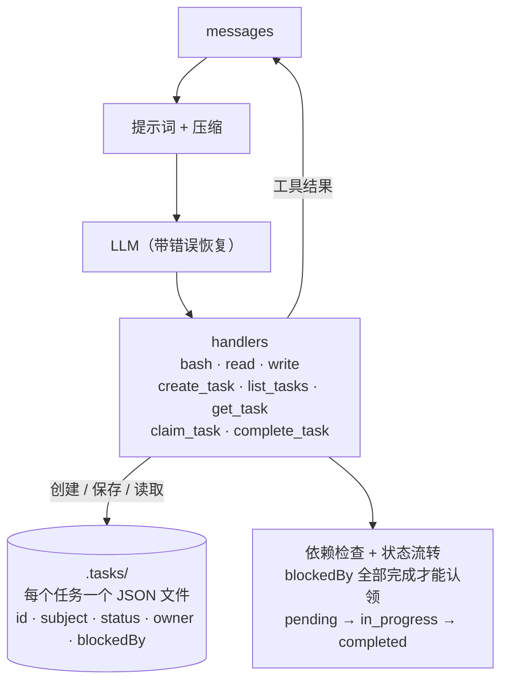

多个任务靠 `blockedBy` 串成有向无环图（DAG），上游完成后下游自动就绪：

```mermaid
flowchart TD
  schema["✓ schema<br/>completed"] --> endpoints["● endpoints<br/>in_progress · owner: agent-1"]
  schema --> docs["○ docs<br/>pending · 依赖已完成，可认领"]
  endpoints --> tests["○ tests<br/>pending · 等 endpoints"]
  tests --> deploy["○ deploy<br/>pending · 等 tests 和 docs"]
  docs --> deploy
```

这里有三个关键设计点：

- **Todo 与 Task 分工互补**：`todo_write` 留在内存里拆解当前正在做的单个任务，Task System 落盘到 `.tasks/` 管理项目级依赖图，两者配合而非替代。
- **依赖按 ID 校验、完成自动提示就绪任务**：`blockedBy` 存的是上游 `task_id`（不是标题），依赖缺失或未完成都会挡住 `claim_task`；`complete_task` 写完状态后会顺手扫出所有当前已满足依赖的 `pending` 任务并附在返回值里。
- **教学版边界**：当前落盘只保证进程重启能恢复，不含文件锁、数据库事务或 lease，多进程并发认领不安全。生产系统应使用条件更新或 CAS 抢占，并记录事件日志。

---

`s05` 的 `todo_write` 把清单放在内存里，进程一退就清空。任务系统换一条思路：每个任务存成 `.tasks/` 下的独立 JSON 文件，文件名就是任务 ID。先写最底层的读写 helper：`saveTask` 负责建目录写盘，`loadTask` 按 ID 读取（文件不存在返回 `null`），`setTasksDir` 供测试切换临时目录，`taskSeq` 用于生成不冲突的序号。

本次代码变化：16 行。

```js ! agent.js range=255:288
import {
  readdirSync,
  readFileSync,
  existsSync,
  mkdirSync,
  writeFileSync,
  rmSync,
} from "node:fs";
import path from "node:path";
import {
  callLlm,
  runBash,
  readFile,
  writeFile,
  editFile,
  glob,
  tool,
  runChatCli,
  isMainModule,
  parseFrontmatter,
  prepareHistoryForSummary,
} from "./helper.js";

const SKILLS_DIR = path.join(process.cwd(), "skills");

export function scanSkills(dir = SKILLS_DIR) {
  const registry = {};
  if (!existsSync(dir)) return registry;
  for (const entry of readdirSync(dir, { withFileTypes: true })) {
    if (!entry.isDirectory()) continue;
    const manifest = path.join(dir, entry.name, "SKILL.md");
    if (!existsSync(manifest)) continue;
    const raw = readFileSync(manifest, "utf8");
    const { meta } = parseFrontmatter(raw);
    const name = meta.name || entry.name;
    registry[name] = { name, description: meta.description || "", content: raw };
  }
  return registry;
}

export const skillRegistry = scanSkills();

function listSkills() {
  const all = Object.values(skillRegistry);
  return all.length ? all.map((s) => `- ${s.name}: ${s.description}`).join("\n") : "(no skills found)";
}

function loadSkill({ name }) {
  const skill = skillRegistry[name];
  return skill ? skill.content : `Skill not found: ${name}`;
}

const MEMORY_TYPES = ["user", "feedback", "project", "reference"];

let memoryDir = path.join(process.cwd(), ".memory");
export function setMemoryDir(dir) {
  memoryDir = dir;
}
const indexPath = () => path.join(memoryDir, "MEMORY.md");

export function writeMemoryFile(name, type, description, body) {
  mkdirSync(memoryDir, { recursive: true });
  const slug = name.toLowerCase().replace(/[\s/]+/g, "-");
  writeFileSync(
    path.join(memoryDir, `${slug}.md`),
    `---\nname: ${name}\ndescription: ${description}\ntype: ${type}\n---\n\n${body}\n`,
  );
  rebuildIndex();
}

export function listMemoryFiles() {
  if (!existsSync(memoryDir)) return [];
  return readdirSync(memoryDir)
    .filter((f) => f.endsWith(".md") && f !== "MEMORY.md")
    .sort()
    .map((filename) => {
      const raw = readFileSync(path.join(memoryDir, filename), "utf8");
      const { meta, body } = parseFrontmatter(raw);
      return {
        filename,
        name: meta.name || filename.replace(/\.md$/, ""),
        description: meta.description || "",
        type: meta.type || "user",
        body,
        content: raw,
      };
    });
}

function rebuildIndex() {
  const lines = listMemoryFiles().map((m) => `- [${m.name}](${m.filename}) — ${m.description}`);
  mkdirSync(memoryDir, { recursive: true });
  writeFileSync(indexPath(), lines.length ? `${lines.join("\n")}\n` : "");
}

export function readMemoryIndex() {
  return existsSync(indexPath()) ? readFileSync(indexPath(), "utf8").trim() : "";
}

export async function selectRelevantMemories(messages, maxItems = 5) {
  const files = listMemoryFiles();
  if (!files.length) return [];
  const recent = messages
    .filter((m) => m.role === "user" && typeof m.content === "string")
    .slice(-3)
    .map((m) => m.content)
    .join(" ")
    .slice(0, 2000);
  if (!recent.trim()) return [];
  const catalog = files.map((f, i) => `${i}: ${f.name} — ${f.description}`).join("\n");
  try {
    const { message } = await callLlm(
      [
        {
          role: "user",
          content: `Given the recent conversation and the memory catalog, return ONLY a JSON array of the indices that are clearly relevant (e.g. [0, 2]). If none, return [].

Recent conversation:
${recent}

Memory catalog:
${catalog}`,
        },
      ],
      {},
    );
    const match = (message.content || "").match(/\[.*?\]/s);
    if (match) {
      const indices = JSON.parse(match[0]);
      return indices
        .filter((i) => Number.isInteger(i) && i >= 0 && i < files.length)
        .slice(0, maxItems)
        .map((i) => files[i].filename);
    }
  } catch {
  }
  const keywords = recent.toLowerCase().split(/\s+/).filter((w) => w.length > 3);
  return files
    .filter((f) => keywords.some((kw) => `${f.name} ${f.description}`.toLowerCase().includes(kw)))
    .slice(0, maxItems)
    .map((f) => f.filename);
}

export async function loadMemories(messages) {
  const selected = await selectRelevantMemories(messages);
  if (!selected.length) return "";
  const parts = ["<relevant_memories>"];
  for (const filename of selected) parts.push(readFileSync(path.join(memoryDir, filename), "utf8"));
  parts.push("</relevant_memories>");
  return parts.join("\n\n");
}

export async function extractMemories(messages) {
  const dialogue = messages
    .filter((m) => (m.role === "user" || m.role === "assistant") && typeof m.content === "string" && m.content.trim())
    .slice(-10)
    .map((m) => `${m.role}: ${m.content}`)
    .join("\n")
    .slice(0, 4000);
  if (!dialogue.trim()) return 0;
  const existing = listMemoryFiles();
  const existingDesc = existing.length
    ? existing.map((m) => `- ${m.name}: ${m.description}`).join("\n")
    : "(none)";
  try {
    const { message } = await callLlm(
      [
        {
          role: "user",
          content: `Extract durable user preferences, constraints, or project facts from this dialogue.
Return a JSON array; each item: {name, type, description, body}.
- name: short kebab-case id; type: one of ${MEMORY_TYPES.join("/")}; description: one-line; body: markdown detail.
If nothing new or already covered, return [].

Existing memories:
${existingDesc}

Dialogue:
${dialogue}`,
        },
      ],
      {},
    );
    const match = (message.content || "").match(/\[.*\]/s);
    if (!match) return 0;
    const items = JSON.parse(match[0]);
    let count = 0;
    for (const m of items) {
      if (m.description && m.body) {
        writeMemoryFile(
          m.name || `memory-${count}`,
          MEMORY_TYPES.includes(m.type) ? m.type : "user",
          m.description,
          m.body,
        );
        count += 1;
      }
    }
    if (count) console.log(`[Memory: extracted ${count} new memories]`);
    return count;
  } catch {
    return 0;
  }
}

const CONSOLIDATE_THRESHOLD = 10;
export async function consolidateMemories() {
  const files = listMemoryFiles();
  if (files.length < CONSOLIDATE_THRESHOLD) return;
  const catalog = files
    .map((f) => `## ${f.filename}\nname: ${f.name}\ndescription: ${f.description}\n${f.body}`)
    .join("\n\n")
    .slice(0, 16000);
  try {
    const { message } = await callLlm(
      [
        {
          role: "user",
          content: `Consolidate these memory files: merge duplicates, drop outdated/contradicted ones, keep under 30, preserve user preferences above all.
Return a JSON array; each item: {name, type, description, body}.

${catalog}`,
        },
      ],
      {},
    );
    const match = (message.content || "").match(/\[.*\]/s);
    if (!match) return;
    const items = JSON.parse(match[0]);
    for (const f of readdirSync(memoryDir)) {
      if (f.endsWith(".md") && f !== "MEMORY.md") rmSync(path.join(memoryDir, f));
    }
    for (const m of items) {
      if (m.description && m.body) {
        writeMemoryFile(
          m.name || "memory",
          MEMORY_TYPES.includes(m.type) ? m.type : "user",
          m.description,
          m.body,
        );
      }
    }
    console.log(`[Memory: consolidated ${files.length} → ${items.length} memories]`);
  } catch {
  }
}

function buildRequest(messages, memoriesContent) {
  if (!memoriesContent) return messages;
  let idx = -1;
  for (let i = messages.length - 1; i >= 0; i -= 1) {
    if (messages[i].role === "user" && typeof messages[i].content === "string") {
      idx = i;
      break;
    }
  }
  if (idx === -1) return messages;
  const copy = messages.slice();
  copy[idx] = { ...messages[idx], content: `${memoriesContent}\n\n${messages[idx].content}` };
  return copy;
}

// !focus(start)
let tasksDir = path.join(process.cwd(), ".tasks");
export function setTasksDir(dir) {
  tasksDir = dir;
}
let taskSeq = 0;
const taskPath = (id) => path.join(tasksDir, `${id}.json`);

function saveTask(task) {
  mkdirSync(tasksDir, { recursive: true });
  writeFileSync(taskPath(task.id), JSON.stringify(task, null, 2));
}
function loadTask(id) {
  if (!existsSync(taskPath(id))) return null;
  return JSON.parse(readFileSync(taskPath(id), "utf8"));
}

// !focus(end)
const TRANSCRIPT_DIR = path.join(process.cwd(), ".transcripts");
const TOOL_RESULTS_DIR = path.join(process.cwd(), ".task_outputs", "tool-results");

const CONTEXT_LIMIT = 12000;
const KEEP_RECENT = 3;
const PERSIST_THRESHOLD = 30000;

export const estimateSize = (messages) => JSON.stringify(messages).length;
const isToolResult = (m) => m.role === "tool";

function apply(messages, next) {
  if (next !== messages) messages.splice(0, messages.length, ...next);
  return messages;
}

export function snipCompact(messages, maxMessages = 50) {
  if (messages.length <= maxMessages) return messages;
  let head = 3;
  let tail = messages.length - (maxMessages - 3);
  while (head < messages.length && isToolResult(messages[head])) head += 1;
  while (tail < messages.length && isToolResult(messages[tail])) tail += 1;
  if (head >= tail) return messages;
  return [
    ...messages.slice(0, head),
    { role: "user", content: `[snipped ${tail - head} messages from the middle]` },
    ...messages.slice(tail),
  ];
}

export function microCompact(messages) {
  const toolMsgs = messages.filter(isToolResult);
  if (toolMsgs.length <= KEEP_RECENT) return messages;
  for (const m of toolMsgs.slice(0, -KEEP_RECENT)) {
    if (m.content.length > 120) m.content = "[Earlier tool result compacted. Re-run if needed.]";
  }
  return messages;
}

function persistLargeOutput(id, output) {
  if (output.length <= PERSIST_THRESHOLD) return output;
  mkdirSync(TOOL_RESULTS_DIR, { recursive: true });
  const file = path.join(TOOL_RESULTS_DIR, `${id}.txt`);
  if (!existsSync(file)) writeFileSync(file, output);
  return `<persisted-output>\nFull output: ${file}\nPreview:\n${output.slice(0, 2000)}\n</persisted-output>`;
}

export function toolResultBudget(messages, maxBytes = 200000) {
  const tail = [];
  for (let i = messages.length - 1; i >= 0 && isToolResult(messages[i]); i -= 1) tail.push(messages[i]);
  let total = tail.reduce((n, m) => n + m.content.length, 0);
  if (total <= maxBytes) return messages;
  for (const m of [...tail].sort((a, b) => b.content.length - a.content.length)) {
    if (total <= maxBytes) break;
    if (m.content.length <= PERSIST_THRESHOLD) continue;
    const before = m.content.length;
    m.content = persistLargeOutput(m.tool_call_id, m.content);
    total -= before - m.content.length;
  }
  return messages;
}

function writeTranscript(messages) {
  mkdirSync(TRANSCRIPT_DIR, { recursive: true });
  const file = path.join(TRANSCRIPT_DIR, `transcript-${Date.now()}.jsonl`);
  writeFileSync(file, messages.map((m) => JSON.stringify(m)).join("\n"));
  return file;
}

async function summarizeHistory(messages) {
  const conversation = prepareHistoryForSummary(messages);
  const prompt = `Summarize this coding-agent conversation so work can continue.
Preserve: 1) current goal, 2) key findings/decisions, 3) files read/changed, 4) remaining work, 5) user constraints.
Be compact but concrete.

${conversation}`;
  const { message } = await callLlm([{ role: "user", content: prompt }], {});
  return (message.content || "").trim() || "(empty summary)";
}

export async function compactHistory(messages) {
  writeTranscript(messages);
  const summary = await summarizeHistory(messages);
  return [{ role: "user", content: `[Compacted]\n\n${summary}` }];
}

export async function reactiveCompact(messages) {
  writeTranscript(messages);
  let tail = Math.max(0, messages.length - 5);
  while (tail < messages.length && isToolResult(messages[tail])) tail += 1;
  const summary = await summarizeHistory(messages.slice(0, tail));
  return [{ role: "user", content: `[Reactive compact]\n\n${summary}` }, ...messages.slice(tail)];
}

const isPromptTooLong = (error) =>
  /prompt.*too.*long|too many tokens|context.*length/i.test(String(error.message));

const DEFAULT_MAX_TOKENS = 8000;
const ESCALATED_MAX_TOKENS = 64000;
const MAX_RECOVERY_RETRIES = 3;
const MAX_RETRIES = 10;
const BASE_DELAY_MS = 500;
const MAX_CONSECUTIVE_529 = 3;
const CONTINUATION_PROMPT =
  "Output token limit hit. Resume directly — no apology, no recap. Pick up mid-thought.";

export class RecoveryState {
  constructor() {
    this.escalated = false;
    this.recoveryCount = 0;
    this.consecutive529 = 0;
    this.attemptedReactiveCompact = false;
    this.currentModel = null;
  }
}

export function retryDelay(attempt, retryAfter) {
  if (retryAfter) return retryAfter;
  const base = Math.min(BASE_DELAY_MS * 2 ** attempt, 32000);
  return base + Math.random() * base * 0.25;
}

let sleep = (ms) => new Promise((resolve) => setTimeout(resolve, ms));
export function setSleepFn(fn) {
  sleep = fn;
}

const isRateLimit = (msg) => /\b429\b|rate.?limit/i.test(msg);
const isOverloaded = (msg) => /\b529\b|overloaded/i.test(msg);

export async function withRetry(fn, state) {
  for (let attempt = 0; attempt < MAX_RETRIES; attempt += 1) {
    try {
      const result = await fn();
      state.consecutive529 = 0;
      return result;
    } catch (error) {
      const msg = String(error.message);
      if (isOverloaded(msg)) {
        state.consecutive529 += 1;
        const fallback = process.env.FALLBACK_MODEL_ID;
        if (state.consecutive529 >= MAX_CONSECUTIVE_529 && fallback) {
          state.currentModel = fallback;
          state.consecutive529 = 0;
          console.log(`[529 x${MAX_CONSECUTIVE_529}] switching to ${fallback}`);
        }
        await sleep(retryDelay(attempt));
        continue;
      }
      if (isRateLimit(msg)) {
        await sleep(retryDelay(attempt));
        continue;
      }
      throw error;
    }
  }
  throw new Error(`Max retries (${MAX_RETRIES}) exceeded`);
}

const PROMPT_SECTIONS = {
  identity: () =>
    `You are a coding agent at ${process.cwd()}. Use tools to solve tasks. Before a multi-step task, use todo_write to plan and update status as you go. For a complex sub-problem, use the task tool to spawn a subagent.`,
  tools: (ctx) => (ctx.tools.length ? `Available tools: ${ctx.tools.join(", ")}.` : null),
  skills: (ctx) =>
    ctx.skills ? `Skills available:\n${ctx.skills}\nUse load_skill to load a skill's full content when needed.` : null,
  compaction: () => "When context gets large, call compact to summarize earlier work and free space.",
  memory: (ctx) =>
    ctx.memories
      ? `Memories available:\n${ctx.memories}\nRespect user preferences from memory; new ones are saved automatically.`
      : null,
};
const SECTION_ORDER = ["identity", "tools", "skills", "compaction", "memory"];

export function assembleSystemPrompt(context) {
  return SECTION_ORDER.map((key) => PROMPT_SECTIONS[key](context)).filter(Boolean).join("\n\n");
}

let lastContextKey = null;
let lastSystemPrompt = null;
export function getSystemPrompt(context) {
  const key = JSON.stringify(context);
  if (key === lastContextKey && lastSystemPrompt) return lastSystemPrompt;
  lastContextKey = key;
  lastSystemPrompt = assembleSystemPrompt(context);
  return lastSystemPrompt;
}
export function resetSystemPromptCache() {
  lastContextKey = null;
  lastSystemPrompt = null;
}

export function buildContext() {
  const skills = listSkills();
  return {
    tools: tools.map((t) => t.function.name),
    skills: skills === "(no skills found)" ? "" : skills,
    memories: readMemoryIndex(),
  };
}

const SUB_SYSTEM = `You are a coding subagent at ${process.cwd()}. Complete the task, then return a concise summary. Do not delegate further.`;

const tools = [
  tool("bash", "Run a shell command.", {
    type: "object",
    properties: { command: { type: "string" } },
    required: ["command"],
  }),
  tool("read_file", "Read a file (optional line limit).", {
    type: "object",
    properties: { path: { type: "string" }, limit: { type: "integer" } },
    required: ["path"],
  }),
  tool("write_file", "Write content to a file.", {
    type: "object",
    properties: { path: { type: "string" }, content: { type: "string" } },
    required: ["path", "content"],
  }),
  tool("edit_file", "Replace exact text in a file once.", {
    type: "object",
    properties: {
      path: { type: "string" },
      old_text: { type: "string" },
      new_text: { type: "string" },
    },
    required: ["path", "old_text", "new_text"],
  }),
  tool("glob", "Find files by glob pattern.", {
    type: "object",
    properties: { pattern: { type: "string" } },
    required: ["pattern"],
  }),
  tool("todo_write", "Create and manage a task list for the current session.", {
    type: "object",
    properties: {
      todos: {
        type: "array",
        items: {
          type: "object",
          properties: {
            content: { type: "string" },
            status: { type: "string", enum: ["pending", "in_progress", "completed"] },
          },
          required: ["content", "status"],
        },
      },
    },
    required: ["todos"],
  }),
  tool("task", "Launch a subagent to handle a complex subtask. Returns only the final summary.", {
    type: "object",
    properties: { description: { type: "string" } },
    required: ["description"],
  }),
  tool("load_skill", "Load a skill's full content by name (see the catalog in the system prompt).", {
    type: "object",
    properties: { name: { type: "string" } },
    required: ["name"],
  }),
  tool("compact", "Summarize earlier conversation to free context space.", {
    type: "object",
    properties: { focus: { type: "string" } },
  }),
];

let currentTodos = [];
export function getTodos() {
  return currentTodos;
}

function runTodoWrite({ todos = [] }) {
  currentTodos = todos;
  const icon = { pending: " ", in_progress: "▸", completed: "✓" };
  console.log("## Current Tasks");
  for (const t of currentTodos) console.log(`  [${icon[t.status]}] ${t.content}`);
  return `Updated ${currentTodos.length} tasks`;
}

const handlers = {
  bash: ({ command }) => runBash(command),
  read_file: ({ path, limit }) => readFile(path, limit),
  write_file: ({ path, content }) => writeFile(path, content),
  edit_file: ({ path, old_text, new_text }) => editFile(path, old_text, new_text),
  glob: ({ pattern }) => glob(pattern),
  todo_write: runTodoWrite,
  task: ({ description }, confirm) => spawnSubagent(description, confirm),
  load_skill: loadSkill,
};

const SUB_EXCLUDE = ["task", "todo_write", "load_skill", "compact"];
const subTools = tools.filter((t) => !SUB_EXCLUDE.includes(t.function.name));
const subHandlers = Object.fromEntries(
  Object.entries(handlers).filter(([name]) => !SUB_EXCLUDE.includes(name)),
);
const MAX_SUB_TURNS = 30;

async function spawnSubagent(description, confirm) {
  const messages = [{ role: "user", content: description }];
  for (let turn = 0; turn < MAX_SUB_TURNS; turn += 1) {
    const { message } = await callLlm(messages, { system: SUB_SYSTEM, tools: subTools });
    messages.push(message);
    if (!message.tool_calls?.length) return message.content || "(subagent returned no text)";

    for (const call of message.tool_calls) {
      const name = call.function.name;
      const args = JSON.parse(call.function.arguments || "{}");
      const blocked = await triggerHooks("PreToolUse", name, args, confirm);
      const handler = subHandlers[name];
      const output =
        blocked != null ? String(blocked) : handler ? handler(args) : `Unknown tool: ${name}`;
      messages.push({ role: "tool", tool_call_id: call.id, content: String(output) });
    }
  }
  return "Subagent stopped after 30 turns without a final answer.";
}

export { spawnSubagent };

const hooks = { UserPromptSubmit: [], PreToolUse: [], PostToolUse: [], Stop: [] };

function registerHook(event, callback) {
  hooks[event].push(callback);
}

async function triggerHooks(event, ...args) {
  for (const callback of hooks[event]) {
    const result = await callback(...args);
    if (result != null) return result;
  }
  return null;
}

const DENY = ["rm -rf /", "sudo", "shutdown", "reboot", "mkfs", "dd if="];
const RISKY = ["rm ", "> /etc/", "chmod 777"];

async function permissionHook(name, args, confirm) {
  if (name !== "bash") return null;
  const command = args.command || "";
  if (DENY.some((p) => command.includes(p))) return "Permission denied: 命中黑名单。";
  if (RISKY.some((p) => command.includes(p))) {
    const answer = confirm ? await confirm(`⚠ 可能有破坏性的命令: ${command} 允许? [y/N] `) : "";
    if (!/^y(es)?$/i.test(String(answer).trim())) return "Permission denied by user.";
  }
  return null;
}

registerHook("PreToolUse", permissionHook);

export async function agentLoop(messages, confirm) {
  let roundsSinceTodo = 0;
  const state = new RecoveryState();
  let maxTokens = DEFAULT_MAX_TOKENS;
  let context = buildContext();
  let system = getSystemPrompt(context);
  const memoriesContent = await loadMemories(messages);
  let preCompress = messages.map((m) => ({ role: m.role, content: m.content }));

  while (true) {
    if (roundsSinceTodo >= 3) {
      messages.push({ role: "user", content: "<reminder>Update your todos.</reminder>" });
      roundsSinceTodo = 0;
    }

    preCompress = messages.map((m) => ({ role: m.role, content: m.content }));

    apply(messages, toolResultBudget(messages));
    apply(messages, snipCompact(messages));
    apply(messages, microCompact(messages));
    if (estimateSize(messages) > CONTEXT_LIMIT) apply(messages, await compactHistory(messages));

    let choice;
    try {
      choice = await withRetry(
        () =>
          callLlm(buildRequest(messages, memoriesContent), {
            system,
            tools,
            model: state.currentModel,
            maxTokens,
          }),
        state,
      );
    } catch (error) {
      if (isPromptTooLong(error) && !state.attemptedReactiveCompact) {
        apply(messages, await reactiveCompact(messages));
        state.attemptedReactiveCompact = true;
        continue;
      }
      console.error(`[unrecoverable] ${error.message}`);
      return `[Error] ${error.message}`;
    }

    const message = choice.message;

    if (choice.finish_reason === "length") {
      if (!state.escalated) {
        maxTokens = ESCALATED_MAX_TOKENS;
        state.escalated = true;
        continue;
      }
      messages.push(message);
      if (state.recoveryCount < MAX_RECOVERY_RETRIES) {
        messages.push({ role: "user", content: CONTINUATION_PROMPT });
        state.recoveryCount += 1;
        continue;
      }
      return message.content || "";
    }

    if (!message.tool_calls?.length) {
      await extractMemories(preCompress);
      await consolidateMemories();
      return message.content || "";
    }

    messages.push(message);
    roundsSinceTodo += 1;
    let compacted = false;
    for (const call of message.tool_calls) {
      const name = call.function.name;
      const args = JSON.parse(call.function.arguments || "{}");

      if (name === "compact") {
        apply(messages, await compactHistory(messages));
        compacted = true;
        break;
      }

      const blocked = await triggerHooks("PreToolUse", name, args, confirm);
      let output;
      if (blocked != null) {
        output = String(blocked);
      } else {
        const handler = handlers[name];
        output = handler ? await handler(args, confirm) : `Unknown tool: ${name}`;
      }

      if (name === "todo_write") roundsSinceTodo = 0;
      messages.push({ role: "tool", tool_call_id: call.id, content: String(output) });
    }
    if (compacted) continue;

    context = buildContext();
    system = getSystemPrompt(context);
  }
}

async function main() {
  await runChatCli({
    promptLabel: "s11 >> ",
    onPrompt: async ({ prompt, messages, ask }) => {
      return agentLoop(messages, ask);
    },
  });
}

if (isMainModule(import.meta.url)) {
  main().catch((error) => {
    console.error(error.message);
    process.exit(1);
  });
}
```

## !!steps
`createTask` 用当前时间戳加递增序号拼出 ID，同一毫秒连建多个任务也不会撞名。新建任务默认状态为 `pending`、`owner` 为 `null`，`blockedBy` 存它依赖的前置任务 ID。`runCreateTask` 负责把结果整理成返回给模型的简短文本，再连同工具 schema 和 `handlers` 一起注册。因为 `s10` 已经实现了动态提示词，新工具会自动出现在系统提示词里。

本次代码变化：23 行。

```js ! agent.js range=271:601
import {
  readdirSync,
  readFileSync,
  existsSync,
  mkdirSync,
  writeFileSync,
  rmSync,
} from "node:fs";
import path from "node:path";
import {
  callLlm,
  runBash,
  readFile,
  writeFile,
  editFile,
  glob,
  tool,
  runChatCli,
  isMainModule,
  parseFrontmatter,
  prepareHistoryForSummary,
} from "./helper.js";

const SKILLS_DIR = path.join(process.cwd(), "skills");

export function scanSkills(dir = SKILLS_DIR) {
  const registry = {};
  if (!existsSync(dir)) return registry;
  for (const entry of readdirSync(dir, { withFileTypes: true })) {
    if (!entry.isDirectory()) continue;
    const manifest = path.join(dir, entry.name, "SKILL.md");
    if (!existsSync(manifest)) continue;
    const raw = readFileSync(manifest, "utf8");
    const { meta } = parseFrontmatter(raw);
    const name = meta.name || entry.name;
    registry[name] = { name, description: meta.description || "", content: raw };
  }
  return registry;
}

export const skillRegistry = scanSkills();

function listSkills() {
  const all = Object.values(skillRegistry);
  return all.length ? all.map((s) => `- ${s.name}: ${s.description}`).join("\n") : "(no skills found)";
}

function loadSkill({ name }) {
  const skill = skillRegistry[name];
  return skill ? skill.content : `Skill not found: ${name}`;
}

const MEMORY_TYPES = ["user", "feedback", "project", "reference"];

let memoryDir = path.join(process.cwd(), ".memory");
export function setMemoryDir(dir) {
  memoryDir = dir;
}
const indexPath = () => path.join(memoryDir, "MEMORY.md");

export function writeMemoryFile(name, type, description, body) {
  mkdirSync(memoryDir, { recursive: true });
  const slug = name.toLowerCase().replace(/[\s/]+/g, "-");
  writeFileSync(
    path.join(memoryDir, `${slug}.md`),
    `---\nname: ${name}\ndescription: ${description}\ntype: ${type}\n---\n\n${body}\n`,
  );
  rebuildIndex();
}

export function listMemoryFiles() {
  if (!existsSync(memoryDir)) return [];
  return readdirSync(memoryDir)
    .filter((f) => f.endsWith(".md") && f !== "MEMORY.md")
    .sort()
    .map((filename) => {
      const raw = readFileSync(path.join(memoryDir, filename), "utf8");
      const { meta, body } = parseFrontmatter(raw);
      return {
        filename,
        name: meta.name || filename.replace(/\.md$/, ""),
        description: meta.description || "",
        type: meta.type || "user",
        body,
        content: raw,
      };
    });
}

function rebuildIndex() {
  const lines = listMemoryFiles().map((m) => `- [${m.name}](${m.filename}) — ${m.description}`);
  mkdirSync(memoryDir, { recursive: true });
  writeFileSync(indexPath(), lines.length ? `${lines.join("\n")}\n` : "");
}

export function readMemoryIndex() {
  return existsSync(indexPath()) ? readFileSync(indexPath(), "utf8").trim() : "";
}

export async function selectRelevantMemories(messages, maxItems = 5) {
  const files = listMemoryFiles();
  if (!files.length) return [];
  const recent = messages
    .filter((m) => m.role === "user" && typeof m.content === "string")
    .slice(-3)
    .map((m) => m.content)
    .join(" ")
    .slice(0, 2000);
  if (!recent.trim()) return [];
  const catalog = files.map((f, i) => `${i}: ${f.name} — ${f.description}`).join("\n");
  try {
    const { message } = await callLlm(
      [
        {
          role: "user",
          content: `Given the recent conversation and the memory catalog, return ONLY a JSON array of the indices that are clearly relevant (e.g. [0, 2]). If none, return [].

Recent conversation:
${recent}

Memory catalog:
${catalog}`,
        },
      ],
      {},
    );
    const match = (message.content || "").match(/\[.*?\]/s);
    if (match) {
      const indices = JSON.parse(match[0]);
      return indices
        .filter((i) => Number.isInteger(i) && i >= 0 && i < files.length)
        .slice(0, maxItems)
        .map((i) => files[i].filename);
    }
  } catch {
  }
  const keywords = recent.toLowerCase().split(/\s+/).filter((w) => w.length > 3);
  return files
    .filter((f) => keywords.some((kw) => `${f.name} ${f.description}`.toLowerCase().includes(kw)))
    .slice(0, maxItems)
    .map((f) => f.filename);
}

export async function loadMemories(messages) {
  const selected = await selectRelevantMemories(messages);
  if (!selected.length) return "";
  const parts = ["<relevant_memories>"];
  for (const filename of selected) parts.push(readFileSync(path.join(memoryDir, filename), "utf8"));
  parts.push("</relevant_memories>");
  return parts.join("\n\n");
}

export async function extractMemories(messages) {
  const dialogue = messages
    .filter((m) => (m.role === "user" || m.role === "assistant") && typeof m.content === "string" && m.content.trim())
    .slice(-10)
    .map((m) => `${m.role}: ${m.content}`)
    .join("\n")
    .slice(0, 4000);
  if (!dialogue.trim()) return 0;
  const existing = listMemoryFiles();
  const existingDesc = existing.length
    ? existing.map((m) => `- ${m.name}: ${m.description}`).join("\n")
    : "(none)";
  try {
    const { message } = await callLlm(
      [
        {
          role: "user",
          content: `Extract durable user preferences, constraints, or project facts from this dialogue.
Return a JSON array; each item: {name, type, description, body}.
- name: short kebab-case id; type: one of ${MEMORY_TYPES.join("/")}; description: one-line; body: markdown detail.
If nothing new or already covered, return [].

Existing memories:
${existingDesc}

Dialogue:
${dialogue}`,
        },
      ],
      {},
    );
    const match = (message.content || "").match(/\[.*\]/s);
    if (!match) return 0;
    const items = JSON.parse(match[0]);
    let count = 0;
    for (const m of items) {
      if (m.description && m.body) {
        writeMemoryFile(
          m.name || `memory-${count}`,
          MEMORY_TYPES.includes(m.type) ? m.type : "user",
          m.description,
          m.body,
        );
        count += 1;
      }
    }
    if (count) console.log(`[Memory: extracted ${count} new memories]`);
    return count;
  } catch {
    return 0;
  }
}

const CONSOLIDATE_THRESHOLD = 10;
export async function consolidateMemories() {
  const files = listMemoryFiles();
  if (files.length < CONSOLIDATE_THRESHOLD) return;
  const catalog = files
    .map((f) => `## ${f.filename}\nname: ${f.name}\ndescription: ${f.description}\n${f.body}`)
    .join("\n\n")
    .slice(0, 16000);
  try {
    const { message } = await callLlm(
      [
        {
          role: "user",
          content: `Consolidate these memory files: merge duplicates, drop outdated/contradicted ones, keep under 30, preserve user preferences above all.
Return a JSON array; each item: {name, type, description, body}.

${catalog}`,
        },
      ],
      {},
    );
    const match = (message.content || "").match(/\[.*\]/s);
    if (!match) return;
    const items = JSON.parse(match[0]);
    for (const f of readdirSync(memoryDir)) {
      if (f.endsWith(".md") && f !== "MEMORY.md") rmSync(path.join(memoryDir, f));
    }
    for (const m of items) {
      if (m.description && m.body) {
        writeMemoryFile(
          m.name || "memory",
          MEMORY_TYPES.includes(m.type) ? m.type : "user",
          m.description,
          m.body,
        );
      }
    }
    console.log(`[Memory: consolidated ${files.length} → ${items.length} memories]`);
  } catch {
  }
}

function buildRequest(messages, memoriesContent) {
  if (!memoriesContent) return messages;
  let idx = -1;
  for (let i = messages.length - 1; i >= 0; i -= 1) {
    if (messages[i].role === "user" && typeof messages[i].content === "string") {
      idx = i;
      break;
    }
  }
  if (idx === -1) return messages;
  const copy = messages.slice();
  copy[idx] = { ...messages[idx], content: `${memoriesContent}\n\n${messages[idx].content}` };
  return copy;
}

let tasksDir = path.join(process.cwd(), ".tasks");
export function setTasksDir(dir) {
  tasksDir = dir;
}
let taskSeq = 0;
const taskPath = (id) => path.join(tasksDir, `${id}.json`);

function saveTask(task) {
  mkdirSync(tasksDir, { recursive: true });
  writeFileSync(taskPath(task.id), JSON.stringify(task, null, 2));
}
function loadTask(id) {
  if (!existsSync(taskPath(id))) return null;
  return JSON.parse(readFileSync(taskPath(id), "utf8"));
}

// !focus(start)
export function createTask(subject, description = "", blockedBy = []) {
  const id = `task_${Date.now()}_${String(taskSeq++).padStart(4, "0")}`;
  const task = { id, subject, description, status: "pending", owner: null, blockedBy };
  saveTask(task);
  return task;
}

function runCreateTask({ subject, description, blockedBy }) {
  const task = createTask(subject, description || "", blockedBy || []);
  const deps = task.blockedBy.length ? ` (blockedBy: ${task.blockedBy.join(", ")})` : "";
  return `Created ${task.id}: ${task.subject}${deps}`;
}

// !focus(end)
const TRANSCRIPT_DIR = path.join(process.cwd(), ".transcripts");
const TOOL_RESULTS_DIR = path.join(process.cwd(), ".task_outputs", "tool-results");

const CONTEXT_LIMIT = 12000;
const KEEP_RECENT = 3;
const PERSIST_THRESHOLD = 30000;

export const estimateSize = (messages) => JSON.stringify(messages).length;
const isToolResult = (m) => m.role === "tool";

function apply(messages, next) {
  if (next !== messages) messages.splice(0, messages.length, ...next);
  return messages;
}

export function snipCompact(messages, maxMessages = 50) {
  if (messages.length <= maxMessages) return messages;
  let head = 3;
  let tail = messages.length - (maxMessages - 3);
  while (head < messages.length && isToolResult(messages[head])) head += 1;
  while (tail < messages.length && isToolResult(messages[tail])) tail += 1;
  if (head >= tail) return messages;
  return [
    ...messages.slice(0, head),
    { role: "user", content: `[snipped ${tail - head} messages from the middle]` },
    ...messages.slice(tail),
  ];
}

export function microCompact(messages) {
  const toolMsgs = messages.filter(isToolResult);
  if (toolMsgs.length <= KEEP_RECENT) return messages;
  for (const m of toolMsgs.slice(0, -KEEP_RECENT)) {
    if (m.content.length > 120) m.content = "[Earlier tool result compacted. Re-run if needed.]";
  }
  return messages;
}

function persistLargeOutput(id, output) {
  if (output.length <= PERSIST_THRESHOLD) return output;
  mkdirSync(TOOL_RESULTS_DIR, { recursive: true });
  const file = path.join(TOOL_RESULTS_DIR, `${id}.txt`);
  if (!existsSync(file)) writeFileSync(file, output);
  return `<persisted-output>\nFull output: ${file}\nPreview:\n${output.slice(0, 2000)}\n</persisted-output>`;
}

export function toolResultBudget(messages, maxBytes = 200000) {
  const tail = [];
  for (let i = messages.length - 1; i >= 0 && isToolResult(messages[i]); i -= 1) tail.push(messages[i]);
  let total = tail.reduce((n, m) => n + m.content.length, 0);
  if (total <= maxBytes) return messages;
  for (const m of [...tail].sort((a, b) => b.content.length - a.content.length)) {
    if (total <= maxBytes) break;
    if (m.content.length <= PERSIST_THRESHOLD) continue;
    const before = m.content.length;
    m.content = persistLargeOutput(m.tool_call_id, m.content);
    total -= before - m.content.length;
  }
  return messages;
}

function writeTranscript(messages) {
  mkdirSync(TRANSCRIPT_DIR, { recursive: true });
  const file = path.join(TRANSCRIPT_DIR, `transcript-${Date.now()}.jsonl`);
  writeFileSync(file, messages.map((m) => JSON.stringify(m)).join("\n"));
  return file;
}

async function summarizeHistory(messages) {
  const conversation = prepareHistoryForSummary(messages);
  const prompt = `Summarize this coding-agent conversation so work can continue.
Preserve: 1) current goal, 2) key findings/decisions, 3) files read/changed, 4) remaining work, 5) user constraints.
Be compact but concrete.

${conversation}`;
  const { message } = await callLlm([{ role: "user", content: prompt }], {});
  return (message.content || "").trim() || "(empty summary)";
}

export async function compactHistory(messages) {
  writeTranscript(messages);
  const summary = await summarizeHistory(messages);
  return [{ role: "user", content: `[Compacted]\n\n${summary}` }];
}

export async function reactiveCompact(messages) {
  writeTranscript(messages);
  let tail = Math.max(0, messages.length - 5);
  while (tail < messages.length && isToolResult(messages[tail])) tail += 1;
  const summary = await summarizeHistory(messages.slice(0, tail));
  return [{ role: "user", content: `[Reactive compact]\n\n${summary}` }, ...messages.slice(tail)];
}

const isPromptTooLong = (error) =>
  /prompt.*too.*long|too many tokens|context.*length/i.test(String(error.message));

const DEFAULT_MAX_TOKENS = 8000;
const ESCALATED_MAX_TOKENS = 64000;
const MAX_RECOVERY_RETRIES = 3;
const MAX_RETRIES = 10;
const BASE_DELAY_MS = 500;
const MAX_CONSECUTIVE_529 = 3;
const CONTINUATION_PROMPT =
  "Output token limit hit. Resume directly — no apology, no recap. Pick up mid-thought.";

export class RecoveryState {
  constructor() {
    this.escalated = false;
    this.recoveryCount = 0;
    this.consecutive529 = 0;
    this.attemptedReactiveCompact = false;
    this.currentModel = null;
  }
}

export function retryDelay(attempt, retryAfter) {
  if (retryAfter) return retryAfter;
  const base = Math.min(BASE_DELAY_MS * 2 ** attempt, 32000);
  return base + Math.random() * base * 0.25;
}

let sleep = (ms) => new Promise((resolve) => setTimeout(resolve, ms));
export function setSleepFn(fn) {
  sleep = fn;
}

const isRateLimit = (msg) => /\b429\b|rate.?limit/i.test(msg);
const isOverloaded = (msg) => /\b529\b|overloaded/i.test(msg);

export async function withRetry(fn, state) {
  for (let attempt = 0; attempt < MAX_RETRIES; attempt += 1) {
    try {
      const result = await fn();
      state.consecutive529 = 0;
      return result;
    } catch (error) {
      const msg = String(error.message);
      if (isOverloaded(msg)) {
        state.consecutive529 += 1;
        const fallback = process.env.FALLBACK_MODEL_ID;
        if (state.consecutive529 >= MAX_CONSECUTIVE_529 && fallback) {
          state.currentModel = fallback;
          state.consecutive529 = 0;
          console.log(`[529 x${MAX_CONSECUTIVE_529}] switching to ${fallback}`);
        }
        await sleep(retryDelay(attempt));
        continue;
      }
      if (isRateLimit(msg)) {
        await sleep(retryDelay(attempt));
        continue;
      }
      throw error;
    }
  }
  throw new Error(`Max retries (${MAX_RETRIES}) exceeded`);
}

const PROMPT_SECTIONS = {
  identity: () =>
    `You are a coding agent at ${process.cwd()}. Use tools to solve tasks. Before a multi-step task, use todo_write to plan and update status as you go. For a complex sub-problem, use the task tool to spawn a subagent.`,
  tools: (ctx) => (ctx.tools.length ? `Available tools: ${ctx.tools.join(", ")}.` : null),
  skills: (ctx) =>
    ctx.skills ? `Skills available:\n${ctx.skills}\nUse load_skill to load a skill's full content when needed.` : null,
  compaction: () => "When context gets large, call compact to summarize earlier work and free space.",
  memory: (ctx) =>
    ctx.memories
      ? `Memories available:\n${ctx.memories}\nRespect user preferences from memory; new ones are saved automatically.`
      : null,
};
const SECTION_ORDER = ["identity", "tools", "skills", "compaction", "memory"];

export function assembleSystemPrompt(context) {
  return SECTION_ORDER.map((key) => PROMPT_SECTIONS[key](context)).filter(Boolean).join("\n\n");
}

let lastContextKey = null;
let lastSystemPrompt = null;
export function getSystemPrompt(context) {
  const key = JSON.stringify(context);
  if (key === lastContextKey && lastSystemPrompt) return lastSystemPrompt;
  lastContextKey = key;
  lastSystemPrompt = assembleSystemPrompt(context);
  return lastSystemPrompt;
}
export function resetSystemPromptCache() {
  lastContextKey = null;
  lastSystemPrompt = null;
}

export function buildContext() {
  const skills = listSkills();
  return {
    tools: tools.map((t) => t.function.name),
    skills: skills === "(no skills found)" ? "" : skills,
    memories: readMemoryIndex(),
  };
}

const SUB_SYSTEM = `You are a coding subagent at ${process.cwd()}. Complete the task, then return a concise summary. Do not delegate further.`;

const tools = [
  tool("bash", "Run a shell command.", {
    type: "object",
    properties: { command: { type: "string" } },
    required: ["command"],
  }),
  tool("read_file", "Read a file (optional line limit).", {
    type: "object",
    properties: { path: { type: "string" }, limit: { type: "integer" } },
    required: ["path"],
  }),
  tool("write_file", "Write content to a file.", {
    type: "object",
    properties: { path: { type: "string" }, content: { type: "string" } },
    required: ["path", "content"],
  }),
  tool("edit_file", "Replace exact text in a file once.", {
    type: "object",
    properties: {
      path: { type: "string" },
      old_text: { type: "string" },
      new_text: { type: "string" },
    },
    required: ["path", "old_text", "new_text"],
  }),
  tool("glob", "Find files by glob pattern.", {
    type: "object",
    properties: { pattern: { type: "string" } },
    required: ["pattern"],
  }),
  tool("todo_write", "Create and manage a task list for the current session.", {
    type: "object",
    properties: {
      todos: {
        type: "array",
        items: {
          type: "object",
          properties: {
            content: { type: "string" },
            status: { type: "string", enum: ["pending", "in_progress", "completed"] },
          },
          required: ["content", "status"],
        },
      },
    },
    required: ["todos"],
  }),
  tool("task", "Launch a subagent to handle a complex subtask. Returns only the final summary.", {
    type: "object",
    properties: { description: { type: "string" } },
    required: ["description"],
  }),
  tool("load_skill", "Load a skill's full content by name (see the catalog in the system prompt).", {
    type: "object",
    properties: { name: { type: "string" } },
    required: ["name"],
  }),
  tool("compact", "Summarize earlier conversation to free context space.", {
    type: "object",
    properties: { focus: { type: "string" } },
  }),
// !focus(start)
  tool("create_task", "Create a persistent task with optional blockedBy dependencies.", {
    type: "object",
    properties: {
      subject: { type: "string" },
      description: { type: "string" },
      blockedBy: { type: "array", items: { type: "string" } },
    },
    required: ["subject"],
  }),
// !focus(end)
];

let currentTodos = [];
export function getTodos() {
  return currentTodos;
}

function runTodoWrite({ todos = [] }) {
  currentTodos = todos;
  const icon = { pending: " ", in_progress: "▸", completed: "✓" };
  console.log("## Current Tasks");
  for (const t of currentTodos) console.log(`  [${icon[t.status]}] ${t.content}`);
  return `Updated ${currentTodos.length} tasks`;
}

const handlers = {
  bash: ({ command }) => runBash(command),
  read_file: ({ path, limit }) => readFile(path, limit),
  write_file: ({ path, content }) => writeFile(path, content),
  edit_file: ({ path, old_text, new_text }) => editFile(path, old_text, new_text),
  glob: ({ pattern }) => glob(pattern),
  todo_write: runTodoWrite,
  task: ({ description }, confirm) => spawnSubagent(description, confirm),
  load_skill: loadSkill,
// !focus(start)
  create_task: runCreateTask,
// !focus(end)
};

const SUB_EXCLUDE = ["task", "todo_write", "load_skill", "compact"];
const subTools = tools.filter((t) => !SUB_EXCLUDE.includes(t.function.name));
const subHandlers = Object.fromEntries(
  Object.entries(handlers).filter(([name]) => !SUB_EXCLUDE.includes(name)),
);
const MAX_SUB_TURNS = 30;

async function spawnSubagent(description, confirm) {
  const messages = [{ role: "user", content: description }];
  for (let turn = 0; turn < MAX_SUB_TURNS; turn += 1) {
    const { message } = await callLlm(messages, { system: SUB_SYSTEM, tools: subTools });
    messages.push(message);
    if (!message.tool_calls?.length) return message.content || "(subagent returned no text)";

    for (const call of message.tool_calls) {
      const name = call.function.name;
      const args = JSON.parse(call.function.arguments || "{}");
      const blocked = await triggerHooks("PreToolUse", name, args, confirm);
      const handler = subHandlers[name];
      const output =
        blocked != null ? String(blocked) : handler ? handler(args) : `Unknown tool: ${name}`;
      messages.push({ role: "tool", tool_call_id: call.id, content: String(output) });
    }
  }
  return "Subagent stopped after 30 turns without a final answer.";
}

export { spawnSubagent };

const hooks = { UserPromptSubmit: [], PreToolUse: [], PostToolUse: [], Stop: [] };

function registerHook(event, callback) {
  hooks[event].push(callback);
}

async function triggerHooks(event, ...args) {
  for (const callback of hooks[event]) {
    const result = await callback(...args);
    if (result != null) return result;
  }
  return null;
}

const DENY = ["rm -rf /", "sudo", "shutdown", "reboot", "mkfs", "dd if="];
const RISKY = ["rm ", "> /etc/", "chmod 777"];

async function permissionHook(name, args, confirm) {
  if (name !== "bash") return null;
  const command = args.command || "";
  if (DENY.some((p) => command.includes(p))) return "Permission denied: 命中黑名单。";
  if (RISKY.some((p) => command.includes(p))) {
    const answer = confirm ? await confirm(`⚠ 可能有破坏性的命令: ${command} 允许? [y/N] `) : "";
    if (!/^y(es)?$/i.test(String(answer).trim())) return "Permission denied by user.";
  }
  return null;
}

registerHook("PreToolUse", permissionHook);

export async function agentLoop(messages, confirm) {
  let roundsSinceTodo = 0;
  const state = new RecoveryState();
  let maxTokens = DEFAULT_MAX_TOKENS;
  let context = buildContext();
  let system = getSystemPrompt(context);
  const memoriesContent = await loadMemories(messages);
  let preCompress = messages.map((m) => ({ role: m.role, content: m.content }));

  while (true) {
    if (roundsSinceTodo >= 3) {
      messages.push({ role: "user", content: "<reminder>Update your todos.</reminder>" });
      roundsSinceTodo = 0;
    }

    preCompress = messages.map((m) => ({ role: m.role, content: m.content }));

    apply(messages, toolResultBudget(messages));
    apply(messages, snipCompact(messages));
    apply(messages, microCompact(messages));
    if (estimateSize(messages) > CONTEXT_LIMIT) apply(messages, await compactHistory(messages));

    let choice;
    try {
      choice = await withRetry(
        () =>
          callLlm(buildRequest(messages, memoriesContent), {
            system,
            tools,
            model: state.currentModel,
            maxTokens,
          }),
        state,
      );
    } catch (error) {
      if (isPromptTooLong(error) && !state.attemptedReactiveCompact) {
        apply(messages, await reactiveCompact(messages));
        state.attemptedReactiveCompact = true;
        continue;
      }
      console.error(`[unrecoverable] ${error.message}`);
      return `[Error] ${error.message}`;
    }

    const message = choice.message;

    if (choice.finish_reason === "length") {
      if (!state.escalated) {
        maxTokens = ESCALATED_MAX_TOKENS;
        state.escalated = true;
        continue;
      }
      messages.push(message);
      if (state.recoveryCount < MAX_RECOVERY_RETRIES) {
        messages.push({ role: "user", content: CONTINUATION_PROMPT });
        state.recoveryCount += 1;
        continue;
      }
      return message.content || "";
    }

    if (!message.tool_calls?.length) {
      await extractMemories(preCompress);
      await consolidateMemories();
      return message.content || "";
    }

    messages.push(message);
    roundsSinceTodo += 1;
    let compacted = false;
    for (const call of message.tool_calls) {
      const name = call.function.name;
      const args = JSON.parse(call.function.arguments || "{}");

      if (name === "compact") {
        apply(messages, await compactHistory(messages));
        compacted = true;
        break;
      }

      const blocked = await triggerHooks("PreToolUse", name, args, confirm);
      let output;
      if (blocked != null) {
        output = String(blocked);
      } else {
        const handler = handlers[name];
        output = handler ? await handler(args, confirm) : `Unknown tool: ${name}`;
      }

      if (name === "todo_write") roundsSinceTodo = 0;
      messages.push({ role: "tool", tool_call_id: call.id, content: String(output) });
    }
    if (compacted) continue;

    context = buildContext();
    system = getSystemPrompt(context);
  }
}

async function main() {
  await runChatCli({
    promptLabel: "s11 >> ",
    onPrompt: async ({ prompt, messages, ask }) => {
      return agentLoop(messages, ask);
    },
  });
}

if (isMainModule(import.meta.url)) {
  main().catch((error) => {
    console.error(error.message);
    process.exit(1);
  });
}
```

## !!steps
`listTasks` 扫描 `.tasks/` 下的任务文件并按文件名排序（即按创建时间排序）。`runListTasks` 把所有任务排成一目了然的清单：图标标示状态（`○` 待办、`●` 进行中、`✓` 完成），后面依次跟着 ID、标题、负责人和依赖列表。由于数据落在磁盘上，退出重开依然能读回完整进度。

本次代码变化：25 行。

```js ! agent.js range=278:628
import {
  readdirSync,
  readFileSync,
  existsSync,
  mkdirSync,
  writeFileSync,
  rmSync,
} from "node:fs";
import path from "node:path";
import {
  callLlm,
  runBash,
  readFile,
  writeFile,
  editFile,
  glob,
  tool,
  runChatCli,
  isMainModule,
  parseFrontmatter,
  prepareHistoryForSummary,
} from "./helper.js";

const SKILLS_DIR = path.join(process.cwd(), "skills");

export function scanSkills(dir = SKILLS_DIR) {
  const registry = {};
  if (!existsSync(dir)) return registry;
  for (const entry of readdirSync(dir, { withFileTypes: true })) {
    if (!entry.isDirectory()) continue;
    const manifest = path.join(dir, entry.name, "SKILL.md");
    if (!existsSync(manifest)) continue;
    const raw = readFileSync(manifest, "utf8");
    const { meta } = parseFrontmatter(raw);
    const name = meta.name || entry.name;
    registry[name] = { name, description: meta.description || "", content: raw };
  }
  return registry;
}

export const skillRegistry = scanSkills();

function listSkills() {
  const all = Object.values(skillRegistry);
  return all.length ? all.map((s) => `- ${s.name}: ${s.description}`).join("\n") : "(no skills found)";
}

function loadSkill({ name }) {
  const skill = skillRegistry[name];
  return skill ? skill.content : `Skill not found: ${name}`;
}

const MEMORY_TYPES = ["user", "feedback", "project", "reference"];

let memoryDir = path.join(process.cwd(), ".memory");
export function setMemoryDir(dir) {
  memoryDir = dir;
}
const indexPath = () => path.join(memoryDir, "MEMORY.md");

export function writeMemoryFile(name, type, description, body) {
  mkdirSync(memoryDir, { recursive: true });
  const slug = name.toLowerCase().replace(/[\s/]+/g, "-");
  writeFileSync(
    path.join(memoryDir, `${slug}.md`),
    `---\nname: ${name}\ndescription: ${description}\ntype: ${type}\n---\n\n${body}\n`,
  );
  rebuildIndex();
}

export function listMemoryFiles() {
  if (!existsSync(memoryDir)) return [];
  return readdirSync(memoryDir)
    .filter((f) => f.endsWith(".md") && f !== "MEMORY.md")
    .sort()
    .map((filename) => {
      const raw = readFileSync(path.join(memoryDir, filename), "utf8");
      const { meta, body } = parseFrontmatter(raw);
      return {
        filename,
        name: meta.name || filename.replace(/\.md$/, ""),
        description: meta.description || "",
        type: meta.type || "user",
        body,
        content: raw,
      };
    });
}

function rebuildIndex() {
  const lines = listMemoryFiles().map((m) => `- [${m.name}](${m.filename}) — ${m.description}`);
  mkdirSync(memoryDir, { recursive: true });
  writeFileSync(indexPath(), lines.length ? `${lines.join("\n")}\n` : "");
}

export function readMemoryIndex() {
  return existsSync(indexPath()) ? readFileSync(indexPath(), "utf8").trim() : "";
}

export async function selectRelevantMemories(messages, maxItems = 5) {
  const files = listMemoryFiles();
  if (!files.length) return [];
  const recent = messages
    .filter((m) => m.role === "user" && typeof m.content === "string")
    .slice(-3)
    .map((m) => m.content)
    .join(" ")
    .slice(0, 2000);
  if (!recent.trim()) return [];
  const catalog = files.map((f, i) => `${i}: ${f.name} — ${f.description}`).join("\n");
  try {
    const { message } = await callLlm(
      [
        {
          role: "user",
          content: `Given the recent conversation and the memory catalog, return ONLY a JSON array of the indices that are clearly relevant (e.g. [0, 2]). If none, return [].

Recent conversation:
${recent}

Memory catalog:
${catalog}`,
        },
      ],
      {},
    );
    const match = (message.content || "").match(/\[.*?\]/s);
    if (match) {
      const indices = JSON.parse(match[0]);
      return indices
        .filter((i) => Number.isInteger(i) && i >= 0 && i < files.length)
        .slice(0, maxItems)
        .map((i) => files[i].filename);
    }
  } catch {
  }
  const keywords = recent.toLowerCase().split(/\s+/).filter((w) => w.length > 3);
  return files
    .filter((f) => keywords.some((kw) => `${f.name} ${f.description}`.toLowerCase().includes(kw)))
    .slice(0, maxItems)
    .map((f) => f.filename);
}

export async function loadMemories(messages) {
  const selected = await selectRelevantMemories(messages);
  if (!selected.length) return "";
  const parts = ["<relevant_memories>"];
  for (const filename of selected) parts.push(readFileSync(path.join(memoryDir, filename), "utf8"));
  parts.push("</relevant_memories>");
  return parts.join("\n\n");
}

export async function extractMemories(messages) {
  const dialogue = messages
    .filter((m) => (m.role === "user" || m.role === "assistant") && typeof m.content === "string" && m.content.trim())
    .slice(-10)
    .map((m) => `${m.role}: ${m.content}`)
    .join("\n")
    .slice(0, 4000);
  if (!dialogue.trim()) return 0;
  const existing = listMemoryFiles();
  const existingDesc = existing.length
    ? existing.map((m) => `- ${m.name}: ${m.description}`).join("\n")
    : "(none)";
  try {
    const { message } = await callLlm(
      [
        {
          role: "user",
          content: `Extract durable user preferences, constraints, or project facts from this dialogue.
Return a JSON array; each item: {name, type, description, body}.
- name: short kebab-case id; type: one of ${MEMORY_TYPES.join("/")}; description: one-line; body: markdown detail.
If nothing new or already covered, return [].

Existing memories:
${existingDesc}

Dialogue:
${dialogue}`,
        },
      ],
      {},
    );
    const match = (message.content || "").match(/\[.*\]/s);
    if (!match) return 0;
    const items = JSON.parse(match[0]);
    let count = 0;
    for (const m of items) {
      if (m.description && m.body) {
        writeMemoryFile(
          m.name || `memory-${count}`,
          MEMORY_TYPES.includes(m.type) ? m.type : "user",
          m.description,
          m.body,
        );
        count += 1;
      }
    }
    if (count) console.log(`[Memory: extracted ${count} new memories]`);
    return count;
  } catch {
    return 0;
  }
}

const CONSOLIDATE_THRESHOLD = 10;
export async function consolidateMemories() {
  const files = listMemoryFiles();
  if (files.length < CONSOLIDATE_THRESHOLD) return;
  const catalog = files
    .map((f) => `## ${f.filename}\nname: ${f.name}\ndescription: ${f.description}\n${f.body}`)
    .join("\n\n")
    .slice(0, 16000);
  try {
    const { message } = await callLlm(
      [
        {
          role: "user",
          content: `Consolidate these memory files: merge duplicates, drop outdated/contradicted ones, keep under 30, preserve user preferences above all.
Return a JSON array; each item: {name, type, description, body}.

${catalog}`,
        },
      ],
      {},
    );
    const match = (message.content || "").match(/\[.*\]/s);
    if (!match) return;
    const items = JSON.parse(match[0]);
    for (const f of readdirSync(memoryDir)) {
      if (f.endsWith(".md") && f !== "MEMORY.md") rmSync(path.join(memoryDir, f));
    }
    for (const m of items) {
      if (m.description && m.body) {
        writeMemoryFile(
          m.name || "memory",
          MEMORY_TYPES.includes(m.type) ? m.type : "user",
          m.description,
          m.body,
        );
      }
    }
    console.log(`[Memory: consolidated ${files.length} → ${items.length} memories]`);
  } catch {
  }
}

function buildRequest(messages, memoriesContent) {
  if (!memoriesContent) return messages;
  let idx = -1;
  for (let i = messages.length - 1; i >= 0; i -= 1) {
    if (messages[i].role === "user" && typeof messages[i].content === "string") {
      idx = i;
      break;
    }
  }
  if (idx === -1) return messages;
  const copy = messages.slice();
  copy[idx] = { ...messages[idx], content: `${memoriesContent}\n\n${messages[idx].content}` };
  return copy;
}

let tasksDir = path.join(process.cwd(), ".tasks");
export function setTasksDir(dir) {
  tasksDir = dir;
}
let taskSeq = 0;
const taskPath = (id) => path.join(tasksDir, `${id}.json`);

function saveTask(task) {
  mkdirSync(tasksDir, { recursive: true });
  writeFileSync(taskPath(task.id), JSON.stringify(task, null, 2));
}
function loadTask(id) {
  if (!existsSync(taskPath(id))) return null;
  return JSON.parse(readFileSync(taskPath(id), "utf8"));
}

export function createTask(subject, description = "", blockedBy = []) {
  const id = `task_${Date.now()}_${String(taskSeq++).padStart(4, "0")}`;
  const task = { id, subject, description, status: "pending", owner: null, blockedBy };
  saveTask(task);
  return task;
}

// !focus(start)
export function listTasks() {
  if (!existsSync(tasksDir)) return [];
  return readdirSync(tasksDir)
    .filter((f) => f.startsWith("task_") && f.endsWith(".json"))
    .sort()
    .map((f) => JSON.parse(readFileSync(path.join(tasksDir, f), "utf8")));
}

// !focus(end)
function runCreateTask({ subject, description, blockedBy }) {
  const task = createTask(subject, description || "", blockedBy || []);
  const deps = task.blockedBy.length ? ` (blockedBy: ${task.blockedBy.join(", ")})` : "";
  return `Created ${task.id}: ${task.subject}${deps}`;
}
// !focus(start)
function runListTasks() {
  const tasks = listTasks();
  if (!tasks.length) return "No tasks. Use create_task to add some.";
  const icon = { pending: "○", in_progress: "●", completed: "✓" };
  return tasks
    .map((t) => {
      const deps = t.blockedBy.length ? ` (blockedBy: ${t.blockedBy.join(", ")})` : "";
      const owner = t.owner ? ` [${t.owner}]` : "";
      return `${icon[t.status] || "?"} ${t.id}: ${t.subject} [${t.status}]${owner}${deps}`;
    })
    .join("\n");
}
// !focus(end)

const TRANSCRIPT_DIR = path.join(process.cwd(), ".transcripts");
const TOOL_RESULTS_DIR = path.join(process.cwd(), ".task_outputs", "tool-results");

const CONTEXT_LIMIT = 12000;
const KEEP_RECENT = 3;
const PERSIST_THRESHOLD = 30000;

export const estimateSize = (messages) => JSON.stringify(messages).length;
const isToolResult = (m) => m.role === "tool";

function apply(messages, next) {
  if (next !== messages) messages.splice(0, messages.length, ...next);
  return messages;
}

export function snipCompact(messages, maxMessages = 50) {
  if (messages.length <= maxMessages) return messages;
  let head = 3;
  let tail = messages.length - (maxMessages - 3);
  while (head < messages.length && isToolResult(messages[head])) head += 1;
  while (tail < messages.length && isToolResult(messages[tail])) tail += 1;
  if (head >= tail) return messages;
  return [
    ...messages.slice(0, head),
    { role: "user", content: `[snipped ${tail - head} messages from the middle]` },
    ...messages.slice(tail),
  ];
}

export function microCompact(messages) {
  const toolMsgs = messages.filter(isToolResult);
  if (toolMsgs.length <= KEEP_RECENT) return messages;
  for (const m of toolMsgs.slice(0, -KEEP_RECENT)) {
    if (m.content.length > 120) m.content = "[Earlier tool result compacted. Re-run if needed.]";
  }
  return messages;
}

function persistLargeOutput(id, output) {
  if (output.length <= PERSIST_THRESHOLD) return output;
  mkdirSync(TOOL_RESULTS_DIR, { recursive: true });
  const file = path.join(TOOL_RESULTS_DIR, `${id}.txt`);
  if (!existsSync(file)) writeFileSync(file, output);
  return `<persisted-output>\nFull output: ${file}\nPreview:\n${output.slice(0, 2000)}\n</persisted-output>`;
}

export function toolResultBudget(messages, maxBytes = 200000) {
  const tail = [];
  for (let i = messages.length - 1; i >= 0 && isToolResult(messages[i]); i -= 1) tail.push(messages[i]);
  let total = tail.reduce((n, m) => n + m.content.length, 0);
  if (total <= maxBytes) return messages;
  for (const m of [...tail].sort((a, b) => b.content.length - a.content.length)) {
    if (total <= maxBytes) break;
    if (m.content.length <= PERSIST_THRESHOLD) continue;
    const before = m.content.length;
    m.content = persistLargeOutput(m.tool_call_id, m.content);
    total -= before - m.content.length;
  }
  return messages;
}

function writeTranscript(messages) {
  mkdirSync(TRANSCRIPT_DIR, { recursive: true });
  const file = path.join(TRANSCRIPT_DIR, `transcript-${Date.now()}.jsonl`);
  writeFileSync(file, messages.map((m) => JSON.stringify(m)).join("\n"));
  return file;
}

async function summarizeHistory(messages) {
  const conversation = prepareHistoryForSummary(messages);
  const prompt = `Summarize this coding-agent conversation so work can continue.
Preserve: 1) current goal, 2) key findings/decisions, 3) files read/changed, 4) remaining work, 5) user constraints.
Be compact but concrete.

${conversation}`;
  const { message } = await callLlm([{ role: "user", content: prompt }], {});
  return (message.content || "").trim() || "(empty summary)";
}

export async function compactHistory(messages) {
  writeTranscript(messages);
  const summary = await summarizeHistory(messages);
  return [{ role: "user", content: `[Compacted]\n\n${summary}` }];
}

export async function reactiveCompact(messages) {
  writeTranscript(messages);
  let tail = Math.max(0, messages.length - 5);
  while (tail < messages.length && isToolResult(messages[tail])) tail += 1;
  const summary = await summarizeHistory(messages.slice(0, tail));
  return [{ role: "user", content: `[Reactive compact]\n\n${summary}` }, ...messages.slice(tail)];
}

const isPromptTooLong = (error) =>
  /prompt.*too.*long|too many tokens|context.*length/i.test(String(error.message));

const DEFAULT_MAX_TOKENS = 8000;
const ESCALATED_MAX_TOKENS = 64000;
const MAX_RECOVERY_RETRIES = 3;
const MAX_RETRIES = 10;
const BASE_DELAY_MS = 500;
const MAX_CONSECUTIVE_529 = 3;
const CONTINUATION_PROMPT =
  "Output token limit hit. Resume directly — no apology, no recap. Pick up mid-thought.";

export class RecoveryState {
  constructor() {
    this.escalated = false;
    this.recoveryCount = 0;
    this.consecutive529 = 0;
    this.attemptedReactiveCompact = false;
    this.currentModel = null;
  }
}

export function retryDelay(attempt, retryAfter) {
  if (retryAfter) return retryAfter;
  const base = Math.min(BASE_DELAY_MS * 2 ** attempt, 32000);
  return base + Math.random() * base * 0.25;
}

let sleep = (ms) => new Promise((resolve) => setTimeout(resolve, ms));
export function setSleepFn(fn) {
  sleep = fn;
}

const isRateLimit = (msg) => /\b429\b|rate.?limit/i.test(msg);
const isOverloaded = (msg) => /\b529\b|overloaded/i.test(msg);

export async function withRetry(fn, state) {
  for (let attempt = 0; attempt < MAX_RETRIES; attempt += 1) {
    try {
      const result = await fn();
      state.consecutive529 = 0;
      return result;
    } catch (error) {
      const msg = String(error.message);
      if (isOverloaded(msg)) {
        state.consecutive529 += 1;
        const fallback = process.env.FALLBACK_MODEL_ID;
        if (state.consecutive529 >= MAX_CONSECUTIVE_529 && fallback) {
          state.currentModel = fallback;
          state.consecutive529 = 0;
          console.log(`[529 x${MAX_CONSECUTIVE_529}] switching to ${fallback}`);
        }
        await sleep(retryDelay(attempt));
        continue;
      }
      if (isRateLimit(msg)) {
        await sleep(retryDelay(attempt));
        continue;
      }
      throw error;
    }
  }
  throw new Error(`Max retries (${MAX_RETRIES}) exceeded`);
}

const PROMPT_SECTIONS = {
  identity: () =>
    `You are a coding agent at ${process.cwd()}. Use tools to solve tasks. Before a multi-step task, use todo_write to plan and update status as you go. For a complex sub-problem, use the task tool to spawn a subagent.`,
  tools: (ctx) => (ctx.tools.length ? `Available tools: ${ctx.tools.join(", ")}.` : null),
  skills: (ctx) =>
    ctx.skills ? `Skills available:\n${ctx.skills}\nUse load_skill to load a skill's full content when needed.` : null,
  compaction: () => "When context gets large, call compact to summarize earlier work and free space.",
  memory: (ctx) =>
    ctx.memories
      ? `Memories available:\n${ctx.memories}\nRespect user preferences from memory; new ones are saved automatically.`
      : null,
};
const SECTION_ORDER = ["identity", "tools", "skills", "compaction", "memory"];

export function assembleSystemPrompt(context) {
  return SECTION_ORDER.map((key) => PROMPT_SECTIONS[key](context)).filter(Boolean).join("\n\n");
}

let lastContextKey = null;
let lastSystemPrompt = null;
export function getSystemPrompt(context) {
  const key = JSON.stringify(context);
  if (key === lastContextKey && lastSystemPrompt) return lastSystemPrompt;
  lastContextKey = key;
  lastSystemPrompt = assembleSystemPrompt(context);
  return lastSystemPrompt;
}
export function resetSystemPromptCache() {
  lastContextKey = null;
  lastSystemPrompt = null;
}

export function buildContext() {
  const skills = listSkills();
  return {
    tools: tools.map((t) => t.function.name),
    skills: skills === "(no skills found)" ? "" : skills,
    memories: readMemoryIndex(),
  };
}

const SUB_SYSTEM = `You are a coding subagent at ${process.cwd()}. Complete the task, then return a concise summary. Do not delegate further.`;

const tools = [
  tool("bash", "Run a shell command.", {
    type: "object",
    properties: { command: { type: "string" } },
    required: ["command"],
  }),
  tool("read_file", "Read a file (optional line limit).", {
    type: "object",
    properties: { path: { type: "string" }, limit: { type: "integer" } },
    required: ["path"],
  }),
  tool("write_file", "Write content to a file.", {
    type: "object",
    properties: { path: { type: "string" }, content: { type: "string" } },
    required: ["path", "content"],
  }),
  tool("edit_file", "Replace exact text in a file once.", {
    type: "object",
    properties: {
      path: { type: "string" },
      old_text: { type: "string" },
      new_text: { type: "string" },
    },
    required: ["path", "old_text", "new_text"],
  }),
  tool("glob", "Find files by glob pattern.", {
    type: "object",
    properties: { pattern: { type: "string" } },
    required: ["pattern"],
  }),
  tool("todo_write", "Create and manage a task list for the current session.", {
    type: "object",
    properties: {
      todos: {
        type: "array",
        items: {
          type: "object",
          properties: {
            content: { type: "string" },
            status: { type: "string", enum: ["pending", "in_progress", "completed"] },
          },
          required: ["content", "status"],
        },
      },
    },
    required: ["todos"],
  }),
  tool("task", "Launch a subagent to handle a complex subtask. Returns only the final summary.", {
    type: "object",
    properties: { description: { type: "string" } },
    required: ["description"],
  }),
  tool("load_skill", "Load a skill's full content by name (see the catalog in the system prompt).", {
    type: "object",
    properties: { name: { type: "string" } },
    required: ["name"],
  }),
  tool("compact", "Summarize earlier conversation to free context space.", {
    type: "object",
    properties: { focus: { type: "string" } },
  }),
  tool("create_task", "Create a persistent task with optional blockedBy dependencies.", {
    type: "object",
    properties: {
      subject: { type: "string" },
      description: { type: "string" },
      blockedBy: { type: "array", items: { type: "string" } },
    },
    required: ["subject"],
  }),
// !focus(start)
  tool("list_tasks", "List all tasks with status, owner, and dependencies.", {
    type: "object",
    properties: {},
  }),
// !focus(end)
];

let currentTodos = [];
export function getTodos() {
  return currentTodos;
}

function runTodoWrite({ todos = [] }) {
  currentTodos = todos;
  const icon = { pending: " ", in_progress: "▸", completed: "✓" };
  console.log("## Current Tasks");
  for (const t of currentTodos) console.log(`  [${icon[t.status]}] ${t.content}`);
  return `Updated ${currentTodos.length} tasks`;
}

const handlers = {
  bash: ({ command }) => runBash(command),
  read_file: ({ path, limit }) => readFile(path, limit),
  write_file: ({ path, content }) => writeFile(path, content),
  edit_file: ({ path, old_text, new_text }) => editFile(path, old_text, new_text),
  glob: ({ pattern }) => glob(pattern),
  todo_write: runTodoWrite,
  task: ({ description }, confirm) => spawnSubagent(description, confirm),
  load_skill: loadSkill,
  create_task: runCreateTask,
// !focus(start)
  list_tasks: runListTasks,
// !focus(end)
};

const SUB_EXCLUDE = ["task", "todo_write", "load_skill", "compact"];
const subTools = tools.filter((t) => !SUB_EXCLUDE.includes(t.function.name));
const subHandlers = Object.fromEntries(
  Object.entries(handlers).filter(([name]) => !SUB_EXCLUDE.includes(name)),
);
const MAX_SUB_TURNS = 30;

async function spawnSubagent(description, confirm) {
  const messages = [{ role: "user", content: description }];
  for (let turn = 0; turn < MAX_SUB_TURNS; turn += 1) {
    const { message } = await callLlm(messages, { system: SUB_SYSTEM, tools: subTools });
    messages.push(message);
    if (!message.tool_calls?.length) return message.content || "(subagent returned no text)";

    for (const call of message.tool_calls) {
      const name = call.function.name;
      const args = JSON.parse(call.function.arguments || "{}");
      const blocked = await triggerHooks("PreToolUse", name, args, confirm);
      const handler = subHandlers[name];
      const output =
        blocked != null ? String(blocked) : handler ? handler(args) : `Unknown tool: ${name}`;
      messages.push({ role: "tool", tool_call_id: call.id, content: String(output) });
    }
  }
  return "Subagent stopped after 30 turns without a final answer.";
}

export { spawnSubagent };

const hooks = { UserPromptSubmit: [], PreToolUse: [], PostToolUse: [], Stop: [] };

function registerHook(event, callback) {
  hooks[event].push(callback);
}

async function triggerHooks(event, ...args) {
  for (const callback of hooks[event]) {
    const result = await callback(...args);
    if (result != null) return result;
  }
  return null;
}

const DENY = ["rm -rf /", "sudo", "shutdown", "reboot", "mkfs", "dd if="];
const RISKY = ["rm ", "> /etc/", "chmod 777"];

async function permissionHook(name, args, confirm) {
  if (name !== "bash") return null;
  const command = args.command || "";
  if (DENY.some((p) => command.includes(p))) return "Permission denied: 命中黑名单。";
  if (RISKY.some((p) => command.includes(p))) {
    const answer = confirm ? await confirm(`⚠ 可能有破坏性的命令: ${command} 允许? [y/N] `) : "";
    if (!/^y(es)?$/i.test(String(answer).trim())) return "Permission denied by user.";
  }
  return null;
}

registerHook("PreToolUse", permissionHook);

export async function agentLoop(messages, confirm) {
  let roundsSinceTodo = 0;
  const state = new RecoveryState();
  let maxTokens = DEFAULT_MAX_TOKENS;
  let context = buildContext();
  let system = getSystemPrompt(context);
  const memoriesContent = await loadMemories(messages);
  let preCompress = messages.map((m) => ({ role: m.role, content: m.content }));

  while (true) {
    if (roundsSinceTodo >= 3) {
      messages.push({ role: "user", content: "<reminder>Update your todos.</reminder>" });
      roundsSinceTodo = 0;
    }

    preCompress = messages.map((m) => ({ role: m.role, content: m.content }));

    apply(messages, toolResultBudget(messages));
    apply(messages, snipCompact(messages));
    apply(messages, microCompact(messages));
    if (estimateSize(messages) > CONTEXT_LIMIT) apply(messages, await compactHistory(messages));

    let choice;
    try {
      choice = await withRetry(
        () =>
          callLlm(buildRequest(messages, memoriesContent), {
            system,
            tools,
            model: state.currentModel,
            maxTokens,
          }),
        state,
      );
    } catch (error) {
      if (isPromptTooLong(error) && !state.attemptedReactiveCompact) {
        apply(messages, await reactiveCompact(messages));
        state.attemptedReactiveCompact = true;
        continue;
      }
      console.error(`[unrecoverable] ${error.message}`);
      return `[Error] ${error.message}`;
    }

    const message = choice.message;

    if (choice.finish_reason === "length") {
      if (!state.escalated) {
        maxTokens = ESCALATED_MAX_TOKENS;
        state.escalated = true;
        continue;
      }
      messages.push(message);
      if (state.recoveryCount < MAX_RECOVERY_RETRIES) {
        messages.push({ role: "user", content: CONTINUATION_PROMPT });
        state.recoveryCount += 1;
        continue;
      }
      return message.content || "";
    }

    if (!message.tool_calls?.length) {
      await extractMemories(preCompress);
      await consolidateMemories();
      return message.content || "";
    }

    messages.push(message);
    roundsSinceTodo += 1;
    let compacted = false;
    for (const call of message.tool_calls) {
      const name = call.function.name;
      const args = JSON.parse(call.function.arguments || "{}");

      if (name === "compact") {
        apply(messages, await compactHistory(messages));
        compacted = true;
        break;
      }

      const blocked = await triggerHooks("PreToolUse", name, args, confirm);
      let output;
      if (blocked != null) {
        output = String(blocked);
      } else {
        const handler = handlers[name];
        output = handler ? await handler(args, confirm) : `Unknown tool: ${name}`;
      }

      if (name === "todo_write") roundsSinceTodo = 0;
      messages.push({ role: "tool", tool_call_id: call.id, content: String(output) });
    }
    if (compacted) continue;

    context = buildContext();
    system = getSystemPrompt(context);
  }
}

async function main() {
  await runChatCli({
    promptLabel: "s11 >> ",
    onPrompt: async ({ prompt, messages, ask }) => {
      return agentLoop(messages, ask);
    },
  });
}

if (isMainModule(import.meta.url)) {
  main().catch((error) => {
    console.error(error.message);
    process.exit(1);
  });
}
```

## !!steps
清单里只列标题和状态，不展示长篇 `description`。当模型需要读取某个任务的完整说明时，调用 `get_task` 传入 `task_id` 即可拿到格式化后的完整 JSON；找不到对应文件就返回明确的错误提示。

本次代码变化：10 行。

```js ! agent.js range=303:636
import {
  readdirSync,
  readFileSync,
  existsSync,
  mkdirSync,
  writeFileSync,
  rmSync,
} from "node:fs";
import path from "node:path";
import {
  callLlm,
  runBash,
  readFile,
  writeFile,
  editFile,
  glob,
  tool,
  runChatCli,
  isMainModule,
  parseFrontmatter,
  prepareHistoryForSummary,
} from "./helper.js";

const SKILLS_DIR = path.join(process.cwd(), "skills");

export function scanSkills(dir = SKILLS_DIR) {
  const registry = {};
  if (!existsSync(dir)) return registry;
  for (const entry of readdirSync(dir, { withFileTypes: true })) {
    if (!entry.isDirectory()) continue;
    const manifest = path.join(dir, entry.name, "SKILL.md");
    if (!existsSync(manifest)) continue;
    const raw = readFileSync(manifest, "utf8");
    const { meta } = parseFrontmatter(raw);
    const name = meta.name || entry.name;
    registry[name] = { name, description: meta.description || "", content: raw };
  }
  return registry;
}

export const skillRegistry = scanSkills();

function listSkills() {
  const all = Object.values(skillRegistry);
  return all.length ? all.map((s) => `- ${s.name}: ${s.description}`).join("\n") : "(no skills found)";
}

function loadSkill({ name }) {
  const skill = skillRegistry[name];
  return skill ? skill.content : `Skill not found: ${name}`;
}

const MEMORY_TYPES = ["user", "feedback", "project", "reference"];

let memoryDir = path.join(process.cwd(), ".memory");
export function setMemoryDir(dir) {
  memoryDir = dir;
}
const indexPath = () => path.join(memoryDir, "MEMORY.md");

export function writeMemoryFile(name, type, description, body) {
  mkdirSync(memoryDir, { recursive: true });
  const slug = name.toLowerCase().replace(/[\s/]+/g, "-");
  writeFileSync(
    path.join(memoryDir, `${slug}.md`),
    `---\nname: ${name}\ndescription: ${description}\ntype: ${type}\n---\n\n${body}\n`,
  );
  rebuildIndex();
}

export function listMemoryFiles() {
  if (!existsSync(memoryDir)) return [];
  return readdirSync(memoryDir)
    .filter((f) => f.endsWith(".md") && f !== "MEMORY.md")
    .sort()
    .map((filename) => {
      const raw = readFileSync(path.join(memoryDir, filename), "utf8");
      const { meta, body } = parseFrontmatter(raw);
      return {
        filename,
        name: meta.name || filename.replace(/\.md$/, ""),
        description: meta.description || "",
        type: meta.type || "user",
        body,
        content: raw,
      };
    });
}

function rebuildIndex() {
  const lines = listMemoryFiles().map((m) => `- [${m.name}](${m.filename}) — ${m.description}`);
  mkdirSync(memoryDir, { recursive: true });
  writeFileSync(indexPath(), lines.length ? `${lines.join("\n")}\n` : "");
}

export function readMemoryIndex() {
  return existsSync(indexPath()) ? readFileSync(indexPath(), "utf8").trim() : "";
}

export async function selectRelevantMemories(messages, maxItems = 5) {
  const files = listMemoryFiles();
  if (!files.length) return [];
  const recent = messages
    .filter((m) => m.role === "user" && typeof m.content === "string")
    .slice(-3)
    .map((m) => m.content)
    .join(" ")
    .slice(0, 2000);
  if (!recent.trim()) return [];
  const catalog = files.map((f, i) => `${i}: ${f.name} — ${f.description}`).join("\n");
  try {
    const { message } = await callLlm(
      [
        {
          role: "user",
          content: `Given the recent conversation and the memory catalog, return ONLY a JSON array of the indices that are clearly relevant (e.g. [0, 2]). If none, return [].

Recent conversation:
${recent}

Memory catalog:
${catalog}`,
        },
      ],
      {},
    );
    const match = (message.content || "").match(/\[.*?\]/s);
    if (match) {
      const indices = JSON.parse(match[0]);
      return indices
        .filter((i) => Number.isInteger(i) && i >= 0 && i < files.length)
        .slice(0, maxItems)
        .map((i) => files[i].filename);
    }
  } catch {
  }
  const keywords = recent.toLowerCase().split(/\s+/).filter((w) => w.length > 3);
  return files
    .filter((f) => keywords.some((kw) => `${f.name} ${f.description}`.toLowerCase().includes(kw)))
    .slice(0, maxItems)
    .map((f) => f.filename);
}

export async function loadMemories(messages) {
  const selected = await selectRelevantMemories(messages);
  if (!selected.length) return "";
  const parts = ["<relevant_memories>"];
  for (const filename of selected) parts.push(readFileSync(path.join(memoryDir, filename), "utf8"));
  parts.push("</relevant_memories>");
  return parts.join("\n\n");
}

export async function extractMemories(messages) {
  const dialogue = messages
    .filter((m) => (m.role === "user" || m.role === "assistant") && typeof m.content === "string" && m.content.trim())
    .slice(-10)
    .map((m) => `${m.role}: ${m.content}`)
    .join("\n")
    .slice(0, 4000);
  if (!dialogue.trim()) return 0;
  const existing = listMemoryFiles();
  const existingDesc = existing.length
    ? existing.map((m) => `- ${m.name}: ${m.description}`).join("\n")
    : "(none)";
  try {
    const { message } = await callLlm(
      [
        {
          role: "user",
          content: `Extract durable user preferences, constraints, or project facts from this dialogue.
Return a JSON array; each item: {name, type, description, body}.
- name: short kebab-case id; type: one of ${MEMORY_TYPES.join("/")}; description: one-line; body: markdown detail.
If nothing new or already covered, return [].

Existing memories:
${existingDesc}

Dialogue:
${dialogue}`,
        },
      ],
      {},
    );
    const match = (message.content || "").match(/\[.*\]/s);
    if (!match) return 0;
    const items = JSON.parse(match[0]);
    let count = 0;
    for (const m of items) {
      if (m.description && m.body) {
        writeMemoryFile(
          m.name || `memory-${count}`,
          MEMORY_TYPES.includes(m.type) ? m.type : "user",
          m.description,
          m.body,
        );
        count += 1;
      }
    }
    if (count) console.log(`[Memory: extracted ${count} new memories]`);
    return count;
  } catch {
    return 0;
  }
}

const CONSOLIDATE_THRESHOLD = 10;
export async function consolidateMemories() {
  const files = listMemoryFiles();
  if (files.length < CONSOLIDATE_THRESHOLD) return;
  const catalog = files
    .map((f) => `## ${f.filename}\nname: ${f.name}\ndescription: ${f.description}\n${f.body}`)
    .join("\n\n")
    .slice(0, 16000);
  try {
    const { message } = await callLlm(
      [
        {
          role: "user",
          content: `Consolidate these memory files: merge duplicates, drop outdated/contradicted ones, keep under 30, preserve user preferences above all.
Return a JSON array; each item: {name, type, description, body}.

${catalog}`,
        },
      ],
      {},
    );
    const match = (message.content || "").match(/\[.*\]/s);
    if (!match) return;
    const items = JSON.parse(match[0]);
    for (const f of readdirSync(memoryDir)) {
      if (f.endsWith(".md") && f !== "MEMORY.md") rmSync(path.join(memoryDir, f));
    }
    for (const m of items) {
      if (m.description && m.body) {
        writeMemoryFile(
          m.name || "memory",
          MEMORY_TYPES.includes(m.type) ? m.type : "user",
          m.description,
          m.body,
        );
      }
    }
    console.log(`[Memory: consolidated ${files.length} → ${items.length} memories]`);
  } catch {
  }
}

function buildRequest(messages, memoriesContent) {
  if (!memoriesContent) return messages;
  let idx = -1;
  for (let i = messages.length - 1; i >= 0; i -= 1) {
    if (messages[i].role === "user" && typeof messages[i].content === "string") {
      idx = i;
      break;
    }
  }
  if (idx === -1) return messages;
  const copy = messages.slice();
  copy[idx] = { ...messages[idx], content: `${memoriesContent}\n\n${messages[idx].content}` };
  return copy;
}

let tasksDir = path.join(process.cwd(), ".tasks");
export function setTasksDir(dir) {
  tasksDir = dir;
}
let taskSeq = 0;
const taskPath = (id) => path.join(tasksDir, `${id}.json`);

function saveTask(task) {
  mkdirSync(tasksDir, { recursive: true });
  writeFileSync(taskPath(task.id), JSON.stringify(task, null, 2));
}
function loadTask(id) {
  if (!existsSync(taskPath(id))) return null;
  return JSON.parse(readFileSync(taskPath(id), "utf8"));
}

export function createTask(subject, description = "", blockedBy = []) {
  const id = `task_${Date.now()}_${String(taskSeq++).padStart(4, "0")}`;
  const task = { id, subject, description, status: "pending", owner: null, blockedBy };
  saveTask(task);
  return task;
}

export function listTasks() {
  if (!existsSync(tasksDir)) return [];
  return readdirSync(tasksDir)
    .filter((f) => f.startsWith("task_") && f.endsWith(".json"))
    .sort()
    .map((f) => JSON.parse(readFileSync(path.join(tasksDir, f), "utf8")));
}

function runCreateTask({ subject, description, blockedBy }) {
  const task = createTask(subject, description || "", blockedBy || []);
  const deps = task.blockedBy.length ? ` (blockedBy: ${task.blockedBy.join(", ")})` : "";
  return `Created ${task.id}: ${task.subject}${deps}`;
}
function runListTasks() {
  const tasks = listTasks();
  if (!tasks.length) return "No tasks. Use create_task to add some.";
  const icon = { pending: "○", in_progress: "●", completed: "✓" };
  return tasks
    .map((t) => {
      const deps = t.blockedBy.length ? ` (blockedBy: ${t.blockedBy.join(", ")})` : "";
      const owner = t.owner ? ` [${t.owner}]` : "";
      return `${icon[t.status] || "?"} ${t.id}: ${t.subject} [${t.status}]${owner}${deps}`;
    })
    .join("\n");
}
// !focus(start)
function runGetTask({ task_id }) {
  const task = loadTask(task_id);
  return task ? JSON.stringify(task, null, 2) : `Error: Task ${task_id} not found`;
}
// !focus(end)

const TRANSCRIPT_DIR = path.join(process.cwd(), ".transcripts");
const TOOL_RESULTS_DIR = path.join(process.cwd(), ".task_outputs", "tool-results");

const CONTEXT_LIMIT = 12000;
const KEEP_RECENT = 3;
const PERSIST_THRESHOLD = 30000;

export const estimateSize = (messages) => JSON.stringify(messages).length;
const isToolResult = (m) => m.role === "tool";

function apply(messages, next) {
  if (next !== messages) messages.splice(0, messages.length, ...next);
  return messages;
}

export function snipCompact(messages, maxMessages = 50) {
  if (messages.length <= maxMessages) return messages;
  let head = 3;
  let tail = messages.length - (maxMessages - 3);
  while (head < messages.length && isToolResult(messages[head])) head += 1;
  while (tail < messages.length && isToolResult(messages[tail])) tail += 1;
  if (head >= tail) return messages;
  return [
    ...messages.slice(0, head),
    { role: "user", content: `[snipped ${tail - head} messages from the middle]` },
    ...messages.slice(tail),
  ];
}

export function microCompact(messages) {
  const toolMsgs = messages.filter(isToolResult);
  if (toolMsgs.length <= KEEP_RECENT) return messages;
  for (const m of toolMsgs.slice(0, -KEEP_RECENT)) {
    if (m.content.length > 120) m.content = "[Earlier tool result compacted. Re-run if needed.]";
  }
  return messages;
}

function persistLargeOutput(id, output) {
  if (output.length <= PERSIST_THRESHOLD) return output;
  mkdirSync(TOOL_RESULTS_DIR, { recursive: true });
  const file = path.join(TOOL_RESULTS_DIR, `${id}.txt`);
  if (!existsSync(file)) writeFileSync(file, output);
  return `<persisted-output>\nFull output: ${file}\nPreview:\n${output.slice(0, 2000)}\n</persisted-output>`;
}

export function toolResultBudget(messages, maxBytes = 200000) {
  const tail = [];
  for (let i = messages.length - 1; i >= 0 && isToolResult(messages[i]); i -= 1) tail.push(messages[i]);
  let total = tail.reduce((n, m) => n + m.content.length, 0);
  if (total <= maxBytes) return messages;
  for (const m of [...tail].sort((a, b) => b.content.length - a.content.length)) {
    if (total <= maxBytes) break;
    if (m.content.length <= PERSIST_THRESHOLD) continue;
    const before = m.content.length;
    m.content = persistLargeOutput(m.tool_call_id, m.content);
    total -= before - m.content.length;
  }
  return messages;
}

function writeTranscript(messages) {
  mkdirSync(TRANSCRIPT_DIR, { recursive: true });
  const file = path.join(TRANSCRIPT_DIR, `transcript-${Date.now()}.jsonl`);
  writeFileSync(file, messages.map((m) => JSON.stringify(m)).join("\n"));
  return file;
}

async function summarizeHistory(messages) {
  const conversation = prepareHistoryForSummary(messages);
  const prompt = `Summarize this coding-agent conversation so work can continue.
Preserve: 1) current goal, 2) key findings/decisions, 3) files read/changed, 4) remaining work, 5) user constraints.
Be compact but concrete.

${conversation}`;
  const { message } = await callLlm([{ role: "user", content: prompt }], {});
  return (message.content || "").trim() || "(empty summary)";
}

export async function compactHistory(messages) {
  writeTranscript(messages);
  const summary = await summarizeHistory(messages);
  return [{ role: "user", content: `[Compacted]\n\n${summary}` }];
}

export async function reactiveCompact(messages) {
  writeTranscript(messages);
  let tail = Math.max(0, messages.length - 5);
  while (tail < messages.length && isToolResult(messages[tail])) tail += 1;
  const summary = await summarizeHistory(messages.slice(0, tail));
  return [{ role: "user", content: `[Reactive compact]\n\n${summary}` }, ...messages.slice(tail)];
}

const isPromptTooLong = (error) =>
  /prompt.*too.*long|too many tokens|context.*length/i.test(String(error.message));

const DEFAULT_MAX_TOKENS = 8000;
const ESCALATED_MAX_TOKENS = 64000;
const MAX_RECOVERY_RETRIES = 3;
const MAX_RETRIES = 10;
const BASE_DELAY_MS = 500;
const MAX_CONSECUTIVE_529 = 3;
const CONTINUATION_PROMPT =
  "Output token limit hit. Resume directly — no apology, no recap. Pick up mid-thought.";

export class RecoveryState {
  constructor() {
    this.escalated = false;
    this.recoveryCount = 0;
    this.consecutive529 = 0;
    this.attemptedReactiveCompact = false;
    this.currentModel = null;
  }
}

export function retryDelay(attempt, retryAfter) {
  if (retryAfter) return retryAfter;
  const base = Math.min(BASE_DELAY_MS * 2 ** attempt, 32000);
  return base + Math.random() * base * 0.25;
}

let sleep = (ms) => new Promise((resolve) => setTimeout(resolve, ms));
export function setSleepFn(fn) {
  sleep = fn;
}

const isRateLimit = (msg) => /\b429\b|rate.?limit/i.test(msg);
const isOverloaded = (msg) => /\b529\b|overloaded/i.test(msg);

export async function withRetry(fn, state) {
  for (let attempt = 0; attempt < MAX_RETRIES; attempt += 1) {
    try {
      const result = await fn();
      state.consecutive529 = 0;
      return result;
    } catch (error) {
      const msg = String(error.message);
      if (isOverloaded(msg)) {
        state.consecutive529 += 1;
        const fallback = process.env.FALLBACK_MODEL_ID;
        if (state.consecutive529 >= MAX_CONSECUTIVE_529 && fallback) {
          state.currentModel = fallback;
          state.consecutive529 = 0;
          console.log(`[529 x${MAX_CONSECUTIVE_529}] switching to ${fallback}`);
        }
        await sleep(retryDelay(attempt));
        continue;
      }
      if (isRateLimit(msg)) {
        await sleep(retryDelay(attempt));
        continue;
      }
      throw error;
    }
  }
  throw new Error(`Max retries (${MAX_RETRIES}) exceeded`);
}

const PROMPT_SECTIONS = {
  identity: () =>
    `You are a coding agent at ${process.cwd()}. Use tools to solve tasks. Before a multi-step task, use todo_write to plan and update status as you go. For a complex sub-problem, use the task tool to spawn a subagent.`,
  tools: (ctx) => (ctx.tools.length ? `Available tools: ${ctx.tools.join(", ")}.` : null),
  skills: (ctx) =>
    ctx.skills ? `Skills available:\n${ctx.skills}\nUse load_skill to load a skill's full content when needed.` : null,
  compaction: () => "When context gets large, call compact to summarize earlier work and free space.",
  memory: (ctx) =>
    ctx.memories
      ? `Memories available:\n${ctx.memories}\nRespect user preferences from memory; new ones are saved automatically.`
      : null,
};
const SECTION_ORDER = ["identity", "tools", "skills", "compaction", "memory"];

export function assembleSystemPrompt(context) {
  return SECTION_ORDER.map((key) => PROMPT_SECTIONS[key](context)).filter(Boolean).join("\n\n");
}

let lastContextKey = null;
let lastSystemPrompt = null;
export function getSystemPrompt(context) {
  const key = JSON.stringify(context);
  if (key === lastContextKey && lastSystemPrompt) return lastSystemPrompt;
  lastContextKey = key;
  lastSystemPrompt = assembleSystemPrompt(context);
  return lastSystemPrompt;
}
export function resetSystemPromptCache() {
  lastContextKey = null;
  lastSystemPrompt = null;
}

export function buildContext() {
  const skills = listSkills();
  return {
    tools: tools.map((t) => t.function.name),
    skills: skills === "(no skills found)" ? "" : skills,
    memories: readMemoryIndex(),
  };
}

const SUB_SYSTEM = `You are a coding subagent at ${process.cwd()}. Complete the task, then return a concise summary. Do not delegate further.`;

const tools = [
  tool("bash", "Run a shell command.", {
    type: "object",
    properties: { command: { type: "string" } },
    required: ["command"],
  }),
  tool("read_file", "Read a file (optional line limit).", {
    type: "object",
    properties: { path: { type: "string" }, limit: { type: "integer" } },
    required: ["path"],
  }),
  tool("write_file", "Write content to a file.", {
    type: "object",
    properties: { path: { type: "string" }, content: { type: "string" } },
    required: ["path", "content"],
  }),
  tool("edit_file", "Replace exact text in a file once.", {
    type: "object",
    properties: {
      path: { type: "string" },
      old_text: { type: "string" },
      new_text: { type: "string" },
    },
    required: ["path", "old_text", "new_text"],
  }),
  tool("glob", "Find files by glob pattern.", {
    type: "object",
    properties: { pattern: { type: "string" } },
    required: ["pattern"],
  }),
  tool("todo_write", "Create and manage a task list for the current session.", {
    type: "object",
    properties: {
      todos: {
        type: "array",
        items: {
          type: "object",
          properties: {
            content: { type: "string" },
            status: { type: "string", enum: ["pending", "in_progress", "completed"] },
          },
          required: ["content", "status"],
        },
      },
    },
    required: ["todos"],
  }),
  tool("task", "Launch a subagent to handle a complex subtask. Returns only the final summary.", {
    type: "object",
    properties: { description: { type: "string" } },
    required: ["description"],
  }),
  tool("load_skill", "Load a skill's full content by name (see the catalog in the system prompt).", {
    type: "object",
    properties: { name: { type: "string" } },
    required: ["name"],
  }),
  tool("compact", "Summarize earlier conversation to free context space.", {
    type: "object",
    properties: { focus: { type: "string" } },
  }),
  tool("create_task", "Create a persistent task with optional blockedBy dependencies.", {
    type: "object",
    properties: {
      subject: { type: "string" },
      description: { type: "string" },
      blockedBy: { type: "array", items: { type: "string" } },
    },
    required: ["subject"],
  }),
  tool("list_tasks", "List all tasks with status, owner, and dependencies.", {
    type: "object",
    properties: {},
  }),
// !focus(start)
  tool("get_task", "Get full details of a task by id.", {
    type: "object",
    properties: { task_id: { type: "string" } },
    required: ["task_id"],
  }),
// !focus(end)
];

let currentTodos = [];
export function getTodos() {
  return currentTodos;
}

function runTodoWrite({ todos = [] }) {
  currentTodos = todos;
  const icon = { pending: " ", in_progress: "▸", completed: "✓" };
  console.log("## Current Tasks");
  for (const t of currentTodos) console.log(`  [${icon[t.status]}] ${t.content}`);
  return `Updated ${currentTodos.length} tasks`;
}

const handlers = {
  bash: ({ command }) => runBash(command),
  read_file: ({ path, limit }) => readFile(path, limit),
  write_file: ({ path, content }) => writeFile(path, content),
  edit_file: ({ path, old_text, new_text }) => editFile(path, old_text, new_text),
  glob: ({ pattern }) => glob(pattern),
  todo_write: runTodoWrite,
  task: ({ description }, confirm) => spawnSubagent(description, confirm),
  load_skill: loadSkill,
  create_task: runCreateTask,
  list_tasks: runListTasks,
// !focus(start)
  get_task: runGetTask,
// !focus(end)
};

const SUB_EXCLUDE = ["task", "todo_write", "load_skill", "compact"];
const subTools = tools.filter((t) => !SUB_EXCLUDE.includes(t.function.name));
const subHandlers = Object.fromEntries(
  Object.entries(handlers).filter(([name]) => !SUB_EXCLUDE.includes(name)),
);
const MAX_SUB_TURNS = 30;

async function spawnSubagent(description, confirm) {
  const messages = [{ role: "user", content: description }];
  for (let turn = 0; turn < MAX_SUB_TURNS; turn += 1) {
    const { message } = await callLlm(messages, { system: SUB_SYSTEM, tools: subTools });
    messages.push(message);
    if (!message.tool_calls?.length) return message.content || "(subagent returned no text)";

    for (const call of message.tool_calls) {
      const name = call.function.name;
      const args = JSON.parse(call.function.arguments || "{}");
      const blocked = await triggerHooks("PreToolUse", name, args, confirm);
      const handler = subHandlers[name];
      const output =
        blocked != null ? String(blocked) : handler ? handler(args) : `Unknown tool: ${name}`;
      messages.push({ role: "tool", tool_call_id: call.id, content: String(output) });
    }
  }
  return "Subagent stopped after 30 turns without a final answer.";
}

export { spawnSubagent };

const hooks = { UserPromptSubmit: [], PreToolUse: [], PostToolUse: [], Stop: [] };

function registerHook(event, callback) {
  hooks[event].push(callback);
}

async function triggerHooks(event, ...args) {
  for (const callback of hooks[event]) {
    const result = await callback(...args);
    if (result != null) return result;
  }
  return null;
}

const DENY = ["rm -rf /", "sudo", "shutdown", "reboot", "mkfs", "dd if="];
const RISKY = ["rm ", "> /etc/", "chmod 777"];

async function permissionHook(name, args, confirm) {
  if (name !== "bash") return null;
  const command = args.command || "";
  if (DENY.some((p) => command.includes(p))) return "Permission denied: 命中黑名单。";
  if (RISKY.some((p) => command.includes(p))) {
    const answer = confirm ? await confirm(`⚠ 可能有破坏性的命令: ${command} 允许? [y/N] `) : "";
    if (!/^y(es)?$/i.test(String(answer).trim())) return "Permission denied by user.";
  }
  return null;
}

registerHook("PreToolUse", permissionHook);

export async function agentLoop(messages, confirm) {
  let roundsSinceTodo = 0;
  const state = new RecoveryState();
  let maxTokens = DEFAULT_MAX_TOKENS;
  let context = buildContext();
  let system = getSystemPrompt(context);
  const memoriesContent = await loadMemories(messages);
  let preCompress = messages.map((m) => ({ role: m.role, content: m.content }));

  while (true) {
    if (roundsSinceTodo >= 3) {
      messages.push({ role: "user", content: "<reminder>Update your todos.</reminder>" });
      roundsSinceTodo = 0;
    }

    preCompress = messages.map((m) => ({ role: m.role, content: m.content }));

    apply(messages, toolResultBudget(messages));
    apply(messages, snipCompact(messages));
    apply(messages, microCompact(messages));
    if (estimateSize(messages) > CONTEXT_LIMIT) apply(messages, await compactHistory(messages));

    let choice;
    try {
      choice = await withRetry(
        () =>
          callLlm(buildRequest(messages, memoriesContent), {
            system,
            tools,
            model: state.currentModel,
            maxTokens,
          }),
        state,
      );
    } catch (error) {
      if (isPromptTooLong(error) && !state.attemptedReactiveCompact) {
        apply(messages, await reactiveCompact(messages));
        state.attemptedReactiveCompact = true;
        continue;
      }
      console.error(`[unrecoverable] ${error.message}`);
      return `[Error] ${error.message}`;
    }

    const message = choice.message;

    if (choice.finish_reason === "length") {
      if (!state.escalated) {
        maxTokens = ESCALATED_MAX_TOKENS;
        state.escalated = true;
        continue;
      }
      messages.push(message);
      if (state.recoveryCount < MAX_RECOVERY_RETRIES) {
        messages.push({ role: "user", content: CONTINUATION_PROMPT });
        state.recoveryCount += 1;
        continue;
      }
      return message.content || "";
    }

    if (!message.tool_calls?.length) {
      await extractMemories(preCompress);
      await consolidateMemories();
      return message.content || "";
    }

    messages.push(message);
    roundsSinceTodo += 1;
    let compacted = false;
    for (const call of message.tool_calls) {
      const name = call.function.name;
      const args = JSON.parse(call.function.arguments || "{}");

      if (name === "compact") {
        apply(messages, await compactHistory(messages));
        compacted = true;
        break;
      }

      const blocked = await triggerHooks("PreToolUse", name, args, confirm);
      let output;
      if (blocked != null) {
        output = String(blocked);
      } else {
        const handler = handlers[name];
        output = handler ? await handler(args, confirm) : `Unknown tool: ${name}`;
      }

      if (name === "todo_write") roundsSinceTodo = 0;
      messages.push({ role: "tool", tool_call_id: call.id, content: String(output) });
    }
    if (compacted) continue;

    context = buildContext();
    system = getSystemPrompt(context);
  }
}

async function main() {
  await runChatCli({
    promptLabel: "s11 >> ",
    onPrompt: async ({ prompt, messages, ask }) => {
      return agentLoop(messages, ask);
    },
  });
}

if (isMainModule(import.meta.url)) {
  main().catch((error) => {
    console.error(error.message);
    process.exit(1);
  });
}
```

## !!steps
开工前必须先认领。`canStart` 检查 `blockedBy` 里的每一项前置任务是否都存在且已完成；`claimTask` 依次校验“任务存在、状态为 `pending`、依赖全部就绪”三个条件。不存在或状态不符会直接报错，依赖未满足则把未完成的依赖 ID 拼成 `Blocked by: ...` 返回给模型；全部通过才把状态改为 `in_progress`、写上 `owner` 并落盘。依赖顺序就是靠这道门锁住的。

本次代码变化：26 行。

```js ! agent.js range=286:662
import {
  readdirSync,
  readFileSync,
  existsSync,
  mkdirSync,
  writeFileSync,
  rmSync,
} from "node:fs";
import path from "node:path";
import {
  callLlm,
  runBash,
  readFile,
  writeFile,
  editFile,
  glob,
  tool,
  runChatCli,
  isMainModule,
  parseFrontmatter,
  prepareHistoryForSummary,
} from "./helper.js";

const SKILLS_DIR = path.join(process.cwd(), "skills");

export function scanSkills(dir = SKILLS_DIR) {
  const registry = {};
  if (!existsSync(dir)) return registry;
  for (const entry of readdirSync(dir, { withFileTypes: true })) {
    if (!entry.isDirectory()) continue;
    const manifest = path.join(dir, entry.name, "SKILL.md");
    if (!existsSync(manifest)) continue;
    const raw = readFileSync(manifest, "utf8");
    const { meta } = parseFrontmatter(raw);
    const name = meta.name || entry.name;
    registry[name] = { name, description: meta.description || "", content: raw };
  }
  return registry;
}

export const skillRegistry = scanSkills();

function listSkills() {
  const all = Object.values(skillRegistry);
  return all.length ? all.map((s) => `- ${s.name}: ${s.description}`).join("\n") : "(no skills found)";
}

function loadSkill({ name }) {
  const skill = skillRegistry[name];
  return skill ? skill.content : `Skill not found: ${name}`;
}

const MEMORY_TYPES = ["user", "feedback", "project", "reference"];

let memoryDir = path.join(process.cwd(), ".memory");
export function setMemoryDir(dir) {
  memoryDir = dir;
}
const indexPath = () => path.join(memoryDir, "MEMORY.md");

export function writeMemoryFile(name, type, description, body) {
  mkdirSync(memoryDir, { recursive: true });
  const slug = name.toLowerCase().replace(/[\s/]+/g, "-");
  writeFileSync(
    path.join(memoryDir, `${slug}.md`),
    `---\nname: ${name}\ndescription: ${description}\ntype: ${type}\n---\n\n${body}\n`,
  );
  rebuildIndex();
}

export function listMemoryFiles() {
  if (!existsSync(memoryDir)) return [];
  return readdirSync(memoryDir)
    .filter((f) => f.endsWith(".md") && f !== "MEMORY.md")
    .sort()
    .map((filename) => {
      const raw = readFileSync(path.join(memoryDir, filename), "utf8");
      const { meta, body } = parseFrontmatter(raw);
      return {
        filename,
        name: meta.name || filename.replace(/\.md$/, ""),
        description: meta.description || "",
        type: meta.type || "user",
        body,
        content: raw,
      };
    });
}

function rebuildIndex() {
  const lines = listMemoryFiles().map((m) => `- [${m.name}](${m.filename}) — ${m.description}`);
  mkdirSync(memoryDir, { recursive: true });
  writeFileSync(indexPath(), lines.length ? `${lines.join("\n")}\n` : "");
}

export function readMemoryIndex() {
  return existsSync(indexPath()) ? readFileSync(indexPath(), "utf8").trim() : "";
}

export async function selectRelevantMemories(messages, maxItems = 5) {
  const files = listMemoryFiles();
  if (!files.length) return [];
  const recent = messages
    .filter((m) => m.role === "user" && typeof m.content === "string")
    .slice(-3)
    .map((m) => m.content)
    .join(" ")
    .slice(0, 2000);
  if (!recent.trim()) return [];
  const catalog = files.map((f, i) => `${i}: ${f.name} — ${f.description}`).join("\n");
  try {
    const { message } = await callLlm(
      [
        {
          role: "user",
          content: `Given the recent conversation and the memory catalog, return ONLY a JSON array of the indices that are clearly relevant (e.g. [0, 2]). If none, return [].

Recent conversation:
${recent}

Memory catalog:
${catalog}`,
        },
      ],
      {},
    );
    const match = (message.content || "").match(/\[.*?\]/s);
    if (match) {
      const indices = JSON.parse(match[0]);
      return indices
        .filter((i) => Number.isInteger(i) && i >= 0 && i < files.length)
        .slice(0, maxItems)
        .map((i) => files[i].filename);
    }
  } catch {
  }
  const keywords = recent.toLowerCase().split(/\s+/).filter((w) => w.length > 3);
  return files
    .filter((f) => keywords.some((kw) => `${f.name} ${f.description}`.toLowerCase().includes(kw)))
    .slice(0, maxItems)
    .map((f) => f.filename);
}

export async function loadMemories(messages) {
  const selected = await selectRelevantMemories(messages);
  if (!selected.length) return "";
  const parts = ["<relevant_memories>"];
  for (const filename of selected) parts.push(readFileSync(path.join(memoryDir, filename), "utf8"));
  parts.push("</relevant_memories>");
  return parts.join("\n\n");
}

export async function extractMemories(messages) {
  const dialogue = messages
    .filter((m) => (m.role === "user" || m.role === "assistant") && typeof m.content === "string" && m.content.trim())
    .slice(-10)
    .map((m) => `${m.role}: ${m.content}`)
    .join("\n")
    .slice(0, 4000);
  if (!dialogue.trim()) return 0;
  const existing = listMemoryFiles();
  const existingDesc = existing.length
    ? existing.map((m) => `- ${m.name}: ${m.description}`).join("\n")
    : "(none)";
  try {
    const { message } = await callLlm(
      [
        {
          role: "user",
          content: `Extract durable user preferences, constraints, or project facts from this dialogue.
Return a JSON array; each item: {name, type, description, body}.
- name: short kebab-case id; type: one of ${MEMORY_TYPES.join("/")}; description: one-line; body: markdown detail.
If nothing new or already covered, return [].

Existing memories:
${existingDesc}

Dialogue:
${dialogue}`,
        },
      ],
      {},
    );
    const match = (message.content || "").match(/\[.*\]/s);
    if (!match) return 0;
    const items = JSON.parse(match[0]);
    let count = 0;
    for (const m of items) {
      if (m.description && m.body) {
        writeMemoryFile(
          m.name || `memory-${count}`,
          MEMORY_TYPES.includes(m.type) ? m.type : "user",
          m.description,
          m.body,
        );
        count += 1;
      }
    }
    if (count) console.log(`[Memory: extracted ${count} new memories]`);
    return count;
  } catch {
    return 0;
  }
}

const CONSOLIDATE_THRESHOLD = 10;
export async function consolidateMemories() {
  const files = listMemoryFiles();
  if (files.length < CONSOLIDATE_THRESHOLD) return;
  const catalog = files
    .map((f) => `## ${f.filename}\nname: ${f.name}\ndescription: ${f.description}\n${f.body}`)
    .join("\n\n")
    .slice(0, 16000);
  try {
    const { message } = await callLlm(
      [
        {
          role: "user",
          content: `Consolidate these memory files: merge duplicates, drop outdated/contradicted ones, keep under 30, preserve user preferences above all.
Return a JSON array; each item: {name, type, description, body}.

${catalog}`,
        },
      ],
      {},
    );
    const match = (message.content || "").match(/\[.*\]/s);
    if (!match) return;
    const items = JSON.parse(match[0]);
    for (const f of readdirSync(memoryDir)) {
      if (f.endsWith(".md") && f !== "MEMORY.md") rmSync(path.join(memoryDir, f));
    }
    for (const m of items) {
      if (m.description && m.body) {
        writeMemoryFile(
          m.name || "memory",
          MEMORY_TYPES.includes(m.type) ? m.type : "user",
          m.description,
          m.body,
        );
      }
    }
    console.log(`[Memory: consolidated ${files.length} → ${items.length} memories]`);
  } catch {
  }
}

function buildRequest(messages, memoriesContent) {
  if (!memoriesContent) return messages;
  let idx = -1;
  for (let i = messages.length - 1; i >= 0; i -= 1) {
    if (messages[i].role === "user" && typeof messages[i].content === "string") {
      idx = i;
      break;
    }
  }
  if (idx === -1) return messages;
  const copy = messages.slice();
  copy[idx] = { ...messages[idx], content: `${memoriesContent}\n\n${messages[idx].content}` };
  return copy;
}

let tasksDir = path.join(process.cwd(), ".tasks");
export function setTasksDir(dir) {
  tasksDir = dir;
}
let taskSeq = 0;
const taskPath = (id) => path.join(tasksDir, `${id}.json`);

function saveTask(task) {
  mkdirSync(tasksDir, { recursive: true });
  writeFileSync(taskPath(task.id), JSON.stringify(task, null, 2));
}
function loadTask(id) {
  if (!existsSync(taskPath(id))) return null;
  return JSON.parse(readFileSync(taskPath(id), "utf8"));
}

export function createTask(subject, description = "", blockedBy = []) {
  const id = `task_${Date.now()}_${String(taskSeq++).padStart(4, "0")}`;
  const task = { id, subject, description, status: "pending", owner: null, blockedBy };
  saveTask(task);
  return task;
}

export function listTasks() {
  if (!existsSync(tasksDir)) return [];
  return readdirSync(tasksDir)
    .filter((f) => f.startsWith("task_") && f.endsWith(".json"))
    .sort()
    .map((f) => JSON.parse(readFileSync(path.join(tasksDir, f), "utf8")));
}

// !focus(start)
export function canStart(id) {
  const task = loadTask(id);
  if (!task) return false;
  return task.blockedBy.every((dep) => existsSync(taskPath(dep)) && loadTask(dep).status === "completed");
}

export function claimTask(id, owner = "agent") {
  const task = loadTask(id);
  if (!task) return `Error: Task ${id} not found`;
  if (task.status !== "pending") return `Task ${id} is ${task.status}, cannot claim`;
  if (!canStart(id)) {
    const deps = task.blockedBy.filter((d) => !existsSync(taskPath(d)) || loadTask(d).status !== "completed");
    return `Blocked by: ${deps.join(", ")}`;
  }
  task.owner = owner;
  task.status = "in_progress";
  saveTask(task);
  return `Claimed ${id} (${task.subject})`;
}

// !focus(end)
function runCreateTask({ subject, description, blockedBy }) {
  const task = createTask(subject, description || "", blockedBy || []);
  const deps = task.blockedBy.length ? ` (blockedBy: ${task.blockedBy.join(", ")})` : "";
  return `Created ${task.id}: ${task.subject}${deps}`;
}
function runListTasks() {
  const tasks = listTasks();
  if (!tasks.length) return "No tasks. Use create_task to add some.";
  const icon = { pending: "○", in_progress: "●", completed: "✓" };
  return tasks
    .map((t) => {
      const deps = t.blockedBy.length ? ` (blockedBy: ${t.blockedBy.join(", ")})` : "";
      const owner = t.owner ? ` [${t.owner}]` : "";
      return `${icon[t.status] || "?"} ${t.id}: ${t.subject} [${t.status}]${owner}${deps}`;
    })
    .join("\n");
}
function runGetTask({ task_id }) {
  const task = loadTask(task_id);
  return task ? JSON.stringify(task, null, 2) : `Error: Task ${task_id} not found`;
}

const TRANSCRIPT_DIR = path.join(process.cwd(), ".transcripts");
const TOOL_RESULTS_DIR = path.join(process.cwd(), ".task_outputs", "tool-results");

const CONTEXT_LIMIT = 12000;
const KEEP_RECENT = 3;
const PERSIST_THRESHOLD = 30000;

export const estimateSize = (messages) => JSON.stringify(messages).length;
const isToolResult = (m) => m.role === "tool";

function apply(messages, next) {
  if (next !== messages) messages.splice(0, messages.length, ...next);
  return messages;
}

export function snipCompact(messages, maxMessages = 50) {
  if (messages.length <= maxMessages) return messages;
  let head = 3;
  let tail = messages.length - (maxMessages - 3);
  while (head < messages.length && isToolResult(messages[head])) head += 1;
  while (tail < messages.length && isToolResult(messages[tail])) tail += 1;
  if (head >= tail) return messages;
  return [
    ...messages.slice(0, head),
    { role: "user", content: `[snipped ${tail - head} messages from the middle]` },
    ...messages.slice(tail),
  ];
}

export function microCompact(messages) {
  const toolMsgs = messages.filter(isToolResult);
  if (toolMsgs.length <= KEEP_RECENT) return messages;
  for (const m of toolMsgs.slice(0, -KEEP_RECENT)) {
    if (m.content.length > 120) m.content = "[Earlier tool result compacted. Re-run if needed.]";
  }
  return messages;
}

function persistLargeOutput(id, output) {
  if (output.length <= PERSIST_THRESHOLD) return output;
  mkdirSync(TOOL_RESULTS_DIR, { recursive: true });
  const file = path.join(TOOL_RESULTS_DIR, `${id}.txt`);
  if (!existsSync(file)) writeFileSync(file, output);
  return `<persisted-output>\nFull output: ${file}\nPreview:\n${output.slice(0, 2000)}\n</persisted-output>`;
}

export function toolResultBudget(messages, maxBytes = 200000) {
  const tail = [];
  for (let i = messages.length - 1; i >= 0 && isToolResult(messages[i]); i -= 1) tail.push(messages[i]);
  let total = tail.reduce((n, m) => n + m.content.length, 0);
  if (total <= maxBytes) return messages;
  for (const m of [...tail].sort((a, b) => b.content.length - a.content.length)) {
    if (total <= maxBytes) break;
    if (m.content.length <= PERSIST_THRESHOLD) continue;
    const before = m.content.length;
    m.content = persistLargeOutput(m.tool_call_id, m.content);
    total -= before - m.content.length;
  }
  return messages;
}

function writeTranscript(messages) {
  mkdirSync(TRANSCRIPT_DIR, { recursive: true });
  const file = path.join(TRANSCRIPT_DIR, `transcript-${Date.now()}.jsonl`);
  writeFileSync(file, messages.map((m) => JSON.stringify(m)).join("\n"));
  return file;
}

async function summarizeHistory(messages) {
  const conversation = prepareHistoryForSummary(messages);
  const prompt = `Summarize this coding-agent conversation so work can continue.
Preserve: 1) current goal, 2) key findings/decisions, 3) files read/changed, 4) remaining work, 5) user constraints.
Be compact but concrete.

${conversation}`;
  const { message } = await callLlm([{ role: "user", content: prompt }], {});
  return (message.content || "").trim() || "(empty summary)";
}

export async function compactHistory(messages) {
  writeTranscript(messages);
  const summary = await summarizeHistory(messages);
  return [{ role: "user", content: `[Compacted]\n\n${summary}` }];
}

export async function reactiveCompact(messages) {
  writeTranscript(messages);
  let tail = Math.max(0, messages.length - 5);
  while (tail < messages.length && isToolResult(messages[tail])) tail += 1;
  const summary = await summarizeHistory(messages.slice(0, tail));
  return [{ role: "user", content: `[Reactive compact]\n\n${summary}` }, ...messages.slice(tail)];
}

const isPromptTooLong = (error) =>
  /prompt.*too.*long|too many tokens|context.*length/i.test(String(error.message));

const DEFAULT_MAX_TOKENS = 8000;
const ESCALATED_MAX_TOKENS = 64000;
const MAX_RECOVERY_RETRIES = 3;
const MAX_RETRIES = 10;
const BASE_DELAY_MS = 500;
const MAX_CONSECUTIVE_529 = 3;
const CONTINUATION_PROMPT =
  "Output token limit hit. Resume directly — no apology, no recap. Pick up mid-thought.";

export class RecoveryState {
  constructor() {
    this.escalated = false;
    this.recoveryCount = 0;
    this.consecutive529 = 0;
    this.attemptedReactiveCompact = false;
    this.currentModel = null;
  }
}

export function retryDelay(attempt, retryAfter) {
  if (retryAfter) return retryAfter;
  const base = Math.min(BASE_DELAY_MS * 2 ** attempt, 32000);
  return base + Math.random() * base * 0.25;
}

let sleep = (ms) => new Promise((resolve) => setTimeout(resolve, ms));
export function setSleepFn(fn) {
  sleep = fn;
}

const isRateLimit = (msg) => /\b429\b|rate.?limit/i.test(msg);
const isOverloaded = (msg) => /\b529\b|overloaded/i.test(msg);

export async function withRetry(fn, state) {
  for (let attempt = 0; attempt < MAX_RETRIES; attempt += 1) {
    try {
      const result = await fn();
      state.consecutive529 = 0;
      return result;
    } catch (error) {
      const msg = String(error.message);
      if (isOverloaded(msg)) {
        state.consecutive529 += 1;
        const fallback = process.env.FALLBACK_MODEL_ID;
        if (state.consecutive529 >= MAX_CONSECUTIVE_529 && fallback) {
          state.currentModel = fallback;
          state.consecutive529 = 0;
          console.log(`[529 x${MAX_CONSECUTIVE_529}] switching to ${fallback}`);
        }
        await sleep(retryDelay(attempt));
        continue;
      }
      if (isRateLimit(msg)) {
        await sleep(retryDelay(attempt));
        continue;
      }
      throw error;
    }
  }
  throw new Error(`Max retries (${MAX_RETRIES}) exceeded`);
}

const PROMPT_SECTIONS = {
  identity: () =>
    `You are a coding agent at ${process.cwd()}. Use tools to solve tasks. Before a multi-step task, use todo_write to plan and update status as you go. For a complex sub-problem, use the task tool to spawn a subagent.`,
  tools: (ctx) => (ctx.tools.length ? `Available tools: ${ctx.tools.join(", ")}.` : null),
  skills: (ctx) =>
    ctx.skills ? `Skills available:\n${ctx.skills}\nUse load_skill to load a skill's full content when needed.` : null,
  compaction: () => "When context gets large, call compact to summarize earlier work and free space.",
  memory: (ctx) =>
    ctx.memories
      ? `Memories available:\n${ctx.memories}\nRespect user preferences from memory; new ones are saved automatically.`
      : null,
};
const SECTION_ORDER = ["identity", "tools", "skills", "compaction", "memory"];

export function assembleSystemPrompt(context) {
  return SECTION_ORDER.map((key) => PROMPT_SECTIONS[key](context)).filter(Boolean).join("\n\n");
}

let lastContextKey = null;
let lastSystemPrompt = null;
export function getSystemPrompt(context) {
  const key = JSON.stringify(context);
  if (key === lastContextKey && lastSystemPrompt) return lastSystemPrompt;
  lastContextKey = key;
  lastSystemPrompt = assembleSystemPrompt(context);
  return lastSystemPrompt;
}
export function resetSystemPromptCache() {
  lastContextKey = null;
  lastSystemPrompt = null;
}

export function buildContext() {
  const skills = listSkills();
  return {
    tools: tools.map((t) => t.function.name),
    skills: skills === "(no skills found)" ? "" : skills,
    memories: readMemoryIndex(),
  };
}

const SUB_SYSTEM = `You are a coding subagent at ${process.cwd()}. Complete the task, then return a concise summary. Do not delegate further.`;

const tools = [
  tool("bash", "Run a shell command.", {
    type: "object",
    properties: { command: { type: "string" } },
    required: ["command"],
  }),
  tool("read_file", "Read a file (optional line limit).", {
    type: "object",
    properties: { path: { type: "string" }, limit: { type: "integer" } },
    required: ["path"],
  }),
  tool("write_file", "Write content to a file.", {
    type: "object",
    properties: { path: { type: "string" }, content: { type: "string" } },
    required: ["path", "content"],
  }),
  tool("edit_file", "Replace exact text in a file once.", {
    type: "object",
    properties: {
      path: { type: "string" },
      old_text: { type: "string" },
      new_text: { type: "string" },
    },
    required: ["path", "old_text", "new_text"],
  }),
  tool("glob", "Find files by glob pattern.", {
    type: "object",
    properties: { pattern: { type: "string" } },
    required: ["pattern"],
  }),
  tool("todo_write", "Create and manage a task list for the current session.", {
    type: "object",
    properties: {
      todos: {
        type: "array",
        items: {
          type: "object",
          properties: {
            content: { type: "string" },
            status: { type: "string", enum: ["pending", "in_progress", "completed"] },
          },
          required: ["content", "status"],
        },
      },
    },
    required: ["todos"],
  }),
  tool("task", "Launch a subagent to handle a complex subtask. Returns only the final summary.", {
    type: "object",
    properties: { description: { type: "string" } },
    required: ["description"],
  }),
  tool("load_skill", "Load a skill's full content by name (see the catalog in the system prompt).", {
    type: "object",
    properties: { name: { type: "string" } },
    required: ["name"],
  }),
  tool("compact", "Summarize earlier conversation to free context space.", {
    type: "object",
    properties: { focus: { type: "string" } },
  }),
  tool("create_task", "Create a persistent task with optional blockedBy dependencies.", {
    type: "object",
    properties: {
      subject: { type: "string" },
      description: { type: "string" },
      blockedBy: { type: "array", items: { type: "string" } },
    },
    required: ["subject"],
  }),
  tool("list_tasks", "List all tasks with status, owner, and dependencies.", {
    type: "object",
    properties: {},
  }),
  tool("get_task", "Get full details of a task by id.", {
    type: "object",
    properties: { task_id: { type: "string" } },
    required: ["task_id"],
  }),
// !focus(start)
  tool("claim_task", "Claim a pending task (sets owner, pending → in_progress).", {
    type: "object",
    properties: { task_id: { type: "string" } },
    required: ["task_id"],
  }),
// !focus(end)
];

let currentTodos = [];
export function getTodos() {
  return currentTodos;
}

function runTodoWrite({ todos = [] }) {
  currentTodos = todos;
  const icon = { pending: " ", in_progress: "▸", completed: "✓" };
  console.log("## Current Tasks");
  for (const t of currentTodos) console.log(`  [${icon[t.status]}] ${t.content}`);
  return `Updated ${currentTodos.length} tasks`;
}

const handlers = {
  bash: ({ command }) => runBash(command),
  read_file: ({ path, limit }) => readFile(path, limit),
  write_file: ({ path, content }) => writeFile(path, content),
  edit_file: ({ path, old_text, new_text }) => editFile(path, old_text, new_text),
  glob: ({ pattern }) => glob(pattern),
  todo_write: runTodoWrite,
  task: ({ description }, confirm) => spawnSubagent(description, confirm),
  load_skill: loadSkill,
  create_task: runCreateTask,
  list_tasks: runListTasks,
  get_task: runGetTask,
// !focus(start)
  claim_task: ({ task_id }) => claimTask(task_id),
// !focus(end)
};

const SUB_EXCLUDE = ["task", "todo_write", "load_skill", "compact"];
const subTools = tools.filter((t) => !SUB_EXCLUDE.includes(t.function.name));
const subHandlers = Object.fromEntries(
  Object.entries(handlers).filter(([name]) => !SUB_EXCLUDE.includes(name)),
);
const MAX_SUB_TURNS = 30;

async function spawnSubagent(description, confirm) {
  const messages = [{ role: "user", content: description }];
  for (let turn = 0; turn < MAX_SUB_TURNS; turn += 1) {
    const { message } = await callLlm(messages, { system: SUB_SYSTEM, tools: subTools });
    messages.push(message);
    if (!message.tool_calls?.length) return message.content || "(subagent returned no text)";

    for (const call of message.tool_calls) {
      const name = call.function.name;
      const args = JSON.parse(call.function.arguments || "{}");
      const blocked = await triggerHooks("PreToolUse", name, args, confirm);
      const handler = subHandlers[name];
      const output =
        blocked != null ? String(blocked) : handler ? handler(args) : `Unknown tool: ${name}`;
      messages.push({ role: "tool", tool_call_id: call.id, content: String(output) });
    }
  }
  return "Subagent stopped after 30 turns without a final answer.";
}

export { spawnSubagent };

const hooks = { UserPromptSubmit: [], PreToolUse: [], PostToolUse: [], Stop: [] };

function registerHook(event, callback) {
  hooks[event].push(callback);
}

async function triggerHooks(event, ...args) {
  for (const callback of hooks[event]) {
    const result = await callback(...args);
    if (result != null) return result;
  }
  return null;
}

const DENY = ["rm -rf /", "sudo", "shutdown", "reboot", "mkfs", "dd if="];
const RISKY = ["rm ", "> /etc/", "chmod 777"];

async function permissionHook(name, args, confirm) {
  if (name !== "bash") return null;
  const command = args.command || "";
  if (DENY.some((p) => command.includes(p))) return "Permission denied: 命中黑名单。";
  if (RISKY.some((p) => command.includes(p))) {
    const answer = confirm ? await confirm(`⚠ 可能有破坏性的命令: ${command} 允许? [y/N] `) : "";
    if (!/^y(es)?$/i.test(String(answer).trim())) return "Permission denied by user.";
  }
  return null;
}

registerHook("PreToolUse", permissionHook);

export async function agentLoop(messages, confirm) {
  let roundsSinceTodo = 0;
  const state = new RecoveryState();
  let maxTokens = DEFAULT_MAX_TOKENS;
  let context = buildContext();
  let system = getSystemPrompt(context);
  const memoriesContent = await loadMemories(messages);
  let preCompress = messages.map((m) => ({ role: m.role, content: m.content }));

  while (true) {
    if (roundsSinceTodo >= 3) {
      messages.push({ role: "user", content: "<reminder>Update your todos.</reminder>" });
      roundsSinceTodo = 0;
    }

    preCompress = messages.map((m) => ({ role: m.role, content: m.content }));

    apply(messages, toolResultBudget(messages));
    apply(messages, snipCompact(messages));
    apply(messages, microCompact(messages));
    if (estimateSize(messages) > CONTEXT_LIMIT) apply(messages, await compactHistory(messages));

    let choice;
    try {
      choice = await withRetry(
        () =>
          callLlm(buildRequest(messages, memoriesContent), {
            system,
            tools,
            model: state.currentModel,
            maxTokens,
          }),
        state,
      );
    } catch (error) {
      if (isPromptTooLong(error) && !state.attemptedReactiveCompact) {
        apply(messages, await reactiveCompact(messages));
        state.attemptedReactiveCompact = true;
        continue;
      }
      console.error(`[unrecoverable] ${error.message}`);
      return `[Error] ${error.message}`;
    }

    const message = choice.message;

    if (choice.finish_reason === "length") {
      if (!state.escalated) {
        maxTokens = ESCALATED_MAX_TOKENS;
        state.escalated = true;
        continue;
      }
      messages.push(message);
      if (state.recoveryCount < MAX_RECOVERY_RETRIES) {
        messages.push({ role: "user", content: CONTINUATION_PROMPT });
        state.recoveryCount += 1;
        continue;
      }
      return message.content || "";
    }

    if (!message.tool_calls?.length) {
      await extractMemories(preCompress);
      await consolidateMemories();
      return message.content || "";
    }

    messages.push(message);
    roundsSinceTodo += 1;
    let compacted = false;
    for (const call of message.tool_calls) {
      const name = call.function.name;
      const args = JSON.parse(call.function.arguments || "{}");

      if (name === "compact") {
        apply(messages, await compactHistory(messages));
        compacted = true;
        break;
      }

      const blocked = await triggerHooks("PreToolUse", name, args, confirm);
      let output;
      if (blocked != null) {
        output = String(blocked);
      } else {
        const handler = handlers[name];
        output = handler ? await handler(args, confirm) : `Unknown tool: ${name}`;
      }

      if (name === "todo_write") roundsSinceTodo = 0;
      messages.push({ role: "tool", tool_call_id: call.id, content: String(output) });
    }
    if (compacted) continue;

    context = buildContext();
    system = getSystemPrompt(context);
  }
}

async function main() {
  await runChatCli({
    promptLabel: "s11 >> ",
    onPrompt: async ({ prompt, messages, ask }) => {
      return agentLoop(messages, ask);
    },
  });
}

if (isMainModule(import.meta.url)) {
  main().catch((error) => {
    console.error(error.message);
    process.exit(1);
  });
}
```

## !!steps
`completeTask` 只允许结束 `in_progress` 状态的任务，将其改写为 `completed` 并落盘。接着它顺手扫一遍所有 `pending` 且带依赖的任务，把当前满足 `canStart` 的任务标题拼成 `Unblocked: ...` 一并返回（若之前已有其他带依赖任务就绪但尚未认领，也会一并列出）。模型看到这条线索，马上就能接上一步去认领后续任务。最后把 CLI 提示符切到 `s12 >> `。

本次代码变化：22 行。

### 测试 Prompt

```text
创建三个持久任务：数据库 schema、依赖 schema 的 API、依赖 API 的测试；列出任务，认领并完成第一个任务，再说明哪个任务被解锁。
```

运行后查看 `.tasks/` 目录，应该会多出三个 JSON 文件，后两个任务的 `blockedBy` 保存着前置任务 ID。第一个任务完成后，返回结果会提示 API 任务已解锁（`Unblocked`），测试任务则仍处于阻塞状态。

### 扩展阅读：商业级 Agent 怎么管理任务图

商业产品里的任务系统不仅要记录清单，还要支持恢复、委派、审计与界面展示：

- **Claude Code**：将会话内 todo 与可委派的子代理工作分开，子代理负责单次委派，长期自动化则由独立运行入口承载。参考 [Claude Code subagents](https://code.claude.com/docs/en/sub-agents)。
- **Codex**：以持久化的 thread、turn 和 rollout 记录执行过程，多 Agent 协作时任务状态与会话状态一并恢复。参考 [Codex 开源代码](https://github.com/openai/codex)。
- **opencode**：用 session、message、part 与事件流落盘执行记录，前端与 runner 都从持久状态还原进度。参考 [OpenCode 开源仓库](https://github.com/anomalyco/opencode)。

**先把状态、负责人和前置依赖落到磁盘，后面的后台执行与多 Agent 协作才有共同的事实来源。**

> **本章思考题**：任务图已经能跨会话保存、按依赖解锁了，但工具调用依然是同步阻塞的。如果某个任务要跑一次耗时几分钟的 `npm install` 或全量测试，整条主循环就会卡在原地什么都干不了。怎么把慢命令丢到后台异步执行，让 Agent 先干别的、跑完再收通知？下一章 `s13` 我们来做 Background Tasks。

```js ! agent.js range=306:847
import {
  readdirSync,
  readFileSync,
  existsSync,
  mkdirSync,
  writeFileSync,
  rmSync,
} from "node:fs";
import path from "node:path";
import {
  callLlm,
  runBash,
  readFile,
  writeFile,
  editFile,
  glob,
  tool,
  runChatCli,
  isMainModule,
  parseFrontmatter,
  prepareHistoryForSummary,
} from "./helper.js";

const SKILLS_DIR = path.join(process.cwd(), "skills");

export function scanSkills(dir = SKILLS_DIR) {
  const registry = {};
  if (!existsSync(dir)) return registry;
  for (const entry of readdirSync(dir, { withFileTypes: true })) {
    if (!entry.isDirectory()) continue;
    const manifest = path.join(dir, entry.name, "SKILL.md");
    if (!existsSync(manifest)) continue;
    const raw = readFileSync(manifest, "utf8");
    const { meta } = parseFrontmatter(raw);
    const name = meta.name || entry.name;
    registry[name] = { name, description: meta.description || "", content: raw };
  }
  return registry;
}

export const skillRegistry = scanSkills();

function listSkills() {
  const all = Object.values(skillRegistry);
  return all.length ? all.map((s) => `- ${s.name}: ${s.description}`).join("\n") : "(no skills found)";
}

function loadSkill({ name }) {
  const skill = skillRegistry[name];
  return skill ? skill.content : `Skill not found: ${name}`;
}

const MEMORY_TYPES = ["user", "feedback", "project", "reference"];

let memoryDir = path.join(process.cwd(), ".memory");
export function setMemoryDir(dir) {
  memoryDir = dir;
}
const indexPath = () => path.join(memoryDir, "MEMORY.md");

export function writeMemoryFile(name, type, description, body) {
  mkdirSync(memoryDir, { recursive: true });
  const slug = name.toLowerCase().replace(/[\s/]+/g, "-");
  writeFileSync(
    path.join(memoryDir, `${slug}.md`),
    `---\nname: ${name}\ndescription: ${description}\ntype: ${type}\n---\n\n${body}\n`,
  );
  rebuildIndex();
}

export function listMemoryFiles() {
  if (!existsSync(memoryDir)) return [];
  return readdirSync(memoryDir)
    .filter((f) => f.endsWith(".md") && f !== "MEMORY.md")
    .sort()
    .map((filename) => {
      const raw = readFileSync(path.join(memoryDir, filename), "utf8");
      const { meta, body } = parseFrontmatter(raw);
      return {
        filename,
        name: meta.name || filename.replace(/\.md$/, ""),
        description: meta.description || "",
        type: meta.type || "user",
        body,
        content: raw,
      };
    });
}

function rebuildIndex() {
  const lines = listMemoryFiles().map((m) => `- [${m.name}](${m.filename}) — ${m.description}`);
  mkdirSync(memoryDir, { recursive: true });
  writeFileSync(indexPath(), lines.length ? `${lines.join("\n")}\n` : "");
}

export function readMemoryIndex() {
  return existsSync(indexPath()) ? readFileSync(indexPath(), "utf8").trim() : "";
}

export async function selectRelevantMemories(messages, maxItems = 5) {
  const files = listMemoryFiles();
  if (!files.length) return [];
  const recent = messages
    .filter((m) => m.role === "user" && typeof m.content === "string")
    .slice(-3)
    .map((m) => m.content)
    .join(" ")
    .slice(0, 2000);
  if (!recent.trim()) return [];
  const catalog = files.map((f, i) => `${i}: ${f.name} — ${f.description}`).join("\n");
  try {
    const { message } = await callLlm(
      [
        {
          role: "user",
          content: `Given the recent conversation and the memory catalog, return ONLY a JSON array of the indices that are clearly relevant (e.g. [0, 2]). If none, return [].

Recent conversation:
${recent}

Memory catalog:
${catalog}`,
        },
      ],
      {},
    );
    const match = (message.content || "").match(/\[.*?\]/s);
    if (match) {
      const indices = JSON.parse(match[0]);
      return indices
        .filter((i) => Number.isInteger(i) && i >= 0 && i < files.length)
        .slice(0, maxItems)
        .map((i) => files[i].filename);
    }
  } catch {
  }
  const keywords = recent.toLowerCase().split(/\s+/).filter((w) => w.length > 3);
  return files
    .filter((f) => keywords.some((kw) => `${f.name} ${f.description}`.toLowerCase().includes(kw)))
    .slice(0, maxItems)
    .map((f) => f.filename);
}

export async function loadMemories(messages) {
  const selected = await selectRelevantMemories(messages);
  if (!selected.length) return "";
  const parts = ["<relevant_memories>"];
  for (const filename of selected) parts.push(readFileSync(path.join(memoryDir, filename), "utf8"));
  parts.push("</relevant_memories>");
  return parts.join("\n\n");
}

export async function extractMemories(messages) {
  const dialogue = messages
    .filter((m) => (m.role === "user" || m.role === "assistant") && typeof m.content === "string" && m.content.trim())
    .slice(-10)
    .map((m) => `${m.role}: ${m.content}`)
    .join("\n")
    .slice(0, 4000);
  if (!dialogue.trim()) return 0;
  const existing = listMemoryFiles();
  const existingDesc = existing.length
    ? existing.map((m) => `- ${m.name}: ${m.description}`).join("\n")
    : "(none)";
  try {
    const { message } = await callLlm(
      [
        {
          role: "user",
          content: `Extract durable user preferences, constraints, or project facts from this dialogue.
Return a JSON array; each item: {name, type, description, body}.
- name: short kebab-case id; type: one of ${MEMORY_TYPES.join("/")}; description: one-line; body: markdown detail.
If nothing new or already covered, return [].

Existing memories:
${existingDesc}

Dialogue:
${dialogue}`,
        },
      ],
      {},
    );
    const match = (message.content || "").match(/\[.*\]/s);
    if (!match) return 0;
    const items = JSON.parse(match[0]);
    let count = 0;
    for (const m of items) {
      if (m.description && m.body) {
        writeMemoryFile(
          m.name || `memory-${count}`,
          MEMORY_TYPES.includes(m.type) ? m.type : "user",
          m.description,
          m.body,
        );
        count += 1;
      }
    }
    if (count) console.log(`[Memory: extracted ${count} new memories]`);
    return count;
  } catch {
    return 0;
  }
}

const CONSOLIDATE_THRESHOLD = 10;
export async function consolidateMemories() {
  const files = listMemoryFiles();
  if (files.length < CONSOLIDATE_THRESHOLD) return;
  const catalog = files
    .map((f) => `## ${f.filename}\nname: ${f.name}\ndescription: ${f.description}\n${f.body}`)
    .join("\n\n")
    .slice(0, 16000);
  try {
    const { message } = await callLlm(
      [
        {
          role: "user",
          content: `Consolidate these memory files: merge duplicates, drop outdated/contradicted ones, keep under 30, preserve user preferences above all.
Return a JSON array; each item: {name, type, description, body}.

${catalog}`,
        },
      ],
      {},
    );
    const match = (message.content || "").match(/\[.*\]/s);
    if (!match) return;
    const items = JSON.parse(match[0]);
    for (const f of readdirSync(memoryDir)) {
      if (f.endsWith(".md") && f !== "MEMORY.md") rmSync(path.join(memoryDir, f));
    }
    for (const m of items) {
      if (m.description && m.body) {
        writeMemoryFile(
          m.name || "memory",
          MEMORY_TYPES.includes(m.type) ? m.type : "user",
          m.description,
          m.body,
        );
      }
    }
    console.log(`[Memory: consolidated ${files.length} → ${items.length} memories]`);
  } catch {
  }
}

function buildRequest(messages, memoriesContent) {
  if (!memoriesContent) return messages;
  let idx = -1;
  for (let i = messages.length - 1; i >= 0; i -= 1) {
    if (messages[i].role === "user" && typeof messages[i].content === "string") {
      idx = i;
      break;
    }
  }
  if (idx === -1) return messages;
  const copy = messages.slice();
  copy[idx] = { ...messages[idx], content: `${memoriesContent}\n\n${messages[idx].content}` };
  return copy;
}

let tasksDir = path.join(process.cwd(), ".tasks");
export function setTasksDir(dir) {
  tasksDir = dir;
}
let taskSeq = 0;
const taskPath = (id) => path.join(tasksDir, `${id}.json`);

function saveTask(task) {
  mkdirSync(tasksDir, { recursive: true });
  writeFileSync(taskPath(task.id), JSON.stringify(task, null, 2));
}
function loadTask(id) {
  if (!existsSync(taskPath(id))) return null;
  return JSON.parse(readFileSync(taskPath(id), "utf8"));
}

export function createTask(subject, description = "", blockedBy = []) {
  const id = `task_${Date.now()}_${String(taskSeq++).padStart(4, "0")}`;
  const task = { id, subject, description, status: "pending", owner: null, blockedBy };
  saveTask(task);
  return task;
}

export function listTasks() {
  if (!existsSync(tasksDir)) return [];
  return readdirSync(tasksDir)
    .filter((f) => f.startsWith("task_") && f.endsWith(".json"))
    .sort()
    .map((f) => JSON.parse(readFileSync(path.join(tasksDir, f), "utf8")));
}

export function canStart(id) {
  const task = loadTask(id);
  if (!task) return false;
  return task.blockedBy.every((dep) => existsSync(taskPath(dep)) && loadTask(dep).status === "completed");
}

export function claimTask(id, owner = "agent") {
  const task = loadTask(id);
  if (!task) return `Error: Task ${id} not found`;
  if (task.status !== "pending") return `Task ${id} is ${task.status}, cannot claim`;
  if (!canStart(id)) {
    const deps = task.blockedBy.filter((d) => !existsSync(taskPath(d)) || loadTask(d).status !== "completed");
    return `Blocked by: ${deps.join(", ")}`;
  }
  task.owner = owner;
  task.status = "in_progress";
  saveTask(task);
  return `Claimed ${id} (${task.subject})`;
}

// !focus(start)
export function completeTask(id) {
  const task = loadTask(id);
  if (!task) return `Error: Task ${id} not found`;
  if (task.status !== "in_progress") return `Task ${id} is ${task.status}, cannot complete`;
  task.status = "completed";
  saveTask(task);
  const unblocked = listTasks()
    .filter((t) => t.status === "pending" && t.blockedBy.length && canStart(t.id))
    .map((t) => t.subject);
  let msg = `Completed ${id} (${task.subject})`;
  if (unblocked.length) msg += `\nUnblocked: ${unblocked.join(", ")}`;
  return msg;
}

// !focus(end)
function runCreateTask({ subject, description, blockedBy }) {
  const task = createTask(subject, description || "", blockedBy || []);
  const deps = task.blockedBy.length ? ` (blockedBy: ${task.blockedBy.join(", ")})` : "";
  return `Created ${task.id}: ${task.subject}${deps}`;
}
function runListTasks() {
  const tasks = listTasks();
  if (!tasks.length) return "No tasks. Use create_task to add some.";
  const icon = { pending: "○", in_progress: "●", completed: "✓" };
  return tasks
    .map((t) => {
      const deps = t.blockedBy.length ? ` (blockedBy: ${t.blockedBy.join(", ")})` : "";
      const owner = t.owner ? ` [${t.owner}]` : "";
      return `${icon[t.status] || "?"} ${t.id}: ${t.subject} [${t.status}]${owner}${deps}`;
    })
    .join("\n");
}
function runGetTask({ task_id }) {
  const task = loadTask(task_id);
  return task ? JSON.stringify(task, null, 2) : `Error: Task ${task_id} not found`;
}

const TRANSCRIPT_DIR = path.join(process.cwd(), ".transcripts");
const TOOL_RESULTS_DIR = path.join(process.cwd(), ".task_outputs", "tool-results");

const CONTEXT_LIMIT = 12000;
const KEEP_RECENT = 3;
const PERSIST_THRESHOLD = 30000;

export const estimateSize = (messages) => JSON.stringify(messages).length;
const isToolResult = (m) => m.role === "tool";

function apply(messages, next) {
  if (next !== messages) messages.splice(0, messages.length, ...next);
  return messages;
}

export function snipCompact(messages, maxMessages = 50) {
  if (messages.length <= maxMessages) return messages;
  let head = 3;
  let tail = messages.length - (maxMessages - 3);
  while (head < messages.length && isToolResult(messages[head])) head += 1;
  while (tail < messages.length && isToolResult(messages[tail])) tail += 1;
  if (head >= tail) return messages;
  return [
    ...messages.slice(0, head),
    { role: "user", content: `[snipped ${tail - head} messages from the middle]` },
    ...messages.slice(tail),
  ];
}

export function microCompact(messages) {
  const toolMsgs = messages.filter(isToolResult);
  if (toolMsgs.length <= KEEP_RECENT) return messages;
  for (const m of toolMsgs.slice(0, -KEEP_RECENT)) {
    if (m.content.length > 120) m.content = "[Earlier tool result compacted. Re-run if needed.]";
  }
  return messages;
}

function persistLargeOutput(id, output) {
  if (output.length <= PERSIST_THRESHOLD) return output;
  mkdirSync(TOOL_RESULTS_DIR, { recursive: true });
  const file = path.join(TOOL_RESULTS_DIR, `${id}.txt`);
  if (!existsSync(file)) writeFileSync(file, output);
  return `<persisted-output>\nFull output: ${file}\nPreview:\n${output.slice(0, 2000)}\n</persisted-output>`;
}

export function toolResultBudget(messages, maxBytes = 200000) {
  const tail = [];
  for (let i = messages.length - 1; i >= 0 && isToolResult(messages[i]); i -= 1) tail.push(messages[i]);
  let total = tail.reduce((n, m) => n + m.content.length, 0);
  if (total <= maxBytes) return messages;
  for (const m of [...tail].sort((a, b) => b.content.length - a.content.length)) {
    if (total <= maxBytes) break;
    if (m.content.length <= PERSIST_THRESHOLD) continue;
    const before = m.content.length;
    m.content = persistLargeOutput(m.tool_call_id, m.content);
    total -= before - m.content.length;
  }
  return messages;
}

function writeTranscript(messages) {
  mkdirSync(TRANSCRIPT_DIR, { recursive: true });
  const file = path.join(TRANSCRIPT_DIR, `transcript-${Date.now()}.jsonl`);
  writeFileSync(file, messages.map((m) => JSON.stringify(m)).join("\n"));
  return file;
}

async function summarizeHistory(messages) {
  const conversation = prepareHistoryForSummary(messages);
  const prompt = `Summarize this coding-agent conversation so work can continue.
Preserve: 1) current goal, 2) key findings/decisions, 3) files read/changed, 4) remaining work, 5) user constraints.
Be compact but concrete.

${conversation}`;
  const { message } = await callLlm([{ role: "user", content: prompt }], {});
  return (message.content || "").trim() || "(empty summary)";
}

export async function compactHistory(messages) {
  writeTranscript(messages);
  const summary = await summarizeHistory(messages);
  return [{ role: "user", content: `[Compacted]\n\n${summary}` }];
}

export async function reactiveCompact(messages) {
  writeTranscript(messages);
  let tail = Math.max(0, messages.length - 5);
  while (tail < messages.length && isToolResult(messages[tail])) tail += 1;
  const summary = await summarizeHistory(messages.slice(0, tail));
  return [{ role: "user", content: `[Reactive compact]\n\n${summary}` }, ...messages.slice(tail)];
}

const isPromptTooLong = (error) =>
  /prompt.*too.*long|too many tokens|context.*length/i.test(String(error.message));

const DEFAULT_MAX_TOKENS = 8000;
const ESCALATED_MAX_TOKENS = 64000;
const MAX_RECOVERY_RETRIES = 3;
const MAX_RETRIES = 10;
const BASE_DELAY_MS = 500;
const MAX_CONSECUTIVE_529 = 3;
const CONTINUATION_PROMPT =
  "Output token limit hit. Resume directly — no apology, no recap. Pick up mid-thought.";

export class RecoveryState {
  constructor() {
    this.escalated = false;
    this.recoveryCount = 0;
    this.consecutive529 = 0;
    this.attemptedReactiveCompact = false;
    this.currentModel = null;
  }
}

export function retryDelay(attempt, retryAfter) {
  if (retryAfter) return retryAfter;
  const base = Math.min(BASE_DELAY_MS * 2 ** attempt, 32000);
  return base + Math.random() * base * 0.25;
}

let sleep = (ms) => new Promise((resolve) => setTimeout(resolve, ms));
export function setSleepFn(fn) {
  sleep = fn;
}

const isRateLimit = (msg) => /\b429\b|rate.?limit/i.test(msg);
const isOverloaded = (msg) => /\b529\b|overloaded/i.test(msg);

export async function withRetry(fn, state) {
  for (let attempt = 0; attempt < MAX_RETRIES; attempt += 1) {
    try {
      const result = await fn();
      state.consecutive529 = 0;
      return result;
    } catch (error) {
      const msg = String(error.message);
      if (isOverloaded(msg)) {
        state.consecutive529 += 1;
        const fallback = process.env.FALLBACK_MODEL_ID;
        if (state.consecutive529 >= MAX_CONSECUTIVE_529 && fallback) {
          state.currentModel = fallback;
          state.consecutive529 = 0;
          console.log(`[529 x${MAX_CONSECUTIVE_529}] switching to ${fallback}`);
        }
        await sleep(retryDelay(attempt));
        continue;
      }
      if (isRateLimit(msg)) {
        await sleep(retryDelay(attempt));
        continue;
      }
      throw error;
    }
  }
  throw new Error(`Max retries (${MAX_RETRIES}) exceeded`);
}

const PROMPT_SECTIONS = {
  identity: () =>
    `You are a coding agent at ${process.cwd()}. Use tools to solve tasks. Before a multi-step task, use todo_write to plan and update status as you go. For a complex sub-problem, use the task tool to spawn a subagent.`,
  tools: (ctx) => (ctx.tools.length ? `Available tools: ${ctx.tools.join(", ")}.` : null),
  skills: (ctx) =>
    ctx.skills ? `Skills available:\n${ctx.skills}\nUse load_skill to load a skill's full content when needed.` : null,
  compaction: () => "When context gets large, call compact to summarize earlier work and free space.",
  memory: (ctx) =>
    ctx.memories
      ? `Memories available:\n${ctx.memories}\nRespect user preferences from memory; new ones are saved automatically.`
      : null,
};
const SECTION_ORDER = ["identity", "tools", "skills", "compaction", "memory"];

export function assembleSystemPrompt(context) {
  return SECTION_ORDER.map((key) => PROMPT_SECTIONS[key](context)).filter(Boolean).join("\n\n");
}

let lastContextKey = null;
let lastSystemPrompt = null;
export function getSystemPrompt(context) {
  const key = JSON.stringify(context);
  if (key === lastContextKey && lastSystemPrompt) return lastSystemPrompt;
  lastContextKey = key;
  lastSystemPrompt = assembleSystemPrompt(context);
  return lastSystemPrompt;
}
export function resetSystemPromptCache() {
  lastContextKey = null;
  lastSystemPrompt = null;
}

export function buildContext() {
  const skills = listSkills();
  return {
    tools: tools.map((t) => t.function.name),
    skills: skills === "(no skills found)" ? "" : skills,
    memories: readMemoryIndex(),
  };
}

const SUB_SYSTEM = `You are a coding subagent at ${process.cwd()}. Complete the task, then return a concise summary. Do not delegate further.`;

const tools = [
  tool("bash", "Run a shell command.", {
    type: "object",
    properties: { command: { type: "string" } },
    required: ["command"],
  }),
  tool("read_file", "Read a file (optional line limit).", {
    type: "object",
    properties: { path: { type: "string" }, limit: { type: "integer" } },
    required: ["path"],
  }),
  tool("write_file", "Write content to a file.", {
    type: "object",
    properties: { path: { type: "string" }, content: { type: "string" } },
    required: ["path", "content"],
  }),
  tool("edit_file", "Replace exact text in a file once.", {
    type: "object",
    properties: {
      path: { type: "string" },
      old_text: { type: "string" },
      new_text: { type: "string" },
    },
    required: ["path", "old_text", "new_text"],
  }),
  tool("glob", "Find files by glob pattern.", {
    type: "object",
    properties: { pattern: { type: "string" } },
    required: ["pattern"],
  }),
  tool("todo_write", "Create and manage a task list for the current session.", {
    type: "object",
    properties: {
      todos: {
        type: "array",
        items: {
          type: "object",
          properties: {
            content: { type: "string" },
            status: { type: "string", enum: ["pending", "in_progress", "completed"] },
          },
          required: ["content", "status"],
        },
      },
    },
    required: ["todos"],
  }),
  tool("task", "Launch a subagent to handle a complex subtask. Returns only the final summary.", {
    type: "object",
    properties: { description: { type: "string" } },
    required: ["description"],
  }),
  tool("load_skill", "Load a skill's full content by name (see the catalog in the system prompt).", {
    type: "object",
    properties: { name: { type: "string" } },
    required: ["name"],
  }),
  tool("compact", "Summarize earlier conversation to free context space.", {
    type: "object",
    properties: { focus: { type: "string" } },
  }),
  tool("create_task", "Create a persistent task with optional blockedBy dependencies.", {
    type: "object",
    properties: {
      subject: { type: "string" },
      description: { type: "string" },
      blockedBy: { type: "array", items: { type: "string" } },
    },
    required: ["subject"],
  }),
  tool("list_tasks", "List all tasks with status, owner, and dependencies.", {
    type: "object",
    properties: {},
  }),
  tool("get_task", "Get full details of a task by id.", {
    type: "object",
    properties: { task_id: { type: "string" } },
    required: ["task_id"],
  }),
  tool("claim_task", "Claim a pending task (sets owner, pending → in_progress).", {
    type: "object",
    properties: { task_id: { type: "string" } },
    required: ["task_id"],
  }),
// !focus(start)
  tool("complete_task", "Complete an in-progress task; reports unblocked downstream tasks.", {
    type: "object",
    properties: { task_id: { type: "string" } },
    required: ["task_id"],
  }),
// !focus(end)
];

let currentTodos = [];
export function getTodos() {
  return currentTodos;
}

function runTodoWrite({ todos = [] }) {
  currentTodos = todos;
  const icon = { pending: " ", in_progress: "▸", completed: "✓" };
  console.log("## Current Tasks");
  for (const t of currentTodos) console.log(`  [${icon[t.status]}] ${t.content}`);
  return `Updated ${currentTodos.length} tasks`;
}

const handlers = {
  bash: ({ command }) => runBash(command),
  read_file: ({ path, limit }) => readFile(path, limit),
  write_file: ({ path, content }) => writeFile(path, content),
  edit_file: ({ path, old_text, new_text }) => editFile(path, old_text, new_text),
  glob: ({ pattern }) => glob(pattern),
  todo_write: runTodoWrite,
  task: ({ description }, confirm) => spawnSubagent(description, confirm),
  load_skill: loadSkill,
  create_task: runCreateTask,
  list_tasks: runListTasks,
  get_task: runGetTask,
  claim_task: ({ task_id }) => claimTask(task_id),
// !focus(start)
  complete_task: ({ task_id }) => completeTask(task_id),
// !focus(end)
};

const SUB_EXCLUDE = ["task", "todo_write", "load_skill", "compact"];
const subTools = tools.filter((t) => !SUB_EXCLUDE.includes(t.function.name));
const subHandlers = Object.fromEntries(
  Object.entries(handlers).filter(([name]) => !SUB_EXCLUDE.includes(name)),
);
const MAX_SUB_TURNS = 30;

async function spawnSubagent(description, confirm) {
  const messages = [{ role: "user", content: description }];
  for (let turn = 0; turn < MAX_SUB_TURNS; turn += 1) {
    const { message } = await callLlm(messages, { system: SUB_SYSTEM, tools: subTools });
    messages.push(message);
    if (!message.tool_calls?.length) return message.content || "(subagent returned no text)";

    for (const call of message.tool_calls) {
      const name = call.function.name;
      const args = JSON.parse(call.function.arguments || "{}");
      const blocked = await triggerHooks("PreToolUse", name, args, confirm);
      const handler = subHandlers[name];
      const output =
        blocked != null ? String(blocked) : handler ? handler(args) : `Unknown tool: ${name}`;
      messages.push({ role: "tool", tool_call_id: call.id, content: String(output) });
    }
  }
  return "Subagent stopped after 30 turns without a final answer.";
}

export { spawnSubagent };

const hooks = { UserPromptSubmit: [], PreToolUse: [], PostToolUse: [], Stop: [] };

function registerHook(event, callback) {
  hooks[event].push(callback);
}

async function triggerHooks(event, ...args) {
  for (const callback of hooks[event]) {
    const result = await callback(...args);
    if (result != null) return result;
  }
  return null;
}

const DENY = ["rm -rf /", "sudo", "shutdown", "reboot", "mkfs", "dd if="];
const RISKY = ["rm ", "> /etc/", "chmod 777"];

async function permissionHook(name, args, confirm) {
  if (name !== "bash") return null;
  const command = args.command || "";
  if (DENY.some((p) => command.includes(p))) return "Permission denied: 命中黑名单。";
  if (RISKY.some((p) => command.includes(p))) {
    const answer = confirm ? await confirm(`⚠ 可能有破坏性的命令: ${command} 允许? [y/N] `) : "";
    if (!/^y(es)?$/i.test(String(answer).trim())) return "Permission denied by user.";
  }
  return null;
}

registerHook("PreToolUse", permissionHook);

export async function agentLoop(messages, confirm) {
  let roundsSinceTodo = 0;
  const state = new RecoveryState();
  let maxTokens = DEFAULT_MAX_TOKENS;
  let context = buildContext();
  let system = getSystemPrompt(context);
  const memoriesContent = await loadMemories(messages);
  let preCompress = messages.map((m) => ({ role: m.role, content: m.content }));

  while (true) {
    if (roundsSinceTodo >= 3) {
      messages.push({ role: "user", content: "<reminder>Update your todos.</reminder>" });
      roundsSinceTodo = 0;
    }

    preCompress = messages.map((m) => ({ role: m.role, content: m.content }));

    apply(messages, toolResultBudget(messages));
    apply(messages, snipCompact(messages));
    apply(messages, microCompact(messages));
    if (estimateSize(messages) > CONTEXT_LIMIT) apply(messages, await compactHistory(messages));

    let choice;
    try {
      choice = await withRetry(
        () =>
          callLlm(buildRequest(messages, memoriesContent), {
            system,
            tools,
            model: state.currentModel,
            maxTokens,
          }),
        state,
      );
    } catch (error) {
      if (isPromptTooLong(error) && !state.attemptedReactiveCompact) {
        apply(messages, await reactiveCompact(messages));
        state.attemptedReactiveCompact = true;
        continue;
      }
      console.error(`[unrecoverable] ${error.message}`);
      return `[Error] ${error.message}`;
    }

    const message = choice.message;

    if (choice.finish_reason === "length") {
      if (!state.escalated) {
        maxTokens = ESCALATED_MAX_TOKENS;
        state.escalated = true;
        continue;
      }
      messages.push(message);
      if (state.recoveryCount < MAX_RECOVERY_RETRIES) {
        messages.push({ role: "user", content: CONTINUATION_PROMPT });
        state.recoveryCount += 1;
        continue;
      }
      return message.content || "";
    }

    if (!message.tool_calls?.length) {
      await extractMemories(preCompress);
      await consolidateMemories();
      return message.content || "";
    }

    messages.push(message);
    roundsSinceTodo += 1;
    let compacted = false;
    for (const call of message.tool_calls) {
      const name = call.function.name;
      const args = JSON.parse(call.function.arguments || "{}");

      if (name === "compact") {
        apply(messages, await compactHistory(messages));
        compacted = true;
        break;
      }

      const blocked = await triggerHooks("PreToolUse", name, args, confirm);
      let output;
      if (blocked != null) {
        output = String(blocked);
      } else {
        const handler = handlers[name];
        output = handler ? await handler(args, confirm) : `Unknown tool: ${name}`;
      }

      if (name === "todo_write") roundsSinceTodo = 0;
      messages.push({ role: "tool", tool_call_id: call.id, content: String(output) });
    }
    if (compacted) continue;

    context = buildContext();
    system = getSystemPrompt(context);
  }
}

async function main() {
  await runChatCli({
// !focus(start)
    promptLabel: "s12 >> ",
// !focus(end)
    onPrompt: async ({ prompt, messages, ask }) => {
      return agentLoop(messages, ask);
    },
  });
}

if (isMainModule(import.meta.url)) {
  main().catch((error) => {
    console.error(error.message);
    process.exit(1);
  });
}
```

## !!steps s13：Background Tasks - 把慢命令丢到后台，不堵死主循环
上一章 `s12` 给 Agent 配好了跨会话持久化的任务图，但所有工具依然是同步执行的。只要跑一条耗时的 `npm install`、`pytest` 或构建命令，整条 `agentLoop` 就会停在原地干等，什么别的活都干不了。

这一章我们把慢命令改造成后台异步执行。**后台任务的本质是把“发起命令”和“回收结果”拆成两步：先立刻交回任务 ID 让主循环继续工作，等子进程跑完再把结果包成通知消息送回对话。**

### 问题

之前的 `runBash()` 底层用的是同步执行，子进程没退出前，整个 Node.js 事件循环都会被冻住。哪怕把同步函数硬套进 `Promise`，照样阻塞主线程。想让 Agent 一边装依赖、一边继续读文件写代码，必须做到“异步派发 + 结果回流”。

### 解决方案

我们给 `bash` 工具加上 `run_in_background` 参数，配合慢命令关键词启发式判断，将慢操作交给 `spawn()` 启动的异步子进程，并用内存表 `backgroundTasks` 跟踪状态，完成后通过 `<task_notification>` 注入回 `messages`：

```mermaid
flowchart TD
  M["messages"] --> L["LLM"]
  L --> D{"这个工具调用慢吗？<br/>run_in_background 或慢关键词"}
  D -->|快：read_file · glob · git status| SYNC["同步执行"]
  D -->|慢：npm install · pytest 等| BG["后台执行<br/>runBashInBackground"]
  SYNC -->|工具结果| M
  BG -->|先回一句：已在后台运行| M
  BG --> DONE["后台任务完成"]
  DONE --> INJ["每轮检查 injectBackgroundNotifications<br/>把完成通知注入 messages"]
  INJ --> M
```

这里有三个关键工程细节：

- **显式参数 + 关键词兜底**：`shouldRunBackground()` 用逻辑或连接两项条件（`Boolean(args.run_in_background) || isSlowOperation(name, args)`）：只要显式传入 `run_in_background: true`，或者 `bash` 命令命中 `SLOW_KEYWORDS`（`install`、`build`、`test` 等）就会放进后台（因此即使显式传 `false`，命中慢关键词仍会走后台）。
- **必须用异步 `spawn()` 且不复用旧 `tool_call_id`**：同步命令无法释放事件循环，必须换成 `node:child_process` 的 `spawn()` 边跑边收集输出；原工具调用已经回过占位 `tool_result`，所以最终结果要包成 `<task_notification>`（摘要保留前 200 字符）作为独立 `user` 消息注入。
- **内存态与 25ms 时间边界**：后台运行槽位只存在内存 `backgroundTasks` Map 中，和 `.tasks/` 里的持久化任务图分工不同，进程退出即清空。`waitForBackgroundTick()` 只等 25ms 照顾超快演示命令；真正跑几秒的命令若在本轮结束后才完成，会在下一次进入循环时被回收。

---

到目前为止，每个工具都是“做完才往下走”。遇到 `npm install` 这类耗时命令，整个 Agent 就卡在原地。我们先建一张内存表 `backgroundTasks` 记录每个后台任务的命令、状态和输出，用 `bgCounter` 生成递增编号，`resetBackgroundTasks` 供测试重置；同时引入 `node:child_process` 的 `spawn`，准备后面启动非阻塞子进程。

本次代码变化：8 行。

```js ! agent.js range=2:367
import {
  readdirSync,
  readFileSync,
  existsSync,
  mkdirSync,
  writeFileSync,
  rmSync,
} from "node:fs";
import path from "node:path";
// !focus(start)
import { spawn } from "node:child_process";
// !focus(end)
import {
  callLlm,
  runBash,
  readFile,
  writeFile,
  editFile,
  glob,
  tool,
  runChatCli,
  isMainModule,
  parseFrontmatter,
  prepareHistoryForSummary,
} from "./helper.js";

const SKILLS_DIR = path.join(process.cwd(), "skills");

export function scanSkills(dir = SKILLS_DIR) {
  const registry = {};
  if (!existsSync(dir)) return registry;
  for (const entry of readdirSync(dir, { withFileTypes: true })) {
    if (!entry.isDirectory()) continue;
    const manifest = path.join(dir, entry.name, "SKILL.md");
    if (!existsSync(manifest)) continue;
    const raw = readFileSync(manifest, "utf8");
    const { meta } = parseFrontmatter(raw);
    const name = meta.name || entry.name;
    registry[name] = { name, description: meta.description || "", content: raw };
  }
  return registry;
}

export const skillRegistry = scanSkills();

function listSkills() {
  const all = Object.values(skillRegistry);
  return all.length ? all.map((s) => `- ${s.name}: ${s.description}`).join("\n") : "(no skills found)";
}

function loadSkill({ name }) {
  const skill = skillRegistry[name];
  return skill ? skill.content : `Skill not found: ${name}`;
}

const MEMORY_TYPES = ["user", "feedback", "project", "reference"];

let memoryDir = path.join(process.cwd(), ".memory");
export function setMemoryDir(dir) {
  memoryDir = dir;
}
const indexPath = () => path.join(memoryDir, "MEMORY.md");

export function writeMemoryFile(name, type, description, body) {
  mkdirSync(memoryDir, { recursive: true });
  const slug = name.toLowerCase().replace(/[\s/]+/g, "-");
  writeFileSync(
    path.join(memoryDir, `${slug}.md`),
    `---\nname: ${name}\ndescription: ${description}\ntype: ${type}\n---\n\n${body}\n`,
  );
  rebuildIndex();
}

export function listMemoryFiles() {
  if (!existsSync(memoryDir)) return [];
  return readdirSync(memoryDir)
    .filter((f) => f.endsWith(".md") && f !== "MEMORY.md")
    .sort()
    .map((filename) => {
      const raw = readFileSync(path.join(memoryDir, filename), "utf8");
      const { meta, body } = parseFrontmatter(raw);
      return {
        filename,
        name: meta.name || filename.replace(/\.md$/, ""),
        description: meta.description || "",
        type: meta.type || "user",
        body,
        content: raw,
      };
    });
}

function rebuildIndex() {
  const lines = listMemoryFiles().map((m) => `- [${m.name}](${m.filename}) — ${m.description}`);
  mkdirSync(memoryDir, { recursive: true });
  writeFileSync(indexPath(), lines.length ? `${lines.join("\n")}\n` : "");
}

export function readMemoryIndex() {
  return existsSync(indexPath()) ? readFileSync(indexPath(), "utf8").trim() : "";
}

export async function selectRelevantMemories(messages, maxItems = 5) {
  const files = listMemoryFiles();
  if (!files.length) return [];
  const recent = messages
    .filter((m) => m.role === "user" && typeof m.content === "string")
    .slice(-3)
    .map((m) => m.content)
    .join(" ")
    .slice(0, 2000);
  if (!recent.trim()) return [];
  const catalog = files.map((f, i) => `${i}: ${f.name} — ${f.description}`).join("\n");
  try {
    const { message } = await callLlm(
      [
        {
          role: "user",
          content: `Given the recent conversation and the memory catalog, return ONLY a JSON array of the indices that are clearly relevant (e.g. [0, 2]). If none, return [].

Recent conversation:
${recent}

Memory catalog:
${catalog}`,
        },
      ],
      {},
    );
    const match = (message.content || "").match(/\[.*?\]/s);
    if (match) {
      const indices = JSON.parse(match[0]);
      return indices
        .filter((i) => Number.isInteger(i) && i >= 0 && i < files.length)
        .slice(0, maxItems)
        .map((i) => files[i].filename);
    }
  } catch {
  }
  const keywords = recent.toLowerCase().split(/\s+/).filter((w) => w.length > 3);
  return files
    .filter((f) => keywords.some((kw) => `${f.name} ${f.description}`.toLowerCase().includes(kw)))
    .slice(0, maxItems)
    .map((f) => f.filename);
}

export async function loadMemories(messages) {
  const selected = await selectRelevantMemories(messages);
  if (!selected.length) return "";
  const parts = ["<relevant_memories>"];
  for (const filename of selected) parts.push(readFileSync(path.join(memoryDir, filename), "utf8"));
  parts.push("</relevant_memories>");
  return parts.join("\n\n");
}

export async function extractMemories(messages) {
  const dialogue = messages
    .filter((m) => (m.role === "user" || m.role === "assistant") && typeof m.content === "string" && m.content.trim())
    .slice(-10)
    .map((m) => `${m.role}: ${m.content}`)
    .join("\n")
    .slice(0, 4000);
  if (!dialogue.trim()) return 0;
  const existing = listMemoryFiles();
  const existingDesc = existing.length
    ? existing.map((m) => `- ${m.name}: ${m.description}`).join("\n")
    : "(none)";
  try {
    const { message } = await callLlm(
      [
        {
          role: "user",
          content: `Extract durable user preferences, constraints, or project facts from this dialogue.
Return a JSON array; each item: {name, type, description, body}.
- name: short kebab-case id; type: one of ${MEMORY_TYPES.join("/")}; description: one-line; body: markdown detail.
If nothing new or already covered, return [].

Existing memories:
${existingDesc}

Dialogue:
${dialogue}`,
        },
      ],
      {},
    );
    const match = (message.content || "").match(/\[.*\]/s);
    if (!match) return 0;
    const items = JSON.parse(match[0]);
    let count = 0;
    for (const m of items) {
      if (m.description && m.body) {
        writeMemoryFile(
          m.name || `memory-${count}`,
          MEMORY_TYPES.includes(m.type) ? m.type : "user",
          m.description,
          m.body,
        );
        count += 1;
      }
    }
    if (count) console.log(`[Memory: extracted ${count} new memories]`);
    return count;
  } catch {
    return 0;
  }
}

const CONSOLIDATE_THRESHOLD = 10;
export async function consolidateMemories() {
  const files = listMemoryFiles();
  if (files.length < CONSOLIDATE_THRESHOLD) return;
  const catalog = files
    .map((f) => `## ${f.filename}\nname: ${f.name}\ndescription: ${f.description}\n${f.body}`)
    .join("\n\n")
    .slice(0, 16000);
  try {
    const { message } = await callLlm(
      [
        {
          role: "user",
          content: `Consolidate these memory files: merge duplicates, drop outdated/contradicted ones, keep under 30, preserve user preferences above all.
Return a JSON array; each item: {name, type, description, body}.

${catalog}`,
        },
      ],
      {},
    );
    const match = (message.content || "").match(/\[.*\]/s);
    if (!match) return;
    const items = JSON.parse(match[0]);
    for (const f of readdirSync(memoryDir)) {
      if (f.endsWith(".md") && f !== "MEMORY.md") rmSync(path.join(memoryDir, f));
    }
    for (const m of items) {
      if (m.description && m.body) {
        writeMemoryFile(
          m.name || "memory",
          MEMORY_TYPES.includes(m.type) ? m.type : "user",
          m.description,
          m.body,
        );
      }
    }
    console.log(`[Memory: consolidated ${files.length} → ${items.length} memories]`);
  } catch {
  }
}

function buildRequest(messages, memoriesContent) {
  if (!memoriesContent) return messages;
  let idx = -1;
  for (let i = messages.length - 1; i >= 0; i -= 1) {
    if (messages[i].role === "user" && typeof messages[i].content === "string") {
      idx = i;
      break;
    }
  }
  if (idx === -1) return messages;
  const copy = messages.slice();
  copy[idx] = { ...messages[idx], content: `${memoriesContent}\n\n${messages[idx].content}` };
  return copy;
}

let tasksDir = path.join(process.cwd(), ".tasks");
export function setTasksDir(dir) {
  tasksDir = dir;
}
let taskSeq = 0;
const taskPath = (id) => path.join(tasksDir, `${id}.json`);

function saveTask(task) {
  mkdirSync(tasksDir, { recursive: true });
  writeFileSync(taskPath(task.id), JSON.stringify(task, null, 2));
}
function loadTask(id) {
  if (!existsSync(taskPath(id))) return null;
  return JSON.parse(readFileSync(taskPath(id), "utf8"));
}

export function createTask(subject, description = "", blockedBy = []) {
  const id = `task_${Date.now()}_${String(taskSeq++).padStart(4, "0")}`;
  const task = { id, subject, description, status: "pending", owner: null, blockedBy };
  saveTask(task);
  return task;
}

export function listTasks() {
  if (!existsSync(tasksDir)) return [];
  return readdirSync(tasksDir)
    .filter((f) => f.startsWith("task_") && f.endsWith(".json"))
    .sort()
    .map((f) => JSON.parse(readFileSync(path.join(tasksDir, f), "utf8")));
}

export function canStart(id) {
  const task = loadTask(id);
  if (!task) return false;
  return task.blockedBy.every((dep) => existsSync(taskPath(dep)) && loadTask(dep).status === "completed");
}

export function claimTask(id, owner = "agent") {
  const task = loadTask(id);
  if (!task) return `Error: Task ${id} not found`;
  if (task.status !== "pending") return `Task ${id} is ${task.status}, cannot claim`;
  if (!canStart(id)) {
    const deps = task.blockedBy.filter((d) => !existsSync(taskPath(d)) || loadTask(d).status !== "completed");
    return `Blocked by: ${deps.join(", ")}`;
  }
  task.owner = owner;
  task.status = "in_progress";
  saveTask(task);
  return `Claimed ${id} (${task.subject})`;
}

export function completeTask(id) {
  const task = loadTask(id);
  if (!task) return `Error: Task ${id} not found`;
  if (task.status !== "in_progress") return `Task ${id} is ${task.status}, cannot complete`;
  task.status = "completed";
  saveTask(task);
  const unblocked = listTasks()
    .filter((t) => t.status === "pending" && t.blockedBy.length && canStart(t.id))
    .map((t) => t.subject);
  let msg = `Completed ${id} (${task.subject})`;
  if (unblocked.length) msg += `\nUnblocked: ${unblocked.join(", ")}`;
  return msg;
}

function runCreateTask({ subject, description, blockedBy }) {
  const task = createTask(subject, description || "", blockedBy || []);
  const deps = task.blockedBy.length ? ` (blockedBy: ${task.blockedBy.join(", ")})` : "";
  return `Created ${task.id}: ${task.subject}${deps}`;
}
function runListTasks() {
  const tasks = listTasks();
  if (!tasks.length) return "No tasks. Use create_task to add some.";
  const icon = { pending: "○", in_progress: "●", completed: "✓" };
  return tasks
    .map((t) => {
      const deps = t.blockedBy.length ? ` (blockedBy: ${t.blockedBy.join(", ")})` : "";
      const owner = t.owner ? ` [${t.owner}]` : "";
      return `${icon[t.status] || "?"} ${t.id}: ${t.subject} [${t.status}]${owner}${deps}`;
    })
    .join("\n");
}
function runGetTask({ task_id }) {
  const task = loadTask(task_id);
  return task ? JSON.stringify(task, null, 2) : `Error: Task ${task_id} not found`;
// !focus(start)
}

let bgCounter = 0;
const backgroundTasks = new Map();
export function resetBackgroundTasks() {
  backgroundTasks.clear();
  bgCounter = 0;
// !focus(end)
}

const TRANSCRIPT_DIR = path.join(process.cwd(), ".transcripts");
const TOOL_RESULTS_DIR = path.join(process.cwd(), ".task_outputs", "tool-results");

const CONTEXT_LIMIT = 12000;
const KEEP_RECENT = 3;
const PERSIST_THRESHOLD = 30000;

export const estimateSize = (messages) => JSON.stringify(messages).length;
const isToolResult = (m) => m.role === "tool";

function apply(messages, next) {
  if (next !== messages) messages.splice(0, messages.length, ...next);
  return messages;
}

export function snipCompact(messages, maxMessages = 50) {
  if (messages.length <= maxMessages) return messages;
  let head = 3;
  let tail = messages.length - (maxMessages - 3);
  while (head < messages.length && isToolResult(messages[head])) head += 1;
  while (tail < messages.length && isToolResult(messages[tail])) tail += 1;
  if (head >= tail) return messages;
  return [
    ...messages.slice(0, head),
    { role: "user", content: `[snipped ${tail - head} messages from the middle]` },
    ...messages.slice(tail),
  ];
}

export function microCompact(messages) {
  const toolMsgs = messages.filter(isToolResult);
  if (toolMsgs.length <= KEEP_RECENT) return messages;
  for (const m of toolMsgs.slice(0, -KEEP_RECENT)) {
    if (m.content.length > 120) m.content = "[Earlier tool result compacted. Re-run if needed.]";
  }
  return messages;
}

function persistLargeOutput(id, output) {
  if (output.length <= PERSIST_THRESHOLD) return output;
  mkdirSync(TOOL_RESULTS_DIR, { recursive: true });
  const file = path.join(TOOL_RESULTS_DIR, `${id}.txt`);
  if (!existsSync(file)) writeFileSync(file, output);
  return `<persisted-output>\nFull output: ${file}\nPreview:\n${output.slice(0, 2000)}\n</persisted-output>`;
}

export function toolResultBudget(messages, maxBytes = 200000) {
  const tail = [];
  for (let i = messages.length - 1; i >= 0 && isToolResult(messages[i]); i -= 1) tail.push(messages[i]);
  let total = tail.reduce((n, m) => n + m.content.length, 0);
  if (total <= maxBytes) return messages;
  for (const m of [...tail].sort((a, b) => b.content.length - a.content.length)) {
    if (total <= maxBytes) break;
    if (m.content.length <= PERSIST_THRESHOLD) continue;
    const before = m.content.length;
    m.content = persistLargeOutput(m.tool_call_id, m.content);
    total -= before - m.content.length;
  }
  return messages;
}

function writeTranscript(messages) {
  mkdirSync(TRANSCRIPT_DIR, { recursive: true });
  const file = path.join(TRANSCRIPT_DIR, `transcript-${Date.now()}.jsonl`);
  writeFileSync(file, messages.map((m) => JSON.stringify(m)).join("\n"));
  return file;
}

async function summarizeHistory(messages) {
  const conversation = prepareHistoryForSummary(messages);
  const prompt = `Summarize this coding-agent conversation so work can continue.
Preserve: 1) current goal, 2) key findings/decisions, 3) files read/changed, 4) remaining work, 5) user constraints.
Be compact but concrete.

${conversation}`;
  const { message } = await callLlm([{ role: "user", content: prompt }], {});
  return (message.content || "").trim() || "(empty summary)";
}

export async function compactHistory(messages) {
  writeTranscript(messages);
  const summary = await summarizeHistory(messages);
  return [{ role: "user", content: `[Compacted]\n\n${summary}` }];
}

export async function reactiveCompact(messages) {
  writeTranscript(messages);
  let tail = Math.max(0, messages.length - 5);
  while (tail < messages.length && isToolResult(messages[tail])) tail += 1;
  const summary = await summarizeHistory(messages.slice(0, tail));
  return [{ role: "user", content: `[Reactive compact]\n\n${summary}` }, ...messages.slice(tail)];
}

const isPromptTooLong = (error) =>
  /prompt.*too.*long|too many tokens|context.*length/i.test(String(error.message));

const DEFAULT_MAX_TOKENS = 8000;
const ESCALATED_MAX_TOKENS = 64000;
const MAX_RECOVERY_RETRIES = 3;
const MAX_RETRIES = 10;
const BASE_DELAY_MS = 500;
const MAX_CONSECUTIVE_529 = 3;
const CONTINUATION_PROMPT =
  "Output token limit hit. Resume directly — no apology, no recap. Pick up mid-thought.";

export class RecoveryState {
  constructor() {
    this.escalated = false;
    this.recoveryCount = 0;
    this.consecutive529 = 0;
    this.attemptedReactiveCompact = false;
    this.currentModel = null;
  }
}

export function retryDelay(attempt, retryAfter) {
  if (retryAfter) return retryAfter;
  const base = Math.min(BASE_DELAY_MS * 2 ** attempt, 32000);
  return base + Math.random() * base * 0.25;
}

let sleep = (ms) => new Promise((resolve) => setTimeout(resolve, ms));
export function setSleepFn(fn) {
  sleep = fn;
}

const isRateLimit = (msg) => /\b429\b|rate.?limit/i.test(msg);
const isOverloaded = (msg) => /\b529\b|overloaded/i.test(msg);

export async function withRetry(fn, state) {
  for (let attempt = 0; attempt < MAX_RETRIES; attempt += 1) {
    try {
      const result = await fn();
      state.consecutive529 = 0;
      return result;
    } catch (error) {
      const msg = String(error.message);
      if (isOverloaded(msg)) {
        state.consecutive529 += 1;
        const fallback = process.env.FALLBACK_MODEL_ID;
        if (state.consecutive529 >= MAX_CONSECUTIVE_529 && fallback) {
          state.currentModel = fallback;
          state.consecutive529 = 0;
          console.log(`[529 x${MAX_CONSECUTIVE_529}] switching to ${fallback}`);
        }
        await sleep(retryDelay(attempt));
        continue;
      }
      if (isRateLimit(msg)) {
        await sleep(retryDelay(attempt));
        continue;
      }
      throw error;
    }
  }
  throw new Error(`Max retries (${MAX_RETRIES}) exceeded`);
}

const PROMPT_SECTIONS = {
  identity: () =>
    `You are a coding agent at ${process.cwd()}. Use tools to solve tasks. Before a multi-step task, use todo_write to plan and update status as you go. For a complex sub-problem, use the task tool to spawn a subagent.`,
  tools: (ctx) => (ctx.tools.length ? `Available tools: ${ctx.tools.join(", ")}.` : null),
  skills: (ctx) =>
    ctx.skills ? `Skills available:\n${ctx.skills}\nUse load_skill to load a skill's full content when needed.` : null,
  compaction: () => "When context gets large, call compact to summarize earlier work and free space.",
  memory: (ctx) =>
    ctx.memories
      ? `Memories available:\n${ctx.memories}\nRespect user preferences from memory; new ones are saved automatically.`
      : null,
};
const SECTION_ORDER = ["identity", "tools", "skills", "compaction", "memory"];

export function assembleSystemPrompt(context) {
  return SECTION_ORDER.map((key) => PROMPT_SECTIONS[key](context)).filter(Boolean).join("\n\n");
}

let lastContextKey = null;
let lastSystemPrompt = null;
export function getSystemPrompt(context) {
  const key = JSON.stringify(context);
  if (key === lastContextKey && lastSystemPrompt) return lastSystemPrompt;
  lastContextKey = key;
  lastSystemPrompt = assembleSystemPrompt(context);
  return lastSystemPrompt;
}
export function resetSystemPromptCache() {
  lastContextKey = null;
  lastSystemPrompt = null;
}

export function buildContext() {
  const skills = listSkills();
  return {
    tools: tools.map((t) => t.function.name),
    skills: skills === "(no skills found)" ? "" : skills,
    memories: readMemoryIndex(),
  };
}

const SUB_SYSTEM = `You are a coding subagent at ${process.cwd()}. Complete the task, then return a concise summary. Do not delegate further.`;

const tools = [
  tool("bash", "Run a shell command.", {
    type: "object",
    properties: { command: { type: "string" } },
    required: ["command"],
  }),
  tool("read_file", "Read a file (optional line limit).", {
    type: "object",
    properties: { path: { type: "string" }, limit: { type: "integer" } },
    required: ["path"],
  }),
  tool("write_file", "Write content to a file.", {
    type: "object",
    properties: { path: { type: "string" }, content: { type: "string" } },
    required: ["path", "content"],
  }),
  tool("edit_file", "Replace exact text in a file once.", {
    type: "object",
    properties: {
      path: { type: "string" },
      old_text: { type: "string" },
      new_text: { type: "string" },
    },
    required: ["path", "old_text", "new_text"],
  }),
  tool("glob", "Find files by glob pattern.", {
    type: "object",
    properties: { pattern: { type: "string" } },
    required: ["pattern"],
  }),
  tool("todo_write", "Create and manage a task list for the current session.", {
    type: "object",
    properties: {
      todos: {
        type: "array",
        items: {
          type: "object",
          properties: {
            content: { type: "string" },
            status: { type: "string", enum: ["pending", "in_progress", "completed"] },
          },
          required: ["content", "status"],
        },
      },
    },
    required: ["todos"],
  }),
  tool("task", "Launch a subagent to handle a complex subtask. Returns only the final summary.", {
    type: "object",
    properties: { description: { type: "string" } },
    required: ["description"],
  }),
  tool("load_skill", "Load a skill's full content by name (see the catalog in the system prompt).", {
    type: "object",
    properties: { name: { type: "string" } },
    required: ["name"],
  }),
  tool("compact", "Summarize earlier conversation to free context space.", {
    type: "object",
    properties: { focus: { type: "string" } },
  }),
  tool("create_task", "Create a persistent task with optional blockedBy dependencies.", {
    type: "object",
    properties: {
      subject: { type: "string" },
      description: { type: "string" },
      blockedBy: { type: "array", items: { type: "string" } },
    },
    required: ["subject"],
  }),
  tool("list_tasks", "List all tasks with status, owner, and dependencies.", {
    type: "object",
    properties: {},
  }),
  tool("get_task", "Get full details of a task by id.", {
    type: "object",
    properties: { task_id: { type: "string" } },
    required: ["task_id"],
  }),
  tool("claim_task", "Claim a pending task (sets owner, pending → in_progress).", {
    type: "object",
    properties: { task_id: { type: "string" } },
    required: ["task_id"],
  }),
  tool("complete_task", "Complete an in-progress task; reports unblocked downstream tasks.", {
    type: "object",
    properties: { task_id: { type: "string" } },
    required: ["task_id"],
  }),
];

let currentTodos = [];
export function getTodos() {
  return currentTodos;
}

function runTodoWrite({ todos = [] }) {
  currentTodos = todos;
  const icon = { pending: " ", in_progress: "▸", completed: "✓" };
  console.log("## Current Tasks");
  for (const t of currentTodos) console.log(`  [${icon[t.status]}] ${t.content}`);
  return `Updated ${currentTodos.length} tasks`;
}

const handlers = {
  bash: ({ command }) => runBash(command),
  read_file: ({ path, limit }) => readFile(path, limit),
  write_file: ({ path, content }) => writeFile(path, content),
  edit_file: ({ path, old_text, new_text }) => editFile(path, old_text, new_text),
  glob: ({ pattern }) => glob(pattern),
  todo_write: runTodoWrite,
  task: ({ description }, confirm) => spawnSubagent(description, confirm),
  load_skill: loadSkill,
  create_task: runCreateTask,
  list_tasks: runListTasks,
  get_task: runGetTask,
  claim_task: ({ task_id }) => claimTask(task_id),
  complete_task: ({ task_id }) => completeTask(task_id),
};

const SUB_EXCLUDE = ["task", "todo_write", "load_skill", "compact"];
const subTools = tools.filter((t) => !SUB_EXCLUDE.includes(t.function.name));
const subHandlers = Object.fromEntries(
  Object.entries(handlers).filter(([name]) => !SUB_EXCLUDE.includes(name)),
);
const MAX_SUB_TURNS = 30;

async function spawnSubagent(description, confirm) {
  const messages = [{ role: "user", content: description }];
  for (let turn = 0; turn < MAX_SUB_TURNS; turn += 1) {
    const { message } = await callLlm(messages, { system: SUB_SYSTEM, tools: subTools });
    messages.push(message);
    if (!message.tool_calls?.length) return message.content || "(subagent returned no text)";

    for (const call of message.tool_calls) {
      const name = call.function.name;
      const args = JSON.parse(call.function.arguments || "{}");
      const blocked = await triggerHooks("PreToolUse", name, args, confirm);
      const handler = subHandlers[name];
      const output =
        blocked != null ? String(blocked) : handler ? handler(args) : `Unknown tool: ${name}`;
      messages.push({ role: "tool", tool_call_id: call.id, content: String(output) });
    }
  }
  return "Subagent stopped after 30 turns without a final answer.";
}

export { spawnSubagent };

const hooks = { UserPromptSubmit: [], PreToolUse: [], PostToolUse: [], Stop: [] };

function registerHook(event, callback) {
  hooks[event].push(callback);
}

async function triggerHooks(event, ...args) {
  for (const callback of hooks[event]) {
    const result = await callback(...args);
    if (result != null) return result;
  }
  return null;
}

const DENY = ["rm -rf /", "sudo", "shutdown", "reboot", "mkfs", "dd if="];
const RISKY = ["rm ", "> /etc/", "chmod 777"];

async function permissionHook(name, args, confirm) {
  if (name !== "bash") return null;
  const command = args.command || "";
  if (DENY.some((p) => command.includes(p))) return "Permission denied: 命中黑名单。";
  if (RISKY.some((p) => command.includes(p))) {
    const answer = confirm ? await confirm(`⚠ 可能有破坏性的命令: ${command} 允许? [y/N] `) : "";
    if (!/^y(es)?$/i.test(String(answer).trim())) return "Permission denied by user.";
  }
  return null;
}

registerHook("PreToolUse", permissionHook);

export async function agentLoop(messages, confirm) {
  let roundsSinceTodo = 0;
  const state = new RecoveryState();
  let maxTokens = DEFAULT_MAX_TOKENS;
  let context = buildContext();
  let system = getSystemPrompt(context);
  const memoriesContent = await loadMemories(messages);
  let preCompress = messages.map((m) => ({ role: m.role, content: m.content }));

  while (true) {
    if (roundsSinceTodo >= 3) {
      messages.push({ role: "user", content: "<reminder>Update your todos.</reminder>" });
      roundsSinceTodo = 0;
    }

    preCompress = messages.map((m) => ({ role: m.role, content: m.content }));

    apply(messages, toolResultBudget(messages));
    apply(messages, snipCompact(messages));
    apply(messages, microCompact(messages));
    if (estimateSize(messages) > CONTEXT_LIMIT) apply(messages, await compactHistory(messages));

    let choice;
    try {
      choice = await withRetry(
        () =>
          callLlm(buildRequest(messages, memoriesContent), {
            system,
            tools,
            model: state.currentModel,
            maxTokens,
          }),
        state,
      );
    } catch (error) {
      if (isPromptTooLong(error) && !state.attemptedReactiveCompact) {
        apply(messages, await reactiveCompact(messages));
        state.attemptedReactiveCompact = true;
        continue;
      }
      console.error(`[unrecoverable] ${error.message}`);
      return `[Error] ${error.message}`;
    }

    const message = choice.message;

    if (choice.finish_reason === "length") {
      if (!state.escalated) {
        maxTokens = ESCALATED_MAX_TOKENS;
        state.escalated = true;
        continue;
      }
      messages.push(message);
      if (state.recoveryCount < MAX_RECOVERY_RETRIES) {
        messages.push({ role: "user", content: CONTINUATION_PROMPT });
        state.recoveryCount += 1;
        continue;
      }
      return message.content || "";
    }

    if (!message.tool_calls?.length) {
      await extractMemories(preCompress);
      await consolidateMemories();
      return message.content || "";
    }

    messages.push(message);
    roundsSinceTodo += 1;
    let compacted = false;
    for (const call of message.tool_calls) {
      const name = call.function.name;
      const args = JSON.parse(call.function.arguments || "{}");

      if (name === "compact") {
        apply(messages, await compactHistory(messages));
        compacted = true;
        break;
      }

      const blocked = await triggerHooks("PreToolUse", name, args, confirm);
      let output;
      if (blocked != null) {
        output = String(blocked);
      } else {
        const handler = handlers[name];
        output = handler ? await handler(args, confirm) : `Unknown tool: ${name}`;
      }

      if (name === "todo_write") roundsSinceTodo = 0;
      messages.push({ role: "tool", tool_call_id: call.id, content: String(output) });
    }
    if (compacted) continue;

    context = buildContext();
    system = getSystemPrompt(context);
  }
}

async function main() {
  await runChatCli({
    promptLabel: "s12 >> ",
    onPrompt: async ({ prompt, messages, ask }) => {
      return agentLoop(messages, ask);
    },
  });
}

if (isMainModule(import.meta.url)) {
  main().catch((error) => {
    console.error(error.message);
    process.exit(1);
  });
}
```

## !!steps
我们提供两套判断逻辑：一是模型主动声明，给 `bash` 工具 schema 加上 `run_in_background` 布尔参数；二是程序自动兜底，`isSlowOperation` 检查命令里是否包含 `install`、`build`、`test` 等慢关键词。`shouldRunBackground` 把两者合在一起，只要满足其一就走后台分支。

本次代码变化：16 行。

```js ! agent.js range=350:588
import {
  readdirSync,
  readFileSync,
  existsSync,
  mkdirSync,
  writeFileSync,
  rmSync,
} from "node:fs";
import path from "node:path";
import { spawn } from "node:child_process";
import {
  callLlm,
  runBash,
  readFile,
  writeFile,
  editFile,
  glob,
  tool,
  runChatCli,
  isMainModule,
  parseFrontmatter,
  prepareHistoryForSummary,
} from "./helper.js";

const SKILLS_DIR = path.join(process.cwd(), "skills");

export function scanSkills(dir = SKILLS_DIR) {
  const registry = {};
  if (!existsSync(dir)) return registry;
  for (const entry of readdirSync(dir, { withFileTypes: true })) {
    if (!entry.isDirectory()) continue;
    const manifest = path.join(dir, entry.name, "SKILL.md");
    if (!existsSync(manifest)) continue;
    const raw = readFileSync(manifest, "utf8");
    const { meta } = parseFrontmatter(raw);
    const name = meta.name || entry.name;
    registry[name] = { name, description: meta.description || "", content: raw };
  }
  return registry;
}

export const skillRegistry = scanSkills();

function listSkills() {
  const all = Object.values(skillRegistry);
  return all.length ? all.map((s) => `- ${s.name}: ${s.description}`).join("\n") : "(no skills found)";
}

function loadSkill({ name }) {
  const skill = skillRegistry[name];
  return skill ? skill.content : `Skill not found: ${name}`;
}

const MEMORY_TYPES = ["user", "feedback", "project", "reference"];

let memoryDir = path.join(process.cwd(), ".memory");
export function setMemoryDir(dir) {
  memoryDir = dir;
}
const indexPath = () => path.join(memoryDir, "MEMORY.md");

export function writeMemoryFile(name, type, description, body) {
  mkdirSync(memoryDir, { recursive: true });
  const slug = name.toLowerCase().replace(/[\s/]+/g, "-");
  writeFileSync(
    path.join(memoryDir, `${slug}.md`),
    `---\nname: ${name}\ndescription: ${description}\ntype: ${type}\n---\n\n${body}\n`,
  );
  rebuildIndex();
}

export function listMemoryFiles() {
  if (!existsSync(memoryDir)) return [];
  return readdirSync(memoryDir)
    .filter((f) => f.endsWith(".md") && f !== "MEMORY.md")
    .sort()
    .map((filename) => {
      const raw = readFileSync(path.join(memoryDir, filename), "utf8");
      const { meta, body } = parseFrontmatter(raw);
      return {
        filename,
        name: meta.name || filename.replace(/\.md$/, ""),
        description: meta.description || "",
        type: meta.type || "user",
        body,
        content: raw,
      };
    });
}

function rebuildIndex() {
  const lines = listMemoryFiles().map((m) => `- [${m.name}](${m.filename}) — ${m.description}`);
  mkdirSync(memoryDir, { recursive: true });
  writeFileSync(indexPath(), lines.length ? `${lines.join("\n")}\n` : "");
}

export function readMemoryIndex() {
  return existsSync(indexPath()) ? readFileSync(indexPath(), "utf8").trim() : "";
}

export async function selectRelevantMemories(messages, maxItems = 5) {
  const files = listMemoryFiles();
  if (!files.length) return [];
  const recent = messages
    .filter((m) => m.role === "user" && typeof m.content === "string")
    .slice(-3)
    .map((m) => m.content)
    .join(" ")
    .slice(0, 2000);
  if (!recent.trim()) return [];
  const catalog = files.map((f, i) => `${i}: ${f.name} — ${f.description}`).join("\n");
  try {
    const { message } = await callLlm(
      [
        {
          role: "user",
          content: `Given the recent conversation and the memory catalog, return ONLY a JSON array of the indices that are clearly relevant (e.g. [0, 2]). If none, return [].

Recent conversation:
${recent}

Memory catalog:
${catalog}`,
        },
      ],
      {},
    );
    const match = (message.content || "").match(/\[.*?\]/s);
    if (match) {
      const indices = JSON.parse(match[0]);
      return indices
        .filter((i) => Number.isInteger(i) && i >= 0 && i < files.length)
        .slice(0, maxItems)
        .map((i) => files[i].filename);
    }
  } catch {
  }
  const keywords = recent.toLowerCase().split(/\s+/).filter((w) => w.length > 3);
  return files
    .filter((f) => keywords.some((kw) => `${f.name} ${f.description}`.toLowerCase().includes(kw)))
    .slice(0, maxItems)
    .map((f) => f.filename);
}

export async function loadMemories(messages) {
  const selected = await selectRelevantMemories(messages);
  if (!selected.length) return "";
  const parts = ["<relevant_memories>"];
  for (const filename of selected) parts.push(readFileSync(path.join(memoryDir, filename), "utf8"));
  parts.push("</relevant_memories>");
  return parts.join("\n\n");
}

export async function extractMemories(messages) {
  const dialogue = messages
    .filter((m) => (m.role === "user" || m.role === "assistant") && typeof m.content === "string" && m.content.trim())
    .slice(-10)
    .map((m) => `${m.role}: ${m.content}`)
    .join("\n")
    .slice(0, 4000);
  if (!dialogue.trim()) return 0;
  const existing = listMemoryFiles();
  const existingDesc = existing.length
    ? existing.map((m) => `- ${m.name}: ${m.description}`).join("\n")
    : "(none)";
  try {
    const { message } = await callLlm(
      [
        {
          role: "user",
          content: `Extract durable user preferences, constraints, or project facts from this dialogue.
Return a JSON array; each item: {name, type, description, body}.
- name: short kebab-case id; type: one of ${MEMORY_TYPES.join("/")}; description: one-line; body: markdown detail.
If nothing new or already covered, return [].

Existing memories:
${existingDesc}

Dialogue:
${dialogue}`,
        },
      ],
      {},
    );
    const match = (message.content || "").match(/\[.*\]/s);
    if (!match) return 0;
    const items = JSON.parse(match[0]);
    let count = 0;
    for (const m of items) {
      if (m.description && m.body) {
        writeMemoryFile(
          m.name || `memory-${count}`,
          MEMORY_TYPES.includes(m.type) ? m.type : "user",
          m.description,
          m.body,
        );
        count += 1;
      }
    }
    if (count) console.log(`[Memory: extracted ${count} new memories]`);
    return count;
  } catch {
    return 0;
  }
}

const CONSOLIDATE_THRESHOLD = 10;
export async function consolidateMemories() {
  const files = listMemoryFiles();
  if (files.length < CONSOLIDATE_THRESHOLD) return;
  const catalog = files
    .map((f) => `## ${f.filename}\nname: ${f.name}\ndescription: ${f.description}\n${f.body}`)
    .join("\n\n")
    .slice(0, 16000);
  try {
    const { message } = await callLlm(
      [
        {
          role: "user",
          content: `Consolidate these memory files: merge duplicates, drop outdated/contradicted ones, keep under 30, preserve user preferences above all.
Return a JSON array; each item: {name, type, description, body}.

${catalog}`,
        },
      ],
      {},
    );
    const match = (message.content || "").match(/\[.*\]/s);
    if (!match) return;
    const items = JSON.parse(match[0]);
    for (const f of readdirSync(memoryDir)) {
      if (f.endsWith(".md") && f !== "MEMORY.md") rmSync(path.join(memoryDir, f));
    }
    for (const m of items) {
      if (m.description && m.body) {
        writeMemoryFile(
          m.name || "memory",
          MEMORY_TYPES.includes(m.type) ? m.type : "user",
          m.description,
          m.body,
        );
      }
    }
    console.log(`[Memory: consolidated ${files.length} → ${items.length} memories]`);
  } catch {
  }
}

function buildRequest(messages, memoriesContent) {
  if (!memoriesContent) return messages;
  let idx = -1;
  for (let i = messages.length - 1; i >= 0; i -= 1) {
    if (messages[i].role === "user" && typeof messages[i].content === "string") {
      idx = i;
      break;
    }
  }
  if (idx === -1) return messages;
  const copy = messages.slice();
  copy[idx] = { ...messages[idx], content: `${memoriesContent}\n\n${messages[idx].content}` };
  return copy;
}

let tasksDir = path.join(process.cwd(), ".tasks");
export function setTasksDir(dir) {
  tasksDir = dir;
}
let taskSeq = 0;
const taskPath = (id) => path.join(tasksDir, `${id}.json`);

function saveTask(task) {
  mkdirSync(tasksDir, { recursive: true });
  writeFileSync(taskPath(task.id), JSON.stringify(task, null, 2));
}
function loadTask(id) {
  if (!existsSync(taskPath(id))) return null;
  return JSON.parse(readFileSync(taskPath(id), "utf8"));
}

export function createTask(subject, description = "", blockedBy = []) {
  const id = `task_${Date.now()}_${String(taskSeq++).padStart(4, "0")}`;
  const task = { id, subject, description, status: "pending", owner: null, blockedBy };
  saveTask(task);
  return task;
}

export function listTasks() {
  if (!existsSync(tasksDir)) return [];
  return readdirSync(tasksDir)
    .filter((f) => f.startsWith("task_") && f.endsWith(".json"))
    .sort()
    .map((f) => JSON.parse(readFileSync(path.join(tasksDir, f), "utf8")));
}

export function canStart(id) {
  const task = loadTask(id);
  if (!task) return false;
  return task.blockedBy.every((dep) => existsSync(taskPath(dep)) && loadTask(dep).status === "completed");
}

export function claimTask(id, owner = "agent") {
  const task = loadTask(id);
  if (!task) return `Error: Task ${id} not found`;
  if (task.status !== "pending") return `Task ${id} is ${task.status}, cannot claim`;
  if (!canStart(id)) {
    const deps = task.blockedBy.filter((d) => !existsSync(taskPath(d)) || loadTask(d).status !== "completed");
    return `Blocked by: ${deps.join(", ")}`;
  }
  task.owner = owner;
  task.status = "in_progress";
  saveTask(task);
  return `Claimed ${id} (${task.subject})`;
}

export function completeTask(id) {
  const task = loadTask(id);
  if (!task) return `Error: Task ${id} not found`;
  if (task.status !== "in_progress") return `Task ${id} is ${task.status}, cannot complete`;
  task.status = "completed";
  saveTask(task);
  const unblocked = listTasks()
    .filter((t) => t.status === "pending" && t.blockedBy.length && canStart(t.id))
    .map((t) => t.subject);
  let msg = `Completed ${id} (${task.subject})`;
  if (unblocked.length) msg += `\nUnblocked: ${unblocked.join(", ")}`;
  return msg;
}

function runCreateTask({ subject, description, blockedBy }) {
  const task = createTask(subject, description || "", blockedBy || []);
  const deps = task.blockedBy.length ? ` (blockedBy: ${task.blockedBy.join(", ")})` : "";
  return `Created ${task.id}: ${task.subject}${deps}`;
}
function runListTasks() {
  const tasks = listTasks();
  if (!tasks.length) return "No tasks. Use create_task to add some.";
  const icon = { pending: "○", in_progress: "●", completed: "✓" };
  return tasks
    .map((t) => {
      const deps = t.blockedBy.length ? ` (blockedBy: ${t.blockedBy.join(", ")})` : "";
      const owner = t.owner ? ` [${t.owner}]` : "";
      return `${icon[t.status] || "?"} ${t.id}: ${t.subject} [${t.status}]${owner}${deps}`;
    })
    .join("\n");
}
function runGetTask({ task_id }) {
  const task = loadTask(task_id);
  return task ? JSON.stringify(task, null, 2) : `Error: Task ${task_id} not found`;
}

let bgCounter = 0;
const backgroundTasks = new Map();
export function resetBackgroundTasks() {
  backgroundTasks.clear();
  bgCounter = 0;
}

// !focus(start)
const SLOW_KEYWORDS = ["install", "build", "test", "deploy", "compile", "pytest", "make", "cargo"];

export function isSlowOperation(name, args) {
  if (name !== "bash") return false;
  const cmd = (args.command || "").toLowerCase();
  return SLOW_KEYWORDS.some((kw) => cmd.includes(kw));
}

export function shouldRunBackground(name, args) {
  return Boolean(args.run_in_background) || isSlowOperation(name, args);
}

// !focus(end)
const TRANSCRIPT_DIR = path.join(process.cwd(), ".transcripts");
const TOOL_RESULTS_DIR = path.join(process.cwd(), ".task_outputs", "tool-results");

const CONTEXT_LIMIT = 12000;
const KEEP_RECENT = 3;
const PERSIST_THRESHOLD = 30000;

export const estimateSize = (messages) => JSON.stringify(messages).length;
const isToolResult = (m) => m.role === "tool";

function apply(messages, next) {
  if (next !== messages) messages.splice(0, messages.length, ...next);
  return messages;
}

export function snipCompact(messages, maxMessages = 50) {
  if (messages.length <= maxMessages) return messages;
  let head = 3;
  let tail = messages.length - (maxMessages - 3);
  while (head < messages.length && isToolResult(messages[head])) head += 1;
  while (tail < messages.length && isToolResult(messages[tail])) tail += 1;
  if (head >= tail) return messages;
  return [
    ...messages.slice(0, head),
    { role: "user", content: `[snipped ${tail - head} messages from the middle]` },
    ...messages.slice(tail),
  ];
}

export function microCompact(messages) {
  const toolMsgs = messages.filter(isToolResult);
  if (toolMsgs.length <= KEEP_RECENT) return messages;
  for (const m of toolMsgs.slice(0, -KEEP_RECENT)) {
    if (m.content.length > 120) m.content = "[Earlier tool result compacted. Re-run if needed.]";
  }
  return messages;
}

function persistLargeOutput(id, output) {
  if (output.length <= PERSIST_THRESHOLD) return output;
  mkdirSync(TOOL_RESULTS_DIR, { recursive: true });
  const file = path.join(TOOL_RESULTS_DIR, `${id}.txt`);
  if (!existsSync(file)) writeFileSync(file, output);
  return `<persisted-output>\nFull output: ${file}\nPreview:\n${output.slice(0, 2000)}\n</persisted-output>`;
}

export function toolResultBudget(messages, maxBytes = 200000) {
  const tail = [];
  for (let i = messages.length - 1; i >= 0 && isToolResult(messages[i]); i -= 1) tail.push(messages[i]);
  let total = tail.reduce((n, m) => n + m.content.length, 0);
  if (total <= maxBytes) return messages;
  for (const m of [...tail].sort((a, b) => b.content.length - a.content.length)) {
    if (total <= maxBytes) break;
    if (m.content.length <= PERSIST_THRESHOLD) continue;
    const before = m.content.length;
    m.content = persistLargeOutput(m.tool_call_id, m.content);
    total -= before - m.content.length;
  }
  return messages;
}

function writeTranscript(messages) {
  mkdirSync(TRANSCRIPT_DIR, { recursive: true });
  const file = path.join(TRANSCRIPT_DIR, `transcript-${Date.now()}.jsonl`);
  writeFileSync(file, messages.map((m) => JSON.stringify(m)).join("\n"));
  return file;
}

async function summarizeHistory(messages) {
  const conversation = prepareHistoryForSummary(messages);
  const prompt = `Summarize this coding-agent conversation so work can continue.
Preserve: 1) current goal, 2) key findings/decisions, 3) files read/changed, 4) remaining work, 5) user constraints.
Be compact but concrete.

${conversation}`;
  const { message } = await callLlm([{ role: "user", content: prompt }], {});
  return (message.content || "").trim() || "(empty summary)";
}

export async function compactHistory(messages) {
  writeTranscript(messages);
  const summary = await summarizeHistory(messages);
  return [{ role: "user", content: `[Compacted]\n\n${summary}` }];
}

export async function reactiveCompact(messages) {
  writeTranscript(messages);
  let tail = Math.max(0, messages.length - 5);
  while (tail < messages.length && isToolResult(messages[tail])) tail += 1;
  const summary = await summarizeHistory(messages.slice(0, tail));
  return [{ role: "user", content: `[Reactive compact]\n\n${summary}` }, ...messages.slice(tail)];
}

const isPromptTooLong = (error) =>
  /prompt.*too.*long|too many tokens|context.*length/i.test(String(error.message));

const DEFAULT_MAX_TOKENS = 8000;
const ESCALATED_MAX_TOKENS = 64000;
const MAX_RECOVERY_RETRIES = 3;
const MAX_RETRIES = 10;
const BASE_DELAY_MS = 500;
const MAX_CONSECUTIVE_529 = 3;
const CONTINUATION_PROMPT =
  "Output token limit hit. Resume directly — no apology, no recap. Pick up mid-thought.";

export class RecoveryState {
  constructor() {
    this.escalated = false;
    this.recoveryCount = 0;
    this.consecutive529 = 0;
    this.attemptedReactiveCompact = false;
    this.currentModel = null;
  }
}

export function retryDelay(attempt, retryAfter) {
  if (retryAfter) return retryAfter;
  const base = Math.min(BASE_DELAY_MS * 2 ** attempt, 32000);
  return base + Math.random() * base * 0.25;
}

let sleep = (ms) => new Promise((resolve) => setTimeout(resolve, ms));
export function setSleepFn(fn) {
  sleep = fn;
}

const isRateLimit = (msg) => /\b429\b|rate.?limit/i.test(msg);
const isOverloaded = (msg) => /\b529\b|overloaded/i.test(msg);

export async function withRetry(fn, state) {
  for (let attempt = 0; attempt < MAX_RETRIES; attempt += 1) {
    try {
      const result = await fn();
      state.consecutive529 = 0;
      return result;
    } catch (error) {
      const msg = String(error.message);
      if (isOverloaded(msg)) {
        state.consecutive529 += 1;
        const fallback = process.env.FALLBACK_MODEL_ID;
        if (state.consecutive529 >= MAX_CONSECUTIVE_529 && fallback) {
          state.currentModel = fallback;
          state.consecutive529 = 0;
          console.log(`[529 x${MAX_CONSECUTIVE_529}] switching to ${fallback}`);
        }
        await sleep(retryDelay(attempt));
        continue;
      }
      if (isRateLimit(msg)) {
        await sleep(retryDelay(attempt));
        continue;
      }
      throw error;
    }
  }
  throw new Error(`Max retries (${MAX_RETRIES}) exceeded`);
}

const PROMPT_SECTIONS = {
  identity: () =>
    `You are a coding agent at ${process.cwd()}. Use tools to solve tasks. Before a multi-step task, use todo_write to plan and update status as you go. For a complex sub-problem, use the task tool to spawn a subagent.`,
  tools: (ctx) => (ctx.tools.length ? `Available tools: ${ctx.tools.join(", ")}.` : null),
  skills: (ctx) =>
    ctx.skills ? `Skills available:\n${ctx.skills}\nUse load_skill to load a skill's full content when needed.` : null,
  compaction: () => "When context gets large, call compact to summarize earlier work and free space.",
  memory: (ctx) =>
    ctx.memories
      ? `Memories available:\n${ctx.memories}\nRespect user preferences from memory; new ones are saved automatically.`
      : null,
};
const SECTION_ORDER = ["identity", "tools", "skills", "compaction", "memory"];

export function assembleSystemPrompt(context) {
  return SECTION_ORDER.map((key) => PROMPT_SECTIONS[key](context)).filter(Boolean).join("\n\n");
}

let lastContextKey = null;
let lastSystemPrompt = null;
export function getSystemPrompt(context) {
  const key = JSON.stringify(context);
  if (key === lastContextKey && lastSystemPrompt) return lastSystemPrompt;
  lastContextKey = key;
  lastSystemPrompt = assembleSystemPrompt(context);
  return lastSystemPrompt;
}
export function resetSystemPromptCache() {
  lastContextKey = null;
  lastSystemPrompt = null;
}

export function buildContext() {
  const skills = listSkills();
  return {
    tools: tools.map((t) => t.function.name),
    skills: skills === "(no skills found)" ? "" : skills,
    memories: readMemoryIndex(),
  };
}

const SUB_SYSTEM = `You are a coding subagent at ${process.cwd()}. Complete the task, then return a concise summary. Do not delegate further.`;

const tools = [
// !focus(start)
  tool("bash", "Run a shell command. Set run_in_background for slow ops (install/build/test).", {
// !focus(end)
    type: "object",
// !focus(start)
    properties: { command: { type: "string" }, run_in_background: { type: "boolean" } },
// !focus(end)
    required: ["command"],
  }),
  tool("read_file", "Read a file (optional line limit).", {
    type: "object",
    properties: { path: { type: "string" }, limit: { type: "integer" } },
    required: ["path"],
  }),
  tool("write_file", "Write content to a file.", {
    type: "object",
    properties: { path: { type: "string" }, content: { type: "string" } },
    required: ["path", "content"],
  }),
  tool("edit_file", "Replace exact text in a file once.", {
    type: "object",
    properties: {
      path: { type: "string" },
      old_text: { type: "string" },
      new_text: { type: "string" },
    },
    required: ["path", "old_text", "new_text"],
  }),
  tool("glob", "Find files by glob pattern.", {
    type: "object",
    properties: { pattern: { type: "string" } },
    required: ["pattern"],
  }),
  tool("todo_write", "Create and manage a task list for the current session.", {
    type: "object",
    properties: {
      todos: {
        type: "array",
        items: {
          type: "object",
          properties: {
            content: { type: "string" },
            status: { type: "string", enum: ["pending", "in_progress", "completed"] },
          },
          required: ["content", "status"],
        },
      },
    },
    required: ["todos"],
  }),
  tool("task", "Launch a subagent to handle a complex subtask. Returns only the final summary.", {
    type: "object",
    properties: { description: { type: "string" } },
    required: ["description"],
  }),
  tool("load_skill", "Load a skill's full content by name (see the catalog in the system prompt).", {
    type: "object",
    properties: { name: { type: "string" } },
    required: ["name"],
  }),
  tool("compact", "Summarize earlier conversation to free context space.", {
    type: "object",
    properties: { focus: { type: "string" } },
  }),
  tool("create_task", "Create a persistent task with optional blockedBy dependencies.", {
    type: "object",
    properties: {
      subject: { type: "string" },
      description: { type: "string" },
      blockedBy: { type: "array", items: { type: "string" } },
    },
    required: ["subject"],
  }),
  tool("list_tasks", "List all tasks with status, owner, and dependencies.", {
    type: "object",
    properties: {},
  }),
  tool("get_task", "Get full details of a task by id.", {
    type: "object",
    properties: { task_id: { type: "string" } },
    required: ["task_id"],
  }),
  tool("claim_task", "Claim a pending task (sets owner, pending → in_progress).", {
    type: "object",
    properties: { task_id: { type: "string" } },
    required: ["task_id"],
  }),
  tool("complete_task", "Complete an in-progress task; reports unblocked downstream tasks.", {
    type: "object",
    properties: { task_id: { type: "string" } },
    required: ["task_id"],
  }),
];

let currentTodos = [];
export function getTodos() {
  return currentTodos;
}

function runTodoWrite({ todos = [] }) {
  currentTodos = todos;
  const icon = { pending: " ", in_progress: "▸", completed: "✓" };
  console.log("## Current Tasks");
  for (const t of currentTodos) console.log(`  [${icon[t.status]}] ${t.content}`);
  return `Updated ${currentTodos.length} tasks`;
}

const handlers = {
  bash: ({ command }) => runBash(command),
  read_file: ({ path, limit }) => readFile(path, limit),
  write_file: ({ path, content }) => writeFile(path, content),
  edit_file: ({ path, old_text, new_text }) => editFile(path, old_text, new_text),
  glob: ({ pattern }) => glob(pattern),
  todo_write: runTodoWrite,
  task: ({ description }, confirm) => spawnSubagent(description, confirm),
  load_skill: loadSkill,
  create_task: runCreateTask,
  list_tasks: runListTasks,
  get_task: runGetTask,
  claim_task: ({ task_id }) => claimTask(task_id),
  complete_task: ({ task_id }) => completeTask(task_id),
};

const SUB_EXCLUDE = ["task", "todo_write", "load_skill", "compact"];
const subTools = tools.filter((t) => !SUB_EXCLUDE.includes(t.function.name));
const subHandlers = Object.fromEntries(
  Object.entries(handlers).filter(([name]) => !SUB_EXCLUDE.includes(name)),
);
const MAX_SUB_TURNS = 30;

async function spawnSubagent(description, confirm) {
  const messages = [{ role: "user", content: description }];
  for (let turn = 0; turn < MAX_SUB_TURNS; turn += 1) {
    const { message } = await callLlm(messages, { system: SUB_SYSTEM, tools: subTools });
    messages.push(message);
    if (!message.tool_calls?.length) return message.content || "(subagent returned no text)";

    for (const call of message.tool_calls) {
      const name = call.function.name;
      const args = JSON.parse(call.function.arguments || "{}");
      const blocked = await triggerHooks("PreToolUse", name, args, confirm);
      const handler = subHandlers[name];
      const output =
        blocked != null ? String(blocked) : handler ? handler(args) : `Unknown tool: ${name}`;
      messages.push({ role: "tool", tool_call_id: call.id, content: String(output) });
    }
  }
  return "Subagent stopped after 30 turns without a final answer.";
}

export { spawnSubagent };

const hooks = { UserPromptSubmit: [], PreToolUse: [], PostToolUse: [], Stop: [] };

function registerHook(event, callback) {
  hooks[event].push(callback);
}

async function triggerHooks(event, ...args) {
  for (const callback of hooks[event]) {
    const result = await callback(...args);
    if (result != null) return result;
  }
  return null;
}

const DENY = ["rm -rf /", "sudo", "shutdown", "reboot", "mkfs", "dd if="];
const RISKY = ["rm ", "> /etc/", "chmod 777"];

async function permissionHook(name, args, confirm) {
  if (name !== "bash") return null;
  const command = args.command || "";
  if (DENY.some((p) => command.includes(p))) return "Permission denied: 命中黑名单。";
  if (RISKY.some((p) => command.includes(p))) {
    const answer = confirm ? await confirm(`⚠ 可能有破坏性的命令: ${command} 允许? [y/N] `) : "";
    if (!/^y(es)?$/i.test(String(answer).trim())) return "Permission denied by user.";
  }
  return null;
}

registerHook("PreToolUse", permissionHook);

export async function agentLoop(messages, confirm) {
  let roundsSinceTodo = 0;
  const state = new RecoveryState();
  let maxTokens = DEFAULT_MAX_TOKENS;
  let context = buildContext();
  let system = getSystemPrompt(context);
  const memoriesContent = await loadMemories(messages);
  let preCompress = messages.map((m) => ({ role: m.role, content: m.content }));

  while (true) {
    if (roundsSinceTodo >= 3) {
      messages.push({ role: "user", content: "<reminder>Update your todos.</reminder>" });
      roundsSinceTodo = 0;
    }

    preCompress = messages.map((m) => ({ role: m.role, content: m.content }));

    apply(messages, toolResultBudget(messages));
    apply(messages, snipCompact(messages));
    apply(messages, microCompact(messages));
    if (estimateSize(messages) > CONTEXT_LIMIT) apply(messages, await compactHistory(messages));

    let choice;
    try {
      choice = await withRetry(
        () =>
          callLlm(buildRequest(messages, memoriesContent), {
            system,
            tools,
            model: state.currentModel,
            maxTokens,
          }),
        state,
      );
    } catch (error) {
      if (isPromptTooLong(error) && !state.attemptedReactiveCompact) {
        apply(messages, await reactiveCompact(messages));
        state.attemptedReactiveCompact = true;
        continue;
      }
      console.error(`[unrecoverable] ${error.message}`);
      return `[Error] ${error.message}`;
    }

    const message = choice.message;

    if (choice.finish_reason === "length") {
      if (!state.escalated) {
        maxTokens = ESCALATED_MAX_TOKENS;
        state.escalated = true;
        continue;
      }
      messages.push(message);
      if (state.recoveryCount < MAX_RECOVERY_RETRIES) {
        messages.push({ role: "user", content: CONTINUATION_PROMPT });
        state.recoveryCount += 1;
        continue;
      }
      return message.content || "";
    }

    if (!message.tool_calls?.length) {
      await extractMemories(preCompress);
      await consolidateMemories();
      return message.content || "";
    }

    messages.push(message);
    roundsSinceTodo += 1;
    let compacted = false;
    for (const call of message.tool_calls) {
      const name = call.function.name;
      const args = JSON.parse(call.function.arguments || "{}");

      if (name === "compact") {
        apply(messages, await compactHistory(messages));
        compacted = true;
        break;
      }

      const blocked = await triggerHooks("PreToolUse", name, args, confirm);
      let output;
      if (blocked != null) {
        output = String(blocked);
      } else {
        const handler = handlers[name];
        output = handler ? await handler(args, confirm) : `Unknown tool: ${name}`;
      }

      if (name === "todo_write") roundsSinceTodo = 0;
      messages.push({ role: "tool", tool_call_id: call.id, content: String(output) });
    }
    if (compacted) continue;

    context = buildContext();
    system = getSystemPrompt(context);
  }
}

async function main() {
  await runChatCli({
    promptLabel: "s12 >> ",
    onPrompt: async ({ prompt, messages, ask }) => {
      return agentLoop(messages, ask);
    },
  });
}

if (isMainModule(import.meta.url)) {
  main().catch((error) => {
    console.error(error.message);
    process.exit(1);
  });
}
```

## !!steps
这是本章的核心函数。它先生成 `bg_XXXX` 编号，在表里登记一条 `running` 记录，然后用 `Promise.resolve().then(run)` 触发异步执行。关键在于这里**没有 `await`**，函数立刻把 `bgId` 返回给调用方；等 `run` 真正跑完，`.then` 回调再把状态更新为 `completed` 并填好结果。

本次代码变化：16 行。

```js ! agent.js range=362:395
import {
  readdirSync,
  readFileSync,
  existsSync,
  mkdirSync,
  writeFileSync,
  rmSync,
} from "node:fs";
import path from "node:path";
import { spawn } from "node:child_process";
import {
  callLlm,
  runBash,
  readFile,
  writeFile,
  editFile,
  glob,
  tool,
  runChatCli,
  isMainModule,
  parseFrontmatter,
  prepareHistoryForSummary,
} from "./helper.js";

const SKILLS_DIR = path.join(process.cwd(), "skills");

export function scanSkills(dir = SKILLS_DIR) {
  const registry = {};
  if (!existsSync(dir)) return registry;
  for (const entry of readdirSync(dir, { withFileTypes: true })) {
    if (!entry.isDirectory()) continue;
    const manifest = path.join(dir, entry.name, "SKILL.md");
    if (!existsSync(manifest)) continue;
    const raw = readFileSync(manifest, "utf8");
    const { meta } = parseFrontmatter(raw);
    const name = meta.name || entry.name;
    registry[name] = { name, description: meta.description || "", content: raw };
  }
  return registry;
}

export const skillRegistry = scanSkills();

function listSkills() {
  const all = Object.values(skillRegistry);
  return all.length ? all.map((s) => `- ${s.name}: ${s.description}`).join("\n") : "(no skills found)";
}

function loadSkill({ name }) {
  const skill = skillRegistry[name];
  return skill ? skill.content : `Skill not found: ${name}`;
}

const MEMORY_TYPES = ["user", "feedback", "project", "reference"];

let memoryDir = path.join(process.cwd(), ".memory");
export function setMemoryDir(dir) {
  memoryDir = dir;
}
const indexPath = () => path.join(memoryDir, "MEMORY.md");

export function writeMemoryFile(name, type, description, body) {
  mkdirSync(memoryDir, { recursive: true });
  const slug = name.toLowerCase().replace(/[\s/]+/g, "-");
  writeFileSync(
    path.join(memoryDir, `${slug}.md`),
    `---\nname: ${name}\ndescription: ${description}\ntype: ${type}\n---\n\n${body}\n`,
  );
  rebuildIndex();
}

export function listMemoryFiles() {
  if (!existsSync(memoryDir)) return [];
  return readdirSync(memoryDir)
    .filter((f) => f.endsWith(".md") && f !== "MEMORY.md")
    .sort()
    .map((filename) => {
      const raw = readFileSync(path.join(memoryDir, filename), "utf8");
      const { meta, body } = parseFrontmatter(raw);
      return {
        filename,
        name: meta.name || filename.replace(/\.md$/, ""),
        description: meta.description || "",
        type: meta.type || "user",
        body,
        content: raw,
      };
    });
}

function rebuildIndex() {
  const lines = listMemoryFiles().map((m) => `- [${m.name}](${m.filename}) — ${m.description}`);
  mkdirSync(memoryDir, { recursive: true });
  writeFileSync(indexPath(), lines.length ? `${lines.join("\n")}\n` : "");
}

export function readMemoryIndex() {
  return existsSync(indexPath()) ? readFileSync(indexPath(), "utf8").trim() : "";
}

export async function selectRelevantMemories(messages, maxItems = 5) {
  const files = listMemoryFiles();
  if (!files.length) return [];
  const recent = messages
    .filter((m) => m.role === "user" && typeof m.content === "string")
    .slice(-3)
    .map((m) => m.content)
    .join(" ")
    .slice(0, 2000);
  if (!recent.trim()) return [];
  const catalog = files.map((f, i) => `${i}: ${f.name} — ${f.description}`).join("\n");
  try {
    const { message } = await callLlm(
      [
        {
          role: "user",
          content: `Given the recent conversation and the memory catalog, return ONLY a JSON array of the indices that are clearly relevant (e.g. [0, 2]). If none, return [].

Recent conversation:
${recent}

Memory catalog:
${catalog}`,
        },
      ],
      {},
    );
    const match = (message.content || "").match(/\[.*?\]/s);
    if (match) {
      const indices = JSON.parse(match[0]);
      return indices
        .filter((i) => Number.isInteger(i) && i >= 0 && i < files.length)
        .slice(0, maxItems)
        .map((i) => files[i].filename);
    }
  } catch {
  }
  const keywords = recent.toLowerCase().split(/\s+/).filter((w) => w.length > 3);
  return files
    .filter((f) => keywords.some((kw) => `${f.name} ${f.description}`.toLowerCase().includes(kw)))
    .slice(0, maxItems)
    .map((f) => f.filename);
}

export async function loadMemories(messages) {
  const selected = await selectRelevantMemories(messages);
  if (!selected.length) return "";
  const parts = ["<relevant_memories>"];
  for (const filename of selected) parts.push(readFileSync(path.join(memoryDir, filename), "utf8"));
  parts.push("</relevant_memories>");
  return parts.join("\n\n");
}

export async function extractMemories(messages) {
  const dialogue = messages
    .filter((m) => (m.role === "user" || m.role === "assistant") && typeof m.content === "string" && m.content.trim())
    .slice(-10)
    .map((m) => `${m.role}: ${m.content}`)
    .join("\n")
    .slice(0, 4000);
  if (!dialogue.trim()) return 0;
  const existing = listMemoryFiles();
  const existingDesc = existing.length
    ? existing.map((m) => `- ${m.name}: ${m.description}`).join("\n")
    : "(none)";
  try {
    const { message } = await callLlm(
      [
        {
          role: "user",
          content: `Extract durable user preferences, constraints, or project facts from this dialogue.
Return a JSON array; each item: {name, type, description, body}.
- name: short kebab-case id; type: one of ${MEMORY_TYPES.join("/")}; description: one-line; body: markdown detail.
If nothing new or already covered, return [].

Existing memories:
${existingDesc}

Dialogue:
${dialogue}`,
        },
      ],
      {},
    );
    const match = (message.content || "").match(/\[.*\]/s);
    if (!match) return 0;
    const items = JSON.parse(match[0]);
    let count = 0;
    for (const m of items) {
      if (m.description && m.body) {
        writeMemoryFile(
          m.name || `memory-${count}`,
          MEMORY_TYPES.includes(m.type) ? m.type : "user",
          m.description,
          m.body,
        );
        count += 1;
      }
    }
    if (count) console.log(`[Memory: extracted ${count} new memories]`);
    return count;
  } catch {
    return 0;
  }
}

const CONSOLIDATE_THRESHOLD = 10;
export async function consolidateMemories() {
  const files = listMemoryFiles();
  if (files.length < CONSOLIDATE_THRESHOLD) return;
  const catalog = files
    .map((f) => `## ${f.filename}\nname: ${f.name}\ndescription: ${f.description}\n${f.body}`)
    .join("\n\n")
    .slice(0, 16000);
  try {
    const { message } = await callLlm(
      [
        {
          role: "user",
          content: `Consolidate these memory files: merge duplicates, drop outdated/contradicted ones, keep under 30, preserve user preferences above all.
Return a JSON array; each item: {name, type, description, body}.

${catalog}`,
        },
      ],
      {},
    );
    const match = (message.content || "").match(/\[.*\]/s);
    if (!match) return;
    const items = JSON.parse(match[0]);
    for (const f of readdirSync(memoryDir)) {
      if (f.endsWith(".md") && f !== "MEMORY.md") rmSync(path.join(memoryDir, f));
    }
    for (const m of items) {
      if (m.description && m.body) {
        writeMemoryFile(
          m.name || "memory",
          MEMORY_TYPES.includes(m.type) ? m.type : "user",
          m.description,
          m.body,
        );
      }
    }
    console.log(`[Memory: consolidated ${files.length} → ${items.length} memories]`);
  } catch {
  }
}

function buildRequest(messages, memoriesContent) {
  if (!memoriesContent) return messages;
  let idx = -1;
  for (let i = messages.length - 1; i >= 0; i -= 1) {
    if (messages[i].role === "user" && typeof messages[i].content === "string") {
      idx = i;
      break;
    }
  }
  if (idx === -1) return messages;
  const copy = messages.slice();
  copy[idx] = { ...messages[idx], content: `${memoriesContent}\n\n${messages[idx].content}` };
  return copy;
}

let tasksDir = path.join(process.cwd(), ".tasks");
export function setTasksDir(dir) {
  tasksDir = dir;
}
let taskSeq = 0;
const taskPath = (id) => path.join(tasksDir, `${id}.json`);

function saveTask(task) {
  mkdirSync(tasksDir, { recursive: true });
  writeFileSync(taskPath(task.id), JSON.stringify(task, null, 2));
}
function loadTask(id) {
  if (!existsSync(taskPath(id))) return null;
  return JSON.parse(readFileSync(taskPath(id), "utf8"));
}

export function createTask(subject, description = "", blockedBy = []) {
  const id = `task_${Date.now()}_${String(taskSeq++).padStart(4, "0")}`;
  const task = { id, subject, description, status: "pending", owner: null, blockedBy };
  saveTask(task);
  return task;
}

export function listTasks() {
  if (!existsSync(tasksDir)) return [];
  return readdirSync(tasksDir)
    .filter((f) => f.startsWith("task_") && f.endsWith(".json"))
    .sort()
    .map((f) => JSON.parse(readFileSync(path.join(tasksDir, f), "utf8")));
}

export function canStart(id) {
  const task = loadTask(id);
  if (!task) return false;
  return task.blockedBy.every((dep) => existsSync(taskPath(dep)) && loadTask(dep).status === "completed");
}

export function claimTask(id, owner = "agent") {
  const task = loadTask(id);
  if (!task) return `Error: Task ${id} not found`;
  if (task.status !== "pending") return `Task ${id} is ${task.status}, cannot claim`;
  if (!canStart(id)) {
    const deps = task.blockedBy.filter((d) => !existsSync(taskPath(d)) || loadTask(d).status !== "completed");
    return `Blocked by: ${deps.join(", ")}`;
  }
  task.owner = owner;
  task.status = "in_progress";
  saveTask(task);
  return `Claimed ${id} (${task.subject})`;
}

export function completeTask(id) {
  const task = loadTask(id);
  if (!task) return `Error: Task ${id} not found`;
  if (task.status !== "in_progress") return `Task ${id} is ${task.status}, cannot complete`;
  task.status = "completed";
  saveTask(task);
  const unblocked = listTasks()
    .filter((t) => t.status === "pending" && t.blockedBy.length && canStart(t.id))
    .map((t) => t.subject);
  let msg = `Completed ${id} (${task.subject})`;
  if (unblocked.length) msg += `\nUnblocked: ${unblocked.join(", ")}`;
  return msg;
}

function runCreateTask({ subject, description, blockedBy }) {
  const task = createTask(subject, description || "", blockedBy || []);
  const deps = task.blockedBy.length ? ` (blockedBy: ${task.blockedBy.join(", ")})` : "";
  return `Created ${task.id}: ${task.subject}${deps}`;
}
function runListTasks() {
  const tasks = listTasks();
  if (!tasks.length) return "No tasks. Use create_task to add some.";
  const icon = { pending: "○", in_progress: "●", completed: "✓" };
  return tasks
    .map((t) => {
      const deps = t.blockedBy.length ? ` (blockedBy: ${t.blockedBy.join(", ")})` : "";
      const owner = t.owner ? ` [${t.owner}]` : "";
      return `${icon[t.status] || "?"} ${t.id}: ${t.subject} [${t.status}]${owner}${deps}`;
    })
    .join("\n");
}
function runGetTask({ task_id }) {
  const task = loadTask(task_id);
  return task ? JSON.stringify(task, null, 2) : `Error: Task ${task_id} not found`;
}

let bgCounter = 0;
const backgroundTasks = new Map();
export function resetBackgroundTasks() {
  backgroundTasks.clear();
  bgCounter = 0;
}

const SLOW_KEYWORDS = ["install", "build", "test", "deploy", "compile", "pytest", "make", "cargo"];

export function isSlowOperation(name, args) {
  if (name !== "bash") return false;
  const cmd = (args.command || "").toLowerCase();
  return SLOW_KEYWORDS.some((kw) => cmd.includes(kw));
}

export function shouldRunBackground(name, args) {
  return Boolean(args.run_in_background) || isSlowOperation(name, args);
}

// !focus(start)
export function startBackgroundTask(name, args, run) {
  bgCounter += 1;
  const bgId = `bg_${String(bgCounter).padStart(4, "0")}`;
  backgroundTasks.set(bgId, { command: args.command || name, status: "running", result: "" });
  Promise.resolve()
    .then(run)
    .then((result) => {
      const task = backgroundTasks.get(bgId);
      if (task) {
        task.status = "completed";
        task.result = String(result);
      }
    });
  return bgId;
}

// !focus(end)
const TRANSCRIPT_DIR = path.join(process.cwd(), ".transcripts");
const TOOL_RESULTS_DIR = path.join(process.cwd(), ".task_outputs", "tool-results");

const CONTEXT_LIMIT = 12000;
const KEEP_RECENT = 3;
const PERSIST_THRESHOLD = 30000;

export const estimateSize = (messages) => JSON.stringify(messages).length;
const isToolResult = (m) => m.role === "tool";

function apply(messages, next) {
  if (next !== messages) messages.splice(0, messages.length, ...next);
  return messages;
}

export function snipCompact(messages, maxMessages = 50) {
  if (messages.length <= maxMessages) return messages;
  let head = 3;
  let tail = messages.length - (maxMessages - 3);
  while (head < messages.length && isToolResult(messages[head])) head += 1;
  while (tail < messages.length && isToolResult(messages[tail])) tail += 1;
  if (head >= tail) return messages;
  return [
    ...messages.slice(0, head),
    { role: "user", content: `[snipped ${tail - head} messages from the middle]` },
    ...messages.slice(tail),
  ];
}

export function microCompact(messages) {
  const toolMsgs = messages.filter(isToolResult);
  if (toolMsgs.length <= KEEP_RECENT) return messages;
  for (const m of toolMsgs.slice(0, -KEEP_RECENT)) {
    if (m.content.length > 120) m.content = "[Earlier tool result compacted. Re-run if needed.]";
  }
  return messages;
}

function persistLargeOutput(id, output) {
  if (output.length <= PERSIST_THRESHOLD) return output;
  mkdirSync(TOOL_RESULTS_DIR, { recursive: true });
  const file = path.join(TOOL_RESULTS_DIR, `${id}.txt`);
  if (!existsSync(file)) writeFileSync(file, output);
  return `<persisted-output>\nFull output: ${file}\nPreview:\n${output.slice(0, 2000)}\n</persisted-output>`;
}

export function toolResultBudget(messages, maxBytes = 200000) {
  const tail = [];
  for (let i = messages.length - 1; i >= 0 && isToolResult(messages[i]); i -= 1) tail.push(messages[i]);
  let total = tail.reduce((n, m) => n + m.content.length, 0);
  if (total <= maxBytes) return messages;
  for (const m of [...tail].sort((a, b) => b.content.length - a.content.length)) {
    if (total <= maxBytes) break;
    if (m.content.length <= PERSIST_THRESHOLD) continue;
    const before = m.content.length;
    m.content = persistLargeOutput(m.tool_call_id, m.content);
    total -= before - m.content.length;
  }
  return messages;
}

function writeTranscript(messages) {
  mkdirSync(TRANSCRIPT_DIR, { recursive: true });
  const file = path.join(TRANSCRIPT_DIR, `transcript-${Date.now()}.jsonl`);
  writeFileSync(file, messages.map((m) => JSON.stringify(m)).join("\n"));
  return file;
}

async function summarizeHistory(messages) {
  const conversation = prepareHistoryForSummary(messages);
  const prompt = `Summarize this coding-agent conversation so work can continue.
Preserve: 1) current goal, 2) key findings/decisions, 3) files read/changed, 4) remaining work, 5) user constraints.
Be compact but concrete.

${conversation}`;
  const { message } = await callLlm([{ role: "user", content: prompt }], {});
  return (message.content || "").trim() || "(empty summary)";
}

export async function compactHistory(messages) {
  writeTranscript(messages);
  const summary = await summarizeHistory(messages);
  return [{ role: "user", content: `[Compacted]\n\n${summary}` }];
}

export async function reactiveCompact(messages) {
  writeTranscript(messages);
  let tail = Math.max(0, messages.length - 5);
  while (tail < messages.length && isToolResult(messages[tail])) tail += 1;
  const summary = await summarizeHistory(messages.slice(0, tail));
  return [{ role: "user", content: `[Reactive compact]\n\n${summary}` }, ...messages.slice(tail)];
}

const isPromptTooLong = (error) =>
  /prompt.*too.*long|too many tokens|context.*length/i.test(String(error.message));

const DEFAULT_MAX_TOKENS = 8000;
const ESCALATED_MAX_TOKENS = 64000;
const MAX_RECOVERY_RETRIES = 3;
const MAX_RETRIES = 10;
const BASE_DELAY_MS = 500;
const MAX_CONSECUTIVE_529 = 3;
const CONTINUATION_PROMPT =
  "Output token limit hit. Resume directly — no apology, no recap. Pick up mid-thought.";

export class RecoveryState {
  constructor() {
    this.escalated = false;
    this.recoveryCount = 0;
    this.consecutive529 = 0;
    this.attemptedReactiveCompact = false;
    this.currentModel = null;
  }
}

export function retryDelay(attempt, retryAfter) {
  if (retryAfter) return retryAfter;
  const base = Math.min(BASE_DELAY_MS * 2 ** attempt, 32000);
  return base + Math.random() * base * 0.25;
}

let sleep = (ms) => new Promise((resolve) => setTimeout(resolve, ms));
export function setSleepFn(fn) {
  sleep = fn;
}

const isRateLimit = (msg) => /\b429\b|rate.?limit/i.test(msg);
const isOverloaded = (msg) => /\b529\b|overloaded/i.test(msg);

export async function withRetry(fn, state) {
  for (let attempt = 0; attempt < MAX_RETRIES; attempt += 1) {
    try {
      const result = await fn();
      state.consecutive529 = 0;
      return result;
    } catch (error) {
      const msg = String(error.message);
      if (isOverloaded(msg)) {
        state.consecutive529 += 1;
        const fallback = process.env.FALLBACK_MODEL_ID;
        if (state.consecutive529 >= MAX_CONSECUTIVE_529 && fallback) {
          state.currentModel = fallback;
          state.consecutive529 = 0;
          console.log(`[529 x${MAX_CONSECUTIVE_529}] switching to ${fallback}`);
        }
        await sleep(retryDelay(attempt));
        continue;
      }
      if (isRateLimit(msg)) {
        await sleep(retryDelay(attempt));
        continue;
      }
      throw error;
    }
  }
  throw new Error(`Max retries (${MAX_RETRIES}) exceeded`);
}

const PROMPT_SECTIONS = {
  identity: () =>
    `You are a coding agent at ${process.cwd()}. Use tools to solve tasks. Before a multi-step task, use todo_write to plan and update status as you go. For a complex sub-problem, use the task tool to spawn a subagent.`,
  tools: (ctx) => (ctx.tools.length ? `Available tools: ${ctx.tools.join(", ")}.` : null),
  skills: (ctx) =>
    ctx.skills ? `Skills available:\n${ctx.skills}\nUse load_skill to load a skill's full content when needed.` : null,
  compaction: () => "When context gets large, call compact to summarize earlier work and free space.",
  memory: (ctx) =>
    ctx.memories
      ? `Memories available:\n${ctx.memories}\nRespect user preferences from memory; new ones are saved automatically.`
      : null,
};
const SECTION_ORDER = ["identity", "tools", "skills", "compaction", "memory"];

export function assembleSystemPrompt(context) {
  return SECTION_ORDER.map((key) => PROMPT_SECTIONS[key](context)).filter(Boolean).join("\n\n");
}

let lastContextKey = null;
let lastSystemPrompt = null;
export function getSystemPrompt(context) {
  const key = JSON.stringify(context);
  if (key === lastContextKey && lastSystemPrompt) return lastSystemPrompt;
  lastContextKey = key;
  lastSystemPrompt = assembleSystemPrompt(context);
  return lastSystemPrompt;
}
export function resetSystemPromptCache() {
  lastContextKey = null;
  lastSystemPrompt = null;
}

export function buildContext() {
  const skills = listSkills();
  return {
    tools: tools.map((t) => t.function.name),
    skills: skills === "(no skills found)" ? "" : skills,
    memories: readMemoryIndex(),
  };
}

const SUB_SYSTEM = `You are a coding subagent at ${process.cwd()}. Complete the task, then return a concise summary. Do not delegate further.`;

const tools = [
  tool("bash", "Run a shell command. Set run_in_background for slow ops (install/build/test).", {
    type: "object",
    properties: { command: { type: "string" }, run_in_background: { type: "boolean" } },
    required: ["command"],
  }),
  tool("read_file", "Read a file (optional line limit).", {
    type: "object",
    properties: { path: { type: "string" }, limit: { type: "integer" } },
    required: ["path"],
  }),
  tool("write_file", "Write content to a file.", {
    type: "object",
    properties: { path: { type: "string" }, content: { type: "string" } },
    required: ["path", "content"],
  }),
  tool("edit_file", "Replace exact text in a file once.", {
    type: "object",
    properties: {
      path: { type: "string" },
      old_text: { type: "string" },
      new_text: { type: "string" },
    },
    required: ["path", "old_text", "new_text"],
  }),
  tool("glob", "Find files by glob pattern.", {
    type: "object",
    properties: { pattern: { type: "string" } },
    required: ["pattern"],
  }),
  tool("todo_write", "Create and manage a task list for the current session.", {
    type: "object",
    properties: {
      todos: {
        type: "array",
        items: {
          type: "object",
          properties: {
            content: { type: "string" },
            status: { type: "string", enum: ["pending", "in_progress", "completed"] },
          },
          required: ["content", "status"],
        },
      },
    },
    required: ["todos"],
  }),
  tool("task", "Launch a subagent to handle a complex subtask. Returns only the final summary.", {
    type: "object",
    properties: { description: { type: "string" } },
    required: ["description"],
  }),
  tool("load_skill", "Load a skill's full content by name (see the catalog in the system prompt).", {
    type: "object",
    properties: { name: { type: "string" } },
    required: ["name"],
  }),
  tool("compact", "Summarize earlier conversation to free context space.", {
    type: "object",
    properties: { focus: { type: "string" } },
  }),
  tool("create_task", "Create a persistent task with optional blockedBy dependencies.", {
    type: "object",
    properties: {
      subject: { type: "string" },
      description: { type: "string" },
      blockedBy: { type: "array", items: { type: "string" } },
    },
    required: ["subject"],
  }),
  tool("list_tasks", "List all tasks with status, owner, and dependencies.", {
    type: "object",
    properties: {},
  }),
  tool("get_task", "Get full details of a task by id.", {
    type: "object",
    properties: { task_id: { type: "string" } },
    required: ["task_id"],
  }),
  tool("claim_task", "Claim a pending task (sets owner, pending → in_progress).", {
    type: "object",
    properties: { task_id: { type: "string" } },
    required: ["task_id"],
  }),
  tool("complete_task", "Complete an in-progress task; reports unblocked downstream tasks.", {
    type: "object",
    properties: { task_id: { type: "string" } },
    required: ["task_id"],
  }),
];

let currentTodos = [];
export function getTodos() {
  return currentTodos;
}

function runTodoWrite({ todos = [] }) {
  currentTodos = todos;
  const icon = { pending: " ", in_progress: "▸", completed: "✓" };
  console.log("## Current Tasks");
  for (const t of currentTodos) console.log(`  [${icon[t.status]}] ${t.content}`);
  return `Updated ${currentTodos.length} tasks`;
}

const handlers = {
  bash: ({ command }) => runBash(command),
  read_file: ({ path, limit }) => readFile(path, limit),
  write_file: ({ path, content }) => writeFile(path, content),
  edit_file: ({ path, old_text, new_text }) => editFile(path, old_text, new_text),
  glob: ({ pattern }) => glob(pattern),
  todo_write: runTodoWrite,
  task: ({ description }, confirm) => spawnSubagent(description, confirm),
  load_skill: loadSkill,
  create_task: runCreateTask,
  list_tasks: runListTasks,
  get_task: runGetTask,
  claim_task: ({ task_id }) => claimTask(task_id),
  complete_task: ({ task_id }) => completeTask(task_id),
};

const SUB_EXCLUDE = ["task", "todo_write", "load_skill", "compact"];
const subTools = tools.filter((t) => !SUB_EXCLUDE.includes(t.function.name));
const subHandlers = Object.fromEntries(
  Object.entries(handlers).filter(([name]) => !SUB_EXCLUDE.includes(name)),
);
const MAX_SUB_TURNS = 30;

async function spawnSubagent(description, confirm) {
  const messages = [{ role: "user", content: description }];
  for (let turn = 0; turn < MAX_SUB_TURNS; turn += 1) {
    const { message } = await callLlm(messages, { system: SUB_SYSTEM, tools: subTools });
    messages.push(message);
    if (!message.tool_calls?.length) return message.content || "(subagent returned no text)";

    for (const call of message.tool_calls) {
      const name = call.function.name;
      const args = JSON.parse(call.function.arguments || "{}");
      const blocked = await triggerHooks("PreToolUse", name, args, confirm);
      const handler = subHandlers[name];
      const output =
        blocked != null ? String(blocked) : handler ? handler(args) : `Unknown tool: ${name}`;
      messages.push({ role: "tool", tool_call_id: call.id, content: String(output) });
    }
  }
  return "Subagent stopped after 30 turns without a final answer.";
}

export { spawnSubagent };

const hooks = { UserPromptSubmit: [], PreToolUse: [], PostToolUse: [], Stop: [] };

function registerHook(event, callback) {
  hooks[event].push(callback);
}

async function triggerHooks(event, ...args) {
  for (const callback of hooks[event]) {
    const result = await callback(...args);
    if (result != null) return result;
  }
  return null;
}

const DENY = ["rm -rf /", "sudo", "shutdown", "reboot", "mkfs", "dd if="];
const RISKY = ["rm ", "> /etc/", "chmod 777"];

async function permissionHook(name, args, confirm) {
  if (name !== "bash") return null;
  const command = args.command || "";
  if (DENY.some((p) => command.includes(p))) return "Permission denied: 命中黑名单。";
  if (RISKY.some((p) => command.includes(p))) {
    const answer = confirm ? await confirm(`⚠ 可能有破坏性的命令: ${command} 允许? [y/N] `) : "";
    if (!/^y(es)?$/i.test(String(answer).trim())) return "Permission denied by user.";
  }
  return null;
}

registerHook("PreToolUse", permissionHook);

export async function agentLoop(messages, confirm) {
  let roundsSinceTodo = 0;
  const state = new RecoveryState();
  let maxTokens = DEFAULT_MAX_TOKENS;
  let context = buildContext();
  let system = getSystemPrompt(context);
  const memoriesContent = await loadMemories(messages);
  let preCompress = messages.map((m) => ({ role: m.role, content: m.content }));

  while (true) {
    if (roundsSinceTodo >= 3) {
      messages.push({ role: "user", content: "<reminder>Update your todos.</reminder>" });
      roundsSinceTodo = 0;
    }

    preCompress = messages.map((m) => ({ role: m.role, content: m.content }));

    apply(messages, toolResultBudget(messages));
    apply(messages, snipCompact(messages));
    apply(messages, microCompact(messages));
    if (estimateSize(messages) > CONTEXT_LIMIT) apply(messages, await compactHistory(messages));

    let choice;
    try {
      choice = await withRetry(
        () =>
          callLlm(buildRequest(messages, memoriesContent), {
            system,
            tools,
            model: state.currentModel,
            maxTokens,
          }),
        state,
      );
    } catch (error) {
      if (isPromptTooLong(error) && !state.attemptedReactiveCompact) {
        apply(messages, await reactiveCompact(messages));
        state.attemptedReactiveCompact = true;
        continue;
      }
      console.error(`[unrecoverable] ${error.message}`);
      return `[Error] ${error.message}`;
    }

    const message = choice.message;

    if (choice.finish_reason === "length") {
      if (!state.escalated) {
        maxTokens = ESCALATED_MAX_TOKENS;
        state.escalated = true;
        continue;
      }
      messages.push(message);
      if (state.recoveryCount < MAX_RECOVERY_RETRIES) {
        messages.push({ role: "user", content: CONTINUATION_PROMPT });
        state.recoveryCount += 1;
        continue;
      }
      return message.content || "";
    }

    if (!message.tool_calls?.length) {
      await extractMemories(preCompress);
      await consolidateMemories();
      return message.content || "";
    }

    messages.push(message);
    roundsSinceTodo += 1;
    let compacted = false;
    for (const call of message.tool_calls) {
      const name = call.function.name;
      const args = JSON.parse(call.function.arguments || "{}");

      if (name === "compact") {
        apply(messages, await compactHistory(messages));
        compacted = true;
        break;
      }

      const blocked = await triggerHooks("PreToolUse", name, args, confirm);
      let output;
      if (blocked != null) {
        output = String(blocked);
      } else {
        const handler = handlers[name];
        output = handler ? await handler(args, confirm) : `Unknown tool: ${name}`;
      }

      if (name === "todo_write") roundsSinceTodo = 0;
      messages.push({ role: "tool", tool_call_id: call.id, content: String(output) });
    }
    if (compacted) continue;

    context = buildContext();
    system = getSystemPrompt(context);
  }
}

async function main() {
  await runChatCli({
    promptLabel: "s12 >> ",
    onPrompt: async ({ prompt, messages, ask }) => {
      return agentLoop(messages, ask);
    },
  });
}

if (isMainModule(import.meta.url)) {
  main().catch((error) => {
    console.error(error.message);
    process.exit(1);
  });
}
```

## !!steps
之前的 `runBash` 底层走同步执行，命令不结束整个 Node 进程就动弹不得，包进 `Promise` 也没用。后台执行必须换成 `spawn`：子进程一拉起就立刻交还控制权，通过 `stdout`/`stderr` 的 `data` 事件累积输出，等 `close` 事件触发时 `resolve` 完整文本；子进程启动失败（`error` 事件）也会转成错误字符串而不抛出未捕获异常。注意教学版没有按退出码区分状态，非零退出码的命令在 `close` 后同样记为 `completed`，但 `stderr` 会一并随结果摘要回传。

本次代码变化：19 行。

```js ! agent.js range=378:414
import {
  readdirSync,
  readFileSync,
  existsSync,
  mkdirSync,
  writeFileSync,
  rmSync,
} from "node:fs";
import path from "node:path";
import { spawn } from "node:child_process";
import {
  callLlm,
  runBash,
  readFile,
  writeFile,
  editFile,
  glob,
  tool,
  runChatCli,
  isMainModule,
  parseFrontmatter,
  prepareHistoryForSummary,
} from "./helper.js";

const SKILLS_DIR = path.join(process.cwd(), "skills");

export function scanSkills(dir = SKILLS_DIR) {
  const registry = {};
  if (!existsSync(dir)) return registry;
  for (const entry of readdirSync(dir, { withFileTypes: true })) {
    if (!entry.isDirectory()) continue;
    const manifest = path.join(dir, entry.name, "SKILL.md");
    if (!existsSync(manifest)) continue;
    const raw = readFileSync(manifest, "utf8");
    const { meta } = parseFrontmatter(raw);
    const name = meta.name || entry.name;
    registry[name] = { name, description: meta.description || "", content: raw };
  }
  return registry;
}

export const skillRegistry = scanSkills();

function listSkills() {
  const all = Object.values(skillRegistry);
  return all.length ? all.map((s) => `- ${s.name}: ${s.description}`).join("\n") : "(no skills found)";
}

function loadSkill({ name }) {
  const skill = skillRegistry[name];
  return skill ? skill.content : `Skill not found: ${name}`;
}

const MEMORY_TYPES = ["user", "feedback", "project", "reference"];

let memoryDir = path.join(process.cwd(), ".memory");
export function setMemoryDir(dir) {
  memoryDir = dir;
}
const indexPath = () => path.join(memoryDir, "MEMORY.md");

export function writeMemoryFile(name, type, description, body) {
  mkdirSync(memoryDir, { recursive: true });
  const slug = name.toLowerCase().replace(/[\s/]+/g, "-");
  writeFileSync(
    path.join(memoryDir, `${slug}.md`),
    `---\nname: ${name}\ndescription: ${description}\ntype: ${type}\n---\n\n${body}\n`,
  );
  rebuildIndex();
}

export function listMemoryFiles() {
  if (!existsSync(memoryDir)) return [];
  return readdirSync(memoryDir)
    .filter((f) => f.endsWith(".md") && f !== "MEMORY.md")
    .sort()
    .map((filename) => {
      const raw = readFileSync(path.join(memoryDir, filename), "utf8");
      const { meta, body } = parseFrontmatter(raw);
      return {
        filename,
        name: meta.name || filename.replace(/\.md$/, ""),
        description: meta.description || "",
        type: meta.type || "user",
        body,
        content: raw,
      };
    });
}

function rebuildIndex() {
  const lines = listMemoryFiles().map((m) => `- [${m.name}](${m.filename}) — ${m.description}`);
  mkdirSync(memoryDir, { recursive: true });
  writeFileSync(indexPath(), lines.length ? `${lines.join("\n")}\n` : "");
}

export function readMemoryIndex() {
  return existsSync(indexPath()) ? readFileSync(indexPath(), "utf8").trim() : "";
}

export async function selectRelevantMemories(messages, maxItems = 5) {
  const files = listMemoryFiles();
  if (!files.length) return [];
  const recent = messages
    .filter((m) => m.role === "user" && typeof m.content === "string")
    .slice(-3)
    .map((m) => m.content)
    .join(" ")
    .slice(0, 2000);
  if (!recent.trim()) return [];
  const catalog = files.map((f, i) => `${i}: ${f.name} — ${f.description}`).join("\n");
  try {
    const { message } = await callLlm(
      [
        {
          role: "user",
          content: `Given the recent conversation and the memory catalog, return ONLY a JSON array of the indices that are clearly relevant (e.g. [0, 2]). If none, return [].

Recent conversation:
${recent}

Memory catalog:
${catalog}`,
        },
      ],
      {},
    );
    const match = (message.content || "").match(/\[.*?\]/s);
    if (match) {
      const indices = JSON.parse(match[0]);
      return indices
        .filter((i) => Number.isInteger(i) && i >= 0 && i < files.length)
        .slice(0, maxItems)
        .map((i) => files[i].filename);
    }
  } catch {
  }
  const keywords = recent.toLowerCase().split(/\s+/).filter((w) => w.length > 3);
  return files
    .filter((f) => keywords.some((kw) => `${f.name} ${f.description}`.toLowerCase().includes(kw)))
    .slice(0, maxItems)
    .map((f) => f.filename);
}

export async function loadMemories(messages) {
  const selected = await selectRelevantMemories(messages);
  if (!selected.length) return "";
  const parts = ["<relevant_memories>"];
  for (const filename of selected) parts.push(readFileSync(path.join(memoryDir, filename), "utf8"));
  parts.push("</relevant_memories>");
  return parts.join("\n\n");
}

export async function extractMemories(messages) {
  const dialogue = messages
    .filter((m) => (m.role === "user" || m.role === "assistant") && typeof m.content === "string" && m.content.trim())
    .slice(-10)
    .map((m) => `${m.role}: ${m.content}`)
    .join("\n")
    .slice(0, 4000);
  if (!dialogue.trim()) return 0;
  const existing = listMemoryFiles();
  const existingDesc = existing.length
    ? existing.map((m) => `- ${m.name}: ${m.description}`).join("\n")
    : "(none)";
  try {
    const { message } = await callLlm(
      [
        {
          role: "user",
          content: `Extract durable user preferences, constraints, or project facts from this dialogue.
Return a JSON array; each item: {name, type, description, body}.
- name: short kebab-case id; type: one of ${MEMORY_TYPES.join("/")}; description: one-line; body: markdown detail.
If nothing new or already covered, return [].

Existing memories:
${existingDesc}

Dialogue:
${dialogue}`,
        },
      ],
      {},
    );
    const match = (message.content || "").match(/\[.*\]/s);
    if (!match) return 0;
    const items = JSON.parse(match[0]);
    let count = 0;
    for (const m of items) {
      if (m.description && m.body) {
        writeMemoryFile(
          m.name || `memory-${count}`,
          MEMORY_TYPES.includes(m.type) ? m.type : "user",
          m.description,
          m.body,
        );
        count += 1;
      }
    }
    if (count) console.log(`[Memory: extracted ${count} new memories]`);
    return count;
  } catch {
    return 0;
  }
}

const CONSOLIDATE_THRESHOLD = 10;
export async function consolidateMemories() {
  const files = listMemoryFiles();
  if (files.length < CONSOLIDATE_THRESHOLD) return;
  const catalog = files
    .map((f) => `## ${f.filename}\nname: ${f.name}\ndescription: ${f.description}\n${f.body}`)
    .join("\n\n")
    .slice(0, 16000);
  try {
    const { message } = await callLlm(
      [
        {
          role: "user",
          content: `Consolidate these memory files: merge duplicates, drop outdated/contradicted ones, keep under 30, preserve user preferences above all.
Return a JSON array; each item: {name, type, description, body}.

${catalog}`,
        },
      ],
      {},
    );
    const match = (message.content || "").match(/\[.*\]/s);
    if (!match) return;
    const items = JSON.parse(match[0]);
    for (const f of readdirSync(memoryDir)) {
      if (f.endsWith(".md") && f !== "MEMORY.md") rmSync(path.join(memoryDir, f));
    }
    for (const m of items) {
      if (m.description && m.body) {
        writeMemoryFile(
          m.name || "memory",
          MEMORY_TYPES.includes(m.type) ? m.type : "user",
          m.description,
          m.body,
        );
      }
    }
    console.log(`[Memory: consolidated ${files.length} → ${items.length} memories]`);
  } catch {
  }
}

function buildRequest(messages, memoriesContent) {
  if (!memoriesContent) return messages;
  let idx = -1;
  for (let i = messages.length - 1; i >= 0; i -= 1) {
    if (messages[i].role === "user" && typeof messages[i].content === "string") {
      idx = i;
      break;
    }
  }
  if (idx === -1) return messages;
  const copy = messages.slice();
  copy[idx] = { ...messages[idx], content: `${memoriesContent}\n\n${messages[idx].content}` };
  return copy;
}

let tasksDir = path.join(process.cwd(), ".tasks");
export function setTasksDir(dir) {
  tasksDir = dir;
}
let taskSeq = 0;
const taskPath = (id) => path.join(tasksDir, `${id}.json`);

function saveTask(task) {
  mkdirSync(tasksDir, { recursive: true });
  writeFileSync(taskPath(task.id), JSON.stringify(task, null, 2));
}
function loadTask(id) {
  if (!existsSync(taskPath(id))) return null;
  return JSON.parse(readFileSync(taskPath(id), "utf8"));
}

export function createTask(subject, description = "", blockedBy = []) {
  const id = `task_${Date.now()}_${String(taskSeq++).padStart(4, "0")}`;
  const task = { id, subject, description, status: "pending", owner: null, blockedBy };
  saveTask(task);
  return task;
}

export function listTasks() {
  if (!existsSync(tasksDir)) return [];
  return readdirSync(tasksDir)
    .filter((f) => f.startsWith("task_") && f.endsWith(".json"))
    .sort()
    .map((f) => JSON.parse(readFileSync(path.join(tasksDir, f), "utf8")));
}

export function canStart(id) {
  const task = loadTask(id);
  if (!task) return false;
  return task.blockedBy.every((dep) => existsSync(taskPath(dep)) && loadTask(dep).status === "completed");
}

export function claimTask(id, owner = "agent") {
  const task = loadTask(id);
  if (!task) return `Error: Task ${id} not found`;
  if (task.status !== "pending") return `Task ${id} is ${task.status}, cannot claim`;
  if (!canStart(id)) {
    const deps = task.blockedBy.filter((d) => !existsSync(taskPath(d)) || loadTask(d).status !== "completed");
    return `Blocked by: ${deps.join(", ")}`;
  }
  task.owner = owner;
  task.status = "in_progress";
  saveTask(task);
  return `Claimed ${id} (${task.subject})`;
}

export function completeTask(id) {
  const task = loadTask(id);
  if (!task) return `Error: Task ${id} not found`;
  if (task.status !== "in_progress") return `Task ${id} is ${task.status}, cannot complete`;
  task.status = "completed";
  saveTask(task);
  const unblocked = listTasks()
    .filter((t) => t.status === "pending" && t.blockedBy.length && canStart(t.id))
    .map((t) => t.subject);
  let msg = `Completed ${id} (${task.subject})`;
  if (unblocked.length) msg += `\nUnblocked: ${unblocked.join(", ")}`;
  return msg;
}

function runCreateTask({ subject, description, blockedBy }) {
  const task = createTask(subject, description || "", blockedBy || []);
  const deps = task.blockedBy.length ? ` (blockedBy: ${task.blockedBy.join(", ")})` : "";
  return `Created ${task.id}: ${task.subject}${deps}`;
}
function runListTasks() {
  const tasks = listTasks();
  if (!tasks.length) return "No tasks. Use create_task to add some.";
  const icon = { pending: "○", in_progress: "●", completed: "✓" };
  return tasks
    .map((t) => {
      const deps = t.blockedBy.length ? ` (blockedBy: ${t.blockedBy.join(", ")})` : "";
      const owner = t.owner ? ` [${t.owner}]` : "";
      return `${icon[t.status] || "?"} ${t.id}: ${t.subject} [${t.status}]${owner}${deps}`;
    })
    .join("\n");
}
function runGetTask({ task_id }) {
  const task = loadTask(task_id);
  return task ? JSON.stringify(task, null, 2) : `Error: Task ${task_id} not found`;
}

let bgCounter = 0;
const backgroundTasks = new Map();
export function resetBackgroundTasks() {
  backgroundTasks.clear();
  bgCounter = 0;
}

const SLOW_KEYWORDS = ["install", "build", "test", "deploy", "compile", "pytest", "make", "cargo"];

export function isSlowOperation(name, args) {
  if (name !== "bash") return false;
  const cmd = (args.command || "").toLowerCase();
  return SLOW_KEYWORDS.some((kw) => cmd.includes(kw));
}

export function shouldRunBackground(name, args) {
  return Boolean(args.run_in_background) || isSlowOperation(name, args);
}

export function startBackgroundTask(name, args, run) {
  bgCounter += 1;
  const bgId = `bg_${String(bgCounter).padStart(4, "0")}`;
  backgroundTasks.set(bgId, { command: args.command || name, status: "running", result: "" });
  Promise.resolve()
    .then(run)
    .then((result) => {
      const task = backgroundTasks.get(bgId);
      if (task) {
        task.status = "completed";
        task.result = String(result);
      }
    });
  return bgId;
}

// !focus(start)
function runBashInBackground(command) {
  return new Promise((resolve) => {
    const child = spawn(command, { cwd: process.cwd(), shell: true });
    let output = "";
    child.stdout.on("data", (chunk) => {
      output += chunk;
    });
    child.stderr.on("data", (chunk) => {
      output += chunk;
    });
    child.on("error", (error) => {
      resolve(`Error: ${error.message}`);
    });
    child.on("close", () => {
      resolve(output.trim() || "(no output)");
    });
  });
}

// !focus(end)
const TRANSCRIPT_DIR = path.join(process.cwd(), ".transcripts");
const TOOL_RESULTS_DIR = path.join(process.cwd(), ".task_outputs", "tool-results");

const CONTEXT_LIMIT = 12000;
const KEEP_RECENT = 3;
const PERSIST_THRESHOLD = 30000;

export const estimateSize = (messages) => JSON.stringify(messages).length;
const isToolResult = (m) => m.role === "tool";

function apply(messages, next) {
  if (next !== messages) messages.splice(0, messages.length, ...next);
  return messages;
}

export function snipCompact(messages, maxMessages = 50) {
  if (messages.length <= maxMessages) return messages;
  let head = 3;
  let tail = messages.length - (maxMessages - 3);
  while (head < messages.length && isToolResult(messages[head])) head += 1;
  while (tail < messages.length && isToolResult(messages[tail])) tail += 1;
  if (head >= tail) return messages;
  return [
    ...messages.slice(0, head),
    { role: "user", content: `[snipped ${tail - head} messages from the middle]` },
    ...messages.slice(tail),
  ];
}

export function microCompact(messages) {
  const toolMsgs = messages.filter(isToolResult);
  if (toolMsgs.length <= KEEP_RECENT) return messages;
  for (const m of toolMsgs.slice(0, -KEEP_RECENT)) {
    if (m.content.length > 120) m.content = "[Earlier tool result compacted. Re-run if needed.]";
  }
  return messages;
}

function persistLargeOutput(id, output) {
  if (output.length <= PERSIST_THRESHOLD) return output;
  mkdirSync(TOOL_RESULTS_DIR, { recursive: true });
  const file = path.join(TOOL_RESULTS_DIR, `${id}.txt`);
  if (!existsSync(file)) writeFileSync(file, output);
  return `<persisted-output>\nFull output: ${file}\nPreview:\n${output.slice(0, 2000)}\n</persisted-output>`;
}

export function toolResultBudget(messages, maxBytes = 200000) {
  const tail = [];
  for (let i = messages.length - 1; i >= 0 && isToolResult(messages[i]); i -= 1) tail.push(messages[i]);
  let total = tail.reduce((n, m) => n + m.content.length, 0);
  if (total <= maxBytes) return messages;
  for (const m of [...tail].sort((a, b) => b.content.length - a.content.length)) {
    if (total <= maxBytes) break;
    if (m.content.length <= PERSIST_THRESHOLD) continue;
    const before = m.content.length;
    m.content = persistLargeOutput(m.tool_call_id, m.content);
    total -= before - m.content.length;
  }
  return messages;
}

function writeTranscript(messages) {
  mkdirSync(TRANSCRIPT_DIR, { recursive: true });
  const file = path.join(TRANSCRIPT_DIR, `transcript-${Date.now()}.jsonl`);
  writeFileSync(file, messages.map((m) => JSON.stringify(m)).join("\n"));
  return file;
}

async function summarizeHistory(messages) {
  const conversation = prepareHistoryForSummary(messages);
  const prompt = `Summarize this coding-agent conversation so work can continue.
Preserve: 1) current goal, 2) key findings/decisions, 3) files read/changed, 4) remaining work, 5) user constraints.
Be compact but concrete.

${conversation}`;
  const { message } = await callLlm([{ role: "user", content: prompt }], {});
  return (message.content || "").trim() || "(empty summary)";
}

export async function compactHistory(messages) {
  writeTranscript(messages);
  const summary = await summarizeHistory(messages);
  return [{ role: "user", content: `[Compacted]\n\n${summary}` }];
}

export async function reactiveCompact(messages) {
  writeTranscript(messages);
  let tail = Math.max(0, messages.length - 5);
  while (tail < messages.length && isToolResult(messages[tail])) tail += 1;
  const summary = await summarizeHistory(messages.slice(0, tail));
  return [{ role: "user", content: `[Reactive compact]\n\n${summary}` }, ...messages.slice(tail)];
}

const isPromptTooLong = (error) =>
  /prompt.*too.*long|too many tokens|context.*length/i.test(String(error.message));

const DEFAULT_MAX_TOKENS = 8000;
const ESCALATED_MAX_TOKENS = 64000;
const MAX_RECOVERY_RETRIES = 3;
const MAX_RETRIES = 10;
const BASE_DELAY_MS = 500;
const MAX_CONSECUTIVE_529 = 3;
const CONTINUATION_PROMPT =
  "Output token limit hit. Resume directly — no apology, no recap. Pick up mid-thought.";

export class RecoveryState {
  constructor() {
    this.escalated = false;
    this.recoveryCount = 0;
    this.consecutive529 = 0;
    this.attemptedReactiveCompact = false;
    this.currentModel = null;
  }
}

export function retryDelay(attempt, retryAfter) {
  if (retryAfter) return retryAfter;
  const base = Math.min(BASE_DELAY_MS * 2 ** attempt, 32000);
  return base + Math.random() * base * 0.25;
}

let sleep = (ms) => new Promise((resolve) => setTimeout(resolve, ms));
export function setSleepFn(fn) {
  sleep = fn;
}

const isRateLimit = (msg) => /\b429\b|rate.?limit/i.test(msg);
const isOverloaded = (msg) => /\b529\b|overloaded/i.test(msg);

export async function withRetry(fn, state) {
  for (let attempt = 0; attempt < MAX_RETRIES; attempt += 1) {
    try {
      const result = await fn();
      state.consecutive529 = 0;
      return result;
    } catch (error) {
      const msg = String(error.message);
      if (isOverloaded(msg)) {
        state.consecutive529 += 1;
        const fallback = process.env.FALLBACK_MODEL_ID;
        if (state.consecutive529 >= MAX_CONSECUTIVE_529 && fallback) {
          state.currentModel = fallback;
          state.consecutive529 = 0;
          console.log(`[529 x${MAX_CONSECUTIVE_529}] switching to ${fallback}`);
        }
        await sleep(retryDelay(attempt));
        continue;
      }
      if (isRateLimit(msg)) {
        await sleep(retryDelay(attempt));
        continue;
      }
      throw error;
    }
  }
  throw new Error(`Max retries (${MAX_RETRIES}) exceeded`);
}

const PROMPT_SECTIONS = {
  identity: () =>
    `You are a coding agent at ${process.cwd()}. Use tools to solve tasks. Before a multi-step task, use todo_write to plan and update status as you go. For a complex sub-problem, use the task tool to spawn a subagent.`,
  tools: (ctx) => (ctx.tools.length ? `Available tools: ${ctx.tools.join(", ")}.` : null),
  skills: (ctx) =>
    ctx.skills ? `Skills available:\n${ctx.skills}\nUse load_skill to load a skill's full content when needed.` : null,
  compaction: () => "When context gets large, call compact to summarize earlier work and free space.",
  memory: (ctx) =>
    ctx.memories
      ? `Memories available:\n${ctx.memories}\nRespect user preferences from memory; new ones are saved automatically.`
      : null,
};
const SECTION_ORDER = ["identity", "tools", "skills", "compaction", "memory"];

export function assembleSystemPrompt(context) {
  return SECTION_ORDER.map((key) => PROMPT_SECTIONS[key](context)).filter(Boolean).join("\n\n");
}

let lastContextKey = null;
let lastSystemPrompt = null;
export function getSystemPrompt(context) {
  const key = JSON.stringify(context);
  if (key === lastContextKey && lastSystemPrompt) return lastSystemPrompt;
  lastContextKey = key;
  lastSystemPrompt = assembleSystemPrompt(context);
  return lastSystemPrompt;
}
export function resetSystemPromptCache() {
  lastContextKey = null;
  lastSystemPrompt = null;
}

export function buildContext() {
  const skills = listSkills();
  return {
    tools: tools.map((t) => t.function.name),
    skills: skills === "(no skills found)" ? "" : skills,
    memories: readMemoryIndex(),
  };
}

const SUB_SYSTEM = `You are a coding subagent at ${process.cwd()}. Complete the task, then return a concise summary. Do not delegate further.`;

const tools = [
  tool("bash", "Run a shell command. Set run_in_background for slow ops (install/build/test).", {
    type: "object",
    properties: { command: { type: "string" }, run_in_background: { type: "boolean" } },
    required: ["command"],
  }),
  tool("read_file", "Read a file (optional line limit).", {
    type: "object",
    properties: { path: { type: "string" }, limit: { type: "integer" } },
    required: ["path"],
  }),
  tool("write_file", "Write content to a file.", {
    type: "object",
    properties: { path: { type: "string" }, content: { type: "string" } },
    required: ["path", "content"],
  }),
  tool("edit_file", "Replace exact text in a file once.", {
    type: "object",
    properties: {
      path: { type: "string" },
      old_text: { type: "string" },
      new_text: { type: "string" },
    },
    required: ["path", "old_text", "new_text"],
  }),
  tool("glob", "Find files by glob pattern.", {
    type: "object",
    properties: { pattern: { type: "string" } },
    required: ["pattern"],
  }),
  tool("todo_write", "Create and manage a task list for the current session.", {
    type: "object",
    properties: {
      todos: {
        type: "array",
        items: {
          type: "object",
          properties: {
            content: { type: "string" },
            status: { type: "string", enum: ["pending", "in_progress", "completed"] },
          },
          required: ["content", "status"],
        },
      },
    },
    required: ["todos"],
  }),
  tool("task", "Launch a subagent to handle a complex subtask. Returns only the final summary.", {
    type: "object",
    properties: { description: { type: "string" } },
    required: ["description"],
  }),
  tool("load_skill", "Load a skill's full content by name (see the catalog in the system prompt).", {
    type: "object",
    properties: { name: { type: "string" } },
    required: ["name"],
  }),
  tool("compact", "Summarize earlier conversation to free context space.", {
    type: "object",
    properties: { focus: { type: "string" } },
  }),
  tool("create_task", "Create a persistent task with optional blockedBy dependencies.", {
    type: "object",
    properties: {
      subject: { type: "string" },
      description: { type: "string" },
      blockedBy: { type: "array", items: { type: "string" } },
    },
    required: ["subject"],
  }),
  tool("list_tasks", "List all tasks with status, owner, and dependencies.", {
    type: "object",
    properties: {},
  }),
  tool("get_task", "Get full details of a task by id.", {
    type: "object",
    properties: { task_id: { type: "string" } },
    required: ["task_id"],
  }),
  tool("claim_task", "Claim a pending task (sets owner, pending → in_progress).", {
    type: "object",
    properties: { task_id: { type: "string" } },
    required: ["task_id"],
  }),
  tool("complete_task", "Complete an in-progress task; reports unblocked downstream tasks.", {
    type: "object",
    properties: { task_id: { type: "string" } },
    required: ["task_id"],
  }),
];

let currentTodos = [];
export function getTodos() {
  return currentTodos;
}

function runTodoWrite({ todos = [] }) {
  currentTodos = todos;
  const icon = { pending: " ", in_progress: "▸", completed: "✓" };
  console.log("## Current Tasks");
  for (const t of currentTodos) console.log(`  [${icon[t.status]}] ${t.content}`);
  return `Updated ${currentTodos.length} tasks`;
}

const handlers = {
  bash: ({ command }) => runBash(command),
  read_file: ({ path, limit }) => readFile(path, limit),
  write_file: ({ path, content }) => writeFile(path, content),
  edit_file: ({ path, old_text, new_text }) => editFile(path, old_text, new_text),
  glob: ({ pattern }) => glob(pattern),
  todo_write: runTodoWrite,
  task: ({ description }, confirm) => spawnSubagent(description, confirm),
  load_skill: loadSkill,
  create_task: runCreateTask,
  list_tasks: runListTasks,
  get_task: runGetTask,
  claim_task: ({ task_id }) => claimTask(task_id),
  complete_task: ({ task_id }) => completeTask(task_id),
};

const SUB_EXCLUDE = ["task", "todo_write", "load_skill", "compact"];
const subTools = tools.filter((t) => !SUB_EXCLUDE.includes(t.function.name));
const subHandlers = Object.fromEntries(
  Object.entries(handlers).filter(([name]) => !SUB_EXCLUDE.includes(name)),
);
const MAX_SUB_TURNS = 30;

async function spawnSubagent(description, confirm) {
  const messages = [{ role: "user", content: description }];
  for (let turn = 0; turn < MAX_SUB_TURNS; turn += 1) {
    const { message } = await callLlm(messages, { system: SUB_SYSTEM, tools: subTools });
    messages.push(message);
    if (!message.tool_calls?.length) return message.content || "(subagent returned no text)";

    for (const call of message.tool_calls) {
      const name = call.function.name;
      const args = JSON.parse(call.function.arguments || "{}");
      const blocked = await triggerHooks("PreToolUse", name, args, confirm);
      const handler = subHandlers[name];
      const output =
        blocked != null ? String(blocked) : handler ? handler(args) : `Unknown tool: ${name}`;
      messages.push({ role: "tool", tool_call_id: call.id, content: String(output) });
    }
  }
  return "Subagent stopped after 30 turns without a final answer.";
}

export { spawnSubagent };

const hooks = { UserPromptSubmit: [], PreToolUse: [], PostToolUse: [], Stop: [] };

function registerHook(event, callback) {
  hooks[event].push(callback);
}

async function triggerHooks(event, ...args) {
  for (const callback of hooks[event]) {
    const result = await callback(...args);
    if (result != null) return result;
  }
  return null;
}

const DENY = ["rm -rf /", "sudo", "shutdown", "reboot", "mkfs", "dd if="];
const RISKY = ["rm ", "> /etc/", "chmod 777"];

async function permissionHook(name, args, confirm) {
  if (name !== "bash") return null;
  const command = args.command || "";
  if (DENY.some((p) => command.includes(p))) return "Permission denied: 命中黑名单。";
  if (RISKY.some((p) => command.includes(p))) {
    const answer = confirm ? await confirm(`⚠ 可能有破坏性的命令: ${command} 允许? [y/N] `) : "";
    if (!/^y(es)?$/i.test(String(answer).trim())) return "Permission denied by user.";
  }
  return null;
}

registerHook("PreToolUse", permissionHook);

export async function agentLoop(messages, confirm) {
  let roundsSinceTodo = 0;
  const state = new RecoveryState();
  let maxTokens = DEFAULT_MAX_TOKENS;
  let context = buildContext();
  let system = getSystemPrompt(context);
  const memoriesContent = await loadMemories(messages);
  let preCompress = messages.map((m) => ({ role: m.role, content: m.content }));

  while (true) {
    if (roundsSinceTodo >= 3) {
      messages.push({ role: "user", content: "<reminder>Update your todos.</reminder>" });
      roundsSinceTodo = 0;
    }

    preCompress = messages.map((m) => ({ role: m.role, content: m.content }));

    apply(messages, toolResultBudget(messages));
    apply(messages, snipCompact(messages));
    apply(messages, microCompact(messages));
    if (estimateSize(messages) > CONTEXT_LIMIT) apply(messages, await compactHistory(messages));

    let choice;
    try {
      choice = await withRetry(
        () =>
          callLlm(buildRequest(messages, memoriesContent), {
            system,
            tools,
            model: state.currentModel,
            maxTokens,
          }),
        state,
      );
    } catch (error) {
      if (isPromptTooLong(error) && !state.attemptedReactiveCompact) {
        apply(messages, await reactiveCompact(messages));
        state.attemptedReactiveCompact = true;
        continue;
      }
      console.error(`[unrecoverable] ${error.message}`);
      return `[Error] ${error.message}`;
    }

    const message = choice.message;

    if (choice.finish_reason === "length") {
      if (!state.escalated) {
        maxTokens = ESCALATED_MAX_TOKENS;
        state.escalated = true;
        continue;
      }
      messages.push(message);
      if (state.recoveryCount < MAX_RECOVERY_RETRIES) {
        messages.push({ role: "user", content: CONTINUATION_PROMPT });
        state.recoveryCount += 1;
        continue;
      }
      return message.content || "";
    }

    if (!message.tool_calls?.length) {
      await extractMemories(preCompress);
      await consolidateMemories();
      return message.content || "";
    }

    messages.push(message);
    roundsSinceTodo += 1;
    let compacted = false;
    for (const call of message.tool_calls) {
      const name = call.function.name;
      const args = JSON.parse(call.function.arguments || "{}");

      if (name === "compact") {
        apply(messages, await compactHistory(messages));
        compacted = true;
        break;
      }

      const blocked = await triggerHooks("PreToolUse", name, args, confirm);
      let output;
      if (blocked != null) {
        output = String(blocked);
      } else {
        const handler = handlers[name];
        output = handler ? await handler(args, confirm) : `Unknown tool: ${name}`;
      }

      if (name === "todo_write") roundsSinceTodo = 0;
      messages.push({ role: "tool", tool_call_id: call.id, content: String(output) });
    }
    if (compacted) continue;

    context = buildContext();
    system = getSystemPrompt(context);
  }
}

async function main() {
  await runChatCli({
    promptLabel: "s12 >> ",
    onPrompt: async ({ prompt, messages, ask }) => {
      return agentLoop(messages, ask);
    },
  });
}

if (isMainModule(import.meta.url)) {
  main().catch((error) => {
    console.error(error.message);
    process.exit(1);
  });
}
```

## !!steps
在 `agentLoop` 的工具分发处增加一条后台分支。只要 `shouldRunBackground` 返回 `true`，就用 `startBackgroundTask` 丢到后台（`bash` 走 `runBashInBackground`），然后立刻返回占位结果 `[Background task bg_0001 started] ...`。这样既满足协议里“每个 `tool_call` 必须有对应 `tool_result`”的要求，又让主循环马上继续处理后续工具。

本次代码变化：8 行。

```js ! agent.js range=850:888
import {
  readdirSync,
  readFileSync,
  existsSync,
  mkdirSync,
  writeFileSync,
  rmSync,
} from "node:fs";
import path from "node:path";
import { spawn } from "node:child_process";
import {
  callLlm,
  runBash,
  readFile,
  writeFile,
  editFile,
  glob,
  tool,
  runChatCli,
  isMainModule,
  parseFrontmatter,
  prepareHistoryForSummary,
} from "./helper.js";

const SKILLS_DIR = path.join(process.cwd(), "skills");

export function scanSkills(dir = SKILLS_DIR) {
  const registry = {};
  if (!existsSync(dir)) return registry;
  for (const entry of readdirSync(dir, { withFileTypes: true })) {
    if (!entry.isDirectory()) continue;
    const manifest = path.join(dir, entry.name, "SKILL.md");
    if (!existsSync(manifest)) continue;
    const raw = readFileSync(manifest, "utf8");
    const { meta } = parseFrontmatter(raw);
    const name = meta.name || entry.name;
    registry[name] = { name, description: meta.description || "", content: raw };
  }
  return registry;
}

export const skillRegistry = scanSkills();

function listSkills() {
  const all = Object.values(skillRegistry);
  return all.length ? all.map((s) => `- ${s.name}: ${s.description}`).join("\n") : "(no skills found)";
}

function loadSkill({ name }) {
  const skill = skillRegistry[name];
  return skill ? skill.content : `Skill not found: ${name}`;
}

const MEMORY_TYPES = ["user", "feedback", "project", "reference"];

let memoryDir = path.join(process.cwd(), ".memory");
export function setMemoryDir(dir) {
  memoryDir = dir;
}
const indexPath = () => path.join(memoryDir, "MEMORY.md");

export function writeMemoryFile(name, type, description, body) {
  mkdirSync(memoryDir, { recursive: true });
  const slug = name.toLowerCase().replace(/[\s/]+/g, "-");
  writeFileSync(
    path.join(memoryDir, `${slug}.md`),
    `---\nname: ${name}\ndescription: ${description}\ntype: ${type}\n---\n\n${body}\n`,
  );
  rebuildIndex();
}

export function listMemoryFiles() {
  if (!existsSync(memoryDir)) return [];
  return readdirSync(memoryDir)
    .filter((f) => f.endsWith(".md") && f !== "MEMORY.md")
    .sort()
    .map((filename) => {
      const raw = readFileSync(path.join(memoryDir, filename), "utf8");
      const { meta, body } = parseFrontmatter(raw);
      return {
        filename,
        name: meta.name || filename.replace(/\.md$/, ""),
        description: meta.description || "",
        type: meta.type || "user",
        body,
        content: raw,
      };
    });
}

function rebuildIndex() {
  const lines = listMemoryFiles().map((m) => `- [${m.name}](${m.filename}) — ${m.description}`);
  mkdirSync(memoryDir, { recursive: true });
  writeFileSync(indexPath(), lines.length ? `${lines.join("\n")}\n` : "");
}

export function readMemoryIndex() {
  return existsSync(indexPath()) ? readFileSync(indexPath(), "utf8").trim() : "";
}

export async function selectRelevantMemories(messages, maxItems = 5) {
  const files = listMemoryFiles();
  if (!files.length) return [];
  const recent = messages
    .filter((m) => m.role === "user" && typeof m.content === "string")
    .slice(-3)
    .map((m) => m.content)
    .join(" ")
    .slice(0, 2000);
  if (!recent.trim()) return [];
  const catalog = files.map((f, i) => `${i}: ${f.name} — ${f.description}`).join("\n");
  try {
    const { message } = await callLlm(
      [
        {
          role: "user",
          content: `Given the recent conversation and the memory catalog, return ONLY a JSON array of the indices that are clearly relevant (e.g. [0, 2]). If none, return [].

Recent conversation:
${recent}

Memory catalog:
${catalog}`,
        },
      ],
      {},
    );
    const match = (message.content || "").match(/\[.*?\]/s);
    if (match) {
      const indices = JSON.parse(match[0]);
      return indices
        .filter((i) => Number.isInteger(i) && i >= 0 && i < files.length)
        .slice(0, maxItems)
        .map((i) => files[i].filename);
    }
  } catch {
  }
  const keywords = recent.toLowerCase().split(/\s+/).filter((w) => w.length > 3);
  return files
    .filter((f) => keywords.some((kw) => `${f.name} ${f.description}`.toLowerCase().includes(kw)))
    .slice(0, maxItems)
    .map((f) => f.filename);
}

export async function loadMemories(messages) {
  const selected = await selectRelevantMemories(messages);
  if (!selected.length) return "";
  const parts = ["<relevant_memories>"];
  for (const filename of selected) parts.push(readFileSync(path.join(memoryDir, filename), "utf8"));
  parts.push("</relevant_memories>");
  return parts.join("\n\n");
}

export async function extractMemories(messages) {
  const dialogue = messages
    .filter((m) => (m.role === "user" || m.role === "assistant") && typeof m.content === "string" && m.content.trim())
    .slice(-10)
    .map((m) => `${m.role}: ${m.content}`)
    .join("\n")
    .slice(0, 4000);
  if (!dialogue.trim()) return 0;
  const existing = listMemoryFiles();
  const existingDesc = existing.length
    ? existing.map((m) => `- ${m.name}: ${m.description}`).join("\n")
    : "(none)";
  try {
    const { message } = await callLlm(
      [
        {
          role: "user",
          content: `Extract durable user preferences, constraints, or project facts from this dialogue.
Return a JSON array; each item: {name, type, description, body}.
- name: short kebab-case id; type: one of ${MEMORY_TYPES.join("/")}; description: one-line; body: markdown detail.
If nothing new or already covered, return [].

Existing memories:
${existingDesc}

Dialogue:
${dialogue}`,
        },
      ],
      {},
    );
    const match = (message.content || "").match(/\[.*\]/s);
    if (!match) return 0;
    const items = JSON.parse(match[0]);
    let count = 0;
    for (const m of items) {
      if (m.description && m.body) {
        writeMemoryFile(
          m.name || `memory-${count}`,
          MEMORY_TYPES.includes(m.type) ? m.type : "user",
          m.description,
          m.body,
        );
        count += 1;
      }
    }
    if (count) console.log(`[Memory: extracted ${count} new memories]`);
    return count;
  } catch {
    return 0;
  }
}

const CONSOLIDATE_THRESHOLD = 10;
export async function consolidateMemories() {
  const files = listMemoryFiles();
  if (files.length < CONSOLIDATE_THRESHOLD) return;
  const catalog = files
    .map((f) => `## ${f.filename}\nname: ${f.name}\ndescription: ${f.description}\n${f.body}`)
    .join("\n\n")
    .slice(0, 16000);
  try {
    const { message } = await callLlm(
      [
        {
          role: "user",
          content: `Consolidate these memory files: merge duplicates, drop outdated/contradicted ones, keep under 30, preserve user preferences above all.
Return a JSON array; each item: {name, type, description, body}.

${catalog}`,
        },
      ],
      {},
    );
    const match = (message.content || "").match(/\[.*\]/s);
    if (!match) return;
    const items = JSON.parse(match[0]);
    for (const f of readdirSync(memoryDir)) {
      if (f.endsWith(".md") && f !== "MEMORY.md") rmSync(path.join(memoryDir, f));
    }
    for (const m of items) {
      if (m.description && m.body) {
        writeMemoryFile(
          m.name || "memory",
          MEMORY_TYPES.includes(m.type) ? m.type : "user",
          m.description,
          m.body,
        );
      }
    }
    console.log(`[Memory: consolidated ${files.length} → ${items.length} memories]`);
  } catch {
  }
}

function buildRequest(messages, memoriesContent) {
  if (!memoriesContent) return messages;
  let idx = -1;
  for (let i = messages.length - 1; i >= 0; i -= 1) {
    if (messages[i].role === "user" && typeof messages[i].content === "string") {
      idx = i;
      break;
    }
  }
  if (idx === -1) return messages;
  const copy = messages.slice();
  copy[idx] = { ...messages[idx], content: `${memoriesContent}\n\n${messages[idx].content}` };
  return copy;
}

let tasksDir = path.join(process.cwd(), ".tasks");
export function setTasksDir(dir) {
  tasksDir = dir;
}
let taskSeq = 0;
const taskPath = (id) => path.join(tasksDir, `${id}.json`);

function saveTask(task) {
  mkdirSync(tasksDir, { recursive: true });
  writeFileSync(taskPath(task.id), JSON.stringify(task, null, 2));
}
function loadTask(id) {
  if (!existsSync(taskPath(id))) return null;
  return JSON.parse(readFileSync(taskPath(id), "utf8"));
}

export function createTask(subject, description = "", blockedBy = []) {
  const id = `task_${Date.now()}_${String(taskSeq++).padStart(4, "0")}`;
  const task = { id, subject, description, status: "pending", owner: null, blockedBy };
  saveTask(task);
  return task;
}

export function listTasks() {
  if (!existsSync(tasksDir)) return [];
  return readdirSync(tasksDir)
    .filter((f) => f.startsWith("task_") && f.endsWith(".json"))
    .sort()
    .map((f) => JSON.parse(readFileSync(path.join(tasksDir, f), "utf8")));
}

export function canStart(id) {
  const task = loadTask(id);
  if (!task) return false;
  return task.blockedBy.every((dep) => existsSync(taskPath(dep)) && loadTask(dep).status === "completed");
}

export function claimTask(id, owner = "agent") {
  const task = loadTask(id);
  if (!task) return `Error: Task ${id} not found`;
  if (task.status !== "pending") return `Task ${id} is ${task.status}, cannot claim`;
  if (!canStart(id)) {
    const deps = task.blockedBy.filter((d) => !existsSync(taskPath(d)) || loadTask(d).status !== "completed");
    return `Blocked by: ${deps.join(", ")}`;
  }
  task.owner = owner;
  task.status = "in_progress";
  saveTask(task);
  return `Claimed ${id} (${task.subject})`;
}

export function completeTask(id) {
  const task = loadTask(id);
  if (!task) return `Error: Task ${id} not found`;
  if (task.status !== "in_progress") return `Task ${id} is ${task.status}, cannot complete`;
  task.status = "completed";
  saveTask(task);
  const unblocked = listTasks()
    .filter((t) => t.status === "pending" && t.blockedBy.length && canStart(t.id))
    .map((t) => t.subject);
  let msg = `Completed ${id} (${task.subject})`;
  if (unblocked.length) msg += `\nUnblocked: ${unblocked.join(", ")}`;
  return msg;
}

function runCreateTask({ subject, description, blockedBy }) {
  const task = createTask(subject, description || "", blockedBy || []);
  const deps = task.blockedBy.length ? ` (blockedBy: ${task.blockedBy.join(", ")})` : "";
  return `Created ${task.id}: ${task.subject}${deps}`;
}
function runListTasks() {
  const tasks = listTasks();
  if (!tasks.length) return "No tasks. Use create_task to add some.";
  const icon = { pending: "○", in_progress: "●", completed: "✓" };
  return tasks
    .map((t) => {
      const deps = t.blockedBy.length ? ` (blockedBy: ${t.blockedBy.join(", ")})` : "";
      const owner = t.owner ? ` [${t.owner}]` : "";
      return `${icon[t.status] || "?"} ${t.id}: ${t.subject} [${t.status}]${owner}${deps}`;
    })
    .join("\n");
}
function runGetTask({ task_id }) {
  const task = loadTask(task_id);
  return task ? JSON.stringify(task, null, 2) : `Error: Task ${task_id} not found`;
}

let bgCounter = 0;
const backgroundTasks = new Map();
export function resetBackgroundTasks() {
  backgroundTasks.clear();
  bgCounter = 0;
}

const SLOW_KEYWORDS = ["install", "build", "test", "deploy", "compile", "pytest", "make", "cargo"];

export function isSlowOperation(name, args) {
  if (name !== "bash") return false;
  const cmd = (args.command || "").toLowerCase();
  return SLOW_KEYWORDS.some((kw) => cmd.includes(kw));
}

export function shouldRunBackground(name, args) {
  return Boolean(args.run_in_background) || isSlowOperation(name, args);
}

export function startBackgroundTask(name, args, run) {
  bgCounter += 1;
  const bgId = `bg_${String(bgCounter).padStart(4, "0")}`;
  backgroundTasks.set(bgId, { command: args.command || name, status: "running", result: "" });
  Promise.resolve()
    .then(run)
    .then((result) => {
      const task = backgroundTasks.get(bgId);
      if (task) {
        task.status = "completed";
        task.result = String(result);
      }
    });
  return bgId;
}

function runBashInBackground(command) {
  return new Promise((resolve) => {
    const child = spawn(command, { cwd: process.cwd(), shell: true });
    let output = "";
    child.stdout.on("data", (chunk) => {
      output += chunk;
    });
    child.stderr.on("data", (chunk) => {
      output += chunk;
    });
    child.on("error", (error) => {
      resolve(`Error: ${error.message}`);
    });
    child.on("close", () => {
      resolve(output.trim() || "(no output)");
    });
  });
}

const TRANSCRIPT_DIR = path.join(process.cwd(), ".transcripts");
const TOOL_RESULTS_DIR = path.join(process.cwd(), ".task_outputs", "tool-results");

const CONTEXT_LIMIT = 12000;
const KEEP_RECENT = 3;
const PERSIST_THRESHOLD = 30000;

export const estimateSize = (messages) => JSON.stringify(messages).length;
const isToolResult = (m) => m.role === "tool";

function apply(messages, next) {
  if (next !== messages) messages.splice(0, messages.length, ...next);
  return messages;
}

export function snipCompact(messages, maxMessages = 50) {
  if (messages.length <= maxMessages) return messages;
  let head = 3;
  let tail = messages.length - (maxMessages - 3);
  while (head < messages.length && isToolResult(messages[head])) head += 1;
  while (tail < messages.length && isToolResult(messages[tail])) tail += 1;
  if (head >= tail) return messages;
  return [
    ...messages.slice(0, head),
    { role: "user", content: `[snipped ${tail - head} messages from the middle]` },
    ...messages.slice(tail),
  ];
}

export function microCompact(messages) {
  const toolMsgs = messages.filter(isToolResult);
  if (toolMsgs.length <= KEEP_RECENT) return messages;
  for (const m of toolMsgs.slice(0, -KEEP_RECENT)) {
    if (m.content.length > 120) m.content = "[Earlier tool result compacted. Re-run if needed.]";
  }
  return messages;
}

function persistLargeOutput(id, output) {
  if (output.length <= PERSIST_THRESHOLD) return output;
  mkdirSync(TOOL_RESULTS_DIR, { recursive: true });
  const file = path.join(TOOL_RESULTS_DIR, `${id}.txt`);
  if (!existsSync(file)) writeFileSync(file, output);
  return `<persisted-output>\nFull output: ${file}\nPreview:\n${output.slice(0, 2000)}\n</persisted-output>`;
}

export function toolResultBudget(messages, maxBytes = 200000) {
  const tail = [];
  for (let i = messages.length - 1; i >= 0 && isToolResult(messages[i]); i -= 1) tail.push(messages[i]);
  let total = tail.reduce((n, m) => n + m.content.length, 0);
  if (total <= maxBytes) return messages;
  for (const m of [...tail].sort((a, b) => b.content.length - a.content.length)) {
    if (total <= maxBytes) break;
    if (m.content.length <= PERSIST_THRESHOLD) continue;
    const before = m.content.length;
    m.content = persistLargeOutput(m.tool_call_id, m.content);
    total -= before - m.content.length;
  }
  return messages;
}

function writeTranscript(messages) {
  mkdirSync(TRANSCRIPT_DIR, { recursive: true });
  const file = path.join(TRANSCRIPT_DIR, `transcript-${Date.now()}.jsonl`);
  writeFileSync(file, messages.map((m) => JSON.stringify(m)).join("\n"));
  return file;
}

async function summarizeHistory(messages) {
  const conversation = prepareHistoryForSummary(messages);
  const prompt = `Summarize this coding-agent conversation so work can continue.
Preserve: 1) current goal, 2) key findings/decisions, 3) files read/changed, 4) remaining work, 5) user constraints.
Be compact but concrete.

${conversation}`;
  const { message } = await callLlm([{ role: "user", content: prompt }], {});
  return (message.content || "").trim() || "(empty summary)";
}

export async function compactHistory(messages) {
  writeTranscript(messages);
  const summary = await summarizeHistory(messages);
  return [{ role: "user", content: `[Compacted]\n\n${summary}` }];
}

export async function reactiveCompact(messages) {
  writeTranscript(messages);
  let tail = Math.max(0, messages.length - 5);
  while (tail < messages.length && isToolResult(messages[tail])) tail += 1;
  const summary = await summarizeHistory(messages.slice(0, tail));
  return [{ role: "user", content: `[Reactive compact]\n\n${summary}` }, ...messages.slice(tail)];
}

const isPromptTooLong = (error) =>
  /prompt.*too.*long|too many tokens|context.*length/i.test(String(error.message));

const DEFAULT_MAX_TOKENS = 8000;
const ESCALATED_MAX_TOKENS = 64000;
const MAX_RECOVERY_RETRIES = 3;
const MAX_RETRIES = 10;
const BASE_DELAY_MS = 500;
const MAX_CONSECUTIVE_529 = 3;
const CONTINUATION_PROMPT =
  "Output token limit hit. Resume directly — no apology, no recap. Pick up mid-thought.";

export class RecoveryState {
  constructor() {
    this.escalated = false;
    this.recoveryCount = 0;
    this.consecutive529 = 0;
    this.attemptedReactiveCompact = false;
    this.currentModel = null;
  }
}

export function retryDelay(attempt, retryAfter) {
  if (retryAfter) return retryAfter;
  const base = Math.min(BASE_DELAY_MS * 2 ** attempt, 32000);
  return base + Math.random() * base * 0.25;
}

let sleep = (ms) => new Promise((resolve) => setTimeout(resolve, ms));
export function setSleepFn(fn) {
  sleep = fn;
}

const isRateLimit = (msg) => /\b429\b|rate.?limit/i.test(msg);
const isOverloaded = (msg) => /\b529\b|overloaded/i.test(msg);

export async function withRetry(fn, state) {
  for (let attempt = 0; attempt < MAX_RETRIES; attempt += 1) {
    try {
      const result = await fn();
      state.consecutive529 = 0;
      return result;
    } catch (error) {
      const msg = String(error.message);
      if (isOverloaded(msg)) {
        state.consecutive529 += 1;
        const fallback = process.env.FALLBACK_MODEL_ID;
        if (state.consecutive529 >= MAX_CONSECUTIVE_529 && fallback) {
          state.currentModel = fallback;
          state.consecutive529 = 0;
          console.log(`[529 x${MAX_CONSECUTIVE_529}] switching to ${fallback}`);
        }
        await sleep(retryDelay(attempt));
        continue;
      }
      if (isRateLimit(msg)) {
        await sleep(retryDelay(attempt));
        continue;
      }
      throw error;
    }
  }
  throw new Error(`Max retries (${MAX_RETRIES}) exceeded`);
}

const PROMPT_SECTIONS = {
  identity: () =>
    `You are a coding agent at ${process.cwd()}. Use tools to solve tasks. Before a multi-step task, use todo_write to plan and update status as you go. For a complex sub-problem, use the task tool to spawn a subagent.`,
  tools: (ctx) => (ctx.tools.length ? `Available tools: ${ctx.tools.join(", ")}.` : null),
  skills: (ctx) =>
    ctx.skills ? `Skills available:\n${ctx.skills}\nUse load_skill to load a skill's full content when needed.` : null,
  compaction: () => "When context gets large, call compact to summarize earlier work and free space.",
  memory: (ctx) =>
    ctx.memories
      ? `Memories available:\n${ctx.memories}\nRespect user preferences from memory; new ones are saved automatically.`
      : null,
};
const SECTION_ORDER = ["identity", "tools", "skills", "compaction", "memory"];

export function assembleSystemPrompt(context) {
  return SECTION_ORDER.map((key) => PROMPT_SECTIONS[key](context)).filter(Boolean).join("\n\n");
}

let lastContextKey = null;
let lastSystemPrompt = null;
export function getSystemPrompt(context) {
  const key = JSON.stringify(context);
  if (key === lastContextKey && lastSystemPrompt) return lastSystemPrompt;
  lastContextKey = key;
  lastSystemPrompt = assembleSystemPrompt(context);
  return lastSystemPrompt;
}
export function resetSystemPromptCache() {
  lastContextKey = null;
  lastSystemPrompt = null;
}

export function buildContext() {
  const skills = listSkills();
  return {
    tools: tools.map((t) => t.function.name),
    skills: skills === "(no skills found)" ? "" : skills,
    memories: readMemoryIndex(),
  };
}

const SUB_SYSTEM = `You are a coding subagent at ${process.cwd()}. Complete the task, then return a concise summary. Do not delegate further.`;

const tools = [
  tool("bash", "Run a shell command. Set run_in_background for slow ops (install/build/test).", {
    type: "object",
    properties: { command: { type: "string" }, run_in_background: { type: "boolean" } },
    required: ["command"],
  }),
  tool("read_file", "Read a file (optional line limit).", {
    type: "object",
    properties: { path: { type: "string" }, limit: { type: "integer" } },
    required: ["path"],
  }),
  tool("write_file", "Write content to a file.", {
    type: "object",
    properties: { path: { type: "string" }, content: { type: "string" } },
    required: ["path", "content"],
  }),
  tool("edit_file", "Replace exact text in a file once.", {
    type: "object",
    properties: {
      path: { type: "string" },
      old_text: { type: "string" },
      new_text: { type: "string" },
    },
    required: ["path", "old_text", "new_text"],
  }),
  tool("glob", "Find files by glob pattern.", {
    type: "object",
    properties: { pattern: { type: "string" } },
    required: ["pattern"],
  }),
  tool("todo_write", "Create and manage a task list for the current session.", {
    type: "object",
    properties: {
      todos: {
        type: "array",
        items: {
          type: "object",
          properties: {
            content: { type: "string" },
            status: { type: "string", enum: ["pending", "in_progress", "completed"] },
          },
          required: ["content", "status"],
        },
      },
    },
    required: ["todos"],
  }),
  tool("task", "Launch a subagent to handle a complex subtask. Returns only the final summary.", {
    type: "object",
    properties: { description: { type: "string" } },
    required: ["description"],
  }),
  tool("load_skill", "Load a skill's full content by name (see the catalog in the system prompt).", {
    type: "object",
    properties: { name: { type: "string" } },
    required: ["name"],
  }),
  tool("compact", "Summarize earlier conversation to free context space.", {
    type: "object",
    properties: { focus: { type: "string" } },
  }),
  tool("create_task", "Create a persistent task with optional blockedBy dependencies.", {
    type: "object",
    properties: {
      subject: { type: "string" },
      description: { type: "string" },
      blockedBy: { type: "array", items: { type: "string" } },
    },
    required: ["subject"],
  }),
  tool("list_tasks", "List all tasks with status, owner, and dependencies.", {
    type: "object",
    properties: {},
  }),
  tool("get_task", "Get full details of a task by id.", {
    type: "object",
    properties: { task_id: { type: "string" } },
    required: ["task_id"],
  }),
  tool("claim_task", "Claim a pending task (sets owner, pending → in_progress).", {
    type: "object",
    properties: { task_id: { type: "string" } },
    required: ["task_id"],
  }),
  tool("complete_task", "Complete an in-progress task; reports unblocked downstream tasks.", {
    type: "object",
    properties: { task_id: { type: "string" } },
    required: ["task_id"],
  }),
];

let currentTodos = [];
export function getTodos() {
  return currentTodos;
}

function runTodoWrite({ todos = [] }) {
  currentTodos = todos;
  const icon = { pending: " ", in_progress: "▸", completed: "✓" };
  console.log("## Current Tasks");
  for (const t of currentTodos) console.log(`  [${icon[t.status]}] ${t.content}`);
  return `Updated ${currentTodos.length} tasks`;
}

const handlers = {
  bash: ({ command }) => runBash(command),
  read_file: ({ path, limit }) => readFile(path, limit),
  write_file: ({ path, content }) => writeFile(path, content),
  edit_file: ({ path, old_text, new_text }) => editFile(path, old_text, new_text),
  glob: ({ pattern }) => glob(pattern),
  todo_write: runTodoWrite,
  task: ({ description }, confirm) => spawnSubagent(description, confirm),
  load_skill: loadSkill,
  create_task: runCreateTask,
  list_tasks: runListTasks,
  get_task: runGetTask,
  claim_task: ({ task_id }) => claimTask(task_id),
  complete_task: ({ task_id }) => completeTask(task_id),
};

const SUB_EXCLUDE = ["task", "todo_write", "load_skill", "compact"];
const subTools = tools.filter((t) => !SUB_EXCLUDE.includes(t.function.name));
const subHandlers = Object.fromEntries(
  Object.entries(handlers).filter(([name]) => !SUB_EXCLUDE.includes(name)),
);
const MAX_SUB_TURNS = 30;

async function spawnSubagent(description, confirm) {
  const messages = [{ role: "user", content: description }];
  for (let turn = 0; turn < MAX_SUB_TURNS; turn += 1) {
    const { message } = await callLlm(messages, { system: SUB_SYSTEM, tools: subTools });
    messages.push(message);
    if (!message.tool_calls?.length) return message.content || "(subagent returned no text)";

    for (const call of message.tool_calls) {
      const name = call.function.name;
      const args = JSON.parse(call.function.arguments || "{}");
      const blocked = await triggerHooks("PreToolUse", name, args, confirm);
      const handler = subHandlers[name];
      const output =
        blocked != null ? String(blocked) : handler ? handler(args) : `Unknown tool: ${name}`;
      messages.push({ role: "tool", tool_call_id: call.id, content: String(output) });
    }
  }
  return "Subagent stopped after 30 turns without a final answer.";
}

export { spawnSubagent };

const hooks = { UserPromptSubmit: [], PreToolUse: [], PostToolUse: [], Stop: [] };

function registerHook(event, callback) {
  hooks[event].push(callback);
}

async function triggerHooks(event, ...args) {
  for (const callback of hooks[event]) {
    const result = await callback(...args);
    if (result != null) return result;
  }
  return null;
}

const DENY = ["rm -rf /", "sudo", "shutdown", "reboot", "mkfs", "dd if="];
const RISKY = ["rm ", "> /etc/", "chmod 777"];

async function permissionHook(name, args, confirm) {
  if (name !== "bash") return null;
  const command = args.command || "";
  if (DENY.some((p) => command.includes(p))) return "Permission denied: 命中黑名单。";
  if (RISKY.some((p) => command.includes(p))) {
    const answer = confirm ? await confirm(`⚠ 可能有破坏性的命令: ${command} 允许? [y/N] `) : "";
    if (!/^y(es)?$/i.test(String(answer).trim())) return "Permission denied by user.";
  }
  return null;
}

registerHook("PreToolUse", permissionHook);

export async function agentLoop(messages, confirm) {
  let roundsSinceTodo = 0;
  const state = new RecoveryState();
  let maxTokens = DEFAULT_MAX_TOKENS;
  let context = buildContext();
  let system = getSystemPrompt(context);
  const memoriesContent = await loadMemories(messages);
  let preCompress = messages.map((m) => ({ role: m.role, content: m.content }));

  while (true) {
    if (roundsSinceTodo >= 3) {
      messages.push({ role: "user", content: "<reminder>Update your todos.</reminder>" });
      roundsSinceTodo = 0;
    }

    preCompress = messages.map((m) => ({ role: m.role, content: m.content }));

    apply(messages, toolResultBudget(messages));
    apply(messages, snipCompact(messages));
    apply(messages, microCompact(messages));
    if (estimateSize(messages) > CONTEXT_LIMIT) apply(messages, await compactHistory(messages));

    let choice;
    try {
      choice = await withRetry(
        () =>
          callLlm(buildRequest(messages, memoriesContent), {
            system,
            tools,
            model: state.currentModel,
            maxTokens,
          }),
        state,
      );
    } catch (error) {
      if (isPromptTooLong(error) && !state.attemptedReactiveCompact) {
        apply(messages, await reactiveCompact(messages));
        state.attemptedReactiveCompact = true;
        continue;
      }
      console.error(`[unrecoverable] ${error.message}`);
      return `[Error] ${error.message}`;
    }

    const message = choice.message;

    if (choice.finish_reason === "length") {
      if (!state.escalated) {
        maxTokens = ESCALATED_MAX_TOKENS;
        state.escalated = true;
        continue;
      }
      messages.push(message);
      if (state.recoveryCount < MAX_RECOVERY_RETRIES) {
        messages.push({ role: "user", content: CONTINUATION_PROMPT });
        state.recoveryCount += 1;
        continue;
      }
      return message.content || "";
    }

    if (!message.tool_calls?.length) {
      await extractMemories(preCompress);
      await consolidateMemories();
      return message.content || "";
    }

    messages.push(message);
    roundsSinceTodo += 1;
    let compacted = false;
    for (const call of message.tool_calls) {
      const name = call.function.name;
      const args = JSON.parse(call.function.arguments || "{}");
// !focus(start)
      const runInBackground = shouldRunBackground(name, args);
// !focus(end)

      if (name === "compact") {
        apply(messages, await compactHistory(messages));
        compacted = true;
        break;
      }

      const blocked = await triggerHooks("PreToolUse", name, args, confirm);
      let output;
      if (blocked != null) {
        output = String(blocked);
// !focus(start)
      } else if (runInBackground) {
        const bgId = startBackgroundTask(name, args, () => {
          const handler = handlers[name];
          if (name === "bash") return runBashInBackground(args.command);
          return handler ? handler(args, confirm) : `Unknown tool: ${name}`;
        });
        output = `[Background task ${bgId} started] ${args.command || name}. Result will arrive when complete.`;
// !focus(end)
      } else {
        const handler = handlers[name];
        output = handler ? await handler(args, confirm) : `Unknown tool: ${name}`;
      }

      if (name === "todo_write") roundsSinceTodo = 0;
      messages.push({ role: "tool", tool_call_id: call.id, content: String(output) });
    }
    if (compacted) continue;

    context = buildContext();
    system = getSystemPrompt(context);
  }
}

async function main() {
  await runChatCli({
    promptLabel: "s12 >> ",
    onPrompt: async ({ prompt, messages, ask }) => {
      return agentLoop(messages, ask);
    },
  });
}

if (isMainModule(import.meta.url)) {
  main().catch((error) => {
    console.error(error.message);
    process.exit(1);
  });
}
```

## !!steps
`collectBackgroundResults` 挑出已完成的记录，拼成带任务 ID、命令和前 200 字符摘要的 `<task_notification>`，随后从表里删除防止重复通知。`injectBackgroundNotifications` 将这些通知作为新的 `user` 消息追加进 `messages`，分别在每轮调模型前和每批工具跑完后触发，让异步结果顺畅回到模型视野里。

本次代码变化：24 行。

```js ! agent.js range=397:923
import {
  readdirSync,
  readFileSync,
  existsSync,
  mkdirSync,
  writeFileSync,
  rmSync,
} from "node:fs";
import path from "node:path";
import { spawn } from "node:child_process";
import {
  callLlm,
  runBash,
  readFile,
  writeFile,
  editFile,
  glob,
  tool,
  runChatCli,
  isMainModule,
  parseFrontmatter,
  prepareHistoryForSummary,
} from "./helper.js";

const SKILLS_DIR = path.join(process.cwd(), "skills");

export function scanSkills(dir = SKILLS_DIR) {
  const registry = {};
  if (!existsSync(dir)) return registry;
  for (const entry of readdirSync(dir, { withFileTypes: true })) {
    if (!entry.isDirectory()) continue;
    const manifest = path.join(dir, entry.name, "SKILL.md");
    if (!existsSync(manifest)) continue;
    const raw = readFileSync(manifest, "utf8");
    const { meta } = parseFrontmatter(raw);
    const name = meta.name || entry.name;
    registry[name] = { name, description: meta.description || "", content: raw };
  }
  return registry;
}

export const skillRegistry = scanSkills();

function listSkills() {
  const all = Object.values(skillRegistry);
  return all.length ? all.map((s) => `- ${s.name}: ${s.description}`).join("\n") : "(no skills found)";
}

function loadSkill({ name }) {
  const skill = skillRegistry[name];
  return skill ? skill.content : `Skill not found: ${name}`;
}

const MEMORY_TYPES = ["user", "feedback", "project", "reference"];

let memoryDir = path.join(process.cwd(), ".memory");
export function setMemoryDir(dir) {
  memoryDir = dir;
}
const indexPath = () => path.join(memoryDir, "MEMORY.md");

export function writeMemoryFile(name, type, description, body) {
  mkdirSync(memoryDir, { recursive: true });
  const slug = name.toLowerCase().replace(/[\s/]+/g, "-");
  writeFileSync(
    path.join(memoryDir, `${slug}.md`),
    `---\nname: ${name}\ndescription: ${description}\ntype: ${type}\n---\n\n${body}\n`,
  );
  rebuildIndex();
}

export function listMemoryFiles() {
  if (!existsSync(memoryDir)) return [];
  return readdirSync(memoryDir)
    .filter((f) => f.endsWith(".md") && f !== "MEMORY.md")
    .sort()
    .map((filename) => {
      const raw = readFileSync(path.join(memoryDir, filename), "utf8");
      const { meta, body } = parseFrontmatter(raw);
      return {
        filename,
        name: meta.name || filename.replace(/\.md$/, ""),
        description: meta.description || "",
        type: meta.type || "user",
        body,
        content: raw,
      };
    });
}

function rebuildIndex() {
  const lines = listMemoryFiles().map((m) => `- [${m.name}](${m.filename}) — ${m.description}`);
  mkdirSync(memoryDir, { recursive: true });
  writeFileSync(indexPath(), lines.length ? `${lines.join("\n")}\n` : "");
}

export function readMemoryIndex() {
  return existsSync(indexPath()) ? readFileSync(indexPath(), "utf8").trim() : "";
}

export async function selectRelevantMemories(messages, maxItems = 5) {
  const files = listMemoryFiles();
  if (!files.length) return [];
  const recent = messages
    .filter((m) => m.role === "user" && typeof m.content === "string")
    .slice(-3)
    .map((m) => m.content)
    .join(" ")
    .slice(0, 2000);
  if (!recent.trim()) return [];
  const catalog = files.map((f, i) => `${i}: ${f.name} — ${f.description}`).join("\n");
  try {
    const { message } = await callLlm(
      [
        {
          role: "user",
          content: `Given the recent conversation and the memory catalog, return ONLY a JSON array of the indices that are clearly relevant (e.g. [0, 2]). If none, return [].

Recent conversation:
${recent}

Memory catalog:
${catalog}`,
        },
      ],
      {},
    );
    const match = (message.content || "").match(/\[.*?\]/s);
    if (match) {
      const indices = JSON.parse(match[0]);
      return indices
        .filter((i) => Number.isInteger(i) && i >= 0 && i < files.length)
        .slice(0, maxItems)
        .map((i) => files[i].filename);
    }
  } catch {
  }
  const keywords = recent.toLowerCase().split(/\s+/).filter((w) => w.length > 3);
  return files
    .filter((f) => keywords.some((kw) => `${f.name} ${f.description}`.toLowerCase().includes(kw)))
    .slice(0, maxItems)
    .map((f) => f.filename);
}

export async function loadMemories(messages) {
  const selected = await selectRelevantMemories(messages);
  if (!selected.length) return "";
  const parts = ["<relevant_memories>"];
  for (const filename of selected) parts.push(readFileSync(path.join(memoryDir, filename), "utf8"));
  parts.push("</relevant_memories>");
  return parts.join("\n\n");
}

export async function extractMemories(messages) {
  const dialogue = messages
    .filter((m) => (m.role === "user" || m.role === "assistant") && typeof m.content === "string" && m.content.trim())
    .slice(-10)
    .map((m) => `${m.role}: ${m.content}`)
    .join("\n")
    .slice(0, 4000);
  if (!dialogue.trim()) return 0;
  const existing = listMemoryFiles();
  const existingDesc = existing.length
    ? existing.map((m) => `- ${m.name}: ${m.description}`).join("\n")
    : "(none)";
  try {
    const { message } = await callLlm(
      [
        {
          role: "user",
          content: `Extract durable user preferences, constraints, or project facts from this dialogue.
Return a JSON array; each item: {name, type, description, body}.
- name: short kebab-case id; type: one of ${MEMORY_TYPES.join("/")}; description: one-line; body: markdown detail.
If nothing new or already covered, return [].

Existing memories:
${existingDesc}

Dialogue:
${dialogue}`,
        },
      ],
      {},
    );
    const match = (message.content || "").match(/\[.*\]/s);
    if (!match) return 0;
    const items = JSON.parse(match[0]);
    let count = 0;
    for (const m of items) {
      if (m.description && m.body) {
        writeMemoryFile(
          m.name || `memory-${count}`,
          MEMORY_TYPES.includes(m.type) ? m.type : "user",
          m.description,
          m.body,
        );
        count += 1;
      }
    }
    if (count) console.log(`[Memory: extracted ${count} new memories]`);
    return count;
  } catch {
    return 0;
  }
}

const CONSOLIDATE_THRESHOLD = 10;
export async function consolidateMemories() {
  const files = listMemoryFiles();
  if (files.length < CONSOLIDATE_THRESHOLD) return;
  const catalog = files
    .map((f) => `## ${f.filename}\nname: ${f.name}\ndescription: ${f.description}\n${f.body}`)
    .join("\n\n")
    .slice(0, 16000);
  try {
    const { message } = await callLlm(
      [
        {
          role: "user",
          content: `Consolidate these memory files: merge duplicates, drop outdated/contradicted ones, keep under 30, preserve user preferences above all.
Return a JSON array; each item: {name, type, description, body}.

${catalog}`,
        },
      ],
      {},
    );
    const match = (message.content || "").match(/\[.*\]/s);
    if (!match) return;
    const items = JSON.parse(match[0]);
    for (const f of readdirSync(memoryDir)) {
      if (f.endsWith(".md") && f !== "MEMORY.md") rmSync(path.join(memoryDir, f));
    }
    for (const m of items) {
      if (m.description && m.body) {
        writeMemoryFile(
          m.name || "memory",
          MEMORY_TYPES.includes(m.type) ? m.type : "user",
          m.description,
          m.body,
        );
      }
    }
    console.log(`[Memory: consolidated ${files.length} → ${items.length} memories]`);
  } catch {
  }
}

function buildRequest(messages, memoriesContent) {
  if (!memoriesContent) return messages;
  let idx = -1;
  for (let i = messages.length - 1; i >= 0; i -= 1) {
    if (messages[i].role === "user" && typeof messages[i].content === "string") {
      idx = i;
      break;
    }
  }
  if (idx === -1) return messages;
  const copy = messages.slice();
  copy[idx] = { ...messages[idx], content: `${memoriesContent}\n\n${messages[idx].content}` };
  return copy;
}

let tasksDir = path.join(process.cwd(), ".tasks");
export function setTasksDir(dir) {
  tasksDir = dir;
}
let taskSeq = 0;
const taskPath = (id) => path.join(tasksDir, `${id}.json`);

function saveTask(task) {
  mkdirSync(tasksDir, { recursive: true });
  writeFileSync(taskPath(task.id), JSON.stringify(task, null, 2));
}
function loadTask(id) {
  if (!existsSync(taskPath(id))) return null;
  return JSON.parse(readFileSync(taskPath(id), "utf8"));
}

export function createTask(subject, description = "", blockedBy = []) {
  const id = `task_${Date.now()}_${String(taskSeq++).padStart(4, "0")}`;
  const task = { id, subject, description, status: "pending", owner: null, blockedBy };
  saveTask(task);
  return task;
}

export function listTasks() {
  if (!existsSync(tasksDir)) return [];
  return readdirSync(tasksDir)
    .filter((f) => f.startsWith("task_") && f.endsWith(".json"))
    .sort()
    .map((f) => JSON.parse(readFileSync(path.join(tasksDir, f), "utf8")));
}

export function canStart(id) {
  const task = loadTask(id);
  if (!task) return false;
  return task.blockedBy.every((dep) => existsSync(taskPath(dep)) && loadTask(dep).status === "completed");
}

export function claimTask(id, owner = "agent") {
  const task = loadTask(id);
  if (!task) return `Error: Task ${id} not found`;
  if (task.status !== "pending") return `Task ${id} is ${task.status}, cannot claim`;
  if (!canStart(id)) {
    const deps = task.blockedBy.filter((d) => !existsSync(taskPath(d)) || loadTask(d).status !== "completed");
    return `Blocked by: ${deps.join(", ")}`;
  }
  task.owner = owner;
  task.status = "in_progress";
  saveTask(task);
  return `Claimed ${id} (${task.subject})`;
}

export function completeTask(id) {
  const task = loadTask(id);
  if (!task) return `Error: Task ${id} not found`;
  if (task.status !== "in_progress") return `Task ${id} is ${task.status}, cannot complete`;
  task.status = "completed";
  saveTask(task);
  const unblocked = listTasks()
    .filter((t) => t.status === "pending" && t.blockedBy.length && canStart(t.id))
    .map((t) => t.subject);
  let msg = `Completed ${id} (${task.subject})`;
  if (unblocked.length) msg += `\nUnblocked: ${unblocked.join(", ")}`;
  return msg;
}

function runCreateTask({ subject, description, blockedBy }) {
  const task = createTask(subject, description || "", blockedBy || []);
  const deps = task.blockedBy.length ? ` (blockedBy: ${task.blockedBy.join(", ")})` : "";
  return `Created ${task.id}: ${task.subject}${deps}`;
}
function runListTasks() {
  const tasks = listTasks();
  if (!tasks.length) return "No tasks. Use create_task to add some.";
  const icon = { pending: "○", in_progress: "●", completed: "✓" };
  return tasks
    .map((t) => {
      const deps = t.blockedBy.length ? ` (blockedBy: ${t.blockedBy.join(", ")})` : "";
      const owner = t.owner ? ` [${t.owner}]` : "";
      return `${icon[t.status] || "?"} ${t.id}: ${t.subject} [${t.status}]${owner}${deps}`;
    })
    .join("\n");
}
function runGetTask({ task_id }) {
  const task = loadTask(task_id);
  return task ? JSON.stringify(task, null, 2) : `Error: Task ${task_id} not found`;
}

let bgCounter = 0;
const backgroundTasks = new Map();
export function resetBackgroundTasks() {
  backgroundTasks.clear();
  bgCounter = 0;
}

const SLOW_KEYWORDS = ["install", "build", "test", "deploy", "compile", "pytest", "make", "cargo"];

export function isSlowOperation(name, args) {
  if (name !== "bash") return false;
  const cmd = (args.command || "").toLowerCase();
  return SLOW_KEYWORDS.some((kw) => cmd.includes(kw));
}

export function shouldRunBackground(name, args) {
  return Boolean(args.run_in_background) || isSlowOperation(name, args);
}

export function startBackgroundTask(name, args, run) {
  bgCounter += 1;
  const bgId = `bg_${String(bgCounter).padStart(4, "0")}`;
  backgroundTasks.set(bgId, { command: args.command || name, status: "running", result: "" });
  Promise.resolve()
    .then(run)
    .then((result) => {
      const task = backgroundTasks.get(bgId);
      if (task) {
        task.status = "completed";
        task.result = String(result);
      }
    });
  return bgId;
}

function runBashInBackground(command) {
  return new Promise((resolve) => {
    const child = spawn(command, { cwd: process.cwd(), shell: true });
    let output = "";
    child.stdout.on("data", (chunk) => {
      output += chunk;
    });
    child.stderr.on("data", (chunk) => {
      output += chunk;
    });
    child.on("error", (error) => {
      resolve(`Error: ${error.message}`);
    });
    child.on("close", () => {
      resolve(output.trim() || "(no output)");
    });
  });
}

// !focus(start)
export function collectBackgroundResults() {
  const notifications = [];
  for (const [bgId, task] of backgroundTasks) {
    if (task.status !== "completed") continue;
    backgroundTasks.delete(bgId);
    notifications.push(
      `<task_notification>\n  <task_id>${bgId}</task_id>\n  <status>completed</status>\n  <command>${task.command}</command>\n  <summary>${task.result.slice(0, 200)}</summary>\n</task_notification>`,
    );
  }
  return notifications;
}

function injectBackgroundNotifications(messages) {
  const notifications = collectBackgroundResults();
  for (const notification of notifications) {
    messages.push({ role: "user", content: notification });
  }
  return notifications.length;
}

// !focus(end)
const TRANSCRIPT_DIR = path.join(process.cwd(), ".transcripts");
const TOOL_RESULTS_DIR = path.join(process.cwd(), ".task_outputs", "tool-results");

const CONTEXT_LIMIT = 12000;
const KEEP_RECENT = 3;
const PERSIST_THRESHOLD = 30000;

export const estimateSize = (messages) => JSON.stringify(messages).length;
const isToolResult = (m) => m.role === "tool";

function apply(messages, next) {
  if (next !== messages) messages.splice(0, messages.length, ...next);
  return messages;
}

export function snipCompact(messages, maxMessages = 50) {
  if (messages.length <= maxMessages) return messages;
  let head = 3;
  let tail = messages.length - (maxMessages - 3);
  while (head < messages.length && isToolResult(messages[head])) head += 1;
  while (tail < messages.length && isToolResult(messages[tail])) tail += 1;
  if (head >= tail) return messages;
  return [
    ...messages.slice(0, head),
    { role: "user", content: `[snipped ${tail - head} messages from the middle]` },
    ...messages.slice(tail),
  ];
}

export function microCompact(messages) {
  const toolMsgs = messages.filter(isToolResult);
  if (toolMsgs.length <= KEEP_RECENT) return messages;
  for (const m of toolMsgs.slice(0, -KEEP_RECENT)) {
    if (m.content.length > 120) m.content = "[Earlier tool result compacted. Re-run if needed.]";
  }
  return messages;
}

function persistLargeOutput(id, output) {
  if (output.length <= PERSIST_THRESHOLD) return output;
  mkdirSync(TOOL_RESULTS_DIR, { recursive: true });
  const file = path.join(TOOL_RESULTS_DIR, `${id}.txt`);
  if (!existsSync(file)) writeFileSync(file, output);
  return `<persisted-output>\nFull output: ${file}\nPreview:\n${output.slice(0, 2000)}\n</persisted-output>`;
}

export function toolResultBudget(messages, maxBytes = 200000) {
  const tail = [];
  for (let i = messages.length - 1; i >= 0 && isToolResult(messages[i]); i -= 1) tail.push(messages[i]);
  let total = tail.reduce((n, m) => n + m.content.length, 0);
  if (total <= maxBytes) return messages;
  for (const m of [...tail].sort((a, b) => b.content.length - a.content.length)) {
    if (total <= maxBytes) break;
    if (m.content.length <= PERSIST_THRESHOLD) continue;
    const before = m.content.length;
    m.content = persistLargeOutput(m.tool_call_id, m.content);
    total -= before - m.content.length;
  }
  return messages;
}

function writeTranscript(messages) {
  mkdirSync(TRANSCRIPT_DIR, { recursive: true });
  const file = path.join(TRANSCRIPT_DIR, `transcript-${Date.now()}.jsonl`);
  writeFileSync(file, messages.map((m) => JSON.stringify(m)).join("\n"));
  return file;
}

async function summarizeHistory(messages) {
  const conversation = prepareHistoryForSummary(messages);
  const prompt = `Summarize this coding-agent conversation so work can continue.
Preserve: 1) current goal, 2) key findings/decisions, 3) files read/changed, 4) remaining work, 5) user constraints.
Be compact but concrete.

${conversation}`;
  const { message } = await callLlm([{ role: "user", content: prompt }], {});
  return (message.content || "").trim() || "(empty summary)";
}

export async function compactHistory(messages) {
  writeTranscript(messages);
  const summary = await summarizeHistory(messages);
  return [{ role: "user", content: `[Compacted]\n\n${summary}` }];
}

export async function reactiveCompact(messages) {
  writeTranscript(messages);
  let tail = Math.max(0, messages.length - 5);
  while (tail < messages.length && isToolResult(messages[tail])) tail += 1;
  const summary = await summarizeHistory(messages.slice(0, tail));
  return [{ role: "user", content: `[Reactive compact]\n\n${summary}` }, ...messages.slice(tail)];
}

const isPromptTooLong = (error) =>
  /prompt.*too.*long|too many tokens|context.*length/i.test(String(error.message));

const DEFAULT_MAX_TOKENS = 8000;
const ESCALATED_MAX_TOKENS = 64000;
const MAX_RECOVERY_RETRIES = 3;
const MAX_RETRIES = 10;
const BASE_DELAY_MS = 500;
const MAX_CONSECUTIVE_529 = 3;
const CONTINUATION_PROMPT =
  "Output token limit hit. Resume directly — no apology, no recap. Pick up mid-thought.";

export class RecoveryState {
  constructor() {
    this.escalated = false;
    this.recoveryCount = 0;
    this.consecutive529 = 0;
    this.attemptedReactiveCompact = false;
    this.currentModel = null;
  }
}

export function retryDelay(attempt, retryAfter) {
  if (retryAfter) return retryAfter;
  const base = Math.min(BASE_DELAY_MS * 2 ** attempt, 32000);
  return base + Math.random() * base * 0.25;
}

let sleep = (ms) => new Promise((resolve) => setTimeout(resolve, ms));
export function setSleepFn(fn) {
  sleep = fn;
}

const isRateLimit = (msg) => /\b429\b|rate.?limit/i.test(msg);
const isOverloaded = (msg) => /\b529\b|overloaded/i.test(msg);

export async function withRetry(fn, state) {
  for (let attempt = 0; attempt < MAX_RETRIES; attempt += 1) {
    try {
      const result = await fn();
      state.consecutive529 = 0;
      return result;
    } catch (error) {
      const msg = String(error.message);
      if (isOverloaded(msg)) {
        state.consecutive529 += 1;
        const fallback = process.env.FALLBACK_MODEL_ID;
        if (state.consecutive529 >= MAX_CONSECUTIVE_529 && fallback) {
          state.currentModel = fallback;
          state.consecutive529 = 0;
          console.log(`[529 x${MAX_CONSECUTIVE_529}] switching to ${fallback}`);
        }
        await sleep(retryDelay(attempt));
        continue;
      }
      if (isRateLimit(msg)) {
        await sleep(retryDelay(attempt));
        continue;
      }
      throw error;
    }
  }
  throw new Error(`Max retries (${MAX_RETRIES}) exceeded`);
}

const PROMPT_SECTIONS = {
  identity: () =>
    `You are a coding agent at ${process.cwd()}. Use tools to solve tasks. Before a multi-step task, use todo_write to plan and update status as you go. For a complex sub-problem, use the task tool to spawn a subagent.`,
  tools: (ctx) => (ctx.tools.length ? `Available tools: ${ctx.tools.join(", ")}.` : null),
  skills: (ctx) =>
    ctx.skills ? `Skills available:\n${ctx.skills}\nUse load_skill to load a skill's full content when needed.` : null,
  compaction: () => "When context gets large, call compact to summarize earlier work and free space.",
  memory: (ctx) =>
    ctx.memories
      ? `Memories available:\n${ctx.memories}\nRespect user preferences from memory; new ones are saved automatically.`
      : null,
};
const SECTION_ORDER = ["identity", "tools", "skills", "compaction", "memory"];

export function assembleSystemPrompt(context) {
  return SECTION_ORDER.map((key) => PROMPT_SECTIONS[key](context)).filter(Boolean).join("\n\n");
}

let lastContextKey = null;
let lastSystemPrompt = null;
export function getSystemPrompt(context) {
  const key = JSON.stringify(context);
  if (key === lastContextKey && lastSystemPrompt) return lastSystemPrompt;
  lastContextKey = key;
  lastSystemPrompt = assembleSystemPrompt(context);
  return lastSystemPrompt;
}
export function resetSystemPromptCache() {
  lastContextKey = null;
  lastSystemPrompt = null;
}

export function buildContext() {
  const skills = listSkills();
  return {
    tools: tools.map((t) => t.function.name),
    skills: skills === "(no skills found)" ? "" : skills,
    memories: readMemoryIndex(),
  };
}

const SUB_SYSTEM = `You are a coding subagent at ${process.cwd()}. Complete the task, then return a concise summary. Do not delegate further.`;

const tools = [
  tool("bash", "Run a shell command. Set run_in_background for slow ops (install/build/test).", {
    type: "object",
    properties: { command: { type: "string" }, run_in_background: { type: "boolean" } },
    required: ["command"],
  }),
  tool("read_file", "Read a file (optional line limit).", {
    type: "object",
    properties: { path: { type: "string" }, limit: { type: "integer" } },
    required: ["path"],
  }),
  tool("write_file", "Write content to a file.", {
    type: "object",
    properties: { path: { type: "string" }, content: { type: "string" } },
    required: ["path", "content"],
  }),
  tool("edit_file", "Replace exact text in a file once.", {
    type: "object",
    properties: {
      path: { type: "string" },
      old_text: { type: "string" },
      new_text: { type: "string" },
    },
    required: ["path", "old_text", "new_text"],
  }),
  tool("glob", "Find files by glob pattern.", {
    type: "object",
    properties: { pattern: { type: "string" } },
    required: ["pattern"],
  }),
  tool("todo_write", "Create and manage a task list for the current session.", {
    type: "object",
    properties: {
      todos: {
        type: "array",
        items: {
          type: "object",
          properties: {
            content: { type: "string" },
            status: { type: "string", enum: ["pending", "in_progress", "completed"] },
          },
          required: ["content", "status"],
        },
      },
    },
    required: ["todos"],
  }),
  tool("task", "Launch a subagent to handle a complex subtask. Returns only the final summary.", {
    type: "object",
    properties: { description: { type: "string" } },
    required: ["description"],
  }),
  tool("load_skill", "Load a skill's full content by name (see the catalog in the system prompt).", {
    type: "object",
    properties: { name: { type: "string" } },
    required: ["name"],
  }),
  tool("compact", "Summarize earlier conversation to free context space.", {
    type: "object",
    properties: { focus: { type: "string" } },
  }),
  tool("create_task", "Create a persistent task with optional blockedBy dependencies.", {
    type: "object",
    properties: {
      subject: { type: "string" },
      description: { type: "string" },
      blockedBy: { type: "array", items: { type: "string" } },
    },
    required: ["subject"],
  }),
  tool("list_tasks", "List all tasks with status, owner, and dependencies.", {
    type: "object",
    properties: {},
  }),
  tool("get_task", "Get full details of a task by id.", {
    type: "object",
    properties: { task_id: { type: "string" } },
    required: ["task_id"],
  }),
  tool("claim_task", "Claim a pending task (sets owner, pending → in_progress).", {
    type: "object",
    properties: { task_id: { type: "string" } },
    required: ["task_id"],
  }),
  tool("complete_task", "Complete an in-progress task; reports unblocked downstream tasks.", {
    type: "object",
    properties: { task_id: { type: "string" } },
    required: ["task_id"],
  }),
];

let currentTodos = [];
export function getTodos() {
  return currentTodos;
}

function runTodoWrite({ todos = [] }) {
  currentTodos = todos;
  const icon = { pending: " ", in_progress: "▸", completed: "✓" };
  console.log("## Current Tasks");
  for (const t of currentTodos) console.log(`  [${icon[t.status]}] ${t.content}`);
  return `Updated ${currentTodos.length} tasks`;
}

const handlers = {
  bash: ({ command }) => runBash(command),
  read_file: ({ path, limit }) => readFile(path, limit),
  write_file: ({ path, content }) => writeFile(path, content),
  edit_file: ({ path, old_text, new_text }) => editFile(path, old_text, new_text),
  glob: ({ pattern }) => glob(pattern),
  todo_write: runTodoWrite,
  task: ({ description }, confirm) => spawnSubagent(description, confirm),
  load_skill: loadSkill,
  create_task: runCreateTask,
  list_tasks: runListTasks,
  get_task: runGetTask,
  claim_task: ({ task_id }) => claimTask(task_id),
  complete_task: ({ task_id }) => completeTask(task_id),
};

const SUB_EXCLUDE = ["task", "todo_write", "load_skill", "compact"];
const subTools = tools.filter((t) => !SUB_EXCLUDE.includes(t.function.name));
const subHandlers = Object.fromEntries(
  Object.entries(handlers).filter(([name]) => !SUB_EXCLUDE.includes(name)),
);
const MAX_SUB_TURNS = 30;

async function spawnSubagent(description, confirm) {
  const messages = [{ role: "user", content: description }];
  for (let turn = 0; turn < MAX_SUB_TURNS; turn += 1) {
    const { message } = await callLlm(messages, { system: SUB_SYSTEM, tools: subTools });
    messages.push(message);
    if (!message.tool_calls?.length) return message.content || "(subagent returned no text)";

    for (const call of message.tool_calls) {
      const name = call.function.name;
      const args = JSON.parse(call.function.arguments || "{}");
      const blocked = await triggerHooks("PreToolUse", name, args, confirm);
      const handler = subHandlers[name];
      const output =
        blocked != null ? String(blocked) : handler ? handler(args) : `Unknown tool: ${name}`;
      messages.push({ role: "tool", tool_call_id: call.id, content: String(output) });
    }
  }
  return "Subagent stopped after 30 turns without a final answer.";
}

export { spawnSubagent };

const hooks = { UserPromptSubmit: [], PreToolUse: [], PostToolUse: [], Stop: [] };

function registerHook(event, callback) {
  hooks[event].push(callback);
}

async function triggerHooks(event, ...args) {
  for (const callback of hooks[event]) {
    const result = await callback(...args);
    if (result != null) return result;
  }
  return null;
}

const DENY = ["rm -rf /", "sudo", "shutdown", "reboot", "mkfs", "dd if="];
const RISKY = ["rm ", "> /etc/", "chmod 777"];

async function permissionHook(name, args, confirm) {
  if (name !== "bash") return null;
  const command = args.command || "";
  if (DENY.some((p) => command.includes(p))) return "Permission denied: 命中黑名单。";
  if (RISKY.some((p) => command.includes(p))) {
    const answer = confirm ? await confirm(`⚠ 可能有破坏性的命令: ${command} 允许? [y/N] `) : "";
    if (!/^y(es)?$/i.test(String(answer).trim())) return "Permission denied by user.";
  }
  return null;
}

registerHook("PreToolUse", permissionHook);

export async function agentLoop(messages, confirm) {
  let roundsSinceTodo = 0;
  const state = new RecoveryState();
  let maxTokens = DEFAULT_MAX_TOKENS;
  let context = buildContext();
  let system = getSystemPrompt(context);
  const memoriesContent = await loadMemories(messages);
  let preCompress = messages.map((m) => ({ role: m.role, content: m.content }));

  while (true) {
// !focus(start)
    injectBackgroundNotifications(messages);

// !focus(end)
    if (roundsSinceTodo >= 3) {
      messages.push({ role: "user", content: "<reminder>Update your todos.</reminder>" });
      roundsSinceTodo = 0;
    }

    preCompress = messages.map((m) => ({ role: m.role, content: m.content }));

    apply(messages, toolResultBudget(messages));
    apply(messages, snipCompact(messages));
    apply(messages, microCompact(messages));
    if (estimateSize(messages) > CONTEXT_LIMIT) apply(messages, await compactHistory(messages));

    let choice;
    try {
      choice = await withRetry(
        () =>
          callLlm(buildRequest(messages, memoriesContent), {
            system,
            tools,
            model: state.currentModel,
            maxTokens,
          }),
        state,
      );
    } catch (error) {
      if (isPromptTooLong(error) && !state.attemptedReactiveCompact) {
        apply(messages, await reactiveCompact(messages));
        state.attemptedReactiveCompact = true;
        continue;
      }
      console.error(`[unrecoverable] ${error.message}`);
      return `[Error] ${error.message}`;
    }

    const message = choice.message;

    if (choice.finish_reason === "length") {
      if (!state.escalated) {
        maxTokens = ESCALATED_MAX_TOKENS;
        state.escalated = true;
        continue;
      }
      messages.push(message);
      if (state.recoveryCount < MAX_RECOVERY_RETRIES) {
        messages.push({ role: "user", content: CONTINUATION_PROMPT });
        state.recoveryCount += 1;
        continue;
      }
      return message.content || "";
    }

    if (!message.tool_calls?.length) {
      await extractMemories(preCompress);
      await consolidateMemories();
      return message.content || "";
    }

    messages.push(message);
    roundsSinceTodo += 1;
    let compacted = false;
    for (const call of message.tool_calls) {
      const name = call.function.name;
      const args = JSON.parse(call.function.arguments || "{}");
      const runInBackground = shouldRunBackground(name, args);

      if (name === "compact") {
        apply(messages, await compactHistory(messages));
        compacted = true;
        break;
      }

      const blocked = await triggerHooks("PreToolUse", name, args, confirm);
      let output;
      if (blocked != null) {
        output = String(blocked);
      } else if (runInBackground) {
        const bgId = startBackgroundTask(name, args, () => {
          const handler = handlers[name];
          if (name === "bash") return runBashInBackground(args.command);
          return handler ? handler(args, confirm) : `Unknown tool: ${name}`;
        });
        output = `[Background task ${bgId} started] ${args.command || name}. Result will arrive when complete.`;
      } else {
        const handler = handlers[name];
        output = handler ? await handler(args, confirm) : `Unknown tool: ${name}`;
      }

      if (name === "todo_write") roundsSinceTodo = 0;
      messages.push({ role: "tool", tool_call_id: call.id, content: String(output) });
    }
    if (compacted) continue;
// !focus(start)

    injectBackgroundNotifications(messages);
// !focus(end)

    context = buildContext();
    system = getSystemPrompt(context);
  }
}

async function main() {
  await runChatCli({
    promptLabel: "s12 >> ",
    onPrompt: async ({ prompt, messages, ask }) => {
      return agentLoop(messages, ask);
    },
  });
}

if (isMainModule(import.meta.url)) {
  main().catch((error) => {
    console.error(error.message);
    process.exit(1);
  });
}
```

## !!steps
有时模型已经准备给出最终答复，但后台任务刚好在几毫秒内收尾。我们加上 `waitForBackgroundTick`：只要还有运行中的后台任务，就等待 `25ms` 再检查一次通知，有新通知就 `continue` 让模型看完结果再回答。顺手把 CLI 提示符更新为 `s13 >> `。

本次代码变化：13 行。

```js ! agent.js range=351:947
import {
  readdirSync,
  readFileSync,
  existsSync,
  mkdirSync,
  writeFileSync,
  rmSync,
} from "node:fs";
import path from "node:path";
import { spawn } from "node:child_process";
import {
  callLlm,
  runBash,
  readFile,
  writeFile,
  editFile,
  glob,
  tool,
  runChatCli,
  isMainModule,
  parseFrontmatter,
  prepareHistoryForSummary,
} from "./helper.js";

const SKILLS_DIR = path.join(process.cwd(), "skills");

export function scanSkills(dir = SKILLS_DIR) {
  const registry = {};
  if (!existsSync(dir)) return registry;
  for (const entry of readdirSync(dir, { withFileTypes: true })) {
    if (!entry.isDirectory()) continue;
    const manifest = path.join(dir, entry.name, "SKILL.md");
    if (!existsSync(manifest)) continue;
    const raw = readFileSync(manifest, "utf8");
    const { meta } = parseFrontmatter(raw);
    const name = meta.name || entry.name;
    registry[name] = { name, description: meta.description || "", content: raw };
  }
  return registry;
}

export const skillRegistry = scanSkills();

function listSkills() {
  const all = Object.values(skillRegistry);
  return all.length ? all.map((s) => `- ${s.name}: ${s.description}`).join("\n") : "(no skills found)";
}

function loadSkill({ name }) {
  const skill = skillRegistry[name];
  return skill ? skill.content : `Skill not found: ${name}`;
}

const MEMORY_TYPES = ["user", "feedback", "project", "reference"];

let memoryDir = path.join(process.cwd(), ".memory");
export function setMemoryDir(dir) {
  memoryDir = dir;
}
const indexPath = () => path.join(memoryDir, "MEMORY.md");

export function writeMemoryFile(name, type, description, body) {
  mkdirSync(memoryDir, { recursive: true });
  const slug = name.toLowerCase().replace(/[\s/]+/g, "-");
  writeFileSync(
    path.join(memoryDir, `${slug}.md`),
    `---\nname: ${name}\ndescription: ${description}\ntype: ${type}\n---\n\n${body}\n`,
  );
  rebuildIndex();
}

export function listMemoryFiles() {
  if (!existsSync(memoryDir)) return [];
  return readdirSync(memoryDir)
    .filter((f) => f.endsWith(".md") && f !== "MEMORY.md")
    .sort()
    .map((filename) => {
      const raw = readFileSync(path.join(memoryDir, filename), "utf8");
      const { meta, body } = parseFrontmatter(raw);
      return {
        filename,
        name: meta.name || filename.replace(/\.md$/, ""),
        description: meta.description || "",
        type: meta.type || "user",
        body,
        content: raw,
      };
    });
}

function rebuildIndex() {
  const lines = listMemoryFiles().map((m) => `- [${m.name}](${m.filename}) — ${m.description}`);
  mkdirSync(memoryDir, { recursive: true });
  writeFileSync(indexPath(), lines.length ? `${lines.join("\n")}\n` : "");
}

export function readMemoryIndex() {
  return existsSync(indexPath()) ? readFileSync(indexPath(), "utf8").trim() : "";
}

export async function selectRelevantMemories(messages, maxItems = 5) {
  const files = listMemoryFiles();
  if (!files.length) return [];
  const recent = messages
    .filter((m) => m.role === "user" && typeof m.content === "string")
    .slice(-3)
    .map((m) => m.content)
    .join(" ")
    .slice(0, 2000);
  if (!recent.trim()) return [];
  const catalog = files.map((f, i) => `${i}: ${f.name} — ${f.description}`).join("\n");
  try {
    const { message } = await callLlm(
      [
        {
          role: "user",
          content: `Given the recent conversation and the memory catalog, return ONLY a JSON array of the indices that are clearly relevant (e.g. [0, 2]). If none, return [].

Recent conversation:
${recent}

Memory catalog:
${catalog}`,
        },
      ],
      {},
    );
    const match = (message.content || "").match(/\[.*?\]/s);
    if (match) {
      const indices = JSON.parse(match[0]);
      return indices
        .filter((i) => Number.isInteger(i) && i >= 0 && i < files.length)
        .slice(0, maxItems)
        .map((i) => files[i].filename);
    }
  } catch {
  }
  const keywords = recent.toLowerCase().split(/\s+/).filter((w) => w.length > 3);
  return files
    .filter((f) => keywords.some((kw) => `${f.name} ${f.description}`.toLowerCase().includes(kw)))
    .slice(0, maxItems)
    .map((f) => f.filename);
}

export async function loadMemories(messages) {
  const selected = await selectRelevantMemories(messages);
  if (!selected.length) return "";
  const parts = ["<relevant_memories>"];
  for (const filename of selected) parts.push(readFileSync(path.join(memoryDir, filename), "utf8"));
  parts.push("</relevant_memories>");
  return parts.join("\n\n");
}

export async function extractMemories(messages) {
  const dialogue = messages
    .filter((m) => (m.role === "user" || m.role === "assistant") && typeof m.content === "string" && m.content.trim())
    .slice(-10)
    .map((m) => `${m.role}: ${m.content}`)
    .join("\n")
    .slice(0, 4000);
  if (!dialogue.trim()) return 0;
  const existing = listMemoryFiles();
  const existingDesc = existing.length
    ? existing.map((m) => `- ${m.name}: ${m.description}`).join("\n")
    : "(none)";
  try {
    const { message } = await callLlm(
      [
        {
          role: "user",
          content: `Extract durable user preferences, constraints, or project facts from this dialogue.
Return a JSON array; each item: {name, type, description, body}.
- name: short kebab-case id; type: one of ${MEMORY_TYPES.join("/")}; description: one-line; body: markdown detail.
If nothing new or already covered, return [].

Existing memories:
${existingDesc}

Dialogue:
${dialogue}`,
        },
      ],
      {},
    );
    const match = (message.content || "").match(/\[.*\]/s);
    if (!match) return 0;
    const items = JSON.parse(match[0]);
    let count = 0;
    for (const m of items) {
      if (m.description && m.body) {
        writeMemoryFile(
          m.name || `memory-${count}`,
          MEMORY_TYPES.includes(m.type) ? m.type : "user",
          m.description,
          m.body,
        );
        count += 1;
      }
    }
    if (count) console.log(`[Memory: extracted ${count} new memories]`);
    return count;
  } catch {
    return 0;
  }
}

const CONSOLIDATE_THRESHOLD = 10;
export async function consolidateMemories() {
  const files = listMemoryFiles();
  if (files.length < CONSOLIDATE_THRESHOLD) return;
  const catalog = files
    .map((f) => `## ${f.filename}\nname: ${f.name}\ndescription: ${f.description}\n${f.body}`)
    .join("\n\n")
    .slice(0, 16000);
  try {
    const { message } = await callLlm(
      [
        {
          role: "user",
          content: `Consolidate these memory files: merge duplicates, drop outdated/contradicted ones, keep under 30, preserve user preferences above all.
Return a JSON array; each item: {name, type, description, body}.

${catalog}`,
        },
      ],
      {},
    );
    const match = (message.content || "").match(/\[.*\]/s);
    if (!match) return;
    const items = JSON.parse(match[0]);
    for (const f of readdirSync(memoryDir)) {
      if (f.endsWith(".md") && f !== "MEMORY.md") rmSync(path.join(memoryDir, f));
    }
    for (const m of items) {
      if (m.description && m.body) {
        writeMemoryFile(
          m.name || "memory",
          MEMORY_TYPES.includes(m.type) ? m.type : "user",
          m.description,
          m.body,
        );
      }
    }
    console.log(`[Memory: consolidated ${files.length} → ${items.length} memories]`);
  } catch {
  }
}

function buildRequest(messages, memoriesContent) {
  if (!memoriesContent) return messages;
  let idx = -1;
  for (let i = messages.length - 1; i >= 0; i -= 1) {
    if (messages[i].role === "user" && typeof messages[i].content === "string") {
      idx = i;
      break;
    }
  }
  if (idx === -1) return messages;
  const copy = messages.slice();
  copy[idx] = { ...messages[idx], content: `${memoriesContent}\n\n${messages[idx].content}` };
  return copy;
}

let tasksDir = path.join(process.cwd(), ".tasks");
export function setTasksDir(dir) {
  tasksDir = dir;
}
let taskSeq = 0;
const taskPath = (id) => path.join(tasksDir, `${id}.json`);

function saveTask(task) {
  mkdirSync(tasksDir, { recursive: true });
  writeFileSync(taskPath(task.id), JSON.stringify(task, null, 2));
}
function loadTask(id) {
  if (!existsSync(taskPath(id))) return null;
  return JSON.parse(readFileSync(taskPath(id), "utf8"));
}

export function createTask(subject, description = "", blockedBy = []) {
  const id = `task_${Date.now()}_${String(taskSeq++).padStart(4, "0")}`;
  const task = { id, subject, description, status: "pending", owner: null, blockedBy };
  saveTask(task);
  return task;
}

export function listTasks() {
  if (!existsSync(tasksDir)) return [];
  return readdirSync(tasksDir)
    .filter((f) => f.startsWith("task_") && f.endsWith(".json"))
    .sort()
    .map((f) => JSON.parse(readFileSync(path.join(tasksDir, f), "utf8")));
}

export function canStart(id) {
  const task = loadTask(id);
  if (!task) return false;
  return task.blockedBy.every((dep) => existsSync(taskPath(dep)) && loadTask(dep).status === "completed");
}

export function claimTask(id, owner = "agent") {
  const task = loadTask(id);
  if (!task) return `Error: Task ${id} not found`;
  if (task.status !== "pending") return `Task ${id} is ${task.status}, cannot claim`;
  if (!canStart(id)) {
    const deps = task.blockedBy.filter((d) => !existsSync(taskPath(d)) || loadTask(d).status !== "completed");
    return `Blocked by: ${deps.join(", ")}`;
  }
  task.owner = owner;
  task.status = "in_progress";
  saveTask(task);
  return `Claimed ${id} (${task.subject})`;
}

export function completeTask(id) {
  const task = loadTask(id);
  if (!task) return `Error: Task ${id} not found`;
  if (task.status !== "in_progress") return `Task ${id} is ${task.status}, cannot complete`;
  task.status = "completed";
  saveTask(task);
  const unblocked = listTasks()
    .filter((t) => t.status === "pending" && t.blockedBy.length && canStart(t.id))
    .map((t) => t.subject);
  let msg = `Completed ${id} (${task.subject})`;
  if (unblocked.length) msg += `\nUnblocked: ${unblocked.join(", ")}`;
  return msg;
}

function runCreateTask({ subject, description, blockedBy }) {
  const task = createTask(subject, description || "", blockedBy || []);
  const deps = task.blockedBy.length ? ` (blockedBy: ${task.blockedBy.join(", ")})` : "";
  return `Created ${task.id}: ${task.subject}${deps}`;
}
function runListTasks() {
  const tasks = listTasks();
  if (!tasks.length) return "No tasks. Use create_task to add some.";
  const icon = { pending: "○", in_progress: "●", completed: "✓" };
  return tasks
    .map((t) => {
      const deps = t.blockedBy.length ? ` (blockedBy: ${t.blockedBy.join(", ")})` : "";
      const owner = t.owner ? ` [${t.owner}]` : "";
      return `${icon[t.status] || "?"} ${t.id}: ${t.subject} [${t.status}]${owner}${deps}`;
    })
    .join("\n");
}
function runGetTask({ task_id }) {
  const task = loadTask(task_id);
  return task ? JSON.stringify(task, null, 2) : `Error: Task ${task_id} not found`;
}

let bgCounter = 0;
const backgroundTasks = new Map();
export function resetBackgroundTasks() {
  backgroundTasks.clear();
  bgCounter = 0;
}

const SLOW_KEYWORDS = ["install", "build", "test", "deploy", "compile", "pytest", "make", "cargo"];
// !focus(start)
const BACKGROUND_POLL_MS = 25;
// !focus(end)

export function isSlowOperation(name, args) {
  if (name !== "bash") return false;
  const cmd = (args.command || "").toLowerCase();
  return SLOW_KEYWORDS.some((kw) => cmd.includes(kw));
}

export function shouldRunBackground(name, args) {
  return Boolean(args.run_in_background) || isSlowOperation(name, args);
}

export function startBackgroundTask(name, args, run) {
  bgCounter += 1;
  const bgId = `bg_${String(bgCounter).padStart(4, "0")}`;
  backgroundTasks.set(bgId, { command: args.command || name, status: "running", result: "" });
  Promise.resolve()
    .then(run)
    .then((result) => {
      const task = backgroundTasks.get(bgId);
      if (task) {
        task.status = "completed";
        task.result = String(result);
      }
    });
  return bgId;
}

function runBashInBackground(command) {
  return new Promise((resolve) => {
    const child = spawn(command, { cwd: process.cwd(), shell: true });
    let output = "";
    child.stdout.on("data", (chunk) => {
      output += chunk;
    });
    child.stderr.on("data", (chunk) => {
      output += chunk;
    });
    child.on("error", (error) => {
      resolve(`Error: ${error.message}`);
    });
    child.on("close", () => {
      resolve(output.trim() || "(no output)");
    });
  });
}

export function collectBackgroundResults() {
  const notifications = [];
  for (const [bgId, task] of backgroundTasks) {
    if (task.status !== "completed") continue;
    backgroundTasks.delete(bgId);
    notifications.push(
      `<task_notification>\n  <task_id>${bgId}</task_id>\n  <status>completed</status>\n  <command>${task.command}</command>\n  <summary>${task.result.slice(0, 200)}</summary>\n</task_notification>`,
    );
  }
  return notifications;
}

function injectBackgroundNotifications(messages) {
  const notifications = collectBackgroundResults();
  for (const notification of notifications) {
    messages.push({ role: "user", content: notification });
  }
  return notifications.length;
}

// !focus(start)
async function waitForBackgroundTick() {
  if (backgroundTasks.size) {
    await new Promise((resolve) => setTimeout(resolve, BACKGROUND_POLL_MS));
  }
}

// !focus(end)
const TRANSCRIPT_DIR = path.join(process.cwd(), ".transcripts");
const TOOL_RESULTS_DIR = path.join(process.cwd(), ".task_outputs", "tool-results");

const CONTEXT_LIMIT = 12000;
const KEEP_RECENT = 3;
const PERSIST_THRESHOLD = 30000;

export const estimateSize = (messages) => JSON.stringify(messages).length;
const isToolResult = (m) => m.role === "tool";

function apply(messages, next) {
  if (next !== messages) messages.splice(0, messages.length, ...next);
  return messages;
}

export function snipCompact(messages, maxMessages = 50) {
  if (messages.length <= maxMessages) return messages;
  let head = 3;
  let tail = messages.length - (maxMessages - 3);
  while (head < messages.length && isToolResult(messages[head])) head += 1;
  while (tail < messages.length && isToolResult(messages[tail])) tail += 1;
  if (head >= tail) return messages;
  return [
    ...messages.slice(0, head),
    { role: "user", content: `[snipped ${tail - head} messages from the middle]` },
    ...messages.slice(tail),
  ];
}

export function microCompact(messages) {
  const toolMsgs = messages.filter(isToolResult);
  if (toolMsgs.length <= KEEP_RECENT) return messages;
  for (const m of toolMsgs.slice(0, -KEEP_RECENT)) {
    if (m.content.length > 120) m.content = "[Earlier tool result compacted. Re-run if needed.]";
  }
  return messages;
}

function persistLargeOutput(id, output) {
  if (output.length <= PERSIST_THRESHOLD) return output;
  mkdirSync(TOOL_RESULTS_DIR, { recursive: true });
  const file = path.join(TOOL_RESULTS_DIR, `${id}.txt`);
  if (!existsSync(file)) writeFileSync(file, output);
  return `<persisted-output>\nFull output: ${file}\nPreview:\n${output.slice(0, 2000)}\n</persisted-output>`;
}

export function toolResultBudget(messages, maxBytes = 200000) {
  const tail = [];
  for (let i = messages.length - 1; i >= 0 && isToolResult(messages[i]); i -= 1) tail.push(messages[i]);
  let total = tail.reduce((n, m) => n + m.content.length, 0);
  if (total <= maxBytes) return messages;
  for (const m of [...tail].sort((a, b) => b.content.length - a.content.length)) {
    if (total <= maxBytes) break;
    if (m.content.length <= PERSIST_THRESHOLD) continue;
    const before = m.content.length;
    m.content = persistLargeOutput(m.tool_call_id, m.content);
    total -= before - m.content.length;
  }
  return messages;
}

function writeTranscript(messages) {
  mkdirSync(TRANSCRIPT_DIR, { recursive: true });
  const file = path.join(TRANSCRIPT_DIR, `transcript-${Date.now()}.jsonl`);
  writeFileSync(file, messages.map((m) => JSON.stringify(m)).join("\n"));
  return file;
}

async function summarizeHistory(messages) {
  const conversation = prepareHistoryForSummary(messages);
  const prompt = `Summarize this coding-agent conversation so work can continue.
Preserve: 1) current goal, 2) key findings/decisions, 3) files read/changed, 4) remaining work, 5) user constraints.
Be compact but concrete.

${conversation}`;
  const { message } = await callLlm([{ role: "user", content: prompt }], {});
  return (message.content || "").trim() || "(empty summary)";
}

export async function compactHistory(messages) {
  writeTranscript(messages);
  const summary = await summarizeHistory(messages);
  return [{ role: "user", content: `[Compacted]\n\n${summary}` }];
}

export async function reactiveCompact(messages) {
  writeTranscript(messages);
  let tail = Math.max(0, messages.length - 5);
  while (tail < messages.length && isToolResult(messages[tail])) tail += 1;
  const summary = await summarizeHistory(messages.slice(0, tail));
  return [{ role: "user", content: `[Reactive compact]\n\n${summary}` }, ...messages.slice(tail)];
}

const isPromptTooLong = (error) =>
  /prompt.*too.*long|too many tokens|context.*length/i.test(String(error.message));

const DEFAULT_MAX_TOKENS = 8000;
const ESCALATED_MAX_TOKENS = 64000;
const MAX_RECOVERY_RETRIES = 3;
const MAX_RETRIES = 10;
const BASE_DELAY_MS = 500;
const MAX_CONSECUTIVE_529 = 3;
const CONTINUATION_PROMPT =
  "Output token limit hit. Resume directly — no apology, no recap. Pick up mid-thought.";

export class RecoveryState {
  constructor() {
    this.escalated = false;
    this.recoveryCount = 0;
    this.consecutive529 = 0;
    this.attemptedReactiveCompact = false;
    this.currentModel = null;
  }
}

export function retryDelay(attempt, retryAfter) {
  if (retryAfter) return retryAfter;
  const base = Math.min(BASE_DELAY_MS * 2 ** attempt, 32000);
  return base + Math.random() * base * 0.25;
}

let sleep = (ms) => new Promise((resolve) => setTimeout(resolve, ms));
export function setSleepFn(fn) {
  sleep = fn;
}

const isRateLimit = (msg) => /\b429\b|rate.?limit/i.test(msg);
const isOverloaded = (msg) => /\b529\b|overloaded/i.test(msg);

export async function withRetry(fn, state) {
  for (let attempt = 0; attempt < MAX_RETRIES; attempt += 1) {
    try {
      const result = await fn();
      state.consecutive529 = 0;
      return result;
    } catch (error) {
      const msg = String(error.message);
      if (isOverloaded(msg)) {
        state.consecutive529 += 1;
        const fallback = process.env.FALLBACK_MODEL_ID;
        if (state.consecutive529 >= MAX_CONSECUTIVE_529 && fallback) {
          state.currentModel = fallback;
          state.consecutive529 = 0;
          console.log(`[529 x${MAX_CONSECUTIVE_529}] switching to ${fallback}`);
        }
        await sleep(retryDelay(attempt));
        continue;
      }
      if (isRateLimit(msg)) {
        await sleep(retryDelay(attempt));
        continue;
      }
      throw error;
    }
  }
  throw new Error(`Max retries (${MAX_RETRIES}) exceeded`);
}

const PROMPT_SECTIONS = {
  identity: () =>
    `You are a coding agent at ${process.cwd()}. Use tools to solve tasks. Before a multi-step task, use todo_write to plan and update status as you go. For a complex sub-problem, use the task tool to spawn a subagent.`,
  tools: (ctx) => (ctx.tools.length ? `Available tools: ${ctx.tools.join(", ")}.` : null),
  skills: (ctx) =>
    ctx.skills ? `Skills available:\n${ctx.skills}\nUse load_skill to load a skill's full content when needed.` : null,
  compaction: () => "When context gets large, call compact to summarize earlier work and free space.",
  memory: (ctx) =>
    ctx.memories
      ? `Memories available:\n${ctx.memories}\nRespect user preferences from memory; new ones are saved automatically.`
      : null,
};
const SECTION_ORDER = ["identity", "tools", "skills", "compaction", "memory"];

export function assembleSystemPrompt(context) {
  return SECTION_ORDER.map((key) => PROMPT_SECTIONS[key](context)).filter(Boolean).join("\n\n");
}

let lastContextKey = null;
let lastSystemPrompt = null;
export function getSystemPrompt(context) {
  const key = JSON.stringify(context);
  if (key === lastContextKey && lastSystemPrompt) return lastSystemPrompt;
  lastContextKey = key;
  lastSystemPrompt = assembleSystemPrompt(context);
  return lastSystemPrompt;
}
export function resetSystemPromptCache() {
  lastContextKey = null;
  lastSystemPrompt = null;
}

export function buildContext() {
  const skills = listSkills();
  return {
    tools: tools.map((t) => t.function.name),
    skills: skills === "(no skills found)" ? "" : skills,
    memories: readMemoryIndex(),
  };
}

const SUB_SYSTEM = `You are a coding subagent at ${process.cwd()}. Complete the task, then return a concise summary. Do not delegate further.`;

const tools = [
  tool("bash", "Run a shell command. Set run_in_background for slow ops (install/build/test).", {
    type: "object",
    properties: { command: { type: "string" }, run_in_background: { type: "boolean" } },
    required: ["command"],
  }),
  tool("read_file", "Read a file (optional line limit).", {
    type: "object",
    properties: { path: { type: "string" }, limit: { type: "integer" } },
    required: ["path"],
  }),
  tool("write_file", "Write content to a file.", {
    type: "object",
    properties: { path: { type: "string" }, content: { type: "string" } },
    required: ["path", "content"],
  }),
  tool("edit_file", "Replace exact text in a file once.", {
    type: "object",
    properties: {
      path: { type: "string" },
      old_text: { type: "string" },
      new_text: { type: "string" },
    },
    required: ["path", "old_text", "new_text"],
  }),
  tool("glob", "Find files by glob pattern.", {
    type: "object",
    properties: { pattern: { type: "string" } },
    required: ["pattern"],
  }),
  tool("todo_write", "Create and manage a task list for the current session.", {
    type: "object",
    properties: {
      todos: {
        type: "array",
        items: {
          type: "object",
          properties: {
            content: { type: "string" },
            status: { type: "string", enum: ["pending", "in_progress", "completed"] },
          },
          required: ["content", "status"],
        },
      },
    },
    required: ["todos"],
  }),
  tool("task", "Launch a subagent to handle a complex subtask. Returns only the final summary.", {
    type: "object",
    properties: { description: { type: "string" } },
    required: ["description"],
  }),
  tool("load_skill", "Load a skill's full content by name (see the catalog in the system prompt).", {
    type: "object",
    properties: { name: { type: "string" } },
    required: ["name"],
  }),
  tool("compact", "Summarize earlier conversation to free context space.", {
    type: "object",
    properties: { focus: { type: "string" } },
  }),
  tool("create_task", "Create a persistent task with optional blockedBy dependencies.", {
    type: "object",
    properties: {
      subject: { type: "string" },
      description: { type: "string" },
      blockedBy: { type: "array", items: { type: "string" } },
    },
    required: ["subject"],
  }),
  tool("list_tasks", "List all tasks with status, owner, and dependencies.", {
    type: "object",
    properties: {},
  }),
  tool("get_task", "Get full details of a task by id.", {
    type: "object",
    properties: { task_id: { type: "string" } },
    required: ["task_id"],
  }),
  tool("claim_task", "Claim a pending task (sets owner, pending → in_progress).", {
    type: "object",
    properties: { task_id: { type: "string" } },
    required: ["task_id"],
  }),
  tool("complete_task", "Complete an in-progress task; reports unblocked downstream tasks.", {
    type: "object",
    properties: { task_id: { type: "string" } },
    required: ["task_id"],
  }),
];

let currentTodos = [];
export function getTodos() {
  return currentTodos;
}

function runTodoWrite({ todos = [] }) {
  currentTodos = todos;
  const icon = { pending: " ", in_progress: "▸", completed: "✓" };
  console.log("## Current Tasks");
  for (const t of currentTodos) console.log(`  [${icon[t.status]}] ${t.content}`);
  return `Updated ${currentTodos.length} tasks`;
}

const handlers = {
  bash: ({ command }) => runBash(command),
  read_file: ({ path, limit }) => readFile(path, limit),
  write_file: ({ path, content }) => writeFile(path, content),
  edit_file: ({ path, old_text, new_text }) => editFile(path, old_text, new_text),
  glob: ({ pattern }) => glob(pattern),
  todo_write: runTodoWrite,
  task: ({ description }, confirm) => spawnSubagent(description, confirm),
  load_skill: loadSkill,
  create_task: runCreateTask,
  list_tasks: runListTasks,
  get_task: runGetTask,
  claim_task: ({ task_id }) => claimTask(task_id),
  complete_task: ({ task_id }) => completeTask(task_id),
};

const SUB_EXCLUDE = ["task", "todo_write", "load_skill", "compact"];
const subTools = tools.filter((t) => !SUB_EXCLUDE.includes(t.function.name));
const subHandlers = Object.fromEntries(
  Object.entries(handlers).filter(([name]) => !SUB_EXCLUDE.includes(name)),
);
const MAX_SUB_TURNS = 30;

async function spawnSubagent(description, confirm) {
  const messages = [{ role: "user", content: description }];
  for (let turn = 0; turn < MAX_SUB_TURNS; turn += 1) {
    const { message } = await callLlm(messages, { system: SUB_SYSTEM, tools: subTools });
    messages.push(message);
    if (!message.tool_calls?.length) return message.content || "(subagent returned no text)";

    for (const call of message.tool_calls) {
      const name = call.function.name;
      const args = JSON.parse(call.function.arguments || "{}");
      const blocked = await triggerHooks("PreToolUse", name, args, confirm);
      const handler = subHandlers[name];
      const output =
        blocked != null ? String(blocked) : handler ? handler(args) : `Unknown tool: ${name}`;
      messages.push({ role: "tool", tool_call_id: call.id, content: String(output) });
    }
  }
  return "Subagent stopped after 30 turns without a final answer.";
}

export { spawnSubagent };

const hooks = { UserPromptSubmit: [], PreToolUse: [], PostToolUse: [], Stop: [] };

function registerHook(event, callback) {
  hooks[event].push(callback);
}

async function triggerHooks(event, ...args) {
  for (const callback of hooks[event]) {
    const result = await callback(...args);
    if (result != null) return result;
  }
  return null;
}

const DENY = ["rm -rf /", "sudo", "shutdown", "reboot", "mkfs", "dd if="];
const RISKY = ["rm ", "> /etc/", "chmod 777"];

async function permissionHook(name, args, confirm) {
  if (name !== "bash") return null;
  const command = args.command || "";
  if (DENY.some((p) => command.includes(p))) return "Permission denied: 命中黑名单。";
  if (RISKY.some((p) => command.includes(p))) {
    const answer = confirm ? await confirm(`⚠ 可能有破坏性的命令: ${command} 允许? [y/N] `) : "";
    if (!/^y(es)?$/i.test(String(answer).trim())) return "Permission denied by user.";
  }
  return null;
}

registerHook("PreToolUse", permissionHook);

export async function agentLoop(messages, confirm) {
  let roundsSinceTodo = 0;
  const state = new RecoveryState();
  let maxTokens = DEFAULT_MAX_TOKENS;
  let context = buildContext();
  let system = getSystemPrompt(context);
  const memoriesContent = await loadMemories(messages);
  let preCompress = messages.map((m) => ({ role: m.role, content: m.content }));

  while (true) {
    injectBackgroundNotifications(messages);

    if (roundsSinceTodo >= 3) {
      messages.push({ role: "user", content: "<reminder>Update your todos.</reminder>" });
      roundsSinceTodo = 0;
    }

    preCompress = messages.map((m) => ({ role: m.role, content: m.content }));

    apply(messages, toolResultBudget(messages));
    apply(messages, snipCompact(messages));
    apply(messages, microCompact(messages));
    if (estimateSize(messages) > CONTEXT_LIMIT) apply(messages, await compactHistory(messages));

    let choice;
    try {
      choice = await withRetry(
        () =>
          callLlm(buildRequest(messages, memoriesContent), {
            system,
            tools,
            model: state.currentModel,
            maxTokens,
          }),
        state,
      );
    } catch (error) {
      if (isPromptTooLong(error) && !state.attemptedReactiveCompact) {
        apply(messages, await reactiveCompact(messages));
        state.attemptedReactiveCompact = true;
        continue;
      }
      console.error(`[unrecoverable] ${error.message}`);
      return `[Error] ${error.message}`;
    }

    const message = choice.message;

    if (choice.finish_reason === "length") {
      if (!state.escalated) {
        maxTokens = ESCALATED_MAX_TOKENS;
        state.escalated = true;
        continue;
      }
      messages.push(message);
      if (state.recoveryCount < MAX_RECOVERY_RETRIES) {
        messages.push({ role: "user", content: CONTINUATION_PROMPT });
        state.recoveryCount += 1;
        continue;
      }
      return message.content || "";
    }

    if (!message.tool_calls?.length) {
// !focus(start)
      if (injectBackgroundNotifications(messages)) continue;
      await waitForBackgroundTick();
      if (injectBackgroundNotifications(messages)) continue;
// !focus(end)
      await extractMemories(preCompress);
      await consolidateMemories();
      return message.content || "";
    }

    messages.push(message);
    roundsSinceTodo += 1;
    let compacted = false;
    for (const call of message.tool_calls) {
      const name = call.function.name;
      const args = JSON.parse(call.function.arguments || "{}");
      const runInBackground = shouldRunBackground(name, args);

      if (name === "compact") {
        apply(messages, await compactHistory(messages));
        compacted = true;
        break;
      }

      const blocked = await triggerHooks("PreToolUse", name, args, confirm);
      let output;
      if (blocked != null) {
        output = String(blocked);
      } else if (runInBackground) {
        const bgId = startBackgroundTask(name, args, () => {
          const handler = handlers[name];
          if (name === "bash") return runBashInBackground(args.command);
          return handler ? handler(args, confirm) : `Unknown tool: ${name}`;
        });
        output = `[Background task ${bgId} started] ${args.command || name}. Result will arrive when complete.`;
      } else {
        const handler = handlers[name];
        output = handler ? await handler(args, confirm) : `Unknown tool: ${name}`;
      }

      if (name === "todo_write") roundsSinceTodo = 0;
      messages.push({ role: "tool", tool_call_id: call.id, content: String(output) });
    }
    if (compacted) continue;

// !focus(start)
    await waitForBackgroundTick();
// !focus(end)
    injectBackgroundNotifications(messages);

    context = buildContext();
    system = getSystemPrompt(context);
  }
}

async function main() {
  await runChatCli({
// !focus(start)
    promptLabel: "s13 >> ",
// !focus(end)
    onPrompt: async ({ prompt, messages, ask }) => {
      return agentLoop(messages, ask);
    },
  });
}

if (isMainModule(import.meta.url)) {
  main().catch((error) => {
    console.error(error.message);
    process.exit(1);
  });
}
```

## !!steps
异步执行的先后顺序光靠脑补很难看清，最后一步统一补齐观察日志：`preview` 负责截断长文本，`describeToolCall` 一行展示工具是同步还是后台派发，`notificationTaskId` 提取通知里的任务编号。再配合每轮的 `Turn N`、派发与回收日志，跑一次“后台命令 + 同步读文件”就能直观看到两件事交错推进。

本次代码变化：27 行。

### 测试 Prompt

```text
用 bash 后台运行 `sleep 0.01 && echo background done`，同时继续读取 package.json。
```

运行后可以在终端日志里看到两件事交错推进：第 1 轮先派发后台任务 `bg_0001` 并立刻拿到占位结果，同时同步读取 `package.json`；下一轮收集到 `bg_0001` 的 `<task_notification>` 注入对话，模型同时看到文件内容和后台执行结果再作总结。

### 扩展阅读：商业级 Agent 怎么做后台任务

生产环境里的后台任务不仅要异步启动，还要支持查看实时日志、取消任务、限制并发以及刷新界面后恢复展示：

- **Claude Code**：支持将 `bash` 命令放入后台运行，并用可追踪的 task ID 持续读取后台输出，与子代理任务统一管理。参考 [Claude Code background bash commands](https://code.claude.com/docs/en/interactive-mode#background-bash-commands)。
- **Codex**：用 thread / turn 事件流持续上报工具状态与输出，长耗时工作通常放进独立线程或后台工作区执行。参考 [Codex 开源代码](https://github.com/openai/codex)。
- **opencode**：通过 session 事件和 tool part 实时更新执行状态，长输出按受管理结果存放，不直接塞爆模型上下文。参考 [OpenCode tools 文档](https://opencode.ai/docs/tools/)。

**同步工具拿即时结果，后台工具拿“回执 + 异步通知”，Agent 主循环才不会被慢命令拖死。**

> **本章思考题**：现在慢命令放进后台不会卡住主循环了，但整个循环依然是被动的：只有你敲一句输入，它才会启动一次。如果希望 Agent 每天早上定时巡检，或者每隔几分钟自动检查任务板，怎么让“时间”本身变成触发循环的入口？下一章 `s14` 我们来做 Cron Scheduler。

```js ! agent.js range=367:968
import {
  readdirSync,
  readFileSync,
  existsSync,
  mkdirSync,
  writeFileSync,
  rmSync,
} from "node:fs";
import path from "node:path";
import { spawn } from "node:child_process";
import {
  callLlm,
  runBash,
  readFile,
  writeFile,
  editFile,
  glob,
  tool,
  runChatCli,
  isMainModule,
  parseFrontmatter,
  prepareHistoryForSummary,
} from "./helper.js";

const SKILLS_DIR = path.join(process.cwd(), "skills");

export function scanSkills(dir = SKILLS_DIR) {
  const registry = {};
  if (!existsSync(dir)) return registry;
  for (const entry of readdirSync(dir, { withFileTypes: true })) {
    if (!entry.isDirectory()) continue;
    const manifest = path.join(dir, entry.name, "SKILL.md");
    if (!existsSync(manifest)) continue;
    const raw = readFileSync(manifest, "utf8");
    const { meta } = parseFrontmatter(raw);
    const name = meta.name || entry.name;
    registry[name] = { name, description: meta.description || "", content: raw };
  }
  return registry;
}

export const skillRegistry = scanSkills();

function listSkills() {
  const all = Object.values(skillRegistry);
  return all.length ? all.map((s) => `- ${s.name}: ${s.description}`).join("\n") : "(no skills found)";
}

function loadSkill({ name }) {
  const skill = skillRegistry[name];
  return skill ? skill.content : `Skill not found: ${name}`;
}

const MEMORY_TYPES = ["user", "feedback", "project", "reference"];

let memoryDir = path.join(process.cwd(), ".memory");
export function setMemoryDir(dir) {
  memoryDir = dir;
}
const indexPath = () => path.join(memoryDir, "MEMORY.md");

export function writeMemoryFile(name, type, description, body) {
  mkdirSync(memoryDir, { recursive: true });
  const slug = name.toLowerCase().replace(/[\s/]+/g, "-");
  writeFileSync(
    path.join(memoryDir, `${slug}.md`),
    `---\nname: ${name}\ndescription: ${description}\ntype: ${type}\n---\n\n${body}\n`,
  );
  rebuildIndex();
}

export function listMemoryFiles() {
  if (!existsSync(memoryDir)) return [];
  return readdirSync(memoryDir)
    .filter((f) => f.endsWith(".md") && f !== "MEMORY.md")
    .sort()
    .map((filename) => {
      const raw = readFileSync(path.join(memoryDir, filename), "utf8");
      const { meta, body } = parseFrontmatter(raw);
      return {
        filename,
        name: meta.name || filename.replace(/\.md$/, ""),
        description: meta.description || "",
        type: meta.type || "user",
        body,
        content: raw,
      };
    });
}

function rebuildIndex() {
  const lines = listMemoryFiles().map((m) => `- [${m.name}](${m.filename}) — ${m.description}`);
  mkdirSync(memoryDir, { recursive: true });
  writeFileSync(indexPath(), lines.length ? `${lines.join("\n")}\n` : "");
}

export function readMemoryIndex() {
  return existsSync(indexPath()) ? readFileSync(indexPath(), "utf8").trim() : "";
}

export async function selectRelevantMemories(messages, maxItems = 5) {
  const files = listMemoryFiles();
  if (!files.length) return [];
  const recent = messages
    .filter((m) => m.role === "user" && typeof m.content === "string")
    .slice(-3)
    .map((m) => m.content)
    .join(" ")
    .slice(0, 2000);
  if (!recent.trim()) return [];
  const catalog = files.map((f, i) => `${i}: ${f.name} — ${f.description}`).join("\n");
  try {
    const { message } = await callLlm(
      [
        {
          role: "user",
          content: `Given the recent conversation and the memory catalog, return ONLY a JSON array of the indices that are clearly relevant (e.g. [0, 2]). If none, return [].

Recent conversation:
${recent}

Memory catalog:
${catalog}`,
        },
      ],
      {},
    );
    const match = (message.content || "").match(/\[.*?\]/s);
    if (match) {
      const indices = JSON.parse(match[0]);
      return indices
        .filter((i) => Number.isInteger(i) && i >= 0 && i < files.length)
        .slice(0, maxItems)
        .map((i) => files[i].filename);
    }
  } catch {
  }
  const keywords = recent.toLowerCase().split(/\s+/).filter((w) => w.length > 3);
  return files
    .filter((f) => keywords.some((kw) => `${f.name} ${f.description}`.toLowerCase().includes(kw)))
    .slice(0, maxItems)
    .map((f) => f.filename);
}

export async function loadMemories(messages) {
  const selected = await selectRelevantMemories(messages);
  if (!selected.length) return "";
  const parts = ["<relevant_memories>"];
  for (const filename of selected) parts.push(readFileSync(path.join(memoryDir, filename), "utf8"));
  parts.push("</relevant_memories>");
  return parts.join("\n\n");
}

export async function extractMemories(messages) {
  const dialogue = messages
    .filter((m) => (m.role === "user" || m.role === "assistant") && typeof m.content === "string" && m.content.trim())
    .slice(-10)
    .map((m) => `${m.role}: ${m.content}`)
    .join("\n")
    .slice(0, 4000);
  if (!dialogue.trim()) return 0;
  const existing = listMemoryFiles();
  const existingDesc = existing.length
    ? existing.map((m) => `- ${m.name}: ${m.description}`).join("\n")
    : "(none)";
  try {
    const { message } = await callLlm(
      [
        {
          role: "user",
          content: `Extract durable user preferences, constraints, or project facts from this dialogue.
Return a JSON array; each item: {name, type, description, body}.
- name: short kebab-case id; type: one of ${MEMORY_TYPES.join("/")}; description: one-line; body: markdown detail.
If nothing new or already covered, return [].

Existing memories:
${existingDesc}

Dialogue:
${dialogue}`,
        },
      ],
      {},
    );
    const match = (message.content || "").match(/\[.*\]/s);
    if (!match) return 0;
    const items = JSON.parse(match[0]);
    let count = 0;
    for (const m of items) {
      if (m.description && m.body) {
        writeMemoryFile(
          m.name || `memory-${count}`,
          MEMORY_TYPES.includes(m.type) ? m.type : "user",
          m.description,
          m.body,
        );
        count += 1;
      }
    }
    if (count) console.log(`[Memory: extracted ${count} new memories]`);
    return count;
  } catch {
    return 0;
  }
}

const CONSOLIDATE_THRESHOLD = 10;
export async function consolidateMemories() {
  const files = listMemoryFiles();
  if (files.length < CONSOLIDATE_THRESHOLD) return;
  const catalog = files
    .map((f) => `## ${f.filename}\nname: ${f.name}\ndescription: ${f.description}\n${f.body}`)
    .join("\n\n")
    .slice(0, 16000);
  try {
    const { message } = await callLlm(
      [
        {
          role: "user",
          content: `Consolidate these memory files: merge duplicates, drop outdated/contradicted ones, keep under 30, preserve user preferences above all.
Return a JSON array; each item: {name, type, description, body}.

${catalog}`,
        },
      ],
      {},
    );
    const match = (message.content || "").match(/\[.*\]/s);
    if (!match) return;
    const items = JSON.parse(match[0]);
    for (const f of readdirSync(memoryDir)) {
      if (f.endsWith(".md") && f !== "MEMORY.md") rmSync(path.join(memoryDir, f));
    }
    for (const m of items) {
      if (m.description && m.body) {
        writeMemoryFile(
          m.name || "memory",
          MEMORY_TYPES.includes(m.type) ? m.type : "user",
          m.description,
          m.body,
        );
      }
    }
    console.log(`[Memory: consolidated ${files.length} → ${items.length} memories]`);
  } catch {
  }
}

function buildRequest(messages, memoriesContent) {
  if (!memoriesContent) return messages;
  let idx = -1;
  for (let i = messages.length - 1; i >= 0; i -= 1) {
    if (messages[i].role === "user" && typeof messages[i].content === "string") {
      idx = i;
      break;
    }
  }
  if (idx === -1) return messages;
  const copy = messages.slice();
  copy[idx] = { ...messages[idx], content: `${memoriesContent}\n\n${messages[idx].content}` };
  return copy;
}

let tasksDir = path.join(process.cwd(), ".tasks");
export function setTasksDir(dir) {
  tasksDir = dir;
}
let taskSeq = 0;
const taskPath = (id) => path.join(tasksDir, `${id}.json`);

function saveTask(task) {
  mkdirSync(tasksDir, { recursive: true });
  writeFileSync(taskPath(task.id), JSON.stringify(task, null, 2));
}
function loadTask(id) {
  if (!existsSync(taskPath(id))) return null;
  return JSON.parse(readFileSync(taskPath(id), "utf8"));
}

export function createTask(subject, description = "", blockedBy = []) {
  const id = `task_${Date.now()}_${String(taskSeq++).padStart(4, "0")}`;
  const task = { id, subject, description, status: "pending", owner: null, blockedBy };
  saveTask(task);
  return task;
}

export function listTasks() {
  if (!existsSync(tasksDir)) return [];
  return readdirSync(tasksDir)
    .filter((f) => f.startsWith("task_") && f.endsWith(".json"))
    .sort()
    .map((f) => JSON.parse(readFileSync(path.join(tasksDir, f), "utf8")));
}

export function canStart(id) {
  const task = loadTask(id);
  if (!task) return false;
  return task.blockedBy.every((dep) => existsSync(taskPath(dep)) && loadTask(dep).status === "completed");
}

export function claimTask(id, owner = "agent") {
  const task = loadTask(id);
  if (!task) return `Error: Task ${id} not found`;
  if (task.status !== "pending") return `Task ${id} is ${task.status}, cannot claim`;
  if (!canStart(id)) {
    const deps = task.blockedBy.filter((d) => !existsSync(taskPath(d)) || loadTask(d).status !== "completed");
    return `Blocked by: ${deps.join(", ")}`;
  }
  task.owner = owner;
  task.status = "in_progress";
  saveTask(task);
  return `Claimed ${id} (${task.subject})`;
}

export function completeTask(id) {
  const task = loadTask(id);
  if (!task) return `Error: Task ${id} not found`;
  if (task.status !== "in_progress") return `Task ${id} is ${task.status}, cannot complete`;
  task.status = "completed";
  saveTask(task);
  const unblocked = listTasks()
    .filter((t) => t.status === "pending" && t.blockedBy.length && canStart(t.id))
    .map((t) => t.subject);
  let msg = `Completed ${id} (${task.subject})`;
  if (unblocked.length) msg += `\nUnblocked: ${unblocked.join(", ")}`;
  return msg;
}

function runCreateTask({ subject, description, blockedBy }) {
  const task = createTask(subject, description || "", blockedBy || []);
  const deps = task.blockedBy.length ? ` (blockedBy: ${task.blockedBy.join(", ")})` : "";
  return `Created ${task.id}: ${task.subject}${deps}`;
}
function runListTasks() {
  const tasks = listTasks();
  if (!tasks.length) return "No tasks. Use create_task to add some.";
  const icon = { pending: "○", in_progress: "●", completed: "✓" };
  return tasks
    .map((t) => {
      const deps = t.blockedBy.length ? ` (blockedBy: ${t.blockedBy.join(", ")})` : "";
      const owner = t.owner ? ` [${t.owner}]` : "";
      return `${icon[t.status] || "?"} ${t.id}: ${t.subject} [${t.status}]${owner}${deps}`;
    })
    .join("\n");
}
function runGetTask({ task_id }) {
  const task = loadTask(task_id);
  return task ? JSON.stringify(task, null, 2) : `Error: Task ${task_id} not found`;
}

let bgCounter = 0;
const backgroundTasks = new Map();
export function resetBackgroundTasks() {
  backgroundTasks.clear();
  bgCounter = 0;
}

const SLOW_KEYWORDS = ["install", "build", "test", "deploy", "compile", "pytest", "make", "cargo"];
const BACKGROUND_POLL_MS = 25;

export function isSlowOperation(name, args) {
  if (name !== "bash") return false;
  const cmd = (args.command || "").toLowerCase();
  return SLOW_KEYWORDS.some((kw) => cmd.includes(kw));
}

export function shouldRunBackground(name, args) {
  return Boolean(args.run_in_background) || isSlowOperation(name, args);
}

export function startBackgroundTask(name, args, run) {
  bgCounter += 1;
  const bgId = `bg_${String(bgCounter).padStart(4, "0")}`;
  backgroundTasks.set(bgId, { command: args.command || name, status: "running", result: "" });
// !focus(start)
  console.log(`  [background] dispatched ${bgId}: ${preview(args.command || name, 60)}`);
// !focus(end)
  Promise.resolve()
    .then(run)
    .then((result) => {
      const task = backgroundTasks.get(bgId);
      if (task) {
        task.status = "completed";
        task.result = String(result);
      }
    });
  return bgId;
}

function runBashInBackground(command) {
  return new Promise((resolve) => {
    const child = spawn(command, { cwd: process.cwd(), shell: true });
    let output = "";
    child.stdout.on("data", (chunk) => {
      output += chunk;
    });
    child.stderr.on("data", (chunk) => {
      output += chunk;
    });
    child.on("error", (error) => {
      resolve(`Error: ${error.message}`);
    });
    child.on("close", () => {
      resolve(output.trim() || "(no output)");
    });
  });
}

export function collectBackgroundResults() {
  const notifications = [];
  for (const [bgId, task] of backgroundTasks) {
    if (task.status !== "completed") continue;
    backgroundTasks.delete(bgId);
    notifications.push(
      `<task_notification>\n  <task_id>${bgId}</task_id>\n  <status>completed</status>\n  <command>${task.command}</command>\n  <summary>${task.result.slice(0, 200)}</summary>\n</task_notification>`,
    );
  }
  return notifications;
}

// !focus(start)
function preview(value, max = 80) {
  const text = String(value ?? "").replace(/\s+/g, " ").trim();
  return text.length > max ? `${text.slice(0, max)}...` : text;
}

function describeToolCall(name, args, background) {
  if (name === "bash") {
    return `bash "${preview(args.command, 60)}" (${background ? "run_in_background=true" : "fast, sync"})`;
  }
  if (name === "read_file") return `read_file "${args.path}" (fast, sync)`;
  if (name === "write_file") return `write_file "${args.path}" (fast, sync)`;
  return `${name} ${preview(JSON.stringify(args), 60)} (${background ? "run_in_background=true" : "fast, sync"})`;
}

function notificationTaskId(notification) {
  return notification.match(/<task_id>(.*?)<\/task_id>/)?.[1] || "background task";
}

// !focus(end)
function injectBackgroundNotifications(messages) {
  const notifications = collectBackgroundResults();
  for (const notification of notifications) {
    messages.push({ role: "user", content: notification });
// !focus(start)
    console.log(`  → collect: ${notificationTaskId(notification)} done! inject <task_notification>`);
// !focus(end)
  }
  return notifications.length;
}

async function waitForBackgroundTick() {
  if (backgroundTasks.size) {
    await new Promise((resolve) => setTimeout(resolve, BACKGROUND_POLL_MS));
  }
}

const TRANSCRIPT_DIR = path.join(process.cwd(), ".transcripts");
const TOOL_RESULTS_DIR = path.join(process.cwd(), ".task_outputs", "tool-results");

const CONTEXT_LIMIT = 12000;
const KEEP_RECENT = 3;
const PERSIST_THRESHOLD = 30000;

export const estimateSize = (messages) => JSON.stringify(messages).length;
const isToolResult = (m) => m.role === "tool";

function apply(messages, next) {
  if (next !== messages) messages.splice(0, messages.length, ...next);
  return messages;
}

export function snipCompact(messages, maxMessages = 50) {
  if (messages.length <= maxMessages) return messages;
  let head = 3;
  let tail = messages.length - (maxMessages - 3);
  while (head < messages.length && isToolResult(messages[head])) head += 1;
  while (tail < messages.length && isToolResult(messages[tail])) tail += 1;
  if (head >= tail) return messages;
  return [
    ...messages.slice(0, head),
    { role: "user", content: `[snipped ${tail - head} messages from the middle]` },
    ...messages.slice(tail),
  ];
}

export function microCompact(messages) {
  const toolMsgs = messages.filter(isToolResult);
  if (toolMsgs.length <= KEEP_RECENT) return messages;
  for (const m of toolMsgs.slice(0, -KEEP_RECENT)) {
    if (m.content.length > 120) m.content = "[Earlier tool result compacted. Re-run if needed.]";
  }
  return messages;
}

function persistLargeOutput(id, output) {
  if (output.length <= PERSIST_THRESHOLD) return output;
  mkdirSync(TOOL_RESULTS_DIR, { recursive: true });
  const file = path.join(TOOL_RESULTS_DIR, `${id}.txt`);
  if (!existsSync(file)) writeFileSync(file, output);
  return `<persisted-output>\nFull output: ${file}\nPreview:\n${output.slice(0, 2000)}\n</persisted-output>`;
}

export function toolResultBudget(messages, maxBytes = 200000) {
  const tail = [];
  for (let i = messages.length - 1; i >= 0 && isToolResult(messages[i]); i -= 1) tail.push(messages[i]);
  let total = tail.reduce((n, m) => n + m.content.length, 0);
  if (total <= maxBytes) return messages;
  for (const m of [...tail].sort((a, b) => b.content.length - a.content.length)) {
    if (total <= maxBytes) break;
    if (m.content.length <= PERSIST_THRESHOLD) continue;
    const before = m.content.length;
    m.content = persistLargeOutput(m.tool_call_id, m.content);
    total -= before - m.content.length;
  }
  return messages;
}

function writeTranscript(messages) {
  mkdirSync(TRANSCRIPT_DIR, { recursive: true });
  const file = path.join(TRANSCRIPT_DIR, `transcript-${Date.now()}.jsonl`);
  writeFileSync(file, messages.map((m) => JSON.stringify(m)).join("\n"));
  return file;
}

async function summarizeHistory(messages) {
  const conversation = prepareHistoryForSummary(messages);
  const prompt = `Summarize this coding-agent conversation so work can continue.
Preserve: 1) current goal, 2) key findings/decisions, 3) files read/changed, 4) remaining work, 5) user constraints.
Be compact but concrete.

${conversation}`;
  const { message } = await callLlm([{ role: "user", content: prompt }], {});
  return (message.content || "").trim() || "(empty summary)";
}

export async function compactHistory(messages) {
  writeTranscript(messages);
  const summary = await summarizeHistory(messages);
  return [{ role: "user", content: `[Compacted]\n\n${summary}` }];
}

export async function reactiveCompact(messages) {
  writeTranscript(messages);
  let tail = Math.max(0, messages.length - 5);
  while (tail < messages.length && isToolResult(messages[tail])) tail += 1;
  const summary = await summarizeHistory(messages.slice(0, tail));
  return [{ role: "user", content: `[Reactive compact]\n\n${summary}` }, ...messages.slice(tail)];
}

const isPromptTooLong = (error) =>
  /prompt.*too.*long|too many tokens|context.*length/i.test(String(error.message));

const DEFAULT_MAX_TOKENS = 8000;
const ESCALATED_MAX_TOKENS = 64000;
const MAX_RECOVERY_RETRIES = 3;
const MAX_RETRIES = 10;
const BASE_DELAY_MS = 500;
const MAX_CONSECUTIVE_529 = 3;
const CONTINUATION_PROMPT =
  "Output token limit hit. Resume directly — no apology, no recap. Pick up mid-thought.";

export class RecoveryState {
  constructor() {
    this.escalated = false;
    this.recoveryCount = 0;
    this.consecutive529 = 0;
    this.attemptedReactiveCompact = false;
    this.currentModel = null;
  }
}

export function retryDelay(attempt, retryAfter) {
  if (retryAfter) return retryAfter;
  const base = Math.min(BASE_DELAY_MS * 2 ** attempt, 32000);
  return base + Math.random() * base * 0.25;
}

let sleep = (ms) => new Promise((resolve) => setTimeout(resolve, ms));
export function setSleepFn(fn) {
  sleep = fn;
}

const isRateLimit = (msg) => /\b429\b|rate.?limit/i.test(msg);
const isOverloaded = (msg) => /\b529\b|overloaded/i.test(msg);

export async function withRetry(fn, state) {
  for (let attempt = 0; attempt < MAX_RETRIES; attempt += 1) {
    try {
      const result = await fn();
      state.consecutive529 = 0;
      return result;
    } catch (error) {
      const msg = String(error.message);
      if (isOverloaded(msg)) {
        state.consecutive529 += 1;
        const fallback = process.env.FALLBACK_MODEL_ID;
        if (state.consecutive529 >= MAX_CONSECUTIVE_529 && fallback) {
          state.currentModel = fallback;
          state.consecutive529 = 0;
          console.log(`[529 x${MAX_CONSECUTIVE_529}] switching to ${fallback}`);
        }
        await sleep(retryDelay(attempt));
        continue;
      }
      if (isRateLimit(msg)) {
        await sleep(retryDelay(attempt));
        continue;
      }
      throw error;
    }
  }
  throw new Error(`Max retries (${MAX_RETRIES}) exceeded`);
}

const PROMPT_SECTIONS = {
  identity: () =>
    `You are a coding agent at ${process.cwd()}. Use tools to solve tasks. Before a multi-step task, use todo_write to plan and update status as you go. For a complex sub-problem, use the task tool to spawn a subagent.`,
  tools: (ctx) => (ctx.tools.length ? `Available tools: ${ctx.tools.join(", ")}.` : null),
  skills: (ctx) =>
    ctx.skills ? `Skills available:\n${ctx.skills}\nUse load_skill to load a skill's full content when needed.` : null,
  compaction: () => "When context gets large, call compact to summarize earlier work and free space.",
  memory: (ctx) =>
    ctx.memories
      ? `Memories available:\n${ctx.memories}\nRespect user preferences from memory; new ones are saved automatically.`
      : null,
};
const SECTION_ORDER = ["identity", "tools", "skills", "compaction", "memory"];

export function assembleSystemPrompt(context) {
  return SECTION_ORDER.map((key) => PROMPT_SECTIONS[key](context)).filter(Boolean).join("\n\n");
}

let lastContextKey = null;
let lastSystemPrompt = null;
export function getSystemPrompt(context) {
  const key = JSON.stringify(context);
  if (key === lastContextKey && lastSystemPrompt) return lastSystemPrompt;
  lastContextKey = key;
  lastSystemPrompt = assembleSystemPrompt(context);
  return lastSystemPrompt;
}
export function resetSystemPromptCache() {
  lastContextKey = null;
  lastSystemPrompt = null;
}

export function buildContext() {
  const skills = listSkills();
  return {
    tools: tools.map((t) => t.function.name),
    skills: skills === "(no skills found)" ? "" : skills,
    memories: readMemoryIndex(),
  };
}

const SUB_SYSTEM = `You are a coding subagent at ${process.cwd()}. Complete the task, then return a concise summary. Do not delegate further.`;

const tools = [
  tool("bash", "Run a shell command. Set run_in_background for slow ops (install/build/test).", {
    type: "object",
    properties: { command: { type: "string" }, run_in_background: { type: "boolean" } },
    required: ["command"],
  }),
  tool("read_file", "Read a file (optional line limit).", {
    type: "object",
    properties: { path: { type: "string" }, limit: { type: "integer" } },
    required: ["path"],
  }),
  tool("write_file", "Write content to a file.", {
    type: "object",
    properties: { path: { type: "string" }, content: { type: "string" } },
    required: ["path", "content"],
  }),
  tool("edit_file", "Replace exact text in a file once.", {
    type: "object",
    properties: {
      path: { type: "string" },
      old_text: { type: "string" },
      new_text: { type: "string" },
    },
    required: ["path", "old_text", "new_text"],
  }),
  tool("glob", "Find files by glob pattern.", {
    type: "object",
    properties: { pattern: { type: "string" } },
    required: ["pattern"],
  }),
  tool("todo_write", "Create and manage a task list for the current session.", {
    type: "object",
    properties: {
      todos: {
        type: "array",
        items: {
          type: "object",
          properties: {
            content: { type: "string" },
            status: { type: "string", enum: ["pending", "in_progress", "completed"] },
          },
          required: ["content", "status"],
        },
      },
    },
    required: ["todos"],
  }),
  tool("task", "Launch a subagent to handle a complex subtask. Returns only the final summary.", {
    type: "object",
    properties: { description: { type: "string" } },
    required: ["description"],
  }),
  tool("load_skill", "Load a skill's full content by name (see the catalog in the system prompt).", {
    type: "object",
    properties: { name: { type: "string" } },
    required: ["name"],
  }),
  tool("compact", "Summarize earlier conversation to free context space.", {
    type: "object",
    properties: { focus: { type: "string" } },
  }),
  tool("create_task", "Create a persistent task with optional blockedBy dependencies.", {
    type: "object",
    properties: {
      subject: { type: "string" },
      description: { type: "string" },
      blockedBy: { type: "array", items: { type: "string" } },
    },
    required: ["subject"],
  }),
  tool("list_tasks", "List all tasks with status, owner, and dependencies.", {
    type: "object",
    properties: {},
  }),
  tool("get_task", "Get full details of a task by id.", {
    type: "object",
    properties: { task_id: { type: "string" } },
    required: ["task_id"],
  }),
  tool("claim_task", "Claim a pending task (sets owner, pending → in_progress).", {
    type: "object",
    properties: { task_id: { type: "string" } },
    required: ["task_id"],
  }),
  tool("complete_task", "Complete an in-progress task; reports unblocked downstream tasks.", {
    type: "object",
    properties: { task_id: { type: "string" } },
    required: ["task_id"],
  }),
];

let currentTodos = [];
export function getTodos() {
  return currentTodos;
}

function runTodoWrite({ todos = [] }) {
  currentTodos = todos;
  const icon = { pending: " ", in_progress: "▸", completed: "✓" };
  console.log("## Current Tasks");
  for (const t of currentTodos) console.log(`  [${icon[t.status]}] ${t.content}`);
  return `Updated ${currentTodos.length} tasks`;
}

const handlers = {
  bash: ({ command }) => runBash(command),
  read_file: ({ path, limit }) => readFile(path, limit),
  write_file: ({ path, content }) => writeFile(path, content),
  edit_file: ({ path, old_text, new_text }) => editFile(path, old_text, new_text),
  glob: ({ pattern }) => glob(pattern),
  todo_write: runTodoWrite,
  task: ({ description }, confirm) => spawnSubagent(description, confirm),
  load_skill: loadSkill,
  create_task: runCreateTask,
  list_tasks: runListTasks,
  get_task: runGetTask,
  claim_task: ({ task_id }) => claimTask(task_id),
  complete_task: ({ task_id }) => completeTask(task_id),
};

const SUB_EXCLUDE = ["task", "todo_write", "load_skill", "compact"];
const subTools = tools.filter((t) => !SUB_EXCLUDE.includes(t.function.name));
const subHandlers = Object.fromEntries(
  Object.entries(handlers).filter(([name]) => !SUB_EXCLUDE.includes(name)),
);
const MAX_SUB_TURNS = 30;

async function spawnSubagent(description, confirm) {
  const messages = [{ role: "user", content: description }];
  for (let turn = 0; turn < MAX_SUB_TURNS; turn += 1) {
    const { message } = await callLlm(messages, { system: SUB_SYSTEM, tools: subTools });
    messages.push(message);
    if (!message.tool_calls?.length) return message.content || "(subagent returned no text)";

    for (const call of message.tool_calls) {
      const name = call.function.name;
      const args = JSON.parse(call.function.arguments || "{}");
      const blocked = await triggerHooks("PreToolUse", name, args, confirm);
      const handler = subHandlers[name];
      const output =
        blocked != null ? String(blocked) : handler ? handler(args) : `Unknown tool: ${name}`;
      messages.push({ role: "tool", tool_call_id: call.id, content: String(output) });
    }
  }
  return "Subagent stopped after 30 turns without a final answer.";
}

export { spawnSubagent };

const hooks = { UserPromptSubmit: [], PreToolUse: [], PostToolUse: [], Stop: [] };

function registerHook(event, callback) {
  hooks[event].push(callback);
}

async function triggerHooks(event, ...args) {
  for (const callback of hooks[event]) {
    const result = await callback(...args);
    if (result != null) return result;
  }
  return null;
}

const DENY = ["rm -rf /", "sudo", "shutdown", "reboot", "mkfs", "dd if="];
const RISKY = ["rm ", "> /etc/", "chmod 777"];

async function permissionHook(name, args, confirm) {
  if (name !== "bash") return null;
  const command = args.command || "";
  if (DENY.some((p) => command.includes(p))) return "Permission denied: 命中黑名单。";
  if (RISKY.some((p) => command.includes(p))) {
    const answer = confirm ? await confirm(`⚠ 可能有破坏性的命令: ${command} 允许? [y/N] `) : "";
    if (!/^y(es)?$/i.test(String(answer).trim())) return "Permission denied by user.";
  }
  return null;
}

registerHook("PreToolUse", permissionHook);

export async function agentLoop(messages, confirm) {
  let roundsSinceTodo = 0;
  const state = new RecoveryState();
  let maxTokens = DEFAULT_MAX_TOKENS;
  let context = buildContext();
  let system = getSystemPrompt(context);
  const memoriesContent = await loadMemories(messages);
  let preCompress = messages.map((m) => ({ role: m.role, content: m.content }));
// !focus(start)
  let turn = 0;
// !focus(end)

  while (true) {
// !focus(start)
    turn += 1;
    console.log(`\nTurn ${turn}:`);
// !focus(end)
    injectBackgroundNotifications(messages);

    if (roundsSinceTodo >= 3) {
      messages.push({ role: "user", content: "<reminder>Update your todos.</reminder>" });
      roundsSinceTodo = 0;
    }

    preCompress = messages.map((m) => ({ role: m.role, content: m.content }));

    apply(messages, toolResultBudget(messages));
    apply(messages, snipCompact(messages));
    apply(messages, microCompact(messages));
    if (estimateSize(messages) > CONTEXT_LIMIT) apply(messages, await compactHistory(messages));

    let choice;
    try {
      choice = await withRetry(
        () =>
          callLlm(buildRequest(messages, memoriesContent), {
            system,
            tools,
            model: state.currentModel,
            maxTokens,
          }),
        state,
      );
    } catch (error) {
      if (isPromptTooLong(error) && !state.attemptedReactiveCompact) {
        apply(messages, await reactiveCompact(messages));
        state.attemptedReactiveCompact = true;
        continue;
      }
      console.error(`[unrecoverable] ${error.message}`);
      return `[Error] ${error.message}`;
    }

    const message = choice.message;

    if (choice.finish_reason === "length") {
      if (!state.escalated) {
        maxTokens = ESCALATED_MAX_TOKENS;
        state.escalated = true;
        continue;
      }
      messages.push(message);
      if (state.recoveryCount < MAX_RECOVERY_RETRIES) {
        messages.push({ role: "user", content: CONTINUATION_PROMPT });
        state.recoveryCount += 1;
        continue;
      }
      return message.content || "";
    }

    if (!message.tool_calls?.length) {
      if (injectBackgroundNotifications(messages)) continue;
      await waitForBackgroundTick();
      if (injectBackgroundNotifications(messages)) continue;
// !focus(start)
      console.log(`  LLM → ${preview(message.content || "(no text)", 100)}`);
// !focus(end)
      await extractMemories(preCompress);
      await consolidateMemories();
      return message.content || "";
    }

    messages.push(message);
    roundsSinceTodo += 1;
    let compacted = false;
    for (const call of message.tool_calls) {
      const name = call.function.name;
      const args = JSON.parse(call.function.arguments || "{}");
      const runInBackground = shouldRunBackground(name, args);
// !focus(start)
      console.log(`  LLM → ${describeToolCall(name, args, runInBackground)}`);
// !focus(end)

      if (name === "compact") {
        apply(messages, await compactHistory(messages));
        compacted = true;
        break;
      }

      const blocked = await triggerHooks("PreToolUse", name, args, confirm);
      let output;
      if (blocked != null) {
        output = String(blocked);
      } else if (runInBackground) {
        const bgId = startBackgroundTask(name, args, () => {
          const handler = handlers[name];
          if (name === "bash") return runBashInBackground(args.command);
          return handler ? handler(args, confirm) : `Unknown tool: ${name}`;
        });
// !focus(start)
        console.log(`  → start_background_task → ${bgId}`);
// !focus(end)
        output = `[Background task ${bgId} started] ${args.command || name}. Result will arrive when complete.`;
      } else {
        const handler = handlers[name];
        output = handler ? await handler(args, confirm) : `Unknown tool: ${name}`;
      }

      if (name === "todo_write") roundsSinceTodo = 0;
      messages.push({ role: "tool", tool_call_id: call.id, content: String(output) });
// !focus(start)
      console.log(`  → tool_result: "${preview(output, 90)}"`);
// !focus(end)
    }
    if (compacted) continue;

    await waitForBackgroundTick();
    injectBackgroundNotifications(messages);

    context = buildContext();
    system = getSystemPrompt(context);
  }
}

async function main() {
  await runChatCli({
    promptLabel: "s13 >> ",
    onPrompt: async ({ prompt, messages, ask }) => {
      return agentLoop(messages, ask);
    },
  });
}

if (isMainModule(import.meta.url)) {
  main().catch((error) => {
    console.error(error.message);
    process.exit(1);
  });
}
```

## !!steps s14：Cron Scheduler - 让时间也能主动唤醒 Agent
上一章 `s13` 把慢命令放进了后台，但整条循环依然只有等你敲一句话才会启动。很多日常工作不该靠人盯着：比如每天早上巡检项目、每隔几分钟查看一次构建或任务板状态。

这一章我们给 Agent 装上一个**进程内定时调度器**。**定时调度按三层解耦：`cronTick` 只管按表发现到点任务并入队，`processCronQueue` 在 Agent 空闲时自动唤醒，原有的 `agentLoop` 照常把到点任务当作 `[Scheduled]` 消息处理。**

### 问题

有了后台执行后，Agent 能“慢慢跑”了，却还不能“到点自己跑”。如果把定时逻辑直接硬塞进主循环，既可能和正在进行的交互对话撞车，又容易在无人值守时卡死在终端权限确认上。

### 解决方案

我们复用 `helper.js` 的五段式 cron 解析工具，新增 `schedule_cron`、`list_crons`、`cancel_cron` 三个工具，并在进程内用每秒一次的心跳串起“检测 → 入队 → 空闲交付 → 注入执行”闭环：

```mermaid
flowchart TD
  subgraph SCHED["进程内调度器（非系统 crontab，进程退出即停）"]
    TICK["cronTick 每秒匹配五段式 cron<br/>如 */5 * * * * · 0 9 * * 1-5"] -->|到点入队（同分钟防重，一次性任务自动删）| Q[("cronQueue")]
  end
  Q -->|"空闲时 processCronQueue 唤醒<br/>injectCronJobs 注入 [Scheduled]"| M["messages"]
  M --> P["提示词 + 压缩"] --> L["LLM（带错误恢复）"]
  L --> H["handlers<br/>同步 / 后台工具 · 任务工具<br/>schedule_cron · list_crons · cancel_cron"]
  H -->|工具结果，下一轮| M
  H -->|durable 任务落盘| F[(".scheduled_tasks.json<br/>重启后自动恢复")]
```

这套调度机制有四个容易踩坑的细节：

- **纯进程内运行，不安装系统 cron**：定时器靠 `setInterval(..., 1000)` + `ticker.unref?.()` 驱动，只在本进程存活时生效，输入 `q` 退出后调度即停止，不会写入操作系统 `crontab`。
- **五段式 cron 对齐整点分钟**：格式为 `分 时 日 月 周`。`*/2 * * * *` 表示“分钟数能被 2 整除时触发”，不是“从登记起等满 2 分钟”；例如 21:55 登记，21:56 就会触发，且 `lastFired` 按“年-月-日 时:分”防重，同一分钟只入队一次。
- **互斥锁 + 无人值守默认拒绝**：`agentRunning` 标志让 `processCronQueue()` 与用户输入 `runInteractiveAgentTurn()` 错开执行，避免并发修改共享状态；自动触发时无人看守终端，`confirm` 固定返回 `"n"` 拒绝高危操作。
- **持久化恢复**：`durable: true` 的任务写入 `.scheduled_tasks.json`，下次启动自动加载。若刚运行脚本就看到日期输出，说明恢复了历史持久任务；退出后执行 `rm .scheduled_tasks.json` 即可清空。

---

五段式 cron 表达式（如 `*/2 * * * *`）的词法校验和匹配比较琐碎，和 Agent 主循环逻辑无关，因此我们把它作为纯工具函数收进 `helper.js`。这一步先引入 `validateCron`（校验合法性）和 `cronMatches`（判断当前时间是否命中）。

本次代码变化：3 行。

```js ! agent.js range=14:33
import {
  readdirSync,
  readFileSync,
  existsSync,
  mkdirSync,
  writeFileSync,
  rmSync,
} from "node:fs";
import path from "node:path";
import { spawn } from "node:child_process";
import {
  callLlm,
  runBash,
  readFile,
  writeFile,
  editFile,
  glob,
  tool,
  runChatCli,
  isMainModule,
  parseFrontmatter,
// !focus(start)
  cronMatches,
  validateCron,
// !focus(end)
  prepareHistoryForSummary,
} from "./helper.js";

const SKILLS_DIR = path.join(process.cwd(), "skills");

export function scanSkills(dir = SKILLS_DIR) {
  const registry = {};
  if (!existsSync(dir)) return registry;
  for (const entry of readdirSync(dir, { withFileTypes: true })) {
    if (!entry.isDirectory()) continue;
    const manifest = path.join(dir, entry.name, "SKILL.md");
    if (!existsSync(manifest)) continue;
    const raw = readFileSync(manifest, "utf8");
    const { meta } = parseFrontmatter(raw);
    const name = meta.name || entry.name;
    registry[name] = { name, description: meta.description || "", content: raw };
  }
  return registry;
}

export const skillRegistry = scanSkills();

function listSkills() {
  const all = Object.values(skillRegistry);
  return all.length ? all.map((s) => `- ${s.name}: ${s.description}`).join("\n") : "(no skills found)";
}

function loadSkill({ name }) {
  const skill = skillRegistry[name];
  return skill ? skill.content : `Skill not found: ${name}`;
}

const MEMORY_TYPES = ["user", "feedback", "project", "reference"];

let memoryDir = path.join(process.cwd(), ".memory");
export function setMemoryDir(dir) {
  memoryDir = dir;
}
const indexPath = () => path.join(memoryDir, "MEMORY.md");

export function writeMemoryFile(name, type, description, body) {
  mkdirSync(memoryDir, { recursive: true });
  const slug = name.toLowerCase().replace(/[\s/]+/g, "-");
  writeFileSync(
    path.join(memoryDir, `${slug}.md`),
    `---\nname: ${name}\ndescription: ${description}\ntype: ${type}\n---\n\n${body}\n`,
  );
  rebuildIndex();
}

export function listMemoryFiles() {
  if (!existsSync(memoryDir)) return [];
  return readdirSync(memoryDir)
    .filter((f) => f.endsWith(".md") && f !== "MEMORY.md")
    .sort()
    .map((filename) => {
      const raw = readFileSync(path.join(memoryDir, filename), "utf8");
      const { meta, body } = parseFrontmatter(raw);
      return {
        filename,
        name: meta.name || filename.replace(/\.md$/, ""),
        description: meta.description || "",
        type: meta.type || "user",
        body,
        content: raw,
      };
    });
}

function rebuildIndex() {
  const lines = listMemoryFiles().map((m) => `- [${m.name}](${m.filename}) — ${m.description}`);
  mkdirSync(memoryDir, { recursive: true });
  writeFileSync(indexPath(), lines.length ? `${lines.join("\n")}\n` : "");
}

export function readMemoryIndex() {
  return existsSync(indexPath()) ? readFileSync(indexPath(), "utf8").trim() : "";
}

export async function selectRelevantMemories(messages, maxItems = 5) {
  const files = listMemoryFiles();
  if (!files.length) return [];
  const recent = messages
    .filter((m) => m.role === "user" && typeof m.content === "string")
    .slice(-3)
    .map((m) => m.content)
    .join(" ")
    .slice(0, 2000);
  if (!recent.trim()) return [];
  const catalog = files.map((f, i) => `${i}: ${f.name} — ${f.description}`).join("\n");
  try {
    const { message } = await callLlm(
      [
        {
          role: "user",
          content: `Given the recent conversation and the memory catalog, return ONLY a JSON array of the indices that are clearly relevant (e.g. [0, 2]). If none, return [].

Recent conversation:
${recent}

Memory catalog:
${catalog}`,
        },
      ],
      {},
    );
    const match = (message.content || "").match(/\[.*?\]/s);
    if (match) {
      const indices = JSON.parse(match[0]);
      return indices
        .filter((i) => Number.isInteger(i) && i >= 0 && i < files.length)
        .slice(0, maxItems)
        .map((i) => files[i].filename);
    }
  } catch {
  }
  const keywords = recent.toLowerCase().split(/\s+/).filter((w) => w.length > 3);
  return files
    .filter((f) => keywords.some((kw) => `${f.name} ${f.description}`.toLowerCase().includes(kw)))
    .slice(0, maxItems)
    .map((f) => f.filename);
}

export async function loadMemories(messages) {
  const selected = await selectRelevantMemories(messages);
  if (!selected.length) return "";
  const parts = ["<relevant_memories>"];
  for (const filename of selected) parts.push(readFileSync(path.join(memoryDir, filename), "utf8"));
  parts.push("</relevant_memories>");
  return parts.join("\n\n");
}

export async function extractMemories(messages) {
  const dialogue = messages
    .filter((m) => (m.role === "user" || m.role === "assistant") && typeof m.content === "string" && m.content.trim())
    .slice(-10)
    .map((m) => `${m.role}: ${m.content}`)
    .join("\n")
    .slice(0, 4000);
  if (!dialogue.trim()) return 0;
  const existing = listMemoryFiles();
  const existingDesc = existing.length
    ? existing.map((m) => `- ${m.name}: ${m.description}`).join("\n")
    : "(none)";
  try {
    const { message } = await callLlm(
      [
        {
          role: "user",
          content: `Extract durable user preferences, constraints, or project facts from this dialogue.
Return a JSON array; each item: {name, type, description, body}.
- name: short kebab-case id; type: one of ${MEMORY_TYPES.join("/")}; description: one-line; body: markdown detail.
If nothing new or already covered, return [].

Existing memories:
${existingDesc}

Dialogue:
${dialogue}`,
        },
      ],
      {},
    );
    const match = (message.content || "").match(/\[.*\]/s);
    if (!match) return 0;
    const items = JSON.parse(match[0]);
    let count = 0;
    for (const m of items) {
      if (m.description && m.body) {
        writeMemoryFile(
          m.name || `memory-${count}`,
          MEMORY_TYPES.includes(m.type) ? m.type : "user",
          m.description,
          m.body,
        );
        count += 1;
      }
    }
    if (count) console.log(`[Memory: extracted ${count} new memories]`);
    return count;
  } catch {
    return 0;
  }
}

const CONSOLIDATE_THRESHOLD = 10;
export async function consolidateMemories() {
  const files = listMemoryFiles();
  if (files.length < CONSOLIDATE_THRESHOLD) return;
  const catalog = files
    .map((f) => `## ${f.filename}\nname: ${f.name}\ndescription: ${f.description}\n${f.body}`)
    .join("\n\n")
    .slice(0, 16000);
  try {
    const { message } = await callLlm(
      [
        {
          role: "user",
          content: `Consolidate these memory files: merge duplicates, drop outdated/contradicted ones, keep under 30, preserve user preferences above all.
Return a JSON array; each item: {name, type, description, body}.

${catalog}`,
        },
      ],
      {},
    );
    const match = (message.content || "").match(/\[.*\]/s);
    if (!match) return;
    const items = JSON.parse(match[0]);
    for (const f of readdirSync(memoryDir)) {
      if (f.endsWith(".md") && f !== "MEMORY.md") rmSync(path.join(memoryDir, f));
    }
    for (const m of items) {
      if (m.description && m.body) {
        writeMemoryFile(
          m.name || "memory",
          MEMORY_TYPES.includes(m.type) ? m.type : "user",
          m.description,
          m.body,
        );
      }
    }
    console.log(`[Memory: consolidated ${files.length} → ${items.length} memories]`);
  } catch {
  }
}

function buildRequest(messages, memoriesContent) {
  if (!memoriesContent) return messages;
  let idx = -1;
  for (let i = messages.length - 1; i >= 0; i -= 1) {
    if (messages[i].role === "user" && typeof messages[i].content === "string") {
      idx = i;
      break;
    }
  }
  if (idx === -1) return messages;
  const copy = messages.slice();
  copy[idx] = { ...messages[idx], content: `${memoriesContent}\n\n${messages[idx].content}` };
  return copy;
}

let tasksDir = path.join(process.cwd(), ".tasks");
export function setTasksDir(dir) {
  tasksDir = dir;
}
let taskSeq = 0;
const taskPath = (id) => path.join(tasksDir, `${id}.json`);

function saveTask(task) {
  mkdirSync(tasksDir, { recursive: true });
  writeFileSync(taskPath(task.id), JSON.stringify(task, null, 2));
}
function loadTask(id) {
  if (!existsSync(taskPath(id))) return null;
  return JSON.parse(readFileSync(taskPath(id), "utf8"));
}

export function createTask(subject, description = "", blockedBy = []) {
  const id = `task_${Date.now()}_${String(taskSeq++).padStart(4, "0")}`;
  const task = { id, subject, description, status: "pending", owner: null, blockedBy };
  saveTask(task);
  return task;
}

export function listTasks() {
  if (!existsSync(tasksDir)) return [];
  return readdirSync(tasksDir)
    .filter((f) => f.startsWith("task_") && f.endsWith(".json"))
    .sort()
    .map((f) => JSON.parse(readFileSync(path.join(tasksDir, f), "utf8")));
}

export function canStart(id) {
  const task = loadTask(id);
  if (!task) return false;
  return task.blockedBy.every((dep) => existsSync(taskPath(dep)) && loadTask(dep).status === "completed");
}

export function claimTask(id, owner = "agent") {
  const task = loadTask(id);
  if (!task) return `Error: Task ${id} not found`;
  if (task.status !== "pending") return `Task ${id} is ${task.status}, cannot claim`;
  if (!canStart(id)) {
    const deps = task.blockedBy.filter((d) => !existsSync(taskPath(d)) || loadTask(d).status !== "completed");
    return `Blocked by: ${deps.join(", ")}`;
  }
  task.owner = owner;
  task.status = "in_progress";
  saveTask(task);
  return `Claimed ${id} (${task.subject})`;
}

export function completeTask(id) {
  const task = loadTask(id);
  if (!task) return `Error: Task ${id} not found`;
  if (task.status !== "in_progress") return `Task ${id} is ${task.status}, cannot complete`;
  task.status = "completed";
  saveTask(task);
  const unblocked = listTasks()
    .filter((t) => t.status === "pending" && t.blockedBy.length && canStart(t.id))
    .map((t) => t.subject);
  let msg = `Completed ${id} (${task.subject})`;
  if (unblocked.length) msg += `\nUnblocked: ${unblocked.join(", ")}`;
  return msg;
}

function runCreateTask({ subject, description, blockedBy }) {
  const task = createTask(subject, description || "", blockedBy || []);
  const deps = task.blockedBy.length ? ` (blockedBy: ${task.blockedBy.join(", ")})` : "";
  return `Created ${task.id}: ${task.subject}${deps}`;
}
function runListTasks() {
  const tasks = listTasks();
  if (!tasks.length) return "No tasks. Use create_task to add some.";
  const icon = { pending: "○", in_progress: "●", completed: "✓" };
  return tasks
    .map((t) => {
      const deps = t.blockedBy.length ? ` (blockedBy: ${t.blockedBy.join(", ")})` : "";
      const owner = t.owner ? ` [${t.owner}]` : "";
      return `${icon[t.status] || "?"} ${t.id}: ${t.subject} [${t.status}]${owner}${deps}`;
    })
    .join("\n");
}
function runGetTask({ task_id }) {
  const task = loadTask(task_id);
  return task ? JSON.stringify(task, null, 2) : `Error: Task ${task_id} not found`;
}

let bgCounter = 0;
const backgroundTasks = new Map();
export function resetBackgroundTasks() {
  backgroundTasks.clear();
  bgCounter = 0;
}

const SLOW_KEYWORDS = ["install", "build", "test", "deploy", "compile", "pytest", "make", "cargo"];
const BACKGROUND_POLL_MS = 25;
export function isSlowOperation(name, args) {
  if (name !== "bash") return false;
  const cmd = (args.command || "").toLowerCase();
  return SLOW_KEYWORDS.some((kw) => cmd.includes(kw));
}

export function shouldRunBackground(name, args) {
  return Boolean(args.run_in_background) || isSlowOperation(name, args);
}

export function startBackgroundTask(name, args, run) {
  bgCounter += 1;
  const bgId = `bg_${String(bgCounter).padStart(4, "0")}`;
  backgroundTasks.set(bgId, { command: args.command || name, status: "running", result: "" });
  console.log(`  [background] dispatched ${bgId}: ${preview(args.command || name, 60)}`);
  Promise.resolve()
    .then(run)
    .then((result) => {
      const task = backgroundTasks.get(bgId);
      if (task) {
        task.status = "completed";
        task.result = String(result);
      }
    });
  return bgId;
}

function runBashInBackground(command) {
  return new Promise((resolve) => {
    const child = spawn(command, { cwd: process.cwd(), shell: true });
    let output = "";
    child.stdout.on("data", (chunk) => {
      output += chunk;
    });
    child.stderr.on("data", (chunk) => {
      output += chunk;
    });
    child.on("error", (error) => {
      resolve(`Error: ${error.message}`);
    });
    child.on("close", () => {
      resolve(output.trim() || "(no output)");
    });
  });
}

export function collectBackgroundResults() {
  const notifications = [];
  for (const [bgId, task] of backgroundTasks) {
    if (task.status !== "completed") continue;
    backgroundTasks.delete(bgId);
    notifications.push(
      `<task_notification>\n  <task_id>${bgId}</task_id>\n  <status>completed</status>\n  <command>${task.command}</command>\n  <summary>${task.result.slice(0, 200)}</summary>\n</task_notification>`,
    );
  }
  return notifications;
}

function preview(value, max = 80) {
  const text = String(value ?? "").replace(/\s+/g, " ").trim();
  return text.length > max ? `${text.slice(0, max)}...` : text;
}

function describeToolCall(name, args, background) {
  if (name === "bash") {
    return `bash "${preview(args.command, 60)}" (${background ? "run_in_background=true" : "fast, sync"})`;
  }
  if (name === "read_file") return `read_file "${args.path}" (fast, sync)`;
  if (name === "write_file") return `write_file "${args.path}" (fast, sync)`;
  return `${name} ${preview(JSON.stringify(args), 60)} (${background ? "run_in_background=true" : "fast, sync"})`;
}

function notificationTaskId(notification) {
  return notification.match(/<task_id>(.*?)<\/task_id>/)?.[1] || "background task";
}

function injectBackgroundNotifications(messages) {
  const notifications = collectBackgroundResults();
  for (const notification of notifications) {
    messages.push({ role: "user", content: notification });
    console.log(`  → collect: ${notificationTaskId(notification)} done! inject <task_notification>`);
  }
  return notifications.length;
}

async function waitForBackgroundTick() {
  if (backgroundTasks.size) {
    await new Promise((resolve) => setTimeout(resolve, BACKGROUND_POLL_MS));
  }
}

const TRANSCRIPT_DIR = path.join(process.cwd(), ".transcripts");
const TOOL_RESULTS_DIR = path.join(process.cwd(), ".task_outputs", "tool-results");

const CONTEXT_LIMIT = 12000;
const KEEP_RECENT = 3;
const PERSIST_THRESHOLD = 30000;

export const estimateSize = (messages) => JSON.stringify(messages).length;
const isToolResult = (m) => m.role === "tool";

function apply(messages, next) {
  if (next !== messages) messages.splice(0, messages.length, ...next);
  return messages;
}

export function snipCompact(messages, maxMessages = 50) {
  if (messages.length <= maxMessages) return messages;
  let head = 3;
  let tail = messages.length - (maxMessages - 3);
  while (head < messages.length && isToolResult(messages[head])) head += 1;
  while (tail < messages.length && isToolResult(messages[tail])) tail += 1;
  if (head >= tail) return messages;
  return [
    ...messages.slice(0, head),
    { role: "user", content: `[snipped ${tail - head} messages from the middle]` },
    ...messages.slice(tail),
  ];
}

export function microCompact(messages) {
  const toolMsgs = messages.filter(isToolResult);
  if (toolMsgs.length <= KEEP_RECENT) return messages;
  for (const m of toolMsgs.slice(0, -KEEP_RECENT)) {
    if (m.content.length > 120) m.content = "[Earlier tool result compacted. Re-run if needed.]";
  }
  return messages;
}

function persistLargeOutput(id, output) {
  if (output.length <= PERSIST_THRESHOLD) return output;
  mkdirSync(TOOL_RESULTS_DIR, { recursive: true });
  const file = path.join(TOOL_RESULTS_DIR, `${id}.txt`);
  if (!existsSync(file)) writeFileSync(file, output);
  return `<persisted-output>\nFull output: ${file}\nPreview:\n${output.slice(0, 2000)}\n</persisted-output>`;
}

export function toolResultBudget(messages, maxBytes = 200000) {
  const tail = [];
  for (let i = messages.length - 1; i >= 0 && isToolResult(messages[i]); i -= 1) tail.push(messages[i]);
  let total = tail.reduce((n, m) => n + m.content.length, 0);
  if (total <= maxBytes) return messages;
  for (const m of [...tail].sort((a, b) => b.content.length - a.content.length)) {
    if (total <= maxBytes) break;
    if (m.content.length <= PERSIST_THRESHOLD) continue;
    const before = m.content.length;
    m.content = persistLargeOutput(m.tool_call_id, m.content);
    total -= before - m.content.length;
  }
  return messages;
}

function writeTranscript(messages) {
  mkdirSync(TRANSCRIPT_DIR, { recursive: true });
  const file = path.join(TRANSCRIPT_DIR, `transcript-${Date.now()}.jsonl`);
  writeFileSync(file, messages.map((m) => JSON.stringify(m)).join("\n"));
  return file;
}

async function summarizeHistory(messages) {
  const conversation = prepareHistoryForSummary(messages);
  const prompt = `Summarize this coding-agent conversation so work can continue.
Preserve: 1) current goal, 2) key findings/decisions, 3) files read/changed, 4) remaining work, 5) user constraints.
Be compact but concrete.

${conversation}`;
  const { message } = await callLlm([{ role: "user", content: prompt }], {});
  return (message.content || "").trim() || "(empty summary)";
}

export async function compactHistory(messages) {
  writeTranscript(messages);
  const summary = await summarizeHistory(messages);
  return [{ role: "user", content: `[Compacted]\n\n${summary}` }];
}

export async function reactiveCompact(messages) {
  writeTranscript(messages);
  let tail = Math.max(0, messages.length - 5);
  while (tail < messages.length && isToolResult(messages[tail])) tail += 1;
  const summary = await summarizeHistory(messages.slice(0, tail));
  return [{ role: "user", content: `[Reactive compact]\n\n${summary}` }, ...messages.slice(tail)];
}

const isPromptTooLong = (error) =>
  /prompt.*too.*long|too many tokens|context.*length/i.test(String(error.message));

const DEFAULT_MAX_TOKENS = 8000;
const ESCALATED_MAX_TOKENS = 64000;
const MAX_RECOVERY_RETRIES = 3;
const MAX_RETRIES = 10;
const BASE_DELAY_MS = 500;
const MAX_CONSECUTIVE_529 = 3;
const CONTINUATION_PROMPT =
  "Output token limit hit. Resume directly — no apology, no recap. Pick up mid-thought.";

export class RecoveryState {
  constructor() {
    this.escalated = false;
    this.recoveryCount = 0;
    this.consecutive529 = 0;
    this.attemptedReactiveCompact = false;
    this.currentModel = null;
  }
}

export function retryDelay(attempt, retryAfter) {
  if (retryAfter) return retryAfter;
  const base = Math.min(BASE_DELAY_MS * 2 ** attempt, 32000);
  return base + Math.random() * base * 0.25;
}

let sleep = (ms) => new Promise((resolve) => setTimeout(resolve, ms));
export function setSleepFn(fn) {
  sleep = fn;
}

const isRateLimit = (msg) => /\b429\b|rate.?limit/i.test(msg);
const isOverloaded = (msg) => /\b529\b|overloaded/i.test(msg);

export async function withRetry(fn, state) {
  for (let attempt = 0; attempt < MAX_RETRIES; attempt += 1) {
    try {
      const result = await fn();
      state.consecutive529 = 0;
      return result;
    } catch (error) {
      const msg = String(error.message);
      if (isOverloaded(msg)) {
        state.consecutive529 += 1;
        const fallback = process.env.FALLBACK_MODEL_ID;
        if (state.consecutive529 >= MAX_CONSECUTIVE_529 && fallback) {
          state.currentModel = fallback;
          state.consecutive529 = 0;
          console.log(`[529 x${MAX_CONSECUTIVE_529}] switching to ${fallback}`);
        }
        await sleep(retryDelay(attempt));
        continue;
      }
      if (isRateLimit(msg)) {
        await sleep(retryDelay(attempt));
        continue;
      }
      throw error;
    }
  }
  throw new Error(`Max retries (${MAX_RETRIES}) exceeded`);
}

const PROMPT_SECTIONS = {
  identity: () =>
    `You are a coding agent at ${process.cwd()}. Use tools to solve tasks. Before a multi-step task, use todo_write to plan and update status as you go. For a complex sub-problem, use the task tool to spawn a subagent.`,
  tools: (ctx) => (ctx.tools.length ? `Available tools: ${ctx.tools.join(", ")}.` : null),
  skills: (ctx) =>
    ctx.skills ? `Skills available:\n${ctx.skills}\nUse load_skill to load a skill's full content when needed.` : null,
  compaction: () => "When context gets large, call compact to summarize earlier work and free space.",
  memory: (ctx) =>
    ctx.memories
      ? `Memories available:\n${ctx.memories}\nRespect user preferences from memory; new ones are saved automatically.`
      : null,
};
const SECTION_ORDER = ["identity", "tools", "skills", "compaction", "memory"];

export function assembleSystemPrompt(context) {
  return SECTION_ORDER.map((key) => PROMPT_SECTIONS[key](context)).filter(Boolean).join("\n\n");
}

let lastContextKey = null;
let lastSystemPrompt = null;
export function getSystemPrompt(context) {
  const key = JSON.stringify(context);
  if (key === lastContextKey && lastSystemPrompt) return lastSystemPrompt;
  lastContextKey = key;
  lastSystemPrompt = assembleSystemPrompt(context);
  return lastSystemPrompt;
}
export function resetSystemPromptCache() {
  lastContextKey = null;
  lastSystemPrompt = null;
}

export function buildContext() {
  const skills = listSkills();
  return {
    tools: tools.map((t) => t.function.name),
    skills: skills === "(no skills found)" ? "" : skills,
    memories: readMemoryIndex(),
  };
}

const SUB_SYSTEM = `You are a coding subagent at ${process.cwd()}. Complete the task, then return a concise summary. Do not delegate further.`;

const tools = [
  tool("bash", "Run a shell command. Set run_in_background for slow ops (install/build/test).", {
    type: "object",
    properties: { command: { type: "string" }, run_in_background: { type: "boolean" } },
    required: ["command"],
  }),
  tool("read_file", "Read a file (optional line limit).", {
    type: "object",
    properties: { path: { type: "string" }, limit: { type: "integer" } },
    required: ["path"],
  }),
  tool("write_file", "Write content to a file.", {
    type: "object",
    properties: { path: { type: "string" }, content: { type: "string" } },
    required: ["path", "content"],
  }),
  tool("edit_file", "Replace exact text in a file once.", {
    type: "object",
    properties: {
      path: { type: "string" },
      old_text: { type: "string" },
      new_text: { type: "string" },
    },
    required: ["path", "old_text", "new_text"],
  }),
  tool("glob", "Find files by glob pattern.", {
    type: "object",
    properties: { pattern: { type: "string" } },
    required: ["pattern"],
  }),
  tool("todo_write", "Create and manage a task list for the current session.", {
    type: "object",
    properties: {
      todos: {
        type: "array",
        items: {
          type: "object",
          properties: {
            content: { type: "string" },
            status: { type: "string", enum: ["pending", "in_progress", "completed"] },
          },
          required: ["content", "status"],
        },
      },
    },
    required: ["todos"],
  }),
  tool("task", "Launch a subagent to handle a complex subtask. Returns only the final summary.", {
    type: "object",
    properties: { description: { type: "string" } },
    required: ["description"],
  }),
  tool("load_skill", "Load a skill's full content by name (see the catalog in the system prompt).", {
    type: "object",
    properties: { name: { type: "string" } },
    required: ["name"],
  }),
  tool("compact", "Summarize earlier conversation to free context space.", {
    type: "object",
    properties: { focus: { type: "string" } },
  }),
  tool("create_task", "Create a persistent task with optional blockedBy dependencies.", {
    type: "object",
    properties: {
      subject: { type: "string" },
      description: { type: "string" },
      blockedBy: { type: "array", items: { type: "string" } },
    },
    required: ["subject"],
  }),
  tool("list_tasks", "List all tasks with status, owner, and dependencies.", {
    type: "object",
    properties: {},
  }),
  tool("get_task", "Get full details of a task by id.", {
    type: "object",
    properties: { task_id: { type: "string" } },
    required: ["task_id"],
  }),
  tool("claim_task", "Claim a pending task (sets owner, pending → in_progress).", {
    type: "object",
    properties: { task_id: { type: "string" } },
    required: ["task_id"],
  }),
  tool("complete_task", "Complete an in-progress task; reports unblocked downstream tasks.", {
    type: "object",
    properties: { task_id: { type: "string" } },
    required: ["task_id"],
  }),
];

let currentTodos = [];
export function getTodos() {
  return currentTodos;
}

function runTodoWrite({ todos = [] }) {
  currentTodos = todos;
  const icon = { pending: " ", in_progress: "▸", completed: "✓" };
  console.log("## Current Tasks");
  for (const t of currentTodos) console.log(`  [${icon[t.status]}] ${t.content}`);
  return `Updated ${currentTodos.length} tasks`;
}

const handlers = {
  bash: ({ command }) => runBash(command),
  read_file: ({ path, limit }) => readFile(path, limit),
  write_file: ({ path, content }) => writeFile(path, content),
  edit_file: ({ path, old_text, new_text }) => editFile(path, old_text, new_text),
  glob: ({ pattern }) => glob(pattern),
  todo_write: runTodoWrite,
  task: ({ description }, confirm) => spawnSubagent(description, confirm),
  load_skill: loadSkill,
  create_task: runCreateTask,
  list_tasks: runListTasks,
  get_task: runGetTask,
  claim_task: ({ task_id }) => claimTask(task_id),
  complete_task: ({ task_id }) => completeTask(task_id),
};

const SUB_EXCLUDE = ["task", "todo_write", "load_skill", "compact"];
const subTools = tools.filter((t) => !SUB_EXCLUDE.includes(t.function.name));
const subHandlers = Object.fromEntries(
  Object.entries(handlers).filter(([name]) => !SUB_EXCLUDE.includes(name)),
);
const MAX_SUB_TURNS = 30;

async function spawnSubagent(description, confirm) {
  const messages = [{ role: "user", content: description }];
  for (let turn = 0; turn < MAX_SUB_TURNS; turn += 1) {
    const { message } = await callLlm(messages, { system: SUB_SYSTEM, tools: subTools });
    messages.push(message);
    if (!message.tool_calls?.length) return message.content || "(subagent returned no text)";

    for (const call of message.tool_calls) {
      const name = call.function.name;
      const args = JSON.parse(call.function.arguments || "{}");
      const blocked = await triggerHooks("PreToolUse", name, args, confirm);
      const handler = subHandlers[name];
      const output =
        blocked != null ? String(blocked) : handler ? handler(args) : `Unknown tool: ${name}`;
      messages.push({ role: "tool", tool_call_id: call.id, content: String(output) });
    }
  }
  return "Subagent stopped after 30 turns without a final answer.";
}

export { spawnSubagent };

const hooks = { UserPromptSubmit: [], PreToolUse: [], PostToolUse: [], Stop: [] };

function registerHook(event, callback) {
  hooks[event].push(callback);
}

async function triggerHooks(event, ...args) {
  for (const callback of hooks[event]) {
    const result = await callback(...args);
    if (result != null) return result;
  }
  return null;
}

const DENY = ["rm -rf /", "sudo", "shutdown", "reboot", "mkfs", "dd if="];
const RISKY = ["rm ", "> /etc/", "chmod 777"];

async function permissionHook(name, args, confirm) {
  if (name !== "bash") return null;
  const command = args.command || "";
  if (DENY.some((p) => command.includes(p))) return "Permission denied: 命中黑名单。";
  if (RISKY.some((p) => command.includes(p))) {
    const answer = confirm ? await confirm(`⚠ 可能有破坏性的命令: ${command} 允许? [y/N] `) : "";
    if (!/^y(es)?$/i.test(String(answer).trim())) return "Permission denied by user.";
  }
  return null;
}

registerHook("PreToolUse", permissionHook);

export async function agentLoop(messages, confirm) {
  let roundsSinceTodo = 0;
  const state = new RecoveryState();
  let maxTokens = DEFAULT_MAX_TOKENS;
  let context = buildContext();
  let system = getSystemPrompt(context);
  const memoriesContent = await loadMemories(messages);
  let preCompress = messages.map((m) => ({ role: m.role, content: m.content }));
  let turn = 0;

  while (true) {
    turn += 1;
    console.log(`\nTurn ${turn}:`);
    injectBackgroundNotifications(messages);

    if (roundsSinceTodo >= 3) {
      messages.push({ role: "user", content: "<reminder>Update your todos.</reminder>" });
      roundsSinceTodo = 0;
    }

    preCompress = messages.map((m) => ({ role: m.role, content: m.content }));

    apply(messages, toolResultBudget(messages));
    apply(messages, snipCompact(messages));
    apply(messages, microCompact(messages));
    if (estimateSize(messages) > CONTEXT_LIMIT) apply(messages, await compactHistory(messages));

    let choice;
    try {
      choice = await withRetry(
        () =>
          callLlm(buildRequest(messages, memoriesContent), {
            system,
            tools,
            model: state.currentModel,
            maxTokens,
          }),
        state,
      );
    } catch (error) {
      if (isPromptTooLong(error) && !state.attemptedReactiveCompact) {
        apply(messages, await reactiveCompact(messages));
        state.attemptedReactiveCompact = true;
        continue;
      }
      console.error(`[unrecoverable] ${error.message}`);
      return `[Error] ${error.message}`;
    }

    const message = choice.message;

    if (choice.finish_reason === "length") {
      if (!state.escalated) {
        maxTokens = ESCALATED_MAX_TOKENS;
        state.escalated = true;
        continue;
      }
      messages.push(message);
      if (state.recoveryCount < MAX_RECOVERY_RETRIES) {
        messages.push({ role: "user", content: CONTINUATION_PROMPT });
        state.recoveryCount += 1;
        continue;
      }
      return message.content || "";
    }

    if (!message.tool_calls?.length) {
      if (injectBackgroundNotifications(messages)) continue;
      await waitForBackgroundTick();
      if (injectBackgroundNotifications(messages)) continue;
      console.log(`  LLM → ${preview(message.content || "(no text)", 100)}`);
      await extractMemories(preCompress);
      await consolidateMemories();
      return message.content || "";
    }

    messages.push(message);
    roundsSinceTodo += 1;
    let compacted = false;
    for (const call of message.tool_calls) {
      const name = call.function.name;
      const args = JSON.parse(call.function.arguments || "{}");
      const runInBackground = shouldRunBackground(name, args);
      console.log(`  LLM → ${describeToolCall(name, args, runInBackground)}`);

      if (name === "compact") {
        apply(messages, await compactHistory(messages));
        compacted = true;
        break;
      }

      const blocked = await triggerHooks("PreToolUse", name, args, confirm);
      let output;
      if (blocked != null) {
        output = String(blocked);
      } else if (runInBackground) {
        const bgId = startBackgroundTask(name, args, () => {
          const handler = handlers[name];
          if (name === "bash") return runBashInBackground(args.command);
          return handler ? handler(args, confirm) : `Unknown tool: ${name}`;
        });
        console.log(`  → start_background_task → ${bgId}`);
        output = `[Background task ${bgId} started] ${args.command || name}. Result will arrive when complete.`;
      } else {
        const handler = handlers[name];
        output = handler ? await handler(args, confirm) : `Unknown tool: ${name}`;
      }

      if (name === "todo_write") roundsSinceTodo = 0;
      messages.push({ role: "tool", tool_call_id: call.id, content: String(output) });
      console.log(`  → tool_result: "${preview(output, 90)}"`);
    }
    if (compacted) continue;

    await waitForBackgroundTick();
    injectBackgroundNotifications(messages);

    context = buildContext();
    system = getSystemPrompt(context);
  }
}

async function main() {
  await runChatCli({
    promptLabel: "s13 >> ",
    onPrompt: async ({ prompt, messages, ask }) => {
      return agentLoop(messages, ask);
    },
  });
}

if (isMainModule(import.meta.url)) {
  main().catch((error) => {
    console.error(error.message);
    process.exit(1);
  });
}
```

## !!steps
先备好调度器的几个核心状态：`scheduledJobs` 保存所有已登记的定时任务；`cronQueue` 暂存已经到点、等待交付的任务；`lastFired` 记下每个任务上次触发的“分钟标记”，防止同一分钟内重复触发；`cronProcessing` 和 `agentRunning` 充当并发互斥锁；`cronStorePath` 和 `resetCron` 方便测试隔离文件路径与重置状态。

本次代码变化：20 行。

```js ! agent.js range=445:482
import {
  readdirSync,
  readFileSync,
  existsSync,
  mkdirSync,
  writeFileSync,
  rmSync,
} from "node:fs";
import path from "node:path";
import { spawn } from "node:child_process";
import {
  callLlm,
  runBash,
  readFile,
  writeFile,
  editFile,
  glob,
  tool,
  runChatCli,
  isMainModule,
  parseFrontmatter,
  cronMatches,
  validateCron,
  prepareHistoryForSummary,
} from "./helper.js";

const SKILLS_DIR = path.join(process.cwd(), "skills");

export function scanSkills(dir = SKILLS_DIR) {
  const registry = {};
  if (!existsSync(dir)) return registry;
  for (const entry of readdirSync(dir, { withFileTypes: true })) {
    if (!entry.isDirectory()) continue;
    const manifest = path.join(dir, entry.name, "SKILL.md");
    if (!existsSync(manifest)) continue;
    const raw = readFileSync(manifest, "utf8");
    const { meta } = parseFrontmatter(raw);
    const name = meta.name || entry.name;
    registry[name] = { name, description: meta.description || "", content: raw };
  }
  return registry;
}

export const skillRegistry = scanSkills();

function listSkills() {
  const all = Object.values(skillRegistry);
  return all.length ? all.map((s) => `- ${s.name}: ${s.description}`).join("\n") : "(no skills found)";
}

function loadSkill({ name }) {
  const skill = skillRegistry[name];
  return skill ? skill.content : `Skill not found: ${name}`;
}

const MEMORY_TYPES = ["user", "feedback", "project", "reference"];

let memoryDir = path.join(process.cwd(), ".memory");
export function setMemoryDir(dir) {
  memoryDir = dir;
}
const indexPath = () => path.join(memoryDir, "MEMORY.md");

export function writeMemoryFile(name, type, description, body) {
  mkdirSync(memoryDir, { recursive: true });
  const slug = name.toLowerCase().replace(/[\s/]+/g, "-");
  writeFileSync(
    path.join(memoryDir, `${slug}.md`),
    `---\nname: ${name}\ndescription: ${description}\ntype: ${type}\n---\n\n${body}\n`,
  );
  rebuildIndex();
}

export function listMemoryFiles() {
  if (!existsSync(memoryDir)) return [];
  return readdirSync(memoryDir)
    .filter((f) => f.endsWith(".md") && f !== "MEMORY.md")
    .sort()
    .map((filename) => {
      const raw = readFileSync(path.join(memoryDir, filename), "utf8");
      const { meta, body } = parseFrontmatter(raw);
      return {
        filename,
        name: meta.name || filename.replace(/\.md$/, ""),
        description: meta.description || "",
        type: meta.type || "user",
        body,
        content: raw,
      };
    });
}

function rebuildIndex() {
  const lines = listMemoryFiles().map((m) => `- [${m.name}](${m.filename}) — ${m.description}`);
  mkdirSync(memoryDir, { recursive: true });
  writeFileSync(indexPath(), lines.length ? `${lines.join("\n")}\n` : "");
}

export function readMemoryIndex() {
  return existsSync(indexPath()) ? readFileSync(indexPath(), "utf8").trim() : "";
}

export async function selectRelevantMemories(messages, maxItems = 5) {
  const files = listMemoryFiles();
  if (!files.length) return [];
  const recent = messages
    .filter((m) => m.role === "user" && typeof m.content === "string")
    .slice(-3)
    .map((m) => m.content)
    .join(" ")
    .slice(0, 2000);
  if (!recent.trim()) return [];
  const catalog = files.map((f, i) => `${i}: ${f.name} — ${f.description}`).join("\n");
  try {
    const { message } = await callLlm(
      [
        {
          role: "user",
          content: `Given the recent conversation and the memory catalog, return ONLY a JSON array of the indices that are clearly relevant (e.g. [0, 2]). If none, return [].

Recent conversation:
${recent}

Memory catalog:
${catalog}`,
        },
      ],
      {},
    );
    const match = (message.content || "").match(/\[.*?\]/s);
    if (match) {
      const indices = JSON.parse(match[0]);
      return indices
        .filter((i) => Number.isInteger(i) && i >= 0 && i < files.length)
        .slice(0, maxItems)
        .map((i) => files[i].filename);
    }
  } catch {
  }
  const keywords = recent.toLowerCase().split(/\s+/).filter((w) => w.length > 3);
  return files
    .filter((f) => keywords.some((kw) => `${f.name} ${f.description}`.toLowerCase().includes(kw)))
    .slice(0, maxItems)
    .map((f) => f.filename);
}

export async function loadMemories(messages) {
  const selected = await selectRelevantMemories(messages);
  if (!selected.length) return "";
  const parts = ["<relevant_memories>"];
  for (const filename of selected) parts.push(readFileSync(path.join(memoryDir, filename), "utf8"));
  parts.push("</relevant_memories>");
  return parts.join("\n\n");
}

export async function extractMemories(messages) {
  const dialogue = messages
    .filter((m) => (m.role === "user" || m.role === "assistant") && typeof m.content === "string" && m.content.trim())
    .slice(-10)
    .map((m) => `${m.role}: ${m.content}`)
    .join("\n")
    .slice(0, 4000);
  if (!dialogue.trim()) return 0;
  const existing = listMemoryFiles();
  const existingDesc = existing.length
    ? existing.map((m) => `- ${m.name}: ${m.description}`).join("\n")
    : "(none)";
  try {
    const { message } = await callLlm(
      [
        {
          role: "user",
          content: `Extract durable user preferences, constraints, or project facts from this dialogue.
Return a JSON array; each item: {name, type, description, body}.
- name: short kebab-case id; type: one of ${MEMORY_TYPES.join("/")}; description: one-line; body: markdown detail.
If nothing new or already covered, return [].

Existing memories:
${existingDesc}

Dialogue:
${dialogue}`,
        },
      ],
      {},
    );
    const match = (message.content || "").match(/\[.*\]/s);
    if (!match) return 0;
    const items = JSON.parse(match[0]);
    let count = 0;
    for (const m of items) {
      if (m.description && m.body) {
        writeMemoryFile(
          m.name || `memory-${count}`,
          MEMORY_TYPES.includes(m.type) ? m.type : "user",
          m.description,
          m.body,
        );
        count += 1;
      }
    }
    if (count) console.log(`[Memory: extracted ${count} new memories]`);
    return count;
  } catch {
    return 0;
  }
}

const CONSOLIDATE_THRESHOLD = 10;
export async function consolidateMemories() {
  const files = listMemoryFiles();
  if (files.length < CONSOLIDATE_THRESHOLD) return;
  const catalog = files
    .map((f) => `## ${f.filename}\nname: ${f.name}\ndescription: ${f.description}\n${f.body}`)
    .join("\n\n")
    .slice(0, 16000);
  try {
    const { message } = await callLlm(
      [
        {
          role: "user",
          content: `Consolidate these memory files: merge duplicates, drop outdated/contradicted ones, keep under 30, preserve user preferences above all.
Return a JSON array; each item: {name, type, description, body}.

${catalog}`,
        },
      ],
      {},
    );
    const match = (message.content || "").match(/\[.*\]/s);
    if (!match) return;
    const items = JSON.parse(match[0]);
    for (const f of readdirSync(memoryDir)) {
      if (f.endsWith(".md") && f !== "MEMORY.md") rmSync(path.join(memoryDir, f));
    }
    for (const m of items) {
      if (m.description && m.body) {
        writeMemoryFile(
          m.name || "memory",
          MEMORY_TYPES.includes(m.type) ? m.type : "user",
          m.description,
          m.body,
        );
      }
    }
    console.log(`[Memory: consolidated ${files.length} → ${items.length} memories]`);
  } catch {
  }
}

function buildRequest(messages, memoriesContent) {
  if (!memoriesContent) return messages;
  let idx = -1;
  for (let i = messages.length - 1; i >= 0; i -= 1) {
    if (messages[i].role === "user" && typeof messages[i].content === "string") {
      idx = i;
      break;
    }
  }
  if (idx === -1) return messages;
  const copy = messages.slice();
  copy[idx] = { ...messages[idx], content: `${memoriesContent}\n\n${messages[idx].content}` };
  return copy;
}

let tasksDir = path.join(process.cwd(), ".tasks");
export function setTasksDir(dir) {
  tasksDir = dir;
}
let taskSeq = 0;
const taskPath = (id) => path.join(tasksDir, `${id}.json`);

function saveTask(task) {
  mkdirSync(tasksDir, { recursive: true });
  writeFileSync(taskPath(task.id), JSON.stringify(task, null, 2));
}
function loadTask(id) {
  if (!existsSync(taskPath(id))) return null;
  return JSON.parse(readFileSync(taskPath(id), "utf8"));
}

export function createTask(subject, description = "", blockedBy = []) {
  const id = `task_${Date.now()}_${String(taskSeq++).padStart(4, "0")}`;
  const task = { id, subject, description, status: "pending", owner: null, blockedBy };
  saveTask(task);
  return task;
}

export function listTasks() {
  if (!existsSync(tasksDir)) return [];
  return readdirSync(tasksDir)
    .filter((f) => f.startsWith("task_") && f.endsWith(".json"))
    .sort()
    .map((f) => JSON.parse(readFileSync(path.join(tasksDir, f), "utf8")));
}

export function canStart(id) {
  const task = loadTask(id);
  if (!task) return false;
  return task.blockedBy.every((dep) => existsSync(taskPath(dep)) && loadTask(dep).status === "completed");
}

export function claimTask(id, owner = "agent") {
  const task = loadTask(id);
  if (!task) return `Error: Task ${id} not found`;
  if (task.status !== "pending") return `Task ${id} is ${task.status}, cannot claim`;
  if (!canStart(id)) {
    const deps = task.blockedBy.filter((d) => !existsSync(taskPath(d)) || loadTask(d).status !== "completed");
    return `Blocked by: ${deps.join(", ")}`;
  }
  task.owner = owner;
  task.status = "in_progress";
  saveTask(task);
  return `Claimed ${id} (${task.subject})`;
}

export function completeTask(id) {
  const task = loadTask(id);
  if (!task) return `Error: Task ${id} not found`;
  if (task.status !== "in_progress") return `Task ${id} is ${task.status}, cannot complete`;
  task.status = "completed";
  saveTask(task);
  const unblocked = listTasks()
    .filter((t) => t.status === "pending" && t.blockedBy.length && canStart(t.id))
    .map((t) => t.subject);
  let msg = `Completed ${id} (${task.subject})`;
  if (unblocked.length) msg += `\nUnblocked: ${unblocked.join(", ")}`;
  return msg;
}

function runCreateTask({ subject, description, blockedBy }) {
  const task = createTask(subject, description || "", blockedBy || []);
  const deps = task.blockedBy.length ? ` (blockedBy: ${task.blockedBy.join(", ")})` : "";
  return `Created ${task.id}: ${task.subject}${deps}`;
}
function runListTasks() {
  const tasks = listTasks();
  if (!tasks.length) return "No tasks. Use create_task to add some.";
  const icon = { pending: "○", in_progress: "●", completed: "✓" };
  return tasks
    .map((t) => {
      const deps = t.blockedBy.length ? ` (blockedBy: ${t.blockedBy.join(", ")})` : "";
      const owner = t.owner ? ` [${t.owner}]` : "";
      return `${icon[t.status] || "?"} ${t.id}: ${t.subject} [${t.status}]${owner}${deps}`;
    })
    .join("\n");
}
function runGetTask({ task_id }) {
  const task = loadTask(task_id);
  return task ? JSON.stringify(task, null, 2) : `Error: Task ${task_id} not found`;
}

let bgCounter = 0;
const backgroundTasks = new Map();
export function resetBackgroundTasks() {
  backgroundTasks.clear();
  bgCounter = 0;
}

const SLOW_KEYWORDS = ["install", "build", "test", "deploy", "compile", "pytest", "make", "cargo"];
const BACKGROUND_POLL_MS = 25;
export function isSlowOperation(name, args) {
  if (name !== "bash") return false;
  const cmd = (args.command || "").toLowerCase();
  return SLOW_KEYWORDS.some((kw) => cmd.includes(kw));
}

export function shouldRunBackground(name, args) {
  return Boolean(args.run_in_background) || isSlowOperation(name, args);
}

export function startBackgroundTask(name, args, run) {
  bgCounter += 1;
  const bgId = `bg_${String(bgCounter).padStart(4, "0")}`;
  backgroundTasks.set(bgId, { command: args.command || name, status: "running", result: "" });
  console.log(`  [background] dispatched ${bgId}: ${preview(args.command || name, 60)}`);
  Promise.resolve()
    .then(run)
    .then((result) => {
      const task = backgroundTasks.get(bgId);
      if (task) {
        task.status = "completed";
        task.result = String(result);
      }
    });
  return bgId;
}

function runBashInBackground(command) {
  return new Promise((resolve) => {
    const child = spawn(command, { cwd: process.cwd(), shell: true });
    let output = "";
    child.stdout.on("data", (chunk) => {
      output += chunk;
    });
    child.stderr.on("data", (chunk) => {
      output += chunk;
    });
    child.on("error", (error) => {
      resolve(`Error: ${error.message}`);
    });
    child.on("close", () => {
      resolve(output.trim() || "(no output)");
    });
  });
}

export function collectBackgroundResults() {
  const notifications = [];
  for (const [bgId, task] of backgroundTasks) {
    if (task.status !== "completed") continue;
    backgroundTasks.delete(bgId);
    notifications.push(
      `<task_notification>\n  <task_id>${bgId}</task_id>\n  <status>completed</status>\n  <command>${task.command}</command>\n  <summary>${task.result.slice(0, 200)}</summary>\n</task_notification>`,
    );
  }
  return notifications;
}

function preview(value, max = 80) {
  const text = String(value ?? "").replace(/\s+/g, " ").trim();
  return text.length > max ? `${text.slice(0, max)}...` : text;
}

function describeToolCall(name, args, background) {
  if (name === "bash") {
    return `bash "${preview(args.command, 60)}" (${background ? "run_in_background=true" : "fast, sync"})`;
  }
  if (name === "read_file") return `read_file "${args.path}" (fast, sync)`;
  if (name === "write_file") return `write_file "${args.path}" (fast, sync)`;
  return `${name} ${preview(JSON.stringify(args), 60)} (${background ? "run_in_background=true" : "fast, sync"})`;
}

function notificationTaskId(notification) {
  return notification.match(/<task_id>(.*?)<\/task_id>/)?.[1] || "background task";
}

function injectBackgroundNotifications(messages) {
  const notifications = collectBackgroundResults();
  for (const notification of notifications) {
    messages.push({ role: "user", content: notification });
    console.log(`  → collect: ${notificationTaskId(notification)} done! inject <task_notification>`);
  }
  return notifications.length;
}

async function waitForBackgroundTick() {
  if (backgroundTasks.size) {
    await new Promise((resolve) => setTimeout(resolve, BACKGROUND_POLL_MS));
  }
}

// !focus(start)
let cronStorePath = path.join(process.cwd(), ".scheduled_tasks.json");
export function setCronStorePath(p) {
  cronStorePath = p;
}

const scheduledJobs = new Map();
const cronQueue = [];
const lastFired = new Map();
let cronSeq = 0;
let cronProcessing = false;
let agentRunning = false;
export function resetCron() {
  scheduledJobs.clear();
  cronQueue.length = 0;
  lastFired.clear();
  cronSeq = 0;
  cronProcessing = false;
  agentRunning = false;
}

// !focus(end)
const TRANSCRIPT_DIR = path.join(process.cwd(), ".transcripts");
const TOOL_RESULTS_DIR = path.join(process.cwd(), ".task_outputs", "tool-results");

const CONTEXT_LIMIT = 12000;
const KEEP_RECENT = 3;
const PERSIST_THRESHOLD = 30000;

export const estimateSize = (messages) => JSON.stringify(messages).length;
const isToolResult = (m) => m.role === "tool";

function apply(messages, next) {
  if (next !== messages) messages.splice(0, messages.length, ...next);
  return messages;
}

export function snipCompact(messages, maxMessages = 50) {
  if (messages.length <= maxMessages) return messages;
  let head = 3;
  let tail = messages.length - (maxMessages - 3);
  while (head < messages.length && isToolResult(messages[head])) head += 1;
  while (tail < messages.length && isToolResult(messages[tail])) tail += 1;
  if (head >= tail) return messages;
  return [
    ...messages.slice(0, head),
    { role: "user", content: `[snipped ${tail - head} messages from the middle]` },
    ...messages.slice(tail),
  ];
}

export function microCompact(messages) {
  const toolMsgs = messages.filter(isToolResult);
  if (toolMsgs.length <= KEEP_RECENT) return messages;
  for (const m of toolMsgs.slice(0, -KEEP_RECENT)) {
    if (m.content.length > 120) m.content = "[Earlier tool result compacted. Re-run if needed.]";
  }
  return messages;
}

function persistLargeOutput(id, output) {
  if (output.length <= PERSIST_THRESHOLD) return output;
  mkdirSync(TOOL_RESULTS_DIR, { recursive: true });
  const file = path.join(TOOL_RESULTS_DIR, `${id}.txt`);
  if (!existsSync(file)) writeFileSync(file, output);
  return `<persisted-output>\nFull output: ${file}\nPreview:\n${output.slice(0, 2000)}\n</persisted-output>`;
}

export function toolResultBudget(messages, maxBytes = 200000) {
  const tail = [];
  for (let i = messages.length - 1; i >= 0 && isToolResult(messages[i]); i -= 1) tail.push(messages[i]);
  let total = tail.reduce((n, m) => n + m.content.length, 0);
  if (total <= maxBytes) return messages;
  for (const m of [...tail].sort((a, b) => b.content.length - a.content.length)) {
    if (total <= maxBytes) break;
    if (m.content.length <= PERSIST_THRESHOLD) continue;
    const before = m.content.length;
    m.content = persistLargeOutput(m.tool_call_id, m.content);
    total -= before - m.content.length;
  }
  return messages;
}

function writeTranscript(messages) {
  mkdirSync(TRANSCRIPT_DIR, { recursive: true });
  const file = path.join(TRANSCRIPT_DIR, `transcript-${Date.now()}.jsonl`);
  writeFileSync(file, messages.map((m) => JSON.stringify(m)).join("\n"));
  return file;
}

async function summarizeHistory(messages) {
  const conversation = prepareHistoryForSummary(messages);
  const prompt = `Summarize this coding-agent conversation so work can continue.
Preserve: 1) current goal, 2) key findings/decisions, 3) files read/changed, 4) remaining work, 5) user constraints.
Be compact but concrete.

${conversation}`;
  const { message } = await callLlm([{ role: "user", content: prompt }], {});
  return (message.content || "").trim() || "(empty summary)";
}

export async function compactHistory(messages) {
  writeTranscript(messages);
  const summary = await summarizeHistory(messages);
  return [{ role: "user", content: `[Compacted]\n\n${summary}` }];
}

export async function reactiveCompact(messages) {
  writeTranscript(messages);
  let tail = Math.max(0, messages.length - 5);
  while (tail < messages.length && isToolResult(messages[tail])) tail += 1;
  const summary = await summarizeHistory(messages.slice(0, tail));
  return [{ role: "user", content: `[Reactive compact]\n\n${summary}` }, ...messages.slice(tail)];
}

const isPromptTooLong = (error) =>
  /prompt.*too.*long|too many tokens|context.*length/i.test(String(error.message));

const DEFAULT_MAX_TOKENS = 8000;
const ESCALATED_MAX_TOKENS = 64000;
const MAX_RECOVERY_RETRIES = 3;
const MAX_RETRIES = 10;
const BASE_DELAY_MS = 500;
const MAX_CONSECUTIVE_529 = 3;
const CONTINUATION_PROMPT =
  "Output token limit hit. Resume directly — no apology, no recap. Pick up mid-thought.";

export class RecoveryState {
  constructor() {
    this.escalated = false;
    this.recoveryCount = 0;
    this.consecutive529 = 0;
    this.attemptedReactiveCompact = false;
    this.currentModel = null;
  }
}

export function retryDelay(attempt, retryAfter) {
  if (retryAfter) return retryAfter;
  const base = Math.min(BASE_DELAY_MS * 2 ** attempt, 32000);
  return base + Math.random() * base * 0.25;
}

let sleep = (ms) => new Promise((resolve) => setTimeout(resolve, ms));
export function setSleepFn(fn) {
  sleep = fn;
}

const isRateLimit = (msg) => /\b429\b|rate.?limit/i.test(msg);
const isOverloaded = (msg) => /\b529\b|overloaded/i.test(msg);

export async function withRetry(fn, state) {
  for (let attempt = 0; attempt < MAX_RETRIES; attempt += 1) {
    try {
      const result = await fn();
      state.consecutive529 = 0;
      return result;
    } catch (error) {
      const msg = String(error.message);
      if (isOverloaded(msg)) {
        state.consecutive529 += 1;
        const fallback = process.env.FALLBACK_MODEL_ID;
        if (state.consecutive529 >= MAX_CONSECUTIVE_529 && fallback) {
          state.currentModel = fallback;
          state.consecutive529 = 0;
          console.log(`[529 x${MAX_CONSECUTIVE_529}] switching to ${fallback}`);
        }
        await sleep(retryDelay(attempt));
        continue;
      }
      if (isRateLimit(msg)) {
        await sleep(retryDelay(attempt));
        continue;
      }
      throw error;
    }
  }
  throw new Error(`Max retries (${MAX_RETRIES}) exceeded`);
}

const PROMPT_SECTIONS = {
  identity: () =>
    `You are a coding agent at ${process.cwd()}. Use tools to solve tasks. Before a multi-step task, use todo_write to plan and update status as you go. For a complex sub-problem, use the task tool to spawn a subagent.`,
  tools: (ctx) => (ctx.tools.length ? `Available tools: ${ctx.tools.join(", ")}.` : null),
  skills: (ctx) =>
    ctx.skills ? `Skills available:\n${ctx.skills}\nUse load_skill to load a skill's full content when needed.` : null,
  compaction: () => "When context gets large, call compact to summarize earlier work and free space.",
  memory: (ctx) =>
    ctx.memories
      ? `Memories available:\n${ctx.memories}\nRespect user preferences from memory; new ones are saved automatically.`
      : null,
};
const SECTION_ORDER = ["identity", "tools", "skills", "compaction", "memory"];

export function assembleSystemPrompt(context) {
  return SECTION_ORDER.map((key) => PROMPT_SECTIONS[key](context)).filter(Boolean).join("\n\n");
}

let lastContextKey = null;
let lastSystemPrompt = null;
export function getSystemPrompt(context) {
  const key = JSON.stringify(context);
  if (key === lastContextKey && lastSystemPrompt) return lastSystemPrompt;
  lastContextKey = key;
  lastSystemPrompt = assembleSystemPrompt(context);
  return lastSystemPrompt;
}
export function resetSystemPromptCache() {
  lastContextKey = null;
  lastSystemPrompt = null;
}

export function buildContext() {
  const skills = listSkills();
  return {
    tools: tools.map((t) => t.function.name),
    skills: skills === "(no skills found)" ? "" : skills,
    memories: readMemoryIndex(),
  };
}

const SUB_SYSTEM = `You are a coding subagent at ${process.cwd()}. Complete the task, then return a concise summary. Do not delegate further.`;

const tools = [
  tool("bash", "Run a shell command. Set run_in_background for slow ops (install/build/test).", {
    type: "object",
    properties: { command: { type: "string" }, run_in_background: { type: "boolean" } },
    required: ["command"],
  }),
  tool("read_file", "Read a file (optional line limit).", {
    type: "object",
    properties: { path: { type: "string" }, limit: { type: "integer" } },
    required: ["path"],
  }),
  tool("write_file", "Write content to a file.", {
    type: "object",
    properties: { path: { type: "string" }, content: { type: "string" } },
    required: ["path", "content"],
  }),
  tool("edit_file", "Replace exact text in a file once.", {
    type: "object",
    properties: {
      path: { type: "string" },
      old_text: { type: "string" },
      new_text: { type: "string" },
    },
    required: ["path", "old_text", "new_text"],
  }),
  tool("glob", "Find files by glob pattern.", {
    type: "object",
    properties: { pattern: { type: "string" } },
    required: ["pattern"],
  }),
  tool("todo_write", "Create and manage a task list for the current session.", {
    type: "object",
    properties: {
      todos: {
        type: "array",
        items: {
          type: "object",
          properties: {
            content: { type: "string" },
            status: { type: "string", enum: ["pending", "in_progress", "completed"] },
          },
          required: ["content", "status"],
        },
      },
    },
    required: ["todos"],
  }),
  tool("task", "Launch a subagent to handle a complex subtask. Returns only the final summary.", {
    type: "object",
    properties: { description: { type: "string" } },
    required: ["description"],
  }),
  tool("load_skill", "Load a skill's full content by name (see the catalog in the system prompt).", {
    type: "object",
    properties: { name: { type: "string" } },
    required: ["name"],
  }),
  tool("compact", "Summarize earlier conversation to free context space.", {
    type: "object",
    properties: { focus: { type: "string" } },
  }),
  tool("create_task", "Create a persistent task with optional blockedBy dependencies.", {
    type: "object",
    properties: {
      subject: { type: "string" },
      description: { type: "string" },
      blockedBy: { type: "array", items: { type: "string" } },
    },
    required: ["subject"],
  }),
  tool("list_tasks", "List all tasks with status, owner, and dependencies.", {
    type: "object",
    properties: {},
  }),
  tool("get_task", "Get full details of a task by id.", {
    type: "object",
    properties: { task_id: { type: "string" } },
    required: ["task_id"],
  }),
  tool("claim_task", "Claim a pending task (sets owner, pending → in_progress).", {
    type: "object",
    properties: { task_id: { type: "string" } },
    required: ["task_id"],
  }),
  tool("complete_task", "Complete an in-progress task; reports unblocked downstream tasks.", {
    type: "object",
    properties: { task_id: { type: "string" } },
    required: ["task_id"],
  }),
];

let currentTodos = [];
export function getTodos() {
  return currentTodos;
}

function runTodoWrite({ todos = [] }) {
  currentTodos = todos;
  const icon = { pending: " ", in_progress: "▸", completed: "✓" };
  console.log("## Current Tasks");
  for (const t of currentTodos) console.log(`  [${icon[t.status]}] ${t.content}`);
  return `Updated ${currentTodos.length} tasks`;
}

const handlers = {
  bash: ({ command }) => runBash(command),
  read_file: ({ path, limit }) => readFile(path, limit),
  write_file: ({ path, content }) => writeFile(path, content),
  edit_file: ({ path, old_text, new_text }) => editFile(path, old_text, new_text),
  glob: ({ pattern }) => glob(pattern),
  todo_write: runTodoWrite,
  task: ({ description }, confirm) => spawnSubagent(description, confirm),
  load_skill: loadSkill,
  create_task: runCreateTask,
  list_tasks: runListTasks,
  get_task: runGetTask,
  claim_task: ({ task_id }) => claimTask(task_id),
  complete_task: ({ task_id }) => completeTask(task_id),
};

const SUB_EXCLUDE = ["task", "todo_write", "load_skill", "compact"];
const subTools = tools.filter((t) => !SUB_EXCLUDE.includes(t.function.name));
const subHandlers = Object.fromEntries(
  Object.entries(handlers).filter(([name]) => !SUB_EXCLUDE.includes(name)),
);
const MAX_SUB_TURNS = 30;

async function spawnSubagent(description, confirm) {
  const messages = [{ role: "user", content: description }];
  for (let turn = 0; turn < MAX_SUB_TURNS; turn += 1) {
    const { message } = await callLlm(messages, { system: SUB_SYSTEM, tools: subTools });
    messages.push(message);
    if (!message.tool_calls?.length) return message.content || "(subagent returned no text)";

    for (const call of message.tool_calls) {
      const name = call.function.name;
      const args = JSON.parse(call.function.arguments || "{}");
      const blocked = await triggerHooks("PreToolUse", name, args, confirm);
      const handler = subHandlers[name];
      const output =
        blocked != null ? String(blocked) : handler ? handler(args) : `Unknown tool: ${name}`;
      messages.push({ role: "tool", tool_call_id: call.id, content: String(output) });
    }
  }
  return "Subagent stopped after 30 turns without a final answer.";
}

export { spawnSubagent };

const hooks = { UserPromptSubmit: [], PreToolUse: [], PostToolUse: [], Stop: [] };

function registerHook(event, callback) {
  hooks[event].push(callback);
}

async function triggerHooks(event, ...args) {
  for (const callback of hooks[event]) {
    const result = await callback(...args);
    if (result != null) return result;
  }
  return null;
}

const DENY = ["rm -rf /", "sudo", "shutdown", "reboot", "mkfs", "dd if="];
const RISKY = ["rm ", "> /etc/", "chmod 777"];

async function permissionHook(name, args, confirm) {
  if (name !== "bash") return null;
  const command = args.command || "";
  if (DENY.some((p) => command.includes(p))) return "Permission denied: 命中黑名单。";
  if (RISKY.some((p) => command.includes(p))) {
    const answer = confirm ? await confirm(`⚠ 可能有破坏性的命令: ${command} 允许? [y/N] `) : "";
    if (!/^y(es)?$/i.test(String(answer).trim())) return "Permission denied by user.";
  }
  return null;
}

registerHook("PreToolUse", permissionHook);

export async function agentLoop(messages, confirm) {
  let roundsSinceTodo = 0;
  const state = new RecoveryState();
  let maxTokens = DEFAULT_MAX_TOKENS;
  let context = buildContext();
  let system = getSystemPrompt(context);
  const memoriesContent = await loadMemories(messages);
  let preCompress = messages.map((m) => ({ role: m.role, content: m.content }));
  let turn = 0;

  while (true) {
    turn += 1;
    console.log(`\nTurn ${turn}:`);
    injectBackgroundNotifications(messages);

    if (roundsSinceTodo >= 3) {
      messages.push({ role: "user", content: "<reminder>Update your todos.</reminder>" });
      roundsSinceTodo = 0;
    }

    preCompress = messages.map((m) => ({ role: m.role, content: m.content }));

    apply(messages, toolResultBudget(messages));
    apply(messages, snipCompact(messages));
    apply(messages, microCompact(messages));
    if (estimateSize(messages) > CONTEXT_LIMIT) apply(messages, await compactHistory(messages));

    let choice;
    try {
      choice = await withRetry(
        () =>
          callLlm(buildRequest(messages, memoriesContent), {
            system,
            tools,
            model: state.currentModel,
            maxTokens,
          }),
        state,
      );
    } catch (error) {
      if (isPromptTooLong(error) && !state.attemptedReactiveCompact) {
        apply(messages, await reactiveCompact(messages));
        state.attemptedReactiveCompact = true;
        continue;
      }
      console.error(`[unrecoverable] ${error.message}`);
      return `[Error] ${error.message}`;
    }

    const message = choice.message;

    if (choice.finish_reason === "length") {
      if (!state.escalated) {
        maxTokens = ESCALATED_MAX_TOKENS;
        state.escalated = true;
        continue;
      }
      messages.push(message);
      if (state.recoveryCount < MAX_RECOVERY_RETRIES) {
        messages.push({ role: "user", content: CONTINUATION_PROMPT });
        state.recoveryCount += 1;
        continue;
      }
      return message.content || "";
    }

    if (!message.tool_calls?.length) {
      if (injectBackgroundNotifications(messages)) continue;
      await waitForBackgroundTick();
      if (injectBackgroundNotifications(messages)) continue;
      console.log(`  LLM → ${preview(message.content || "(no text)", 100)}`);
      await extractMemories(preCompress);
      await consolidateMemories();
      return message.content || "";
    }

    messages.push(message);
    roundsSinceTodo += 1;
    let compacted = false;
    for (const call of message.tool_calls) {
      const name = call.function.name;
      const args = JSON.parse(call.function.arguments || "{}");
      const runInBackground = shouldRunBackground(name, args);
      console.log(`  LLM → ${describeToolCall(name, args, runInBackground)}`);

      if (name === "compact") {
        apply(messages, await compactHistory(messages));
        compacted = true;
        break;
      }

      const blocked = await triggerHooks("PreToolUse", name, args, confirm);
      let output;
      if (blocked != null) {
        output = String(blocked);
      } else if (runInBackground) {
        const bgId = startBackgroundTask(name, args, () => {
          const handler = handlers[name];
          if (name === "bash") return runBashInBackground(args.command);
          return handler ? handler(args, confirm) : `Unknown tool: ${name}`;
        });
        console.log(`  → start_background_task → ${bgId}`);
        output = `[Background task ${bgId} started] ${args.command || name}. Result will arrive when complete.`;
      } else {
        const handler = handlers[name];
        output = handler ? await handler(args, confirm) : `Unknown tool: ${name}`;
      }

      if (name === "todo_write") roundsSinceTodo = 0;
      messages.push({ role: "tool", tool_call_id: call.id, content: String(output) });
      console.log(`  → tool_result: "${preview(output, 90)}"`);
    }
    if (compacted) continue;

    await waitForBackgroundTick();
    injectBackgroundNotifications(messages);

    context = buildContext();
    system = getSystemPrompt(context);
  }
}

async function main() {
  await runChatCli({
    promptLabel: "s13 >> ",
    onPrompt: async ({ prompt, messages, ask }) => {
      return agentLoop(messages, ask);
    },
  });
}

if (isMainModule(import.meta.url)) {
  main().catch((error) => {
    console.error(error.message);
    process.exit(1);
  });
}
```

## !!steps
`scheduleJob` 先用 `validateCron` 校验表达式，不合法就直接返回错误说明。校验通过后生成 `cron_XXXX` 编号并写入登记表，同时支持两个布尔选项：`recurring` 控制周期触发还是一次性，`durable` 控制是否经由 `saveDurableJobs()` 同步落盘到 `.scheduled_tasks.json`。

本次代码变化：14 行。

```js ! agent.js range=465:496
import {
  readdirSync,
  readFileSync,
  existsSync,
  mkdirSync,
  writeFileSync,
  rmSync,
} from "node:fs";
import path from "node:path";
import { spawn } from "node:child_process";
import {
  callLlm,
  runBash,
  readFile,
  writeFile,
  editFile,
  glob,
  tool,
  runChatCli,
  isMainModule,
  parseFrontmatter,
  cronMatches,
  validateCron,
  prepareHistoryForSummary,
} from "./helper.js";

const SKILLS_DIR = path.join(process.cwd(), "skills");

export function scanSkills(dir = SKILLS_DIR) {
  const registry = {};
  if (!existsSync(dir)) return registry;
  for (const entry of readdirSync(dir, { withFileTypes: true })) {
    if (!entry.isDirectory()) continue;
    const manifest = path.join(dir, entry.name, "SKILL.md");
    if (!existsSync(manifest)) continue;
    const raw = readFileSync(manifest, "utf8");
    const { meta } = parseFrontmatter(raw);
    const name = meta.name || entry.name;
    registry[name] = { name, description: meta.description || "", content: raw };
  }
  return registry;
}

export const skillRegistry = scanSkills();

function listSkills() {
  const all = Object.values(skillRegistry);
  return all.length ? all.map((s) => `- ${s.name}: ${s.description}`).join("\n") : "(no skills found)";
}

function loadSkill({ name }) {
  const skill = skillRegistry[name];
  return skill ? skill.content : `Skill not found: ${name}`;
}

const MEMORY_TYPES = ["user", "feedback", "project", "reference"];

let memoryDir = path.join(process.cwd(), ".memory");
export function setMemoryDir(dir) {
  memoryDir = dir;
}
const indexPath = () => path.join(memoryDir, "MEMORY.md");

export function writeMemoryFile(name, type, description, body) {
  mkdirSync(memoryDir, { recursive: true });
  const slug = name.toLowerCase().replace(/[\s/]+/g, "-");
  writeFileSync(
    path.join(memoryDir, `${slug}.md`),
    `---\nname: ${name}\ndescription: ${description}\ntype: ${type}\n---\n\n${body}\n`,
  );
  rebuildIndex();
}

export function listMemoryFiles() {
  if (!existsSync(memoryDir)) return [];
  return readdirSync(memoryDir)
    .filter((f) => f.endsWith(".md") && f !== "MEMORY.md")
    .sort()
    .map((filename) => {
      const raw = readFileSync(path.join(memoryDir, filename), "utf8");
      const { meta, body } = parseFrontmatter(raw);
      return {
        filename,
        name: meta.name || filename.replace(/\.md$/, ""),
        description: meta.description || "",
        type: meta.type || "user",
        body,
        content: raw,
      };
    });
}

function rebuildIndex() {
  const lines = listMemoryFiles().map((m) => `- [${m.name}](${m.filename}) — ${m.description}`);
  mkdirSync(memoryDir, { recursive: true });
  writeFileSync(indexPath(), lines.length ? `${lines.join("\n")}\n` : "");
}

export function readMemoryIndex() {
  return existsSync(indexPath()) ? readFileSync(indexPath(), "utf8").trim() : "";
}

export async function selectRelevantMemories(messages, maxItems = 5) {
  const files = listMemoryFiles();
  if (!files.length) return [];
  const recent = messages
    .filter((m) => m.role === "user" && typeof m.content === "string")
    .slice(-3)
    .map((m) => m.content)
    .join(" ")
    .slice(0, 2000);
  if (!recent.trim()) return [];
  const catalog = files.map((f, i) => `${i}: ${f.name} — ${f.description}`).join("\n");
  try {
    const { message } = await callLlm(
      [
        {
          role: "user",
          content: `Given the recent conversation and the memory catalog, return ONLY a JSON array of the indices that are clearly relevant (e.g. [0, 2]). If none, return [].

Recent conversation:
${recent}

Memory catalog:
${catalog}`,
        },
      ],
      {},
    );
    const match = (message.content || "").match(/\[.*?\]/s);
    if (match) {
      const indices = JSON.parse(match[0]);
      return indices
        .filter((i) => Number.isInteger(i) && i >= 0 && i < files.length)
        .slice(0, maxItems)
        .map((i) => files[i].filename);
    }
  } catch {
  }
  const keywords = recent.toLowerCase().split(/\s+/).filter((w) => w.length > 3);
  return files
    .filter((f) => keywords.some((kw) => `${f.name} ${f.description}`.toLowerCase().includes(kw)))
    .slice(0, maxItems)
    .map((f) => f.filename);
}

export async function loadMemories(messages) {
  const selected = await selectRelevantMemories(messages);
  if (!selected.length) return "";
  const parts = ["<relevant_memories>"];
  for (const filename of selected) parts.push(readFileSync(path.join(memoryDir, filename), "utf8"));
  parts.push("</relevant_memories>");
  return parts.join("\n\n");
}

export async function extractMemories(messages) {
  const dialogue = messages
    .filter((m) => (m.role === "user" || m.role === "assistant") && typeof m.content === "string" && m.content.trim())
    .slice(-10)
    .map((m) => `${m.role}: ${m.content}`)
    .join("\n")
    .slice(0, 4000);
  if (!dialogue.trim()) return 0;
  const existing = listMemoryFiles();
  const existingDesc = existing.length
    ? existing.map((m) => `- ${m.name}: ${m.description}`).join("\n")
    : "(none)";
  try {
    const { message } = await callLlm(
      [
        {
          role: "user",
          content: `Extract durable user preferences, constraints, or project facts from this dialogue.
Return a JSON array; each item: {name, type, description, body}.
- name: short kebab-case id; type: one of ${MEMORY_TYPES.join("/")}; description: one-line; body: markdown detail.
If nothing new or already covered, return [].

Existing memories:
${existingDesc}

Dialogue:
${dialogue}`,
        },
      ],
      {},
    );
    const match = (message.content || "").match(/\[.*\]/s);
    if (!match) return 0;
    const items = JSON.parse(match[0]);
    let count = 0;
    for (const m of items) {
      if (m.description && m.body) {
        writeMemoryFile(
          m.name || `memory-${count}`,
          MEMORY_TYPES.includes(m.type) ? m.type : "user",
          m.description,
          m.body,
        );
        count += 1;
      }
    }
    if (count) console.log(`[Memory: extracted ${count} new memories]`);
    return count;
  } catch {
    return 0;
  }
}

const CONSOLIDATE_THRESHOLD = 10;
export async function consolidateMemories() {
  const files = listMemoryFiles();
  if (files.length < CONSOLIDATE_THRESHOLD) return;
  const catalog = files
    .map((f) => `## ${f.filename}\nname: ${f.name}\ndescription: ${f.description}\n${f.body}`)
    .join("\n\n")
    .slice(0, 16000);
  try {
    const { message } = await callLlm(
      [
        {
          role: "user",
          content: `Consolidate these memory files: merge duplicates, drop outdated/contradicted ones, keep under 30, preserve user preferences above all.
Return a JSON array; each item: {name, type, description, body}.

${catalog}`,
        },
      ],
      {},
    );
    const match = (message.content || "").match(/\[.*\]/s);
    if (!match) return;
    const items = JSON.parse(match[0]);
    for (const f of readdirSync(memoryDir)) {
      if (f.endsWith(".md") && f !== "MEMORY.md") rmSync(path.join(memoryDir, f));
    }
    for (const m of items) {
      if (m.description && m.body) {
        writeMemoryFile(
          m.name || "memory",
          MEMORY_TYPES.includes(m.type) ? m.type : "user",
          m.description,
          m.body,
        );
      }
    }
    console.log(`[Memory: consolidated ${files.length} → ${items.length} memories]`);
  } catch {
  }
}

function buildRequest(messages, memoriesContent) {
  if (!memoriesContent) return messages;
  let idx = -1;
  for (let i = messages.length - 1; i >= 0; i -= 1) {
    if (messages[i].role === "user" && typeof messages[i].content === "string") {
      idx = i;
      break;
    }
  }
  if (idx === -1) return messages;
  const copy = messages.slice();
  copy[idx] = { ...messages[idx], content: `${memoriesContent}\n\n${messages[idx].content}` };
  return copy;
}

let tasksDir = path.join(process.cwd(), ".tasks");
export function setTasksDir(dir) {
  tasksDir = dir;
}
let taskSeq = 0;
const taskPath = (id) => path.join(tasksDir, `${id}.json`);

function saveTask(task) {
  mkdirSync(tasksDir, { recursive: true });
  writeFileSync(taskPath(task.id), JSON.stringify(task, null, 2));
}
function loadTask(id) {
  if (!existsSync(taskPath(id))) return null;
  return JSON.parse(readFileSync(taskPath(id), "utf8"));
}

export function createTask(subject, description = "", blockedBy = []) {
  const id = `task_${Date.now()}_${String(taskSeq++).padStart(4, "0")}`;
  const task = { id, subject, description, status: "pending", owner: null, blockedBy };
  saveTask(task);
  return task;
}

export function listTasks() {
  if (!existsSync(tasksDir)) return [];
  return readdirSync(tasksDir)
    .filter((f) => f.startsWith("task_") && f.endsWith(".json"))
    .sort()
    .map((f) => JSON.parse(readFileSync(path.join(tasksDir, f), "utf8")));
}

export function canStart(id) {
  const task = loadTask(id);
  if (!task) return false;
  return task.blockedBy.every((dep) => existsSync(taskPath(dep)) && loadTask(dep).status === "completed");
}

export function claimTask(id, owner = "agent") {
  const task = loadTask(id);
  if (!task) return `Error: Task ${id} not found`;
  if (task.status !== "pending") return `Task ${id} is ${task.status}, cannot claim`;
  if (!canStart(id)) {
    const deps = task.blockedBy.filter((d) => !existsSync(taskPath(d)) || loadTask(d).status !== "completed");
    return `Blocked by: ${deps.join(", ")}`;
  }
  task.owner = owner;
  task.status = "in_progress";
  saveTask(task);
  return `Claimed ${id} (${task.subject})`;
}

export function completeTask(id) {
  const task = loadTask(id);
  if (!task) return `Error: Task ${id} not found`;
  if (task.status !== "in_progress") return `Task ${id} is ${task.status}, cannot complete`;
  task.status = "completed";
  saveTask(task);
  const unblocked = listTasks()
    .filter((t) => t.status === "pending" && t.blockedBy.length && canStart(t.id))
    .map((t) => t.subject);
  let msg = `Completed ${id} (${task.subject})`;
  if (unblocked.length) msg += `\nUnblocked: ${unblocked.join(", ")}`;
  return msg;
}

function runCreateTask({ subject, description, blockedBy }) {
  const task = createTask(subject, description || "", blockedBy || []);
  const deps = task.blockedBy.length ? ` (blockedBy: ${task.blockedBy.join(", ")})` : "";
  return `Created ${task.id}: ${task.subject}${deps}`;
}
function runListTasks() {
  const tasks = listTasks();
  if (!tasks.length) return "No tasks. Use create_task to add some.";
  const icon = { pending: "○", in_progress: "●", completed: "✓" };
  return tasks
    .map((t) => {
      const deps = t.blockedBy.length ? ` (blockedBy: ${t.blockedBy.join(", ")})` : "";
      const owner = t.owner ? ` [${t.owner}]` : "";
      return `${icon[t.status] || "?"} ${t.id}: ${t.subject} [${t.status}]${owner}${deps}`;
    })
    .join("\n");
}
function runGetTask({ task_id }) {
  const task = loadTask(task_id);
  return task ? JSON.stringify(task, null, 2) : `Error: Task ${task_id} not found`;
}

let bgCounter = 0;
const backgroundTasks = new Map();
export function resetBackgroundTasks() {
  backgroundTasks.clear();
  bgCounter = 0;
}

const SLOW_KEYWORDS = ["install", "build", "test", "deploy", "compile", "pytest", "make", "cargo"];
const BACKGROUND_POLL_MS = 25;
export function isSlowOperation(name, args) {
  if (name !== "bash") return false;
  const cmd = (args.command || "").toLowerCase();
  return SLOW_KEYWORDS.some((kw) => cmd.includes(kw));
}

export function shouldRunBackground(name, args) {
  return Boolean(args.run_in_background) || isSlowOperation(name, args);
}

export function startBackgroundTask(name, args, run) {
  bgCounter += 1;
  const bgId = `bg_${String(bgCounter).padStart(4, "0")}`;
  backgroundTasks.set(bgId, { command: args.command || name, status: "running", result: "" });
  console.log(`  [background] dispatched ${bgId}: ${preview(args.command || name, 60)}`);
  Promise.resolve()
    .then(run)
    .then((result) => {
      const task = backgroundTasks.get(bgId);
      if (task) {
        task.status = "completed";
        task.result = String(result);
      }
    });
  return bgId;
}

function runBashInBackground(command) {
  return new Promise((resolve) => {
    const child = spawn(command, { cwd: process.cwd(), shell: true });
    let output = "";
    child.stdout.on("data", (chunk) => {
      output += chunk;
    });
    child.stderr.on("data", (chunk) => {
      output += chunk;
    });
    child.on("error", (error) => {
      resolve(`Error: ${error.message}`);
    });
    child.on("close", () => {
      resolve(output.trim() || "(no output)");
    });
  });
}

export function collectBackgroundResults() {
  const notifications = [];
  for (const [bgId, task] of backgroundTasks) {
    if (task.status !== "completed") continue;
    backgroundTasks.delete(bgId);
    notifications.push(
      `<task_notification>\n  <task_id>${bgId}</task_id>\n  <status>completed</status>\n  <command>${task.command}</command>\n  <summary>${task.result.slice(0, 200)}</summary>\n</task_notification>`,
    );
  }
  return notifications;
}

function preview(value, max = 80) {
  const text = String(value ?? "").replace(/\s+/g, " ").trim();
  return text.length > max ? `${text.slice(0, max)}...` : text;
}

function describeToolCall(name, args, background) {
  if (name === "bash") {
    return `bash "${preview(args.command, 60)}" (${background ? "run_in_background=true" : "fast, sync"})`;
  }
  if (name === "read_file") return `read_file "${args.path}" (fast, sync)`;
  if (name === "write_file") return `write_file "${args.path}" (fast, sync)`;
  return `${name} ${preview(JSON.stringify(args), 60)} (${background ? "run_in_background=true" : "fast, sync"})`;
}

function notificationTaskId(notification) {
  return notification.match(/<task_id>(.*?)<\/task_id>/)?.[1] || "background task";
}

function injectBackgroundNotifications(messages) {
  const notifications = collectBackgroundResults();
  for (const notification of notifications) {
    messages.push({ role: "user", content: notification });
    console.log(`  → collect: ${notificationTaskId(notification)} done! inject <task_notification>`);
  }
  return notifications.length;
}

async function waitForBackgroundTick() {
  if (backgroundTasks.size) {
    await new Promise((resolve) => setTimeout(resolve, BACKGROUND_POLL_MS));
  }
}

let cronStorePath = path.join(process.cwd(), ".scheduled_tasks.json");
export function setCronStorePath(p) {
  cronStorePath = p;
}

const scheduledJobs = new Map();
const cronQueue = [];
const lastFired = new Map();
let cronSeq = 0;
let cronProcessing = false;
let agentRunning = false;
export function resetCron() {
  scheduledJobs.clear();
  cronQueue.length = 0;
  lastFired.clear();
  cronSeq = 0;
  cronProcessing = false;
  agentRunning = false;
}

// !focus(start)
function saveDurableJobs() {
  const durable = [...scheduledJobs.values()].filter((j) => j.durable);
  writeFileSync(cronStorePath, JSON.stringify(durable, null, 2));
}

export function scheduleJob(cron, prompt, recurring = true, durable = true) {
  const err = validateCron(cron);
  if (err) return err;
  const job = { id: `cron_${String(cronSeq++).padStart(4, "0")}`, cron, prompt, recurring, durable };
  scheduledJobs.set(job.id, job);
  if (durable) saveDurableJobs();
  return job;
}

// !focus(end)
const TRANSCRIPT_DIR = path.join(process.cwd(), ".transcripts");
const TOOL_RESULTS_DIR = path.join(process.cwd(), ".task_outputs", "tool-results");

const CONTEXT_LIMIT = 12000;
const KEEP_RECENT = 3;
const PERSIST_THRESHOLD = 30000;

export const estimateSize = (messages) => JSON.stringify(messages).length;
const isToolResult = (m) => m.role === "tool";

function apply(messages, next) {
  if (next !== messages) messages.splice(0, messages.length, ...next);
  return messages;
}

export function snipCompact(messages, maxMessages = 50) {
  if (messages.length <= maxMessages) return messages;
  let head = 3;
  let tail = messages.length - (maxMessages - 3);
  while (head < messages.length && isToolResult(messages[head])) head += 1;
  while (tail < messages.length && isToolResult(messages[tail])) tail += 1;
  if (head >= tail) return messages;
  return [
    ...messages.slice(0, head),
    { role: "user", content: `[snipped ${tail - head} messages from the middle]` },
    ...messages.slice(tail),
  ];
}

export function microCompact(messages) {
  const toolMsgs = messages.filter(isToolResult);
  if (toolMsgs.length <= KEEP_RECENT) return messages;
  for (const m of toolMsgs.slice(0, -KEEP_RECENT)) {
    if (m.content.length > 120) m.content = "[Earlier tool result compacted. Re-run if needed.]";
  }
  return messages;
}

function persistLargeOutput(id, output) {
  if (output.length <= PERSIST_THRESHOLD) return output;
  mkdirSync(TOOL_RESULTS_DIR, { recursive: true });
  const file = path.join(TOOL_RESULTS_DIR, `${id}.txt`);
  if (!existsSync(file)) writeFileSync(file, output);
  return `<persisted-output>\nFull output: ${file}\nPreview:\n${output.slice(0, 2000)}\n</persisted-output>`;
}

export function toolResultBudget(messages, maxBytes = 200000) {
  const tail = [];
  for (let i = messages.length - 1; i >= 0 && isToolResult(messages[i]); i -= 1) tail.push(messages[i]);
  let total = tail.reduce((n, m) => n + m.content.length, 0);
  if (total <= maxBytes) return messages;
  for (const m of [...tail].sort((a, b) => b.content.length - a.content.length)) {
    if (total <= maxBytes) break;
    if (m.content.length <= PERSIST_THRESHOLD) continue;
    const before = m.content.length;
    m.content = persistLargeOutput(m.tool_call_id, m.content);
    total -= before - m.content.length;
  }
  return messages;
}

function writeTranscript(messages) {
  mkdirSync(TRANSCRIPT_DIR, { recursive: true });
  const file = path.join(TRANSCRIPT_DIR, `transcript-${Date.now()}.jsonl`);
  writeFileSync(file, messages.map((m) => JSON.stringify(m)).join("\n"));
  return file;
}

async function summarizeHistory(messages) {
  const conversation = prepareHistoryForSummary(messages);
  const prompt = `Summarize this coding-agent conversation so work can continue.
Preserve: 1) current goal, 2) key findings/decisions, 3) files read/changed, 4) remaining work, 5) user constraints.
Be compact but concrete.

${conversation}`;
  const { message } = await callLlm([{ role: "user", content: prompt }], {});
  return (message.content || "").trim() || "(empty summary)";
}

export async function compactHistory(messages) {
  writeTranscript(messages);
  const summary = await summarizeHistory(messages);
  return [{ role: "user", content: `[Compacted]\n\n${summary}` }];
}

export async function reactiveCompact(messages) {
  writeTranscript(messages);
  let tail = Math.max(0, messages.length - 5);
  while (tail < messages.length && isToolResult(messages[tail])) tail += 1;
  const summary = await summarizeHistory(messages.slice(0, tail));
  return [{ role: "user", content: `[Reactive compact]\n\n${summary}` }, ...messages.slice(tail)];
}

const isPromptTooLong = (error) =>
  /prompt.*too.*long|too many tokens|context.*length/i.test(String(error.message));

const DEFAULT_MAX_TOKENS = 8000;
const ESCALATED_MAX_TOKENS = 64000;
const MAX_RECOVERY_RETRIES = 3;
const MAX_RETRIES = 10;
const BASE_DELAY_MS = 500;
const MAX_CONSECUTIVE_529 = 3;
const CONTINUATION_PROMPT =
  "Output token limit hit. Resume directly — no apology, no recap. Pick up mid-thought.";

export class RecoveryState {
  constructor() {
    this.escalated = false;
    this.recoveryCount = 0;
    this.consecutive529 = 0;
    this.attemptedReactiveCompact = false;
    this.currentModel = null;
  }
}

export function retryDelay(attempt, retryAfter) {
  if (retryAfter) return retryAfter;
  const base = Math.min(BASE_DELAY_MS * 2 ** attempt, 32000);
  return base + Math.random() * base * 0.25;
}

let sleep = (ms) => new Promise((resolve) => setTimeout(resolve, ms));
export function setSleepFn(fn) {
  sleep = fn;
}

const isRateLimit = (msg) => /\b429\b|rate.?limit/i.test(msg);
const isOverloaded = (msg) => /\b529\b|overloaded/i.test(msg);

export async function withRetry(fn, state) {
  for (let attempt = 0; attempt < MAX_RETRIES; attempt += 1) {
    try {
      const result = await fn();
      state.consecutive529 = 0;
      return result;
    } catch (error) {
      const msg = String(error.message);
      if (isOverloaded(msg)) {
        state.consecutive529 += 1;
        const fallback = process.env.FALLBACK_MODEL_ID;
        if (state.consecutive529 >= MAX_CONSECUTIVE_529 && fallback) {
          state.currentModel = fallback;
          state.consecutive529 = 0;
          console.log(`[529 x${MAX_CONSECUTIVE_529}] switching to ${fallback}`);
        }
        await sleep(retryDelay(attempt));
        continue;
      }
      if (isRateLimit(msg)) {
        await sleep(retryDelay(attempt));
        continue;
      }
      throw error;
    }
  }
  throw new Error(`Max retries (${MAX_RETRIES}) exceeded`);
}

const PROMPT_SECTIONS = {
  identity: () =>
    `You are a coding agent at ${process.cwd()}. Use tools to solve tasks. Before a multi-step task, use todo_write to plan and update status as you go. For a complex sub-problem, use the task tool to spawn a subagent.`,
  tools: (ctx) => (ctx.tools.length ? `Available tools: ${ctx.tools.join(", ")}.` : null),
  skills: (ctx) =>
    ctx.skills ? `Skills available:\n${ctx.skills}\nUse load_skill to load a skill's full content when needed.` : null,
  compaction: () => "When context gets large, call compact to summarize earlier work and free space.",
  memory: (ctx) =>
    ctx.memories
      ? `Memories available:\n${ctx.memories}\nRespect user preferences from memory; new ones are saved automatically.`
      : null,
};
const SECTION_ORDER = ["identity", "tools", "skills", "compaction", "memory"];

export function assembleSystemPrompt(context) {
  return SECTION_ORDER.map((key) => PROMPT_SECTIONS[key](context)).filter(Boolean).join("\n\n");
}

let lastContextKey = null;
let lastSystemPrompt = null;
export function getSystemPrompt(context) {
  const key = JSON.stringify(context);
  if (key === lastContextKey && lastSystemPrompt) return lastSystemPrompt;
  lastContextKey = key;
  lastSystemPrompt = assembleSystemPrompt(context);
  return lastSystemPrompt;
}
export function resetSystemPromptCache() {
  lastContextKey = null;
  lastSystemPrompt = null;
}

export function buildContext() {
  const skills = listSkills();
  return {
    tools: tools.map((t) => t.function.name),
    skills: skills === "(no skills found)" ? "" : skills,
    memories: readMemoryIndex(),
  };
}

const SUB_SYSTEM = `You are a coding subagent at ${process.cwd()}. Complete the task, then return a concise summary. Do not delegate further.`;

const tools = [
  tool("bash", "Run a shell command. Set run_in_background for slow ops (install/build/test).", {
    type: "object",
    properties: { command: { type: "string" }, run_in_background: { type: "boolean" } },
    required: ["command"],
  }),
  tool("read_file", "Read a file (optional line limit).", {
    type: "object",
    properties: { path: { type: "string" }, limit: { type: "integer" } },
    required: ["path"],
  }),
  tool("write_file", "Write content to a file.", {
    type: "object",
    properties: { path: { type: "string" }, content: { type: "string" } },
    required: ["path", "content"],
  }),
  tool("edit_file", "Replace exact text in a file once.", {
    type: "object",
    properties: {
      path: { type: "string" },
      old_text: { type: "string" },
      new_text: { type: "string" },
    },
    required: ["path", "old_text", "new_text"],
  }),
  tool("glob", "Find files by glob pattern.", {
    type: "object",
    properties: { pattern: { type: "string" } },
    required: ["pattern"],
  }),
  tool("todo_write", "Create and manage a task list for the current session.", {
    type: "object",
    properties: {
      todos: {
        type: "array",
        items: {
          type: "object",
          properties: {
            content: { type: "string" },
            status: { type: "string", enum: ["pending", "in_progress", "completed"] },
          },
          required: ["content", "status"],
        },
      },
    },
    required: ["todos"],
  }),
  tool("task", "Launch a subagent to handle a complex subtask. Returns only the final summary.", {
    type: "object",
    properties: { description: { type: "string" } },
    required: ["description"],
  }),
  tool("load_skill", "Load a skill's full content by name (see the catalog in the system prompt).", {
    type: "object",
    properties: { name: { type: "string" } },
    required: ["name"],
  }),
  tool("compact", "Summarize earlier conversation to free context space.", {
    type: "object",
    properties: { focus: { type: "string" } },
  }),
  tool("create_task", "Create a persistent task with optional blockedBy dependencies.", {
    type: "object",
    properties: {
      subject: { type: "string" },
      description: { type: "string" },
      blockedBy: { type: "array", items: { type: "string" } },
    },
    required: ["subject"],
  }),
  tool("list_tasks", "List all tasks with status, owner, and dependencies.", {
    type: "object",
    properties: {},
  }),
  tool("get_task", "Get full details of a task by id.", {
    type: "object",
    properties: { task_id: { type: "string" } },
    required: ["task_id"],
  }),
  tool("claim_task", "Claim a pending task (sets owner, pending → in_progress).", {
    type: "object",
    properties: { task_id: { type: "string" } },
    required: ["task_id"],
  }),
  tool("complete_task", "Complete an in-progress task; reports unblocked downstream tasks.", {
    type: "object",
    properties: { task_id: { type: "string" } },
    required: ["task_id"],
  }),
];

let currentTodos = [];
export function getTodos() {
  return currentTodos;
}

function runTodoWrite({ todos = [] }) {
  currentTodos = todos;
  const icon = { pending: " ", in_progress: "▸", completed: "✓" };
  console.log("## Current Tasks");
  for (const t of currentTodos) console.log(`  [${icon[t.status]}] ${t.content}`);
  return `Updated ${currentTodos.length} tasks`;
}

const handlers = {
  bash: ({ command }) => runBash(command),
  read_file: ({ path, limit }) => readFile(path, limit),
  write_file: ({ path, content }) => writeFile(path, content),
  edit_file: ({ path, old_text, new_text }) => editFile(path, old_text, new_text),
  glob: ({ pattern }) => glob(pattern),
  todo_write: runTodoWrite,
  task: ({ description }, confirm) => spawnSubagent(description, confirm),
  load_skill: loadSkill,
  create_task: runCreateTask,
  list_tasks: runListTasks,
  get_task: runGetTask,
  claim_task: ({ task_id }) => claimTask(task_id),
  complete_task: ({ task_id }) => completeTask(task_id),
};

const SUB_EXCLUDE = ["task", "todo_write", "load_skill", "compact"];
const subTools = tools.filter((t) => !SUB_EXCLUDE.includes(t.function.name));
const subHandlers = Object.fromEntries(
  Object.entries(handlers).filter(([name]) => !SUB_EXCLUDE.includes(name)),
);
const MAX_SUB_TURNS = 30;

async function spawnSubagent(description, confirm) {
  const messages = [{ role: "user", content: description }];
  for (let turn = 0; turn < MAX_SUB_TURNS; turn += 1) {
    const { message } = await callLlm(messages, { system: SUB_SYSTEM, tools: subTools });
    messages.push(message);
    if (!message.tool_calls?.length) return message.content || "(subagent returned no text)";

    for (const call of message.tool_calls) {
      const name = call.function.name;
      const args = JSON.parse(call.function.arguments || "{}");
      const blocked = await triggerHooks("PreToolUse", name, args, confirm);
      const handler = subHandlers[name];
      const output =
        blocked != null ? String(blocked) : handler ? handler(args) : `Unknown tool: ${name}`;
      messages.push({ role: "tool", tool_call_id: call.id, content: String(output) });
    }
  }
  return "Subagent stopped after 30 turns without a final answer.";
}

export { spawnSubagent };

const hooks = { UserPromptSubmit: [], PreToolUse: [], PostToolUse: [], Stop: [] };

function registerHook(event, callback) {
  hooks[event].push(callback);
}

async function triggerHooks(event, ...args) {
  for (const callback of hooks[event]) {
    const result = await callback(...args);
    if (result != null) return result;
  }
  return null;
}

const DENY = ["rm -rf /", "sudo", "shutdown", "reboot", "mkfs", "dd if="];
const RISKY = ["rm ", "> /etc/", "chmod 777"];

async function permissionHook(name, args, confirm) {
  if (name !== "bash") return null;
  const command = args.command || "";
  if (DENY.some((p) => command.includes(p))) return "Permission denied: 命中黑名单。";
  if (RISKY.some((p) => command.includes(p))) {
    const answer = confirm ? await confirm(`⚠ 可能有破坏性的命令: ${command} 允许? [y/N] `) : "";
    if (!/^y(es)?$/i.test(String(answer).trim())) return "Permission denied by user.";
  }
  return null;
}

registerHook("PreToolUse", permissionHook);

export async function agentLoop(messages, confirm) {
  let roundsSinceTodo = 0;
  const state = new RecoveryState();
  let maxTokens = DEFAULT_MAX_TOKENS;
  let context = buildContext();
  let system = getSystemPrompt(context);
  const memoriesContent = await loadMemories(messages);
  let preCompress = messages.map((m) => ({ role: m.role, content: m.content }));
  let turn = 0;

  while (true) {
    turn += 1;
    console.log(`\nTurn ${turn}:`);
    injectBackgroundNotifications(messages);

    if (roundsSinceTodo >= 3) {
      messages.push({ role: "user", content: "<reminder>Update your todos.</reminder>" });
      roundsSinceTodo = 0;
    }

    preCompress = messages.map((m) => ({ role: m.role, content: m.content }));

    apply(messages, toolResultBudget(messages));
    apply(messages, snipCompact(messages));
    apply(messages, microCompact(messages));
    if (estimateSize(messages) > CONTEXT_LIMIT) apply(messages, await compactHistory(messages));

    let choice;
    try {
      choice = await withRetry(
        () =>
          callLlm(buildRequest(messages, memoriesContent), {
            system,
            tools,
            model: state.currentModel,
            maxTokens,
          }),
        state,
      );
    } catch (error) {
      if (isPromptTooLong(error) && !state.attemptedReactiveCompact) {
        apply(messages, await reactiveCompact(messages));
        state.attemptedReactiveCompact = true;
        continue;
      }
      console.error(`[unrecoverable] ${error.message}`);
      return `[Error] ${error.message}`;
    }

    const message = choice.message;

    if (choice.finish_reason === "length") {
      if (!state.escalated) {
        maxTokens = ESCALATED_MAX_TOKENS;
        state.escalated = true;
        continue;
      }
      messages.push(message);
      if (state.recoveryCount < MAX_RECOVERY_RETRIES) {
        messages.push({ role: "user", content: CONTINUATION_PROMPT });
        state.recoveryCount += 1;
        continue;
      }
      return message.content || "";
    }

    if (!message.tool_calls?.length) {
      if (injectBackgroundNotifications(messages)) continue;
      await waitForBackgroundTick();
      if (injectBackgroundNotifications(messages)) continue;
      console.log(`  LLM → ${preview(message.content || "(no text)", 100)}`);
      await extractMemories(preCompress);
      await consolidateMemories();
      return message.content || "";
    }

    messages.push(message);
    roundsSinceTodo += 1;
    let compacted = false;
    for (const call of message.tool_calls) {
      const name = call.function.name;
      const args = JSON.parse(call.function.arguments || "{}");
      const runInBackground = shouldRunBackground(name, args);
      console.log(`  LLM → ${describeToolCall(name, args, runInBackground)}`);

      if (name === "compact") {
        apply(messages, await compactHistory(messages));
        compacted = true;
        break;
      }

      const blocked = await triggerHooks("PreToolUse", name, args, confirm);
      let output;
      if (blocked != null) {
        output = String(blocked);
      } else if (runInBackground) {
        const bgId = startBackgroundTask(name, args, () => {
          const handler = handlers[name];
          if (name === "bash") return runBashInBackground(args.command);
          return handler ? handler(args, confirm) : `Unknown tool: ${name}`;
        });
        console.log(`  → start_background_task → ${bgId}`);
        output = `[Background task ${bgId} started] ${args.command || name}. Result will arrive when complete.`;
      } else {
        const handler = handlers[name];
        output = handler ? await handler(args, confirm) : `Unknown tool: ${name}`;
      }

      if (name === "todo_write") roundsSinceTodo = 0;
      messages.push({ role: "tool", tool_call_id: call.id, content: String(output) });
      console.log(`  → tool_result: "${preview(output, 90)}"`);
    }
    if (compacted) continue;

    await waitForBackgroundTick();
    injectBackgroundNotifications(messages);

    context = buildContext();
    system = getSystemPrompt(context);
  }
}

async function main() {
  await runChatCli({
    promptLabel: "s13 >> ",
    onPrompt: async ({ prompt, messages, ask }) => {
      return agentLoop(messages, ask);
    },
  });
}

if (isMainModule(import.meta.url)) {
  main().catch((error) => {
    console.error(error.message);
    process.exit(1);
  });
}
```

## !!steps
接着把登记能力包装成工具。`runScheduleCron` 调用 `scheduleJob`，成功时返回编号与摘要，失败时返回带 `Error:` 的提示让模型有机会修正 cron 表达式重试。再连同 schema 和 `handlers` 一起接入，这一步之后模型已经能登记定时任务，只是还没装上心跳去触发。

本次代码变化：15 行。

```js ! agent.js range=478:834
import {
  readdirSync,
  readFileSync,
  existsSync,
  mkdirSync,
  writeFileSync,
  rmSync,
} from "node:fs";
import path from "node:path";
import { spawn } from "node:child_process";
import {
  callLlm,
  runBash,
  readFile,
  writeFile,
  editFile,
  glob,
  tool,
  runChatCli,
  isMainModule,
  parseFrontmatter,
  cronMatches,
  validateCron,
  prepareHistoryForSummary,
} from "./helper.js";

const SKILLS_DIR = path.join(process.cwd(), "skills");

export function scanSkills(dir = SKILLS_DIR) {
  const registry = {};
  if (!existsSync(dir)) return registry;
  for (const entry of readdirSync(dir, { withFileTypes: true })) {
    if (!entry.isDirectory()) continue;
    const manifest = path.join(dir, entry.name, "SKILL.md");
    if (!existsSync(manifest)) continue;
    const raw = readFileSync(manifest, "utf8");
    const { meta } = parseFrontmatter(raw);
    const name = meta.name || entry.name;
    registry[name] = { name, description: meta.description || "", content: raw };
  }
  return registry;
}

export const skillRegistry = scanSkills();

function listSkills() {
  const all = Object.values(skillRegistry);
  return all.length ? all.map((s) => `- ${s.name}: ${s.description}`).join("\n") : "(no skills found)";
}

function loadSkill({ name }) {
  const skill = skillRegistry[name];
  return skill ? skill.content : `Skill not found: ${name}`;
}

const MEMORY_TYPES = ["user", "feedback", "project", "reference"];

let memoryDir = path.join(process.cwd(), ".memory");
export function setMemoryDir(dir) {
  memoryDir = dir;
}
const indexPath = () => path.join(memoryDir, "MEMORY.md");

export function writeMemoryFile(name, type, description, body) {
  mkdirSync(memoryDir, { recursive: true });
  const slug = name.toLowerCase().replace(/[\s/]+/g, "-");
  writeFileSync(
    path.join(memoryDir, `${slug}.md`),
    `---\nname: ${name}\ndescription: ${description}\ntype: ${type}\n---\n\n${body}\n`,
  );
  rebuildIndex();
}

export function listMemoryFiles() {
  if (!existsSync(memoryDir)) return [];
  return readdirSync(memoryDir)
    .filter((f) => f.endsWith(".md") && f !== "MEMORY.md")
    .sort()
    .map((filename) => {
      const raw = readFileSync(path.join(memoryDir, filename), "utf8");
      const { meta, body } = parseFrontmatter(raw);
      return {
        filename,
        name: meta.name || filename.replace(/\.md$/, ""),
        description: meta.description || "",
        type: meta.type || "user",
        body,
        content: raw,
      };
    });
}

function rebuildIndex() {
  const lines = listMemoryFiles().map((m) => `- [${m.name}](${m.filename}) — ${m.description}`);
  mkdirSync(memoryDir, { recursive: true });
  writeFileSync(indexPath(), lines.length ? `${lines.join("\n")}\n` : "");
}

export function readMemoryIndex() {
  return existsSync(indexPath()) ? readFileSync(indexPath(), "utf8").trim() : "";
}

export async function selectRelevantMemories(messages, maxItems = 5) {
  const files = listMemoryFiles();
  if (!files.length) return [];
  const recent = messages
    .filter((m) => m.role === "user" && typeof m.content === "string")
    .slice(-3)
    .map((m) => m.content)
    .join(" ")
    .slice(0, 2000);
  if (!recent.trim()) return [];
  const catalog = files.map((f, i) => `${i}: ${f.name} — ${f.description}`).join("\n");
  try {
    const { message } = await callLlm(
      [
        {
          role: "user",
          content: `Given the recent conversation and the memory catalog, return ONLY a JSON array of the indices that are clearly relevant (e.g. [0, 2]). If none, return [].

Recent conversation:
${recent}

Memory catalog:
${catalog}`,
        },
      ],
      {},
    );
    const match = (message.content || "").match(/\[.*?\]/s);
    if (match) {
      const indices = JSON.parse(match[0]);
      return indices
        .filter((i) => Number.isInteger(i) && i >= 0 && i < files.length)
        .slice(0, maxItems)
        .map((i) => files[i].filename);
    }
  } catch {
  }
  const keywords = recent.toLowerCase().split(/\s+/).filter((w) => w.length > 3);
  return files
    .filter((f) => keywords.some((kw) => `${f.name} ${f.description}`.toLowerCase().includes(kw)))
    .slice(0, maxItems)
    .map((f) => f.filename);
}

export async function loadMemories(messages) {
  const selected = await selectRelevantMemories(messages);
  if (!selected.length) return "";
  const parts = ["<relevant_memories>"];
  for (const filename of selected) parts.push(readFileSync(path.join(memoryDir, filename), "utf8"));
  parts.push("</relevant_memories>");
  return parts.join("\n\n");
}

export async function extractMemories(messages) {
  const dialogue = messages
    .filter((m) => (m.role === "user" || m.role === "assistant") && typeof m.content === "string" && m.content.trim())
    .slice(-10)
    .map((m) => `${m.role}: ${m.content}`)
    .join("\n")
    .slice(0, 4000);
  if (!dialogue.trim()) return 0;
  const existing = listMemoryFiles();
  const existingDesc = existing.length
    ? existing.map((m) => `- ${m.name}: ${m.description}`).join("\n")
    : "(none)";
  try {
    const { message } = await callLlm(
      [
        {
          role: "user",
          content: `Extract durable user preferences, constraints, or project facts from this dialogue.
Return a JSON array; each item: {name, type, description, body}.
- name: short kebab-case id; type: one of ${MEMORY_TYPES.join("/")}; description: one-line; body: markdown detail.
If nothing new or already covered, return [].

Existing memories:
${existingDesc}

Dialogue:
${dialogue}`,
        },
      ],
      {},
    );
    const match = (message.content || "").match(/\[.*\]/s);
    if (!match) return 0;
    const items = JSON.parse(match[0]);
    let count = 0;
    for (const m of items) {
      if (m.description && m.body) {
        writeMemoryFile(
          m.name || `memory-${count}`,
          MEMORY_TYPES.includes(m.type) ? m.type : "user",
          m.description,
          m.body,
        );
        count += 1;
      }
    }
    if (count) console.log(`[Memory: extracted ${count} new memories]`);
    return count;
  } catch {
    return 0;
  }
}

const CONSOLIDATE_THRESHOLD = 10;
export async function consolidateMemories() {
  const files = listMemoryFiles();
  if (files.length < CONSOLIDATE_THRESHOLD) return;
  const catalog = files
    .map((f) => `## ${f.filename}\nname: ${f.name}\ndescription: ${f.description}\n${f.body}`)
    .join("\n\n")
    .slice(0, 16000);
  try {
    const { message } = await callLlm(
      [
        {
          role: "user",
          content: `Consolidate these memory files: merge duplicates, drop outdated/contradicted ones, keep under 30, preserve user preferences above all.
Return a JSON array; each item: {name, type, description, body}.

${catalog}`,
        },
      ],
      {},
    );
    const match = (message.content || "").match(/\[.*\]/s);
    if (!match) return;
    const items = JSON.parse(match[0]);
    for (const f of readdirSync(memoryDir)) {
      if (f.endsWith(".md") && f !== "MEMORY.md") rmSync(path.join(memoryDir, f));
    }
    for (const m of items) {
      if (m.description && m.body) {
        writeMemoryFile(
          m.name || "memory",
          MEMORY_TYPES.includes(m.type) ? m.type : "user",
          m.description,
          m.body,
        );
      }
    }
    console.log(`[Memory: consolidated ${files.length} → ${items.length} memories]`);
  } catch {
  }
}

function buildRequest(messages, memoriesContent) {
  if (!memoriesContent) return messages;
  let idx = -1;
  for (let i = messages.length - 1; i >= 0; i -= 1) {
    if (messages[i].role === "user" && typeof messages[i].content === "string") {
      idx = i;
      break;
    }
  }
  if (idx === -1) return messages;
  const copy = messages.slice();
  copy[idx] = { ...messages[idx], content: `${memoriesContent}\n\n${messages[idx].content}` };
  return copy;
}

let tasksDir = path.join(process.cwd(), ".tasks");
export function setTasksDir(dir) {
  tasksDir = dir;
}
let taskSeq = 0;
const taskPath = (id) => path.join(tasksDir, `${id}.json`);

function saveTask(task) {
  mkdirSync(tasksDir, { recursive: true });
  writeFileSync(taskPath(task.id), JSON.stringify(task, null, 2));
}
function loadTask(id) {
  if (!existsSync(taskPath(id))) return null;
  return JSON.parse(readFileSync(taskPath(id), "utf8"));
}

export function createTask(subject, description = "", blockedBy = []) {
  const id = `task_${Date.now()}_${String(taskSeq++).padStart(4, "0")}`;
  const task = { id, subject, description, status: "pending", owner: null, blockedBy };
  saveTask(task);
  return task;
}

export function listTasks() {
  if (!existsSync(tasksDir)) return [];
  return readdirSync(tasksDir)
    .filter((f) => f.startsWith("task_") && f.endsWith(".json"))
    .sort()
    .map((f) => JSON.parse(readFileSync(path.join(tasksDir, f), "utf8")));
}

export function canStart(id) {
  const task = loadTask(id);
  if (!task) return false;
  return task.blockedBy.every((dep) => existsSync(taskPath(dep)) && loadTask(dep).status === "completed");
}

export function claimTask(id, owner = "agent") {
  const task = loadTask(id);
  if (!task) return `Error: Task ${id} not found`;
  if (task.status !== "pending") return `Task ${id} is ${task.status}, cannot claim`;
  if (!canStart(id)) {
    const deps = task.blockedBy.filter((d) => !existsSync(taskPath(d)) || loadTask(d).status !== "completed");
    return `Blocked by: ${deps.join(", ")}`;
  }
  task.owner = owner;
  task.status = "in_progress";
  saveTask(task);
  return `Claimed ${id} (${task.subject})`;
}

export function completeTask(id) {
  const task = loadTask(id);
  if (!task) return `Error: Task ${id} not found`;
  if (task.status !== "in_progress") return `Task ${id} is ${task.status}, cannot complete`;
  task.status = "completed";
  saveTask(task);
  const unblocked = listTasks()
    .filter((t) => t.status === "pending" && t.blockedBy.length && canStart(t.id))
    .map((t) => t.subject);
  let msg = `Completed ${id} (${task.subject})`;
  if (unblocked.length) msg += `\nUnblocked: ${unblocked.join(", ")}`;
  return msg;
}

function runCreateTask({ subject, description, blockedBy }) {
  const task = createTask(subject, description || "", blockedBy || []);
  const deps = task.blockedBy.length ? ` (blockedBy: ${task.blockedBy.join(", ")})` : "";
  return `Created ${task.id}: ${task.subject}${deps}`;
}
function runListTasks() {
  const tasks = listTasks();
  if (!tasks.length) return "No tasks. Use create_task to add some.";
  const icon = { pending: "○", in_progress: "●", completed: "✓" };
  return tasks
    .map((t) => {
      const deps = t.blockedBy.length ? ` (blockedBy: ${t.blockedBy.join(", ")})` : "";
      const owner = t.owner ? ` [${t.owner}]` : "";
      return `${icon[t.status] || "?"} ${t.id}: ${t.subject} [${t.status}]${owner}${deps}`;
    })
    .join("\n");
}
function runGetTask({ task_id }) {
  const task = loadTask(task_id);
  return task ? JSON.stringify(task, null, 2) : `Error: Task ${task_id} not found`;
}

let bgCounter = 0;
const backgroundTasks = new Map();
export function resetBackgroundTasks() {
  backgroundTasks.clear();
  bgCounter = 0;
}

const SLOW_KEYWORDS = ["install", "build", "test", "deploy", "compile", "pytest", "make", "cargo"];
const BACKGROUND_POLL_MS = 25;
export function isSlowOperation(name, args) {
  if (name !== "bash") return false;
  const cmd = (args.command || "").toLowerCase();
  return SLOW_KEYWORDS.some((kw) => cmd.includes(kw));
}

export function shouldRunBackground(name, args) {
  return Boolean(args.run_in_background) || isSlowOperation(name, args);
}

export function startBackgroundTask(name, args, run) {
  bgCounter += 1;
  const bgId = `bg_${String(bgCounter).padStart(4, "0")}`;
  backgroundTasks.set(bgId, { command: args.command || name, status: "running", result: "" });
  console.log(`  [background] dispatched ${bgId}: ${preview(args.command || name, 60)}`);
  Promise.resolve()
    .then(run)
    .then((result) => {
      const task = backgroundTasks.get(bgId);
      if (task) {
        task.status = "completed";
        task.result = String(result);
      }
    });
  return bgId;
}

function runBashInBackground(command) {
  return new Promise((resolve) => {
    const child = spawn(command, { cwd: process.cwd(), shell: true });
    let output = "";
    child.stdout.on("data", (chunk) => {
      output += chunk;
    });
    child.stderr.on("data", (chunk) => {
      output += chunk;
    });
    child.on("error", (error) => {
      resolve(`Error: ${error.message}`);
    });
    child.on("close", () => {
      resolve(output.trim() || "(no output)");
    });
  });
}

export function collectBackgroundResults() {
  const notifications = [];
  for (const [bgId, task] of backgroundTasks) {
    if (task.status !== "completed") continue;
    backgroundTasks.delete(bgId);
    notifications.push(
      `<task_notification>\n  <task_id>${bgId}</task_id>\n  <status>completed</status>\n  <command>${task.command}</command>\n  <summary>${task.result.slice(0, 200)}</summary>\n</task_notification>`,
    );
  }
  return notifications;
}

function preview(value, max = 80) {
  const text = String(value ?? "").replace(/\s+/g, " ").trim();
  return text.length > max ? `${text.slice(0, max)}...` : text;
}

function describeToolCall(name, args, background) {
  if (name === "bash") {
    return `bash "${preview(args.command, 60)}" (${background ? "run_in_background=true" : "fast, sync"})`;
  }
  if (name === "read_file") return `read_file "${args.path}" (fast, sync)`;
  if (name === "write_file") return `write_file "${args.path}" (fast, sync)`;
  return `${name} ${preview(JSON.stringify(args), 60)} (${background ? "run_in_background=true" : "fast, sync"})`;
}

function notificationTaskId(notification) {
  return notification.match(/<task_id>(.*?)<\/task_id>/)?.[1] || "background task";
}

function injectBackgroundNotifications(messages) {
  const notifications = collectBackgroundResults();
  for (const notification of notifications) {
    messages.push({ role: "user", content: notification });
    console.log(`  → collect: ${notificationTaskId(notification)} done! inject <task_notification>`);
  }
  return notifications.length;
}

async function waitForBackgroundTick() {
  if (backgroundTasks.size) {
    await new Promise((resolve) => setTimeout(resolve, BACKGROUND_POLL_MS));
  }
}

let cronStorePath = path.join(process.cwd(), ".scheduled_tasks.json");
export function setCronStorePath(p) {
  cronStorePath = p;
}

const scheduledJobs = new Map();
const cronQueue = [];
const lastFired = new Map();
let cronSeq = 0;
let cronProcessing = false;
let agentRunning = false;
export function resetCron() {
  scheduledJobs.clear();
  cronQueue.length = 0;
  lastFired.clear();
  cronSeq = 0;
  cronProcessing = false;
  agentRunning = false;
}

function saveDurableJobs() {
  const durable = [...scheduledJobs.values()].filter((j) => j.durable);
  writeFileSync(cronStorePath, JSON.stringify(durable, null, 2));
}

export function scheduleJob(cron, prompt, recurring = true, durable = true) {
  const err = validateCron(cron);
  if (err) return err;
  const job = { id: `cron_${String(cronSeq++).padStart(4, "0")}`, cron, prompt, recurring, durable };
  scheduledJobs.set(job.id, job);
  if (durable) saveDurableJobs();
  return job;
}
// !focus(start)
function runScheduleCron({ cron, prompt, recurring = true, durable = true }) {
  const result = scheduleJob(cron, prompt, recurring, durable);
  return typeof result === "string" ? `Error: ${result}` : `Scheduled ${result.id}: '${cron}' → ${prompt}`;
}
// !focus(end)

const TRANSCRIPT_DIR = path.join(process.cwd(), ".transcripts");
const TOOL_RESULTS_DIR = path.join(process.cwd(), ".task_outputs", "tool-results");

const CONTEXT_LIMIT = 12000;
const KEEP_RECENT = 3;
const PERSIST_THRESHOLD = 30000;

export const estimateSize = (messages) => JSON.stringify(messages).length;
const isToolResult = (m) => m.role === "tool";

function apply(messages, next) {
  if (next !== messages) messages.splice(0, messages.length, ...next);
  return messages;
}

export function snipCompact(messages, maxMessages = 50) {
  if (messages.length <= maxMessages) return messages;
  let head = 3;
  let tail = messages.length - (maxMessages - 3);
  while (head < messages.length && isToolResult(messages[head])) head += 1;
  while (tail < messages.length && isToolResult(messages[tail])) tail += 1;
  if (head >= tail) return messages;
  return [
    ...messages.slice(0, head),
    { role: "user", content: `[snipped ${tail - head} messages from the middle]` },
    ...messages.slice(tail),
  ];
}

export function microCompact(messages) {
  const toolMsgs = messages.filter(isToolResult);
  if (toolMsgs.length <= KEEP_RECENT) return messages;
  for (const m of toolMsgs.slice(0, -KEEP_RECENT)) {
    if (m.content.length > 120) m.content = "[Earlier tool result compacted. Re-run if needed.]";
  }
  return messages;
}

function persistLargeOutput(id, output) {
  if (output.length <= PERSIST_THRESHOLD) return output;
  mkdirSync(TOOL_RESULTS_DIR, { recursive: true });
  const file = path.join(TOOL_RESULTS_DIR, `${id}.txt`);
  if (!existsSync(file)) writeFileSync(file, output);
  return `<persisted-output>\nFull output: ${file}\nPreview:\n${output.slice(0, 2000)}\n</persisted-output>`;
}

export function toolResultBudget(messages, maxBytes = 200000) {
  const tail = [];
  for (let i = messages.length - 1; i >= 0 && isToolResult(messages[i]); i -= 1) tail.push(messages[i]);
  let total = tail.reduce((n, m) => n + m.content.length, 0);
  if (total <= maxBytes) return messages;
  for (const m of [...tail].sort((a, b) => b.content.length - a.content.length)) {
    if (total <= maxBytes) break;
    if (m.content.length <= PERSIST_THRESHOLD) continue;
    const before = m.content.length;
    m.content = persistLargeOutput(m.tool_call_id, m.content);
    total -= before - m.content.length;
  }
  return messages;
}

function writeTranscript(messages) {
  mkdirSync(TRANSCRIPT_DIR, { recursive: true });
  const file = path.join(TRANSCRIPT_DIR, `transcript-${Date.now()}.jsonl`);
  writeFileSync(file, messages.map((m) => JSON.stringify(m)).join("\n"));
  return file;
}

async function summarizeHistory(messages) {
  const conversation = prepareHistoryForSummary(messages);
  const prompt = `Summarize this coding-agent conversation so work can continue.
Preserve: 1) current goal, 2) key findings/decisions, 3) files read/changed, 4) remaining work, 5) user constraints.
Be compact but concrete.

${conversation}`;
  const { message } = await callLlm([{ role: "user", content: prompt }], {});
  return (message.content || "").trim() || "(empty summary)";
}

export async function compactHistory(messages) {
  writeTranscript(messages);
  const summary = await summarizeHistory(messages);
  return [{ role: "user", content: `[Compacted]\n\n${summary}` }];
}

export async function reactiveCompact(messages) {
  writeTranscript(messages);
  let tail = Math.max(0, messages.length - 5);
  while (tail < messages.length && isToolResult(messages[tail])) tail += 1;
  const summary = await summarizeHistory(messages.slice(0, tail));
  return [{ role: "user", content: `[Reactive compact]\n\n${summary}` }, ...messages.slice(tail)];
}

const isPromptTooLong = (error) =>
  /prompt.*too.*long|too many tokens|context.*length/i.test(String(error.message));

const DEFAULT_MAX_TOKENS = 8000;
const ESCALATED_MAX_TOKENS = 64000;
const MAX_RECOVERY_RETRIES = 3;
const MAX_RETRIES = 10;
const BASE_DELAY_MS = 500;
const MAX_CONSECUTIVE_529 = 3;
const CONTINUATION_PROMPT =
  "Output token limit hit. Resume directly — no apology, no recap. Pick up mid-thought.";

export class RecoveryState {
  constructor() {
    this.escalated = false;
    this.recoveryCount = 0;
    this.consecutive529 = 0;
    this.attemptedReactiveCompact = false;
    this.currentModel = null;
  }
}

export function retryDelay(attempt, retryAfter) {
  if (retryAfter) return retryAfter;
  const base = Math.min(BASE_DELAY_MS * 2 ** attempt, 32000);
  return base + Math.random() * base * 0.25;
}

let sleep = (ms) => new Promise((resolve) => setTimeout(resolve, ms));
export function setSleepFn(fn) {
  sleep = fn;
}

const isRateLimit = (msg) => /\b429\b|rate.?limit/i.test(msg);
const isOverloaded = (msg) => /\b529\b|overloaded/i.test(msg);

export async function withRetry(fn, state) {
  for (let attempt = 0; attempt < MAX_RETRIES; attempt += 1) {
    try {
      const result = await fn();
      state.consecutive529 = 0;
      return result;
    } catch (error) {
      const msg = String(error.message);
      if (isOverloaded(msg)) {
        state.consecutive529 += 1;
        const fallback = process.env.FALLBACK_MODEL_ID;
        if (state.consecutive529 >= MAX_CONSECUTIVE_529 && fallback) {
          state.currentModel = fallback;
          state.consecutive529 = 0;
          console.log(`[529 x${MAX_CONSECUTIVE_529}] switching to ${fallback}`);
        }
        await sleep(retryDelay(attempt));
        continue;
      }
      if (isRateLimit(msg)) {
        await sleep(retryDelay(attempt));
        continue;
      }
      throw error;
    }
  }
  throw new Error(`Max retries (${MAX_RETRIES}) exceeded`);
}

const PROMPT_SECTIONS = {
  identity: () =>
    `You are a coding agent at ${process.cwd()}. Use tools to solve tasks. Before a multi-step task, use todo_write to plan and update status as you go. For a complex sub-problem, use the task tool to spawn a subagent.`,
  tools: (ctx) => (ctx.tools.length ? `Available tools: ${ctx.tools.join(", ")}.` : null),
  skills: (ctx) =>
    ctx.skills ? `Skills available:\n${ctx.skills}\nUse load_skill to load a skill's full content when needed.` : null,
  compaction: () => "When context gets large, call compact to summarize earlier work and free space.",
  memory: (ctx) =>
    ctx.memories
      ? `Memories available:\n${ctx.memories}\nRespect user preferences from memory; new ones are saved automatically.`
      : null,
};
const SECTION_ORDER = ["identity", "tools", "skills", "compaction", "memory"];

export function assembleSystemPrompt(context) {
  return SECTION_ORDER.map((key) => PROMPT_SECTIONS[key](context)).filter(Boolean).join("\n\n");
}

let lastContextKey = null;
let lastSystemPrompt = null;
export function getSystemPrompt(context) {
  const key = JSON.stringify(context);
  if (key === lastContextKey && lastSystemPrompt) return lastSystemPrompt;
  lastContextKey = key;
  lastSystemPrompt = assembleSystemPrompt(context);
  return lastSystemPrompt;
}
export function resetSystemPromptCache() {
  lastContextKey = null;
  lastSystemPrompt = null;
}

export function buildContext() {
  const skills = listSkills();
  return {
    tools: tools.map((t) => t.function.name),
    skills: skills === "(no skills found)" ? "" : skills,
    memories: readMemoryIndex(),
  };
}

const SUB_SYSTEM = `You are a coding subagent at ${process.cwd()}. Complete the task, then return a concise summary. Do not delegate further.`;

const tools = [
  tool("bash", "Run a shell command. Set run_in_background for slow ops (install/build/test).", {
    type: "object",
    properties: { command: { type: "string" }, run_in_background: { type: "boolean" } },
    required: ["command"],
  }),
  tool("read_file", "Read a file (optional line limit).", {
    type: "object",
    properties: { path: { type: "string" }, limit: { type: "integer" } },
    required: ["path"],
  }),
  tool("write_file", "Write content to a file.", {
    type: "object",
    properties: { path: { type: "string" }, content: { type: "string" } },
    required: ["path", "content"],
  }),
  tool("edit_file", "Replace exact text in a file once.", {
    type: "object",
    properties: {
      path: { type: "string" },
      old_text: { type: "string" },
      new_text: { type: "string" },
    },
    required: ["path", "old_text", "new_text"],
  }),
  tool("glob", "Find files by glob pattern.", {
    type: "object",
    properties: { pattern: { type: "string" } },
    required: ["pattern"],
  }),
  tool("todo_write", "Create and manage a task list for the current session.", {
    type: "object",
    properties: {
      todos: {
        type: "array",
        items: {
          type: "object",
          properties: {
            content: { type: "string" },
            status: { type: "string", enum: ["pending", "in_progress", "completed"] },
          },
          required: ["content", "status"],
        },
      },
    },
    required: ["todos"],
  }),
  tool("task", "Launch a subagent to handle a complex subtask. Returns only the final summary.", {
    type: "object",
    properties: { description: { type: "string" } },
    required: ["description"],
  }),
  tool("load_skill", "Load a skill's full content by name (see the catalog in the system prompt).", {
    type: "object",
    properties: { name: { type: "string" } },
    required: ["name"],
  }),
  tool("compact", "Summarize earlier conversation to free context space.", {
    type: "object",
    properties: { focus: { type: "string" } },
  }),
  tool("create_task", "Create a persistent task with optional blockedBy dependencies.", {
    type: "object",
    properties: {
      subject: { type: "string" },
      description: { type: "string" },
      blockedBy: { type: "array", items: { type: "string" } },
    },
    required: ["subject"],
  }),
  tool("list_tasks", "List all tasks with status, owner, and dependencies.", {
    type: "object",
    properties: {},
  }),
  tool("get_task", "Get full details of a task by id.", {
    type: "object",
    properties: { task_id: { type: "string" } },
    required: ["task_id"],
  }),
  tool("claim_task", "Claim a pending task (sets owner, pending → in_progress).", {
    type: "object",
    properties: { task_id: { type: "string" } },
    required: ["task_id"],
  }),
  tool("complete_task", "Complete an in-progress task; reports unblocked downstream tasks.", {
    type: "object",
    properties: { task_id: { type: "string" } },
    required: ["task_id"],
  }),
// !focus(start)
  tool("schedule_cron", "Schedule a cron job (5-field: min hour dom month dow) to inject a prompt when it fires.", {
    type: "object",
    properties: {
      cron: { type: "string" },
      prompt: { type: "string" },
      recurring: { type: "boolean" },
      durable: { type: "boolean" },
    },
    required: ["cron", "prompt"],
  }),
// !focus(end)
];

let currentTodos = [];
export function getTodos() {
  return currentTodos;
}

function runTodoWrite({ todos = [] }) {
  currentTodos = todos;
  const icon = { pending: " ", in_progress: "▸", completed: "✓" };
  console.log("## Current Tasks");
  for (const t of currentTodos) console.log(`  [${icon[t.status]}] ${t.content}`);
  return `Updated ${currentTodos.length} tasks`;
}

const handlers = {
  bash: ({ command }) => runBash(command),
  read_file: ({ path, limit }) => readFile(path, limit),
  write_file: ({ path, content }) => writeFile(path, content),
  edit_file: ({ path, old_text, new_text }) => editFile(path, old_text, new_text),
  glob: ({ pattern }) => glob(pattern),
  todo_write: runTodoWrite,
  task: ({ description }, confirm) => spawnSubagent(description, confirm),
  load_skill: loadSkill,
  create_task: runCreateTask,
  list_tasks: runListTasks,
  get_task: runGetTask,
  claim_task: ({ task_id }) => claimTask(task_id),
  complete_task: ({ task_id }) => completeTask(task_id),
// !focus(start)
  schedule_cron: runScheduleCron,
// !focus(end)
};

const SUB_EXCLUDE = ["task", "todo_write", "load_skill", "compact"];
const subTools = tools.filter((t) => !SUB_EXCLUDE.includes(t.function.name));
const subHandlers = Object.fromEntries(
  Object.entries(handlers).filter(([name]) => !SUB_EXCLUDE.includes(name)),
);
const MAX_SUB_TURNS = 30;

async function spawnSubagent(description, confirm) {
  const messages = [{ role: "user", content: description }];
  for (let turn = 0; turn < MAX_SUB_TURNS; turn += 1) {
    const { message } = await callLlm(messages, { system: SUB_SYSTEM, tools: subTools });
    messages.push(message);
    if (!message.tool_calls?.length) return message.content || "(subagent returned no text)";

    for (const call of message.tool_calls) {
      const name = call.function.name;
      const args = JSON.parse(call.function.arguments || "{}");
      const blocked = await triggerHooks("PreToolUse", name, args, confirm);
      const handler = subHandlers[name];
      const output =
        blocked != null ? String(blocked) : handler ? handler(args) : `Unknown tool: ${name}`;
      messages.push({ role: "tool", tool_call_id: call.id, content: String(output) });
    }
  }
  return "Subagent stopped after 30 turns without a final answer.";
}

export { spawnSubagent };

const hooks = { UserPromptSubmit: [], PreToolUse: [], PostToolUse: [], Stop: [] };

function registerHook(event, callback) {
  hooks[event].push(callback);
}

async function triggerHooks(event, ...args) {
  for (const callback of hooks[event]) {
    const result = await callback(...args);
    if (result != null) return result;
  }
  return null;
}

const DENY = ["rm -rf /", "sudo", "shutdown", "reboot", "mkfs", "dd if="];
const RISKY = ["rm ", "> /etc/", "chmod 777"];

async function permissionHook(name, args, confirm) {
  if (name !== "bash") return null;
  const command = args.command || "";
  if (DENY.some((p) => command.includes(p))) return "Permission denied: 命中黑名单。";
  if (RISKY.some((p) => command.includes(p))) {
    const answer = confirm ? await confirm(`⚠ 可能有破坏性的命令: ${command} 允许? [y/N] `) : "";
    if (!/^y(es)?$/i.test(String(answer).trim())) return "Permission denied by user.";
  }
  return null;
}

registerHook("PreToolUse", permissionHook);

export async function agentLoop(messages, confirm) {
  let roundsSinceTodo = 0;
  const state = new RecoveryState();
  let maxTokens = DEFAULT_MAX_TOKENS;
  let context = buildContext();
  let system = getSystemPrompt(context);
  const memoriesContent = await loadMemories(messages);
  let preCompress = messages.map((m) => ({ role: m.role, content: m.content }));
  let turn = 0;

  while (true) {
    turn += 1;
    console.log(`\nTurn ${turn}:`);
    injectBackgroundNotifications(messages);

    if (roundsSinceTodo >= 3) {
      messages.push({ role: "user", content: "<reminder>Update your todos.</reminder>" });
      roundsSinceTodo = 0;
    }

    preCompress = messages.map((m) => ({ role: m.role, content: m.content }));

    apply(messages, toolResultBudget(messages));
    apply(messages, snipCompact(messages));
    apply(messages, microCompact(messages));
    if (estimateSize(messages) > CONTEXT_LIMIT) apply(messages, await compactHistory(messages));

    let choice;
    try {
      choice = await withRetry(
        () =>
          callLlm(buildRequest(messages, memoriesContent), {
            system,
            tools,
            model: state.currentModel,
            maxTokens,
          }),
        state,
      );
    } catch (error) {
      if (isPromptTooLong(error) && !state.attemptedReactiveCompact) {
        apply(messages, await reactiveCompact(messages));
        state.attemptedReactiveCompact = true;
        continue;
      }
      console.error(`[unrecoverable] ${error.message}`);
      return `[Error] ${error.message}`;
    }

    const message = choice.message;

    if (choice.finish_reason === "length") {
      if (!state.escalated) {
        maxTokens = ESCALATED_MAX_TOKENS;
        state.escalated = true;
        continue;
      }
      messages.push(message);
      if (state.recoveryCount < MAX_RECOVERY_RETRIES) {
        messages.push({ role: "user", content: CONTINUATION_PROMPT });
        state.recoveryCount += 1;
        continue;
      }
      return message.content || "";
    }

    if (!message.tool_calls?.length) {
      if (injectBackgroundNotifications(messages)) continue;
      await waitForBackgroundTick();
      if (injectBackgroundNotifications(messages)) continue;
      console.log(`  LLM → ${preview(message.content || "(no text)", 100)}`);
      await extractMemories(preCompress);
      await consolidateMemories();
      return message.content || "";
    }

    messages.push(message);
    roundsSinceTodo += 1;
    let compacted = false;
    for (const call of message.tool_calls) {
      const name = call.function.name;
      const args = JSON.parse(call.function.arguments || "{}");
      const runInBackground = shouldRunBackground(name, args);
      console.log(`  LLM → ${describeToolCall(name, args, runInBackground)}`);

      if (name === "compact") {
        apply(messages, await compactHistory(messages));
        compacted = true;
        break;
      }

      const blocked = await triggerHooks("PreToolUse", name, args, confirm);
      let output;
      if (blocked != null) {
        output = String(blocked);
      } else if (runInBackground) {
        const bgId = startBackgroundTask(name, args, () => {
          const handler = handlers[name];
          if (name === "bash") return runBashInBackground(args.command);
          return handler ? handler(args, confirm) : `Unknown tool: ${name}`;
        });
        console.log(`  → start_background_task → ${bgId}`);
        output = `[Background task ${bgId} started] ${args.command || name}. Result will arrive when complete.`;
      } else {
        const handler = handlers[name];
        output = handler ? await handler(args, confirm) : `Unknown tool: ${name}`;
      }

      if (name === "todo_write") roundsSinceTodo = 0;
      messages.push({ role: "tool", tool_call_id: call.id, content: String(output) });
      console.log(`  → tool_result: "${preview(output, 90)}"`);
    }
    if (compacted) continue;

    await waitForBackgroundTick();
    injectBackgroundNotifications(messages);

    context = buildContext();
    system = getSystemPrompt(context);
  }
}

async function main() {
  await runChatCli({
    promptLabel: "s13 >> ",
    onPrompt: async ({ prompt, messages, ask }) => {
      return agentLoop(messages, ask);
    },
  });
}

if (isMainModule(import.meta.url)) {
  main().catch((error) => {
    console.error(error.message);
    process.exit(1);
  });
}
```

## !!steps
能建就得能查能删。`listCronJobs` 返回全部已登记任务，`cancelJob` 按 ID 删除并在需要时同步更新 `.scheduled_tasks.json`。我们把 `list_crons` 和 `cancel_cron` 两个工具的包装函数、schema 与 `handlers` 一次性配齐。

本次代码变化：32 行。

```js ! agent.js range=478:868
import {
  readdirSync,
  readFileSync,
  existsSync,
  mkdirSync,
  writeFileSync,
  rmSync,
} from "node:fs";
import path from "node:path";
import { spawn } from "node:child_process";
import {
  callLlm,
  runBash,
  readFile,
  writeFile,
  editFile,
  glob,
  tool,
  runChatCli,
  isMainModule,
  parseFrontmatter,
  cronMatches,
  validateCron,
  prepareHistoryForSummary,
} from "./helper.js";

const SKILLS_DIR = path.join(process.cwd(), "skills");

export function scanSkills(dir = SKILLS_DIR) {
  const registry = {};
  if (!existsSync(dir)) return registry;
  for (const entry of readdirSync(dir, { withFileTypes: true })) {
    if (!entry.isDirectory()) continue;
    const manifest = path.join(dir, entry.name, "SKILL.md");
    if (!existsSync(manifest)) continue;
    const raw = readFileSync(manifest, "utf8");
    const { meta } = parseFrontmatter(raw);
    const name = meta.name || entry.name;
    registry[name] = { name, description: meta.description || "", content: raw };
  }
  return registry;
}

export const skillRegistry = scanSkills();

function listSkills() {
  const all = Object.values(skillRegistry);
  return all.length ? all.map((s) => `- ${s.name}: ${s.description}`).join("\n") : "(no skills found)";
}

function loadSkill({ name }) {
  const skill = skillRegistry[name];
  return skill ? skill.content : `Skill not found: ${name}`;
}

const MEMORY_TYPES = ["user", "feedback", "project", "reference"];

let memoryDir = path.join(process.cwd(), ".memory");
export function setMemoryDir(dir) {
  memoryDir = dir;
}
const indexPath = () => path.join(memoryDir, "MEMORY.md");

export function writeMemoryFile(name, type, description, body) {
  mkdirSync(memoryDir, { recursive: true });
  const slug = name.toLowerCase().replace(/[\s/]+/g, "-");
  writeFileSync(
    path.join(memoryDir, `${slug}.md`),
    `---\nname: ${name}\ndescription: ${description}\ntype: ${type}\n---\n\n${body}\n`,
  );
  rebuildIndex();
}

export function listMemoryFiles() {
  if (!existsSync(memoryDir)) return [];
  return readdirSync(memoryDir)
    .filter((f) => f.endsWith(".md") && f !== "MEMORY.md")
    .sort()
    .map((filename) => {
      const raw = readFileSync(path.join(memoryDir, filename), "utf8");
      const { meta, body } = parseFrontmatter(raw);
      return {
        filename,
        name: meta.name || filename.replace(/\.md$/, ""),
        description: meta.description || "",
        type: meta.type || "user",
        body,
        content: raw,
      };
    });
}

function rebuildIndex() {
  const lines = listMemoryFiles().map((m) => `- [${m.name}](${m.filename}) — ${m.description}`);
  mkdirSync(memoryDir, { recursive: true });
  writeFileSync(indexPath(), lines.length ? `${lines.join("\n")}\n` : "");
}

export function readMemoryIndex() {
  return existsSync(indexPath()) ? readFileSync(indexPath(), "utf8").trim() : "";
}

export async function selectRelevantMemories(messages, maxItems = 5) {
  const files = listMemoryFiles();
  if (!files.length) return [];
  const recent = messages
    .filter((m) => m.role === "user" && typeof m.content === "string")
    .slice(-3)
    .map((m) => m.content)
    .join(" ")
    .slice(0, 2000);
  if (!recent.trim()) return [];
  const catalog = files.map((f, i) => `${i}: ${f.name} — ${f.description}`).join("\n");
  try {
    const { message } = await callLlm(
      [
        {
          role: "user",
          content: `Given the recent conversation and the memory catalog, return ONLY a JSON array of the indices that are clearly relevant (e.g. [0, 2]). If none, return [].

Recent conversation:
${recent}

Memory catalog:
${catalog}`,
        },
      ],
      {},
    );
    const match = (message.content || "").match(/\[.*?\]/s);
    if (match) {
      const indices = JSON.parse(match[0]);
      return indices
        .filter((i) => Number.isInteger(i) && i >= 0 && i < files.length)
        .slice(0, maxItems)
        .map((i) => files[i].filename);
    }
  } catch {
  }
  const keywords = recent.toLowerCase().split(/\s+/).filter((w) => w.length > 3);
  return files
    .filter((f) => keywords.some((kw) => `${f.name} ${f.description}`.toLowerCase().includes(kw)))
    .slice(0, maxItems)
    .map((f) => f.filename);
}

export async function loadMemories(messages) {
  const selected = await selectRelevantMemories(messages);
  if (!selected.length) return "";
  const parts = ["<relevant_memories>"];
  for (const filename of selected) parts.push(readFileSync(path.join(memoryDir, filename), "utf8"));
  parts.push("</relevant_memories>");
  return parts.join("\n\n");
}

export async function extractMemories(messages) {
  const dialogue = messages
    .filter((m) => (m.role === "user" || m.role === "assistant") && typeof m.content === "string" && m.content.trim())
    .slice(-10)
    .map((m) => `${m.role}: ${m.content}`)
    .join("\n")
    .slice(0, 4000);
  if (!dialogue.trim()) return 0;
  const existing = listMemoryFiles();
  const existingDesc = existing.length
    ? existing.map((m) => `- ${m.name}: ${m.description}`).join("\n")
    : "(none)";
  try {
    const { message } = await callLlm(
      [
        {
          role: "user",
          content: `Extract durable user preferences, constraints, or project facts from this dialogue.
Return a JSON array; each item: {name, type, description, body}.
- name: short kebab-case id; type: one of ${MEMORY_TYPES.join("/")}; description: one-line; body: markdown detail.
If nothing new or already covered, return [].

Existing memories:
${existingDesc}

Dialogue:
${dialogue}`,
        },
      ],
      {},
    );
    const match = (message.content || "").match(/\[.*\]/s);
    if (!match) return 0;
    const items = JSON.parse(match[0]);
    let count = 0;
    for (const m of items) {
      if (m.description && m.body) {
        writeMemoryFile(
          m.name || `memory-${count}`,
          MEMORY_TYPES.includes(m.type) ? m.type : "user",
          m.description,
          m.body,
        );
        count += 1;
      }
    }
    if (count) console.log(`[Memory: extracted ${count} new memories]`);
    return count;
  } catch {
    return 0;
  }
}

const CONSOLIDATE_THRESHOLD = 10;
export async function consolidateMemories() {
  const files = listMemoryFiles();
  if (files.length < CONSOLIDATE_THRESHOLD) return;
  const catalog = files
    .map((f) => `## ${f.filename}\nname: ${f.name}\ndescription: ${f.description}\n${f.body}`)
    .join("\n\n")
    .slice(0, 16000);
  try {
    const { message } = await callLlm(
      [
        {
          role: "user",
          content: `Consolidate these memory files: merge duplicates, drop outdated/contradicted ones, keep under 30, preserve user preferences above all.
Return a JSON array; each item: {name, type, description, body}.

${catalog}`,
        },
      ],
      {},
    );
    const match = (message.content || "").match(/\[.*\]/s);
    if (!match) return;
    const items = JSON.parse(match[0]);
    for (const f of readdirSync(memoryDir)) {
      if (f.endsWith(".md") && f !== "MEMORY.md") rmSync(path.join(memoryDir, f));
    }
    for (const m of items) {
      if (m.description && m.body) {
        writeMemoryFile(
          m.name || "memory",
          MEMORY_TYPES.includes(m.type) ? m.type : "user",
          m.description,
          m.body,
        );
      }
    }
    console.log(`[Memory: consolidated ${files.length} → ${items.length} memories]`);
  } catch {
  }
}

function buildRequest(messages, memoriesContent) {
  if (!memoriesContent) return messages;
  let idx = -1;
  for (let i = messages.length - 1; i >= 0; i -= 1) {
    if (messages[i].role === "user" && typeof messages[i].content === "string") {
      idx = i;
      break;
    }
  }
  if (idx === -1) return messages;
  const copy = messages.slice();
  copy[idx] = { ...messages[idx], content: `${memoriesContent}\n\n${messages[idx].content}` };
  return copy;
}

let tasksDir = path.join(process.cwd(), ".tasks");
export function setTasksDir(dir) {
  tasksDir = dir;
}
let taskSeq = 0;
const taskPath = (id) => path.join(tasksDir, `${id}.json`);

function saveTask(task) {
  mkdirSync(tasksDir, { recursive: true });
  writeFileSync(taskPath(task.id), JSON.stringify(task, null, 2));
}
function loadTask(id) {
  if (!existsSync(taskPath(id))) return null;
  return JSON.parse(readFileSync(taskPath(id), "utf8"));
}

export function createTask(subject, description = "", blockedBy = []) {
  const id = `task_${Date.now()}_${String(taskSeq++).padStart(4, "0")}`;
  const task = { id, subject, description, status: "pending", owner: null, blockedBy };
  saveTask(task);
  return task;
}

export function listTasks() {
  if (!existsSync(tasksDir)) return [];
  return readdirSync(tasksDir)
    .filter((f) => f.startsWith("task_") && f.endsWith(".json"))
    .sort()
    .map((f) => JSON.parse(readFileSync(path.join(tasksDir, f), "utf8")));
}

export function canStart(id) {
  const task = loadTask(id);
  if (!task) return false;
  return task.blockedBy.every((dep) => existsSync(taskPath(dep)) && loadTask(dep).status === "completed");
}

export function claimTask(id, owner = "agent") {
  const task = loadTask(id);
  if (!task) return `Error: Task ${id} not found`;
  if (task.status !== "pending") return `Task ${id} is ${task.status}, cannot claim`;
  if (!canStart(id)) {
    const deps = task.blockedBy.filter((d) => !existsSync(taskPath(d)) || loadTask(d).status !== "completed");
    return `Blocked by: ${deps.join(", ")}`;
  }
  task.owner = owner;
  task.status = "in_progress";
  saveTask(task);
  return `Claimed ${id} (${task.subject})`;
}

export function completeTask(id) {
  const task = loadTask(id);
  if (!task) return `Error: Task ${id} not found`;
  if (task.status !== "in_progress") return `Task ${id} is ${task.status}, cannot complete`;
  task.status = "completed";
  saveTask(task);
  const unblocked = listTasks()
    .filter((t) => t.status === "pending" && t.blockedBy.length && canStart(t.id))
    .map((t) => t.subject);
  let msg = `Completed ${id} (${task.subject})`;
  if (unblocked.length) msg += `\nUnblocked: ${unblocked.join(", ")}`;
  return msg;
}

function runCreateTask({ subject, description, blockedBy }) {
  const task = createTask(subject, description || "", blockedBy || []);
  const deps = task.blockedBy.length ? ` (blockedBy: ${task.blockedBy.join(", ")})` : "";
  return `Created ${task.id}: ${task.subject}${deps}`;
}
function runListTasks() {
  const tasks = listTasks();
  if (!tasks.length) return "No tasks. Use create_task to add some.";
  const icon = { pending: "○", in_progress: "●", completed: "✓" };
  return tasks
    .map((t) => {
      const deps = t.blockedBy.length ? ` (blockedBy: ${t.blockedBy.join(", ")})` : "";
      const owner = t.owner ? ` [${t.owner}]` : "";
      return `${icon[t.status] || "?"} ${t.id}: ${t.subject} [${t.status}]${owner}${deps}`;
    })
    .join("\n");
}
function runGetTask({ task_id }) {
  const task = loadTask(task_id);
  return task ? JSON.stringify(task, null, 2) : `Error: Task ${task_id} not found`;
}

let bgCounter = 0;
const backgroundTasks = new Map();
export function resetBackgroundTasks() {
  backgroundTasks.clear();
  bgCounter = 0;
}

const SLOW_KEYWORDS = ["install", "build", "test", "deploy", "compile", "pytest", "make", "cargo"];
const BACKGROUND_POLL_MS = 25;
export function isSlowOperation(name, args) {
  if (name !== "bash") return false;
  const cmd = (args.command || "").toLowerCase();
  return SLOW_KEYWORDS.some((kw) => cmd.includes(kw));
}

export function shouldRunBackground(name, args) {
  return Boolean(args.run_in_background) || isSlowOperation(name, args);
}

export function startBackgroundTask(name, args, run) {
  bgCounter += 1;
  const bgId = `bg_${String(bgCounter).padStart(4, "0")}`;
  backgroundTasks.set(bgId, { command: args.command || name, status: "running", result: "" });
  console.log(`  [background] dispatched ${bgId}: ${preview(args.command || name, 60)}`);
  Promise.resolve()
    .then(run)
    .then((result) => {
      const task = backgroundTasks.get(bgId);
      if (task) {
        task.status = "completed";
        task.result = String(result);
      }
    });
  return bgId;
}

function runBashInBackground(command) {
  return new Promise((resolve) => {
    const child = spawn(command, { cwd: process.cwd(), shell: true });
    let output = "";
    child.stdout.on("data", (chunk) => {
      output += chunk;
    });
    child.stderr.on("data", (chunk) => {
      output += chunk;
    });
    child.on("error", (error) => {
      resolve(`Error: ${error.message}`);
    });
    child.on("close", () => {
      resolve(output.trim() || "(no output)");
    });
  });
}

export function collectBackgroundResults() {
  const notifications = [];
  for (const [bgId, task] of backgroundTasks) {
    if (task.status !== "completed") continue;
    backgroundTasks.delete(bgId);
    notifications.push(
      `<task_notification>\n  <task_id>${bgId}</task_id>\n  <status>completed</status>\n  <command>${task.command}</command>\n  <summary>${task.result.slice(0, 200)}</summary>\n</task_notification>`,
    );
  }
  return notifications;
}

function preview(value, max = 80) {
  const text = String(value ?? "").replace(/\s+/g, " ").trim();
  return text.length > max ? `${text.slice(0, max)}...` : text;
}

function describeToolCall(name, args, background) {
  if (name === "bash") {
    return `bash "${preview(args.command, 60)}" (${background ? "run_in_background=true" : "fast, sync"})`;
  }
  if (name === "read_file") return `read_file "${args.path}" (fast, sync)`;
  if (name === "write_file") return `write_file "${args.path}" (fast, sync)`;
  return `${name} ${preview(JSON.stringify(args), 60)} (${background ? "run_in_background=true" : "fast, sync"})`;
}

function notificationTaskId(notification) {
  return notification.match(/<task_id>(.*?)<\/task_id>/)?.[1] || "background task";
}

function injectBackgroundNotifications(messages) {
  const notifications = collectBackgroundResults();
  for (const notification of notifications) {
    messages.push({ role: "user", content: notification });
    console.log(`  → collect: ${notificationTaskId(notification)} done! inject <task_notification>`);
  }
  return notifications.length;
}

async function waitForBackgroundTick() {
  if (backgroundTasks.size) {
    await new Promise((resolve) => setTimeout(resolve, BACKGROUND_POLL_MS));
  }
}

let cronStorePath = path.join(process.cwd(), ".scheduled_tasks.json");
export function setCronStorePath(p) {
  cronStorePath = p;
}

const scheduledJobs = new Map();
const cronQueue = [];
const lastFired = new Map();
let cronSeq = 0;
let cronProcessing = false;
let agentRunning = false;
export function resetCron() {
  scheduledJobs.clear();
  cronQueue.length = 0;
  lastFired.clear();
  cronSeq = 0;
  cronProcessing = false;
  agentRunning = false;
}

function saveDurableJobs() {
  const durable = [...scheduledJobs.values()].filter((j) => j.durable);
  writeFileSync(cronStorePath, JSON.stringify(durable, null, 2));
}

export function scheduleJob(cron, prompt, recurring = true, durable = true) {
  const err = validateCron(cron);
  if (err) return err;
  const job = { id: `cron_${String(cronSeq++).padStart(4, "0")}`, cron, prompt, recurring, durable };
  scheduledJobs.set(job.id, job);
  if (durable) saveDurableJobs();
  return job;
}
// !focus(start)
export function cancelJob(id) {
  const job = scheduledJobs.get(id);
  if (!job) return `Job ${id} not found`;
  scheduledJobs.delete(id);
  if (job.durable) saveDurableJobs();
  return `Cancelled ${id}`;
}
export function listCronJobs() {
  return [...scheduledJobs.values()];
}

// !focus(end)
function runScheduleCron({ cron, prompt, recurring = true, durable = true }) {
  const result = scheduleJob(cron, prompt, recurring, durable);
  return typeof result === "string" ? `Error: ${result}` : `Scheduled ${result.id}: '${cron}' → ${prompt}`;
}
// !focus(start)
function runListCrons() {
  const jobs = listCronJobs();
  if (!jobs.length) return "No cron jobs. Use schedule_cron to add one.";
  return jobs
    .map(
      (j) =>
        `${j.id}: '${j.cron}' → ${j.prompt.slice(0, 40)} [${j.recurring ? "recurring" : "one-shot"}, ${j.durable ? "durable" : "session"}]`,
    )
    .join("\n");
}
function runCancelCron({ job_id }) {
  return cancelJob(job_id);
}
// !focus(end)

const TRANSCRIPT_DIR = path.join(process.cwd(), ".transcripts");
const TOOL_RESULTS_DIR = path.join(process.cwd(), ".task_outputs", "tool-results");

const CONTEXT_LIMIT = 12000;
const KEEP_RECENT = 3;
const PERSIST_THRESHOLD = 30000;

export const estimateSize = (messages) => JSON.stringify(messages).length;
const isToolResult = (m) => m.role === "tool";

function apply(messages, next) {
  if (next !== messages) messages.splice(0, messages.length, ...next);
  return messages;
}

export function snipCompact(messages, maxMessages = 50) {
  if (messages.length <= maxMessages) return messages;
  let head = 3;
  let tail = messages.length - (maxMessages - 3);
  while (head < messages.length && isToolResult(messages[head])) head += 1;
  while (tail < messages.length && isToolResult(messages[tail])) tail += 1;
  if (head >= tail) return messages;
  return [
    ...messages.slice(0, head),
    { role: "user", content: `[snipped ${tail - head} messages from the middle]` },
    ...messages.slice(tail),
  ];
}

export function microCompact(messages) {
  const toolMsgs = messages.filter(isToolResult);
  if (toolMsgs.length <= KEEP_RECENT) return messages;
  for (const m of toolMsgs.slice(0, -KEEP_RECENT)) {
    if (m.content.length > 120) m.content = "[Earlier tool result compacted. Re-run if needed.]";
  }
  return messages;
}

function persistLargeOutput(id, output) {
  if (output.length <= PERSIST_THRESHOLD) return output;
  mkdirSync(TOOL_RESULTS_DIR, { recursive: true });
  const file = path.join(TOOL_RESULTS_DIR, `${id}.txt`);
  if (!existsSync(file)) writeFileSync(file, output);
  return `<persisted-output>\nFull output: ${file}\nPreview:\n${output.slice(0, 2000)}\n</persisted-output>`;
}

export function toolResultBudget(messages, maxBytes = 200000) {
  const tail = [];
  for (let i = messages.length - 1; i >= 0 && isToolResult(messages[i]); i -= 1) tail.push(messages[i]);
  let total = tail.reduce((n, m) => n + m.content.length, 0);
  if (total <= maxBytes) return messages;
  for (const m of [...tail].sort((a, b) => b.content.length - a.content.length)) {
    if (total <= maxBytes) break;
    if (m.content.length <= PERSIST_THRESHOLD) continue;
    const before = m.content.length;
    m.content = persistLargeOutput(m.tool_call_id, m.content);
    total -= before - m.content.length;
  }
  return messages;
}

function writeTranscript(messages) {
  mkdirSync(TRANSCRIPT_DIR, { recursive: true });
  const file = path.join(TRANSCRIPT_DIR, `transcript-${Date.now()}.jsonl`);
  writeFileSync(file, messages.map((m) => JSON.stringify(m)).join("\n"));
  return file;
}

async function summarizeHistory(messages) {
  const conversation = prepareHistoryForSummary(messages);
  const prompt = `Summarize this coding-agent conversation so work can continue.
Preserve: 1) current goal, 2) key findings/decisions, 3) files read/changed, 4) remaining work, 5) user constraints.
Be compact but concrete.

${conversation}`;
  const { message } = await callLlm([{ role: "user", content: prompt }], {});
  return (message.content || "").trim() || "(empty summary)";
}

export async function compactHistory(messages) {
  writeTranscript(messages);
  const summary = await summarizeHistory(messages);
  return [{ role: "user", content: `[Compacted]\n\n${summary}` }];
}

export async function reactiveCompact(messages) {
  writeTranscript(messages);
  let tail = Math.max(0, messages.length - 5);
  while (tail < messages.length && isToolResult(messages[tail])) tail += 1;
  const summary = await summarizeHistory(messages.slice(0, tail));
  return [{ role: "user", content: `[Reactive compact]\n\n${summary}` }, ...messages.slice(tail)];
}

const isPromptTooLong = (error) =>
  /prompt.*too.*long|too many tokens|context.*length/i.test(String(error.message));

const DEFAULT_MAX_TOKENS = 8000;
const ESCALATED_MAX_TOKENS = 64000;
const MAX_RECOVERY_RETRIES = 3;
const MAX_RETRIES = 10;
const BASE_DELAY_MS = 500;
const MAX_CONSECUTIVE_529 = 3;
const CONTINUATION_PROMPT =
  "Output token limit hit. Resume directly — no apology, no recap. Pick up mid-thought.";

export class RecoveryState {
  constructor() {
    this.escalated = false;
    this.recoveryCount = 0;
    this.consecutive529 = 0;
    this.attemptedReactiveCompact = false;
    this.currentModel = null;
  }
}

export function retryDelay(attempt, retryAfter) {
  if (retryAfter) return retryAfter;
  const base = Math.min(BASE_DELAY_MS * 2 ** attempt, 32000);
  return base + Math.random() * base * 0.25;
}

let sleep = (ms) => new Promise((resolve) => setTimeout(resolve, ms));
export function setSleepFn(fn) {
  sleep = fn;
}

const isRateLimit = (msg) => /\b429\b|rate.?limit/i.test(msg);
const isOverloaded = (msg) => /\b529\b|overloaded/i.test(msg);

export async function withRetry(fn, state) {
  for (let attempt = 0; attempt < MAX_RETRIES; attempt += 1) {
    try {
      const result = await fn();
      state.consecutive529 = 0;
      return result;
    } catch (error) {
      const msg = String(error.message);
      if (isOverloaded(msg)) {
        state.consecutive529 += 1;
        const fallback = process.env.FALLBACK_MODEL_ID;
        if (state.consecutive529 >= MAX_CONSECUTIVE_529 && fallback) {
          state.currentModel = fallback;
          state.consecutive529 = 0;
          console.log(`[529 x${MAX_CONSECUTIVE_529}] switching to ${fallback}`);
        }
        await sleep(retryDelay(attempt));
        continue;
      }
      if (isRateLimit(msg)) {
        await sleep(retryDelay(attempt));
        continue;
      }
      throw error;
    }
  }
  throw new Error(`Max retries (${MAX_RETRIES}) exceeded`);
}

const PROMPT_SECTIONS = {
  identity: () =>
    `You are a coding agent at ${process.cwd()}. Use tools to solve tasks. Before a multi-step task, use todo_write to plan and update status as you go. For a complex sub-problem, use the task tool to spawn a subagent.`,
  tools: (ctx) => (ctx.tools.length ? `Available tools: ${ctx.tools.join(", ")}.` : null),
  skills: (ctx) =>
    ctx.skills ? `Skills available:\n${ctx.skills}\nUse load_skill to load a skill's full content when needed.` : null,
  compaction: () => "When context gets large, call compact to summarize earlier work and free space.",
  memory: (ctx) =>
    ctx.memories
      ? `Memories available:\n${ctx.memories}\nRespect user preferences from memory; new ones are saved automatically.`
      : null,
};
const SECTION_ORDER = ["identity", "tools", "skills", "compaction", "memory"];

export function assembleSystemPrompt(context) {
  return SECTION_ORDER.map((key) => PROMPT_SECTIONS[key](context)).filter(Boolean).join("\n\n");
}

let lastContextKey = null;
let lastSystemPrompt = null;
export function getSystemPrompt(context) {
  const key = JSON.stringify(context);
  if (key === lastContextKey && lastSystemPrompt) return lastSystemPrompt;
  lastContextKey = key;
  lastSystemPrompt = assembleSystemPrompt(context);
  return lastSystemPrompt;
}
export function resetSystemPromptCache() {
  lastContextKey = null;
  lastSystemPrompt = null;
}

export function buildContext() {
  const skills = listSkills();
  return {
    tools: tools.map((t) => t.function.name),
    skills: skills === "(no skills found)" ? "" : skills,
    memories: readMemoryIndex(),
  };
}

const SUB_SYSTEM = `You are a coding subagent at ${process.cwd()}. Complete the task, then return a concise summary. Do not delegate further.`;

const tools = [
  tool("bash", "Run a shell command. Set run_in_background for slow ops (install/build/test).", {
    type: "object",
    properties: { command: { type: "string" }, run_in_background: { type: "boolean" } },
    required: ["command"],
  }),
  tool("read_file", "Read a file (optional line limit).", {
    type: "object",
    properties: { path: { type: "string" }, limit: { type: "integer" } },
    required: ["path"],
  }),
  tool("write_file", "Write content to a file.", {
    type: "object",
    properties: { path: { type: "string" }, content: { type: "string" } },
    required: ["path", "content"],
  }),
  tool("edit_file", "Replace exact text in a file once.", {
    type: "object",
    properties: {
      path: { type: "string" },
      old_text: { type: "string" },
      new_text: { type: "string" },
    },
    required: ["path", "old_text", "new_text"],
  }),
  tool("glob", "Find files by glob pattern.", {
    type: "object",
    properties: { pattern: { type: "string" } },
    required: ["pattern"],
  }),
  tool("todo_write", "Create and manage a task list for the current session.", {
    type: "object",
    properties: {
      todos: {
        type: "array",
        items: {
          type: "object",
          properties: {
            content: { type: "string" },
            status: { type: "string", enum: ["pending", "in_progress", "completed"] },
          },
          required: ["content", "status"],
        },
      },
    },
    required: ["todos"],
  }),
  tool("task", "Launch a subagent to handle a complex subtask. Returns only the final summary.", {
    type: "object",
    properties: { description: { type: "string" } },
    required: ["description"],
  }),
  tool("load_skill", "Load a skill's full content by name (see the catalog in the system prompt).", {
    type: "object",
    properties: { name: { type: "string" } },
    required: ["name"],
  }),
  tool("compact", "Summarize earlier conversation to free context space.", {
    type: "object",
    properties: { focus: { type: "string" } },
  }),
  tool("create_task", "Create a persistent task with optional blockedBy dependencies.", {
    type: "object",
    properties: {
      subject: { type: "string" },
      description: { type: "string" },
      blockedBy: { type: "array", items: { type: "string" } },
    },
    required: ["subject"],
  }),
  tool("list_tasks", "List all tasks with status, owner, and dependencies.", {
    type: "object",
    properties: {},
  }),
  tool("get_task", "Get full details of a task by id.", {
    type: "object",
    properties: { task_id: { type: "string" } },
    required: ["task_id"],
  }),
  tool("claim_task", "Claim a pending task (sets owner, pending → in_progress).", {
    type: "object",
    properties: { task_id: { type: "string" } },
    required: ["task_id"],
  }),
  tool("complete_task", "Complete an in-progress task; reports unblocked downstream tasks.", {
    type: "object",
    properties: { task_id: { type: "string" } },
    required: ["task_id"],
  }),
  tool("schedule_cron", "Schedule a cron job (5-field: min hour dom month dow) to inject a prompt when it fires.", {
    type: "object",
    properties: {
      cron: { type: "string" },
      prompt: { type: "string" },
      recurring: { type: "boolean" },
      durable: { type: "boolean" },
    },
    required: ["cron", "prompt"],
  }),
// !focus(start)
  tool("list_crons", "List all registered cron jobs.", { type: "object", properties: {} }),
  tool("cancel_cron", "Cancel a cron job by id.", {
    type: "object",
    properties: { job_id: { type: "string" } },
    required: ["job_id"],
  }),
// !focus(end)
];

let currentTodos = [];
export function getTodos() {
  return currentTodos;
}

function runTodoWrite({ todos = [] }) {
  currentTodos = todos;
  const icon = { pending: " ", in_progress: "▸", completed: "✓" };
  console.log("## Current Tasks");
  for (const t of currentTodos) console.log(`  [${icon[t.status]}] ${t.content}`);
  return `Updated ${currentTodos.length} tasks`;
}

const handlers = {
  bash: ({ command }) => runBash(command),
  read_file: ({ path, limit }) => readFile(path, limit),
  write_file: ({ path, content }) => writeFile(path, content),
  edit_file: ({ path, old_text, new_text }) => editFile(path, old_text, new_text),
  glob: ({ pattern }) => glob(pattern),
  todo_write: runTodoWrite,
  task: ({ description }, confirm) => spawnSubagent(description, confirm),
  load_skill: loadSkill,
  create_task: runCreateTask,
  list_tasks: runListTasks,
  get_task: runGetTask,
  claim_task: ({ task_id }) => claimTask(task_id),
  complete_task: ({ task_id }) => completeTask(task_id),
  schedule_cron: runScheduleCron,
// !focus(start)
  list_crons: runListCrons,
  cancel_cron: runCancelCron,
// !focus(end)
};

const SUB_EXCLUDE = ["task", "todo_write", "load_skill", "compact"];
const subTools = tools.filter((t) => !SUB_EXCLUDE.includes(t.function.name));
const subHandlers = Object.fromEntries(
  Object.entries(handlers).filter(([name]) => !SUB_EXCLUDE.includes(name)),
);
const MAX_SUB_TURNS = 30;

async function spawnSubagent(description, confirm) {
  const messages = [{ role: "user", content: description }];
  for (let turn = 0; turn < MAX_SUB_TURNS; turn += 1) {
    const { message } = await callLlm(messages, { system: SUB_SYSTEM, tools: subTools });
    messages.push(message);
    if (!message.tool_calls?.length) return message.content || "(subagent returned no text)";

    for (const call of message.tool_calls) {
      const name = call.function.name;
      const args = JSON.parse(call.function.arguments || "{}");
      const blocked = await triggerHooks("PreToolUse", name, args, confirm);
      const handler = subHandlers[name];
      const output =
        blocked != null ? String(blocked) : handler ? handler(args) : `Unknown tool: ${name}`;
      messages.push({ role: "tool", tool_call_id: call.id, content: String(output) });
    }
  }
  return "Subagent stopped after 30 turns without a final answer.";
}

export { spawnSubagent };

const hooks = { UserPromptSubmit: [], PreToolUse: [], PostToolUse: [], Stop: [] };

function registerHook(event, callback) {
  hooks[event].push(callback);
}

async function triggerHooks(event, ...args) {
  for (const callback of hooks[event]) {
    const result = await callback(...args);
    if (result != null) return result;
  }
  return null;
}

const DENY = ["rm -rf /", "sudo", "shutdown", "reboot", "mkfs", "dd if="];
const RISKY = ["rm ", "> /etc/", "chmod 777"];

async function permissionHook(name, args, confirm) {
  if (name !== "bash") return null;
  const command = args.command || "";
  if (DENY.some((p) => command.includes(p))) return "Permission denied: 命中黑名单。";
  if (RISKY.some((p) => command.includes(p))) {
    const answer = confirm ? await confirm(`⚠ 可能有破坏性的命令: ${command} 允许? [y/N] `) : "";
    if (!/^y(es)?$/i.test(String(answer).trim())) return "Permission denied by user.";
  }
  return null;
}

registerHook("PreToolUse", permissionHook);

export async function agentLoop(messages, confirm) {
  let roundsSinceTodo = 0;
  const state = new RecoveryState();
  let maxTokens = DEFAULT_MAX_TOKENS;
  let context = buildContext();
  let system = getSystemPrompt(context);
  const memoriesContent = await loadMemories(messages);
  let preCompress = messages.map((m) => ({ role: m.role, content: m.content }));
  let turn = 0;

  while (true) {
    turn += 1;
    console.log(`\nTurn ${turn}:`);
    injectBackgroundNotifications(messages);

    if (roundsSinceTodo >= 3) {
      messages.push({ role: "user", content: "<reminder>Update your todos.</reminder>" });
      roundsSinceTodo = 0;
    }

    preCompress = messages.map((m) => ({ role: m.role, content: m.content }));

    apply(messages, toolResultBudget(messages));
    apply(messages, snipCompact(messages));
    apply(messages, microCompact(messages));
    if (estimateSize(messages) > CONTEXT_LIMIT) apply(messages, await compactHistory(messages));

    let choice;
    try {
      choice = await withRetry(
        () =>
          callLlm(buildRequest(messages, memoriesContent), {
            system,
            tools,
            model: state.currentModel,
            maxTokens,
          }),
        state,
      );
    } catch (error) {
      if (isPromptTooLong(error) && !state.attemptedReactiveCompact) {
        apply(messages, await reactiveCompact(messages));
        state.attemptedReactiveCompact = true;
        continue;
      }
      console.error(`[unrecoverable] ${error.message}`);
      return `[Error] ${error.message}`;
    }

    const message = choice.message;

    if (choice.finish_reason === "length") {
      if (!state.escalated) {
        maxTokens = ESCALATED_MAX_TOKENS;
        state.escalated = true;
        continue;
      }
      messages.push(message);
      if (state.recoveryCount < MAX_RECOVERY_RETRIES) {
        messages.push({ role: "user", content: CONTINUATION_PROMPT });
        state.recoveryCount += 1;
        continue;
      }
      return message.content || "";
    }

    if (!message.tool_calls?.length) {
      if (injectBackgroundNotifications(messages)) continue;
      await waitForBackgroundTick();
      if (injectBackgroundNotifications(messages)) continue;
      console.log(`  LLM → ${preview(message.content || "(no text)", 100)}`);
      await extractMemories(preCompress);
      await consolidateMemories();
      return message.content || "";
    }

    messages.push(message);
    roundsSinceTodo += 1;
    let compacted = false;
    for (const call of message.tool_calls) {
      const name = call.function.name;
      const args = JSON.parse(call.function.arguments || "{}");
      const runInBackground = shouldRunBackground(name, args);
      console.log(`  LLM → ${describeToolCall(name, args, runInBackground)}`);

      if (name === "compact") {
        apply(messages, await compactHistory(messages));
        compacted = true;
        break;
      }

      const blocked = await triggerHooks("PreToolUse", name, args, confirm);
      let output;
      if (blocked != null) {
        output = String(blocked);
      } else if (runInBackground) {
        const bgId = startBackgroundTask(name, args, () => {
          const handler = handlers[name];
          if (name === "bash") return runBashInBackground(args.command);
          return handler ? handler(args, confirm) : `Unknown tool: ${name}`;
        });
        console.log(`  → start_background_task → ${bgId}`);
        output = `[Background task ${bgId} started] ${args.command || name}. Result will arrive when complete.`;
      } else {
        const handler = handlers[name];
        output = handler ? await handler(args, confirm) : `Unknown tool: ${name}`;
      }

      if (name === "todo_write") roundsSinceTodo = 0;
      messages.push({ role: "tool", tool_call_id: call.id, content: String(output) });
      console.log(`  → tool_result: "${preview(output, 90)}"`);
    }
    if (compacted) continue;

    await waitForBackgroundTick();
    injectBackgroundNotifications(messages);

    context = buildContext();
    system = getSystemPrompt(context);
  }
}

async function main() {
  await runChatCli({
    promptLabel: "s13 >> ",
    onPrompt: async ({ prompt, messages, ask }) => {
      return agentLoop(messages, ask);
    },
  });
}

if (isMainModule(import.meta.url)) {
  main().catch((error) => {
    console.error(error.message);
    process.exit(1);
  });
}
```

## !!steps
`cronTick` 是进程内调度器的心跳。每秒扫一遍登记表：时间命中 `cronMatches` 且当前分钟标记尚未触发过，就把任务推入 `cronQueue` 并写好 `lastFired`；若是一次性任务，顺手删除并更新磁盘。`main` 里用 `setInterval(..., 1000)` 驱动它并调用 `ticker.unref?.()`，退出 CLI 时清理定时器。它只负责入队，绝不直接调模型。

本次代码变化：23 行。

```js ! agent.js range=489:1079
import {
  readdirSync,
  readFileSync,
  existsSync,
  mkdirSync,
  writeFileSync,
  rmSync,
} from "node:fs";
import path from "node:path";
import { spawn } from "node:child_process";
import {
  callLlm,
  runBash,
  readFile,
  writeFile,
  editFile,
  glob,
  tool,
  runChatCli,
  isMainModule,
  parseFrontmatter,
  cronMatches,
  validateCron,
  prepareHistoryForSummary,
} from "./helper.js";

const SKILLS_DIR = path.join(process.cwd(), "skills");

export function scanSkills(dir = SKILLS_DIR) {
  const registry = {};
  if (!existsSync(dir)) return registry;
  for (const entry of readdirSync(dir, { withFileTypes: true })) {
    if (!entry.isDirectory()) continue;
    const manifest = path.join(dir, entry.name, "SKILL.md");
    if (!existsSync(manifest)) continue;
    const raw = readFileSync(manifest, "utf8");
    const { meta } = parseFrontmatter(raw);
    const name = meta.name || entry.name;
    registry[name] = { name, description: meta.description || "", content: raw };
  }
  return registry;
}

export const skillRegistry = scanSkills();

function listSkills() {
  const all = Object.values(skillRegistry);
  return all.length ? all.map((s) => `- ${s.name}: ${s.description}`).join("\n") : "(no skills found)";
}

function loadSkill({ name }) {
  const skill = skillRegistry[name];
  return skill ? skill.content : `Skill not found: ${name}`;
}

const MEMORY_TYPES = ["user", "feedback", "project", "reference"];

let memoryDir = path.join(process.cwd(), ".memory");
export function setMemoryDir(dir) {
  memoryDir = dir;
}
const indexPath = () => path.join(memoryDir, "MEMORY.md");

export function writeMemoryFile(name, type, description, body) {
  mkdirSync(memoryDir, { recursive: true });
  const slug = name.toLowerCase().replace(/[\s/]+/g, "-");
  writeFileSync(
    path.join(memoryDir, `${slug}.md`),
    `---\nname: ${name}\ndescription: ${description}\ntype: ${type}\n---\n\n${body}\n`,
  );
  rebuildIndex();
}

export function listMemoryFiles() {
  if (!existsSync(memoryDir)) return [];
  return readdirSync(memoryDir)
    .filter((f) => f.endsWith(".md") && f !== "MEMORY.md")
    .sort()
    .map((filename) => {
      const raw = readFileSync(path.join(memoryDir, filename), "utf8");
      const { meta, body } = parseFrontmatter(raw);
      return {
        filename,
        name: meta.name || filename.replace(/\.md$/, ""),
        description: meta.description || "",
        type: meta.type || "user",
        body,
        content: raw,
      };
    });
}

function rebuildIndex() {
  const lines = listMemoryFiles().map((m) => `- [${m.name}](${m.filename}) — ${m.description}`);
  mkdirSync(memoryDir, { recursive: true });
  writeFileSync(indexPath(), lines.length ? `${lines.join("\n")}\n` : "");
}

export function readMemoryIndex() {
  return existsSync(indexPath()) ? readFileSync(indexPath(), "utf8").trim() : "";
}

export async function selectRelevantMemories(messages, maxItems = 5) {
  const files = listMemoryFiles();
  if (!files.length) return [];
  const recent = messages
    .filter((m) => m.role === "user" && typeof m.content === "string")
    .slice(-3)
    .map((m) => m.content)
    .join(" ")
    .slice(0, 2000);
  if (!recent.trim()) return [];
  const catalog = files.map((f, i) => `${i}: ${f.name} — ${f.description}`).join("\n");
  try {
    const { message } = await callLlm(
      [
        {
          role: "user",
          content: `Given the recent conversation and the memory catalog, return ONLY a JSON array of the indices that are clearly relevant (e.g. [0, 2]). If none, return [].

Recent conversation:
${recent}

Memory catalog:
${catalog}`,
        },
      ],
      {},
    );
    const match = (message.content || "").match(/\[.*?\]/s);
    if (match) {
      const indices = JSON.parse(match[0]);
      return indices
        .filter((i) => Number.isInteger(i) && i >= 0 && i < files.length)
        .slice(0, maxItems)
        .map((i) => files[i].filename);
    }
  } catch {
  }
  const keywords = recent.toLowerCase().split(/\s+/).filter((w) => w.length > 3);
  return files
    .filter((f) => keywords.some((kw) => `${f.name} ${f.description}`.toLowerCase().includes(kw)))
    .slice(0, maxItems)
    .map((f) => f.filename);
}

export async function loadMemories(messages) {
  const selected = await selectRelevantMemories(messages);
  if (!selected.length) return "";
  const parts = ["<relevant_memories>"];
  for (const filename of selected) parts.push(readFileSync(path.join(memoryDir, filename), "utf8"));
  parts.push("</relevant_memories>");
  return parts.join("\n\n");
}

export async function extractMemories(messages) {
  const dialogue = messages
    .filter((m) => (m.role === "user" || m.role === "assistant") && typeof m.content === "string" && m.content.trim())
    .slice(-10)
    .map((m) => `${m.role}: ${m.content}`)
    .join("\n")
    .slice(0, 4000);
  if (!dialogue.trim()) return 0;
  const existing = listMemoryFiles();
  const existingDesc = existing.length
    ? existing.map((m) => `- ${m.name}: ${m.description}`).join("\n")
    : "(none)";
  try {
    const { message } = await callLlm(
      [
        {
          role: "user",
          content: `Extract durable user preferences, constraints, or project facts from this dialogue.
Return a JSON array; each item: {name, type, description, body}.
- name: short kebab-case id; type: one of ${MEMORY_TYPES.join("/")}; description: one-line; body: markdown detail.
If nothing new or already covered, return [].

Existing memories:
${existingDesc}

Dialogue:
${dialogue}`,
        },
      ],
      {},
    );
    const match = (message.content || "").match(/\[.*\]/s);
    if (!match) return 0;
    const items = JSON.parse(match[0]);
    let count = 0;
    for (const m of items) {
      if (m.description && m.body) {
        writeMemoryFile(
          m.name || `memory-${count}`,
          MEMORY_TYPES.includes(m.type) ? m.type : "user",
          m.description,
          m.body,
        );
        count += 1;
      }
    }
    if (count) console.log(`[Memory: extracted ${count} new memories]`);
    return count;
  } catch {
    return 0;
  }
}

const CONSOLIDATE_THRESHOLD = 10;
export async function consolidateMemories() {
  const files = listMemoryFiles();
  if (files.length < CONSOLIDATE_THRESHOLD) return;
  const catalog = files
    .map((f) => `## ${f.filename}\nname: ${f.name}\ndescription: ${f.description}\n${f.body}`)
    .join("\n\n")
    .slice(0, 16000);
  try {
    const { message } = await callLlm(
      [
        {
          role: "user",
          content: `Consolidate these memory files: merge duplicates, drop outdated/contradicted ones, keep under 30, preserve user preferences above all.
Return a JSON array; each item: {name, type, description, body}.

${catalog}`,
        },
      ],
      {},
    );
    const match = (message.content || "").match(/\[.*\]/s);
    if (!match) return;
    const items = JSON.parse(match[0]);
    for (const f of readdirSync(memoryDir)) {
      if (f.endsWith(".md") && f !== "MEMORY.md") rmSync(path.join(memoryDir, f));
    }
    for (const m of items) {
      if (m.description && m.body) {
        writeMemoryFile(
          m.name || "memory",
          MEMORY_TYPES.includes(m.type) ? m.type : "user",
          m.description,
          m.body,
        );
      }
    }
    console.log(`[Memory: consolidated ${files.length} → ${items.length} memories]`);
  } catch {
  }
}

function buildRequest(messages, memoriesContent) {
  if (!memoriesContent) return messages;
  let idx = -1;
  for (let i = messages.length - 1; i >= 0; i -= 1) {
    if (messages[i].role === "user" && typeof messages[i].content === "string") {
      idx = i;
      break;
    }
  }
  if (idx === -1) return messages;
  const copy = messages.slice();
  copy[idx] = { ...messages[idx], content: `${memoriesContent}\n\n${messages[idx].content}` };
  return copy;
}

let tasksDir = path.join(process.cwd(), ".tasks");
export function setTasksDir(dir) {
  tasksDir = dir;
}
let taskSeq = 0;
const taskPath = (id) => path.join(tasksDir, `${id}.json`);

function saveTask(task) {
  mkdirSync(tasksDir, { recursive: true });
  writeFileSync(taskPath(task.id), JSON.stringify(task, null, 2));
}
function loadTask(id) {
  if (!existsSync(taskPath(id))) return null;
  return JSON.parse(readFileSync(taskPath(id), "utf8"));
}

export function createTask(subject, description = "", blockedBy = []) {
  const id = `task_${Date.now()}_${String(taskSeq++).padStart(4, "0")}`;
  const task = { id, subject, description, status: "pending", owner: null, blockedBy };
  saveTask(task);
  return task;
}

export function listTasks() {
  if (!existsSync(tasksDir)) return [];
  return readdirSync(tasksDir)
    .filter((f) => f.startsWith("task_") && f.endsWith(".json"))
    .sort()
    .map((f) => JSON.parse(readFileSync(path.join(tasksDir, f), "utf8")));
}

export function canStart(id) {
  const task = loadTask(id);
  if (!task) return false;
  return task.blockedBy.every((dep) => existsSync(taskPath(dep)) && loadTask(dep).status === "completed");
}

export function claimTask(id, owner = "agent") {
  const task = loadTask(id);
  if (!task) return `Error: Task ${id} not found`;
  if (task.status !== "pending") return `Task ${id} is ${task.status}, cannot claim`;
  if (!canStart(id)) {
    const deps = task.blockedBy.filter((d) => !existsSync(taskPath(d)) || loadTask(d).status !== "completed");
    return `Blocked by: ${deps.join(", ")}`;
  }
  task.owner = owner;
  task.status = "in_progress";
  saveTask(task);
  return `Claimed ${id} (${task.subject})`;
}

export function completeTask(id) {
  const task = loadTask(id);
  if (!task) return `Error: Task ${id} not found`;
  if (task.status !== "in_progress") return `Task ${id} is ${task.status}, cannot complete`;
  task.status = "completed";
  saveTask(task);
  const unblocked = listTasks()
    .filter((t) => t.status === "pending" && t.blockedBy.length && canStart(t.id))
    .map((t) => t.subject);
  let msg = `Completed ${id} (${task.subject})`;
  if (unblocked.length) msg += `\nUnblocked: ${unblocked.join(", ")}`;
  return msg;
}

function runCreateTask({ subject, description, blockedBy }) {
  const task = createTask(subject, description || "", blockedBy || []);
  const deps = task.blockedBy.length ? ` (blockedBy: ${task.blockedBy.join(", ")})` : "";
  return `Created ${task.id}: ${task.subject}${deps}`;
}
function runListTasks() {
  const tasks = listTasks();
  if (!tasks.length) return "No tasks. Use create_task to add some.";
  const icon = { pending: "○", in_progress: "●", completed: "✓" };
  return tasks
    .map((t) => {
      const deps = t.blockedBy.length ? ` (blockedBy: ${t.blockedBy.join(", ")})` : "";
      const owner = t.owner ? ` [${t.owner}]` : "";
      return `${icon[t.status] || "?"} ${t.id}: ${t.subject} [${t.status}]${owner}${deps}`;
    })
    .join("\n");
}
function runGetTask({ task_id }) {
  const task = loadTask(task_id);
  return task ? JSON.stringify(task, null, 2) : `Error: Task ${task_id} not found`;
}

let bgCounter = 0;
const backgroundTasks = new Map();
export function resetBackgroundTasks() {
  backgroundTasks.clear();
  bgCounter = 0;
}

const SLOW_KEYWORDS = ["install", "build", "test", "deploy", "compile", "pytest", "make", "cargo"];
const BACKGROUND_POLL_MS = 25;
export function isSlowOperation(name, args) {
  if (name !== "bash") return false;
  const cmd = (args.command || "").toLowerCase();
  return SLOW_KEYWORDS.some((kw) => cmd.includes(kw));
}

export function shouldRunBackground(name, args) {
  return Boolean(args.run_in_background) || isSlowOperation(name, args);
}

export function startBackgroundTask(name, args, run) {
  bgCounter += 1;
  const bgId = `bg_${String(bgCounter).padStart(4, "0")}`;
  backgroundTasks.set(bgId, { command: args.command || name, status: "running", result: "" });
  console.log(`  [background] dispatched ${bgId}: ${preview(args.command || name, 60)}`);
  Promise.resolve()
    .then(run)
    .then((result) => {
      const task = backgroundTasks.get(bgId);
      if (task) {
        task.status = "completed";
        task.result = String(result);
      }
    });
  return bgId;
}

function runBashInBackground(command) {
  return new Promise((resolve) => {
    const child = spawn(command, { cwd: process.cwd(), shell: true });
    let output = "";
    child.stdout.on("data", (chunk) => {
      output += chunk;
    });
    child.stderr.on("data", (chunk) => {
      output += chunk;
    });
    child.on("error", (error) => {
      resolve(`Error: ${error.message}`);
    });
    child.on("close", () => {
      resolve(output.trim() || "(no output)");
    });
  });
}

export function collectBackgroundResults() {
  const notifications = [];
  for (const [bgId, task] of backgroundTasks) {
    if (task.status !== "completed") continue;
    backgroundTasks.delete(bgId);
    notifications.push(
      `<task_notification>\n  <task_id>${bgId}</task_id>\n  <status>completed</status>\n  <command>${task.command}</command>\n  <summary>${task.result.slice(0, 200)}</summary>\n</task_notification>`,
    );
  }
  return notifications;
}

function preview(value, max = 80) {
  const text = String(value ?? "").replace(/\s+/g, " ").trim();
  return text.length > max ? `${text.slice(0, max)}...` : text;
}

function describeToolCall(name, args, background) {
  if (name === "bash") {
    return `bash "${preview(args.command, 60)}" (${background ? "run_in_background=true" : "fast, sync"})`;
  }
  if (name === "read_file") return `read_file "${args.path}" (fast, sync)`;
  if (name === "write_file") return `write_file "${args.path}" (fast, sync)`;
  return `${name} ${preview(JSON.stringify(args), 60)} (${background ? "run_in_background=true" : "fast, sync"})`;
}

function notificationTaskId(notification) {
  return notification.match(/<task_id>(.*?)<\/task_id>/)?.[1] || "background task";
}

function injectBackgroundNotifications(messages) {
  const notifications = collectBackgroundResults();
  for (const notification of notifications) {
    messages.push({ role: "user", content: notification });
    console.log(`  → collect: ${notificationTaskId(notification)} done! inject <task_notification>`);
  }
  return notifications.length;
}

async function waitForBackgroundTick() {
  if (backgroundTasks.size) {
    await new Promise((resolve) => setTimeout(resolve, BACKGROUND_POLL_MS));
  }
}

let cronStorePath = path.join(process.cwd(), ".scheduled_tasks.json");
export function setCronStorePath(p) {
  cronStorePath = p;
}

const scheduledJobs = new Map();
const cronQueue = [];
const lastFired = new Map();
let cronSeq = 0;
let cronProcessing = false;
let agentRunning = false;
export function resetCron() {
  scheduledJobs.clear();
  cronQueue.length = 0;
  lastFired.clear();
  cronSeq = 0;
  cronProcessing = false;
  agentRunning = false;
}

function saveDurableJobs() {
  const durable = [...scheduledJobs.values()].filter((j) => j.durable);
  writeFileSync(cronStorePath, JSON.stringify(durable, null, 2));
}

export function scheduleJob(cron, prompt, recurring = true, durable = true) {
  const err = validateCron(cron);
  if (err) return err;
  const job = { id: `cron_${String(cronSeq++).padStart(4, "0")}`, cron, prompt, recurring, durable };
  scheduledJobs.set(job.id, job);
  if (durable) saveDurableJobs();
  return job;
}
export function cancelJob(id) {
  const job = scheduledJobs.get(id);
  if (!job) return `Job ${id} not found`;
  scheduledJobs.delete(id);
  if (job.durable) saveDurableJobs();
  return `Cancelled ${id}`;
}
export function listCronJobs() {
  return [...scheduledJobs.values()];
}

// !focus(start)
export function cronTick(now = new Date()) {
  const marker = `${now.getFullYear()}-${now.getMonth()}-${now.getDate()} ${now.getHours()}:${now.getMinutes()}`;
  for (const job of [...scheduledJobs.values()]) {
    try {
      if (!cronMatches(job.cron, now)) continue;
      if (lastFired.get(job.id) !== marker) {
        cronQueue.push(job);
        lastFired.set(job.id, marker);
      }
      if (!job.recurring) {
        scheduledJobs.delete(job.id);
        if (job.durable) saveDurableJobs();
      }
    } catch {
    }
  }
}

// !focus(end)
function runScheduleCron({ cron, prompt, recurring = true, durable = true }) {
  const result = scheduleJob(cron, prompt, recurring, durable);
  return typeof result === "string" ? `Error: ${result}` : `Scheduled ${result.id}: '${cron}' → ${prompt}`;
}
function runListCrons() {
  const jobs = listCronJobs();
  if (!jobs.length) return "No cron jobs. Use schedule_cron to add one.";
  return jobs
    .map(
      (j) =>
        `${j.id}: '${j.cron}' → ${j.prompt.slice(0, 40)} [${j.recurring ? "recurring" : "one-shot"}, ${j.durable ? "durable" : "session"}]`,
    )
    .join("\n");
}
function runCancelCron({ job_id }) {
  return cancelJob(job_id);
}

const TRANSCRIPT_DIR = path.join(process.cwd(), ".transcripts");
const TOOL_RESULTS_DIR = path.join(process.cwd(), ".task_outputs", "tool-results");

const CONTEXT_LIMIT = 12000;
const KEEP_RECENT = 3;
const PERSIST_THRESHOLD = 30000;

export const estimateSize = (messages) => JSON.stringify(messages).length;
const isToolResult = (m) => m.role === "tool";

function apply(messages, next) {
  if (next !== messages) messages.splice(0, messages.length, ...next);
  return messages;
}

export function snipCompact(messages, maxMessages = 50) {
  if (messages.length <= maxMessages) return messages;
  let head = 3;
  let tail = messages.length - (maxMessages - 3);
  while (head < messages.length && isToolResult(messages[head])) head += 1;
  while (tail < messages.length && isToolResult(messages[tail])) tail += 1;
  if (head >= tail) return messages;
  return [
    ...messages.slice(0, head),
    { role: "user", content: `[snipped ${tail - head} messages from the middle]` },
    ...messages.slice(tail),
  ];
}

export function microCompact(messages) {
  const toolMsgs = messages.filter(isToolResult);
  if (toolMsgs.length <= KEEP_RECENT) return messages;
  for (const m of toolMsgs.slice(0, -KEEP_RECENT)) {
    if (m.content.length > 120) m.content = "[Earlier tool result compacted. Re-run if needed.]";
  }
  return messages;
}

function persistLargeOutput(id, output) {
  if (output.length <= PERSIST_THRESHOLD) return output;
  mkdirSync(TOOL_RESULTS_DIR, { recursive: true });
  const file = path.join(TOOL_RESULTS_DIR, `${id}.txt`);
  if (!existsSync(file)) writeFileSync(file, output);
  return `<persisted-output>\nFull output: ${file}\nPreview:\n${output.slice(0, 2000)}\n</persisted-output>`;
}

export function toolResultBudget(messages, maxBytes = 200000) {
  const tail = [];
  for (let i = messages.length - 1; i >= 0 && isToolResult(messages[i]); i -= 1) tail.push(messages[i]);
  let total = tail.reduce((n, m) => n + m.content.length, 0);
  if (total <= maxBytes) return messages;
  for (const m of [...tail].sort((a, b) => b.content.length - a.content.length)) {
    if (total <= maxBytes) break;
    if (m.content.length <= PERSIST_THRESHOLD) continue;
    const before = m.content.length;
    m.content = persistLargeOutput(m.tool_call_id, m.content);
    total -= before - m.content.length;
  }
  return messages;
}

function writeTranscript(messages) {
  mkdirSync(TRANSCRIPT_DIR, { recursive: true });
  const file = path.join(TRANSCRIPT_DIR, `transcript-${Date.now()}.jsonl`);
  writeFileSync(file, messages.map((m) => JSON.stringify(m)).join("\n"));
  return file;
}

async function summarizeHistory(messages) {
  const conversation = prepareHistoryForSummary(messages);
  const prompt = `Summarize this coding-agent conversation so work can continue.
Preserve: 1) current goal, 2) key findings/decisions, 3) files read/changed, 4) remaining work, 5) user constraints.
Be compact but concrete.

${conversation}`;
  const { message } = await callLlm([{ role: "user", content: prompt }], {});
  return (message.content || "").trim() || "(empty summary)";
}

export async function compactHistory(messages) {
  writeTranscript(messages);
  const summary = await summarizeHistory(messages);
  return [{ role: "user", content: `[Compacted]\n\n${summary}` }];
}

export async function reactiveCompact(messages) {
  writeTranscript(messages);
  let tail = Math.max(0, messages.length - 5);
  while (tail < messages.length && isToolResult(messages[tail])) tail += 1;
  const summary = await summarizeHistory(messages.slice(0, tail));
  return [{ role: "user", content: `[Reactive compact]\n\n${summary}` }, ...messages.slice(tail)];
}

const isPromptTooLong = (error) =>
  /prompt.*too.*long|too many tokens|context.*length/i.test(String(error.message));

const DEFAULT_MAX_TOKENS = 8000;
const ESCALATED_MAX_TOKENS = 64000;
const MAX_RECOVERY_RETRIES = 3;
const MAX_RETRIES = 10;
const BASE_DELAY_MS = 500;
const MAX_CONSECUTIVE_529 = 3;
const CONTINUATION_PROMPT =
  "Output token limit hit. Resume directly — no apology, no recap. Pick up mid-thought.";

export class RecoveryState {
  constructor() {
    this.escalated = false;
    this.recoveryCount = 0;
    this.consecutive529 = 0;
    this.attemptedReactiveCompact = false;
    this.currentModel = null;
  }
}

export function retryDelay(attempt, retryAfter) {
  if (retryAfter) return retryAfter;
  const base = Math.min(BASE_DELAY_MS * 2 ** attempt, 32000);
  return base + Math.random() * base * 0.25;
}

let sleep = (ms) => new Promise((resolve) => setTimeout(resolve, ms));
export function setSleepFn(fn) {
  sleep = fn;
}

const isRateLimit = (msg) => /\b429\b|rate.?limit/i.test(msg);
const isOverloaded = (msg) => /\b529\b|overloaded/i.test(msg);

export async function withRetry(fn, state) {
  for (let attempt = 0; attempt < MAX_RETRIES; attempt += 1) {
    try {
      const result = await fn();
      state.consecutive529 = 0;
      return result;
    } catch (error) {
      const msg = String(error.message);
      if (isOverloaded(msg)) {
        state.consecutive529 += 1;
        const fallback = process.env.FALLBACK_MODEL_ID;
        if (state.consecutive529 >= MAX_CONSECUTIVE_529 && fallback) {
          state.currentModel = fallback;
          state.consecutive529 = 0;
          console.log(`[529 x${MAX_CONSECUTIVE_529}] switching to ${fallback}`);
        }
        await sleep(retryDelay(attempt));
        continue;
      }
      if (isRateLimit(msg)) {
        await sleep(retryDelay(attempt));
        continue;
      }
      throw error;
    }
  }
  throw new Error(`Max retries (${MAX_RETRIES}) exceeded`);
}

const PROMPT_SECTIONS = {
  identity: () =>
    `You are a coding agent at ${process.cwd()}. Use tools to solve tasks. Before a multi-step task, use todo_write to plan and update status as you go. For a complex sub-problem, use the task tool to spawn a subagent.`,
  tools: (ctx) => (ctx.tools.length ? `Available tools: ${ctx.tools.join(", ")}.` : null),
  skills: (ctx) =>
    ctx.skills ? `Skills available:\n${ctx.skills}\nUse load_skill to load a skill's full content when needed.` : null,
  compaction: () => "When context gets large, call compact to summarize earlier work and free space.",
  memory: (ctx) =>
    ctx.memories
      ? `Memories available:\n${ctx.memories}\nRespect user preferences from memory; new ones are saved automatically.`
      : null,
};
const SECTION_ORDER = ["identity", "tools", "skills", "compaction", "memory"];

export function assembleSystemPrompt(context) {
  return SECTION_ORDER.map((key) => PROMPT_SECTIONS[key](context)).filter(Boolean).join("\n\n");
}

let lastContextKey = null;
let lastSystemPrompt = null;
export function getSystemPrompt(context) {
  const key = JSON.stringify(context);
  if (key === lastContextKey && lastSystemPrompt) return lastSystemPrompt;
  lastContextKey = key;
  lastSystemPrompt = assembleSystemPrompt(context);
  return lastSystemPrompt;
}
export function resetSystemPromptCache() {
  lastContextKey = null;
  lastSystemPrompt = null;
}

export function buildContext() {
  const skills = listSkills();
  return {
    tools: tools.map((t) => t.function.name),
    skills: skills === "(no skills found)" ? "" : skills,
    memories: readMemoryIndex(),
  };
}

const SUB_SYSTEM = `You are a coding subagent at ${process.cwd()}. Complete the task, then return a concise summary. Do not delegate further.`;

const tools = [
  tool("bash", "Run a shell command. Set run_in_background for slow ops (install/build/test).", {
    type: "object",
    properties: { command: { type: "string" }, run_in_background: { type: "boolean" } },
    required: ["command"],
  }),
  tool("read_file", "Read a file (optional line limit).", {
    type: "object",
    properties: { path: { type: "string" }, limit: { type: "integer" } },
    required: ["path"],
  }),
  tool("write_file", "Write content to a file.", {
    type: "object",
    properties: { path: { type: "string" }, content: { type: "string" } },
    required: ["path", "content"],
  }),
  tool("edit_file", "Replace exact text in a file once.", {
    type: "object",
    properties: {
      path: { type: "string" },
      old_text: { type: "string" },
      new_text: { type: "string" },
    },
    required: ["path", "old_text", "new_text"],
  }),
  tool("glob", "Find files by glob pattern.", {
    type: "object",
    properties: { pattern: { type: "string" } },
    required: ["pattern"],
  }),
  tool("todo_write", "Create and manage a task list for the current session.", {
    type: "object",
    properties: {
      todos: {
        type: "array",
        items: {
          type: "object",
          properties: {
            content: { type: "string" },
            status: { type: "string", enum: ["pending", "in_progress", "completed"] },
          },
          required: ["content", "status"],
        },
      },
    },
    required: ["todos"],
  }),
  tool("task", "Launch a subagent to handle a complex subtask. Returns only the final summary.", {
    type: "object",
    properties: { description: { type: "string" } },
    required: ["description"],
  }),
  tool("load_skill", "Load a skill's full content by name (see the catalog in the system prompt).", {
    type: "object",
    properties: { name: { type: "string" } },
    required: ["name"],
  }),
  tool("compact", "Summarize earlier conversation to free context space.", {
    type: "object",
    properties: { focus: { type: "string" } },
  }),
  tool("create_task", "Create a persistent task with optional blockedBy dependencies.", {
    type: "object",
    properties: {
      subject: { type: "string" },
      description: { type: "string" },
      blockedBy: { type: "array", items: { type: "string" } },
    },
    required: ["subject"],
  }),
  tool("list_tasks", "List all tasks with status, owner, and dependencies.", {
    type: "object",
    properties: {},
  }),
  tool("get_task", "Get full details of a task by id.", {
    type: "object",
    properties: { task_id: { type: "string" } },
    required: ["task_id"],
  }),
  tool("claim_task", "Claim a pending task (sets owner, pending → in_progress).", {
    type: "object",
    properties: { task_id: { type: "string" } },
    required: ["task_id"],
  }),
  tool("complete_task", "Complete an in-progress task; reports unblocked downstream tasks.", {
    type: "object",
    properties: { task_id: { type: "string" } },
    required: ["task_id"],
  }),
  tool("schedule_cron", "Schedule a cron job (5-field: min hour dom month dow) to inject a prompt when it fires.", {
    type: "object",
    properties: {
      cron: { type: "string" },
      prompt: { type: "string" },
      recurring: { type: "boolean" },
      durable: { type: "boolean" },
    },
    required: ["cron", "prompt"],
  }),
  tool("list_crons", "List all registered cron jobs.", { type: "object", properties: {} }),
  tool("cancel_cron", "Cancel a cron job by id.", {
    type: "object",
    properties: { job_id: { type: "string" } },
    required: ["job_id"],
  }),
];

let currentTodos = [];
export function getTodos() {
  return currentTodos;
}

function runTodoWrite({ todos = [] }) {
  currentTodos = todos;
  const icon = { pending: " ", in_progress: "▸", completed: "✓" };
  console.log("## Current Tasks");
  for (const t of currentTodos) console.log(`  [${icon[t.status]}] ${t.content}`);
  return `Updated ${currentTodos.length} tasks`;
}

const handlers = {
  bash: ({ command }) => runBash(command),
  read_file: ({ path, limit }) => readFile(path, limit),
  write_file: ({ path, content }) => writeFile(path, content),
  edit_file: ({ path, old_text, new_text }) => editFile(path, old_text, new_text),
  glob: ({ pattern }) => glob(pattern),
  todo_write: runTodoWrite,
  task: ({ description }, confirm) => spawnSubagent(description, confirm),
  load_skill: loadSkill,
  create_task: runCreateTask,
  list_tasks: runListTasks,
  get_task: runGetTask,
  claim_task: ({ task_id }) => claimTask(task_id),
  complete_task: ({ task_id }) => completeTask(task_id),
  schedule_cron: runScheduleCron,
  list_crons: runListCrons,
  cancel_cron: runCancelCron,
};

const SUB_EXCLUDE = ["task", "todo_write", "load_skill", "compact"];
const subTools = tools.filter((t) => !SUB_EXCLUDE.includes(t.function.name));
const subHandlers = Object.fromEntries(
  Object.entries(handlers).filter(([name]) => !SUB_EXCLUDE.includes(name)),
);
const MAX_SUB_TURNS = 30;

async function spawnSubagent(description, confirm) {
  const messages = [{ role: "user", content: description }];
  for (let turn = 0; turn < MAX_SUB_TURNS; turn += 1) {
    const { message } = await callLlm(messages, { system: SUB_SYSTEM, tools: subTools });
    messages.push(message);
    if (!message.tool_calls?.length) return message.content || "(subagent returned no text)";

    for (const call of message.tool_calls) {
      const name = call.function.name;
      const args = JSON.parse(call.function.arguments || "{}");
      const blocked = await triggerHooks("PreToolUse", name, args, confirm);
      const handler = subHandlers[name];
      const output =
        blocked != null ? String(blocked) : handler ? handler(args) : `Unknown tool: ${name}`;
      messages.push({ role: "tool", tool_call_id: call.id, content: String(output) });
    }
  }
  return "Subagent stopped after 30 turns without a final answer.";
}

export { spawnSubagent };

const hooks = { UserPromptSubmit: [], PreToolUse: [], PostToolUse: [], Stop: [] };

function registerHook(event, callback) {
  hooks[event].push(callback);
}

async function triggerHooks(event, ...args) {
  for (const callback of hooks[event]) {
    const result = await callback(...args);
    if (result != null) return result;
  }
  return null;
}

const DENY = ["rm -rf /", "sudo", "shutdown", "reboot", "mkfs", "dd if="];
const RISKY = ["rm ", "> /etc/", "chmod 777"];

async function permissionHook(name, args, confirm) {
  if (name !== "bash") return null;
  const command = args.command || "";
  if (DENY.some((p) => command.includes(p))) return "Permission denied: 命中黑名单。";
  if (RISKY.some((p) => command.includes(p))) {
    const answer = confirm ? await confirm(`⚠ 可能有破坏性的命令: ${command} 允许? [y/N] `) : "";
    if (!/^y(es)?$/i.test(String(answer).trim())) return "Permission denied by user.";
  }
  return null;
}

registerHook("PreToolUse", permissionHook);

export async function agentLoop(messages, confirm) {
  let roundsSinceTodo = 0;
  const state = new RecoveryState();
  let maxTokens = DEFAULT_MAX_TOKENS;
  let context = buildContext();
  let system = getSystemPrompt(context);
  const memoriesContent = await loadMemories(messages);
  let preCompress = messages.map((m) => ({ role: m.role, content: m.content }));
  let turn = 0;

  while (true) {
    turn += 1;
    console.log(`\nTurn ${turn}:`);
    injectBackgroundNotifications(messages);

    if (roundsSinceTodo >= 3) {
      messages.push({ role: "user", content: "<reminder>Update your todos.</reminder>" });
      roundsSinceTodo = 0;
    }

    preCompress = messages.map((m) => ({ role: m.role, content: m.content }));

    apply(messages, toolResultBudget(messages));
    apply(messages, snipCompact(messages));
    apply(messages, microCompact(messages));
    if (estimateSize(messages) > CONTEXT_LIMIT) apply(messages, await compactHistory(messages));

    let choice;
    try {
      choice = await withRetry(
        () =>
          callLlm(buildRequest(messages, memoriesContent), {
            system,
            tools,
            model: state.currentModel,
            maxTokens,
          }),
        state,
      );
    } catch (error) {
      if (isPromptTooLong(error) && !state.attemptedReactiveCompact) {
        apply(messages, await reactiveCompact(messages));
        state.attemptedReactiveCompact = true;
        continue;
      }
      console.error(`[unrecoverable] ${error.message}`);
      return `[Error] ${error.message}`;
    }

    const message = choice.message;

    if (choice.finish_reason === "length") {
      if (!state.escalated) {
        maxTokens = ESCALATED_MAX_TOKENS;
        state.escalated = true;
        continue;
      }
      messages.push(message);
      if (state.recoveryCount < MAX_RECOVERY_RETRIES) {
        messages.push({ role: "user", content: CONTINUATION_PROMPT });
        state.recoveryCount += 1;
        continue;
      }
      return message.content || "";
    }

    if (!message.tool_calls?.length) {
      if (injectBackgroundNotifications(messages)) continue;
      await waitForBackgroundTick();
      if (injectBackgroundNotifications(messages)) continue;
      console.log(`  LLM → ${preview(message.content || "(no text)", 100)}`);
      await extractMemories(preCompress);
      await consolidateMemories();
      return message.content || "";
    }

    messages.push(message);
    roundsSinceTodo += 1;
    let compacted = false;
    for (const call of message.tool_calls) {
      const name = call.function.name;
      const args = JSON.parse(call.function.arguments || "{}");
      const runInBackground = shouldRunBackground(name, args);
      console.log(`  LLM → ${describeToolCall(name, args, runInBackground)}`);

      if (name === "compact") {
        apply(messages, await compactHistory(messages));
        compacted = true;
        break;
      }

      const blocked = await triggerHooks("PreToolUse", name, args, confirm);
      let output;
      if (blocked != null) {
        output = String(blocked);
      } else if (runInBackground) {
        const bgId = startBackgroundTask(name, args, () => {
          const handler = handlers[name];
          if (name === "bash") return runBashInBackground(args.command);
          return handler ? handler(args, confirm) : `Unknown tool: ${name}`;
        });
        console.log(`  → start_background_task → ${bgId}`);
        output = `[Background task ${bgId} started] ${args.command || name}. Result will arrive when complete.`;
      } else {
        const handler = handlers[name];
        output = handler ? await handler(args, confirm) : `Unknown tool: ${name}`;
      }

      if (name === "todo_write") roundsSinceTodo = 0;
      messages.push({ role: "tool", tool_call_id: call.id, content: String(output) });
      console.log(`  → tool_result: "${preview(output, 90)}"`);
    }
    if (compacted) continue;

    await waitForBackgroundTick();
    injectBackgroundNotifications(messages);

    context = buildContext();
    system = getSystemPrompt(context);
  }
}

async function main() {
// !focus(start)
  const ticker = setInterval(() => {
    cronTick(new Date());
  }, 1000);
  ticker.unref?.();
// !focus(end)
  await runChatCli({
    promptLabel: "s13 >> ",
    onPrompt: async ({ prompt, messages, ask }) => {
      return agentLoop(messages, ask);
    },
  });
// !focus(start)
  clearInterval(ticker);
// !focus(end)
}

if (isMainModule(import.meta.url)) {
  main().catch((error) => {
    console.error(error.message);
    process.exit(1);
  });
}
```

## !!steps
排进 `cronQueue` 的任务需要进入模型上下文。`consumeCronQueue` 一次性清空并取出所有待执行任务，`injectCronJobs` 给每条 prompt 加上 `[Scheduled]` 前缀，以普通 `user` 消息压入 `messages`。在 `agentLoop` 每轮开头调用它后，模型看到定时任务就像看到用户新发了一句需求。

本次代码变化：17 行。

```js ! agent.js range=507:975
import {
  readdirSync,
  readFileSync,
  existsSync,
  mkdirSync,
  writeFileSync,
  rmSync,
} from "node:fs";
import path from "node:path";
import { spawn } from "node:child_process";
import {
  callLlm,
  runBash,
  readFile,
  writeFile,
  editFile,
  glob,
  tool,
  runChatCli,
  isMainModule,
  parseFrontmatter,
  cronMatches,
  validateCron,
  prepareHistoryForSummary,
} from "./helper.js";

const SKILLS_DIR = path.join(process.cwd(), "skills");

export function scanSkills(dir = SKILLS_DIR) {
  const registry = {};
  if (!existsSync(dir)) return registry;
  for (const entry of readdirSync(dir, { withFileTypes: true })) {
    if (!entry.isDirectory()) continue;
    const manifest = path.join(dir, entry.name, "SKILL.md");
    if (!existsSync(manifest)) continue;
    const raw = readFileSync(manifest, "utf8");
    const { meta } = parseFrontmatter(raw);
    const name = meta.name || entry.name;
    registry[name] = { name, description: meta.description || "", content: raw };
  }
  return registry;
}

export const skillRegistry = scanSkills();

function listSkills() {
  const all = Object.values(skillRegistry);
  return all.length ? all.map((s) => `- ${s.name}: ${s.description}`).join("\n") : "(no skills found)";
}

function loadSkill({ name }) {
  const skill = skillRegistry[name];
  return skill ? skill.content : `Skill not found: ${name}`;
}

const MEMORY_TYPES = ["user", "feedback", "project", "reference"];

let memoryDir = path.join(process.cwd(), ".memory");
export function setMemoryDir(dir) {
  memoryDir = dir;
}
const indexPath = () => path.join(memoryDir, "MEMORY.md");

export function writeMemoryFile(name, type, description, body) {
  mkdirSync(memoryDir, { recursive: true });
  const slug = name.toLowerCase().replace(/[\s/]+/g, "-");
  writeFileSync(
    path.join(memoryDir, `${slug}.md`),
    `---\nname: ${name}\ndescription: ${description}\ntype: ${type}\n---\n\n${body}\n`,
  );
  rebuildIndex();
}

export function listMemoryFiles() {
  if (!existsSync(memoryDir)) return [];
  return readdirSync(memoryDir)
    .filter((f) => f.endsWith(".md") && f !== "MEMORY.md")
    .sort()
    .map((filename) => {
      const raw = readFileSync(path.join(memoryDir, filename), "utf8");
      const { meta, body } = parseFrontmatter(raw);
      return {
        filename,
        name: meta.name || filename.replace(/\.md$/, ""),
        description: meta.description || "",
        type: meta.type || "user",
        body,
        content: raw,
      };
    });
}

function rebuildIndex() {
  const lines = listMemoryFiles().map((m) => `- [${m.name}](${m.filename}) — ${m.description}`);
  mkdirSync(memoryDir, { recursive: true });
  writeFileSync(indexPath(), lines.length ? `${lines.join("\n")}\n` : "");
}

export function readMemoryIndex() {
  return existsSync(indexPath()) ? readFileSync(indexPath(), "utf8").trim() : "";
}

export async function selectRelevantMemories(messages, maxItems = 5) {
  const files = listMemoryFiles();
  if (!files.length) return [];
  const recent = messages
    .filter((m) => m.role === "user" && typeof m.content === "string")
    .slice(-3)
    .map((m) => m.content)
    .join(" ")
    .slice(0, 2000);
  if (!recent.trim()) return [];
  const catalog = files.map((f, i) => `${i}: ${f.name} — ${f.description}`).join("\n");
  try {
    const { message } = await callLlm(
      [
        {
          role: "user",
          content: `Given the recent conversation and the memory catalog, return ONLY a JSON array of the indices that are clearly relevant (e.g. [0, 2]). If none, return [].

Recent conversation:
${recent}

Memory catalog:
${catalog}`,
        },
      ],
      {},
    );
    const match = (message.content || "").match(/\[.*?\]/s);
    if (match) {
      const indices = JSON.parse(match[0]);
      return indices
        .filter((i) => Number.isInteger(i) && i >= 0 && i < files.length)
        .slice(0, maxItems)
        .map((i) => files[i].filename);
    }
  } catch {
  }
  const keywords = recent.toLowerCase().split(/\s+/).filter((w) => w.length > 3);
  return files
    .filter((f) => keywords.some((kw) => `${f.name} ${f.description}`.toLowerCase().includes(kw)))
    .slice(0, maxItems)
    .map((f) => f.filename);
}

export async function loadMemories(messages) {
  const selected = await selectRelevantMemories(messages);
  if (!selected.length) return "";
  const parts = ["<relevant_memories>"];
  for (const filename of selected) parts.push(readFileSync(path.join(memoryDir, filename), "utf8"));
  parts.push("</relevant_memories>");
  return parts.join("\n\n");
}

export async function extractMemories(messages) {
  const dialogue = messages
    .filter((m) => (m.role === "user" || m.role === "assistant") && typeof m.content === "string" && m.content.trim())
    .slice(-10)
    .map((m) => `${m.role}: ${m.content}`)
    .join("\n")
    .slice(0, 4000);
  if (!dialogue.trim()) return 0;
  const existing = listMemoryFiles();
  const existingDesc = existing.length
    ? existing.map((m) => `- ${m.name}: ${m.description}`).join("\n")
    : "(none)";
  try {
    const { message } = await callLlm(
      [
        {
          role: "user",
          content: `Extract durable user preferences, constraints, or project facts from this dialogue.
Return a JSON array; each item: {name, type, description, body}.
- name: short kebab-case id; type: one of ${MEMORY_TYPES.join("/")}; description: one-line; body: markdown detail.
If nothing new or already covered, return [].

Existing memories:
${existingDesc}

Dialogue:
${dialogue}`,
        },
      ],
      {},
    );
    const match = (message.content || "").match(/\[.*\]/s);
    if (!match) return 0;
    const items = JSON.parse(match[0]);
    let count = 0;
    for (const m of items) {
      if (m.description && m.body) {
        writeMemoryFile(
          m.name || `memory-${count}`,
          MEMORY_TYPES.includes(m.type) ? m.type : "user",
          m.description,
          m.body,
        );
        count += 1;
      }
    }
    if (count) console.log(`[Memory: extracted ${count} new memories]`);
    return count;
  } catch {
    return 0;
  }
}

const CONSOLIDATE_THRESHOLD = 10;
export async function consolidateMemories() {
  const files = listMemoryFiles();
  if (files.length < CONSOLIDATE_THRESHOLD) return;
  const catalog = files
    .map((f) => `## ${f.filename}\nname: ${f.name}\ndescription: ${f.description}\n${f.body}`)
    .join("\n\n")
    .slice(0, 16000);
  try {
    const { message } = await callLlm(
      [
        {
          role: "user",
          content: `Consolidate these memory files: merge duplicates, drop outdated/contradicted ones, keep under 30, preserve user preferences above all.
Return a JSON array; each item: {name, type, description, body}.

${catalog}`,
        },
      ],
      {},
    );
    const match = (message.content || "").match(/\[.*\]/s);
    if (!match) return;
    const items = JSON.parse(match[0]);
    for (const f of readdirSync(memoryDir)) {
      if (f.endsWith(".md") && f !== "MEMORY.md") rmSync(path.join(memoryDir, f));
    }
    for (const m of items) {
      if (m.description && m.body) {
        writeMemoryFile(
          m.name || "memory",
          MEMORY_TYPES.includes(m.type) ? m.type : "user",
          m.description,
          m.body,
        );
      }
    }
    console.log(`[Memory: consolidated ${files.length} → ${items.length} memories]`);
  } catch {
  }
}

function buildRequest(messages, memoriesContent) {
  if (!memoriesContent) return messages;
  let idx = -1;
  for (let i = messages.length - 1; i >= 0; i -= 1) {
    if (messages[i].role === "user" && typeof messages[i].content === "string") {
      idx = i;
      break;
    }
  }
  if (idx === -1) return messages;
  const copy = messages.slice();
  copy[idx] = { ...messages[idx], content: `${memoriesContent}\n\n${messages[idx].content}` };
  return copy;
}

let tasksDir = path.join(process.cwd(), ".tasks");
export function setTasksDir(dir) {
  tasksDir = dir;
}
let taskSeq = 0;
const taskPath = (id) => path.join(tasksDir, `${id}.json`);

function saveTask(task) {
  mkdirSync(tasksDir, { recursive: true });
  writeFileSync(taskPath(task.id), JSON.stringify(task, null, 2));
}
function loadTask(id) {
  if (!existsSync(taskPath(id))) return null;
  return JSON.parse(readFileSync(taskPath(id), "utf8"));
}

export function createTask(subject, description = "", blockedBy = []) {
  const id = `task_${Date.now()}_${String(taskSeq++).padStart(4, "0")}`;
  const task = { id, subject, description, status: "pending", owner: null, blockedBy };
  saveTask(task);
  return task;
}

export function listTasks() {
  if (!existsSync(tasksDir)) return [];
  return readdirSync(tasksDir)
    .filter((f) => f.startsWith("task_") && f.endsWith(".json"))
    .sort()
    .map((f) => JSON.parse(readFileSync(path.join(tasksDir, f), "utf8")));
}

export function canStart(id) {
  const task = loadTask(id);
  if (!task) return false;
  return task.blockedBy.every((dep) => existsSync(taskPath(dep)) && loadTask(dep).status === "completed");
}

export function claimTask(id, owner = "agent") {
  const task = loadTask(id);
  if (!task) return `Error: Task ${id} not found`;
  if (task.status !== "pending") return `Task ${id} is ${task.status}, cannot claim`;
  if (!canStart(id)) {
    const deps = task.blockedBy.filter((d) => !existsSync(taskPath(d)) || loadTask(d).status !== "completed");
    return `Blocked by: ${deps.join(", ")}`;
  }
  task.owner = owner;
  task.status = "in_progress";
  saveTask(task);
  return `Claimed ${id} (${task.subject})`;
}

export function completeTask(id) {
  const task = loadTask(id);
  if (!task) return `Error: Task ${id} not found`;
  if (task.status !== "in_progress") return `Task ${id} is ${task.status}, cannot complete`;
  task.status = "completed";
  saveTask(task);
  const unblocked = listTasks()
    .filter((t) => t.status === "pending" && t.blockedBy.length && canStart(t.id))
    .map((t) => t.subject);
  let msg = `Completed ${id} (${task.subject})`;
  if (unblocked.length) msg += `\nUnblocked: ${unblocked.join(", ")}`;
  return msg;
}

function runCreateTask({ subject, description, blockedBy }) {
  const task = createTask(subject, description || "", blockedBy || []);
  const deps = task.blockedBy.length ? ` (blockedBy: ${task.blockedBy.join(", ")})` : "";
  return `Created ${task.id}: ${task.subject}${deps}`;
}
function runListTasks() {
  const tasks = listTasks();
  if (!tasks.length) return "No tasks. Use create_task to add some.";
  const icon = { pending: "○", in_progress: "●", completed: "✓" };
  return tasks
    .map((t) => {
      const deps = t.blockedBy.length ? ` (blockedBy: ${t.blockedBy.join(", ")})` : "";
      const owner = t.owner ? ` [${t.owner}]` : "";
      return `${icon[t.status] || "?"} ${t.id}: ${t.subject} [${t.status}]${owner}${deps}`;
    })
    .join("\n");
}
function runGetTask({ task_id }) {
  const task = loadTask(task_id);
  return task ? JSON.stringify(task, null, 2) : `Error: Task ${task_id} not found`;
}

let bgCounter = 0;
const backgroundTasks = new Map();
export function resetBackgroundTasks() {
  backgroundTasks.clear();
  bgCounter = 0;
}

const SLOW_KEYWORDS = ["install", "build", "test", "deploy", "compile", "pytest", "make", "cargo"];
const BACKGROUND_POLL_MS = 25;
export function isSlowOperation(name, args) {
  if (name !== "bash") return false;
  const cmd = (args.command || "").toLowerCase();
  return SLOW_KEYWORDS.some((kw) => cmd.includes(kw));
}

export function shouldRunBackground(name, args) {
  return Boolean(args.run_in_background) || isSlowOperation(name, args);
}

export function startBackgroundTask(name, args, run) {
  bgCounter += 1;
  const bgId = `bg_${String(bgCounter).padStart(4, "0")}`;
  backgroundTasks.set(bgId, { command: args.command || name, status: "running", result: "" });
  console.log(`  [background] dispatched ${bgId}: ${preview(args.command || name, 60)}`);
  Promise.resolve()
    .then(run)
    .then((result) => {
      const task = backgroundTasks.get(bgId);
      if (task) {
        task.status = "completed";
        task.result = String(result);
      }
    });
  return bgId;
}

function runBashInBackground(command) {
  return new Promise((resolve) => {
    const child = spawn(command, { cwd: process.cwd(), shell: true });
    let output = "";
    child.stdout.on("data", (chunk) => {
      output += chunk;
    });
    child.stderr.on("data", (chunk) => {
      output += chunk;
    });
    child.on("error", (error) => {
      resolve(`Error: ${error.message}`);
    });
    child.on("close", () => {
      resolve(output.trim() || "(no output)");
    });
  });
}

export function collectBackgroundResults() {
  const notifications = [];
  for (const [bgId, task] of backgroundTasks) {
    if (task.status !== "completed") continue;
    backgroundTasks.delete(bgId);
    notifications.push(
      `<task_notification>\n  <task_id>${bgId}</task_id>\n  <status>completed</status>\n  <command>${task.command}</command>\n  <summary>${task.result.slice(0, 200)}</summary>\n</task_notification>`,
    );
  }
  return notifications;
}

function preview(value, max = 80) {
  const text = String(value ?? "").replace(/\s+/g, " ").trim();
  return text.length > max ? `${text.slice(0, max)}...` : text;
}

function describeToolCall(name, args, background) {
  if (name === "bash") {
    return `bash "${preview(args.command, 60)}" (${background ? "run_in_background=true" : "fast, sync"})`;
  }
  if (name === "read_file") return `read_file "${args.path}" (fast, sync)`;
  if (name === "write_file") return `write_file "${args.path}" (fast, sync)`;
  return `${name} ${preview(JSON.stringify(args), 60)} (${background ? "run_in_background=true" : "fast, sync"})`;
}

function notificationTaskId(notification) {
  return notification.match(/<task_id>(.*?)<\/task_id>/)?.[1] || "background task";
}

function injectBackgroundNotifications(messages) {
  const notifications = collectBackgroundResults();
  for (const notification of notifications) {
    messages.push({ role: "user", content: notification });
    console.log(`  → collect: ${notificationTaskId(notification)} done! inject <task_notification>`);
  }
  return notifications.length;
}

async function waitForBackgroundTick() {
  if (backgroundTasks.size) {
    await new Promise((resolve) => setTimeout(resolve, BACKGROUND_POLL_MS));
  }
}

let cronStorePath = path.join(process.cwd(), ".scheduled_tasks.json");
export function setCronStorePath(p) {
  cronStorePath = p;
}

const scheduledJobs = new Map();
const cronQueue = [];
const lastFired = new Map();
let cronSeq = 0;
let cronProcessing = false;
let agentRunning = false;
export function resetCron() {
  scheduledJobs.clear();
  cronQueue.length = 0;
  lastFired.clear();
  cronSeq = 0;
  cronProcessing = false;
  agentRunning = false;
}

function saveDurableJobs() {
  const durable = [...scheduledJobs.values()].filter((j) => j.durable);
  writeFileSync(cronStorePath, JSON.stringify(durable, null, 2));
}

export function scheduleJob(cron, prompt, recurring = true, durable = true) {
  const err = validateCron(cron);
  if (err) return err;
  const job = { id: `cron_${String(cronSeq++).padStart(4, "0")}`, cron, prompt, recurring, durable };
  scheduledJobs.set(job.id, job);
  if (durable) saveDurableJobs();
  return job;
}
export function cancelJob(id) {
  const job = scheduledJobs.get(id);
  if (!job) return `Job ${id} not found`;
  scheduledJobs.delete(id);
  if (job.durable) saveDurableJobs();
  return `Cancelled ${id}`;
}
export function listCronJobs() {
  return [...scheduledJobs.values()];
}

export function cronTick(now = new Date()) {
  const marker = `${now.getFullYear()}-${now.getMonth()}-${now.getDate()} ${now.getHours()}:${now.getMinutes()}`;
  for (const job of [...scheduledJobs.values()]) {
    try {
      if (!cronMatches(job.cron, now)) continue;
      if (lastFired.get(job.id) !== marker) {
        cronQueue.push(job);
        lastFired.set(job.id, marker);
      }
      if (!job.recurring) {
        scheduledJobs.delete(job.id);
        if (job.durable) saveDurableJobs();
      }
    } catch {
    }
  }
}

// !focus(start)
export function consumeCronQueue() {
  return cronQueue.splice(0);
}

export function hasCronQueue() {
  return cronQueue.length > 0;
}

function injectCronJobs(messages) {
  const fired = consumeCronQueue();
  for (const job of fired) {
    messages.push({ role: "user", content: `[Scheduled] ${job.prompt}` });
  }
  return fired.length;
}

// !focus(end)
function runScheduleCron({ cron, prompt, recurring = true, durable = true }) {
  const result = scheduleJob(cron, prompt, recurring, durable);
  return typeof result === "string" ? `Error: ${result}` : `Scheduled ${result.id}: '${cron}' → ${prompt}`;
}
function runListCrons() {
  const jobs = listCronJobs();
  if (!jobs.length) return "No cron jobs. Use schedule_cron to add one.";
  return jobs
    .map(
      (j) =>
        `${j.id}: '${j.cron}' → ${j.prompt.slice(0, 40)} [${j.recurring ? "recurring" : "one-shot"}, ${j.durable ? "durable" : "session"}]`,
    )
    .join("\n");
}
function runCancelCron({ job_id }) {
  return cancelJob(job_id);
}

const TRANSCRIPT_DIR = path.join(process.cwd(), ".transcripts");
const TOOL_RESULTS_DIR = path.join(process.cwd(), ".task_outputs", "tool-results");

const CONTEXT_LIMIT = 12000;
const KEEP_RECENT = 3;
const PERSIST_THRESHOLD = 30000;

export const estimateSize = (messages) => JSON.stringify(messages).length;
const isToolResult = (m) => m.role === "tool";

function apply(messages, next) {
  if (next !== messages) messages.splice(0, messages.length, ...next);
  return messages;
}

export function snipCompact(messages, maxMessages = 50) {
  if (messages.length <= maxMessages) return messages;
  let head = 3;
  let tail = messages.length - (maxMessages - 3);
  while (head < messages.length && isToolResult(messages[head])) head += 1;
  while (tail < messages.length && isToolResult(messages[tail])) tail += 1;
  if (head >= tail) return messages;
  return [
    ...messages.slice(0, head),
    { role: "user", content: `[snipped ${tail - head} messages from the middle]` },
    ...messages.slice(tail),
  ];
}

export function microCompact(messages) {
  const toolMsgs = messages.filter(isToolResult);
  if (toolMsgs.length <= KEEP_RECENT) return messages;
  for (const m of toolMsgs.slice(0, -KEEP_RECENT)) {
    if (m.content.length > 120) m.content = "[Earlier tool result compacted. Re-run if needed.]";
  }
  return messages;
}

function persistLargeOutput(id, output) {
  if (output.length <= PERSIST_THRESHOLD) return output;
  mkdirSync(TOOL_RESULTS_DIR, { recursive: true });
  const file = path.join(TOOL_RESULTS_DIR, `${id}.txt`);
  if (!existsSync(file)) writeFileSync(file, output);
  return `<persisted-output>\nFull output: ${file}\nPreview:\n${output.slice(0, 2000)}\n</persisted-output>`;
}

export function toolResultBudget(messages, maxBytes = 200000) {
  const tail = [];
  for (let i = messages.length - 1; i >= 0 && isToolResult(messages[i]); i -= 1) tail.push(messages[i]);
  let total = tail.reduce((n, m) => n + m.content.length, 0);
  if (total <= maxBytes) return messages;
  for (const m of [...tail].sort((a, b) => b.content.length - a.content.length)) {
    if (total <= maxBytes) break;
    if (m.content.length <= PERSIST_THRESHOLD) continue;
    const before = m.content.length;
    m.content = persistLargeOutput(m.tool_call_id, m.content);
    total -= before - m.content.length;
  }
  return messages;
}

function writeTranscript(messages) {
  mkdirSync(TRANSCRIPT_DIR, { recursive: true });
  const file = path.join(TRANSCRIPT_DIR, `transcript-${Date.now()}.jsonl`);
  writeFileSync(file, messages.map((m) => JSON.stringify(m)).join("\n"));
  return file;
}

async function summarizeHistory(messages) {
  const conversation = prepareHistoryForSummary(messages);
  const prompt = `Summarize this coding-agent conversation so work can continue.
Preserve: 1) current goal, 2) key findings/decisions, 3) files read/changed, 4) remaining work, 5) user constraints.
Be compact but concrete.

${conversation}`;
  const { message } = await callLlm([{ role: "user", content: prompt }], {});
  return (message.content || "").trim() || "(empty summary)";
}

export async function compactHistory(messages) {
  writeTranscript(messages);
  const summary = await summarizeHistory(messages);
  return [{ role: "user", content: `[Compacted]\n\n${summary}` }];
}

export async function reactiveCompact(messages) {
  writeTranscript(messages);
  let tail = Math.max(0, messages.length - 5);
  while (tail < messages.length && isToolResult(messages[tail])) tail += 1;
  const summary = await summarizeHistory(messages.slice(0, tail));
  return [{ role: "user", content: `[Reactive compact]\n\n${summary}` }, ...messages.slice(tail)];
}

const isPromptTooLong = (error) =>
  /prompt.*too.*long|too many tokens|context.*length/i.test(String(error.message));

const DEFAULT_MAX_TOKENS = 8000;
const ESCALATED_MAX_TOKENS = 64000;
const MAX_RECOVERY_RETRIES = 3;
const MAX_RETRIES = 10;
const BASE_DELAY_MS = 500;
const MAX_CONSECUTIVE_529 = 3;
const CONTINUATION_PROMPT =
  "Output token limit hit. Resume directly — no apology, no recap. Pick up mid-thought.";

export class RecoveryState {
  constructor() {
    this.escalated = false;
    this.recoveryCount = 0;
    this.consecutive529 = 0;
    this.attemptedReactiveCompact = false;
    this.currentModel = null;
  }
}

export function retryDelay(attempt, retryAfter) {
  if (retryAfter) return retryAfter;
  const base = Math.min(BASE_DELAY_MS * 2 ** attempt, 32000);
  return base + Math.random() * base * 0.25;
}

let sleep = (ms) => new Promise((resolve) => setTimeout(resolve, ms));
export function setSleepFn(fn) {
  sleep = fn;
}

const isRateLimit = (msg) => /\b429\b|rate.?limit/i.test(msg);
const isOverloaded = (msg) => /\b529\b|overloaded/i.test(msg);

export async function withRetry(fn, state) {
  for (let attempt = 0; attempt < MAX_RETRIES; attempt += 1) {
    try {
      const result = await fn();
      state.consecutive529 = 0;
      return result;
    } catch (error) {
      const msg = String(error.message);
      if (isOverloaded(msg)) {
        state.consecutive529 += 1;
        const fallback = process.env.FALLBACK_MODEL_ID;
        if (state.consecutive529 >= MAX_CONSECUTIVE_529 && fallback) {
          state.currentModel = fallback;
          state.consecutive529 = 0;
          console.log(`[529 x${MAX_CONSECUTIVE_529}] switching to ${fallback}`);
        }
        await sleep(retryDelay(attempt));
        continue;
      }
      if (isRateLimit(msg)) {
        await sleep(retryDelay(attempt));
        continue;
      }
      throw error;
    }
  }
  throw new Error(`Max retries (${MAX_RETRIES}) exceeded`);
}

const PROMPT_SECTIONS = {
  identity: () =>
    `You are a coding agent at ${process.cwd()}. Use tools to solve tasks. Before a multi-step task, use todo_write to plan and update status as you go. For a complex sub-problem, use the task tool to spawn a subagent.`,
  tools: (ctx) => (ctx.tools.length ? `Available tools: ${ctx.tools.join(", ")}.` : null),
  skills: (ctx) =>
    ctx.skills ? `Skills available:\n${ctx.skills}\nUse load_skill to load a skill's full content when needed.` : null,
  compaction: () => "When context gets large, call compact to summarize earlier work and free space.",
  memory: (ctx) =>
    ctx.memories
      ? `Memories available:\n${ctx.memories}\nRespect user preferences from memory; new ones are saved automatically.`
      : null,
};
const SECTION_ORDER = ["identity", "tools", "skills", "compaction", "memory"];

export function assembleSystemPrompt(context) {
  return SECTION_ORDER.map((key) => PROMPT_SECTIONS[key](context)).filter(Boolean).join("\n\n");
}

let lastContextKey = null;
let lastSystemPrompt = null;
export function getSystemPrompt(context) {
  const key = JSON.stringify(context);
  if (key === lastContextKey && lastSystemPrompt) return lastSystemPrompt;
  lastContextKey = key;
  lastSystemPrompt = assembleSystemPrompt(context);
  return lastSystemPrompt;
}
export function resetSystemPromptCache() {
  lastContextKey = null;
  lastSystemPrompt = null;
}

export function buildContext() {
  const skills = listSkills();
  return {
    tools: tools.map((t) => t.function.name),
    skills: skills === "(no skills found)" ? "" : skills,
    memories: readMemoryIndex(),
  };
}

const SUB_SYSTEM = `You are a coding subagent at ${process.cwd()}. Complete the task, then return a concise summary. Do not delegate further.`;

const tools = [
  tool("bash", "Run a shell command. Set run_in_background for slow ops (install/build/test).", {
    type: "object",
    properties: { command: { type: "string" }, run_in_background: { type: "boolean" } },
    required: ["command"],
  }),
  tool("read_file", "Read a file (optional line limit).", {
    type: "object",
    properties: { path: { type: "string" }, limit: { type: "integer" } },
    required: ["path"],
  }),
  tool("write_file", "Write content to a file.", {
    type: "object",
    properties: { path: { type: "string" }, content: { type: "string" } },
    required: ["path", "content"],
  }),
  tool("edit_file", "Replace exact text in a file once.", {
    type: "object",
    properties: {
      path: { type: "string" },
      old_text: { type: "string" },
      new_text: { type: "string" },
    },
    required: ["path", "old_text", "new_text"],
  }),
  tool("glob", "Find files by glob pattern.", {
    type: "object",
    properties: { pattern: { type: "string" } },
    required: ["pattern"],
  }),
  tool("todo_write", "Create and manage a task list for the current session.", {
    type: "object",
    properties: {
      todos: {
        type: "array",
        items: {
          type: "object",
          properties: {
            content: { type: "string" },
            status: { type: "string", enum: ["pending", "in_progress", "completed"] },
          },
          required: ["content", "status"],
        },
      },
    },
    required: ["todos"],
  }),
  tool("task", "Launch a subagent to handle a complex subtask. Returns only the final summary.", {
    type: "object",
    properties: { description: { type: "string" } },
    required: ["description"],
  }),
  tool("load_skill", "Load a skill's full content by name (see the catalog in the system prompt).", {
    type: "object",
    properties: { name: { type: "string" } },
    required: ["name"],
  }),
  tool("compact", "Summarize earlier conversation to free context space.", {
    type: "object",
    properties: { focus: { type: "string" } },
  }),
  tool("create_task", "Create a persistent task with optional blockedBy dependencies.", {
    type: "object",
    properties: {
      subject: { type: "string" },
      description: { type: "string" },
      blockedBy: { type: "array", items: { type: "string" } },
    },
    required: ["subject"],
  }),
  tool("list_tasks", "List all tasks with status, owner, and dependencies.", {
    type: "object",
    properties: {},
  }),
  tool("get_task", "Get full details of a task by id.", {
    type: "object",
    properties: { task_id: { type: "string" } },
    required: ["task_id"],
  }),
  tool("claim_task", "Claim a pending task (sets owner, pending → in_progress).", {
    type: "object",
    properties: { task_id: { type: "string" } },
    required: ["task_id"],
  }),
  tool("complete_task", "Complete an in-progress task; reports unblocked downstream tasks.", {
    type: "object",
    properties: { task_id: { type: "string" } },
    required: ["task_id"],
  }),
  tool("schedule_cron", "Schedule a cron job (5-field: min hour dom month dow) to inject a prompt when it fires.", {
    type: "object",
    properties: {
      cron: { type: "string" },
      prompt: { type: "string" },
      recurring: { type: "boolean" },
      durable: { type: "boolean" },
    },
    required: ["cron", "prompt"],
  }),
  tool("list_crons", "List all registered cron jobs.", { type: "object", properties: {} }),
  tool("cancel_cron", "Cancel a cron job by id.", {
    type: "object",
    properties: { job_id: { type: "string" } },
    required: ["job_id"],
  }),
];

let currentTodos = [];
export function getTodos() {
  return currentTodos;
}

function runTodoWrite({ todos = [] }) {
  currentTodos = todos;
  const icon = { pending: " ", in_progress: "▸", completed: "✓" };
  console.log("## Current Tasks");
  for (const t of currentTodos) console.log(`  [${icon[t.status]}] ${t.content}`);
  return `Updated ${currentTodos.length} tasks`;
}

const handlers = {
  bash: ({ command }) => runBash(command),
  read_file: ({ path, limit }) => readFile(path, limit),
  write_file: ({ path, content }) => writeFile(path, content),
  edit_file: ({ path, old_text, new_text }) => editFile(path, old_text, new_text),
  glob: ({ pattern }) => glob(pattern),
  todo_write: runTodoWrite,
  task: ({ description }, confirm) => spawnSubagent(description, confirm),
  load_skill: loadSkill,
  create_task: runCreateTask,
  list_tasks: runListTasks,
  get_task: runGetTask,
  claim_task: ({ task_id }) => claimTask(task_id),
  complete_task: ({ task_id }) => completeTask(task_id),
  schedule_cron: runScheduleCron,
  list_crons: runListCrons,
  cancel_cron: runCancelCron,
};

const SUB_EXCLUDE = ["task", "todo_write", "load_skill", "compact"];
const subTools = tools.filter((t) => !SUB_EXCLUDE.includes(t.function.name));
const subHandlers = Object.fromEntries(
  Object.entries(handlers).filter(([name]) => !SUB_EXCLUDE.includes(name)),
);
const MAX_SUB_TURNS = 30;

async function spawnSubagent(description, confirm) {
  const messages = [{ role: "user", content: description }];
  for (let turn = 0; turn < MAX_SUB_TURNS; turn += 1) {
    const { message } = await callLlm(messages, { system: SUB_SYSTEM, tools: subTools });
    messages.push(message);
    if (!message.tool_calls?.length) return message.content || "(subagent returned no text)";

    for (const call of message.tool_calls) {
      const name = call.function.name;
      const args = JSON.parse(call.function.arguments || "{}");
      const blocked = await triggerHooks("PreToolUse", name, args, confirm);
      const handler = subHandlers[name];
      const output =
        blocked != null ? String(blocked) : handler ? handler(args) : `Unknown tool: ${name}`;
      messages.push({ role: "tool", tool_call_id: call.id, content: String(output) });
    }
  }
  return "Subagent stopped after 30 turns without a final answer.";
}

export { spawnSubagent };

const hooks = { UserPromptSubmit: [], PreToolUse: [], PostToolUse: [], Stop: [] };

function registerHook(event, callback) {
  hooks[event].push(callback);
}

async function triggerHooks(event, ...args) {
  for (const callback of hooks[event]) {
    const result = await callback(...args);
    if (result != null) return result;
  }
  return null;
}

const DENY = ["rm -rf /", "sudo", "shutdown", "reboot", "mkfs", "dd if="];
const RISKY = ["rm ", "> /etc/", "chmod 777"];

async function permissionHook(name, args, confirm) {
  if (name !== "bash") return null;
  const command = args.command || "";
  if (DENY.some((p) => command.includes(p))) return "Permission denied: 命中黑名单。";
  if (RISKY.some((p) => command.includes(p))) {
    const answer = confirm ? await confirm(`⚠ 可能有破坏性的命令: ${command} 允许? [y/N] `) : "";
    if (!/^y(es)?$/i.test(String(answer).trim())) return "Permission denied by user.";
  }
  return null;
}

registerHook("PreToolUse", permissionHook);

export async function agentLoop(messages, confirm) {
  let roundsSinceTodo = 0;
  const state = new RecoveryState();
  let maxTokens = DEFAULT_MAX_TOKENS;
  let context = buildContext();
  let system = getSystemPrompt(context);
  const memoriesContent = await loadMemories(messages);
  let preCompress = messages.map((m) => ({ role: m.role, content: m.content }));
  let turn = 0;

  while (true) {
    turn += 1;
    console.log(`\nTurn ${turn}:`);
    injectBackgroundNotifications(messages);

// !focus(start)
    injectCronJobs(messages);
// !focus(end)
    if (roundsSinceTodo >= 3) {
      messages.push({ role: "user", content: "<reminder>Update your todos.</reminder>" });
      roundsSinceTodo = 0;
    }

    preCompress = messages.map((m) => ({ role: m.role, content: m.content }));

    apply(messages, toolResultBudget(messages));
    apply(messages, snipCompact(messages));
    apply(messages, microCompact(messages));
    if (estimateSize(messages) > CONTEXT_LIMIT) apply(messages, await compactHistory(messages));

    let choice;
    try {
      choice = await withRetry(
        () =>
          callLlm(buildRequest(messages, memoriesContent), {
            system,
            tools,
            model: state.currentModel,
            maxTokens,
          }),
        state,
      );
    } catch (error) {
      if (isPromptTooLong(error) && !state.attemptedReactiveCompact) {
        apply(messages, await reactiveCompact(messages));
        state.attemptedReactiveCompact = true;
        continue;
      }
      console.error(`[unrecoverable] ${error.message}`);
      return `[Error] ${error.message}`;
    }

    const message = choice.message;

    if (choice.finish_reason === "length") {
      if (!state.escalated) {
        maxTokens = ESCALATED_MAX_TOKENS;
        state.escalated = true;
        continue;
      }
      messages.push(message);
      if (state.recoveryCount < MAX_RECOVERY_RETRIES) {
        messages.push({ role: "user", content: CONTINUATION_PROMPT });
        state.recoveryCount += 1;
        continue;
      }
      return message.content || "";
    }

    if (!message.tool_calls?.length) {
      if (injectBackgroundNotifications(messages)) continue;
      await waitForBackgroundTick();
      if (injectBackgroundNotifications(messages)) continue;
      console.log(`  LLM → ${preview(message.content || "(no text)", 100)}`);
      await extractMemories(preCompress);
      await consolidateMemories();
      return message.content || "";
    }

    messages.push(message);
    roundsSinceTodo += 1;
    let compacted = false;
    for (const call of message.tool_calls) {
      const name = call.function.name;
      const args = JSON.parse(call.function.arguments || "{}");
      const runInBackground = shouldRunBackground(name, args);
      console.log(`  LLM → ${describeToolCall(name, args, runInBackground)}`);

      if (name === "compact") {
        apply(messages, await compactHistory(messages));
        compacted = true;
        break;
      }

      const blocked = await triggerHooks("PreToolUse", name, args, confirm);
      let output;
      if (blocked != null) {
        output = String(blocked);
      } else if (runInBackground) {
        const bgId = startBackgroundTask(name, args, () => {
          const handler = handlers[name];
          if (name === "bash") return runBashInBackground(args.command);
          return handler ? handler(args, confirm) : `Unknown tool: ${name}`;
        });
        console.log(`  → start_background_task → ${bgId}`);
        output = `[Background task ${bgId} started] ${args.command || name}. Result will arrive when complete.`;
      } else {
        const handler = handlers[name];
        output = handler ? await handler(args, confirm) : `Unknown tool: ${name}`;
      }

      if (name === "todo_write") roundsSinceTodo = 0;
      messages.push({ role: "tool", tool_call_id: call.id, content: String(output) });
      console.log(`  → tool_result: "${preview(output, 90)}"`);
    }
    if (compacted) continue;

    await waitForBackgroundTick();
    injectBackgroundNotifications(messages);

    context = buildContext();
    system = getSystemPrompt(context);
  }
}

async function main() {
  const ticker = setInterval(() => {
    cronTick(new Date());
  }, 1000);
  ticker.unref?.();
  await runChatCli({
    promptLabel: "s13 >> ",
    onPrompt: async ({ prompt, messages, ask }) => {
      return agentLoop(messages, ask);
    },
  });
  clearInterval(ticker);
}

if (isMainModule(import.meta.url)) {
  main().catch((error) => {
    console.error(error.message);
    process.exit(1);
  });
}
```

## !!steps
闹钟不能干等用户再开口。`processCronQueue` 趁队列非空且 `agentRunning` 为 `false` 时，直接以空历史启动一轮 `agentLoop`（开头的 `injectCronJobs` 会自动消费队列），并把 `confirm` 固定成返回 `"n"` 避免无人值守时卡死。同时交互输入改走 `runInteractiveAgentTurn`，轮询等待运行锁释放后再进循环，彻底防住并发撞车。

本次代码变化：32 行。

```js ! agent.js range=523:1125
import {
  readdirSync,
  readFileSync,
  existsSync,
  mkdirSync,
  writeFileSync,
  rmSync,
} from "node:fs";
import path from "node:path";
import { spawn } from "node:child_process";
import {
  callLlm,
  runBash,
  readFile,
  writeFile,
  editFile,
  glob,
  tool,
  runChatCli,
  isMainModule,
  parseFrontmatter,
  cronMatches,
  validateCron,
  prepareHistoryForSummary,
} from "./helper.js";

const SKILLS_DIR = path.join(process.cwd(), "skills");

export function scanSkills(dir = SKILLS_DIR) {
  const registry = {};
  if (!existsSync(dir)) return registry;
  for (const entry of readdirSync(dir, { withFileTypes: true })) {
    if (!entry.isDirectory()) continue;
    const manifest = path.join(dir, entry.name, "SKILL.md");
    if (!existsSync(manifest)) continue;
    const raw = readFileSync(manifest, "utf8");
    const { meta } = parseFrontmatter(raw);
    const name = meta.name || entry.name;
    registry[name] = { name, description: meta.description || "", content: raw };
  }
  return registry;
}

export const skillRegistry = scanSkills();

function listSkills() {
  const all = Object.values(skillRegistry);
  return all.length ? all.map((s) => `- ${s.name}: ${s.description}`).join("\n") : "(no skills found)";
}

function loadSkill({ name }) {
  const skill = skillRegistry[name];
  return skill ? skill.content : `Skill not found: ${name}`;
}

const MEMORY_TYPES = ["user", "feedback", "project", "reference"];

let memoryDir = path.join(process.cwd(), ".memory");
export function setMemoryDir(dir) {
  memoryDir = dir;
}
const indexPath = () => path.join(memoryDir, "MEMORY.md");

export function writeMemoryFile(name, type, description, body) {
  mkdirSync(memoryDir, { recursive: true });
  const slug = name.toLowerCase().replace(/[\s/]+/g, "-");
  writeFileSync(
    path.join(memoryDir, `${slug}.md`),
    `---\nname: ${name}\ndescription: ${description}\ntype: ${type}\n---\n\n${body}\n`,
  );
  rebuildIndex();
}

export function listMemoryFiles() {
  if (!existsSync(memoryDir)) return [];
  return readdirSync(memoryDir)
    .filter((f) => f.endsWith(".md") && f !== "MEMORY.md")
    .sort()
    .map((filename) => {
      const raw = readFileSync(path.join(memoryDir, filename), "utf8");
      const { meta, body } = parseFrontmatter(raw);
      return {
        filename,
        name: meta.name || filename.replace(/\.md$/, ""),
        description: meta.description || "",
        type: meta.type || "user",
        body,
        content: raw,
      };
    });
}

function rebuildIndex() {
  const lines = listMemoryFiles().map((m) => `- [${m.name}](${m.filename}) — ${m.description}`);
  mkdirSync(memoryDir, { recursive: true });
  writeFileSync(indexPath(), lines.length ? `${lines.join("\n")}\n` : "");
}

export function readMemoryIndex() {
  return existsSync(indexPath()) ? readFileSync(indexPath(), "utf8").trim() : "";
}

export async function selectRelevantMemories(messages, maxItems = 5) {
  const files = listMemoryFiles();
  if (!files.length) return [];
  const recent = messages
    .filter((m) => m.role === "user" && typeof m.content === "string")
    .slice(-3)
    .map((m) => m.content)
    .join(" ")
    .slice(0, 2000);
  if (!recent.trim()) return [];
  const catalog = files.map((f, i) => `${i}: ${f.name} — ${f.description}`).join("\n");
  try {
    const { message } = await callLlm(
      [
        {
          role: "user",
          content: `Given the recent conversation and the memory catalog, return ONLY a JSON array of the indices that are clearly relevant (e.g. [0, 2]). If none, return [].

Recent conversation:
${recent}

Memory catalog:
${catalog}`,
        },
      ],
      {},
    );
    const match = (message.content || "").match(/\[.*?\]/s);
    if (match) {
      const indices = JSON.parse(match[0]);
      return indices
        .filter((i) => Number.isInteger(i) && i >= 0 && i < files.length)
        .slice(0, maxItems)
        .map((i) => files[i].filename);
    }
  } catch {
  }
  const keywords = recent.toLowerCase().split(/\s+/).filter((w) => w.length > 3);
  return files
    .filter((f) => keywords.some((kw) => `${f.name} ${f.description}`.toLowerCase().includes(kw)))
    .slice(0, maxItems)
    .map((f) => f.filename);
}

export async function loadMemories(messages) {
  const selected = await selectRelevantMemories(messages);
  if (!selected.length) return "";
  const parts = ["<relevant_memories>"];
  for (const filename of selected) parts.push(readFileSync(path.join(memoryDir, filename), "utf8"));
  parts.push("</relevant_memories>");
  return parts.join("\n\n");
}

export async function extractMemories(messages) {
  const dialogue = messages
    .filter((m) => (m.role === "user" || m.role === "assistant") && typeof m.content === "string" && m.content.trim())
    .slice(-10)
    .map((m) => `${m.role}: ${m.content}`)
    .join("\n")
    .slice(0, 4000);
  if (!dialogue.trim()) return 0;
  const existing = listMemoryFiles();
  const existingDesc = existing.length
    ? existing.map((m) => `- ${m.name}: ${m.description}`).join("\n")
    : "(none)";
  try {
    const { message } = await callLlm(
      [
        {
          role: "user",
          content: `Extract durable user preferences, constraints, or project facts from this dialogue.
Return a JSON array; each item: {name, type, description, body}.
- name: short kebab-case id; type: one of ${MEMORY_TYPES.join("/")}; description: one-line; body: markdown detail.
If nothing new or already covered, return [].

Existing memories:
${existingDesc}

Dialogue:
${dialogue}`,
        },
      ],
      {},
    );
    const match = (message.content || "").match(/\[.*\]/s);
    if (!match) return 0;
    const items = JSON.parse(match[0]);
    let count = 0;
    for (const m of items) {
      if (m.description && m.body) {
        writeMemoryFile(
          m.name || `memory-${count}`,
          MEMORY_TYPES.includes(m.type) ? m.type : "user",
          m.description,
          m.body,
        );
        count += 1;
      }
    }
    if (count) console.log(`[Memory: extracted ${count} new memories]`);
    return count;
  } catch {
    return 0;
  }
}

const CONSOLIDATE_THRESHOLD = 10;
export async function consolidateMemories() {
  const files = listMemoryFiles();
  if (files.length < CONSOLIDATE_THRESHOLD) return;
  const catalog = files
    .map((f) => `## ${f.filename}\nname: ${f.name}\ndescription: ${f.description}\n${f.body}`)
    .join("\n\n")
    .slice(0, 16000);
  try {
    const { message } = await callLlm(
      [
        {
          role: "user",
          content: `Consolidate these memory files: merge duplicates, drop outdated/contradicted ones, keep under 30, preserve user preferences above all.
Return a JSON array; each item: {name, type, description, body}.

${catalog}`,
        },
      ],
      {},
    );
    const match = (message.content || "").match(/\[.*\]/s);
    if (!match) return;
    const items = JSON.parse(match[0]);
    for (const f of readdirSync(memoryDir)) {
      if (f.endsWith(".md") && f !== "MEMORY.md") rmSync(path.join(memoryDir, f));
    }
    for (const m of items) {
      if (m.description && m.body) {
        writeMemoryFile(
          m.name || "memory",
          MEMORY_TYPES.includes(m.type) ? m.type : "user",
          m.description,
          m.body,
        );
      }
    }
    console.log(`[Memory: consolidated ${files.length} → ${items.length} memories]`);
  } catch {
  }
}

function buildRequest(messages, memoriesContent) {
  if (!memoriesContent) return messages;
  let idx = -1;
  for (let i = messages.length - 1; i >= 0; i -= 1) {
    if (messages[i].role === "user" && typeof messages[i].content === "string") {
      idx = i;
      break;
    }
  }
  if (idx === -1) return messages;
  const copy = messages.slice();
  copy[idx] = { ...messages[idx], content: `${memoriesContent}\n\n${messages[idx].content}` };
  return copy;
}

let tasksDir = path.join(process.cwd(), ".tasks");
export function setTasksDir(dir) {
  tasksDir = dir;
}
let taskSeq = 0;
const taskPath = (id) => path.join(tasksDir, `${id}.json`);

function saveTask(task) {
  mkdirSync(tasksDir, { recursive: true });
  writeFileSync(taskPath(task.id), JSON.stringify(task, null, 2));
}
function loadTask(id) {
  if (!existsSync(taskPath(id))) return null;
  return JSON.parse(readFileSync(taskPath(id), "utf8"));
}

export function createTask(subject, description = "", blockedBy = []) {
  const id = `task_${Date.now()}_${String(taskSeq++).padStart(4, "0")}`;
  const task = { id, subject, description, status: "pending", owner: null, blockedBy };
  saveTask(task);
  return task;
}

export function listTasks() {
  if (!existsSync(tasksDir)) return [];
  return readdirSync(tasksDir)
    .filter((f) => f.startsWith("task_") && f.endsWith(".json"))
    .sort()
    .map((f) => JSON.parse(readFileSync(path.join(tasksDir, f), "utf8")));
}

export function canStart(id) {
  const task = loadTask(id);
  if (!task) return false;
  return task.blockedBy.every((dep) => existsSync(taskPath(dep)) && loadTask(dep).status === "completed");
}

export function claimTask(id, owner = "agent") {
  const task = loadTask(id);
  if (!task) return `Error: Task ${id} not found`;
  if (task.status !== "pending") return `Task ${id} is ${task.status}, cannot claim`;
  if (!canStart(id)) {
    const deps = task.blockedBy.filter((d) => !existsSync(taskPath(d)) || loadTask(d).status !== "completed");
    return `Blocked by: ${deps.join(", ")}`;
  }
  task.owner = owner;
  task.status = "in_progress";
  saveTask(task);
  return `Claimed ${id} (${task.subject})`;
}

export function completeTask(id) {
  const task = loadTask(id);
  if (!task) return `Error: Task ${id} not found`;
  if (task.status !== "in_progress") return `Task ${id} is ${task.status}, cannot complete`;
  task.status = "completed";
  saveTask(task);
  const unblocked = listTasks()
    .filter((t) => t.status === "pending" && t.blockedBy.length && canStart(t.id))
    .map((t) => t.subject);
  let msg = `Completed ${id} (${task.subject})`;
  if (unblocked.length) msg += `\nUnblocked: ${unblocked.join(", ")}`;
  return msg;
}

function runCreateTask({ subject, description, blockedBy }) {
  const task = createTask(subject, description || "", blockedBy || []);
  const deps = task.blockedBy.length ? ` (blockedBy: ${task.blockedBy.join(", ")})` : "";
  return `Created ${task.id}: ${task.subject}${deps}`;
}
function runListTasks() {
  const tasks = listTasks();
  if (!tasks.length) return "No tasks. Use create_task to add some.";
  const icon = { pending: "○", in_progress: "●", completed: "✓" };
  return tasks
    .map((t) => {
      const deps = t.blockedBy.length ? ` (blockedBy: ${t.blockedBy.join(", ")})` : "";
      const owner = t.owner ? ` [${t.owner}]` : "";
      return `${icon[t.status] || "?"} ${t.id}: ${t.subject} [${t.status}]${owner}${deps}`;
    })
    .join("\n");
}
function runGetTask({ task_id }) {
  const task = loadTask(task_id);
  return task ? JSON.stringify(task, null, 2) : `Error: Task ${task_id} not found`;
}

let bgCounter = 0;
const backgroundTasks = new Map();
export function resetBackgroundTasks() {
  backgroundTasks.clear();
  bgCounter = 0;
}

const SLOW_KEYWORDS = ["install", "build", "test", "deploy", "compile", "pytest", "make", "cargo"];
const BACKGROUND_POLL_MS = 25;
export function isSlowOperation(name, args) {
  if (name !== "bash") return false;
  const cmd = (args.command || "").toLowerCase();
  return SLOW_KEYWORDS.some((kw) => cmd.includes(kw));
}

export function shouldRunBackground(name, args) {
  return Boolean(args.run_in_background) || isSlowOperation(name, args);
}

export function startBackgroundTask(name, args, run) {
  bgCounter += 1;
  const bgId = `bg_${String(bgCounter).padStart(4, "0")}`;
  backgroundTasks.set(bgId, { command: args.command || name, status: "running", result: "" });
  console.log(`  [background] dispatched ${bgId}: ${preview(args.command || name, 60)}`);
  Promise.resolve()
    .then(run)
    .then((result) => {
      const task = backgroundTasks.get(bgId);
      if (task) {
        task.status = "completed";
        task.result = String(result);
      }
    });
  return bgId;
}

function runBashInBackground(command) {
  return new Promise((resolve) => {
    const child = spawn(command, { cwd: process.cwd(), shell: true });
    let output = "";
    child.stdout.on("data", (chunk) => {
      output += chunk;
    });
    child.stderr.on("data", (chunk) => {
      output += chunk;
    });
    child.on("error", (error) => {
      resolve(`Error: ${error.message}`);
    });
    child.on("close", () => {
      resolve(output.trim() || "(no output)");
    });
  });
}

export function collectBackgroundResults() {
  const notifications = [];
  for (const [bgId, task] of backgroundTasks) {
    if (task.status !== "completed") continue;
    backgroundTasks.delete(bgId);
    notifications.push(
      `<task_notification>\n  <task_id>${bgId}</task_id>\n  <status>completed</status>\n  <command>${task.command}</command>\n  <summary>${task.result.slice(0, 200)}</summary>\n</task_notification>`,
    );
  }
  return notifications;
}

function preview(value, max = 80) {
  const text = String(value ?? "").replace(/\s+/g, " ").trim();
  return text.length > max ? `${text.slice(0, max)}...` : text;
}

function describeToolCall(name, args, background) {
  if (name === "bash") {
    return `bash "${preview(args.command, 60)}" (${background ? "run_in_background=true" : "fast, sync"})`;
  }
  if (name === "read_file") return `read_file "${args.path}" (fast, sync)`;
  if (name === "write_file") return `write_file "${args.path}" (fast, sync)`;
  return `${name} ${preview(JSON.stringify(args), 60)} (${background ? "run_in_background=true" : "fast, sync"})`;
}

function notificationTaskId(notification) {
  return notification.match(/<task_id>(.*?)<\/task_id>/)?.[1] || "background task";
}

function injectBackgroundNotifications(messages) {
  const notifications = collectBackgroundResults();
  for (const notification of notifications) {
    messages.push({ role: "user", content: notification });
    console.log(`  → collect: ${notificationTaskId(notification)} done! inject <task_notification>`);
  }
  return notifications.length;
}

async function waitForBackgroundTick() {
  if (backgroundTasks.size) {
    await new Promise((resolve) => setTimeout(resolve, BACKGROUND_POLL_MS));
  }
}

let cronStorePath = path.join(process.cwd(), ".scheduled_tasks.json");
export function setCronStorePath(p) {
  cronStorePath = p;
}

const scheduledJobs = new Map();
const cronQueue = [];
const lastFired = new Map();
let cronSeq = 0;
let cronProcessing = false;
let agentRunning = false;
export function resetCron() {
  scheduledJobs.clear();
  cronQueue.length = 0;
  lastFired.clear();
  cronSeq = 0;
  cronProcessing = false;
  agentRunning = false;
}

function saveDurableJobs() {
  const durable = [...scheduledJobs.values()].filter((j) => j.durable);
  writeFileSync(cronStorePath, JSON.stringify(durable, null, 2));
}

export function scheduleJob(cron, prompt, recurring = true, durable = true) {
  const err = validateCron(cron);
  if (err) return err;
  const job = { id: `cron_${String(cronSeq++).padStart(4, "0")}`, cron, prompt, recurring, durable };
  scheduledJobs.set(job.id, job);
  if (durable) saveDurableJobs();
  return job;
}
export function cancelJob(id) {
  const job = scheduledJobs.get(id);
  if (!job) return `Job ${id} not found`;
  scheduledJobs.delete(id);
  if (job.durable) saveDurableJobs();
  return `Cancelled ${id}`;
}
export function listCronJobs() {
  return [...scheduledJobs.values()];
}

export function cronTick(now = new Date()) {
  const marker = `${now.getFullYear()}-${now.getMonth()}-${now.getDate()} ${now.getHours()}:${now.getMinutes()}`;
  for (const job of [...scheduledJobs.values()]) {
    try {
      if (!cronMatches(job.cron, now)) continue;
      if (lastFired.get(job.id) !== marker) {
        cronQueue.push(job);
        lastFired.set(job.id, marker);
      }
      if (!job.recurring) {
        scheduledJobs.delete(job.id);
        if (job.durable) saveDurableJobs();
      }
    } catch {
    }
  }
}

export function consumeCronQueue() {
  return cronQueue.splice(0);
}

export function hasCronQueue() {
  return cronQueue.length > 0;
}

function injectCronJobs(messages) {
  const fired = consumeCronQueue();
  for (const job of fired) {
    messages.push({ role: "user", content: `[Scheduled] ${job.prompt}` });
  }
  return fired.length;
}

// !focus(start)
export async function processCronQueue(confirm = async () => "n") {
  if (cronProcessing || agentRunning || !hasCronQueue()) return false;
  cronProcessing = true;
  agentRunning = true;
  try {
    if (!hasCronQueue()) return false;
    const text = await agentLoop([], confirm);
    if (text) console.log(text);
    return true;
  } catch (error) {
    return false;
  } finally {
    agentRunning = false;
    cronProcessing = false;
  }
}

// !focus(end)
function runScheduleCron({ cron, prompt, recurring = true, durable = true }) {
  const result = scheduleJob(cron, prompt, recurring, durable);
  return typeof result === "string" ? `Error: ${result}` : `Scheduled ${result.id}: '${cron}' → ${prompt}`;
}
function runListCrons() {
  const jobs = listCronJobs();
  if (!jobs.length) return "No cron jobs. Use schedule_cron to add one.";
  return jobs
    .map(
      (j) =>
        `${j.id}: '${j.cron}' → ${j.prompt.slice(0, 40)} [${j.recurring ? "recurring" : "one-shot"}, ${j.durable ? "durable" : "session"}]`,
    )
    .join("\n");
}
function runCancelCron({ job_id }) {
  return cancelJob(job_id);
}

const TRANSCRIPT_DIR = path.join(process.cwd(), ".transcripts");
const TOOL_RESULTS_DIR = path.join(process.cwd(), ".task_outputs", "tool-results");

const CONTEXT_LIMIT = 12000;
const KEEP_RECENT = 3;
const PERSIST_THRESHOLD = 30000;

export const estimateSize = (messages) => JSON.stringify(messages).length;
const isToolResult = (m) => m.role === "tool";

function apply(messages, next) {
  if (next !== messages) messages.splice(0, messages.length, ...next);
  return messages;
}

export function snipCompact(messages, maxMessages = 50) {
  if (messages.length <= maxMessages) return messages;
  let head = 3;
  let tail = messages.length - (maxMessages - 3);
  while (head < messages.length && isToolResult(messages[head])) head += 1;
  while (tail < messages.length && isToolResult(messages[tail])) tail += 1;
  if (head >= tail) return messages;
  return [
    ...messages.slice(0, head),
    { role: "user", content: `[snipped ${tail - head} messages from the middle]` },
    ...messages.slice(tail),
  ];
}

export function microCompact(messages) {
  const toolMsgs = messages.filter(isToolResult);
  if (toolMsgs.length <= KEEP_RECENT) return messages;
  for (const m of toolMsgs.slice(0, -KEEP_RECENT)) {
    if (m.content.length > 120) m.content = "[Earlier tool result compacted. Re-run if needed.]";
  }
  return messages;
}

function persistLargeOutput(id, output) {
  if (output.length <= PERSIST_THRESHOLD) return output;
  mkdirSync(TOOL_RESULTS_DIR, { recursive: true });
  const file = path.join(TOOL_RESULTS_DIR, `${id}.txt`);
  if (!existsSync(file)) writeFileSync(file, output);
  return `<persisted-output>\nFull output: ${file}\nPreview:\n${output.slice(0, 2000)}\n</persisted-output>`;
}

export function toolResultBudget(messages, maxBytes = 200000) {
  const tail = [];
  for (let i = messages.length - 1; i >= 0 && isToolResult(messages[i]); i -= 1) tail.push(messages[i]);
  let total = tail.reduce((n, m) => n + m.content.length, 0);
  if (total <= maxBytes) return messages;
  for (const m of [...tail].sort((a, b) => b.content.length - a.content.length)) {
    if (total <= maxBytes) break;
    if (m.content.length <= PERSIST_THRESHOLD) continue;
    const before = m.content.length;
    m.content = persistLargeOutput(m.tool_call_id, m.content);
    total -= before - m.content.length;
  }
  return messages;
}

function writeTranscript(messages) {
  mkdirSync(TRANSCRIPT_DIR, { recursive: true });
  const file = path.join(TRANSCRIPT_DIR, `transcript-${Date.now()}.jsonl`);
  writeFileSync(file, messages.map((m) => JSON.stringify(m)).join("\n"));
  return file;
}

async function summarizeHistory(messages) {
  const conversation = prepareHistoryForSummary(messages);
  const prompt = `Summarize this coding-agent conversation so work can continue.
Preserve: 1) current goal, 2) key findings/decisions, 3) files read/changed, 4) remaining work, 5) user constraints.
Be compact but concrete.

${conversation}`;
  const { message } = await callLlm([{ role: "user", content: prompt }], {});
  return (message.content || "").trim() || "(empty summary)";
}

export async function compactHistory(messages) {
  writeTranscript(messages);
  const summary = await summarizeHistory(messages);
  return [{ role: "user", content: `[Compacted]\n\n${summary}` }];
}

export async function reactiveCompact(messages) {
  writeTranscript(messages);
  let tail = Math.max(0, messages.length - 5);
  while (tail < messages.length && isToolResult(messages[tail])) tail += 1;
  const summary = await summarizeHistory(messages.slice(0, tail));
  return [{ role: "user", content: `[Reactive compact]\n\n${summary}` }, ...messages.slice(tail)];
}

const isPromptTooLong = (error) =>
  /prompt.*too.*long|too many tokens|context.*length/i.test(String(error.message));

const DEFAULT_MAX_TOKENS = 8000;
const ESCALATED_MAX_TOKENS = 64000;
const MAX_RECOVERY_RETRIES = 3;
const MAX_RETRIES = 10;
const BASE_DELAY_MS = 500;
const MAX_CONSECUTIVE_529 = 3;
const CONTINUATION_PROMPT =
  "Output token limit hit. Resume directly — no apology, no recap. Pick up mid-thought.";

export class RecoveryState {
  constructor() {
    this.escalated = false;
    this.recoveryCount = 0;
    this.consecutive529 = 0;
    this.attemptedReactiveCompact = false;
    this.currentModel = null;
  }
}

export function retryDelay(attempt, retryAfter) {
  if (retryAfter) return retryAfter;
  const base = Math.min(BASE_DELAY_MS * 2 ** attempt, 32000);
  return base + Math.random() * base * 0.25;
}

let sleep = (ms) => new Promise((resolve) => setTimeout(resolve, ms));
export function setSleepFn(fn) {
  sleep = fn;
}

const isRateLimit = (msg) => /\b429\b|rate.?limit/i.test(msg);
const isOverloaded = (msg) => /\b529\b|overloaded/i.test(msg);

export async function withRetry(fn, state) {
  for (let attempt = 0; attempt < MAX_RETRIES; attempt += 1) {
    try {
      const result = await fn();
      state.consecutive529 = 0;
      return result;
    } catch (error) {
      const msg = String(error.message);
      if (isOverloaded(msg)) {
        state.consecutive529 += 1;
        const fallback = process.env.FALLBACK_MODEL_ID;
        if (state.consecutive529 >= MAX_CONSECUTIVE_529 && fallback) {
          state.currentModel = fallback;
          state.consecutive529 = 0;
          console.log(`[529 x${MAX_CONSECUTIVE_529}] switching to ${fallback}`);
        }
        await sleep(retryDelay(attempt));
        continue;
      }
      if (isRateLimit(msg)) {
        await sleep(retryDelay(attempt));
        continue;
      }
      throw error;
    }
  }
  throw new Error(`Max retries (${MAX_RETRIES}) exceeded`);
}

const PROMPT_SECTIONS = {
  identity: () =>
    `You are a coding agent at ${process.cwd()}. Use tools to solve tasks. Before a multi-step task, use todo_write to plan and update status as you go. For a complex sub-problem, use the task tool to spawn a subagent.`,
  tools: (ctx) => (ctx.tools.length ? `Available tools: ${ctx.tools.join(", ")}.` : null),
  skills: (ctx) =>
    ctx.skills ? `Skills available:\n${ctx.skills}\nUse load_skill to load a skill's full content when needed.` : null,
  compaction: () => "When context gets large, call compact to summarize earlier work and free space.",
  memory: (ctx) =>
    ctx.memories
      ? `Memories available:\n${ctx.memories}\nRespect user preferences from memory; new ones are saved automatically.`
      : null,
};
const SECTION_ORDER = ["identity", "tools", "skills", "compaction", "memory"];

export function assembleSystemPrompt(context) {
  return SECTION_ORDER.map((key) => PROMPT_SECTIONS[key](context)).filter(Boolean).join("\n\n");
}

let lastContextKey = null;
let lastSystemPrompt = null;
export function getSystemPrompt(context) {
  const key = JSON.stringify(context);
  if (key === lastContextKey && lastSystemPrompt) return lastSystemPrompt;
  lastContextKey = key;
  lastSystemPrompt = assembleSystemPrompt(context);
  return lastSystemPrompt;
}
export function resetSystemPromptCache() {
  lastContextKey = null;
  lastSystemPrompt = null;
}

export function buildContext() {
  const skills = listSkills();
  return {
    tools: tools.map((t) => t.function.name),
    skills: skills === "(no skills found)" ? "" : skills,
    memories: readMemoryIndex(),
  };
}

const SUB_SYSTEM = `You are a coding subagent at ${process.cwd()}. Complete the task, then return a concise summary. Do not delegate further.`;

const tools = [
  tool("bash", "Run a shell command. Set run_in_background for slow ops (install/build/test).", {
    type: "object",
    properties: { command: { type: "string" }, run_in_background: { type: "boolean" } },
    required: ["command"],
  }),
  tool("read_file", "Read a file (optional line limit).", {
    type: "object",
    properties: { path: { type: "string" }, limit: { type: "integer" } },
    required: ["path"],
  }),
  tool("write_file", "Write content to a file.", {
    type: "object",
    properties: { path: { type: "string" }, content: { type: "string" } },
    required: ["path", "content"],
  }),
  tool("edit_file", "Replace exact text in a file once.", {
    type: "object",
    properties: {
      path: { type: "string" },
      old_text: { type: "string" },
      new_text: { type: "string" },
    },
    required: ["path", "old_text", "new_text"],
  }),
  tool("glob", "Find files by glob pattern.", {
    type: "object",
    properties: { pattern: { type: "string" } },
    required: ["pattern"],
  }),
  tool("todo_write", "Create and manage a task list for the current session.", {
    type: "object",
    properties: {
      todos: {
        type: "array",
        items: {
          type: "object",
          properties: {
            content: { type: "string" },
            status: { type: "string", enum: ["pending", "in_progress", "completed"] },
          },
          required: ["content", "status"],
        },
      },
    },
    required: ["todos"],
  }),
  tool("task", "Launch a subagent to handle a complex subtask. Returns only the final summary.", {
    type: "object",
    properties: { description: { type: "string" } },
    required: ["description"],
  }),
  tool("load_skill", "Load a skill's full content by name (see the catalog in the system prompt).", {
    type: "object",
    properties: { name: { type: "string" } },
    required: ["name"],
  }),
  tool("compact", "Summarize earlier conversation to free context space.", {
    type: "object",
    properties: { focus: { type: "string" } },
  }),
  tool("create_task", "Create a persistent task with optional blockedBy dependencies.", {
    type: "object",
    properties: {
      subject: { type: "string" },
      description: { type: "string" },
      blockedBy: { type: "array", items: { type: "string" } },
    },
    required: ["subject"],
  }),
  tool("list_tasks", "List all tasks with status, owner, and dependencies.", {
    type: "object",
    properties: {},
  }),
  tool("get_task", "Get full details of a task by id.", {
    type: "object",
    properties: { task_id: { type: "string" } },
    required: ["task_id"],
  }),
  tool("claim_task", "Claim a pending task (sets owner, pending → in_progress).", {
    type: "object",
    properties: { task_id: { type: "string" } },
    required: ["task_id"],
  }),
  tool("complete_task", "Complete an in-progress task; reports unblocked downstream tasks.", {
    type: "object",
    properties: { task_id: { type: "string" } },
    required: ["task_id"],
  }),
  tool("schedule_cron", "Schedule a cron job (5-field: min hour dom month dow) to inject a prompt when it fires.", {
    type: "object",
    properties: {
      cron: { type: "string" },
      prompt: { type: "string" },
      recurring: { type: "boolean" },
      durable: { type: "boolean" },
    },
    required: ["cron", "prompt"],
  }),
  tool("list_crons", "List all registered cron jobs.", { type: "object", properties: {} }),
  tool("cancel_cron", "Cancel a cron job by id.", {
    type: "object",
    properties: { job_id: { type: "string" } },
    required: ["job_id"],
  }),
];

let currentTodos = [];
export function getTodos() {
  return currentTodos;
}

function runTodoWrite({ todos = [] }) {
  currentTodos = todos;
  const icon = { pending: " ", in_progress: "▸", completed: "✓" };
  console.log("## Current Tasks");
  for (const t of currentTodos) console.log(`  [${icon[t.status]}] ${t.content}`);
  return `Updated ${currentTodos.length} tasks`;
}

const handlers = {
  bash: ({ command }) => runBash(command),
  read_file: ({ path, limit }) => readFile(path, limit),
  write_file: ({ path, content }) => writeFile(path, content),
  edit_file: ({ path, old_text, new_text }) => editFile(path, old_text, new_text),
  glob: ({ pattern }) => glob(pattern),
  todo_write: runTodoWrite,
  task: ({ description }, confirm) => spawnSubagent(description, confirm),
  load_skill: loadSkill,
  create_task: runCreateTask,
  list_tasks: runListTasks,
  get_task: runGetTask,
  claim_task: ({ task_id }) => claimTask(task_id),
  complete_task: ({ task_id }) => completeTask(task_id),
  schedule_cron: runScheduleCron,
  list_crons: runListCrons,
  cancel_cron: runCancelCron,
};

const SUB_EXCLUDE = ["task", "todo_write", "load_skill", "compact"];
const subTools = tools.filter((t) => !SUB_EXCLUDE.includes(t.function.name));
const subHandlers = Object.fromEntries(
  Object.entries(handlers).filter(([name]) => !SUB_EXCLUDE.includes(name)),
);
const MAX_SUB_TURNS = 30;

async function spawnSubagent(description, confirm) {
  const messages = [{ role: "user", content: description }];
  for (let turn = 0; turn < MAX_SUB_TURNS; turn += 1) {
    const { message } = await callLlm(messages, { system: SUB_SYSTEM, tools: subTools });
    messages.push(message);
    if (!message.tool_calls?.length) return message.content || "(subagent returned no text)";

    for (const call of message.tool_calls) {
      const name = call.function.name;
      const args = JSON.parse(call.function.arguments || "{}");
      const blocked = await triggerHooks("PreToolUse", name, args, confirm);
      const handler = subHandlers[name];
      const output =
        blocked != null ? String(blocked) : handler ? handler(args) : `Unknown tool: ${name}`;
      messages.push({ role: "tool", tool_call_id: call.id, content: String(output) });
    }
  }
  return "Subagent stopped after 30 turns without a final answer.";
}

export { spawnSubagent };

const hooks = { UserPromptSubmit: [], PreToolUse: [], PostToolUse: [], Stop: [] };

function registerHook(event, callback) {
  hooks[event].push(callback);
}

async function triggerHooks(event, ...args) {
  for (const callback of hooks[event]) {
    const result = await callback(...args);
    if (result != null) return result;
  }
  return null;
}

const DENY = ["rm -rf /", "sudo", "shutdown", "reboot", "mkfs", "dd if="];
const RISKY = ["rm ", "> /etc/", "chmod 777"];

async function permissionHook(name, args, confirm) {
  if (name !== "bash") return null;
  const command = args.command || "";
  if (DENY.some((p) => command.includes(p))) return "Permission denied: 命中黑名单。";
  if (RISKY.some((p) => command.includes(p))) {
    const answer = confirm ? await confirm(`⚠ 可能有破坏性的命令: ${command} 允许? [y/N] `) : "";
    if (!/^y(es)?$/i.test(String(answer).trim())) return "Permission denied by user.";
  }
  return null;
}

registerHook("PreToolUse", permissionHook);

export async function agentLoop(messages, confirm) {
  let roundsSinceTodo = 0;
  const state = new RecoveryState();
  let maxTokens = DEFAULT_MAX_TOKENS;
  let context = buildContext();
  let system = getSystemPrompt(context);
  const memoriesContent = await loadMemories(messages);
  let preCompress = messages.map((m) => ({ role: m.role, content: m.content }));
  let turn = 0;

  while (true) {
    turn += 1;
    console.log(`\nTurn ${turn}:`);
    injectBackgroundNotifications(messages);

    injectCronJobs(messages);
    if (roundsSinceTodo >= 3) {
      messages.push({ role: "user", content: "<reminder>Update your todos.</reminder>" });
      roundsSinceTodo = 0;
    }

    preCompress = messages.map((m) => ({ role: m.role, content: m.content }));

    apply(messages, toolResultBudget(messages));
    apply(messages, snipCompact(messages));
    apply(messages, microCompact(messages));
    if (estimateSize(messages) > CONTEXT_LIMIT) apply(messages, await compactHistory(messages));

    let choice;
    try {
      choice = await withRetry(
        () =>
          callLlm(buildRequest(messages, memoriesContent), {
            system,
            tools,
            model: state.currentModel,
            maxTokens,
          }),
        state,
      );
    } catch (error) {
      if (isPromptTooLong(error) && !state.attemptedReactiveCompact) {
        apply(messages, await reactiveCompact(messages));
        state.attemptedReactiveCompact = true;
        continue;
      }
      console.error(`[unrecoverable] ${error.message}`);
      return `[Error] ${error.message}`;
    }

    const message = choice.message;

    if (choice.finish_reason === "length") {
      if (!state.escalated) {
        maxTokens = ESCALATED_MAX_TOKENS;
        state.escalated = true;
        continue;
      }
      messages.push(message);
      if (state.recoveryCount < MAX_RECOVERY_RETRIES) {
        messages.push({ role: "user", content: CONTINUATION_PROMPT });
        state.recoveryCount += 1;
        continue;
      }
      return message.content || "";
    }

    if (!message.tool_calls?.length) {
      if (injectBackgroundNotifications(messages)) continue;
      await waitForBackgroundTick();
      if (injectBackgroundNotifications(messages)) continue;
      console.log(`  LLM → ${preview(message.content || "(no text)", 100)}`);
      await extractMemories(preCompress);
      await consolidateMemories();
      return message.content || "";
    }

    messages.push(message);
    roundsSinceTodo += 1;
    let compacted = false;
    for (const call of message.tool_calls) {
      const name = call.function.name;
      const args = JSON.parse(call.function.arguments || "{}");
      const runInBackground = shouldRunBackground(name, args);
      console.log(`  LLM → ${describeToolCall(name, args, runInBackground)}`);

      if (name === "compact") {
        apply(messages, await compactHistory(messages));
        compacted = true;
        break;
      }

      const blocked = await triggerHooks("PreToolUse", name, args, confirm);
      let output;
      if (blocked != null) {
        output = String(blocked);
      } else if (runInBackground) {
        const bgId = startBackgroundTask(name, args, () => {
          const handler = handlers[name];
          if (name === "bash") return runBashInBackground(args.command);
          return handler ? handler(args, confirm) : `Unknown tool: ${name}`;
        });
        console.log(`  → start_background_task → ${bgId}`);
        output = `[Background task ${bgId} started] ${args.command || name}. Result will arrive when complete.`;
      } else {
        const handler = handlers[name];
        output = handler ? await handler(args, confirm) : `Unknown tool: ${name}`;
      }

      if (name === "todo_write") roundsSinceTodo = 0;
      messages.push({ role: "tool", tool_call_id: call.id, content: String(output) });
      console.log(`  → tool_result: "${preview(output, 90)}"`);
    }
    if (compacted) continue;

    await waitForBackgroundTick();
    injectBackgroundNotifications(messages);

    context = buildContext();
    system = getSystemPrompt(context);
  }
}

// !focus(start)
async function runInteractiveAgentTurn(messages, confirm) {
  while (agentRunning) {
    await new Promise((resolve) => setTimeout(resolve, 50));
  }
  agentRunning = true;
  try {
    return await agentLoop(messages, confirm);
  } finally {
    agentRunning = false;
  }
}

// !focus(end)
async function main() {
  const ticker = setInterval(() => {
    cronTick(new Date());
// !focus(start)
    processCronQueue(async () => "n");
// !focus(end)
  }, 1000);
  ticker.unref?.();
  await runChatCli({
    promptLabel: "s13 >> ",
    onPrompt: async ({ prompt, messages, ask }) => {
// !focus(start)
      return runInteractiveAgentTurn(messages, ask);
// !focus(end)
    },
  });
  clearInterval(ticker);
}

if (isMainModule(import.meta.url)) {
  main().catch((error) => {
    console.error(error.message);
    process.exit(1);
  });
}
```

## !!steps
补上持久化的另一半：`loadDurableJobs` 在 `main()` 启动时读取 `.scheduled_tasks.json`，只恢复表达式校验通过的任务并打印数量；文件损坏则安静忽略。所以如果刚启动脚本就看到恢复提示甚至立刻输出日期，正是旧的持久任务生效了。顺手把 CLI 提示符更新为 `s14 >> `。

本次代码变化：17 行。

```js ! agent.js range=469:1136
import {
  readdirSync,
  readFileSync,
  existsSync,
  mkdirSync,
  writeFileSync,
  rmSync,
} from "node:fs";
import path from "node:path";
import { spawn } from "node:child_process";
import {
  callLlm,
  runBash,
  readFile,
  writeFile,
  editFile,
  glob,
  tool,
  runChatCli,
  isMainModule,
  parseFrontmatter,
  cronMatches,
  validateCron,
  prepareHistoryForSummary,
} from "./helper.js";

const SKILLS_DIR = path.join(process.cwd(), "skills");

export function scanSkills(dir = SKILLS_DIR) {
  const registry = {};
  if (!existsSync(dir)) return registry;
  for (const entry of readdirSync(dir, { withFileTypes: true })) {
    if (!entry.isDirectory()) continue;
    const manifest = path.join(dir, entry.name, "SKILL.md");
    if (!existsSync(manifest)) continue;
    const raw = readFileSync(manifest, "utf8");
    const { meta } = parseFrontmatter(raw);
    const name = meta.name || entry.name;
    registry[name] = { name, description: meta.description || "", content: raw };
  }
  return registry;
}

export const skillRegistry = scanSkills();

function listSkills() {
  const all = Object.values(skillRegistry);
  return all.length ? all.map((s) => `- ${s.name}: ${s.description}`).join("\n") : "(no skills found)";
}

function loadSkill({ name }) {
  const skill = skillRegistry[name];
  return skill ? skill.content : `Skill not found: ${name}`;
}

const MEMORY_TYPES = ["user", "feedback", "project", "reference"];

let memoryDir = path.join(process.cwd(), ".memory");
export function setMemoryDir(dir) {
  memoryDir = dir;
}
const indexPath = () => path.join(memoryDir, "MEMORY.md");

export function writeMemoryFile(name, type, description, body) {
  mkdirSync(memoryDir, { recursive: true });
  const slug = name.toLowerCase().replace(/[\s/]+/g, "-");
  writeFileSync(
    path.join(memoryDir, `${slug}.md`),
    `---\nname: ${name}\ndescription: ${description}\ntype: ${type}\n---\n\n${body}\n`,
  );
  rebuildIndex();
}

export function listMemoryFiles() {
  if (!existsSync(memoryDir)) return [];
  return readdirSync(memoryDir)
    .filter((f) => f.endsWith(".md") && f !== "MEMORY.md")
    .sort()
    .map((filename) => {
      const raw = readFileSync(path.join(memoryDir, filename), "utf8");
      const { meta, body } = parseFrontmatter(raw);
      return {
        filename,
        name: meta.name || filename.replace(/\.md$/, ""),
        description: meta.description || "",
        type: meta.type || "user",
        body,
        content: raw,
      };
    });
}

function rebuildIndex() {
  const lines = listMemoryFiles().map((m) => `- [${m.name}](${m.filename}) — ${m.description}`);
  mkdirSync(memoryDir, { recursive: true });
  writeFileSync(indexPath(), lines.length ? `${lines.join("\n")}\n` : "");
}

export function readMemoryIndex() {
  return existsSync(indexPath()) ? readFileSync(indexPath(), "utf8").trim() : "";
}

export async function selectRelevantMemories(messages, maxItems = 5) {
  const files = listMemoryFiles();
  if (!files.length) return [];
  const recent = messages
    .filter((m) => m.role === "user" && typeof m.content === "string")
    .slice(-3)
    .map((m) => m.content)
    .join(" ")
    .slice(0, 2000);
  if (!recent.trim()) return [];
  const catalog = files.map((f, i) => `${i}: ${f.name} — ${f.description}`).join("\n");
  try {
    const { message } = await callLlm(
      [
        {
          role: "user",
          content: `Given the recent conversation and the memory catalog, return ONLY a JSON array of the indices that are clearly relevant (e.g. [0, 2]). If none, return [].

Recent conversation:
${recent}

Memory catalog:
${catalog}`,
        },
      ],
      {},
    );
    const match = (message.content || "").match(/\[.*?\]/s);
    if (match) {
      const indices = JSON.parse(match[0]);
      return indices
        .filter((i) => Number.isInteger(i) && i >= 0 && i < files.length)
        .slice(0, maxItems)
        .map((i) => files[i].filename);
    }
  } catch {
  }
  const keywords = recent.toLowerCase().split(/\s+/).filter((w) => w.length > 3);
  return files
    .filter((f) => keywords.some((kw) => `${f.name} ${f.description}`.toLowerCase().includes(kw)))
    .slice(0, maxItems)
    .map((f) => f.filename);
}

export async function loadMemories(messages) {
  const selected = await selectRelevantMemories(messages);
  if (!selected.length) return "";
  const parts = ["<relevant_memories>"];
  for (const filename of selected) parts.push(readFileSync(path.join(memoryDir, filename), "utf8"));
  parts.push("</relevant_memories>");
  return parts.join("\n\n");
}

export async function extractMemories(messages) {
  const dialogue = messages
    .filter((m) => (m.role === "user" || m.role === "assistant") && typeof m.content === "string" && m.content.trim())
    .slice(-10)
    .map((m) => `${m.role}: ${m.content}`)
    .join("\n")
    .slice(0, 4000);
  if (!dialogue.trim()) return 0;
  const existing = listMemoryFiles();
  const existingDesc = existing.length
    ? existing.map((m) => `- ${m.name}: ${m.description}`).join("\n")
    : "(none)";
  try {
    const { message } = await callLlm(
      [
        {
          role: "user",
          content: `Extract durable user preferences, constraints, or project facts from this dialogue.
Return a JSON array; each item: {name, type, description, body}.
- name: short kebab-case id; type: one of ${MEMORY_TYPES.join("/")}; description: one-line; body: markdown detail.
If nothing new or already covered, return [].

Existing memories:
${existingDesc}

Dialogue:
${dialogue}`,
        },
      ],
      {},
    );
    const match = (message.content || "").match(/\[.*\]/s);
    if (!match) return 0;
    const items = JSON.parse(match[0]);
    let count = 0;
    for (const m of items) {
      if (m.description && m.body) {
        writeMemoryFile(
          m.name || `memory-${count}`,
          MEMORY_TYPES.includes(m.type) ? m.type : "user",
          m.description,
          m.body,
        );
        count += 1;
      }
    }
    if (count) console.log(`[Memory: extracted ${count} new memories]`);
    return count;
  } catch {
    return 0;
  }
}

const CONSOLIDATE_THRESHOLD = 10;
export async function consolidateMemories() {
  const files = listMemoryFiles();
  if (files.length < CONSOLIDATE_THRESHOLD) return;
  const catalog = files
    .map((f) => `## ${f.filename}\nname: ${f.name}\ndescription: ${f.description}\n${f.body}`)
    .join("\n\n")
    .slice(0, 16000);
  try {
    const { message } = await callLlm(
      [
        {
          role: "user",
          content: `Consolidate these memory files: merge duplicates, drop outdated/contradicted ones, keep under 30, preserve user preferences above all.
Return a JSON array; each item: {name, type, description, body}.

${catalog}`,
        },
      ],
      {},
    );
    const match = (message.content || "").match(/\[.*\]/s);
    if (!match) return;
    const items = JSON.parse(match[0]);
    for (const f of readdirSync(memoryDir)) {
      if (f.endsWith(".md") && f !== "MEMORY.md") rmSync(path.join(memoryDir, f));
    }
    for (const m of items) {
      if (m.description && m.body) {
        writeMemoryFile(
          m.name || "memory",
          MEMORY_TYPES.includes(m.type) ? m.type : "user",
          m.description,
          m.body,
        );
      }
    }
    console.log(`[Memory: consolidated ${files.length} → ${items.length} memories]`);
  } catch {
  }
}

function buildRequest(messages, memoriesContent) {
  if (!memoriesContent) return messages;
  let idx = -1;
  for (let i = messages.length - 1; i >= 0; i -= 1) {
    if (messages[i].role === "user" && typeof messages[i].content === "string") {
      idx = i;
      break;
    }
  }
  if (idx === -1) return messages;
  const copy = messages.slice();
  copy[idx] = { ...messages[idx], content: `${memoriesContent}\n\n${messages[idx].content}` };
  return copy;
}

let tasksDir = path.join(process.cwd(), ".tasks");
export function setTasksDir(dir) {
  tasksDir = dir;
}
let taskSeq = 0;
const taskPath = (id) => path.join(tasksDir, `${id}.json`);

function saveTask(task) {
  mkdirSync(tasksDir, { recursive: true });
  writeFileSync(taskPath(task.id), JSON.stringify(task, null, 2));
}
function loadTask(id) {
  if (!existsSync(taskPath(id))) return null;
  return JSON.parse(readFileSync(taskPath(id), "utf8"));
}

export function createTask(subject, description = "", blockedBy = []) {
  const id = `task_${Date.now()}_${String(taskSeq++).padStart(4, "0")}`;
  const task = { id, subject, description, status: "pending", owner: null, blockedBy };
  saveTask(task);
  return task;
}

export function listTasks() {
  if (!existsSync(tasksDir)) return [];
  return readdirSync(tasksDir)
    .filter((f) => f.startsWith("task_") && f.endsWith(".json"))
    .sort()
    .map((f) => JSON.parse(readFileSync(path.join(tasksDir, f), "utf8")));
}

export function canStart(id) {
  const task = loadTask(id);
  if (!task) return false;
  return task.blockedBy.every((dep) => existsSync(taskPath(dep)) && loadTask(dep).status === "completed");
}

export function claimTask(id, owner = "agent") {
  const task = loadTask(id);
  if (!task) return `Error: Task ${id} not found`;
  if (task.status !== "pending") return `Task ${id} is ${task.status}, cannot claim`;
  if (!canStart(id)) {
    const deps = task.blockedBy.filter((d) => !existsSync(taskPath(d)) || loadTask(d).status !== "completed");
    return `Blocked by: ${deps.join(", ")}`;
  }
  task.owner = owner;
  task.status = "in_progress";
  saveTask(task);
  return `Claimed ${id} (${task.subject})`;
}

export function completeTask(id) {
  const task = loadTask(id);
  if (!task) return `Error: Task ${id} not found`;
  if (task.status !== "in_progress") return `Task ${id} is ${task.status}, cannot complete`;
  task.status = "completed";
  saveTask(task);
  const unblocked = listTasks()
    .filter((t) => t.status === "pending" && t.blockedBy.length && canStart(t.id))
    .map((t) => t.subject);
  let msg = `Completed ${id} (${task.subject})`;
  if (unblocked.length) msg += `\nUnblocked: ${unblocked.join(", ")}`;
  return msg;
}

function runCreateTask({ subject, description, blockedBy }) {
  const task = createTask(subject, description || "", blockedBy || []);
  const deps = task.blockedBy.length ? ` (blockedBy: ${task.blockedBy.join(", ")})` : "";
  return `Created ${task.id}: ${task.subject}${deps}`;
}
function runListTasks() {
  const tasks = listTasks();
  if (!tasks.length) return "No tasks. Use create_task to add some.";
  const icon = { pending: "○", in_progress: "●", completed: "✓" };
  return tasks
    .map((t) => {
      const deps = t.blockedBy.length ? ` (blockedBy: ${t.blockedBy.join(", ")})` : "";
      const owner = t.owner ? ` [${t.owner}]` : "";
      return `${icon[t.status] || "?"} ${t.id}: ${t.subject} [${t.status}]${owner}${deps}`;
    })
    .join("\n");
}
function runGetTask({ task_id }) {
  const task = loadTask(task_id);
  return task ? JSON.stringify(task, null, 2) : `Error: Task ${task_id} not found`;
}

let bgCounter = 0;
const backgroundTasks = new Map();
export function resetBackgroundTasks() {
  backgroundTasks.clear();
  bgCounter = 0;
}

const SLOW_KEYWORDS = ["install", "build", "test", "deploy", "compile", "pytest", "make", "cargo"];
const BACKGROUND_POLL_MS = 25;
export function isSlowOperation(name, args) {
  if (name !== "bash") return false;
  const cmd = (args.command || "").toLowerCase();
  return SLOW_KEYWORDS.some((kw) => cmd.includes(kw));
}

export function shouldRunBackground(name, args) {
  return Boolean(args.run_in_background) || isSlowOperation(name, args);
}

export function startBackgroundTask(name, args, run) {
  bgCounter += 1;
  const bgId = `bg_${String(bgCounter).padStart(4, "0")}`;
  backgroundTasks.set(bgId, { command: args.command || name, status: "running", result: "" });
  console.log(`  [background] dispatched ${bgId}: ${preview(args.command || name, 60)}`);
  Promise.resolve()
    .then(run)
    .then((result) => {
      const task = backgroundTasks.get(bgId);
      if (task) {
        task.status = "completed";
        task.result = String(result);
      }
    });
  return bgId;
}

function runBashInBackground(command) {
  return new Promise((resolve) => {
    const child = spawn(command, { cwd: process.cwd(), shell: true });
    let output = "";
    child.stdout.on("data", (chunk) => {
      output += chunk;
    });
    child.stderr.on("data", (chunk) => {
      output += chunk;
    });
    child.on("error", (error) => {
      resolve(`Error: ${error.message}`);
    });
    child.on("close", () => {
      resolve(output.trim() || "(no output)");
    });
  });
}

export function collectBackgroundResults() {
  const notifications = [];
  for (const [bgId, task] of backgroundTasks) {
    if (task.status !== "completed") continue;
    backgroundTasks.delete(bgId);
    notifications.push(
      `<task_notification>\n  <task_id>${bgId}</task_id>\n  <status>completed</status>\n  <command>${task.command}</command>\n  <summary>${task.result.slice(0, 200)}</summary>\n</task_notification>`,
    );
  }
  return notifications;
}

function preview(value, max = 80) {
  const text = String(value ?? "").replace(/\s+/g, " ").trim();
  return text.length > max ? `${text.slice(0, max)}...` : text;
}

function describeToolCall(name, args, background) {
  if (name === "bash") {
    return `bash "${preview(args.command, 60)}" (${background ? "run_in_background=true" : "fast, sync"})`;
  }
  if (name === "read_file") return `read_file "${args.path}" (fast, sync)`;
  if (name === "write_file") return `write_file "${args.path}" (fast, sync)`;
  return `${name} ${preview(JSON.stringify(args), 60)} (${background ? "run_in_background=true" : "fast, sync"})`;
}

function notificationTaskId(notification) {
  return notification.match(/<task_id>(.*?)<\/task_id>/)?.[1] || "background task";
}

function injectBackgroundNotifications(messages) {
  const notifications = collectBackgroundResults();
  for (const notification of notifications) {
    messages.push({ role: "user", content: notification });
    console.log(`  → collect: ${notificationTaskId(notification)} done! inject <task_notification>`);
  }
  return notifications.length;
}

async function waitForBackgroundTick() {
  if (backgroundTasks.size) {
    await new Promise((resolve) => setTimeout(resolve, BACKGROUND_POLL_MS));
  }
}

let cronStorePath = path.join(process.cwd(), ".scheduled_tasks.json");
export function setCronStorePath(p) {
  cronStorePath = p;
}

const scheduledJobs = new Map();
const cronQueue = [];
const lastFired = new Map();
let cronSeq = 0;
let cronProcessing = false;
let agentRunning = false;
export function resetCron() {
  scheduledJobs.clear();
  cronQueue.length = 0;
  lastFired.clear();
  cronSeq = 0;
  cronProcessing = false;
  agentRunning = false;
}

function saveDurableJobs() {
  const durable = [...scheduledJobs.values()].filter((j) => j.durable);
  writeFileSync(cronStorePath, JSON.stringify(durable, null, 2));
}
// !focus(start)
export function loadDurableJobs() {
  if (!existsSync(cronStorePath)) return;
  try {
    let count = 0;
    for (const j of JSON.parse(readFileSync(cronStorePath, "utf8"))) {
      if (!validateCron(j.cron)) {
        scheduledJobs.set(j.id, j);
        count += 1;
      }
    }
    if (count) console.log(`  [cron] loaded ${count} durable job(s)`);
  } catch {
  }
}
// !focus(end)

export function scheduleJob(cron, prompt, recurring = true, durable = true) {
  const err = validateCron(cron);
  if (err) return err;
  const job = { id: `cron_${String(cronSeq++).padStart(4, "0")}`, cron, prompt, recurring, durable };
  scheduledJobs.set(job.id, job);
  if (durable) saveDurableJobs();
  return job;
}
export function cancelJob(id) {
  const job = scheduledJobs.get(id);
  if (!job) return `Job ${id} not found`;
  scheduledJobs.delete(id);
  if (job.durable) saveDurableJobs();
  return `Cancelled ${id}`;
}
export function listCronJobs() {
  return [...scheduledJobs.values()];
}

export function cronTick(now = new Date()) {
  const marker = `${now.getFullYear()}-${now.getMonth()}-${now.getDate()} ${now.getHours()}:${now.getMinutes()}`;
  for (const job of [...scheduledJobs.values()]) {
    try {
      if (!cronMatches(job.cron, now)) continue;
      if (lastFired.get(job.id) !== marker) {
        cronQueue.push(job);
        lastFired.set(job.id, marker);
      }
      if (!job.recurring) {
        scheduledJobs.delete(job.id);
        if (job.durable) saveDurableJobs();
      }
    } catch {
    }
  }
}

export function consumeCronQueue() {
  return cronQueue.splice(0);
}

export function hasCronQueue() {
  return cronQueue.length > 0;
}

function injectCronJobs(messages) {
  const fired = consumeCronQueue();
  for (const job of fired) {
    messages.push({ role: "user", content: `[Scheduled] ${job.prompt}` });
  }
  return fired.length;
}

export async function processCronQueue(confirm = async () => "n") {
  if (cronProcessing || agentRunning || !hasCronQueue()) return false;
  cronProcessing = true;
  agentRunning = true;
  try {
    if (!hasCronQueue()) return false;
    const text = await agentLoop([], confirm);
    if (text) console.log(text);
    return true;
  } catch (error) {
    return false;
  } finally {
    agentRunning = false;
    cronProcessing = false;
  }
}

function runScheduleCron({ cron, prompt, recurring = true, durable = true }) {
  const result = scheduleJob(cron, prompt, recurring, durable);
  return typeof result === "string" ? `Error: ${result}` : `Scheduled ${result.id}: '${cron}' → ${prompt}`;
}
function runListCrons() {
  const jobs = listCronJobs();
  if (!jobs.length) return "No cron jobs. Use schedule_cron to add one.";
  return jobs
    .map(
      (j) =>
        `${j.id}: '${j.cron}' → ${j.prompt.slice(0, 40)} [${j.recurring ? "recurring" : "one-shot"}, ${j.durable ? "durable" : "session"}]`,
    )
    .join("\n");
}
function runCancelCron({ job_id }) {
  return cancelJob(job_id);
}

const TRANSCRIPT_DIR = path.join(process.cwd(), ".transcripts");
const TOOL_RESULTS_DIR = path.join(process.cwd(), ".task_outputs", "tool-results");

const CONTEXT_LIMIT = 12000;
const KEEP_RECENT = 3;
const PERSIST_THRESHOLD = 30000;

export const estimateSize = (messages) => JSON.stringify(messages).length;
const isToolResult = (m) => m.role === "tool";

function apply(messages, next) {
  if (next !== messages) messages.splice(0, messages.length, ...next);
  return messages;
}

export function snipCompact(messages, maxMessages = 50) {
  if (messages.length <= maxMessages) return messages;
  let head = 3;
  let tail = messages.length - (maxMessages - 3);
  while (head < messages.length && isToolResult(messages[head])) head += 1;
  while (tail < messages.length && isToolResult(messages[tail])) tail += 1;
  if (head >= tail) return messages;
  return [
    ...messages.slice(0, head),
    { role: "user", content: `[snipped ${tail - head} messages from the middle]` },
    ...messages.slice(tail),
  ];
}

export function microCompact(messages) {
  const toolMsgs = messages.filter(isToolResult);
  if (toolMsgs.length <= KEEP_RECENT) return messages;
  for (const m of toolMsgs.slice(0, -KEEP_RECENT)) {
    if (m.content.length > 120) m.content = "[Earlier tool result compacted. Re-run if needed.]";
  }
  return messages;
}

function persistLargeOutput(id, output) {
  if (output.length <= PERSIST_THRESHOLD) return output;
  mkdirSync(TOOL_RESULTS_DIR, { recursive: true });
  const file = path.join(TOOL_RESULTS_DIR, `${id}.txt`);
  if (!existsSync(file)) writeFileSync(file, output);
  return `<persisted-output>\nFull output: ${file}\nPreview:\n${output.slice(0, 2000)}\n</persisted-output>`;
}

export function toolResultBudget(messages, maxBytes = 200000) {
  const tail = [];
  for (let i = messages.length - 1; i >= 0 && isToolResult(messages[i]); i -= 1) tail.push(messages[i]);
  let total = tail.reduce((n, m) => n + m.content.length, 0);
  if (total <= maxBytes) return messages;
  for (const m of [...tail].sort((a, b) => b.content.length - a.content.length)) {
    if (total <= maxBytes) break;
    if (m.content.length <= PERSIST_THRESHOLD) continue;
    const before = m.content.length;
    m.content = persistLargeOutput(m.tool_call_id, m.content);
    total -= before - m.content.length;
  }
  return messages;
}

function writeTranscript(messages) {
  mkdirSync(TRANSCRIPT_DIR, { recursive: true });
  const file = path.join(TRANSCRIPT_DIR, `transcript-${Date.now()}.jsonl`);
  writeFileSync(file, messages.map((m) => JSON.stringify(m)).join("\n"));
  return file;
}

async function summarizeHistory(messages) {
  const conversation = prepareHistoryForSummary(messages);
  const prompt = `Summarize this coding-agent conversation so work can continue.
Preserve: 1) current goal, 2) key findings/decisions, 3) files read/changed, 4) remaining work, 5) user constraints.
Be compact but concrete.

${conversation}`;
  const { message } = await callLlm([{ role: "user", content: prompt }], {});
  return (message.content || "").trim() || "(empty summary)";
}

export async function compactHistory(messages) {
  writeTranscript(messages);
  const summary = await summarizeHistory(messages);
  return [{ role: "user", content: `[Compacted]\n\n${summary}` }];
}

export async function reactiveCompact(messages) {
  writeTranscript(messages);
  let tail = Math.max(0, messages.length - 5);
  while (tail < messages.length && isToolResult(messages[tail])) tail += 1;
  const summary = await summarizeHistory(messages.slice(0, tail));
  return [{ role: "user", content: `[Reactive compact]\n\n${summary}` }, ...messages.slice(tail)];
}

const isPromptTooLong = (error) =>
  /prompt.*too.*long|too many tokens|context.*length/i.test(String(error.message));

const DEFAULT_MAX_TOKENS = 8000;
const ESCALATED_MAX_TOKENS = 64000;
const MAX_RECOVERY_RETRIES = 3;
const MAX_RETRIES = 10;
const BASE_DELAY_MS = 500;
const MAX_CONSECUTIVE_529 = 3;
const CONTINUATION_PROMPT =
  "Output token limit hit. Resume directly — no apology, no recap. Pick up mid-thought.";

export class RecoveryState {
  constructor() {
    this.escalated = false;
    this.recoveryCount = 0;
    this.consecutive529 = 0;
    this.attemptedReactiveCompact = false;
    this.currentModel = null;
  }
}

export function retryDelay(attempt, retryAfter) {
  if (retryAfter) return retryAfter;
  const base = Math.min(BASE_DELAY_MS * 2 ** attempt, 32000);
  return base + Math.random() * base * 0.25;
}

let sleep = (ms) => new Promise((resolve) => setTimeout(resolve, ms));
export function setSleepFn(fn) {
  sleep = fn;
}

const isRateLimit = (msg) => /\b429\b|rate.?limit/i.test(msg);
const isOverloaded = (msg) => /\b529\b|overloaded/i.test(msg);

export async function withRetry(fn, state) {
  for (let attempt = 0; attempt < MAX_RETRIES; attempt += 1) {
    try {
      const result = await fn();
      state.consecutive529 = 0;
      return result;
    } catch (error) {
      const msg = String(error.message);
      if (isOverloaded(msg)) {
        state.consecutive529 += 1;
        const fallback = process.env.FALLBACK_MODEL_ID;
        if (state.consecutive529 >= MAX_CONSECUTIVE_529 && fallback) {
          state.currentModel = fallback;
          state.consecutive529 = 0;
          console.log(`[529 x${MAX_CONSECUTIVE_529}] switching to ${fallback}`);
        }
        await sleep(retryDelay(attempt));
        continue;
      }
      if (isRateLimit(msg)) {
        await sleep(retryDelay(attempt));
        continue;
      }
      throw error;
    }
  }
  throw new Error(`Max retries (${MAX_RETRIES}) exceeded`);
}

const PROMPT_SECTIONS = {
  identity: () =>
    `You are a coding agent at ${process.cwd()}. Use tools to solve tasks. Before a multi-step task, use todo_write to plan and update status as you go. For a complex sub-problem, use the task tool to spawn a subagent.`,
  tools: (ctx) => (ctx.tools.length ? `Available tools: ${ctx.tools.join(", ")}.` : null),
  skills: (ctx) =>
    ctx.skills ? `Skills available:\n${ctx.skills}\nUse load_skill to load a skill's full content when needed.` : null,
  compaction: () => "When context gets large, call compact to summarize earlier work and free space.",
  memory: (ctx) =>
    ctx.memories
      ? `Memories available:\n${ctx.memories}\nRespect user preferences from memory; new ones are saved automatically.`
      : null,
};
const SECTION_ORDER = ["identity", "tools", "skills", "compaction", "memory"];

export function assembleSystemPrompt(context) {
  return SECTION_ORDER.map((key) => PROMPT_SECTIONS[key](context)).filter(Boolean).join("\n\n");
}

let lastContextKey = null;
let lastSystemPrompt = null;
export function getSystemPrompt(context) {
  const key = JSON.stringify(context);
  if (key === lastContextKey && lastSystemPrompt) return lastSystemPrompt;
  lastContextKey = key;
  lastSystemPrompt = assembleSystemPrompt(context);
  return lastSystemPrompt;
}
export function resetSystemPromptCache() {
  lastContextKey = null;
  lastSystemPrompt = null;
}

export function buildContext() {
  const skills = listSkills();
  return {
    tools: tools.map((t) => t.function.name),
    skills: skills === "(no skills found)" ? "" : skills,
    memories: readMemoryIndex(),
  };
}

const SUB_SYSTEM = `You are a coding subagent at ${process.cwd()}. Complete the task, then return a concise summary. Do not delegate further.`;

const tools = [
  tool("bash", "Run a shell command. Set run_in_background for slow ops (install/build/test).", {
    type: "object",
    properties: { command: { type: "string" }, run_in_background: { type: "boolean" } },
    required: ["command"],
  }),
  tool("read_file", "Read a file (optional line limit).", {
    type: "object",
    properties: { path: { type: "string" }, limit: { type: "integer" } },
    required: ["path"],
  }),
  tool("write_file", "Write content to a file.", {
    type: "object",
    properties: { path: { type: "string" }, content: { type: "string" } },
    required: ["path", "content"],
  }),
  tool("edit_file", "Replace exact text in a file once.", {
    type: "object",
    properties: {
      path: { type: "string" },
      old_text: { type: "string" },
      new_text: { type: "string" },
    },
    required: ["path", "old_text", "new_text"],
  }),
  tool("glob", "Find files by glob pattern.", {
    type: "object",
    properties: { pattern: { type: "string" } },
    required: ["pattern"],
  }),
  tool("todo_write", "Create and manage a task list for the current session.", {
    type: "object",
    properties: {
      todos: {
        type: "array",
        items: {
          type: "object",
          properties: {
            content: { type: "string" },
            status: { type: "string", enum: ["pending", "in_progress", "completed"] },
          },
          required: ["content", "status"],
        },
      },
    },
    required: ["todos"],
  }),
  tool("task", "Launch a subagent to handle a complex subtask. Returns only the final summary.", {
    type: "object",
    properties: { description: { type: "string" } },
    required: ["description"],
  }),
  tool("load_skill", "Load a skill's full content by name (see the catalog in the system prompt).", {
    type: "object",
    properties: { name: { type: "string" } },
    required: ["name"],
  }),
  tool("compact", "Summarize earlier conversation to free context space.", {
    type: "object",
    properties: { focus: { type: "string" } },
  }),
  tool("create_task", "Create a persistent task with optional blockedBy dependencies.", {
    type: "object",
    properties: {
      subject: { type: "string" },
      description: { type: "string" },
      blockedBy: { type: "array", items: { type: "string" } },
    },
    required: ["subject"],
  }),
  tool("list_tasks", "List all tasks with status, owner, and dependencies.", {
    type: "object",
    properties: {},
  }),
  tool("get_task", "Get full details of a task by id.", {
    type: "object",
    properties: { task_id: { type: "string" } },
    required: ["task_id"],
  }),
  tool("claim_task", "Claim a pending task (sets owner, pending → in_progress).", {
    type: "object",
    properties: { task_id: { type: "string" } },
    required: ["task_id"],
  }),
  tool("complete_task", "Complete an in-progress task; reports unblocked downstream tasks.", {
    type: "object",
    properties: { task_id: { type: "string" } },
    required: ["task_id"],
  }),
  tool("schedule_cron", "Schedule a cron job (5-field: min hour dom month dow) to inject a prompt when it fires.", {
    type: "object",
    properties: {
      cron: { type: "string" },
      prompt: { type: "string" },
      recurring: { type: "boolean" },
      durable: { type: "boolean" },
    },
    required: ["cron", "prompt"],
  }),
  tool("list_crons", "List all registered cron jobs.", { type: "object", properties: {} }),
  tool("cancel_cron", "Cancel a cron job by id.", {
    type: "object",
    properties: { job_id: { type: "string" } },
    required: ["job_id"],
  }),
];

let currentTodos = [];
export function getTodos() {
  return currentTodos;
}

function runTodoWrite({ todos = [] }) {
  currentTodos = todos;
  const icon = { pending: " ", in_progress: "▸", completed: "✓" };
  console.log("## Current Tasks");
  for (const t of currentTodos) console.log(`  [${icon[t.status]}] ${t.content}`);
  return `Updated ${currentTodos.length} tasks`;
}

const handlers = {
  bash: ({ command }) => runBash(command),
  read_file: ({ path, limit }) => readFile(path, limit),
  write_file: ({ path, content }) => writeFile(path, content),
  edit_file: ({ path, old_text, new_text }) => editFile(path, old_text, new_text),
  glob: ({ pattern }) => glob(pattern),
  todo_write: runTodoWrite,
  task: ({ description }, confirm) => spawnSubagent(description, confirm),
  load_skill: loadSkill,
  create_task: runCreateTask,
  list_tasks: runListTasks,
  get_task: runGetTask,
  claim_task: ({ task_id }) => claimTask(task_id),
  complete_task: ({ task_id }) => completeTask(task_id),
  schedule_cron: runScheduleCron,
  list_crons: runListCrons,
  cancel_cron: runCancelCron,
};

const SUB_EXCLUDE = ["task", "todo_write", "load_skill", "compact"];
const subTools = tools.filter((t) => !SUB_EXCLUDE.includes(t.function.name));
const subHandlers = Object.fromEntries(
  Object.entries(handlers).filter(([name]) => !SUB_EXCLUDE.includes(name)),
);
const MAX_SUB_TURNS = 30;

async function spawnSubagent(description, confirm) {
  const messages = [{ role: "user", content: description }];
  for (let turn = 0; turn < MAX_SUB_TURNS; turn += 1) {
    const { message } = await callLlm(messages, { system: SUB_SYSTEM, tools: subTools });
    messages.push(message);
    if (!message.tool_calls?.length) return message.content || "(subagent returned no text)";

    for (const call of message.tool_calls) {
      const name = call.function.name;
      const args = JSON.parse(call.function.arguments || "{}");
      const blocked = await triggerHooks("PreToolUse", name, args, confirm);
      const handler = subHandlers[name];
      const output =
        blocked != null ? String(blocked) : handler ? handler(args) : `Unknown tool: ${name}`;
      messages.push({ role: "tool", tool_call_id: call.id, content: String(output) });
    }
  }
  return "Subagent stopped after 30 turns without a final answer.";
}

export { spawnSubagent };

const hooks = { UserPromptSubmit: [], PreToolUse: [], PostToolUse: [], Stop: [] };

function registerHook(event, callback) {
  hooks[event].push(callback);
}

async function triggerHooks(event, ...args) {
  for (const callback of hooks[event]) {
    const result = await callback(...args);
    if (result != null) return result;
  }
  return null;
}

const DENY = ["rm -rf /", "sudo", "shutdown", "reboot", "mkfs", "dd if="];
const RISKY = ["rm ", "> /etc/", "chmod 777"];

async function permissionHook(name, args, confirm) {
  if (name !== "bash") return null;
  const command = args.command || "";
  if (DENY.some((p) => command.includes(p))) return "Permission denied: 命中黑名单。";
  if (RISKY.some((p) => command.includes(p))) {
    const answer = confirm ? await confirm(`⚠ 可能有破坏性的命令: ${command} 允许? [y/N] `) : "";
    if (!/^y(es)?$/i.test(String(answer).trim())) return "Permission denied by user.";
  }
  return null;
}

registerHook("PreToolUse", permissionHook);

export async function agentLoop(messages, confirm) {
  let roundsSinceTodo = 0;
  const state = new RecoveryState();
  let maxTokens = DEFAULT_MAX_TOKENS;
  let context = buildContext();
  let system = getSystemPrompt(context);
  const memoriesContent = await loadMemories(messages);
  let preCompress = messages.map((m) => ({ role: m.role, content: m.content }));
  let turn = 0;

  while (true) {
    turn += 1;
    console.log(`\nTurn ${turn}:`);
    injectBackgroundNotifications(messages);

    injectCronJobs(messages);
    if (roundsSinceTodo >= 3) {
      messages.push({ role: "user", content: "<reminder>Update your todos.</reminder>" });
      roundsSinceTodo = 0;
    }

    preCompress = messages.map((m) => ({ role: m.role, content: m.content }));

    apply(messages, toolResultBudget(messages));
    apply(messages, snipCompact(messages));
    apply(messages, microCompact(messages));
    if (estimateSize(messages) > CONTEXT_LIMIT) apply(messages, await compactHistory(messages));

    let choice;
    try {
      choice = await withRetry(
        () =>
          callLlm(buildRequest(messages, memoriesContent), {
            system,
            tools,
            model: state.currentModel,
            maxTokens,
          }),
        state,
      );
    } catch (error) {
      if (isPromptTooLong(error) && !state.attemptedReactiveCompact) {
        apply(messages, await reactiveCompact(messages));
        state.attemptedReactiveCompact = true;
        continue;
      }
      console.error(`[unrecoverable] ${error.message}`);
      return `[Error] ${error.message}`;
    }

    const message = choice.message;

    if (choice.finish_reason === "length") {
      if (!state.escalated) {
        maxTokens = ESCALATED_MAX_TOKENS;
        state.escalated = true;
        continue;
      }
      messages.push(message);
      if (state.recoveryCount < MAX_RECOVERY_RETRIES) {
        messages.push({ role: "user", content: CONTINUATION_PROMPT });
        state.recoveryCount += 1;
        continue;
      }
      return message.content || "";
    }

    if (!message.tool_calls?.length) {
      if (injectBackgroundNotifications(messages)) continue;
      await waitForBackgroundTick();
      if (injectBackgroundNotifications(messages)) continue;
      console.log(`  LLM → ${preview(message.content || "(no text)", 100)}`);
      await extractMemories(preCompress);
      await consolidateMemories();
      return message.content || "";
    }

    messages.push(message);
    roundsSinceTodo += 1;
    let compacted = false;
    for (const call of message.tool_calls) {
      const name = call.function.name;
      const args = JSON.parse(call.function.arguments || "{}");
      const runInBackground = shouldRunBackground(name, args);
      console.log(`  LLM → ${describeToolCall(name, args, runInBackground)}`);

      if (name === "compact") {
        apply(messages, await compactHistory(messages));
        compacted = true;
        break;
      }

      const blocked = await triggerHooks("PreToolUse", name, args, confirm);
      let output;
      if (blocked != null) {
        output = String(blocked);
      } else if (runInBackground) {
        const bgId = startBackgroundTask(name, args, () => {
          const handler = handlers[name];
          if (name === "bash") return runBashInBackground(args.command);
          return handler ? handler(args, confirm) : `Unknown tool: ${name}`;
        });
        console.log(`  → start_background_task → ${bgId}`);
        output = `[Background task ${bgId} started] ${args.command || name}. Result will arrive when complete.`;
      } else {
        const handler = handlers[name];
        output = handler ? await handler(args, confirm) : `Unknown tool: ${name}`;
      }

      if (name === "todo_write") roundsSinceTodo = 0;
      messages.push({ role: "tool", tool_call_id: call.id, content: String(output) });
      console.log(`  → tool_result: "${preview(output, 90)}"`);
    }
    if (compacted) continue;

    await waitForBackgroundTick();
    injectBackgroundNotifications(messages);

    context = buildContext();
    system = getSystemPrompt(context);
  }
}

async function runInteractiveAgentTurn(messages, confirm) {
  while (agentRunning) {
    await new Promise((resolve) => setTimeout(resolve, 50));
  }
  agentRunning = true;
  try {
    return await agentLoop(messages, confirm);
  } finally {
    agentRunning = false;
  }
}

async function main() {
// !focus(start)
  loadDurableJobs();
// !focus(end)
  const ticker = setInterval(() => {
    cronTick(new Date());
    processCronQueue(async () => "n");
  }, 1000);
  ticker.unref?.();
  await runChatCli({
// !focus(start)
    promptLabel: "s14 >> ",
// !focus(end)
    onPrompt: async ({ prompt, messages, ask }) => {
      return runInteractiveAgentTurn(messages, ask);
    },
  });
  clearInterval(ticker);
}

if (isMainModule(import.meta.url)) {
  main().catch((error) => {
    console.error(error.message);
    process.exit(1);
  });
}
```

## !!steps
定时触发发生在后台，没有清晰日志很难排查先后顺序。最后一步补齐 `[cron register]`、`[cron fire]`、`[inject cron]` 与 `[queue processor]` 日志，同时把上一章的轮次、工具和后台日志统一成 `[turn N]`、`[assistant]`、`[tool result]`、`[background start]`、`[task notification]` 方括号标签，一整条调度链路一目了然。

本次代码变化：19 行。

### 测试 Prompt

```text
Schedule a task to print the current date every 1 minutes
```

注册成功后，什么都不用输入；因为 `* * * * *` 匹配任意分钟且心跳每秒检测一次，在当前分钟的下一次 1 秒心跳（以及之后的每一整分钟）就会自动触发，你可以看到完整的教学日志链：`[cron register]` → `[cron fire]` → `[queue processor]` → `[inject cron]` → `> bash "date"` 自动输出当前时间。测试完毕退出后，若不想下次启动继续触发，记得删除 `.scheduled_tasks.json`。

### 扩展阅读：商业级 Agent 怎么做定时调度

真实产品通常会把“何时唤醒”与“唤醒后做什么”彻底拆开，把进程内心跳替换成常驻守护服务或云端调度器：

- **Claude Code**：会话内提供 `/loop` 及 `CronCreate` / `CronList` / `CronDelete` 工具，在运行期间趁空闲低优先级入队；需要脱离当前终端长期可靠运行时，官方建议改用 cloud routines、Desktop scheduled task 或 GitHub Actions。参考 [Claude Code scheduled tasks](https://code.claude.com/docs/en/scheduled-tasks)。
- **Codex**：Codex App 的 Automations 支持按计划后台运行并将结果送入 review queue，本地运行时依赖机器保持唤醒且应用在线。参考 [Codex Automations](https://openai.com/academy/codex-automations/) 与 [Introducing the Codex app](https://openai.com/index/introducing-the-codex-app/)。
- **opencode**：核心保持精简，定时能力交给社区插件生态，例如 `opencode-scheduler` 在 macOS 注册 `launchd`、在 Linux 注册 `systemd`。参考 [OpenCode ecosystem](https://opencode.ai/docs/ecosystem/) 与 [opencode-scheduler](https://github.com/different-ai/opencode-scheduler)。

如果把本章改造成系统级 cron，核心只需换掉 `cronTick` 一层：由系统 `crontab` / `launchd` / `systemd` 每分钟拉起一个独立 runner，读取 `.scheduled_tasks.json`，用 `cronMatches()` 筛出到点任务并执行 `agentLoop`，同时补齐锁文件防重入、环境变量与日志轮转。

**`s14` 把“发现到点、排队交付、注入循环”的运行时闭环先立住，将来换上系统调度器或云调度器时，主循环一行都不用改。**

> **本章思考题**：到这里，单个 Agent 已经能管任务图、跑后台、按时自启动。但面对前后端联调、一边改实现一边补测试这种大活，单兵还是忙不过来。如果不再只派一次性的子代理，而是拉起几个有名字、有角色、靠收件箱异步沟通的队友，这套协作层该怎么设计？下一章 `s15` 我们来做 Agent Teams。

```js ! agent.js range=434:1156
import {
  readdirSync,
  readFileSync,
  existsSync,
  mkdirSync,
  writeFileSync,
  rmSync,
} from "node:fs";
import path from "node:path";
import { spawn } from "node:child_process";
import {
  callLlm,
  runBash,
  readFile,
  writeFile,
  editFile,
  glob,
  tool,
  runChatCli,
  isMainModule,
  parseFrontmatter,
  cronMatches,
  validateCron,
  prepareHistoryForSummary,
} from "./helper.js";

const SKILLS_DIR = path.join(process.cwd(), "skills");

export function scanSkills(dir = SKILLS_DIR) {
  const registry = {};
  if (!existsSync(dir)) return registry;
  for (const entry of readdirSync(dir, { withFileTypes: true })) {
    if (!entry.isDirectory()) continue;
    const manifest = path.join(dir, entry.name, "SKILL.md");
    if (!existsSync(manifest)) continue;
    const raw = readFileSync(manifest, "utf8");
    const { meta } = parseFrontmatter(raw);
    const name = meta.name || entry.name;
    registry[name] = { name, description: meta.description || "", content: raw };
  }
  return registry;
}

export const skillRegistry = scanSkills();

function listSkills() {
  const all = Object.values(skillRegistry);
  return all.length ? all.map((s) => `- ${s.name}: ${s.description}`).join("\n") : "(no skills found)";
}

function loadSkill({ name }) {
  const skill = skillRegistry[name];
  return skill ? skill.content : `Skill not found: ${name}`;
}

const MEMORY_TYPES = ["user", "feedback", "project", "reference"];

let memoryDir = path.join(process.cwd(), ".memory");
export function setMemoryDir(dir) {
  memoryDir = dir;
}
const indexPath = () => path.join(memoryDir, "MEMORY.md");

export function writeMemoryFile(name, type, description, body) {
  mkdirSync(memoryDir, { recursive: true });
  const slug = name.toLowerCase().replace(/[\s/]+/g, "-");
  writeFileSync(
    path.join(memoryDir, `${slug}.md`),
    `---\nname: ${name}\ndescription: ${description}\ntype: ${type}\n---\n\n${body}\n`,
  );
  rebuildIndex();
}

export function listMemoryFiles() {
  if (!existsSync(memoryDir)) return [];
  return readdirSync(memoryDir)
    .filter((f) => f.endsWith(".md") && f !== "MEMORY.md")
    .sort()
    .map((filename) => {
      const raw = readFileSync(path.join(memoryDir, filename), "utf8");
      const { meta, body } = parseFrontmatter(raw);
      return {
        filename,
        name: meta.name || filename.replace(/\.md$/, ""),
        description: meta.description || "",
        type: meta.type || "user",
        body,
        content: raw,
      };
    });
}

function rebuildIndex() {
  const lines = listMemoryFiles().map((m) => `- [${m.name}](${m.filename}) — ${m.description}`);
  mkdirSync(memoryDir, { recursive: true });
  writeFileSync(indexPath(), lines.length ? `${lines.join("\n")}\n` : "");
}

export function readMemoryIndex() {
  return existsSync(indexPath()) ? readFileSync(indexPath(), "utf8").trim() : "";
}

export async function selectRelevantMemories(messages, maxItems = 5) {
  const files = listMemoryFiles();
  if (!files.length) return [];
  const recent = messages
    .filter((m) => m.role === "user" && typeof m.content === "string")
    .slice(-3)
    .map((m) => m.content)
    .join(" ")
    .slice(0, 2000);
  if (!recent.trim()) return [];
  const catalog = files.map((f, i) => `${i}: ${f.name} — ${f.description}`).join("\n");
  try {
    const { message } = await callLlm(
      [
        {
          role: "user",
          content: `Given the recent conversation and the memory catalog, return ONLY a JSON array of the indices that are clearly relevant (e.g. [0, 2]). If none, return [].

Recent conversation:
${recent}

Memory catalog:
${catalog}`,
        },
      ],
      {},
    );
    const match = (message.content || "").match(/\[.*?\]/s);
    if (match) {
      const indices = JSON.parse(match[0]);
      return indices
        .filter((i) => Number.isInteger(i) && i >= 0 && i < files.length)
        .slice(0, maxItems)
        .map((i) => files[i].filename);
    }
  } catch {
  }
  const keywords = recent.toLowerCase().split(/\s+/).filter((w) => w.length > 3);
  return files
    .filter((f) => keywords.some((kw) => `${f.name} ${f.description}`.toLowerCase().includes(kw)))
    .slice(0, maxItems)
    .map((f) => f.filename);
}

export async function loadMemories(messages) {
  const selected = await selectRelevantMemories(messages);
  if (!selected.length) return "";
  const parts = ["<relevant_memories>"];
  for (const filename of selected) parts.push(readFileSync(path.join(memoryDir, filename), "utf8"));
  parts.push("</relevant_memories>");
  return parts.join("\n\n");
}

export async function extractMemories(messages) {
  const dialogue = messages
    .filter((m) => (m.role === "user" || m.role === "assistant") && typeof m.content === "string" && m.content.trim())
    .slice(-10)
    .map((m) => `${m.role}: ${m.content}`)
    .join("\n")
    .slice(0, 4000);
  if (!dialogue.trim()) return 0;
  const existing = listMemoryFiles();
  const existingDesc = existing.length
    ? existing.map((m) => `- ${m.name}: ${m.description}`).join("\n")
    : "(none)";
  try {
    const { message } = await callLlm(
      [
        {
          role: "user",
          content: `Extract durable user preferences, constraints, or project facts from this dialogue.
Return a JSON array; each item: {name, type, description, body}.
- name: short kebab-case id; type: one of ${MEMORY_TYPES.join("/")}; description: one-line; body: markdown detail.
If nothing new or already covered, return [].

Existing memories:
${existingDesc}

Dialogue:
${dialogue}`,
        },
      ],
      {},
    );
    const match = (message.content || "").match(/\[.*\]/s);
    if (!match) return 0;
    const items = JSON.parse(match[0]);
    let count = 0;
    for (const m of items) {
      if (m.description && m.body) {
        writeMemoryFile(
          m.name || `memory-${count}`,
          MEMORY_TYPES.includes(m.type) ? m.type : "user",
          m.description,
          m.body,
        );
        count += 1;
      }
    }
    if (count) console.log(`[Memory: extracted ${count} new memories]`);
    return count;
  } catch {
    return 0;
  }
}

const CONSOLIDATE_THRESHOLD = 10;
export async function consolidateMemories() {
  const files = listMemoryFiles();
  if (files.length < CONSOLIDATE_THRESHOLD) return;
  const catalog = files
    .map((f) => `## ${f.filename}\nname: ${f.name}\ndescription: ${f.description}\n${f.body}`)
    .join("\n\n")
    .slice(0, 16000);
  try {
    const { message } = await callLlm(
      [
        {
          role: "user",
          content: `Consolidate these memory files: merge duplicates, drop outdated/contradicted ones, keep under 30, preserve user preferences above all.
Return a JSON array; each item: {name, type, description, body}.

${catalog}`,
        },
      ],
      {},
    );
    const match = (message.content || "").match(/\[.*\]/s);
    if (!match) return;
    const items = JSON.parse(match[0]);
    for (const f of readdirSync(memoryDir)) {
      if (f.endsWith(".md") && f !== "MEMORY.md") rmSync(path.join(memoryDir, f));
    }
    for (const m of items) {
      if (m.description && m.body) {
        writeMemoryFile(
          m.name || "memory",
          MEMORY_TYPES.includes(m.type) ? m.type : "user",
          m.description,
          m.body,
        );
      }
    }
    console.log(`[Memory: consolidated ${files.length} → ${items.length} memories]`);
  } catch {
  }
}

function buildRequest(messages, memoriesContent) {
  if (!memoriesContent) return messages;
  let idx = -1;
  for (let i = messages.length - 1; i >= 0; i -= 1) {
    if (messages[i].role === "user" && typeof messages[i].content === "string") {
      idx = i;
      break;
    }
  }
  if (idx === -1) return messages;
  const copy = messages.slice();
  copy[idx] = { ...messages[idx], content: `${memoriesContent}\n\n${messages[idx].content}` };
  return copy;
}

let tasksDir = path.join(process.cwd(), ".tasks");
export function setTasksDir(dir) {
  tasksDir = dir;
}
let taskSeq = 0;
const taskPath = (id) => path.join(tasksDir, `${id}.json`);

function saveTask(task) {
  mkdirSync(tasksDir, { recursive: true });
  writeFileSync(taskPath(task.id), JSON.stringify(task, null, 2));
}
function loadTask(id) {
  if (!existsSync(taskPath(id))) return null;
  return JSON.parse(readFileSync(taskPath(id), "utf8"));
}

export function createTask(subject, description = "", blockedBy = []) {
  const id = `task_${Date.now()}_${String(taskSeq++).padStart(4, "0")}`;
  const task = { id, subject, description, status: "pending", owner: null, blockedBy };
  saveTask(task);
  return task;
}

export function listTasks() {
  if (!existsSync(tasksDir)) return [];
  return readdirSync(tasksDir)
    .filter((f) => f.startsWith("task_") && f.endsWith(".json"))
    .sort()
    .map((f) => JSON.parse(readFileSync(path.join(tasksDir, f), "utf8")));
}

export function canStart(id) {
  const task = loadTask(id);
  if (!task) return false;
  return task.blockedBy.every((dep) => existsSync(taskPath(dep)) && loadTask(dep).status === "completed");
}

export function claimTask(id, owner = "agent") {
  const task = loadTask(id);
  if (!task) return `Error: Task ${id} not found`;
  if (task.status !== "pending") return `Task ${id} is ${task.status}, cannot claim`;
  if (!canStart(id)) {
    const deps = task.blockedBy.filter((d) => !existsSync(taskPath(d)) || loadTask(d).status !== "completed");
    return `Blocked by: ${deps.join(", ")}`;
  }
  task.owner = owner;
  task.status = "in_progress";
  saveTask(task);
  return `Claimed ${id} (${task.subject})`;
}

export function completeTask(id) {
  const task = loadTask(id);
  if (!task) return `Error: Task ${id} not found`;
  if (task.status !== "in_progress") return `Task ${id} is ${task.status}, cannot complete`;
  task.status = "completed";
  saveTask(task);
  const unblocked = listTasks()
    .filter((t) => t.status === "pending" && t.blockedBy.length && canStart(t.id))
    .map((t) => t.subject);
  let msg = `Completed ${id} (${task.subject})`;
  if (unblocked.length) msg += `\nUnblocked: ${unblocked.join(", ")}`;
  return msg;
}

function runCreateTask({ subject, description, blockedBy }) {
  const task = createTask(subject, description || "", blockedBy || []);
  const deps = task.blockedBy.length ? ` (blockedBy: ${task.blockedBy.join(", ")})` : "";
  return `Created ${task.id}: ${task.subject}${deps}`;
}
function runListTasks() {
  const tasks = listTasks();
  if (!tasks.length) return "No tasks. Use create_task to add some.";
  const icon = { pending: "○", in_progress: "●", completed: "✓" };
  return tasks
    .map((t) => {
      const deps = t.blockedBy.length ? ` (blockedBy: ${t.blockedBy.join(", ")})` : "";
      const owner = t.owner ? ` [${t.owner}]` : "";
      return `${icon[t.status] || "?"} ${t.id}: ${t.subject} [${t.status}]${owner}${deps}`;
    })
    .join("\n");
}
function runGetTask({ task_id }) {
  const task = loadTask(task_id);
  return task ? JSON.stringify(task, null, 2) : `Error: Task ${task_id} not found`;
}

let bgCounter = 0;
const backgroundTasks = new Map();
export function resetBackgroundTasks() {
  backgroundTasks.clear();
  bgCounter = 0;
}

const SLOW_KEYWORDS = ["install", "build", "test", "deploy", "compile", "pytest", "make", "cargo"];
const BACKGROUND_POLL_MS = 25;
export function isSlowOperation(name, args) {
  if (name !== "bash") return false;
  const cmd = (args.command || "").toLowerCase();
  return SLOW_KEYWORDS.some((kw) => cmd.includes(kw));
}

export function shouldRunBackground(name, args) {
  return Boolean(args.run_in_background) || isSlowOperation(name, args);
}

export function startBackgroundTask(name, args, run) {
  bgCounter += 1;
  const bgId = `bg_${String(bgCounter).padStart(4, "0")}`;
  backgroundTasks.set(bgId, { command: args.command || name, status: "running", result: "" });
  console.log(`  [background] dispatched ${bgId}: ${preview(args.command || name, 60)}`);
  Promise.resolve()
    .then(run)
    .then((result) => {
      const task = backgroundTasks.get(bgId);
      if (task) {
        task.status = "completed";
        task.result = String(result);
      }
    });
  return bgId;
}

function runBashInBackground(command) {
  return new Promise((resolve) => {
    const child = spawn(command, { cwd: process.cwd(), shell: true });
    let output = "";
    child.stdout.on("data", (chunk) => {
      output += chunk;
    });
    child.stderr.on("data", (chunk) => {
      output += chunk;
    });
    child.on("error", (error) => {
      resolve(`Error: ${error.message}`);
    });
    child.on("close", () => {
      resolve(output.trim() || "(no output)");
    });
  });
}

export function collectBackgroundResults() {
  const notifications = [];
  for (const [bgId, task] of backgroundTasks) {
    if (task.status !== "completed") continue;
    backgroundTasks.delete(bgId);
    notifications.push(
      `<task_notification>\n  <task_id>${bgId}</task_id>\n  <status>completed</status>\n  <command>${task.command}</command>\n  <summary>${task.result.slice(0, 200)}</summary>\n</task_notification>`,
    );
  }
  return notifications;
}

function preview(value, max = 80) {
  const text = String(value ?? "").replace(/\s+/g, " ").trim();
  return text.length > max ? `${text.slice(0, max)}...` : text;
}

function describeToolCall(name, args, background) {
  if (name === "bash") {
    return `bash "${preview(args.command, 60)}" (${background ? "run_in_background=true" : "fast, sync"})`;
  }
  if (name === "read_file") return `read_file "${args.path}" (fast, sync)`;
  if (name === "write_file") return `write_file "${args.path}" (fast, sync)`;
  return `${name} ${preview(JSON.stringify(args), 60)} (${background ? "run_in_background=true" : "fast, sync"})`;
}

function notificationTaskId(notification) {
  return notification.match(/<task_id>(.*?)<\/task_id>/)?.[1] || "background task";
}

function injectBackgroundNotifications(messages) {
  const notifications = collectBackgroundResults();
  for (const notification of notifications) {
    messages.push({ role: "user", content: notification });
// !focus(start)
    console.log(`  [task notification] ${notificationTaskId(notification)} done → inject <task_notification>`);
// !focus(end)
  }
  return notifications.length;
}

async function waitForBackgroundTick() {
  if (backgroundTasks.size) {
    await new Promise((resolve) => setTimeout(resolve, BACKGROUND_POLL_MS));
  }
}

let cronStorePath = path.join(process.cwd(), ".scheduled_tasks.json");
export function setCronStorePath(p) {
  cronStorePath = p;
}

const scheduledJobs = new Map();
const cronQueue = [];
const lastFired = new Map();
let cronSeq = 0;
let cronProcessing = false;
let agentRunning = false;
export function resetCron() {
  scheduledJobs.clear();
  cronQueue.length = 0;
  lastFired.clear();
  cronSeq = 0;
  cronProcessing = false;
  agentRunning = false;
}

function saveDurableJobs() {
  const durable = [...scheduledJobs.values()].filter((j) => j.durable);
  writeFileSync(cronStorePath, JSON.stringify(durable, null, 2));
}
export function loadDurableJobs() {
  if (!existsSync(cronStorePath)) return;
  try {
    let count = 0;
    for (const j of JSON.parse(readFileSync(cronStorePath, "utf8"))) {
      if (!validateCron(j.cron)) {
        scheduledJobs.set(j.id, j);
        count += 1;
      }
    }
    if (count) console.log(`  [cron] loaded ${count} durable job(s)`);
  } catch {
  }
}

export function scheduleJob(cron, prompt, recurring = true, durable = true) {
  const err = validateCron(cron);
  if (err) return err;
  const job = { id: `cron_${String(cronSeq++).padStart(4, "0")}`, cron, prompt, recurring, durable };
  scheduledJobs.set(job.id, job);
  if (durable) saveDurableJobs();
// !focus(start)
  console.log(`  [cron register] ${job.id} '${cron}' → ${preview(prompt, 40)}`);
// !focus(end)
  return job;
}
export function cancelJob(id) {
  const job = scheduledJobs.get(id);
  if (!job) return `Job ${id} not found`;
  scheduledJobs.delete(id);
  if (job.durable) saveDurableJobs();
  return `Cancelled ${id}`;
}
export function listCronJobs() {
  return [...scheduledJobs.values()];
}

export function cronTick(now = new Date()) {
  const marker = `${now.getFullYear()}-${now.getMonth()}-${now.getDate()} ${now.getHours()}:${now.getMinutes()}`;
  for (const job of [...scheduledJobs.values()]) {
    try {
      if (!cronMatches(job.cron, now)) continue;
      if (lastFired.get(job.id) !== marker) {
        cronQueue.push(job);
        lastFired.set(job.id, marker);
// !focus(start)
        console.log(`  [cron fire] ${job.id} → ${preview(job.prompt, 40)}`);
// !focus(end)
      }
      if (!job.recurring) {
        scheduledJobs.delete(job.id);
        if (job.durable) saveDurableJobs();
      }
    } catch {
    }
  }
}

export function consumeCronQueue() {
  return cronQueue.splice(0);
}

export function hasCronQueue() {
  return cronQueue.length > 0;
}

function injectCronJobs(messages) {
  const fired = consumeCronQueue();
  for (const job of fired) {
    messages.push({ role: "user", content: `[Scheduled] ${job.prompt}` });
// !focus(start)
    console.log(`  [inject cron] ${preview(job.prompt, 50)}`);
// !focus(end)
  }
  return fired.length;
}

export async function processCronQueue(confirm = async () => "n") {
  if (cronProcessing || agentRunning || !hasCronQueue()) return false;
  cronProcessing = true;
  agentRunning = true;
  try {
    if (!hasCronQueue()) return false;
// !focus(start)
    console.log("\n  [queue processor] delivering scheduled work");
// !focus(end)
    const text = await agentLoop([], confirm);
    if (text) console.log(text);
// !focus(start)
    console.log();
// !focus(end)
    return true;
  } catch (error) {
// !focus(start)
    console.error(`[queue processor error] ${error.message}`);
// !focus(end)
    return false;
  } finally {
    agentRunning = false;
    cronProcessing = false;
  }
}

function runScheduleCron({ cron, prompt, recurring = true, durable = true }) {
  const result = scheduleJob(cron, prompt, recurring, durable);
  return typeof result === "string" ? `Error: ${result}` : `Scheduled ${result.id}: '${cron}' → ${prompt}`;
}
function runListCrons() {
  const jobs = listCronJobs();
  if (!jobs.length) return "No cron jobs. Use schedule_cron to add one.";
  return jobs
    .map(
      (j) =>
        `${j.id}: '${j.cron}' → ${j.prompt.slice(0, 40)} [${j.recurring ? "recurring" : "one-shot"}, ${j.durable ? "durable" : "session"}]`,
    )
    .join("\n");
}
function runCancelCron({ job_id }) {
  return cancelJob(job_id);
}

const TRANSCRIPT_DIR = path.join(process.cwd(), ".transcripts");
const TOOL_RESULTS_DIR = path.join(process.cwd(), ".task_outputs", "tool-results");

const CONTEXT_LIMIT = 12000;
const KEEP_RECENT = 3;
const PERSIST_THRESHOLD = 30000;

export const estimateSize = (messages) => JSON.stringify(messages).length;
const isToolResult = (m) => m.role === "tool";

function apply(messages, next) {
  if (next !== messages) messages.splice(0, messages.length, ...next);
  return messages;
}

export function snipCompact(messages, maxMessages = 50) {
  if (messages.length <= maxMessages) return messages;
  let head = 3;
  let tail = messages.length - (maxMessages - 3);
  while (head < messages.length && isToolResult(messages[head])) head += 1;
  while (tail < messages.length && isToolResult(messages[tail])) tail += 1;
  if (head >= tail) return messages;
  return [
    ...messages.slice(0, head),
    { role: "user", content: `[snipped ${tail - head} messages from the middle]` },
    ...messages.slice(tail),
  ];
}

export function microCompact(messages) {
  const toolMsgs = messages.filter(isToolResult);
  if (toolMsgs.length <= KEEP_RECENT) return messages;
  for (const m of toolMsgs.slice(0, -KEEP_RECENT)) {
    if (m.content.length > 120) m.content = "[Earlier tool result compacted. Re-run if needed.]";
  }
  return messages;
}

function persistLargeOutput(id, output) {
  if (output.length <= PERSIST_THRESHOLD) return output;
  mkdirSync(TOOL_RESULTS_DIR, { recursive: true });
  const file = path.join(TOOL_RESULTS_DIR, `${id}.txt`);
  if (!existsSync(file)) writeFileSync(file, output);
  return `<persisted-output>\nFull output: ${file}\nPreview:\n${output.slice(0, 2000)}\n</persisted-output>`;
}

export function toolResultBudget(messages, maxBytes = 200000) {
  const tail = [];
  for (let i = messages.length - 1; i >= 0 && isToolResult(messages[i]); i -= 1) tail.push(messages[i]);
  let total = tail.reduce((n, m) => n + m.content.length, 0);
  if (total <= maxBytes) return messages;
  for (const m of [...tail].sort((a, b) => b.content.length - a.content.length)) {
    if (total <= maxBytes) break;
    if (m.content.length <= PERSIST_THRESHOLD) continue;
    const before = m.content.length;
    m.content = persistLargeOutput(m.tool_call_id, m.content);
    total -= before - m.content.length;
  }
  return messages;
}

function writeTranscript(messages) {
  mkdirSync(TRANSCRIPT_DIR, { recursive: true });
  const file = path.join(TRANSCRIPT_DIR, `transcript-${Date.now()}.jsonl`);
  writeFileSync(file, messages.map((m) => JSON.stringify(m)).join("\n"));
  return file;
}

async function summarizeHistory(messages) {
  const conversation = prepareHistoryForSummary(messages);
  const prompt = `Summarize this coding-agent conversation so work can continue.
Preserve: 1) current goal, 2) key findings/decisions, 3) files read/changed, 4) remaining work, 5) user constraints.
Be compact but concrete.

${conversation}`;
  const { message } = await callLlm([{ role: "user", content: prompt }], {});
  return (message.content || "").trim() || "(empty summary)";
}

export async function compactHistory(messages) {
  writeTranscript(messages);
  const summary = await summarizeHistory(messages);
  return [{ role: "user", content: `[Compacted]\n\n${summary}` }];
}

export async function reactiveCompact(messages) {
  writeTranscript(messages);
  let tail = Math.max(0, messages.length - 5);
  while (tail < messages.length && isToolResult(messages[tail])) tail += 1;
  const summary = await summarizeHistory(messages.slice(0, tail));
  return [{ role: "user", content: `[Reactive compact]\n\n${summary}` }, ...messages.slice(tail)];
}

const isPromptTooLong = (error) =>
  /prompt.*too.*long|too many tokens|context.*length/i.test(String(error.message));

const DEFAULT_MAX_TOKENS = 8000;
const ESCALATED_MAX_TOKENS = 64000;
const MAX_RECOVERY_RETRIES = 3;
const MAX_RETRIES = 10;
const BASE_DELAY_MS = 500;
const MAX_CONSECUTIVE_529 = 3;
const CONTINUATION_PROMPT =
  "Output token limit hit. Resume directly — no apology, no recap. Pick up mid-thought.";

export class RecoveryState {
  constructor() {
    this.escalated = false;
    this.recoveryCount = 0;
    this.consecutive529 = 0;
    this.attemptedReactiveCompact = false;
    this.currentModel = null;
  }
}

export function retryDelay(attempt, retryAfter) {
  if (retryAfter) return retryAfter;
  const base = Math.min(BASE_DELAY_MS * 2 ** attempt, 32000);
  return base + Math.random() * base * 0.25;
}

let sleep = (ms) => new Promise((resolve) => setTimeout(resolve, ms));
export function setSleepFn(fn) {
  sleep = fn;
}

const isRateLimit = (msg) => /\b429\b|rate.?limit/i.test(msg);
const isOverloaded = (msg) => /\b529\b|overloaded/i.test(msg);

export async function withRetry(fn, state) {
  for (let attempt = 0; attempt < MAX_RETRIES; attempt += 1) {
    try {
      const result = await fn();
      state.consecutive529 = 0;
      return result;
    } catch (error) {
      const msg = String(error.message);
      if (isOverloaded(msg)) {
        state.consecutive529 += 1;
        const fallback = process.env.FALLBACK_MODEL_ID;
        if (state.consecutive529 >= MAX_CONSECUTIVE_529 && fallback) {
          state.currentModel = fallback;
          state.consecutive529 = 0;
          console.log(`[529 x${MAX_CONSECUTIVE_529}] switching to ${fallback}`);
        }
        await sleep(retryDelay(attempt));
        continue;
      }
      if (isRateLimit(msg)) {
        await sleep(retryDelay(attempt));
        continue;
      }
      throw error;
    }
  }
  throw new Error(`Max retries (${MAX_RETRIES}) exceeded`);
}

const PROMPT_SECTIONS = {
  identity: () =>
    `You are a coding agent at ${process.cwd()}. Use tools to solve tasks. Before a multi-step task, use todo_write to plan and update status as you go. For a complex sub-problem, use the task tool to spawn a subagent.`,
  tools: (ctx) => (ctx.tools.length ? `Available tools: ${ctx.tools.join(", ")}.` : null),
  skills: (ctx) =>
    ctx.skills ? `Skills available:\n${ctx.skills}\nUse load_skill to load a skill's full content when needed.` : null,
  compaction: () => "When context gets large, call compact to summarize earlier work and free space.",
  memory: (ctx) =>
    ctx.memories
      ? `Memories available:\n${ctx.memories}\nRespect user preferences from memory; new ones are saved automatically.`
      : null,
};
const SECTION_ORDER = ["identity", "tools", "skills", "compaction", "memory"];

export function assembleSystemPrompt(context) {
  return SECTION_ORDER.map((key) => PROMPT_SECTIONS[key](context)).filter(Boolean).join("\n\n");
}

let lastContextKey = null;
let lastSystemPrompt = null;
export function getSystemPrompt(context) {
  const key = JSON.stringify(context);
  if (key === lastContextKey && lastSystemPrompt) return lastSystemPrompt;
  lastContextKey = key;
  lastSystemPrompt = assembleSystemPrompt(context);
  return lastSystemPrompt;
}
export function resetSystemPromptCache() {
  lastContextKey = null;
  lastSystemPrompt = null;
}

export function buildContext() {
  const skills = listSkills();
  return {
    tools: tools.map((t) => t.function.name),
    skills: skills === "(no skills found)" ? "" : skills,
    memories: readMemoryIndex(),
  };
}

const SUB_SYSTEM = `You are a coding subagent at ${process.cwd()}. Complete the task, then return a concise summary. Do not delegate further.`;

const tools = [
  tool("bash", "Run a shell command. Set run_in_background for slow ops (install/build/test).", {
    type: "object",
    properties: { command: { type: "string" }, run_in_background: { type: "boolean" } },
    required: ["command"],
  }),
  tool("read_file", "Read a file (optional line limit).", {
    type: "object",
    properties: { path: { type: "string" }, limit: { type: "integer" } },
    required: ["path"],
  }),
  tool("write_file", "Write content to a file.", {
    type: "object",
    properties: { path: { type: "string" }, content: { type: "string" } },
    required: ["path", "content"],
  }),
  tool("edit_file", "Replace exact text in a file once.", {
    type: "object",
    properties: {
      path: { type: "string" },
      old_text: { type: "string" },
      new_text: { type: "string" },
    },
    required: ["path", "old_text", "new_text"],
  }),
  tool("glob", "Find files by glob pattern.", {
    type: "object",
    properties: { pattern: { type: "string" } },
    required: ["pattern"],
  }),
  tool("todo_write", "Create and manage a task list for the current session.", {
    type: "object",
    properties: {
      todos: {
        type: "array",
        items: {
          type: "object",
          properties: {
            content: { type: "string" },
            status: { type: "string", enum: ["pending", "in_progress", "completed"] },
          },
          required: ["content", "status"],
        },
      },
    },
    required: ["todos"],
  }),
  tool("task", "Launch a subagent to handle a complex subtask. Returns only the final summary.", {
    type: "object",
    properties: { description: { type: "string" } },
    required: ["description"],
  }),
  tool("load_skill", "Load a skill's full content by name (see the catalog in the system prompt).", {
    type: "object",
    properties: { name: { type: "string" } },
    required: ["name"],
  }),
  tool("compact", "Summarize earlier conversation to free context space.", {
    type: "object",
    properties: { focus: { type: "string" } },
  }),
  tool("create_task", "Create a persistent task with optional blockedBy dependencies.", {
    type: "object",
    properties: {
      subject: { type: "string" },
      description: { type: "string" },
      blockedBy: { type: "array", items: { type: "string" } },
    },
    required: ["subject"],
  }),
  tool("list_tasks", "List all tasks with status, owner, and dependencies.", {
    type: "object",
    properties: {},
  }),
  tool("get_task", "Get full details of a task by id.", {
    type: "object",
    properties: { task_id: { type: "string" } },
    required: ["task_id"],
  }),
  tool("claim_task", "Claim a pending task (sets owner, pending → in_progress).", {
    type: "object",
    properties: { task_id: { type: "string" } },
    required: ["task_id"],
  }),
  tool("complete_task", "Complete an in-progress task; reports unblocked downstream tasks.", {
    type: "object",
    properties: { task_id: { type: "string" } },
    required: ["task_id"],
  }),
  tool("schedule_cron", "Schedule a cron job (5-field: min hour dom month dow) to inject a prompt when it fires.", {
    type: "object",
    properties: {
      cron: { type: "string" },
      prompt: { type: "string" },
      recurring: { type: "boolean" },
      durable: { type: "boolean" },
    },
    required: ["cron", "prompt"],
  }),
  tool("list_crons", "List all registered cron jobs.", { type: "object", properties: {} }),
  tool("cancel_cron", "Cancel a cron job by id.", {
    type: "object",
    properties: { job_id: { type: "string" } },
    required: ["job_id"],
  }),
];

let currentTodos = [];
export function getTodos() {
  return currentTodos;
}

function runTodoWrite({ todos = [] }) {
  currentTodos = todos;
  const icon = { pending: " ", in_progress: "▸", completed: "✓" };
  console.log("## Current Tasks");
  for (const t of currentTodos) console.log(`  [${icon[t.status]}] ${t.content}`);
  return `Updated ${currentTodos.length} tasks`;
}

const handlers = {
  bash: ({ command }) => runBash(command),
  read_file: ({ path, limit }) => readFile(path, limit),
  write_file: ({ path, content }) => writeFile(path, content),
  edit_file: ({ path, old_text, new_text }) => editFile(path, old_text, new_text),
  glob: ({ pattern }) => glob(pattern),
  todo_write: runTodoWrite,
  task: ({ description }, confirm) => spawnSubagent(description, confirm),
  load_skill: loadSkill,
  create_task: runCreateTask,
  list_tasks: runListTasks,
  get_task: runGetTask,
  claim_task: ({ task_id }) => claimTask(task_id),
  complete_task: ({ task_id }) => completeTask(task_id),
  schedule_cron: runScheduleCron,
  list_crons: runListCrons,
  cancel_cron: runCancelCron,
};

const SUB_EXCLUDE = ["task", "todo_write", "load_skill", "compact"];
const subTools = tools.filter((t) => !SUB_EXCLUDE.includes(t.function.name));
const subHandlers = Object.fromEntries(
  Object.entries(handlers).filter(([name]) => !SUB_EXCLUDE.includes(name)),
);
const MAX_SUB_TURNS = 30;

async function spawnSubagent(description, confirm) {
  const messages = [{ role: "user", content: description }];
  for (let turn = 0; turn < MAX_SUB_TURNS; turn += 1) {
    const { message } = await callLlm(messages, { system: SUB_SYSTEM, tools: subTools });
    messages.push(message);
    if (!message.tool_calls?.length) return message.content || "(subagent returned no text)";

    for (const call of message.tool_calls) {
      const name = call.function.name;
      const args = JSON.parse(call.function.arguments || "{}");
      const blocked = await triggerHooks("PreToolUse", name, args, confirm);
      const handler = subHandlers[name];
      const output =
        blocked != null ? String(blocked) : handler ? handler(args) : `Unknown tool: ${name}`;
      messages.push({ role: "tool", tool_call_id: call.id, content: String(output) });
    }
  }
  return "Subagent stopped after 30 turns without a final answer.";
}

export { spawnSubagent };

const hooks = { UserPromptSubmit: [], PreToolUse: [], PostToolUse: [], Stop: [] };

function registerHook(event, callback) {
  hooks[event].push(callback);
}

async function triggerHooks(event, ...args) {
  for (const callback of hooks[event]) {
    const result = await callback(...args);
    if (result != null) return result;
  }
  return null;
}

const DENY = ["rm -rf /", "sudo", "shutdown", "reboot", "mkfs", "dd if="];
const RISKY = ["rm ", "> /etc/", "chmod 777"];

async function permissionHook(name, args, confirm) {
  if (name !== "bash") return null;
  const command = args.command || "";
  if (DENY.some((p) => command.includes(p))) return "Permission denied: 命中黑名单。";
  if (RISKY.some((p) => command.includes(p))) {
    const answer = confirm ? await confirm(`⚠ 可能有破坏性的命令: ${command} 允许? [y/N] `) : "";
    if (!/^y(es)?$/i.test(String(answer).trim())) return "Permission denied by user.";
  }
  return null;
}

registerHook("PreToolUse", permissionHook);

export async function agentLoop(messages, confirm) {
  let roundsSinceTodo = 0;
  const state = new RecoveryState();
  let maxTokens = DEFAULT_MAX_TOKENS;
  let context = buildContext();
  let system = getSystemPrompt(context);
  const memoriesContent = await loadMemories(messages);
  let preCompress = messages.map((m) => ({ role: m.role, content: m.content }));
  let turn = 0;

  while (true) {
    turn += 1;
// !focus(start)
    console.log(`\n[turn ${turn}]`);
// !focus(end)
    injectBackgroundNotifications(messages);

    injectCronJobs(messages);
    if (roundsSinceTodo >= 3) {
      messages.push({ role: "user", content: "<reminder>Update your todos.</reminder>" });
      roundsSinceTodo = 0;
    }

    preCompress = messages.map((m) => ({ role: m.role, content: m.content }));

    apply(messages, toolResultBudget(messages));
    apply(messages, snipCompact(messages));
    apply(messages, microCompact(messages));
    if (estimateSize(messages) > CONTEXT_LIMIT) apply(messages, await compactHistory(messages));

    let choice;
    try {
      choice = await withRetry(
        () =>
          callLlm(buildRequest(messages, memoriesContent), {
            system,
            tools,
            model: state.currentModel,
            maxTokens,
          }),
        state,
      );
    } catch (error) {
      if (isPromptTooLong(error) && !state.attemptedReactiveCompact) {
        apply(messages, await reactiveCompact(messages));
        state.attemptedReactiveCompact = true;
        continue;
      }
      console.error(`[unrecoverable] ${error.message}`);
      return `[Error] ${error.message}`;
    }

    const message = choice.message;

    if (choice.finish_reason === "length") {
      if (!state.escalated) {
        maxTokens = ESCALATED_MAX_TOKENS;
        state.escalated = true;
        continue;
      }
      messages.push(message);
      if (state.recoveryCount < MAX_RECOVERY_RETRIES) {
        messages.push({ role: "user", content: CONTINUATION_PROMPT });
        state.recoveryCount += 1;
        continue;
      }
      return message.content || "";
    }

    if (!message.tool_calls?.length) {
      if (injectBackgroundNotifications(messages)) continue;
      await waitForBackgroundTick();
      if (injectBackgroundNotifications(messages)) continue;
// !focus(start)
      console.log(`  [assistant] ${preview(message.content || "(no text)", 100)}`);
// !focus(end)
      await extractMemories(preCompress);
      await consolidateMemories();
      return message.content || "";
    }

    messages.push(message);
    roundsSinceTodo += 1;
    let compacted = false;
    for (const call of message.tool_calls) {
      const name = call.function.name;
      const args = JSON.parse(call.function.arguments || "{}");
      const runInBackground = shouldRunBackground(name, args);
// !focus(start)
      console.log(`> ${describeToolCall(name, args, runInBackground)}`);
// !focus(end)

      if (name === "compact") {
        apply(messages, await compactHistory(messages));
        compacted = true;
        break;
      }

      const blocked = await triggerHooks("PreToolUse", name, args, confirm);
      let output;
      if (blocked != null) {
        output = String(blocked);
      } else if (runInBackground) {
        const bgId = startBackgroundTask(name, args, () => {
          const handler = handlers[name];
          if (name === "bash") return runBashInBackground(args.command);
          return handler ? handler(args, confirm) : `Unknown tool: ${name}`;
        });
// !focus(start)
        console.log(`  [background start] ${bgId}`);
// !focus(end)
        output = `[Background task ${bgId} started] ${args.command || name}. Result will arrive when complete.`;
      } else {
        const handler = handlers[name];
        output = handler ? await handler(args, confirm) : `Unknown tool: ${name}`;
      }

      if (name === "todo_write") roundsSinceTodo = 0;
      messages.push({ role: "tool", tool_call_id: call.id, content: String(output) });
// !focus(start)
      console.log(`  [tool result] ${preview(output, 120)}`);
// !focus(end)
    }
    if (compacted) continue;

    await waitForBackgroundTick();
    injectBackgroundNotifications(messages);

    context = buildContext();
    system = getSystemPrompt(context);
  }
}

async function runInteractiveAgentTurn(messages, confirm) {
  while (agentRunning) {
    await new Promise((resolve) => setTimeout(resolve, 50));
  }
  agentRunning = true;
  try {
    return await agentLoop(messages, confirm);
  } finally {
    agentRunning = false;
  }
}

async function main() {
  loadDurableJobs();
// !focus(start)
  console.log("  [queue processor] started");
// !focus(end)
  const ticker = setInterval(() => {
    cronTick(new Date());
    processCronQueue(async () => "n");
  }, 1000);
  ticker.unref?.();
  await runChatCli({
    promptLabel: "s14 >> ",
    onPrompt: async ({ prompt, messages, ask }) => {
      return runInteractiveAgentTurn(messages, ask);
    },
  });
  clearInterval(ticker);
}

if (isMainModule(import.meta.url)) {
  main().catch((error) => {
    console.error(error.message);
    process.exit(1);
  });
}
```

## !!steps s15：Agent Teams - 给队友起名字、建邮箱，把单兵变成团队
上一章 `s14` 让单个 Agent 具备了按时自启动的能力，但面对前后端联调、同时改代码和补测试这类大任务，单兵串行推进还是慢。回头看 `s06` 的 `task` 子代理，它像一次性的临时工，干完只交回一段摘要就解散，没法长期沟通。

这一章我们给 Agent 搭起团队协作层。**多 Agent 协作的关键不是“多调几次模型”，而是给每个队友独立身份、独立上下文和可检查的文件收件箱，让 Lead 派活后继续干自己的事，结果通过 `.mailboxes/*.jsonl` 异步回流。**

### 问题

一次性子代理有两个局限：主 Agent 必须同步干等它结束，而且中途无法追加指令，也分不清多个协作者各自负责什么。当多个角色需要并行干活、互相通信时，必须有一套带身份的异步消息总线。

### 解决方案

我们用 `.mailboxes/<agent>.jsonl` 实现文件邮箱，向 Lead 暴露 `spawn_teammate`、`send_message`、`check_inbox` 三个工具，让每个队友在后台跑自己的独立多轮循环：

```mermaid
flowchart TD
  subgraph LEAD["Lead 主循环"]
    LM["messages"] --> LL["LLM"]
    LL --> LH["handlers<br/>bash · read · write · task · cron<br/>spawn_teammate · send_message · check_inbox"]
    LH -->|工具结果| LM
  end
  LH -->|spawn| A["队友 alice<br/>收件箱 → LLM<br/>工具 → 回复"]
  LH -->|spawn| B["队友 bob<br/>独立循环<br/>独立 messages"]
  LH -->|spawn| C["队友 charlie<br/>不能再派<br/>其他队友"]
  BUS[("MessageBus<br/>.mailboxes/*.jsonl")]
  A & B & C <-->|收发消息| BUS
  LH <-->|send_message / check_inbox| BUS
```

按角色拆工后，整个团队围绕同一个文件消息总线协作：

```mermaid
flowchart TD
  LEAD["Lead Agent<br/>主循环 + spawn + 处理收件箱"] <--> BUS[("Message Bus<br/>.mailboxes/*.jsonl")]
  BUS <--> A["Alice 后端<br/>独立循环：收件 → 干活 → 回复"]
  BUS <--> B["Bob 前端<br/>独立循环：收件 → 干活 → 回复"]
  BUS <--> C["Charlie 测试<br/>独立循环：收件 → 干活 → 回复"]
```

这里有三个关键工程设计：

- **消费式 JSONL 文件邮箱**：`sendMessage()` 往 `.mailboxes/<to>.jsonl` 追加一行 JSON，`readInbox()` 读完立刻删除文件防止重复消费。未读消息落在磁盘上，排错时打开尚未消费的 `.mailboxes/lead.jsonl` 就能看清待处理内容。
- **异步派发 + 异常兜底**：`spawnTeammate()` 用未 `await` 的 `Promise.resolve().then(run)` 启动后台循环，最多跑 `TEAMMATE_TURNS`（10）轮；`.catch()` 把异常回写到 Lead 邮箱，`.finally()` 清理 `activeTeammates` 防止同名队友被永久锁死。
- **权限与生命周期边界**：队友只有 `bash`、`read_file`、`write_file`、`send_message` 四个工具（不能再派队友，避免无限裂变），执行前照样过 `PreToolUse` 权限门；普通子代理也在 `SUB_EXCLUDE` 里禁用了团队工具。本章队友交出最终回复即退出，下一章 `s16` 再补短暂空闲等待与协议握手。

---

`s06` 的子代理做完就散，只留一段摘要。本章的队友需要和 Lead 异步互通，通信手段非常朴素：每个 Agent 在 `.mailboxes/` 下拥有一个 `.jsonl` 文件。我们引入 `appendFileSync`，让 `sendMessage` 把发件人、收件人、内容、类型和时间戳序列化为一行追加写入对方文件；同时提供 `setMailboxDir` 方便测试隔离目录。

本次代码变化：10 行。

```js ! agent.js range=1:605
import {
  readdirSync,
  readFileSync,
  existsSync,
  mkdirSync,
  writeFileSync,
// !focus(start)
  appendFileSync,
// !focus(end)
  rmSync,
} from "node:fs";
import path from "node:path";
import { spawn } from "node:child_process";
import {
  callLlm,
  runBash,
  readFile,
  writeFile,
  editFile,
  glob,
  tool,
  runChatCli,
  isMainModule,
  parseFrontmatter,
  cronMatches,
  validateCron,
  prepareHistoryForSummary,
} from "./helper.js";

const SKILLS_DIR = path.join(process.cwd(), "skills");

export function scanSkills(dir = SKILLS_DIR) {
  const registry = {};
  if (!existsSync(dir)) return registry;
  for (const entry of readdirSync(dir, { withFileTypes: true })) {
    if (!entry.isDirectory()) continue;
    const manifest = path.join(dir, entry.name, "SKILL.md");
    if (!existsSync(manifest)) continue;
    const raw = readFileSync(manifest, "utf8");
    const { meta } = parseFrontmatter(raw);
    const name = meta.name || entry.name;
    registry[name] = { name, description: meta.description || "", content: raw };
  }
  return registry;
}

export const skillRegistry = scanSkills();

function listSkills() {
  const all = Object.values(skillRegistry);
  return all.length ? all.map((s) => `- ${s.name}: ${s.description}`).join("\n") : "(no skills found)";
}

function loadSkill({ name }) {
  const skill = skillRegistry[name];
  return skill ? skill.content : `Skill not found: ${name}`;
}

const MEMORY_TYPES = ["user", "feedback", "project", "reference"];

let memoryDir = path.join(process.cwd(), ".memory");
export function setMemoryDir(dir) {
  memoryDir = dir;
}
const indexPath = () => path.join(memoryDir, "MEMORY.md");

export function writeMemoryFile(name, type, description, body) {
  mkdirSync(memoryDir, { recursive: true });
  const slug = name.toLowerCase().replace(/[\s/]+/g, "-");
  writeFileSync(
    path.join(memoryDir, `${slug}.md`),
    `---\nname: ${name}\ndescription: ${description}\ntype: ${type}\n---\n\n${body}\n`,
  );
  rebuildIndex();
}

export function listMemoryFiles() {
  if (!existsSync(memoryDir)) return [];
  return readdirSync(memoryDir)
    .filter((f) => f.endsWith(".md") && f !== "MEMORY.md")
    .sort()
    .map((filename) => {
      const raw = readFileSync(path.join(memoryDir, filename), "utf8");
      const { meta, body } = parseFrontmatter(raw);
      return {
        filename,
        name: meta.name || filename.replace(/\.md$/, ""),
        description: meta.description || "",
        type: meta.type || "user",
        body,
        content: raw,
      };
    });
}

function rebuildIndex() {
  const lines = listMemoryFiles().map((m) => `- [${m.name}](${m.filename}) — ${m.description}`);
  mkdirSync(memoryDir, { recursive: true });
  writeFileSync(indexPath(), lines.length ? `${lines.join("\n")}\n` : "");
}

export function readMemoryIndex() {
  return existsSync(indexPath()) ? readFileSync(indexPath(), "utf8").trim() : "";
}

export async function selectRelevantMemories(messages, maxItems = 5) {
  const files = listMemoryFiles();
  if (!files.length) return [];
  const recent = messages
    .filter((m) => m.role === "user" && typeof m.content === "string")
    .slice(-3)
    .map((m) => m.content)
    .join(" ")
    .slice(0, 2000);
  if (!recent.trim()) return [];
  const catalog = files.map((f, i) => `${i}: ${f.name} — ${f.description}`).join("\n");
  try {
    const { message } = await callLlm(
      [
        {
          role: "user",
          content: `Given the recent conversation and the memory catalog, return ONLY a JSON array of the indices that are clearly relevant (e.g. [0, 2]). If none, return [].

Recent conversation:
${recent}

Memory catalog:
${catalog}`,
        },
      ],
      {},
    );
    const match = (message.content || "").match(/\[.*?\]/s);
    if (match) {
      const indices = JSON.parse(match[0]);
      return indices
        .filter((i) => Number.isInteger(i) && i >= 0 && i < files.length)
        .slice(0, maxItems)
        .map((i) => files[i].filename);
    }
  } catch {
  }
  const keywords = recent.toLowerCase().split(/\s+/).filter((w) => w.length > 3);
  return files
    .filter((f) => keywords.some((kw) => `${f.name} ${f.description}`.toLowerCase().includes(kw)))
    .slice(0, maxItems)
    .map((f) => f.filename);
}

export async function loadMemories(messages) {
  const selected = await selectRelevantMemories(messages);
  if (!selected.length) return "";
  const parts = ["<relevant_memories>"];
  for (const filename of selected) parts.push(readFileSync(path.join(memoryDir, filename), "utf8"));
  parts.push("</relevant_memories>");
  return parts.join("\n\n");
}

export async function extractMemories(messages) {
  const dialogue = messages
    .filter((m) => (m.role === "user" || m.role === "assistant") && typeof m.content === "string" && m.content.trim())
    .slice(-10)
    .map((m) => `${m.role}: ${m.content}`)
    .join("\n")
    .slice(0, 4000);
  if (!dialogue.trim()) return 0;
  const existing = listMemoryFiles();
  const existingDesc = existing.length
    ? existing.map((m) => `- ${m.name}: ${m.description}`).join("\n")
    : "(none)";
  try {
    const { message } = await callLlm(
      [
        {
          role: "user",
          content: `Extract durable user preferences, constraints, or project facts from this dialogue.
Return a JSON array; each item: {name, type, description, body}.
- name: short kebab-case id; type: one of ${MEMORY_TYPES.join("/")}; description: one-line; body: markdown detail.
If nothing new or already covered, return [].

Existing memories:
${existingDesc}

Dialogue:
${dialogue}`,
        },
      ],
      {},
    );
    const match = (message.content || "").match(/\[.*\]/s);
    if (!match) return 0;
    const items = JSON.parse(match[0]);
    let count = 0;
    for (const m of items) {
      if (m.description && m.body) {
        writeMemoryFile(
          m.name || `memory-${count}`,
          MEMORY_TYPES.includes(m.type) ? m.type : "user",
          m.description,
          m.body,
        );
        count += 1;
      }
    }
    if (count) console.log(`[Memory: extracted ${count} new memories]`);
    return count;
  } catch {
    return 0;
  }
}

const CONSOLIDATE_THRESHOLD = 10;
export async function consolidateMemories() {
  const files = listMemoryFiles();
  if (files.length < CONSOLIDATE_THRESHOLD) return;
  const catalog = files
    .map((f) => `## ${f.filename}\nname: ${f.name}\ndescription: ${f.description}\n${f.body}`)
    .join("\n\n")
    .slice(0, 16000);
  try {
    const { message } = await callLlm(
      [
        {
          role: "user",
          content: `Consolidate these memory files: merge duplicates, drop outdated/contradicted ones, keep under 30, preserve user preferences above all.
Return a JSON array; each item: {name, type, description, body}.

${catalog}`,
        },
      ],
      {},
    );
    const match = (message.content || "").match(/\[.*\]/s);
    if (!match) return;
    const items = JSON.parse(match[0]);
    for (const f of readdirSync(memoryDir)) {
      if (f.endsWith(".md") && f !== "MEMORY.md") rmSync(path.join(memoryDir, f));
    }
    for (const m of items) {
      if (m.description && m.body) {
        writeMemoryFile(
          m.name || "memory",
          MEMORY_TYPES.includes(m.type) ? m.type : "user",
          m.description,
          m.body,
        );
      }
    }
    console.log(`[Memory: consolidated ${files.length} → ${items.length} memories]`);
  } catch {
  }
}

function buildRequest(messages, memoriesContent) {
  if (!memoriesContent) return messages;
  let idx = -1;
  for (let i = messages.length - 1; i >= 0; i -= 1) {
    if (messages[i].role === "user" && typeof messages[i].content === "string") {
      idx = i;
      break;
    }
  }
  if (idx === -1) return messages;
  const copy = messages.slice();
  copy[idx] = { ...messages[idx], content: `${memoriesContent}\n\n${messages[idx].content}` };
  return copy;
}

let tasksDir = path.join(process.cwd(), ".tasks");
export function setTasksDir(dir) {
  tasksDir = dir;
}
let taskSeq = 0;
const taskPath = (id) => path.join(tasksDir, `${id}.json`);

function saveTask(task) {
  mkdirSync(tasksDir, { recursive: true });
  writeFileSync(taskPath(task.id), JSON.stringify(task, null, 2));
}
function loadTask(id) {
  if (!existsSync(taskPath(id))) return null;
  return JSON.parse(readFileSync(taskPath(id), "utf8"));
}

export function createTask(subject, description = "", blockedBy = []) {
  const id = `task_${Date.now()}_${String(taskSeq++).padStart(4, "0")}`;
  const task = { id, subject, description, status: "pending", owner: null, blockedBy };
  saveTask(task);
  return task;
}

export function listTasks() {
  if (!existsSync(tasksDir)) return [];
  return readdirSync(tasksDir)
    .filter((f) => f.startsWith("task_") && f.endsWith(".json"))
    .sort()
    .map((f) => JSON.parse(readFileSync(path.join(tasksDir, f), "utf8")));
}

export function canStart(id) {
  const task = loadTask(id);
  if (!task) return false;
  return task.blockedBy.every((dep) => existsSync(taskPath(dep)) && loadTask(dep).status === "completed");
}

export function claimTask(id, owner = "agent") {
  const task = loadTask(id);
  if (!task) return `Error: Task ${id} not found`;
  if (task.status !== "pending") return `Task ${id} is ${task.status}, cannot claim`;
  if (!canStart(id)) {
    const deps = task.blockedBy.filter((d) => !existsSync(taskPath(d)) || loadTask(d).status !== "completed");
    return `Blocked by: ${deps.join(", ")}`;
  }
  task.owner = owner;
  task.status = "in_progress";
  saveTask(task);
  return `Claimed ${id} (${task.subject})`;
}

export function completeTask(id) {
  const task = loadTask(id);
  if (!task) return `Error: Task ${id} not found`;
  if (task.status !== "in_progress") return `Task ${id} is ${task.status}, cannot complete`;
  task.status = "completed";
  saveTask(task);
  const unblocked = listTasks()
    .filter((t) => t.status === "pending" && t.blockedBy.length && canStart(t.id))
    .map((t) => t.subject);
  let msg = `Completed ${id} (${task.subject})`;
  if (unblocked.length) msg += `\nUnblocked: ${unblocked.join(", ")}`;
  return msg;
}

function runCreateTask({ subject, description, blockedBy }) {
  const task = createTask(subject, description || "", blockedBy || []);
  const deps = task.blockedBy.length ? ` (blockedBy: ${task.blockedBy.join(", ")})` : "";
  return `Created ${task.id}: ${task.subject}${deps}`;
}
function runListTasks() {
  const tasks = listTasks();
  if (!tasks.length) return "No tasks. Use create_task to add some.";
  const icon = { pending: "○", in_progress: "●", completed: "✓" };
  return tasks
    .map((t) => {
      const deps = t.blockedBy.length ? ` (blockedBy: ${t.blockedBy.join(", ")})` : "";
      const owner = t.owner ? ` [${t.owner}]` : "";
      return `${icon[t.status] || "?"} ${t.id}: ${t.subject} [${t.status}]${owner}${deps}`;
    })
    .join("\n");
}
function runGetTask({ task_id }) {
  const task = loadTask(task_id);
  return task ? JSON.stringify(task, null, 2) : `Error: Task ${task_id} not found`;
}

let bgCounter = 0;
const backgroundTasks = new Map();
export function resetBackgroundTasks() {
  backgroundTasks.clear();
  bgCounter = 0;
}

const SLOW_KEYWORDS = ["install", "build", "test", "deploy", "compile", "pytest", "make", "cargo"];
const BACKGROUND_POLL_MS = 25;
export function isSlowOperation(name, args) {
  if (name !== "bash") return false;
  const cmd = (args.command || "").toLowerCase();
  return SLOW_KEYWORDS.some((kw) => cmd.includes(kw));
}

export function shouldRunBackground(name, args) {
  return Boolean(args.run_in_background) || isSlowOperation(name, args);
}

export function startBackgroundTask(name, args, run) {
  bgCounter += 1;
  const bgId = `bg_${String(bgCounter).padStart(4, "0")}`;
  backgroundTasks.set(bgId, { command: args.command || name, status: "running", result: "" });
  console.log(`  [background] dispatched ${bgId}: ${preview(args.command || name, 60)}`);
  Promise.resolve()
    .then(run)
    .then((result) => {
      const task = backgroundTasks.get(bgId);
      if (task) {
        task.status = "completed";
        task.result = String(result);
      }
    });
  return bgId;
}

function runBashInBackground(command) {
  return new Promise((resolve) => {
    const child = spawn(command, { cwd: process.cwd(), shell: true });
    let output = "";
    child.stdout.on("data", (chunk) => {
      output += chunk;
    });
    child.stderr.on("data", (chunk) => {
      output += chunk;
    });
    child.on("error", (error) => {
      resolve(`Error: ${error.message}`);
    });
    child.on("close", () => {
      resolve(output.trim() || "(no output)");
    });
  });
}

export function collectBackgroundResults() {
  const notifications = [];
  for (const [bgId, task] of backgroundTasks) {
    if (task.status !== "completed") continue;
    backgroundTasks.delete(bgId);
    notifications.push(
      `<task_notification>\n  <task_id>${bgId}</task_id>\n  <status>completed</status>\n  <command>${task.command}</command>\n  <summary>${task.result.slice(0, 200)}</summary>\n</task_notification>`,
    );
  }
  return notifications;
}

function preview(value, max = 80) {
  const text = String(value ?? "").replace(/\s+/g, " ").trim();
  return text.length > max ? `${text.slice(0, max)}...` : text;
}

function describeToolCall(name, args, background) {
  if (name === "bash") {
    return `bash "${preview(args.command, 60)}" (${background ? "run_in_background=true" : "fast, sync"})`;
  }
  if (name === "read_file") return `read_file "${args.path}" (fast, sync)`;
  if (name === "write_file") return `write_file "${args.path}" (fast, sync)`;
  return `${name} ${preview(JSON.stringify(args), 60)} (${background ? "run_in_background=true" : "fast, sync"})`;
}

function notificationTaskId(notification) {
  return notification.match(/<task_id>(.*?)<\/task_id>/)?.[1] || "background task";
}

function injectBackgroundNotifications(messages) {
  const notifications = collectBackgroundResults();
  for (const notification of notifications) {
    messages.push({ role: "user", content: notification });
    console.log(`  [task notification] ${notificationTaskId(notification)} done → inject <task_notification>`);
  }
  return notifications.length;
}

async function waitForBackgroundTick() {
  if (backgroundTasks.size) {
    await new Promise((resolve) => setTimeout(resolve, BACKGROUND_POLL_MS));
  }
}

let cronStorePath = path.join(process.cwd(), ".scheduled_tasks.json");
export function setCronStorePath(p) {
  cronStorePath = p;
}

const scheduledJobs = new Map();
const cronQueue = [];
const lastFired = new Map();
let cronSeq = 0;
let cronProcessing = false;
let agentRunning = false;
export function resetCron() {
  scheduledJobs.clear();
  cronQueue.length = 0;
  lastFired.clear();
  cronSeq = 0;
  cronProcessing = false;
  agentRunning = false;
}

function saveDurableJobs() {
  const durable = [...scheduledJobs.values()].filter((j) => j.durable);
  writeFileSync(cronStorePath, JSON.stringify(durable, null, 2));
}
export function loadDurableJobs() {
  if (!existsSync(cronStorePath)) return;
  try {
    let count = 0;
    for (const j of JSON.parse(readFileSync(cronStorePath, "utf8"))) {
      if (!validateCron(j.cron)) {
        scheduledJobs.set(j.id, j);
        count += 1;
      }
    }
    if (count) console.log(`  [cron] loaded ${count} durable job(s)`);
  } catch {
  }
}

export function scheduleJob(cron, prompt, recurring = true, durable = true) {
  const err = validateCron(cron);
  if (err) return err;
  const job = { id: `cron_${String(cronSeq++).padStart(4, "0")}`, cron, prompt, recurring, durable };
  scheduledJobs.set(job.id, job);
  if (durable) saveDurableJobs();
  console.log(`  [cron register] ${job.id} '${cron}' → ${preview(prompt, 40)}`);
  return job;
}
export function cancelJob(id) {
  const job = scheduledJobs.get(id);
  if (!job) return `Job ${id} not found`;
  scheduledJobs.delete(id);
  if (job.durable) saveDurableJobs();
  return `Cancelled ${id}`;
}
export function listCronJobs() {
  return [...scheduledJobs.values()];
}

export function cronTick(now = new Date()) {
  const marker = `${now.getFullYear()}-${now.getMonth()}-${now.getDate()} ${now.getHours()}:${now.getMinutes()}`;
  for (const job of [...scheduledJobs.values()]) {
    try {
      if (!cronMatches(job.cron, now)) continue;
      if (lastFired.get(job.id) !== marker) {
        cronQueue.push(job);
        lastFired.set(job.id, marker);
        console.log(`  [cron fire] ${job.id} → ${preview(job.prompt, 40)}`);
      }
      if (!job.recurring) {
        scheduledJobs.delete(job.id);
        if (job.durable) saveDurableJobs();
      }
    } catch {
    }
  }
}

export function consumeCronQueue() {
  return cronQueue.splice(0);
}

export function hasCronQueue() {
  return cronQueue.length > 0;
}

function injectCronJobs(messages) {
  const fired = consumeCronQueue();
  for (const job of fired) {
    messages.push({ role: "user", content: `[Scheduled] ${job.prompt}` });
    console.log(`  [inject cron] ${preview(job.prompt, 50)}`);
  }
  return fired.length;
}

export async function processCronQueue(confirm = async () => "n") {
  if (cronProcessing || agentRunning || !hasCronQueue()) return false;
  cronProcessing = true;
  agentRunning = true;
  try {
    if (!hasCronQueue()) return false;
    console.log("\n  [queue processor] delivering scheduled work");
    const text = await agentLoop([], confirm);
    if (text) console.log(text);
    console.log();
    return true;
  } catch (error) {
    console.error(`[queue processor error] ${error.message}`);
    return false;
  } finally {
    agentRunning = false;
    cronProcessing = false;
  }
}

function runScheduleCron({ cron, prompt, recurring = true, durable = true }) {
  const result = scheduleJob(cron, prompt, recurring, durable);
  return typeof result === "string" ? `Error: ${result}` : `Scheduled ${result.id}: '${cron}' → ${prompt}`;
}
function runListCrons() {
  const jobs = listCronJobs();
  if (!jobs.length) return "No cron jobs. Use schedule_cron to add one.";
  return jobs
    .map(
      (j) =>
        `${j.id}: '${j.cron}' → ${j.prompt.slice(0, 40)} [${j.recurring ? "recurring" : "one-shot"}, ${j.durable ? "durable" : "session"}]`,
    )
    .join("\n");
}
function runCancelCron({ job_id }) {
  return cancelJob(job_id);
// !focus(start)
}

let mailboxDir = path.join(process.cwd(), ".mailboxes");
export function setMailboxDir(dir) {
  mailboxDir = dir;
}
export function sendMessage(from, to, content, type = "message") {
  mkdirSync(mailboxDir, { recursive: true });
  appendFileSync(path.join(mailboxDir, `${to}.jsonl`), `${JSON.stringify({ from, to, content, type, ts: Date.now() })}\n`);
// !focus(end)
}

const TRANSCRIPT_DIR = path.join(process.cwd(), ".transcripts");
const TOOL_RESULTS_DIR = path.join(process.cwd(), ".task_outputs", "tool-results");

const CONTEXT_LIMIT = 12000;
const KEEP_RECENT = 3;
const PERSIST_THRESHOLD = 30000;

export const estimateSize = (messages) => JSON.stringify(messages).length;
const isToolResult = (m) => m.role === "tool";

function apply(messages, next) {
  if (next !== messages) messages.splice(0, messages.length, ...next);
  return messages;
}

export function snipCompact(messages, maxMessages = 50) {
  if (messages.length <= maxMessages) return messages;
  let head = 3;
  let tail = messages.length - (maxMessages - 3);
  while (head < messages.length && isToolResult(messages[head])) head += 1;
  while (tail < messages.length && isToolResult(messages[tail])) tail += 1;
  if (head >= tail) return messages;
  return [
    ...messages.slice(0, head),
    { role: "user", content: `[snipped ${tail - head} messages from the middle]` },
    ...messages.slice(tail),
  ];
}

export function microCompact(messages) {
  const toolMsgs = messages.filter(isToolResult);
  if (toolMsgs.length <= KEEP_RECENT) return messages;
  for (const m of toolMsgs.slice(0, -KEEP_RECENT)) {
    if (m.content.length > 120) m.content = "[Earlier tool result compacted. Re-run if needed.]";
  }
  return messages;
}

function persistLargeOutput(id, output) {
  if (output.length <= PERSIST_THRESHOLD) return output;
  mkdirSync(TOOL_RESULTS_DIR, { recursive: true });
  const file = path.join(TOOL_RESULTS_DIR, `${id}.txt`);
  if (!existsSync(file)) writeFileSync(file, output);
  return `<persisted-output>\nFull output: ${file}\nPreview:\n${output.slice(0, 2000)}\n</persisted-output>`;
}

export function toolResultBudget(messages, maxBytes = 200000) {
  const tail = [];
  for (let i = messages.length - 1; i >= 0 && isToolResult(messages[i]); i -= 1) tail.push(messages[i]);
  let total = tail.reduce((n, m) => n + m.content.length, 0);
  if (total <= maxBytes) return messages;
  for (const m of [...tail].sort((a, b) => b.content.length - a.content.length)) {
    if (total <= maxBytes) break;
    if (m.content.length <= PERSIST_THRESHOLD) continue;
    const before = m.content.length;
    m.content = persistLargeOutput(m.tool_call_id, m.content);
    total -= before - m.content.length;
  }
  return messages;
}

function writeTranscript(messages) {
  mkdirSync(TRANSCRIPT_DIR, { recursive: true });
  const file = path.join(TRANSCRIPT_DIR, `transcript-${Date.now()}.jsonl`);
  writeFileSync(file, messages.map((m) => JSON.stringify(m)).join("\n"));
  return file;
}

async function summarizeHistory(messages) {
  const conversation = prepareHistoryForSummary(messages);
  const prompt = `Summarize this coding-agent conversation so work can continue.
Preserve: 1) current goal, 2) key findings/decisions, 3) files read/changed, 4) remaining work, 5) user constraints.
Be compact but concrete.

${conversation}`;
  const { message } = await callLlm([{ role: "user", content: prompt }], {});
  return (message.content || "").trim() || "(empty summary)";
}

export async function compactHistory(messages) {
  writeTranscript(messages);
  const summary = await summarizeHistory(messages);
  return [{ role: "user", content: `[Compacted]\n\n${summary}` }];
}

export async function reactiveCompact(messages) {
  writeTranscript(messages);
  let tail = Math.max(0, messages.length - 5);
  while (tail < messages.length && isToolResult(messages[tail])) tail += 1;
  const summary = await summarizeHistory(messages.slice(0, tail));
  return [{ role: "user", content: `[Reactive compact]\n\n${summary}` }, ...messages.slice(tail)];
}

const isPromptTooLong = (error) =>
  /prompt.*too.*long|too many tokens|context.*length/i.test(String(error.message));

const DEFAULT_MAX_TOKENS = 8000;
const ESCALATED_MAX_TOKENS = 64000;
const MAX_RECOVERY_RETRIES = 3;
const MAX_RETRIES = 10;
const BASE_DELAY_MS = 500;
const MAX_CONSECUTIVE_529 = 3;
const CONTINUATION_PROMPT =
  "Output token limit hit. Resume directly — no apology, no recap. Pick up mid-thought.";

export class RecoveryState {
  constructor() {
    this.escalated = false;
    this.recoveryCount = 0;
    this.consecutive529 = 0;
    this.attemptedReactiveCompact = false;
    this.currentModel = null;
  }
}

export function retryDelay(attempt, retryAfter) {
  if (retryAfter) return retryAfter;
  const base = Math.min(BASE_DELAY_MS * 2 ** attempt, 32000);
  return base + Math.random() * base * 0.25;
}

let sleep = (ms) => new Promise((resolve) => setTimeout(resolve, ms));
export function setSleepFn(fn) {
  sleep = fn;
}

const isRateLimit = (msg) => /\b429\b|rate.?limit/i.test(msg);
const isOverloaded = (msg) => /\b529\b|overloaded/i.test(msg);

export async function withRetry(fn, state) {
  for (let attempt = 0; attempt < MAX_RETRIES; attempt += 1) {
    try {
      const result = await fn();
      state.consecutive529 = 0;
      return result;
    } catch (error) {
      const msg = String(error.message);
      if (isOverloaded(msg)) {
        state.consecutive529 += 1;
        const fallback = process.env.FALLBACK_MODEL_ID;
        if (state.consecutive529 >= MAX_CONSECUTIVE_529 && fallback) {
          state.currentModel = fallback;
          state.consecutive529 = 0;
          console.log(`[529 x${MAX_CONSECUTIVE_529}] switching to ${fallback}`);
        }
        await sleep(retryDelay(attempt));
        continue;
      }
      if (isRateLimit(msg)) {
        await sleep(retryDelay(attempt));
        continue;
      }
      throw error;
    }
  }
  throw new Error(`Max retries (${MAX_RETRIES}) exceeded`);
}

const PROMPT_SECTIONS = {
  identity: () =>
    `You are a coding agent at ${process.cwd()}. Use tools to solve tasks. Before a multi-step task, use todo_write to plan and update status as you go. For a complex sub-problem, use the task tool to spawn a subagent.`,
  tools: (ctx) => (ctx.tools.length ? `Available tools: ${ctx.tools.join(", ")}.` : null),
  skills: (ctx) =>
    ctx.skills ? `Skills available:\n${ctx.skills}\nUse load_skill to load a skill's full content when needed.` : null,
  compaction: () => "When context gets large, call compact to summarize earlier work and free space.",
  memory: (ctx) =>
    ctx.memories
      ? `Memories available:\n${ctx.memories}\nRespect user preferences from memory; new ones are saved automatically.`
      : null,
};
const SECTION_ORDER = ["identity", "tools", "skills", "compaction", "memory"];

export function assembleSystemPrompt(context) {
  return SECTION_ORDER.map((key) => PROMPT_SECTIONS[key](context)).filter(Boolean).join("\n\n");
}

let lastContextKey = null;
let lastSystemPrompt = null;
export function getSystemPrompt(context) {
  const key = JSON.stringify(context);
  if (key === lastContextKey && lastSystemPrompt) return lastSystemPrompt;
  lastContextKey = key;
  lastSystemPrompt = assembleSystemPrompt(context);
  return lastSystemPrompt;
}
export function resetSystemPromptCache() {
  lastContextKey = null;
  lastSystemPrompt = null;
}

export function buildContext() {
  const skills = listSkills();
  return {
    tools: tools.map((t) => t.function.name),
    skills: skills === "(no skills found)" ? "" : skills,
    memories: readMemoryIndex(),
  };
}

const SUB_SYSTEM = `You are a coding subagent at ${process.cwd()}. Complete the task, then return a concise summary. Do not delegate further.`;

const tools = [
  tool("bash", "Run a shell command. Set run_in_background for slow ops (install/build/test).", {
    type: "object",
    properties: { command: { type: "string" }, run_in_background: { type: "boolean" } },
    required: ["command"],
  }),
  tool("read_file", "Read a file (optional line limit).", {
    type: "object",
    properties: { path: { type: "string" }, limit: { type: "integer" } },
    required: ["path"],
  }),
  tool("write_file", "Write content to a file.", {
    type: "object",
    properties: { path: { type: "string" }, content: { type: "string" } },
    required: ["path", "content"],
  }),
  tool("edit_file", "Replace exact text in a file once.", {
    type: "object",
    properties: {
      path: { type: "string" },
      old_text: { type: "string" },
      new_text: { type: "string" },
    },
    required: ["path", "old_text", "new_text"],
  }),
  tool("glob", "Find files by glob pattern.", {
    type: "object",
    properties: { pattern: { type: "string" } },
    required: ["pattern"],
  }),
  tool("todo_write", "Create and manage a task list for the current session.", {
    type: "object",
    properties: {
      todos: {
        type: "array",
        items: {
          type: "object",
          properties: {
            content: { type: "string" },
            status: { type: "string", enum: ["pending", "in_progress", "completed"] },
          },
          required: ["content", "status"],
        },
      },
    },
    required: ["todos"],
  }),
  tool("task", "Launch a subagent to handle a complex subtask. Returns only the final summary.", {
    type: "object",
    properties: { description: { type: "string" } },
    required: ["description"],
  }),
  tool("load_skill", "Load a skill's full content by name (see the catalog in the system prompt).", {
    type: "object",
    properties: { name: { type: "string" } },
    required: ["name"],
  }),
  tool("compact", "Summarize earlier conversation to free context space.", {
    type: "object",
    properties: { focus: { type: "string" } },
  }),
  tool("create_task", "Create a persistent task with optional blockedBy dependencies.", {
    type: "object",
    properties: {
      subject: { type: "string" },
      description: { type: "string" },
      blockedBy: { type: "array", items: { type: "string" } },
    },
    required: ["subject"],
  }),
  tool("list_tasks", "List all tasks with status, owner, and dependencies.", {
    type: "object",
    properties: {},
  }),
  tool("get_task", "Get full details of a task by id.", {
    type: "object",
    properties: { task_id: { type: "string" } },
    required: ["task_id"],
  }),
  tool("claim_task", "Claim a pending task (sets owner, pending → in_progress).", {
    type: "object",
    properties: { task_id: { type: "string" } },
    required: ["task_id"],
  }),
  tool("complete_task", "Complete an in-progress task; reports unblocked downstream tasks.", {
    type: "object",
    properties: { task_id: { type: "string" } },
    required: ["task_id"],
  }),
  tool("schedule_cron", "Schedule a cron job (5-field: min hour dom month dow) to inject a prompt when it fires.", {
    type: "object",
    properties: {
      cron: { type: "string" },
      prompt: { type: "string" },
      recurring: { type: "boolean" },
      durable: { type: "boolean" },
    },
    required: ["cron", "prompt"],
  }),
  tool("list_crons", "List all registered cron jobs.", { type: "object", properties: {} }),
  tool("cancel_cron", "Cancel a cron job by id.", {
    type: "object",
    properties: { job_id: { type: "string" } },
    required: ["job_id"],
  }),
];

let currentTodos = [];
export function getTodos() {
  return currentTodos;
}

function runTodoWrite({ todos = [] }) {
  currentTodos = todos;
  const icon = { pending: " ", in_progress: "▸", completed: "✓" };
  console.log("## Current Tasks");
  for (const t of currentTodos) console.log(`  [${icon[t.status]}] ${t.content}`);
  return `Updated ${currentTodos.length} tasks`;
}

const handlers = {
  bash: ({ command }) => runBash(command),
  read_file: ({ path, limit }) => readFile(path, limit),
  write_file: ({ path, content }) => writeFile(path, content),
  edit_file: ({ path, old_text, new_text }) => editFile(path, old_text, new_text),
  glob: ({ pattern }) => glob(pattern),
  todo_write: runTodoWrite,
  task: ({ description }, confirm) => spawnSubagent(description, confirm),
  load_skill: loadSkill,
  create_task: runCreateTask,
  list_tasks: runListTasks,
  get_task: runGetTask,
  claim_task: ({ task_id }) => claimTask(task_id),
  complete_task: ({ task_id }) => completeTask(task_id),
  schedule_cron: runScheduleCron,
  list_crons: runListCrons,
  cancel_cron: runCancelCron,
};

const SUB_EXCLUDE = ["task", "todo_write", "load_skill", "compact"];
const subTools = tools.filter((t) => !SUB_EXCLUDE.includes(t.function.name));
const subHandlers = Object.fromEntries(
  Object.entries(handlers).filter(([name]) => !SUB_EXCLUDE.includes(name)),
);
const MAX_SUB_TURNS = 30;

async function spawnSubagent(description, confirm) {
  const messages = [{ role: "user", content: description }];
  for (let turn = 0; turn < MAX_SUB_TURNS; turn += 1) {
    const { message } = await callLlm(messages, { system: SUB_SYSTEM, tools: subTools });
    messages.push(message);
    if (!message.tool_calls?.length) return message.content || "(subagent returned no text)";

    for (const call of message.tool_calls) {
      const name = call.function.name;
      const args = JSON.parse(call.function.arguments || "{}");
      const blocked = await triggerHooks("PreToolUse", name, args, confirm);
      const handler = subHandlers[name];
      const output =
        blocked != null ? String(blocked) : handler ? handler(args) : `Unknown tool: ${name}`;
      messages.push({ role: "tool", tool_call_id: call.id, content: String(output) });
    }
  }
  return "Subagent stopped after 30 turns without a final answer.";
}

export { spawnSubagent };

const hooks = { UserPromptSubmit: [], PreToolUse: [], PostToolUse: [], Stop: [] };

function registerHook(event, callback) {
  hooks[event].push(callback);
}

async function triggerHooks(event, ...args) {
  for (const callback of hooks[event]) {
    const result = await callback(...args);
    if (result != null) return result;
  }
  return null;
}

const DENY = ["rm -rf /", "sudo", "shutdown", "reboot", "mkfs", "dd if="];
const RISKY = ["rm ", "> /etc/", "chmod 777"];

async function permissionHook(name, args, confirm) {
  if (name !== "bash") return null;
  const command = args.command || "";
  if (DENY.some((p) => command.includes(p))) return "Permission denied: 命中黑名单。";
  if (RISKY.some((p) => command.includes(p))) {
    const answer = confirm ? await confirm(`⚠ 可能有破坏性的命令: ${command} 允许? [y/N] `) : "";
    if (!/^y(es)?$/i.test(String(answer).trim())) return "Permission denied by user.";
  }
  return null;
}

registerHook("PreToolUse", permissionHook);

export async function agentLoop(messages, confirm) {
  let roundsSinceTodo = 0;
  const state = new RecoveryState();
  let maxTokens = DEFAULT_MAX_TOKENS;
  let context = buildContext();
  let system = getSystemPrompt(context);
  const memoriesContent = await loadMemories(messages);
  let preCompress = messages.map((m) => ({ role: m.role, content: m.content }));
  let turn = 0;

  while (true) {
    turn += 1;
    console.log(`\n[turn ${turn}]`);
    injectBackgroundNotifications(messages);

    injectCronJobs(messages);
    if (roundsSinceTodo >= 3) {
      messages.push({ role: "user", content: "<reminder>Update your todos.</reminder>" });
      roundsSinceTodo = 0;
    }

    preCompress = messages.map((m) => ({ role: m.role, content: m.content }));

    apply(messages, toolResultBudget(messages));
    apply(messages, snipCompact(messages));
    apply(messages, microCompact(messages));
    if (estimateSize(messages) > CONTEXT_LIMIT) apply(messages, await compactHistory(messages));

    let choice;
    try {
      choice = await withRetry(
        () =>
          callLlm(buildRequest(messages, memoriesContent), {
            system,
            tools,
            model: state.currentModel,
            maxTokens,
          }),
        state,
      );
    } catch (error) {
      if (isPromptTooLong(error) && !state.attemptedReactiveCompact) {
        apply(messages, await reactiveCompact(messages));
        state.attemptedReactiveCompact = true;
        continue;
      }
      console.error(`[unrecoverable] ${error.message}`);
      return `[Error] ${error.message}`;
    }

    const message = choice.message;

    if (choice.finish_reason === "length") {
      if (!state.escalated) {
        maxTokens = ESCALATED_MAX_TOKENS;
        state.escalated = true;
        continue;
      }
      messages.push(message);
      if (state.recoveryCount < MAX_RECOVERY_RETRIES) {
        messages.push({ role: "user", content: CONTINUATION_PROMPT });
        state.recoveryCount += 1;
        continue;
      }
      return message.content || "";
    }

    if (!message.tool_calls?.length) {
      if (injectBackgroundNotifications(messages)) continue;
      await waitForBackgroundTick();
      if (injectBackgroundNotifications(messages)) continue;
      console.log(`  [assistant] ${preview(message.content || "(no text)", 100)}`);
      await extractMemories(preCompress);
      await consolidateMemories();
      return message.content || "";
    }

    messages.push(message);
    roundsSinceTodo += 1;
    let compacted = false;
    for (const call of message.tool_calls) {
      const name = call.function.name;
      const args = JSON.parse(call.function.arguments || "{}");
      const runInBackground = shouldRunBackground(name, args);
      console.log(`> ${describeToolCall(name, args, runInBackground)}`);

      if (name === "compact") {
        apply(messages, await compactHistory(messages));
        compacted = true;
        break;
      }

      const blocked = await triggerHooks("PreToolUse", name, args, confirm);
      let output;
      if (blocked != null) {
        output = String(blocked);
      } else if (runInBackground) {
        const bgId = startBackgroundTask(name, args, () => {
          const handler = handlers[name];
          if (name === "bash") return runBashInBackground(args.command);
          return handler ? handler(args, confirm) : `Unknown tool: ${name}`;
        });
        console.log(`  [background start] ${bgId}`);
        output = `[Background task ${bgId} started] ${args.command || name}. Result will arrive when complete.`;
      } else {
        const handler = handlers[name];
        output = handler ? await handler(args, confirm) : `Unknown tool: ${name}`;
      }

      if (name === "todo_write") roundsSinceTodo = 0;
      messages.push({ role: "tool", tool_call_id: call.id, content: String(output) });
      console.log(`  [tool result] ${preview(output, 120)}`);
    }
    if (compacted) continue;

    await waitForBackgroundTick();
    injectBackgroundNotifications(messages);

    context = buildContext();
    system = getSystemPrompt(context);
  }
}

async function runInteractiveAgentTurn(messages, confirm) {
  while (agentRunning) {
    await new Promise((resolve) => setTimeout(resolve, 50));
  }
  agentRunning = true;
  try {
    return await agentLoop(messages, confirm);
  } finally {
    agentRunning = false;
  }
}

async function main() {
  loadDurableJobs();
  console.log("  [queue processor] started");
  const ticker = setInterval(() => {
    cronTick(new Date());
    processCronQueue(async () => "n");
  }, 1000);
  ticker.unref?.();
  await runChatCli({
    promptLabel: "s14 >> ",
    onPrompt: async ({ prompt, messages, ask }) => {
      return runInteractiveAgentTurn(messages, ask);
    },
  });
  clearInterval(ticker);
}

if (isMainModule(import.meta.url)) {
  main().catch((error) => {
    console.error(error.message);
    process.exit(1);
  });
}
```

## !!steps
`readInbox` 按行解析 `<agent>.jsonl` 里的所有消息，读完立刻删除文件，保证每条消息只进入上下文一次。文件不存在说明暂无新信，直接返回空数组。收发双方不必同时在线，全靠磁盘文件异步解耦。

本次代码变化：7 行。

```js ! agent.js range=587:611
import {
  readdirSync,
  readFileSync,
  existsSync,
  mkdirSync,
  writeFileSync,
  appendFileSync,
  rmSync,
} from "node:fs";
import path from "node:path";
import { spawn } from "node:child_process";
import {
  callLlm,
  runBash,
  readFile,
  writeFile,
  editFile,
  glob,
  tool,
  runChatCli,
  isMainModule,
  parseFrontmatter,
  cronMatches,
  validateCron,
  prepareHistoryForSummary,
} from "./helper.js";

const SKILLS_DIR = path.join(process.cwd(), "skills");

export function scanSkills(dir = SKILLS_DIR) {
  const registry = {};
  if (!existsSync(dir)) return registry;
  for (const entry of readdirSync(dir, { withFileTypes: true })) {
    if (!entry.isDirectory()) continue;
    const manifest = path.join(dir, entry.name, "SKILL.md");
    if (!existsSync(manifest)) continue;
    const raw = readFileSync(manifest, "utf8");
    const { meta } = parseFrontmatter(raw);
    const name = meta.name || entry.name;
    registry[name] = { name, description: meta.description || "", content: raw };
  }
  return registry;
}

export const skillRegistry = scanSkills();

function listSkills() {
  const all = Object.values(skillRegistry);
  return all.length ? all.map((s) => `- ${s.name}: ${s.description}`).join("\n") : "(no skills found)";
}

function loadSkill({ name }) {
  const skill = skillRegistry[name];
  return skill ? skill.content : `Skill not found: ${name}`;
}

const MEMORY_TYPES = ["user", "feedback", "project", "reference"];

let memoryDir = path.join(process.cwd(), ".memory");
export function setMemoryDir(dir) {
  memoryDir = dir;
}
const indexPath = () => path.join(memoryDir, "MEMORY.md");

export function writeMemoryFile(name, type, description, body) {
  mkdirSync(memoryDir, { recursive: true });
  const slug = name.toLowerCase().replace(/[\s/]+/g, "-");
  writeFileSync(
    path.join(memoryDir, `${slug}.md`),
    `---\nname: ${name}\ndescription: ${description}\ntype: ${type}\n---\n\n${body}\n`,
  );
  rebuildIndex();
}

export function listMemoryFiles() {
  if (!existsSync(memoryDir)) return [];
  return readdirSync(memoryDir)
    .filter((f) => f.endsWith(".md") && f !== "MEMORY.md")
    .sort()
    .map((filename) => {
      const raw = readFileSync(path.join(memoryDir, filename), "utf8");
      const { meta, body } = parseFrontmatter(raw);
      return {
        filename,
        name: meta.name || filename.replace(/\.md$/, ""),
        description: meta.description || "",
        type: meta.type || "user",
        body,
        content: raw,
      };
    });
}

function rebuildIndex() {
  const lines = listMemoryFiles().map((m) => `- [${m.name}](${m.filename}) — ${m.description}`);
  mkdirSync(memoryDir, { recursive: true });
  writeFileSync(indexPath(), lines.length ? `${lines.join("\n")}\n` : "");
}

export function readMemoryIndex() {
  return existsSync(indexPath()) ? readFileSync(indexPath(), "utf8").trim() : "";
}

export async function selectRelevantMemories(messages, maxItems = 5) {
  const files = listMemoryFiles();
  if (!files.length) return [];
  const recent = messages
    .filter((m) => m.role === "user" && typeof m.content === "string")
    .slice(-3)
    .map((m) => m.content)
    .join(" ")
    .slice(0, 2000);
  if (!recent.trim()) return [];
  const catalog = files.map((f, i) => `${i}: ${f.name} — ${f.description}`).join("\n");
  try {
    const { message } = await callLlm(
      [
        {
          role: "user",
          content: `Given the recent conversation and the memory catalog, return ONLY a JSON array of the indices that are clearly relevant (e.g. [0, 2]). If none, return [].

Recent conversation:
${recent}

Memory catalog:
${catalog}`,
        },
      ],
      {},
    );
    const match = (message.content || "").match(/\[.*?\]/s);
    if (match) {
      const indices = JSON.parse(match[0]);
      return indices
        .filter((i) => Number.isInteger(i) && i >= 0 && i < files.length)
        .slice(0, maxItems)
        .map((i) => files[i].filename);
    }
  } catch {
  }
  const keywords = recent.toLowerCase().split(/\s+/).filter((w) => w.length > 3);
  return files
    .filter((f) => keywords.some((kw) => `${f.name} ${f.description}`.toLowerCase().includes(kw)))
    .slice(0, maxItems)
    .map((f) => f.filename);
}

export async function loadMemories(messages) {
  const selected = await selectRelevantMemories(messages);
  if (!selected.length) return "";
  const parts = ["<relevant_memories>"];
  for (const filename of selected) parts.push(readFileSync(path.join(memoryDir, filename), "utf8"));
  parts.push("</relevant_memories>");
  return parts.join("\n\n");
}

export async function extractMemories(messages) {
  const dialogue = messages
    .filter((m) => (m.role === "user" || m.role === "assistant") && typeof m.content === "string" && m.content.trim())
    .slice(-10)
    .map((m) => `${m.role}: ${m.content}`)
    .join("\n")
    .slice(0, 4000);
  if (!dialogue.trim()) return 0;
  const existing = listMemoryFiles();
  const existingDesc = existing.length
    ? existing.map((m) => `- ${m.name}: ${m.description}`).join("\n")
    : "(none)";
  try {
    const { message } = await callLlm(
      [
        {
          role: "user",
          content: `Extract durable user preferences, constraints, or project facts from this dialogue.
Return a JSON array; each item: {name, type, description, body}.
- name: short kebab-case id; type: one of ${MEMORY_TYPES.join("/")}; description: one-line; body: markdown detail.
If nothing new or already covered, return [].

Existing memories:
${existingDesc}

Dialogue:
${dialogue}`,
        },
      ],
      {},
    );
    const match = (message.content || "").match(/\[.*\]/s);
    if (!match) return 0;
    const items = JSON.parse(match[0]);
    let count = 0;
    for (const m of items) {
      if (m.description && m.body) {
        writeMemoryFile(
          m.name || `memory-${count}`,
          MEMORY_TYPES.includes(m.type) ? m.type : "user",
          m.description,
          m.body,
        );
        count += 1;
      }
    }
    if (count) console.log(`[Memory: extracted ${count} new memories]`);
    return count;
  } catch {
    return 0;
  }
}

const CONSOLIDATE_THRESHOLD = 10;
export async function consolidateMemories() {
  const files = listMemoryFiles();
  if (files.length < CONSOLIDATE_THRESHOLD) return;
  const catalog = files
    .map((f) => `## ${f.filename}\nname: ${f.name}\ndescription: ${f.description}\n${f.body}`)
    .join("\n\n")
    .slice(0, 16000);
  try {
    const { message } = await callLlm(
      [
        {
          role: "user",
          content: `Consolidate these memory files: merge duplicates, drop outdated/contradicted ones, keep under 30, preserve user preferences above all.
Return a JSON array; each item: {name, type, description, body}.

${catalog}`,
        },
      ],
      {},
    );
    const match = (message.content || "").match(/\[.*\]/s);
    if (!match) return;
    const items = JSON.parse(match[0]);
    for (const f of readdirSync(memoryDir)) {
      if (f.endsWith(".md") && f !== "MEMORY.md") rmSync(path.join(memoryDir, f));
    }
    for (const m of items) {
      if (m.description && m.body) {
        writeMemoryFile(
          m.name || "memory",
          MEMORY_TYPES.includes(m.type) ? m.type : "user",
          m.description,
          m.body,
        );
      }
    }
    console.log(`[Memory: consolidated ${files.length} → ${items.length} memories]`);
  } catch {
  }
}

function buildRequest(messages, memoriesContent) {
  if (!memoriesContent) return messages;
  let idx = -1;
  for (let i = messages.length - 1; i >= 0; i -= 1) {
    if (messages[i].role === "user" && typeof messages[i].content === "string") {
      idx = i;
      break;
    }
  }
  if (idx === -1) return messages;
  const copy = messages.slice();
  copy[idx] = { ...messages[idx], content: `${memoriesContent}\n\n${messages[idx].content}` };
  return copy;
}

let tasksDir = path.join(process.cwd(), ".tasks");
export function setTasksDir(dir) {
  tasksDir = dir;
}
let taskSeq = 0;
const taskPath = (id) => path.join(tasksDir, `${id}.json`);

function saveTask(task) {
  mkdirSync(tasksDir, { recursive: true });
  writeFileSync(taskPath(task.id), JSON.stringify(task, null, 2));
}
function loadTask(id) {
  if (!existsSync(taskPath(id))) return null;
  return JSON.parse(readFileSync(taskPath(id), "utf8"));
}

export function createTask(subject, description = "", blockedBy = []) {
  const id = `task_${Date.now()}_${String(taskSeq++).padStart(4, "0")}`;
  const task = { id, subject, description, status: "pending", owner: null, blockedBy };
  saveTask(task);
  return task;
}

export function listTasks() {
  if (!existsSync(tasksDir)) return [];
  return readdirSync(tasksDir)
    .filter((f) => f.startsWith("task_") && f.endsWith(".json"))
    .sort()
    .map((f) => JSON.parse(readFileSync(path.join(tasksDir, f), "utf8")));
}

export function canStart(id) {
  const task = loadTask(id);
  if (!task) return false;
  return task.blockedBy.every((dep) => existsSync(taskPath(dep)) && loadTask(dep).status === "completed");
}

export function claimTask(id, owner = "agent") {
  const task = loadTask(id);
  if (!task) return `Error: Task ${id} not found`;
  if (task.status !== "pending") return `Task ${id} is ${task.status}, cannot claim`;
  if (!canStart(id)) {
    const deps = task.blockedBy.filter((d) => !existsSync(taskPath(d)) || loadTask(d).status !== "completed");
    return `Blocked by: ${deps.join(", ")}`;
  }
  task.owner = owner;
  task.status = "in_progress";
  saveTask(task);
  return `Claimed ${id} (${task.subject})`;
}

export function completeTask(id) {
  const task = loadTask(id);
  if (!task) return `Error: Task ${id} not found`;
  if (task.status !== "in_progress") return `Task ${id} is ${task.status}, cannot complete`;
  task.status = "completed";
  saveTask(task);
  const unblocked = listTasks()
    .filter((t) => t.status === "pending" && t.blockedBy.length && canStart(t.id))
    .map((t) => t.subject);
  let msg = `Completed ${id} (${task.subject})`;
  if (unblocked.length) msg += `\nUnblocked: ${unblocked.join(", ")}`;
  return msg;
}

function runCreateTask({ subject, description, blockedBy }) {
  const task = createTask(subject, description || "", blockedBy || []);
  const deps = task.blockedBy.length ? ` (blockedBy: ${task.blockedBy.join(", ")})` : "";
  return `Created ${task.id}: ${task.subject}${deps}`;
}
function runListTasks() {
  const tasks = listTasks();
  if (!tasks.length) return "No tasks. Use create_task to add some.";
  const icon = { pending: "○", in_progress: "●", completed: "✓" };
  return tasks
    .map((t) => {
      const deps = t.blockedBy.length ? ` (blockedBy: ${t.blockedBy.join(", ")})` : "";
      const owner = t.owner ? ` [${t.owner}]` : "";
      return `${icon[t.status] || "?"} ${t.id}: ${t.subject} [${t.status}]${owner}${deps}`;
    })
    .join("\n");
}
function runGetTask({ task_id }) {
  const task = loadTask(task_id);
  return task ? JSON.stringify(task, null, 2) : `Error: Task ${task_id} not found`;
}

let bgCounter = 0;
const backgroundTasks = new Map();
export function resetBackgroundTasks() {
  backgroundTasks.clear();
  bgCounter = 0;
}

const SLOW_KEYWORDS = ["install", "build", "test", "deploy", "compile", "pytest", "make", "cargo"];
const BACKGROUND_POLL_MS = 25;
export function isSlowOperation(name, args) {
  if (name !== "bash") return false;
  const cmd = (args.command || "").toLowerCase();
  return SLOW_KEYWORDS.some((kw) => cmd.includes(kw));
}

export function shouldRunBackground(name, args) {
  return Boolean(args.run_in_background) || isSlowOperation(name, args);
}

export function startBackgroundTask(name, args, run) {
  bgCounter += 1;
  const bgId = `bg_${String(bgCounter).padStart(4, "0")}`;
  backgroundTasks.set(bgId, { command: args.command || name, status: "running", result: "" });
  console.log(`  [background] dispatched ${bgId}: ${preview(args.command || name, 60)}`);
  Promise.resolve()
    .then(run)
    .then((result) => {
      const task = backgroundTasks.get(bgId);
      if (task) {
        task.status = "completed";
        task.result = String(result);
      }
    });
  return bgId;
}

function runBashInBackground(command) {
  return new Promise((resolve) => {
    const child = spawn(command, { cwd: process.cwd(), shell: true });
    let output = "";
    child.stdout.on("data", (chunk) => {
      output += chunk;
    });
    child.stderr.on("data", (chunk) => {
      output += chunk;
    });
    child.on("error", (error) => {
      resolve(`Error: ${error.message}`);
    });
    child.on("close", () => {
      resolve(output.trim() || "(no output)");
    });
  });
}

export function collectBackgroundResults() {
  const notifications = [];
  for (const [bgId, task] of backgroundTasks) {
    if (task.status !== "completed") continue;
    backgroundTasks.delete(bgId);
    notifications.push(
      `<task_notification>\n  <task_id>${bgId}</task_id>\n  <status>completed</status>\n  <command>${task.command}</command>\n  <summary>${task.result.slice(0, 200)}</summary>\n</task_notification>`,
    );
  }
  return notifications;
}

function preview(value, max = 80) {
  const text = String(value ?? "").replace(/\s+/g, " ").trim();
  return text.length > max ? `${text.slice(0, max)}...` : text;
}

function describeToolCall(name, args, background) {
  if (name === "bash") {
    return `bash "${preview(args.command, 60)}" (${background ? "run_in_background=true" : "fast, sync"})`;
  }
  if (name === "read_file") return `read_file "${args.path}" (fast, sync)`;
  if (name === "write_file") return `write_file "${args.path}" (fast, sync)`;
  return `${name} ${preview(JSON.stringify(args), 60)} (${background ? "run_in_background=true" : "fast, sync"})`;
}

function notificationTaskId(notification) {
  return notification.match(/<task_id>(.*?)<\/task_id>/)?.[1] || "background task";
}

function injectBackgroundNotifications(messages) {
  const notifications = collectBackgroundResults();
  for (const notification of notifications) {
    messages.push({ role: "user", content: notification });
    console.log(`  [task notification] ${notificationTaskId(notification)} done → inject <task_notification>`);
  }
  return notifications.length;
}

async function waitForBackgroundTick() {
  if (backgroundTasks.size) {
    await new Promise((resolve) => setTimeout(resolve, BACKGROUND_POLL_MS));
  }
}

let cronStorePath = path.join(process.cwd(), ".scheduled_tasks.json");
export function setCronStorePath(p) {
  cronStorePath = p;
}

const scheduledJobs = new Map();
const cronQueue = [];
const lastFired = new Map();
let cronSeq = 0;
let cronProcessing = false;
let agentRunning = false;
export function resetCron() {
  scheduledJobs.clear();
  cronQueue.length = 0;
  lastFired.clear();
  cronSeq = 0;
  cronProcessing = false;
  agentRunning = false;
}

function saveDurableJobs() {
  const durable = [...scheduledJobs.values()].filter((j) => j.durable);
  writeFileSync(cronStorePath, JSON.stringify(durable, null, 2));
}
export function loadDurableJobs() {
  if (!existsSync(cronStorePath)) return;
  try {
    let count = 0;
    for (const j of JSON.parse(readFileSync(cronStorePath, "utf8"))) {
      if (!validateCron(j.cron)) {
        scheduledJobs.set(j.id, j);
        count += 1;
      }
    }
    if (count) console.log(`  [cron] loaded ${count} durable job(s)`);
  } catch {
  }
}

export function scheduleJob(cron, prompt, recurring = true, durable = true) {
  const err = validateCron(cron);
  if (err) return err;
  const job = { id: `cron_${String(cronSeq++).padStart(4, "0")}`, cron, prompt, recurring, durable };
  scheduledJobs.set(job.id, job);
  if (durable) saveDurableJobs();
  console.log(`  [cron register] ${job.id} '${cron}' → ${preview(prompt, 40)}`);
  return job;
}
export function cancelJob(id) {
  const job = scheduledJobs.get(id);
  if (!job) return `Job ${id} not found`;
  scheduledJobs.delete(id);
  if (job.durable) saveDurableJobs();
  return `Cancelled ${id}`;
}
export function listCronJobs() {
  return [...scheduledJobs.values()];
}

export function cronTick(now = new Date()) {
  const marker = `${now.getFullYear()}-${now.getMonth()}-${now.getDate()} ${now.getHours()}:${now.getMinutes()}`;
  for (const job of [...scheduledJobs.values()]) {
    try {
      if (!cronMatches(job.cron, now)) continue;
      if (lastFired.get(job.id) !== marker) {
        cronQueue.push(job);
        lastFired.set(job.id, marker);
        console.log(`  [cron fire] ${job.id} → ${preview(job.prompt, 40)}`);
      }
      if (!job.recurring) {
        scheduledJobs.delete(job.id);
        if (job.durable) saveDurableJobs();
      }
    } catch {
    }
  }
}

export function consumeCronQueue() {
  return cronQueue.splice(0);
}

export function hasCronQueue() {
  return cronQueue.length > 0;
}

function injectCronJobs(messages) {
  const fired = consumeCronQueue();
  for (const job of fired) {
    messages.push({ role: "user", content: `[Scheduled] ${job.prompt}` });
    console.log(`  [inject cron] ${preview(job.prompt, 50)}`);
  }
  return fired.length;
}

export async function processCronQueue(confirm = async () => "n") {
  if (cronProcessing || agentRunning || !hasCronQueue()) return false;
  cronProcessing = true;
  agentRunning = true;
  try {
    if (!hasCronQueue()) return false;
    console.log("\n  [queue processor] delivering scheduled work");
    const text = await agentLoop([], confirm);
    if (text) console.log(text);
    console.log();
    return true;
  } catch (error) {
    console.error(`[queue processor error] ${error.message}`);
    return false;
  } finally {
    agentRunning = false;
    cronProcessing = false;
  }
}

function runScheduleCron({ cron, prompt, recurring = true, durable = true }) {
  const result = scheduleJob(cron, prompt, recurring, durable);
  return typeof result === "string" ? `Error: ${result}` : `Scheduled ${result.id}: '${cron}' → ${prompt}`;
}
function runListCrons() {
  const jobs = listCronJobs();
  if (!jobs.length) return "No cron jobs. Use schedule_cron to add one.";
  return jobs
    .map(
      (j) =>
        `${j.id}: '${j.cron}' → ${j.prompt.slice(0, 40)} [${j.recurring ? "recurring" : "one-shot"}, ${j.durable ? "durable" : "session"}]`,
    )
    .join("\n");
}
function runCancelCron({ job_id }) {
  return cancelJob(job_id);
}

let mailboxDir = path.join(process.cwd(), ".mailboxes");
export function setMailboxDir(dir) {
  mailboxDir = dir;
}
export function sendMessage(from, to, content, type = "message") {
  mkdirSync(mailboxDir, { recursive: true });
  appendFileSync(path.join(mailboxDir, `${to}.jsonl`), `${JSON.stringify({ from, to, content, type, ts: Date.now() })}\n`);
}
// !focus(start)
export function readInbox(agent) {
  const file = path.join(mailboxDir, `${agent}.jsonl`);
  if (!existsSync(file)) return [];
  const msgs = readFileSync(file, "utf8").split(/\r?\n/).filter(Boolean).map((l) => JSON.parse(l));
  rmSync(file);
  return msgs;
}
// !focus(end)

const TRANSCRIPT_DIR = path.join(process.cwd(), ".transcripts");
const TOOL_RESULTS_DIR = path.join(process.cwd(), ".task_outputs", "tool-results");

const CONTEXT_LIMIT = 12000;
const KEEP_RECENT = 3;
const PERSIST_THRESHOLD = 30000;

export const estimateSize = (messages) => JSON.stringify(messages).length;
const isToolResult = (m) => m.role === "tool";

function apply(messages, next) {
  if (next !== messages) messages.splice(0, messages.length, ...next);
  return messages;
}

export function snipCompact(messages, maxMessages = 50) {
  if (messages.length <= maxMessages) return messages;
  let head = 3;
  let tail = messages.length - (maxMessages - 3);
  while (head < messages.length && isToolResult(messages[head])) head += 1;
  while (tail < messages.length && isToolResult(messages[tail])) tail += 1;
  if (head >= tail) return messages;
  return [
    ...messages.slice(0, head),
    { role: "user", content: `[snipped ${tail - head} messages from the middle]` },
    ...messages.slice(tail),
  ];
}

export function microCompact(messages) {
  const toolMsgs = messages.filter(isToolResult);
  if (toolMsgs.length <= KEEP_RECENT) return messages;
  for (const m of toolMsgs.slice(0, -KEEP_RECENT)) {
    if (m.content.length > 120) m.content = "[Earlier tool result compacted. Re-run if needed.]";
  }
  return messages;
}

function persistLargeOutput(id, output) {
  if (output.length <= PERSIST_THRESHOLD) return output;
  mkdirSync(TOOL_RESULTS_DIR, { recursive: true });
  const file = path.join(TOOL_RESULTS_DIR, `${id}.txt`);
  if (!existsSync(file)) writeFileSync(file, output);
  return `<persisted-output>\nFull output: ${file}\nPreview:\n${output.slice(0, 2000)}\n</persisted-output>`;
}

export function toolResultBudget(messages, maxBytes = 200000) {
  const tail = [];
  for (let i = messages.length - 1; i >= 0 && isToolResult(messages[i]); i -= 1) tail.push(messages[i]);
  let total = tail.reduce((n, m) => n + m.content.length, 0);
  if (total <= maxBytes) return messages;
  for (const m of [...tail].sort((a, b) => b.content.length - a.content.length)) {
    if (total <= maxBytes) break;
    if (m.content.length <= PERSIST_THRESHOLD) continue;
    const before = m.content.length;
    m.content = persistLargeOutput(m.tool_call_id, m.content);
    total -= before - m.content.length;
  }
  return messages;
}

function writeTranscript(messages) {
  mkdirSync(TRANSCRIPT_DIR, { recursive: true });
  const file = path.join(TRANSCRIPT_DIR, `transcript-${Date.now()}.jsonl`);
  writeFileSync(file, messages.map((m) => JSON.stringify(m)).join("\n"));
  return file;
}

async function summarizeHistory(messages) {
  const conversation = prepareHistoryForSummary(messages);
  const prompt = `Summarize this coding-agent conversation so work can continue.
Preserve: 1) current goal, 2) key findings/decisions, 3) files read/changed, 4) remaining work, 5) user constraints.
Be compact but concrete.

${conversation}`;
  const { message } = await callLlm([{ role: "user", content: prompt }], {});
  return (message.content || "").trim() || "(empty summary)";
}

export async function compactHistory(messages) {
  writeTranscript(messages);
  const summary = await summarizeHistory(messages);
  return [{ role: "user", content: `[Compacted]\n\n${summary}` }];
}

export async function reactiveCompact(messages) {
  writeTranscript(messages);
  let tail = Math.max(0, messages.length - 5);
  while (tail < messages.length && isToolResult(messages[tail])) tail += 1;
  const summary = await summarizeHistory(messages.slice(0, tail));
  return [{ role: "user", content: `[Reactive compact]\n\n${summary}` }, ...messages.slice(tail)];
}

const isPromptTooLong = (error) =>
  /prompt.*too.*long|too many tokens|context.*length/i.test(String(error.message));

const DEFAULT_MAX_TOKENS = 8000;
const ESCALATED_MAX_TOKENS = 64000;
const MAX_RECOVERY_RETRIES = 3;
const MAX_RETRIES = 10;
const BASE_DELAY_MS = 500;
const MAX_CONSECUTIVE_529 = 3;
const CONTINUATION_PROMPT =
  "Output token limit hit. Resume directly — no apology, no recap. Pick up mid-thought.";

export class RecoveryState {
  constructor() {
    this.escalated = false;
    this.recoveryCount = 0;
    this.consecutive529 = 0;
    this.attemptedReactiveCompact = false;
    this.currentModel = null;
  }
}

export function retryDelay(attempt, retryAfter) {
  if (retryAfter) return retryAfter;
  const base = Math.min(BASE_DELAY_MS * 2 ** attempt, 32000);
  return base + Math.random() * base * 0.25;
}

let sleep = (ms) => new Promise((resolve) => setTimeout(resolve, ms));
export function setSleepFn(fn) {
  sleep = fn;
}

const isRateLimit = (msg) => /\b429\b|rate.?limit/i.test(msg);
const isOverloaded = (msg) => /\b529\b|overloaded/i.test(msg);

export async function withRetry(fn, state) {
  for (let attempt = 0; attempt < MAX_RETRIES; attempt += 1) {
    try {
      const result = await fn();
      state.consecutive529 = 0;
      return result;
    } catch (error) {
      const msg = String(error.message);
      if (isOverloaded(msg)) {
        state.consecutive529 += 1;
        const fallback = process.env.FALLBACK_MODEL_ID;
        if (state.consecutive529 >= MAX_CONSECUTIVE_529 && fallback) {
          state.currentModel = fallback;
          state.consecutive529 = 0;
          console.log(`[529 x${MAX_CONSECUTIVE_529}] switching to ${fallback}`);
        }
        await sleep(retryDelay(attempt));
        continue;
      }
      if (isRateLimit(msg)) {
        await sleep(retryDelay(attempt));
        continue;
      }
      throw error;
    }
  }
  throw new Error(`Max retries (${MAX_RETRIES}) exceeded`);
}

const PROMPT_SECTIONS = {
  identity: () =>
    `You are a coding agent at ${process.cwd()}. Use tools to solve tasks. Before a multi-step task, use todo_write to plan and update status as you go. For a complex sub-problem, use the task tool to spawn a subagent.`,
  tools: (ctx) => (ctx.tools.length ? `Available tools: ${ctx.tools.join(", ")}.` : null),
  skills: (ctx) =>
    ctx.skills ? `Skills available:\n${ctx.skills}\nUse load_skill to load a skill's full content when needed.` : null,
  compaction: () => "When context gets large, call compact to summarize earlier work and free space.",
  memory: (ctx) =>
    ctx.memories
      ? `Memories available:\n${ctx.memories}\nRespect user preferences from memory; new ones are saved automatically.`
      : null,
};
const SECTION_ORDER = ["identity", "tools", "skills", "compaction", "memory"];

export function assembleSystemPrompt(context) {
  return SECTION_ORDER.map((key) => PROMPT_SECTIONS[key](context)).filter(Boolean).join("\n\n");
}

let lastContextKey = null;
let lastSystemPrompt = null;
export function getSystemPrompt(context) {
  const key = JSON.stringify(context);
  if (key === lastContextKey && lastSystemPrompt) return lastSystemPrompt;
  lastContextKey = key;
  lastSystemPrompt = assembleSystemPrompt(context);
  return lastSystemPrompt;
}
export function resetSystemPromptCache() {
  lastContextKey = null;
  lastSystemPrompt = null;
}

export function buildContext() {
  const skills = listSkills();
  return {
    tools: tools.map((t) => t.function.name),
    skills: skills === "(no skills found)" ? "" : skills,
    memories: readMemoryIndex(),
  };
}

const SUB_SYSTEM = `You are a coding subagent at ${process.cwd()}. Complete the task, then return a concise summary. Do not delegate further.`;

const tools = [
  tool("bash", "Run a shell command. Set run_in_background for slow ops (install/build/test).", {
    type: "object",
    properties: { command: { type: "string" }, run_in_background: { type: "boolean" } },
    required: ["command"],
  }),
  tool("read_file", "Read a file (optional line limit).", {
    type: "object",
    properties: { path: { type: "string" }, limit: { type: "integer" } },
    required: ["path"],
  }),
  tool("write_file", "Write content to a file.", {
    type: "object",
    properties: { path: { type: "string" }, content: { type: "string" } },
    required: ["path", "content"],
  }),
  tool("edit_file", "Replace exact text in a file once.", {
    type: "object",
    properties: {
      path: { type: "string" },
      old_text: { type: "string" },
      new_text: { type: "string" },
    },
    required: ["path", "old_text", "new_text"],
  }),
  tool("glob", "Find files by glob pattern.", {
    type: "object",
    properties: { pattern: { type: "string" } },
    required: ["pattern"],
  }),
  tool("todo_write", "Create and manage a task list for the current session.", {
    type: "object",
    properties: {
      todos: {
        type: "array",
        items: {
          type: "object",
          properties: {
            content: { type: "string" },
            status: { type: "string", enum: ["pending", "in_progress", "completed"] },
          },
          required: ["content", "status"],
        },
      },
    },
    required: ["todos"],
  }),
  tool("task", "Launch a subagent to handle a complex subtask. Returns only the final summary.", {
    type: "object",
    properties: { description: { type: "string" } },
    required: ["description"],
  }),
  tool("load_skill", "Load a skill's full content by name (see the catalog in the system prompt).", {
    type: "object",
    properties: { name: { type: "string" } },
    required: ["name"],
  }),
  tool("compact", "Summarize earlier conversation to free context space.", {
    type: "object",
    properties: { focus: { type: "string" } },
  }),
  tool("create_task", "Create a persistent task with optional blockedBy dependencies.", {
    type: "object",
    properties: {
      subject: { type: "string" },
      description: { type: "string" },
      blockedBy: { type: "array", items: { type: "string" } },
    },
    required: ["subject"],
  }),
  tool("list_tasks", "List all tasks with status, owner, and dependencies.", {
    type: "object",
    properties: {},
  }),
  tool("get_task", "Get full details of a task by id.", {
    type: "object",
    properties: { task_id: { type: "string" } },
    required: ["task_id"],
  }),
  tool("claim_task", "Claim a pending task (sets owner, pending → in_progress).", {
    type: "object",
    properties: { task_id: { type: "string" } },
    required: ["task_id"],
  }),
  tool("complete_task", "Complete an in-progress task; reports unblocked downstream tasks.", {
    type: "object",
    properties: { task_id: { type: "string" } },
    required: ["task_id"],
  }),
  tool("schedule_cron", "Schedule a cron job (5-field: min hour dom month dow) to inject a prompt when it fires.", {
    type: "object",
    properties: {
      cron: { type: "string" },
      prompt: { type: "string" },
      recurring: { type: "boolean" },
      durable: { type: "boolean" },
    },
    required: ["cron", "prompt"],
  }),
  tool("list_crons", "List all registered cron jobs.", { type: "object", properties: {} }),
  tool("cancel_cron", "Cancel a cron job by id.", {
    type: "object",
    properties: { job_id: { type: "string" } },
    required: ["job_id"],
  }),
];

let currentTodos = [];
export function getTodos() {
  return currentTodos;
}

function runTodoWrite({ todos = [] }) {
  currentTodos = todos;
  const icon = { pending: " ", in_progress: "▸", completed: "✓" };
  console.log("## Current Tasks");
  for (const t of currentTodos) console.log(`  [${icon[t.status]}] ${t.content}`);
  return `Updated ${currentTodos.length} tasks`;
}

const handlers = {
  bash: ({ command }) => runBash(command),
  read_file: ({ path, limit }) => readFile(path, limit),
  write_file: ({ path, content }) => writeFile(path, content),
  edit_file: ({ path, old_text, new_text }) => editFile(path, old_text, new_text),
  glob: ({ pattern }) => glob(pattern),
  todo_write: runTodoWrite,
  task: ({ description }, confirm) => spawnSubagent(description, confirm),
  load_skill: loadSkill,
  create_task: runCreateTask,
  list_tasks: runListTasks,
  get_task: runGetTask,
  claim_task: ({ task_id }) => claimTask(task_id),
  complete_task: ({ task_id }) => completeTask(task_id),
  schedule_cron: runScheduleCron,
  list_crons: runListCrons,
  cancel_cron: runCancelCron,
};

const SUB_EXCLUDE = ["task", "todo_write", "load_skill", "compact"];
const subTools = tools.filter((t) => !SUB_EXCLUDE.includes(t.function.name));
const subHandlers = Object.fromEntries(
  Object.entries(handlers).filter(([name]) => !SUB_EXCLUDE.includes(name)),
);
const MAX_SUB_TURNS = 30;

async function spawnSubagent(description, confirm) {
  const messages = [{ role: "user", content: description }];
  for (let turn = 0; turn < MAX_SUB_TURNS; turn += 1) {
    const { message } = await callLlm(messages, { system: SUB_SYSTEM, tools: subTools });
    messages.push(message);
    if (!message.tool_calls?.length) return message.content || "(subagent returned no text)";

    for (const call of message.tool_calls) {
      const name = call.function.name;
      const args = JSON.parse(call.function.arguments || "{}");
      const blocked = await triggerHooks("PreToolUse", name, args, confirm);
      const handler = subHandlers[name];
      const output =
        blocked != null ? String(blocked) : handler ? handler(args) : `Unknown tool: ${name}`;
      messages.push({ role: "tool", tool_call_id: call.id, content: String(output) });
    }
  }
  return "Subagent stopped after 30 turns without a final answer.";
}

export { spawnSubagent };

const hooks = { UserPromptSubmit: [], PreToolUse: [], PostToolUse: [], Stop: [] };

function registerHook(event, callback) {
  hooks[event].push(callback);
}

async function triggerHooks(event, ...args) {
  for (const callback of hooks[event]) {
    const result = await callback(...args);
    if (result != null) return result;
  }
  return null;
}

const DENY = ["rm -rf /", "sudo", "shutdown", "reboot", "mkfs", "dd if="];
const RISKY = ["rm ", "> /etc/", "chmod 777"];

async function permissionHook(name, args, confirm) {
  if (name !== "bash") return null;
  const command = args.command || "";
  if (DENY.some((p) => command.includes(p))) return "Permission denied: 命中黑名单。";
  if (RISKY.some((p) => command.includes(p))) {
    const answer = confirm ? await confirm(`⚠ 可能有破坏性的命令: ${command} 允许? [y/N] `) : "";
    if (!/^y(es)?$/i.test(String(answer).trim())) return "Permission denied by user.";
  }
  return null;
}

registerHook("PreToolUse", permissionHook);

export async function agentLoop(messages, confirm) {
  let roundsSinceTodo = 0;
  const state = new RecoveryState();
  let maxTokens = DEFAULT_MAX_TOKENS;
  let context = buildContext();
  let system = getSystemPrompt(context);
  const memoriesContent = await loadMemories(messages);
  let preCompress = messages.map((m) => ({ role: m.role, content: m.content }));
  let turn = 0;

  while (true) {
    turn += 1;
    console.log(`\n[turn ${turn}]`);
    injectBackgroundNotifications(messages);

    injectCronJobs(messages);
    if (roundsSinceTodo >= 3) {
      messages.push({ role: "user", content: "<reminder>Update your todos.</reminder>" });
      roundsSinceTodo = 0;
    }

    preCompress = messages.map((m) => ({ role: m.role, content: m.content }));

    apply(messages, toolResultBudget(messages));
    apply(messages, snipCompact(messages));
    apply(messages, microCompact(messages));
    if (estimateSize(messages) > CONTEXT_LIMIT) apply(messages, await compactHistory(messages));

    let choice;
    try {
      choice = await withRetry(
        () =>
          callLlm(buildRequest(messages, memoriesContent), {
            system,
            tools,
            model: state.currentModel,
            maxTokens,
          }),
        state,
      );
    } catch (error) {
      if (isPromptTooLong(error) && !state.attemptedReactiveCompact) {
        apply(messages, await reactiveCompact(messages));
        state.attemptedReactiveCompact = true;
        continue;
      }
      console.error(`[unrecoverable] ${error.message}`);
      return `[Error] ${error.message}`;
    }

    const message = choice.message;

    if (choice.finish_reason === "length") {
      if (!state.escalated) {
        maxTokens = ESCALATED_MAX_TOKENS;
        state.escalated = true;
        continue;
      }
      messages.push(message);
      if (state.recoveryCount < MAX_RECOVERY_RETRIES) {
        messages.push({ role: "user", content: CONTINUATION_PROMPT });
        state.recoveryCount += 1;
        continue;
      }
      return message.content || "";
    }

    if (!message.tool_calls?.length) {
      if (injectBackgroundNotifications(messages)) continue;
      await waitForBackgroundTick();
      if (injectBackgroundNotifications(messages)) continue;
      console.log(`  [assistant] ${preview(message.content || "(no text)", 100)}`);
      await extractMemories(preCompress);
      await consolidateMemories();
      return message.content || "";
    }

    messages.push(message);
    roundsSinceTodo += 1;
    let compacted = false;
    for (const call of message.tool_calls) {
      const name = call.function.name;
      const args = JSON.parse(call.function.arguments || "{}");
      const runInBackground = shouldRunBackground(name, args);
      console.log(`> ${describeToolCall(name, args, runInBackground)}`);

      if (name === "compact") {
        apply(messages, await compactHistory(messages));
        compacted = true;
        break;
      }

      const blocked = await triggerHooks("PreToolUse", name, args, confirm);
      let output;
      if (blocked != null) {
        output = String(blocked);
      } else if (runInBackground) {
        const bgId = startBackgroundTask(name, args, () => {
          const handler = handlers[name];
          if (name === "bash") return runBashInBackground(args.command);
          return handler ? handler(args, confirm) : `Unknown tool: ${name}`;
        });
        console.log(`  [background start] ${bgId}`);
        output = `[Background task ${bgId} started] ${args.command || name}. Result will arrive when complete.`;
      } else {
        const handler = handlers[name];
        output = handler ? await handler(args, confirm) : `Unknown tool: ${name}`;
      }

      if (name === "todo_write") roundsSinceTodo = 0;
      messages.push({ role: "tool", tool_call_id: call.id, content: String(output) });
      console.log(`  [tool result] ${preview(output, 120)}`);
    }
    if (compacted) continue;

    await waitForBackgroundTick();
    injectBackgroundNotifications(messages);

    context = buildContext();
    system = getSystemPrompt(context);
  }
}

async function runInteractiveAgentTurn(messages, confirm) {
  while (agentRunning) {
    await new Promise((resolve) => setTimeout(resolve, 50));
  }
  agentRunning = true;
  try {
    return await agentLoop(messages, confirm);
  } finally {
    agentRunning = false;
  }
}

async function main() {
  loadDurableJobs();
  console.log("  [queue processor] started");
  const ticker = setInterval(() => {
    cronTick(new Date());
    processCronQueue(async () => "n");
  }, 1000);
  ticker.unref?.();
  await runChatCli({
    promptLabel: "s14 >> ",
    onPrompt: async ({ prompt, messages, ask }) => {
      return runInteractiveAgentTurn(messages, ask);
    },
  });
  clearInterval(ticker);
}

if (isMainModule(import.meta.url)) {
  main().catch((error) => {
    console.error(error.message);
    process.exit(1);
  });
}
```

## !!steps
把收发封装成两个工具交给 Lead：`send_message` 固定以 `"lead"` 名义给指定队友写信，`check_inbox` 读取 Lead 收件箱并整理成 `[发件人] 内容` 列表。同时把 `spawn_teammate`、`send_message`、`check_inbox` 一并放进 `SUB_EXCLUDE`，防止 `s06` 的一次性子代理越权操作团队。

本次代码变化：20 行。

```js ! agent.js range=595:977
import {
  readdirSync,
  readFileSync,
  existsSync,
  mkdirSync,
  writeFileSync,
  appendFileSync,
  rmSync,
} from "node:fs";
import path from "node:path";
import { spawn } from "node:child_process";
import {
  callLlm,
  runBash,
  readFile,
  writeFile,
  editFile,
  glob,
  tool,
  runChatCli,
  isMainModule,
  parseFrontmatter,
  cronMatches,
  validateCron,
  prepareHistoryForSummary,
} from "./helper.js";

const SKILLS_DIR = path.join(process.cwd(), "skills");

export function scanSkills(dir = SKILLS_DIR) {
  const registry = {};
  if (!existsSync(dir)) return registry;
  for (const entry of readdirSync(dir, { withFileTypes: true })) {
    if (!entry.isDirectory()) continue;
    const manifest = path.join(dir, entry.name, "SKILL.md");
    if (!existsSync(manifest)) continue;
    const raw = readFileSync(manifest, "utf8");
    const { meta } = parseFrontmatter(raw);
    const name = meta.name || entry.name;
    registry[name] = { name, description: meta.description || "", content: raw };
  }
  return registry;
}

export const skillRegistry = scanSkills();

function listSkills() {
  const all = Object.values(skillRegistry);
  return all.length ? all.map((s) => `- ${s.name}: ${s.description}`).join("\n") : "(no skills found)";
}

function loadSkill({ name }) {
  const skill = skillRegistry[name];
  return skill ? skill.content : `Skill not found: ${name}`;
}

const MEMORY_TYPES = ["user", "feedback", "project", "reference"];

let memoryDir = path.join(process.cwd(), ".memory");
export function setMemoryDir(dir) {
  memoryDir = dir;
}
const indexPath = () => path.join(memoryDir, "MEMORY.md");

export function writeMemoryFile(name, type, description, body) {
  mkdirSync(memoryDir, { recursive: true });
  const slug = name.toLowerCase().replace(/[\s/]+/g, "-");
  writeFileSync(
    path.join(memoryDir, `${slug}.md`),
    `---\nname: ${name}\ndescription: ${description}\ntype: ${type}\n---\n\n${body}\n`,
  );
  rebuildIndex();
}

export function listMemoryFiles() {
  if (!existsSync(memoryDir)) return [];
  return readdirSync(memoryDir)
    .filter((f) => f.endsWith(".md") && f !== "MEMORY.md")
    .sort()
    .map((filename) => {
      const raw = readFileSync(path.join(memoryDir, filename), "utf8");
      const { meta, body } = parseFrontmatter(raw);
      return {
        filename,
        name: meta.name || filename.replace(/\.md$/, ""),
        description: meta.description || "",
        type: meta.type || "user",
        body,
        content: raw,
      };
    });
}

function rebuildIndex() {
  const lines = listMemoryFiles().map((m) => `- [${m.name}](${m.filename}) — ${m.description}`);
  mkdirSync(memoryDir, { recursive: true });
  writeFileSync(indexPath(), lines.length ? `${lines.join("\n")}\n` : "");
}

export function readMemoryIndex() {
  return existsSync(indexPath()) ? readFileSync(indexPath(), "utf8").trim() : "";
}

export async function selectRelevantMemories(messages, maxItems = 5) {
  const files = listMemoryFiles();
  if (!files.length) return [];
  const recent = messages
    .filter((m) => m.role === "user" && typeof m.content === "string")
    .slice(-3)
    .map((m) => m.content)
    .join(" ")
    .slice(0, 2000);
  if (!recent.trim()) return [];
  const catalog = files.map((f, i) => `${i}: ${f.name} — ${f.description}`).join("\n");
  try {
    const { message } = await callLlm(
      [
        {
          role: "user",
          content: `Given the recent conversation and the memory catalog, return ONLY a JSON array of the indices that are clearly relevant (e.g. [0, 2]). If none, return [].

Recent conversation:
${recent}

Memory catalog:
${catalog}`,
        },
      ],
      {},
    );
    const match = (message.content || "").match(/\[.*?\]/s);
    if (match) {
      const indices = JSON.parse(match[0]);
      return indices
        .filter((i) => Number.isInteger(i) && i >= 0 && i < files.length)
        .slice(0, maxItems)
        .map((i) => files[i].filename);
    }
  } catch {
  }
  const keywords = recent.toLowerCase().split(/\s+/).filter((w) => w.length > 3);
  return files
    .filter((f) => keywords.some((kw) => `${f.name} ${f.description}`.toLowerCase().includes(kw)))
    .slice(0, maxItems)
    .map((f) => f.filename);
}

export async function loadMemories(messages) {
  const selected = await selectRelevantMemories(messages);
  if (!selected.length) return "";
  const parts = ["<relevant_memories>"];
  for (const filename of selected) parts.push(readFileSync(path.join(memoryDir, filename), "utf8"));
  parts.push("</relevant_memories>");
  return parts.join("\n\n");
}

export async function extractMemories(messages) {
  const dialogue = messages
    .filter((m) => (m.role === "user" || m.role === "assistant") && typeof m.content === "string" && m.content.trim())
    .slice(-10)
    .map((m) => `${m.role}: ${m.content}`)
    .join("\n")
    .slice(0, 4000);
  if (!dialogue.trim()) return 0;
  const existing = listMemoryFiles();
  const existingDesc = existing.length
    ? existing.map((m) => `- ${m.name}: ${m.description}`).join("\n")
    : "(none)";
  try {
    const { message } = await callLlm(
      [
        {
          role: "user",
          content: `Extract durable user preferences, constraints, or project facts from this dialogue.
Return a JSON array; each item: {name, type, description, body}.
- name: short kebab-case id; type: one of ${MEMORY_TYPES.join("/")}; description: one-line; body: markdown detail.
If nothing new or already covered, return [].

Existing memories:
${existingDesc}

Dialogue:
${dialogue}`,
        },
      ],
      {},
    );
    const match = (message.content || "").match(/\[.*\]/s);
    if (!match) return 0;
    const items = JSON.parse(match[0]);
    let count = 0;
    for (const m of items) {
      if (m.description && m.body) {
        writeMemoryFile(
          m.name || `memory-${count}`,
          MEMORY_TYPES.includes(m.type) ? m.type : "user",
          m.description,
          m.body,
        );
        count += 1;
      }
    }
    if (count) console.log(`[Memory: extracted ${count} new memories]`);
    return count;
  } catch {
    return 0;
  }
}

const CONSOLIDATE_THRESHOLD = 10;
export async function consolidateMemories() {
  const files = listMemoryFiles();
  if (files.length < CONSOLIDATE_THRESHOLD) return;
  const catalog = files
    .map((f) => `## ${f.filename}\nname: ${f.name}\ndescription: ${f.description}\n${f.body}`)
    .join("\n\n")
    .slice(0, 16000);
  try {
    const { message } = await callLlm(
      [
        {
          role: "user",
          content: `Consolidate these memory files: merge duplicates, drop outdated/contradicted ones, keep under 30, preserve user preferences above all.
Return a JSON array; each item: {name, type, description, body}.

${catalog}`,
        },
      ],
      {},
    );
    const match = (message.content || "").match(/\[.*\]/s);
    if (!match) return;
    const items = JSON.parse(match[0]);
    for (const f of readdirSync(memoryDir)) {
      if (f.endsWith(".md") && f !== "MEMORY.md") rmSync(path.join(memoryDir, f));
    }
    for (const m of items) {
      if (m.description && m.body) {
        writeMemoryFile(
          m.name || "memory",
          MEMORY_TYPES.includes(m.type) ? m.type : "user",
          m.description,
          m.body,
        );
      }
    }
    console.log(`[Memory: consolidated ${files.length} → ${items.length} memories]`);
  } catch {
  }
}

function buildRequest(messages, memoriesContent) {
  if (!memoriesContent) return messages;
  let idx = -1;
  for (let i = messages.length - 1; i >= 0; i -= 1) {
    if (messages[i].role === "user" && typeof messages[i].content === "string") {
      idx = i;
      break;
    }
  }
  if (idx === -1) return messages;
  const copy = messages.slice();
  copy[idx] = { ...messages[idx], content: `${memoriesContent}\n\n${messages[idx].content}` };
  return copy;
}

let tasksDir = path.join(process.cwd(), ".tasks");
export function setTasksDir(dir) {
  tasksDir = dir;
}
let taskSeq = 0;
const taskPath = (id) => path.join(tasksDir, `${id}.json`);

function saveTask(task) {
  mkdirSync(tasksDir, { recursive: true });
  writeFileSync(taskPath(task.id), JSON.stringify(task, null, 2));
}
function loadTask(id) {
  if (!existsSync(taskPath(id))) return null;
  return JSON.parse(readFileSync(taskPath(id), "utf8"));
}

export function createTask(subject, description = "", blockedBy = []) {
  const id = `task_${Date.now()}_${String(taskSeq++).padStart(4, "0")}`;
  const task = { id, subject, description, status: "pending", owner: null, blockedBy };
  saveTask(task);
  return task;
}

export function listTasks() {
  if (!existsSync(tasksDir)) return [];
  return readdirSync(tasksDir)
    .filter((f) => f.startsWith("task_") && f.endsWith(".json"))
    .sort()
    .map((f) => JSON.parse(readFileSync(path.join(tasksDir, f), "utf8")));
}

export function canStart(id) {
  const task = loadTask(id);
  if (!task) return false;
  return task.blockedBy.every((dep) => existsSync(taskPath(dep)) && loadTask(dep).status === "completed");
}

export function claimTask(id, owner = "agent") {
  const task = loadTask(id);
  if (!task) return `Error: Task ${id} not found`;
  if (task.status !== "pending") return `Task ${id} is ${task.status}, cannot claim`;
  if (!canStart(id)) {
    const deps = task.blockedBy.filter((d) => !existsSync(taskPath(d)) || loadTask(d).status !== "completed");
    return `Blocked by: ${deps.join(", ")}`;
  }
  task.owner = owner;
  task.status = "in_progress";
  saveTask(task);
  return `Claimed ${id} (${task.subject})`;
}

export function completeTask(id) {
  const task = loadTask(id);
  if (!task) return `Error: Task ${id} not found`;
  if (task.status !== "in_progress") return `Task ${id} is ${task.status}, cannot complete`;
  task.status = "completed";
  saveTask(task);
  const unblocked = listTasks()
    .filter((t) => t.status === "pending" && t.blockedBy.length && canStart(t.id))
    .map((t) => t.subject);
  let msg = `Completed ${id} (${task.subject})`;
  if (unblocked.length) msg += `\nUnblocked: ${unblocked.join(", ")}`;
  return msg;
}

function runCreateTask({ subject, description, blockedBy }) {
  const task = createTask(subject, description || "", blockedBy || []);
  const deps = task.blockedBy.length ? ` (blockedBy: ${task.blockedBy.join(", ")})` : "";
  return `Created ${task.id}: ${task.subject}${deps}`;
}
function runListTasks() {
  const tasks = listTasks();
  if (!tasks.length) return "No tasks. Use create_task to add some.";
  const icon = { pending: "○", in_progress: "●", completed: "✓" };
  return tasks
    .map((t) => {
      const deps = t.blockedBy.length ? ` (blockedBy: ${t.blockedBy.join(", ")})` : "";
      const owner = t.owner ? ` [${t.owner}]` : "";
      return `${icon[t.status] || "?"} ${t.id}: ${t.subject} [${t.status}]${owner}${deps}`;
    })
    .join("\n");
}
function runGetTask({ task_id }) {
  const task = loadTask(task_id);
  return task ? JSON.stringify(task, null, 2) : `Error: Task ${task_id} not found`;
}

let bgCounter = 0;
const backgroundTasks = new Map();
export function resetBackgroundTasks() {
  backgroundTasks.clear();
  bgCounter = 0;
}

const SLOW_KEYWORDS = ["install", "build", "test", "deploy", "compile", "pytest", "make", "cargo"];
const BACKGROUND_POLL_MS = 25;
export function isSlowOperation(name, args) {
  if (name !== "bash") return false;
  const cmd = (args.command || "").toLowerCase();
  return SLOW_KEYWORDS.some((kw) => cmd.includes(kw));
}

export function shouldRunBackground(name, args) {
  return Boolean(args.run_in_background) || isSlowOperation(name, args);
}

export function startBackgroundTask(name, args, run) {
  bgCounter += 1;
  const bgId = `bg_${String(bgCounter).padStart(4, "0")}`;
  backgroundTasks.set(bgId, { command: args.command || name, status: "running", result: "" });
  console.log(`  [background] dispatched ${bgId}: ${preview(args.command || name, 60)}`);
  Promise.resolve()
    .then(run)
    .then((result) => {
      const task = backgroundTasks.get(bgId);
      if (task) {
        task.status = "completed";
        task.result = String(result);
      }
    });
  return bgId;
}

function runBashInBackground(command) {
  return new Promise((resolve) => {
    const child = spawn(command, { cwd: process.cwd(), shell: true });
    let output = "";
    child.stdout.on("data", (chunk) => {
      output += chunk;
    });
    child.stderr.on("data", (chunk) => {
      output += chunk;
    });
    child.on("error", (error) => {
      resolve(`Error: ${error.message}`);
    });
    child.on("close", () => {
      resolve(output.trim() || "(no output)");
    });
  });
}

export function collectBackgroundResults() {
  const notifications = [];
  for (const [bgId, task] of backgroundTasks) {
    if (task.status !== "completed") continue;
    backgroundTasks.delete(bgId);
    notifications.push(
      `<task_notification>\n  <task_id>${bgId}</task_id>\n  <status>completed</status>\n  <command>${task.command}</command>\n  <summary>${task.result.slice(0, 200)}</summary>\n</task_notification>`,
    );
  }
  return notifications;
}

function preview(value, max = 80) {
  const text = String(value ?? "").replace(/\s+/g, " ").trim();
  return text.length > max ? `${text.slice(0, max)}...` : text;
}

function describeToolCall(name, args, background) {
  if (name === "bash") {
    return `bash "${preview(args.command, 60)}" (${background ? "run_in_background=true" : "fast, sync"})`;
  }
  if (name === "read_file") return `read_file "${args.path}" (fast, sync)`;
  if (name === "write_file") return `write_file "${args.path}" (fast, sync)`;
  return `${name} ${preview(JSON.stringify(args), 60)} (${background ? "run_in_background=true" : "fast, sync"})`;
}

function notificationTaskId(notification) {
  return notification.match(/<task_id>(.*?)<\/task_id>/)?.[1] || "background task";
}

function injectBackgroundNotifications(messages) {
  const notifications = collectBackgroundResults();
  for (const notification of notifications) {
    messages.push({ role: "user", content: notification });
    console.log(`  [task notification] ${notificationTaskId(notification)} done → inject <task_notification>`);
  }
  return notifications.length;
}

async function waitForBackgroundTick() {
  if (backgroundTasks.size) {
    await new Promise((resolve) => setTimeout(resolve, BACKGROUND_POLL_MS));
  }
}

let cronStorePath = path.join(process.cwd(), ".scheduled_tasks.json");
export function setCronStorePath(p) {
  cronStorePath = p;
}

const scheduledJobs = new Map();
const cronQueue = [];
const lastFired = new Map();
let cronSeq = 0;
let cronProcessing = false;
let agentRunning = false;
export function resetCron() {
  scheduledJobs.clear();
  cronQueue.length = 0;
  lastFired.clear();
  cronSeq = 0;
  cronProcessing = false;
  agentRunning = false;
}

function saveDurableJobs() {
  const durable = [...scheduledJobs.values()].filter((j) => j.durable);
  writeFileSync(cronStorePath, JSON.stringify(durable, null, 2));
}
export function loadDurableJobs() {
  if (!existsSync(cronStorePath)) return;
  try {
    let count = 0;
    for (const j of JSON.parse(readFileSync(cronStorePath, "utf8"))) {
      if (!validateCron(j.cron)) {
        scheduledJobs.set(j.id, j);
        count += 1;
      }
    }
    if (count) console.log(`  [cron] loaded ${count} durable job(s)`);
  } catch {
  }
}

export function scheduleJob(cron, prompt, recurring = true, durable = true) {
  const err = validateCron(cron);
  if (err) return err;
  const job = { id: `cron_${String(cronSeq++).padStart(4, "0")}`, cron, prompt, recurring, durable };
  scheduledJobs.set(job.id, job);
  if (durable) saveDurableJobs();
  console.log(`  [cron register] ${job.id} '${cron}' → ${preview(prompt, 40)}`);
  return job;
}
export function cancelJob(id) {
  const job = scheduledJobs.get(id);
  if (!job) return `Job ${id} not found`;
  scheduledJobs.delete(id);
  if (job.durable) saveDurableJobs();
  return `Cancelled ${id}`;
}
export function listCronJobs() {
  return [...scheduledJobs.values()];
}

export function cronTick(now = new Date()) {
  const marker = `${now.getFullYear()}-${now.getMonth()}-${now.getDate()} ${now.getHours()}:${now.getMinutes()}`;
  for (const job of [...scheduledJobs.values()]) {
    try {
      if (!cronMatches(job.cron, now)) continue;
      if (lastFired.get(job.id) !== marker) {
        cronQueue.push(job);
        lastFired.set(job.id, marker);
        console.log(`  [cron fire] ${job.id} → ${preview(job.prompt, 40)}`);
      }
      if (!job.recurring) {
        scheduledJobs.delete(job.id);
        if (job.durable) saveDurableJobs();
      }
    } catch {
    }
  }
}

export function consumeCronQueue() {
  return cronQueue.splice(0);
}

export function hasCronQueue() {
  return cronQueue.length > 0;
}

function injectCronJobs(messages) {
  const fired = consumeCronQueue();
  for (const job of fired) {
    messages.push({ role: "user", content: `[Scheduled] ${job.prompt}` });
    console.log(`  [inject cron] ${preview(job.prompt, 50)}`);
  }
  return fired.length;
}

export async function processCronQueue(confirm = async () => "n") {
  if (cronProcessing || agentRunning || !hasCronQueue()) return false;
  cronProcessing = true;
  agentRunning = true;
  try {
    if (!hasCronQueue()) return false;
    console.log("\n  [queue processor] delivering scheduled work");
    const text = await agentLoop([], confirm);
    if (text) console.log(text);
    console.log();
    return true;
  } catch (error) {
    console.error(`[queue processor error] ${error.message}`);
    return false;
  } finally {
    agentRunning = false;
    cronProcessing = false;
  }
}

function runScheduleCron({ cron, prompt, recurring = true, durable = true }) {
  const result = scheduleJob(cron, prompt, recurring, durable);
  return typeof result === "string" ? `Error: ${result}` : `Scheduled ${result.id}: '${cron}' → ${prompt}`;
}
function runListCrons() {
  const jobs = listCronJobs();
  if (!jobs.length) return "No cron jobs. Use schedule_cron to add one.";
  return jobs
    .map(
      (j) =>
        `${j.id}: '${j.cron}' → ${j.prompt.slice(0, 40)} [${j.recurring ? "recurring" : "one-shot"}, ${j.durable ? "durable" : "session"}]`,
    )
    .join("\n");
}
function runCancelCron({ job_id }) {
  return cancelJob(job_id);
}

let mailboxDir = path.join(process.cwd(), ".mailboxes");
export function setMailboxDir(dir) {
  mailboxDir = dir;
}
export function sendMessage(from, to, content, type = "message") {
  mkdirSync(mailboxDir, { recursive: true });
  appendFileSync(path.join(mailboxDir, `${to}.jsonl`), `${JSON.stringify({ from, to, content, type, ts: Date.now() })}\n`);
}
export function readInbox(agent) {
  const file = path.join(mailboxDir, `${agent}.jsonl`);
  if (!existsSync(file)) return [];
  const msgs = readFileSync(file, "utf8").split(/\r?\n/).filter(Boolean).map((l) => JSON.parse(l));
  rmSync(file);
  return msgs;
}

// !focus(start)
function runSendMessage({ to, content }) {
  sendMessage("lead", to, content);
  return `Sent to ${to}`;
}
function runCheckInbox() {
  const msgs = readInbox("lead");
  if (!msgs.length) return "(inbox empty)";
  return msgs.map((m) => `[${m.from}] ${m.content.slice(0, 200)}`).join("\n");
}

// !focus(end)
const TRANSCRIPT_DIR = path.join(process.cwd(), ".transcripts");
const TOOL_RESULTS_DIR = path.join(process.cwd(), ".task_outputs", "tool-results");

const CONTEXT_LIMIT = 12000;
const KEEP_RECENT = 3;
const PERSIST_THRESHOLD = 30000;

export const estimateSize = (messages) => JSON.stringify(messages).length;
const isToolResult = (m) => m.role === "tool";

function apply(messages, next) {
  if (next !== messages) messages.splice(0, messages.length, ...next);
  return messages;
}

export function snipCompact(messages, maxMessages = 50) {
  if (messages.length <= maxMessages) return messages;
  let head = 3;
  let tail = messages.length - (maxMessages - 3);
  while (head < messages.length && isToolResult(messages[head])) head += 1;
  while (tail < messages.length && isToolResult(messages[tail])) tail += 1;
  if (head >= tail) return messages;
  return [
    ...messages.slice(0, head),
    { role: "user", content: `[snipped ${tail - head} messages from the middle]` },
    ...messages.slice(tail),
  ];
}

export function microCompact(messages) {
  const toolMsgs = messages.filter(isToolResult);
  if (toolMsgs.length <= KEEP_RECENT) return messages;
  for (const m of toolMsgs.slice(0, -KEEP_RECENT)) {
    if (m.content.length > 120) m.content = "[Earlier tool result compacted. Re-run if needed.]";
  }
  return messages;
}

function persistLargeOutput(id, output) {
  if (output.length <= PERSIST_THRESHOLD) return output;
  mkdirSync(TOOL_RESULTS_DIR, { recursive: true });
  const file = path.join(TOOL_RESULTS_DIR, `${id}.txt`);
  if (!existsSync(file)) writeFileSync(file, output);
  return `<persisted-output>\nFull output: ${file}\nPreview:\n${output.slice(0, 2000)}\n</persisted-output>`;
}

export function toolResultBudget(messages, maxBytes = 200000) {
  const tail = [];
  for (let i = messages.length - 1; i >= 0 && isToolResult(messages[i]); i -= 1) tail.push(messages[i]);
  let total = tail.reduce((n, m) => n + m.content.length, 0);
  if (total <= maxBytes) return messages;
  for (const m of [...tail].sort((a, b) => b.content.length - a.content.length)) {
    if (total <= maxBytes) break;
    if (m.content.length <= PERSIST_THRESHOLD) continue;
    const before = m.content.length;
    m.content = persistLargeOutput(m.tool_call_id, m.content);
    total -= before - m.content.length;
  }
  return messages;
}

function writeTranscript(messages) {
  mkdirSync(TRANSCRIPT_DIR, { recursive: true });
  const file = path.join(TRANSCRIPT_DIR, `transcript-${Date.now()}.jsonl`);
  writeFileSync(file, messages.map((m) => JSON.stringify(m)).join("\n"));
  return file;
}

async function summarizeHistory(messages) {
  const conversation = prepareHistoryForSummary(messages);
  const prompt = `Summarize this coding-agent conversation so work can continue.
Preserve: 1) current goal, 2) key findings/decisions, 3) files read/changed, 4) remaining work, 5) user constraints.
Be compact but concrete.

${conversation}`;
  const { message } = await callLlm([{ role: "user", content: prompt }], {});
  return (message.content || "").trim() || "(empty summary)";
}

export async function compactHistory(messages) {
  writeTranscript(messages);
  const summary = await summarizeHistory(messages);
  return [{ role: "user", content: `[Compacted]\n\n${summary}` }];
}

export async function reactiveCompact(messages) {
  writeTranscript(messages);
  let tail = Math.max(0, messages.length - 5);
  while (tail < messages.length && isToolResult(messages[tail])) tail += 1;
  const summary = await summarizeHistory(messages.slice(0, tail));
  return [{ role: "user", content: `[Reactive compact]\n\n${summary}` }, ...messages.slice(tail)];
}

const isPromptTooLong = (error) =>
  /prompt.*too.*long|too many tokens|context.*length/i.test(String(error.message));

const DEFAULT_MAX_TOKENS = 8000;
const ESCALATED_MAX_TOKENS = 64000;
const MAX_RECOVERY_RETRIES = 3;
const MAX_RETRIES = 10;
const BASE_DELAY_MS = 500;
const MAX_CONSECUTIVE_529 = 3;
const CONTINUATION_PROMPT =
  "Output token limit hit. Resume directly — no apology, no recap. Pick up mid-thought.";

export class RecoveryState {
  constructor() {
    this.escalated = false;
    this.recoveryCount = 0;
    this.consecutive529 = 0;
    this.attemptedReactiveCompact = false;
    this.currentModel = null;
  }
}

export function retryDelay(attempt, retryAfter) {
  if (retryAfter) return retryAfter;
  const base = Math.min(BASE_DELAY_MS * 2 ** attempt, 32000);
  return base + Math.random() * base * 0.25;
}

let sleep = (ms) => new Promise((resolve) => setTimeout(resolve, ms));
export function setSleepFn(fn) {
  sleep = fn;
}

const isRateLimit = (msg) => /\b429\b|rate.?limit/i.test(msg);
const isOverloaded = (msg) => /\b529\b|overloaded/i.test(msg);

export async function withRetry(fn, state) {
  for (let attempt = 0; attempt < MAX_RETRIES; attempt += 1) {
    try {
      const result = await fn();
      state.consecutive529 = 0;
      return result;
    } catch (error) {
      const msg = String(error.message);
      if (isOverloaded(msg)) {
        state.consecutive529 += 1;
        const fallback = process.env.FALLBACK_MODEL_ID;
        if (state.consecutive529 >= MAX_CONSECUTIVE_529 && fallback) {
          state.currentModel = fallback;
          state.consecutive529 = 0;
          console.log(`[529 x${MAX_CONSECUTIVE_529}] switching to ${fallback}`);
        }
        await sleep(retryDelay(attempt));
        continue;
      }
      if (isRateLimit(msg)) {
        await sleep(retryDelay(attempt));
        continue;
      }
      throw error;
    }
  }
  throw new Error(`Max retries (${MAX_RETRIES}) exceeded`);
}

const PROMPT_SECTIONS = {
  identity: () =>
    `You are a coding agent at ${process.cwd()}. Use tools to solve tasks. Before a multi-step task, use todo_write to plan and update status as you go. For a complex sub-problem, use the task tool to spawn a subagent.`,
  tools: (ctx) => (ctx.tools.length ? `Available tools: ${ctx.tools.join(", ")}.` : null),
  skills: (ctx) =>
    ctx.skills ? `Skills available:\n${ctx.skills}\nUse load_skill to load a skill's full content when needed.` : null,
  compaction: () => "When context gets large, call compact to summarize earlier work and free space.",
  memory: (ctx) =>
    ctx.memories
      ? `Memories available:\n${ctx.memories}\nRespect user preferences from memory; new ones are saved automatically.`
      : null,
};
const SECTION_ORDER = ["identity", "tools", "skills", "compaction", "memory"];

export function assembleSystemPrompt(context) {
  return SECTION_ORDER.map((key) => PROMPT_SECTIONS[key](context)).filter(Boolean).join("\n\n");
}

let lastContextKey = null;
let lastSystemPrompt = null;
export function getSystemPrompt(context) {
  const key = JSON.stringify(context);
  if (key === lastContextKey && lastSystemPrompt) return lastSystemPrompt;
  lastContextKey = key;
  lastSystemPrompt = assembleSystemPrompt(context);
  return lastSystemPrompt;
}
export function resetSystemPromptCache() {
  lastContextKey = null;
  lastSystemPrompt = null;
}

export function buildContext() {
  const skills = listSkills();
  return {
    tools: tools.map((t) => t.function.name),
    skills: skills === "(no skills found)" ? "" : skills,
    memories: readMemoryIndex(),
  };
}

const SUB_SYSTEM = `You are a coding subagent at ${process.cwd()}. Complete the task, then return a concise summary. Do not delegate further.`;

const tools = [
  tool("bash", "Run a shell command. Set run_in_background for slow ops (install/build/test).", {
    type: "object",
    properties: { command: { type: "string" }, run_in_background: { type: "boolean" } },
    required: ["command"],
  }),
  tool("read_file", "Read a file (optional line limit).", {
    type: "object",
    properties: { path: { type: "string" }, limit: { type: "integer" } },
    required: ["path"],
  }),
  tool("write_file", "Write content to a file.", {
    type: "object",
    properties: { path: { type: "string" }, content: { type: "string" } },
    required: ["path", "content"],
  }),
  tool("edit_file", "Replace exact text in a file once.", {
    type: "object",
    properties: {
      path: { type: "string" },
      old_text: { type: "string" },
      new_text: { type: "string" },
    },
    required: ["path", "old_text", "new_text"],
  }),
  tool("glob", "Find files by glob pattern.", {
    type: "object",
    properties: { pattern: { type: "string" } },
    required: ["pattern"],
  }),
  tool("todo_write", "Create and manage a task list for the current session.", {
    type: "object",
    properties: {
      todos: {
        type: "array",
        items: {
          type: "object",
          properties: {
            content: { type: "string" },
            status: { type: "string", enum: ["pending", "in_progress", "completed"] },
          },
          required: ["content", "status"],
        },
      },
    },
    required: ["todos"],
  }),
  tool("task", "Launch a subagent to handle a complex subtask. Returns only the final summary.", {
    type: "object",
    properties: { description: { type: "string" } },
    required: ["description"],
  }),
  tool("load_skill", "Load a skill's full content by name (see the catalog in the system prompt).", {
    type: "object",
    properties: { name: { type: "string" } },
    required: ["name"],
  }),
  tool("compact", "Summarize earlier conversation to free context space.", {
    type: "object",
    properties: { focus: { type: "string" } },
  }),
  tool("create_task", "Create a persistent task with optional blockedBy dependencies.", {
    type: "object",
    properties: {
      subject: { type: "string" },
      description: { type: "string" },
      blockedBy: { type: "array", items: { type: "string" } },
    },
    required: ["subject"],
  }),
  tool("list_tasks", "List all tasks with status, owner, and dependencies.", {
    type: "object",
    properties: {},
  }),
  tool("get_task", "Get full details of a task by id.", {
    type: "object",
    properties: { task_id: { type: "string" } },
    required: ["task_id"],
  }),
  tool("claim_task", "Claim a pending task (sets owner, pending → in_progress).", {
    type: "object",
    properties: { task_id: { type: "string" } },
    required: ["task_id"],
  }),
  tool("complete_task", "Complete an in-progress task; reports unblocked downstream tasks.", {
    type: "object",
    properties: { task_id: { type: "string" } },
    required: ["task_id"],
  }),
  tool("schedule_cron", "Schedule a cron job (5-field: min hour dom month dow) to inject a prompt when it fires.", {
    type: "object",
    properties: {
      cron: { type: "string" },
      prompt: { type: "string" },
      recurring: { type: "boolean" },
      durable: { type: "boolean" },
    },
    required: ["cron", "prompt"],
  }),
  tool("list_crons", "List all registered cron jobs.", { type: "object", properties: {} }),
  tool("cancel_cron", "Cancel a cron job by id.", {
    type: "object",
    properties: { job_id: { type: "string" } },
    required: ["job_id"],
  }),
// !focus(start)
  tool("send_message", "Send a message to a teammate via the message bus.", {
    type: "object",
    properties: { to: { type: "string" }, content: { type: "string" } },
    required: ["to", "content"],
  }),
  tool("check_inbox", "Check the lead's inbox for teammate messages.", { type: "object", properties: {} }),
// !focus(end)
];

let currentTodos = [];
export function getTodos() {
  return currentTodos;
}

function runTodoWrite({ todos = [] }) {
  currentTodos = todos;
  const icon = { pending: " ", in_progress: "▸", completed: "✓" };
  console.log("## Current Tasks");
  for (const t of currentTodos) console.log(`  [${icon[t.status]}] ${t.content}`);
  return `Updated ${currentTodos.length} tasks`;
}

const handlers = {
  bash: ({ command }) => runBash(command),
  read_file: ({ path, limit }) => readFile(path, limit),
  write_file: ({ path, content }) => writeFile(path, content),
  edit_file: ({ path, old_text, new_text }) => editFile(path, old_text, new_text),
  glob: ({ pattern }) => glob(pattern),
  todo_write: runTodoWrite,
  task: ({ description }, confirm) => spawnSubagent(description, confirm),
  load_skill: loadSkill,
  create_task: runCreateTask,
  list_tasks: runListTasks,
  get_task: runGetTask,
  claim_task: ({ task_id }) => claimTask(task_id),
  complete_task: ({ task_id }) => completeTask(task_id),
  schedule_cron: runScheduleCron,
  list_crons: runListCrons,
  cancel_cron: runCancelCron,
// !focus(start)
  send_message: runSendMessage,
  check_inbox: runCheckInbox,
// !focus(end)
};

// !focus(start)
const SUB_EXCLUDE = ["task", "todo_write", "load_skill", "compact", "spawn_teammate", "send_message", "check_inbox"];
// !focus(end)
const subTools = tools.filter((t) => !SUB_EXCLUDE.includes(t.function.name));
const subHandlers = Object.fromEntries(
  Object.entries(handlers).filter(([name]) => !SUB_EXCLUDE.includes(name)),
);
const MAX_SUB_TURNS = 30;

async function spawnSubagent(description, confirm) {
  const messages = [{ role: "user", content: description }];
  for (let turn = 0; turn < MAX_SUB_TURNS; turn += 1) {
    const { message } = await callLlm(messages, { system: SUB_SYSTEM, tools: subTools });
    messages.push(message);
    if (!message.tool_calls?.length) return message.content || "(subagent returned no text)";

    for (const call of message.tool_calls) {
      const name = call.function.name;
      const args = JSON.parse(call.function.arguments || "{}");
      const blocked = await triggerHooks("PreToolUse", name, args, confirm);
      const handler = subHandlers[name];
      const output =
        blocked != null ? String(blocked) : handler ? handler(args) : `Unknown tool: ${name}`;
      messages.push({ role: "tool", tool_call_id: call.id, content: String(output) });
    }
  }
  return "Subagent stopped after 30 turns without a final answer.";
}

export { spawnSubagent };

const hooks = { UserPromptSubmit: [], PreToolUse: [], PostToolUse: [], Stop: [] };

function registerHook(event, callback) {
  hooks[event].push(callback);
}

async function triggerHooks(event, ...args) {
  for (const callback of hooks[event]) {
    const result = await callback(...args);
    if (result != null) return result;
  }
  return null;
}

const DENY = ["rm -rf /", "sudo", "shutdown", "reboot", "mkfs", "dd if="];
const RISKY = ["rm ", "> /etc/", "chmod 777"];

async function permissionHook(name, args, confirm) {
  if (name !== "bash") return null;
  const command = args.command || "";
  if (DENY.some((p) => command.includes(p))) return "Permission denied: 命中黑名单。";
  if (RISKY.some((p) => command.includes(p))) {
    const answer = confirm ? await confirm(`⚠ 可能有破坏性的命令: ${command} 允许? [y/N] `) : "";
    if (!/^y(es)?$/i.test(String(answer).trim())) return "Permission denied by user.";
  }
  return null;
}

registerHook("PreToolUse", permissionHook);

export async function agentLoop(messages, confirm) {
  let roundsSinceTodo = 0;
  const state = new RecoveryState();
  let maxTokens = DEFAULT_MAX_TOKENS;
  let context = buildContext();
  let system = getSystemPrompt(context);
  const memoriesContent = await loadMemories(messages);
  let preCompress = messages.map((m) => ({ role: m.role, content: m.content }));
  let turn = 0;

  while (true) {
    turn += 1;
    console.log(`\n[turn ${turn}]`);
    injectBackgroundNotifications(messages);

    injectCronJobs(messages);
    if (roundsSinceTodo >= 3) {
      messages.push({ role: "user", content: "<reminder>Update your todos.</reminder>" });
      roundsSinceTodo = 0;
    }

    preCompress = messages.map((m) => ({ role: m.role, content: m.content }));

    apply(messages, toolResultBudget(messages));
    apply(messages, snipCompact(messages));
    apply(messages, microCompact(messages));
    if (estimateSize(messages) > CONTEXT_LIMIT) apply(messages, await compactHistory(messages));

    let choice;
    try {
      choice = await withRetry(
        () =>
          callLlm(buildRequest(messages, memoriesContent), {
            system,
            tools,
            model: state.currentModel,
            maxTokens,
          }),
        state,
      );
    } catch (error) {
      if (isPromptTooLong(error) && !state.attemptedReactiveCompact) {
        apply(messages, await reactiveCompact(messages));
        state.attemptedReactiveCompact = true;
        continue;
      }
      console.error(`[unrecoverable] ${error.message}`);
      return `[Error] ${error.message}`;
    }

    const message = choice.message;

    if (choice.finish_reason === "length") {
      if (!state.escalated) {
        maxTokens = ESCALATED_MAX_TOKENS;
        state.escalated = true;
        continue;
      }
      messages.push(message);
      if (state.recoveryCount < MAX_RECOVERY_RETRIES) {
        messages.push({ role: "user", content: CONTINUATION_PROMPT });
        state.recoveryCount += 1;
        continue;
      }
      return message.content || "";
    }

    if (!message.tool_calls?.length) {
      if (injectBackgroundNotifications(messages)) continue;
      await waitForBackgroundTick();
      if (injectBackgroundNotifications(messages)) continue;
      console.log(`  [assistant] ${preview(message.content || "(no text)", 100)}`);
      await extractMemories(preCompress);
      await consolidateMemories();
      return message.content || "";
    }

    messages.push(message);
    roundsSinceTodo += 1;
    let compacted = false;
    for (const call of message.tool_calls) {
      const name = call.function.name;
      const args = JSON.parse(call.function.arguments || "{}");
      const runInBackground = shouldRunBackground(name, args);
      console.log(`> ${describeToolCall(name, args, runInBackground)}`);

      if (name === "compact") {
        apply(messages, await compactHistory(messages));
        compacted = true;
        break;
      }

      const blocked = await triggerHooks("PreToolUse", name, args, confirm);
      let output;
      if (blocked != null) {
        output = String(blocked);
      } else if (runInBackground) {
        const bgId = startBackgroundTask(name, args, () => {
          const handler = handlers[name];
          if (name === "bash") return runBashInBackground(args.command);
          return handler ? handler(args, confirm) : `Unknown tool: ${name}`;
        });
        console.log(`  [background start] ${bgId}`);
        output = `[Background task ${bgId} started] ${args.command || name}. Result will arrive when complete.`;
      } else {
        const handler = handlers[name];
        output = handler ? await handler(args, confirm) : `Unknown tool: ${name}`;
      }

      if (name === "todo_write") roundsSinceTodo = 0;
      messages.push({ role: "tool", tool_call_id: call.id, content: String(output) });
      console.log(`  [tool result] ${preview(output, 120)}`);
    }
    if (compacted) continue;

    await waitForBackgroundTick();
    injectBackgroundNotifications(messages);

    context = buildContext();
    system = getSystemPrompt(context);
  }
}

async function runInteractiveAgentTurn(messages, confirm) {
  while (agentRunning) {
    await new Promise((resolve) => setTimeout(resolve, 50));
  }
  agentRunning = true;
  try {
    return await agentLoop(messages, confirm);
  } finally {
    agentRunning = false;
  }
}

async function main() {
  loadDurableJobs();
  console.log("  [queue processor] started");
  const ticker = setInterval(() => {
    cronTick(new Date());
    processCronQueue(async () => "n");
  }, 1000);
  ticker.unref?.();
  await runChatCli({
    promptLabel: "s14 >> ",
    onPrompt: async ({ prompt, messages, ask }) => {
      return runInteractiveAgentTurn(messages, ask);
    },
  });
  clearInterval(ticker);
}

if (isMainModule(import.meta.url)) {
  main().catch((error) => {
    console.error(error.message);
    process.exit(1);
  });
}
```

## !!steps
开始搭建 `spawnTeammate`。`activeTeammates` 集合用来防重名并发启动，每个队友都有专属 `system` 提示词（告知名字、角色和“完工后向 `lead` 发消息”），并设 `TEAMMATE_TURNS = 10` 控制最大轮数。这一步先立好骨架，下一帧给它配工具。

本次代码变化：13 行。

```js ! agent.js range=595:625
import {
  readdirSync,
  readFileSync,
  existsSync,
  mkdirSync,
  writeFileSync,
  appendFileSync,
  rmSync,
} from "node:fs";
import path from "node:path";
import { spawn } from "node:child_process";
import {
  callLlm,
  runBash,
  readFile,
  writeFile,
  editFile,
  glob,
  tool,
  runChatCli,
  isMainModule,
  parseFrontmatter,
  cronMatches,
  validateCron,
  prepareHistoryForSummary,
} from "./helper.js";

const SKILLS_DIR = path.join(process.cwd(), "skills");

export function scanSkills(dir = SKILLS_DIR) {
  const registry = {};
  if (!existsSync(dir)) return registry;
  for (const entry of readdirSync(dir, { withFileTypes: true })) {
    if (!entry.isDirectory()) continue;
    const manifest = path.join(dir, entry.name, "SKILL.md");
    if (!existsSync(manifest)) continue;
    const raw = readFileSync(manifest, "utf8");
    const { meta } = parseFrontmatter(raw);
    const name = meta.name || entry.name;
    registry[name] = { name, description: meta.description || "", content: raw };
  }
  return registry;
}

export const skillRegistry = scanSkills();

function listSkills() {
  const all = Object.values(skillRegistry);
  return all.length ? all.map((s) => `- ${s.name}: ${s.description}`).join("\n") : "(no skills found)";
}

function loadSkill({ name }) {
  const skill = skillRegistry[name];
  return skill ? skill.content : `Skill not found: ${name}`;
}

const MEMORY_TYPES = ["user", "feedback", "project", "reference"];

let memoryDir = path.join(process.cwd(), ".memory");
export function setMemoryDir(dir) {
  memoryDir = dir;
}
const indexPath = () => path.join(memoryDir, "MEMORY.md");

export function writeMemoryFile(name, type, description, body) {
  mkdirSync(memoryDir, { recursive: true });
  const slug = name.toLowerCase().replace(/[\s/]+/g, "-");
  writeFileSync(
    path.join(memoryDir, `${slug}.md`),
    `---\nname: ${name}\ndescription: ${description}\ntype: ${type}\n---\n\n${body}\n`,
  );
  rebuildIndex();
}

export function listMemoryFiles() {
  if (!existsSync(memoryDir)) return [];
  return readdirSync(memoryDir)
    .filter((f) => f.endsWith(".md") && f !== "MEMORY.md")
    .sort()
    .map((filename) => {
      const raw = readFileSync(path.join(memoryDir, filename), "utf8");
      const { meta, body } = parseFrontmatter(raw);
      return {
        filename,
        name: meta.name || filename.replace(/\.md$/, ""),
        description: meta.description || "",
        type: meta.type || "user",
        body,
        content: raw,
      };
    });
}

function rebuildIndex() {
  const lines = listMemoryFiles().map((m) => `- [${m.name}](${m.filename}) — ${m.description}`);
  mkdirSync(memoryDir, { recursive: true });
  writeFileSync(indexPath(), lines.length ? `${lines.join("\n")}\n` : "");
}

export function readMemoryIndex() {
  return existsSync(indexPath()) ? readFileSync(indexPath(), "utf8").trim() : "";
}

export async function selectRelevantMemories(messages, maxItems = 5) {
  const files = listMemoryFiles();
  if (!files.length) return [];
  const recent = messages
    .filter((m) => m.role === "user" && typeof m.content === "string")
    .slice(-3)
    .map((m) => m.content)
    .join(" ")
    .slice(0, 2000);
  if (!recent.trim()) return [];
  const catalog = files.map((f, i) => `${i}: ${f.name} — ${f.description}`).join("\n");
  try {
    const { message } = await callLlm(
      [
        {
          role: "user",
          content: `Given the recent conversation and the memory catalog, return ONLY a JSON array of the indices that are clearly relevant (e.g. [0, 2]). If none, return [].

Recent conversation:
${recent}

Memory catalog:
${catalog}`,
        },
      ],
      {},
    );
    const match = (message.content || "").match(/\[.*?\]/s);
    if (match) {
      const indices = JSON.parse(match[0]);
      return indices
        .filter((i) => Number.isInteger(i) && i >= 0 && i < files.length)
        .slice(0, maxItems)
        .map((i) => files[i].filename);
    }
  } catch {
  }
  const keywords = recent.toLowerCase().split(/\s+/).filter((w) => w.length > 3);
  return files
    .filter((f) => keywords.some((kw) => `${f.name} ${f.description}`.toLowerCase().includes(kw)))
    .slice(0, maxItems)
    .map((f) => f.filename);
}

export async function loadMemories(messages) {
  const selected = await selectRelevantMemories(messages);
  if (!selected.length) return "";
  const parts = ["<relevant_memories>"];
  for (const filename of selected) parts.push(readFileSync(path.join(memoryDir, filename), "utf8"));
  parts.push("</relevant_memories>");
  return parts.join("\n\n");
}

export async function extractMemories(messages) {
  const dialogue = messages
    .filter((m) => (m.role === "user" || m.role === "assistant") && typeof m.content === "string" && m.content.trim())
    .slice(-10)
    .map((m) => `${m.role}: ${m.content}`)
    .join("\n")
    .slice(0, 4000);
  if (!dialogue.trim()) return 0;
  const existing = listMemoryFiles();
  const existingDesc = existing.length
    ? existing.map((m) => `- ${m.name}: ${m.description}`).join("\n")
    : "(none)";
  try {
    const { message } = await callLlm(
      [
        {
          role: "user",
          content: `Extract durable user preferences, constraints, or project facts from this dialogue.
Return a JSON array; each item: {name, type, description, body}.
- name: short kebab-case id; type: one of ${MEMORY_TYPES.join("/")}; description: one-line; body: markdown detail.
If nothing new or already covered, return [].

Existing memories:
${existingDesc}

Dialogue:
${dialogue}`,
        },
      ],
      {},
    );
    const match = (message.content || "").match(/\[.*\]/s);
    if (!match) return 0;
    const items = JSON.parse(match[0]);
    let count = 0;
    for (const m of items) {
      if (m.description && m.body) {
        writeMemoryFile(
          m.name || `memory-${count}`,
          MEMORY_TYPES.includes(m.type) ? m.type : "user",
          m.description,
          m.body,
        );
        count += 1;
      }
    }
    if (count) console.log(`[Memory: extracted ${count} new memories]`);
    return count;
  } catch {
    return 0;
  }
}

const CONSOLIDATE_THRESHOLD = 10;
export async function consolidateMemories() {
  const files = listMemoryFiles();
  if (files.length < CONSOLIDATE_THRESHOLD) return;
  const catalog = files
    .map((f) => `## ${f.filename}\nname: ${f.name}\ndescription: ${f.description}\n${f.body}`)
    .join("\n\n")
    .slice(0, 16000);
  try {
    const { message } = await callLlm(
      [
        {
          role: "user",
          content: `Consolidate these memory files: merge duplicates, drop outdated/contradicted ones, keep under 30, preserve user preferences above all.
Return a JSON array; each item: {name, type, description, body}.

${catalog}`,
        },
      ],
      {},
    );
    const match = (message.content || "").match(/\[.*\]/s);
    if (!match) return;
    const items = JSON.parse(match[0]);
    for (const f of readdirSync(memoryDir)) {
      if (f.endsWith(".md") && f !== "MEMORY.md") rmSync(path.join(memoryDir, f));
    }
    for (const m of items) {
      if (m.description && m.body) {
        writeMemoryFile(
          m.name || "memory",
          MEMORY_TYPES.includes(m.type) ? m.type : "user",
          m.description,
          m.body,
        );
      }
    }
    console.log(`[Memory: consolidated ${files.length} → ${items.length} memories]`);
  } catch {
  }
}

function buildRequest(messages, memoriesContent) {
  if (!memoriesContent) return messages;
  let idx = -1;
  for (let i = messages.length - 1; i >= 0; i -= 1) {
    if (messages[i].role === "user" && typeof messages[i].content === "string") {
      idx = i;
      break;
    }
  }
  if (idx === -1) return messages;
  const copy = messages.slice();
  copy[idx] = { ...messages[idx], content: `${memoriesContent}\n\n${messages[idx].content}` };
  return copy;
}

let tasksDir = path.join(process.cwd(), ".tasks");
export function setTasksDir(dir) {
  tasksDir = dir;
}
let taskSeq = 0;
const taskPath = (id) => path.join(tasksDir, `${id}.json`);

function saveTask(task) {
  mkdirSync(tasksDir, { recursive: true });
  writeFileSync(taskPath(task.id), JSON.stringify(task, null, 2));
}
function loadTask(id) {
  if (!existsSync(taskPath(id))) return null;
  return JSON.parse(readFileSync(taskPath(id), "utf8"));
}

export function createTask(subject, description = "", blockedBy = []) {
  const id = `task_${Date.now()}_${String(taskSeq++).padStart(4, "0")}`;
  const task = { id, subject, description, status: "pending", owner: null, blockedBy };
  saveTask(task);
  return task;
}

export function listTasks() {
  if (!existsSync(tasksDir)) return [];
  return readdirSync(tasksDir)
    .filter((f) => f.startsWith("task_") && f.endsWith(".json"))
    .sort()
    .map((f) => JSON.parse(readFileSync(path.join(tasksDir, f), "utf8")));
}

export function canStart(id) {
  const task = loadTask(id);
  if (!task) return false;
  return task.blockedBy.every((dep) => existsSync(taskPath(dep)) && loadTask(dep).status === "completed");
}

export function claimTask(id, owner = "agent") {
  const task = loadTask(id);
  if (!task) return `Error: Task ${id} not found`;
  if (task.status !== "pending") return `Task ${id} is ${task.status}, cannot claim`;
  if (!canStart(id)) {
    const deps = task.blockedBy.filter((d) => !existsSync(taskPath(d)) || loadTask(d).status !== "completed");
    return `Blocked by: ${deps.join(", ")}`;
  }
  task.owner = owner;
  task.status = "in_progress";
  saveTask(task);
  return `Claimed ${id} (${task.subject})`;
}

export function completeTask(id) {
  const task = loadTask(id);
  if (!task) return `Error: Task ${id} not found`;
  if (task.status !== "in_progress") return `Task ${id} is ${task.status}, cannot complete`;
  task.status = "completed";
  saveTask(task);
  const unblocked = listTasks()
    .filter((t) => t.status === "pending" && t.blockedBy.length && canStart(t.id))
    .map((t) => t.subject);
  let msg = `Completed ${id} (${task.subject})`;
  if (unblocked.length) msg += `\nUnblocked: ${unblocked.join(", ")}`;
  return msg;
}

function runCreateTask({ subject, description, blockedBy }) {
  const task = createTask(subject, description || "", blockedBy || []);
  const deps = task.blockedBy.length ? ` (blockedBy: ${task.blockedBy.join(", ")})` : "";
  return `Created ${task.id}: ${task.subject}${deps}`;
}
function runListTasks() {
  const tasks = listTasks();
  if (!tasks.length) return "No tasks. Use create_task to add some.";
  const icon = { pending: "○", in_progress: "●", completed: "✓" };
  return tasks
    .map((t) => {
      const deps = t.blockedBy.length ? ` (blockedBy: ${t.blockedBy.join(", ")})` : "";
      const owner = t.owner ? ` [${t.owner}]` : "";
      return `${icon[t.status] || "?"} ${t.id}: ${t.subject} [${t.status}]${owner}${deps}`;
    })
    .join("\n");
}
function runGetTask({ task_id }) {
  const task = loadTask(task_id);
  return task ? JSON.stringify(task, null, 2) : `Error: Task ${task_id} not found`;
}

let bgCounter = 0;
const backgroundTasks = new Map();
export function resetBackgroundTasks() {
  backgroundTasks.clear();
  bgCounter = 0;
}

const SLOW_KEYWORDS = ["install", "build", "test", "deploy", "compile", "pytest", "make", "cargo"];
const BACKGROUND_POLL_MS = 25;
export function isSlowOperation(name, args) {
  if (name !== "bash") return false;
  const cmd = (args.command || "").toLowerCase();
  return SLOW_KEYWORDS.some((kw) => cmd.includes(kw));
}

export function shouldRunBackground(name, args) {
  return Boolean(args.run_in_background) || isSlowOperation(name, args);
}

export function startBackgroundTask(name, args, run) {
  bgCounter += 1;
  const bgId = `bg_${String(bgCounter).padStart(4, "0")}`;
  backgroundTasks.set(bgId, { command: args.command || name, status: "running", result: "" });
  console.log(`  [background] dispatched ${bgId}: ${preview(args.command || name, 60)}`);
  Promise.resolve()
    .then(run)
    .then((result) => {
      const task = backgroundTasks.get(bgId);
      if (task) {
        task.status = "completed";
        task.result = String(result);
      }
    });
  return bgId;
}

function runBashInBackground(command) {
  return new Promise((resolve) => {
    const child = spawn(command, { cwd: process.cwd(), shell: true });
    let output = "";
    child.stdout.on("data", (chunk) => {
      output += chunk;
    });
    child.stderr.on("data", (chunk) => {
      output += chunk;
    });
    child.on("error", (error) => {
      resolve(`Error: ${error.message}`);
    });
    child.on("close", () => {
      resolve(output.trim() || "(no output)");
    });
  });
}

export function collectBackgroundResults() {
  const notifications = [];
  for (const [bgId, task] of backgroundTasks) {
    if (task.status !== "completed") continue;
    backgroundTasks.delete(bgId);
    notifications.push(
      `<task_notification>\n  <task_id>${bgId}</task_id>\n  <status>completed</status>\n  <command>${task.command}</command>\n  <summary>${task.result.slice(0, 200)}</summary>\n</task_notification>`,
    );
  }
  return notifications;
}

function preview(value, max = 80) {
  const text = String(value ?? "").replace(/\s+/g, " ").trim();
  return text.length > max ? `${text.slice(0, max)}...` : text;
}

function describeToolCall(name, args, background) {
  if (name === "bash") {
    return `bash "${preview(args.command, 60)}" (${background ? "run_in_background=true" : "fast, sync"})`;
  }
  if (name === "read_file") return `read_file "${args.path}" (fast, sync)`;
  if (name === "write_file") return `write_file "${args.path}" (fast, sync)`;
  return `${name} ${preview(JSON.stringify(args), 60)} (${background ? "run_in_background=true" : "fast, sync"})`;
}

function notificationTaskId(notification) {
  return notification.match(/<task_id>(.*?)<\/task_id>/)?.[1] || "background task";
}

function injectBackgroundNotifications(messages) {
  const notifications = collectBackgroundResults();
  for (const notification of notifications) {
    messages.push({ role: "user", content: notification });
    console.log(`  [task notification] ${notificationTaskId(notification)} done → inject <task_notification>`);
  }
  return notifications.length;
}

async function waitForBackgroundTick() {
  if (backgroundTasks.size) {
    await new Promise((resolve) => setTimeout(resolve, BACKGROUND_POLL_MS));
  }
}

let cronStorePath = path.join(process.cwd(), ".scheduled_tasks.json");
export function setCronStorePath(p) {
  cronStorePath = p;
}

const scheduledJobs = new Map();
const cronQueue = [];
const lastFired = new Map();
let cronSeq = 0;
let cronProcessing = false;
let agentRunning = false;
export function resetCron() {
  scheduledJobs.clear();
  cronQueue.length = 0;
  lastFired.clear();
  cronSeq = 0;
  cronProcessing = false;
  agentRunning = false;
}

function saveDurableJobs() {
  const durable = [...scheduledJobs.values()].filter((j) => j.durable);
  writeFileSync(cronStorePath, JSON.stringify(durable, null, 2));
}
export function loadDurableJobs() {
  if (!existsSync(cronStorePath)) return;
  try {
    let count = 0;
    for (const j of JSON.parse(readFileSync(cronStorePath, "utf8"))) {
      if (!validateCron(j.cron)) {
        scheduledJobs.set(j.id, j);
        count += 1;
      }
    }
    if (count) console.log(`  [cron] loaded ${count} durable job(s)`);
  } catch {
  }
}

export function scheduleJob(cron, prompt, recurring = true, durable = true) {
  const err = validateCron(cron);
  if (err) return err;
  const job = { id: `cron_${String(cronSeq++).padStart(4, "0")}`, cron, prompt, recurring, durable };
  scheduledJobs.set(job.id, job);
  if (durable) saveDurableJobs();
  console.log(`  [cron register] ${job.id} '${cron}' → ${preview(prompt, 40)}`);
  return job;
}
export function cancelJob(id) {
  const job = scheduledJobs.get(id);
  if (!job) return `Job ${id} not found`;
  scheduledJobs.delete(id);
  if (job.durable) saveDurableJobs();
  return `Cancelled ${id}`;
}
export function listCronJobs() {
  return [...scheduledJobs.values()];
}

export function cronTick(now = new Date()) {
  const marker = `${now.getFullYear()}-${now.getMonth()}-${now.getDate()} ${now.getHours()}:${now.getMinutes()}`;
  for (const job of [...scheduledJobs.values()]) {
    try {
      if (!cronMatches(job.cron, now)) continue;
      if (lastFired.get(job.id) !== marker) {
        cronQueue.push(job);
        lastFired.set(job.id, marker);
        console.log(`  [cron fire] ${job.id} → ${preview(job.prompt, 40)}`);
      }
      if (!job.recurring) {
        scheduledJobs.delete(job.id);
        if (job.durable) saveDurableJobs();
      }
    } catch {
    }
  }
}

export function consumeCronQueue() {
  return cronQueue.splice(0);
}

export function hasCronQueue() {
  return cronQueue.length > 0;
}

function injectCronJobs(messages) {
  const fired = consumeCronQueue();
  for (const job of fired) {
    messages.push({ role: "user", content: `[Scheduled] ${job.prompt}` });
    console.log(`  [inject cron] ${preview(job.prompt, 50)}`);
  }
  return fired.length;
}

export async function processCronQueue(confirm = async () => "n") {
  if (cronProcessing || agentRunning || !hasCronQueue()) return false;
  cronProcessing = true;
  agentRunning = true;
  try {
    if (!hasCronQueue()) return false;
    console.log("\n  [queue processor] delivering scheduled work");
    const text = await agentLoop([], confirm);
    if (text) console.log(text);
    console.log();
    return true;
  } catch (error) {
    console.error(`[queue processor error] ${error.message}`);
    return false;
  } finally {
    agentRunning = false;
    cronProcessing = false;
  }
}

function runScheduleCron({ cron, prompt, recurring = true, durable = true }) {
  const result = scheduleJob(cron, prompt, recurring, durable);
  return typeof result === "string" ? `Error: ${result}` : `Scheduled ${result.id}: '${cron}' → ${prompt}`;
}
function runListCrons() {
  const jobs = listCronJobs();
  if (!jobs.length) return "No cron jobs. Use schedule_cron to add one.";
  return jobs
    .map(
      (j) =>
        `${j.id}: '${j.cron}' → ${j.prompt.slice(0, 40)} [${j.recurring ? "recurring" : "one-shot"}, ${j.durable ? "durable" : "session"}]`,
    )
    .join("\n");
}
function runCancelCron({ job_id }) {
  return cancelJob(job_id);
}

let mailboxDir = path.join(process.cwd(), ".mailboxes");
export function setMailboxDir(dir) {
  mailboxDir = dir;
}
export function sendMessage(from, to, content, type = "message") {
  mkdirSync(mailboxDir, { recursive: true });
  appendFileSync(path.join(mailboxDir, `${to}.jsonl`), `${JSON.stringify({ from, to, content, type, ts: Date.now() })}\n`);
}
export function readInbox(agent) {
  const file = path.join(mailboxDir, `${agent}.jsonl`);
  if (!existsSync(file)) return [];
  const msgs = readFileSync(file, "utf8").split(/\r?\n/).filter(Boolean).map((l) => JSON.parse(l));
  rmSync(file);
  return msgs;
}

// !focus(start)
const activeTeammates = new Set();
export function resetTeammates() {
  activeTeammates.clear();
}
const TEAMMATE_TURNS = 10;

export function spawnTeammate(name, role, prompt, confirm) {
  if (activeTeammates.has(name)) return `Teammate '${name}' already exists`;
  activeTeammates.add(name);
  const system = `You are '${name}', a ${role}. Use tools to complete tasks. Send results via send_message to 'lead'.`;
  return `Teammate '${name}' spawned as ${role}`;
}

// !focus(end)
function runSendMessage({ to, content }) {
  sendMessage("lead", to, content);
  return `Sent to ${to}`;
}
function runCheckInbox() {
  const msgs = readInbox("lead");
  if (!msgs.length) return "(inbox empty)";
  return msgs.map((m) => `[${m.from}] ${m.content.slice(0, 200)}`).join("\n");
}

const TRANSCRIPT_DIR = path.join(process.cwd(), ".transcripts");
const TOOL_RESULTS_DIR = path.join(process.cwd(), ".task_outputs", "tool-results");

const CONTEXT_LIMIT = 12000;
const KEEP_RECENT = 3;
const PERSIST_THRESHOLD = 30000;

export const estimateSize = (messages) => JSON.stringify(messages).length;
const isToolResult = (m) => m.role === "tool";

function apply(messages, next) {
  if (next !== messages) messages.splice(0, messages.length, ...next);
  return messages;
}

export function snipCompact(messages, maxMessages = 50) {
  if (messages.length <= maxMessages) return messages;
  let head = 3;
  let tail = messages.length - (maxMessages - 3);
  while (head < messages.length && isToolResult(messages[head])) head += 1;
  while (tail < messages.length && isToolResult(messages[tail])) tail += 1;
  if (head >= tail) return messages;
  return [
    ...messages.slice(0, head),
    { role: "user", content: `[snipped ${tail - head} messages from the middle]` },
    ...messages.slice(tail),
  ];
}

export function microCompact(messages) {
  const toolMsgs = messages.filter(isToolResult);
  if (toolMsgs.length <= KEEP_RECENT) return messages;
  for (const m of toolMsgs.slice(0, -KEEP_RECENT)) {
    if (m.content.length > 120) m.content = "[Earlier tool result compacted. Re-run if needed.]";
  }
  return messages;
}

function persistLargeOutput(id, output) {
  if (output.length <= PERSIST_THRESHOLD) return output;
  mkdirSync(TOOL_RESULTS_DIR, { recursive: true });
  const file = path.join(TOOL_RESULTS_DIR, `${id}.txt`);
  if (!existsSync(file)) writeFileSync(file, output);
  return `<persisted-output>\nFull output: ${file}\nPreview:\n${output.slice(0, 2000)}\n</persisted-output>`;
}

export function toolResultBudget(messages, maxBytes = 200000) {
  const tail = [];
  for (let i = messages.length - 1; i >= 0 && isToolResult(messages[i]); i -= 1) tail.push(messages[i]);
  let total = tail.reduce((n, m) => n + m.content.length, 0);
  if (total <= maxBytes) return messages;
  for (const m of [...tail].sort((a, b) => b.content.length - a.content.length)) {
    if (total <= maxBytes) break;
    if (m.content.length <= PERSIST_THRESHOLD) continue;
    const before = m.content.length;
    m.content = persistLargeOutput(m.tool_call_id, m.content);
    total -= before - m.content.length;
  }
  return messages;
}

function writeTranscript(messages) {
  mkdirSync(TRANSCRIPT_DIR, { recursive: true });
  const file = path.join(TRANSCRIPT_DIR, `transcript-${Date.now()}.jsonl`);
  writeFileSync(file, messages.map((m) => JSON.stringify(m)).join("\n"));
  return file;
}

async function summarizeHistory(messages) {
  const conversation = prepareHistoryForSummary(messages);
  const prompt = `Summarize this coding-agent conversation so work can continue.
Preserve: 1) current goal, 2) key findings/decisions, 3) files read/changed, 4) remaining work, 5) user constraints.
Be compact but concrete.

${conversation}`;
  const { message } = await callLlm([{ role: "user", content: prompt }], {});
  return (message.content || "").trim() || "(empty summary)";
}

export async function compactHistory(messages) {
  writeTranscript(messages);
  const summary = await summarizeHistory(messages);
  return [{ role: "user", content: `[Compacted]\n\n${summary}` }];
}

export async function reactiveCompact(messages) {
  writeTranscript(messages);
  let tail = Math.max(0, messages.length - 5);
  while (tail < messages.length && isToolResult(messages[tail])) tail += 1;
  const summary = await summarizeHistory(messages.slice(0, tail));
  return [{ role: "user", content: `[Reactive compact]\n\n${summary}` }, ...messages.slice(tail)];
}

const isPromptTooLong = (error) =>
  /prompt.*too.*long|too many tokens|context.*length/i.test(String(error.message));

const DEFAULT_MAX_TOKENS = 8000;
const ESCALATED_MAX_TOKENS = 64000;
const MAX_RECOVERY_RETRIES = 3;
const MAX_RETRIES = 10;
const BASE_DELAY_MS = 500;
const MAX_CONSECUTIVE_529 = 3;
const CONTINUATION_PROMPT =
  "Output token limit hit. Resume directly — no apology, no recap. Pick up mid-thought.";

export class RecoveryState {
  constructor() {
    this.escalated = false;
    this.recoveryCount = 0;
    this.consecutive529 = 0;
    this.attemptedReactiveCompact = false;
    this.currentModel = null;
  }
}

export function retryDelay(attempt, retryAfter) {
  if (retryAfter) return retryAfter;
  const base = Math.min(BASE_DELAY_MS * 2 ** attempt, 32000);
  return base + Math.random() * base * 0.25;
}

let sleep = (ms) => new Promise((resolve) => setTimeout(resolve, ms));
export function setSleepFn(fn) {
  sleep = fn;
}

const isRateLimit = (msg) => /\b429\b|rate.?limit/i.test(msg);
const isOverloaded = (msg) => /\b529\b|overloaded/i.test(msg);

export async function withRetry(fn, state) {
  for (let attempt = 0; attempt < MAX_RETRIES; attempt += 1) {
    try {
      const result = await fn();
      state.consecutive529 = 0;
      return result;
    } catch (error) {
      const msg = String(error.message);
      if (isOverloaded(msg)) {
        state.consecutive529 += 1;
        const fallback = process.env.FALLBACK_MODEL_ID;
        if (state.consecutive529 >= MAX_CONSECUTIVE_529 && fallback) {
          state.currentModel = fallback;
          state.consecutive529 = 0;
          console.log(`[529 x${MAX_CONSECUTIVE_529}] switching to ${fallback}`);
        }
        await sleep(retryDelay(attempt));
        continue;
      }
      if (isRateLimit(msg)) {
        await sleep(retryDelay(attempt));
        continue;
      }
      throw error;
    }
  }
  throw new Error(`Max retries (${MAX_RETRIES}) exceeded`);
}

const PROMPT_SECTIONS = {
  identity: () =>
    `You are a coding agent at ${process.cwd()}. Use tools to solve tasks. Before a multi-step task, use todo_write to plan and update status as you go. For a complex sub-problem, use the task tool to spawn a subagent.`,
  tools: (ctx) => (ctx.tools.length ? `Available tools: ${ctx.tools.join(", ")}.` : null),
  skills: (ctx) =>
    ctx.skills ? `Skills available:\n${ctx.skills}\nUse load_skill to load a skill's full content when needed.` : null,
  compaction: () => "When context gets large, call compact to summarize earlier work and free space.",
  memory: (ctx) =>
    ctx.memories
      ? `Memories available:\n${ctx.memories}\nRespect user preferences from memory; new ones are saved automatically.`
      : null,
};
const SECTION_ORDER = ["identity", "tools", "skills", "compaction", "memory"];

export function assembleSystemPrompt(context) {
  return SECTION_ORDER.map((key) => PROMPT_SECTIONS[key](context)).filter(Boolean).join("\n\n");
}

let lastContextKey = null;
let lastSystemPrompt = null;
export function getSystemPrompt(context) {
  const key = JSON.stringify(context);
  if (key === lastContextKey && lastSystemPrompt) return lastSystemPrompt;
  lastContextKey = key;
  lastSystemPrompt = assembleSystemPrompt(context);
  return lastSystemPrompt;
}
export function resetSystemPromptCache() {
  lastContextKey = null;
  lastSystemPrompt = null;
}

export function buildContext() {
  const skills = listSkills();
  return {
    tools: tools.map((t) => t.function.name),
    skills: skills === "(no skills found)" ? "" : skills,
    memories: readMemoryIndex(),
  };
}

const SUB_SYSTEM = `You are a coding subagent at ${process.cwd()}. Complete the task, then return a concise summary. Do not delegate further.`;

const tools = [
  tool("bash", "Run a shell command. Set run_in_background for slow ops (install/build/test).", {
    type: "object",
    properties: { command: { type: "string" }, run_in_background: { type: "boolean" } },
    required: ["command"],
  }),
  tool("read_file", "Read a file (optional line limit).", {
    type: "object",
    properties: { path: { type: "string" }, limit: { type: "integer" } },
    required: ["path"],
  }),
  tool("write_file", "Write content to a file.", {
    type: "object",
    properties: { path: { type: "string" }, content: { type: "string" } },
    required: ["path", "content"],
  }),
  tool("edit_file", "Replace exact text in a file once.", {
    type: "object",
    properties: {
      path: { type: "string" },
      old_text: { type: "string" },
      new_text: { type: "string" },
    },
    required: ["path", "old_text", "new_text"],
  }),
  tool("glob", "Find files by glob pattern.", {
    type: "object",
    properties: { pattern: { type: "string" } },
    required: ["pattern"],
  }),
  tool("todo_write", "Create and manage a task list for the current session.", {
    type: "object",
    properties: {
      todos: {
        type: "array",
        items: {
          type: "object",
          properties: {
            content: { type: "string" },
            status: { type: "string", enum: ["pending", "in_progress", "completed"] },
          },
          required: ["content", "status"],
        },
      },
    },
    required: ["todos"],
  }),
  tool("task", "Launch a subagent to handle a complex subtask. Returns only the final summary.", {
    type: "object",
    properties: { description: { type: "string" } },
    required: ["description"],
  }),
  tool("load_skill", "Load a skill's full content by name (see the catalog in the system prompt).", {
    type: "object",
    properties: { name: { type: "string" } },
    required: ["name"],
  }),
  tool("compact", "Summarize earlier conversation to free context space.", {
    type: "object",
    properties: { focus: { type: "string" } },
  }),
  tool("create_task", "Create a persistent task with optional blockedBy dependencies.", {
    type: "object",
    properties: {
      subject: { type: "string" },
      description: { type: "string" },
      blockedBy: { type: "array", items: { type: "string" } },
    },
    required: ["subject"],
  }),
  tool("list_tasks", "List all tasks with status, owner, and dependencies.", {
    type: "object",
    properties: {},
  }),
  tool("get_task", "Get full details of a task by id.", {
    type: "object",
    properties: { task_id: { type: "string" } },
    required: ["task_id"],
  }),
  tool("claim_task", "Claim a pending task (sets owner, pending → in_progress).", {
    type: "object",
    properties: { task_id: { type: "string" } },
    required: ["task_id"],
  }),
  tool("complete_task", "Complete an in-progress task; reports unblocked downstream tasks.", {
    type: "object",
    properties: { task_id: { type: "string" } },
    required: ["task_id"],
  }),
  tool("schedule_cron", "Schedule a cron job (5-field: min hour dom month dow) to inject a prompt when it fires.", {
    type: "object",
    properties: {
      cron: { type: "string" },
      prompt: { type: "string" },
      recurring: { type: "boolean" },
      durable: { type: "boolean" },
    },
    required: ["cron", "prompt"],
  }),
  tool("list_crons", "List all registered cron jobs.", { type: "object", properties: {} }),
  tool("cancel_cron", "Cancel a cron job by id.", {
    type: "object",
    properties: { job_id: { type: "string" } },
    required: ["job_id"],
  }),
  tool("send_message", "Send a message to a teammate via the message bus.", {
    type: "object",
    properties: { to: { type: "string" }, content: { type: "string" } },
    required: ["to", "content"],
  }),
  tool("check_inbox", "Check the lead's inbox for teammate messages.", { type: "object", properties: {} }),
];

let currentTodos = [];
export function getTodos() {
  return currentTodos;
}

function runTodoWrite({ todos = [] }) {
  currentTodos = todos;
  const icon = { pending: " ", in_progress: "▸", completed: "✓" };
  console.log("## Current Tasks");
  for (const t of currentTodos) console.log(`  [${icon[t.status]}] ${t.content}`);
  return `Updated ${currentTodos.length} tasks`;
}

const handlers = {
  bash: ({ command }) => runBash(command),
  read_file: ({ path, limit }) => readFile(path, limit),
  write_file: ({ path, content }) => writeFile(path, content),
  edit_file: ({ path, old_text, new_text }) => editFile(path, old_text, new_text),
  glob: ({ pattern }) => glob(pattern),
  todo_write: runTodoWrite,
  task: ({ description }, confirm) => spawnSubagent(description, confirm),
  load_skill: loadSkill,
  create_task: runCreateTask,
  list_tasks: runListTasks,
  get_task: runGetTask,
  claim_task: ({ task_id }) => claimTask(task_id),
  complete_task: ({ task_id }) => completeTask(task_id),
  schedule_cron: runScheduleCron,
  list_crons: runListCrons,
  cancel_cron: runCancelCron,
  send_message: runSendMessage,
  check_inbox: runCheckInbox,
};

const SUB_EXCLUDE = ["task", "todo_write", "load_skill", "compact", "spawn_teammate", "send_message", "check_inbox"];
const subTools = tools.filter((t) => !SUB_EXCLUDE.includes(t.function.name));
const subHandlers = Object.fromEntries(
  Object.entries(handlers).filter(([name]) => !SUB_EXCLUDE.includes(name)),
);
const MAX_SUB_TURNS = 30;

async function spawnSubagent(description, confirm) {
  const messages = [{ role: "user", content: description }];
  for (let turn = 0; turn < MAX_SUB_TURNS; turn += 1) {
    const { message } = await callLlm(messages, { system: SUB_SYSTEM, tools: subTools });
    messages.push(message);
    if (!message.tool_calls?.length) return message.content || "(subagent returned no text)";

    for (const call of message.tool_calls) {
      const name = call.function.name;
      const args = JSON.parse(call.function.arguments || "{}");
      const blocked = await triggerHooks("PreToolUse", name, args, confirm);
      const handler = subHandlers[name];
      const output =
        blocked != null ? String(blocked) : handler ? handler(args) : `Unknown tool: ${name}`;
      messages.push({ role: "tool", tool_call_id: call.id, content: String(output) });
    }
  }
  return "Subagent stopped after 30 turns without a final answer.";
}

export { spawnSubagent };

const hooks = { UserPromptSubmit: [], PreToolUse: [], PostToolUse: [], Stop: [] };

function registerHook(event, callback) {
  hooks[event].push(callback);
}

async function triggerHooks(event, ...args) {
  for (const callback of hooks[event]) {
    const result = await callback(...args);
    if (result != null) return result;
  }
  return null;
}

const DENY = ["rm -rf /", "sudo", "shutdown", "reboot", "mkfs", "dd if="];
const RISKY = ["rm ", "> /etc/", "chmod 777"];

async function permissionHook(name, args, confirm) {
  if (name !== "bash") return null;
  const command = args.command || "";
  if (DENY.some((p) => command.includes(p))) return "Permission denied: 命中黑名单。";
  if (RISKY.some((p) => command.includes(p))) {
    const answer = confirm ? await confirm(`⚠ 可能有破坏性的命令: ${command} 允许? [y/N] `) : "";
    if (!/^y(es)?$/i.test(String(answer).trim())) return "Permission denied by user.";
  }
  return null;
}

registerHook("PreToolUse", permissionHook);

export async function agentLoop(messages, confirm) {
  let roundsSinceTodo = 0;
  const state = new RecoveryState();
  let maxTokens = DEFAULT_MAX_TOKENS;
  let context = buildContext();
  let system = getSystemPrompt(context);
  const memoriesContent = await loadMemories(messages);
  let preCompress = messages.map((m) => ({ role: m.role, content: m.content }));
  let turn = 0;

  while (true) {
    turn += 1;
    console.log(`\n[turn ${turn}]`);
    injectBackgroundNotifications(messages);

    injectCronJobs(messages);
    if (roundsSinceTodo >= 3) {
      messages.push({ role: "user", content: "<reminder>Update your todos.</reminder>" });
      roundsSinceTodo = 0;
    }

    preCompress = messages.map((m) => ({ role: m.role, content: m.content }));

    apply(messages, toolResultBudget(messages));
    apply(messages, snipCompact(messages));
    apply(messages, microCompact(messages));
    if (estimateSize(messages) > CONTEXT_LIMIT) apply(messages, await compactHistory(messages));

    let choice;
    try {
      choice = await withRetry(
        () =>
          callLlm(buildRequest(messages, memoriesContent), {
            system,
            tools,
            model: state.currentModel,
            maxTokens,
          }),
        state,
      );
    } catch (error) {
      if (isPromptTooLong(error) && !state.attemptedReactiveCompact) {
        apply(messages, await reactiveCompact(messages));
        state.attemptedReactiveCompact = true;
        continue;
      }
      console.error(`[unrecoverable] ${error.message}`);
      return `[Error] ${error.message}`;
    }

    const message = choice.message;

    if (choice.finish_reason === "length") {
      if (!state.escalated) {
        maxTokens = ESCALATED_MAX_TOKENS;
        state.escalated = true;
        continue;
      }
      messages.push(message);
      if (state.recoveryCount < MAX_RECOVERY_RETRIES) {
        messages.push({ role: "user", content: CONTINUATION_PROMPT });
        state.recoveryCount += 1;
        continue;
      }
      return message.content || "";
    }

    if (!message.tool_calls?.length) {
      if (injectBackgroundNotifications(messages)) continue;
      await waitForBackgroundTick();
      if (injectBackgroundNotifications(messages)) continue;
      console.log(`  [assistant] ${preview(message.content || "(no text)", 100)}`);
      await extractMemories(preCompress);
      await consolidateMemories();
      return message.content || "";
    }

    messages.push(message);
    roundsSinceTodo += 1;
    let compacted = false;
    for (const call of message.tool_calls) {
      const name = call.function.name;
      const args = JSON.parse(call.function.arguments || "{}");
      const runInBackground = shouldRunBackground(name, args);
      console.log(`> ${describeToolCall(name, args, runInBackground)}`);

      if (name === "compact") {
        apply(messages, await compactHistory(messages));
        compacted = true;
        break;
      }

      const blocked = await triggerHooks("PreToolUse", name, args, confirm);
      let output;
      if (blocked != null) {
        output = String(blocked);
      } else if (runInBackground) {
        const bgId = startBackgroundTask(name, args, () => {
          const handler = handlers[name];
          if (name === "bash") return runBashInBackground(args.command);
          return handler ? handler(args, confirm) : `Unknown tool: ${name}`;
        });
        console.log(`  [background start] ${bgId}`);
        output = `[Background task ${bgId} started] ${args.command || name}. Result will arrive when complete.`;
      } else {
        const handler = handlers[name];
        output = handler ? await handler(args, confirm) : `Unknown tool: ${name}`;
      }

      if (name === "todo_write") roundsSinceTodo = 0;
      messages.push({ role: "tool", tool_call_id: call.id, content: String(output) });
      console.log(`  [tool result] ${preview(output, 120)}`);
    }
    if (compacted) continue;

    await waitForBackgroundTick();
    injectBackgroundNotifications(messages);

    context = buildContext();
    system = getSystemPrompt(context);
  }
}

async function runInteractiveAgentTurn(messages, confirm) {
  while (agentRunning) {
    await new Promise((resolve) => setTimeout(resolve, 50));
  }
  agentRunning = true;
  try {
    return await agentLoop(messages, confirm);
  } finally {
    agentRunning = false;
  }
}

async function main() {
  loadDurableJobs();
  console.log("  [queue processor] started");
  const ticker = setInterval(() => {
    cronTick(new Date());
    processCronQueue(async () => "n");
  }, 1000);
  ticker.unref?.();
  await runChatCli({
    promptLabel: "s14 >> ",
    onPrompt: async ({ prompt, messages, ask }) => {
      return runInteractiveAgentTurn(messages, ask);
    },
  });
  clearInterval(ticker);
}

if (isMainModule(import.meta.url)) {
  main().catch((error) => {
    console.error(error.message);
    process.exit(1);
  });
}
```

## !!steps
队友拿到精简后的四个工具：`bash`、`read_file`、`write_file` 和 `send_message`。注意这里的 `send_message` 闭包绑定了队友自己的 `name` 作为发件人，而且故意不提供 `spawn_teammate`，把团队结构收束在“一层 Lead + 多个队友”，避免无限嵌套拉人。

本次代码变化：31 行。

```js ! agent.js range=605:653
import {
  readdirSync,
  readFileSync,
  existsSync,
  mkdirSync,
  writeFileSync,
  appendFileSync,
  rmSync,
} from "node:fs";
import path from "node:path";
import { spawn } from "node:child_process";
import {
  callLlm,
  runBash,
  readFile,
  writeFile,
  editFile,
  glob,
  tool,
  runChatCli,
  isMainModule,
  parseFrontmatter,
  cronMatches,
  validateCron,
  prepareHistoryForSummary,
} from "./helper.js";

const SKILLS_DIR = path.join(process.cwd(), "skills");

export function scanSkills(dir = SKILLS_DIR) {
  const registry = {};
  if (!existsSync(dir)) return registry;
  for (const entry of readdirSync(dir, { withFileTypes: true })) {
    if (!entry.isDirectory()) continue;
    const manifest = path.join(dir, entry.name, "SKILL.md");
    if (!existsSync(manifest)) continue;
    const raw = readFileSync(manifest, "utf8");
    const { meta } = parseFrontmatter(raw);
    const name = meta.name || entry.name;
    registry[name] = { name, description: meta.description || "", content: raw };
  }
  return registry;
}

export const skillRegistry = scanSkills();

function listSkills() {
  const all = Object.values(skillRegistry);
  return all.length ? all.map((s) => `- ${s.name}: ${s.description}`).join("\n") : "(no skills found)";
}

function loadSkill({ name }) {
  const skill = skillRegistry[name];
  return skill ? skill.content : `Skill not found: ${name}`;
}

const MEMORY_TYPES = ["user", "feedback", "project", "reference"];

let memoryDir = path.join(process.cwd(), ".memory");
export function setMemoryDir(dir) {
  memoryDir = dir;
}
const indexPath = () => path.join(memoryDir, "MEMORY.md");

export function writeMemoryFile(name, type, description, body) {
  mkdirSync(memoryDir, { recursive: true });
  const slug = name.toLowerCase().replace(/[\s/]+/g, "-");
  writeFileSync(
    path.join(memoryDir, `${slug}.md`),
    `---\nname: ${name}\ndescription: ${description}\ntype: ${type}\n---\n\n${body}\n`,
  );
  rebuildIndex();
}

export function listMemoryFiles() {
  if (!existsSync(memoryDir)) return [];
  return readdirSync(memoryDir)
    .filter((f) => f.endsWith(".md") && f !== "MEMORY.md")
    .sort()
    .map((filename) => {
      const raw = readFileSync(path.join(memoryDir, filename), "utf8");
      const { meta, body } = parseFrontmatter(raw);
      return {
        filename,
        name: meta.name || filename.replace(/\.md$/, ""),
        description: meta.description || "",
        type: meta.type || "user",
        body,
        content: raw,
      };
    });
}

function rebuildIndex() {
  const lines = listMemoryFiles().map((m) => `- [${m.name}](${m.filename}) — ${m.description}`);
  mkdirSync(memoryDir, { recursive: true });
  writeFileSync(indexPath(), lines.length ? `${lines.join("\n")}\n` : "");
}

export function readMemoryIndex() {
  return existsSync(indexPath()) ? readFileSync(indexPath(), "utf8").trim() : "";
}

export async function selectRelevantMemories(messages, maxItems = 5) {
  const files = listMemoryFiles();
  if (!files.length) return [];
  const recent = messages
    .filter((m) => m.role === "user" && typeof m.content === "string")
    .slice(-3)
    .map((m) => m.content)
    .join(" ")
    .slice(0, 2000);
  if (!recent.trim()) return [];
  const catalog = files.map((f, i) => `${i}: ${f.name} — ${f.description}`).join("\n");
  try {
    const { message } = await callLlm(
      [
        {
          role: "user",
          content: `Given the recent conversation and the memory catalog, return ONLY a JSON array of the indices that are clearly relevant (e.g. [0, 2]). If none, return [].

Recent conversation:
${recent}

Memory catalog:
${catalog}`,
        },
      ],
      {},
    );
    const match = (message.content || "").match(/\[.*?\]/s);
    if (match) {
      const indices = JSON.parse(match[0]);
      return indices
        .filter((i) => Number.isInteger(i) && i >= 0 && i < files.length)
        .slice(0, maxItems)
        .map((i) => files[i].filename);
    }
  } catch {
  }
  const keywords = recent.toLowerCase().split(/\s+/).filter((w) => w.length > 3);
  return files
    .filter((f) => keywords.some((kw) => `${f.name} ${f.description}`.toLowerCase().includes(kw)))
    .slice(0, maxItems)
    .map((f) => f.filename);
}

export async function loadMemories(messages) {
  const selected = await selectRelevantMemories(messages);
  if (!selected.length) return "";
  const parts = ["<relevant_memories>"];
  for (const filename of selected) parts.push(readFileSync(path.join(memoryDir, filename), "utf8"));
  parts.push("</relevant_memories>");
  return parts.join("\n\n");
}

export async function extractMemories(messages) {
  const dialogue = messages
    .filter((m) => (m.role === "user" || m.role === "assistant") && typeof m.content === "string" && m.content.trim())
    .slice(-10)
    .map((m) => `${m.role}: ${m.content}`)
    .join("\n")
    .slice(0, 4000);
  if (!dialogue.trim()) return 0;
  const existing = listMemoryFiles();
  const existingDesc = existing.length
    ? existing.map((m) => `- ${m.name}: ${m.description}`).join("\n")
    : "(none)";
  try {
    const { message } = await callLlm(
      [
        {
          role: "user",
          content: `Extract durable user preferences, constraints, or project facts from this dialogue.
Return a JSON array; each item: {name, type, description, body}.
- name: short kebab-case id; type: one of ${MEMORY_TYPES.join("/")}; description: one-line; body: markdown detail.
If nothing new or already covered, return [].

Existing memories:
${existingDesc}

Dialogue:
${dialogue}`,
        },
      ],
      {},
    );
    const match = (message.content || "").match(/\[.*\]/s);
    if (!match) return 0;
    const items = JSON.parse(match[0]);
    let count = 0;
    for (const m of items) {
      if (m.description && m.body) {
        writeMemoryFile(
          m.name || `memory-${count}`,
          MEMORY_TYPES.includes(m.type) ? m.type : "user",
          m.description,
          m.body,
        );
        count += 1;
      }
    }
    if (count) console.log(`[Memory: extracted ${count} new memories]`);
    return count;
  } catch {
    return 0;
  }
}

const CONSOLIDATE_THRESHOLD = 10;
export async function consolidateMemories() {
  const files = listMemoryFiles();
  if (files.length < CONSOLIDATE_THRESHOLD) return;
  const catalog = files
    .map((f) => `## ${f.filename}\nname: ${f.name}\ndescription: ${f.description}\n${f.body}`)
    .join("\n\n")
    .slice(0, 16000);
  try {
    const { message } = await callLlm(
      [
        {
          role: "user",
          content: `Consolidate these memory files: merge duplicates, drop outdated/contradicted ones, keep under 30, preserve user preferences above all.
Return a JSON array; each item: {name, type, description, body}.

${catalog}`,
        },
      ],
      {},
    );
    const match = (message.content || "").match(/\[.*\]/s);
    if (!match) return;
    const items = JSON.parse(match[0]);
    for (const f of readdirSync(memoryDir)) {
      if (f.endsWith(".md") && f !== "MEMORY.md") rmSync(path.join(memoryDir, f));
    }
    for (const m of items) {
      if (m.description && m.body) {
        writeMemoryFile(
          m.name || "memory",
          MEMORY_TYPES.includes(m.type) ? m.type : "user",
          m.description,
          m.body,
        );
      }
    }
    console.log(`[Memory: consolidated ${files.length} → ${items.length} memories]`);
  } catch {
  }
}

function buildRequest(messages, memoriesContent) {
  if (!memoriesContent) return messages;
  let idx = -1;
  for (let i = messages.length - 1; i >= 0; i -= 1) {
    if (messages[i].role === "user" && typeof messages[i].content === "string") {
      idx = i;
      break;
    }
  }
  if (idx === -1) return messages;
  const copy = messages.slice();
  copy[idx] = { ...messages[idx], content: `${memoriesContent}\n\n${messages[idx].content}` };
  return copy;
}

let tasksDir = path.join(process.cwd(), ".tasks");
export function setTasksDir(dir) {
  tasksDir = dir;
}
let taskSeq = 0;
const taskPath = (id) => path.join(tasksDir, `${id}.json`);

function saveTask(task) {
  mkdirSync(tasksDir, { recursive: true });
  writeFileSync(taskPath(task.id), JSON.stringify(task, null, 2));
}
function loadTask(id) {
  if (!existsSync(taskPath(id))) return null;
  return JSON.parse(readFileSync(taskPath(id), "utf8"));
}

export function createTask(subject, description = "", blockedBy = []) {
  const id = `task_${Date.now()}_${String(taskSeq++).padStart(4, "0")}`;
  const task = { id, subject, description, status: "pending", owner: null, blockedBy };
  saveTask(task);
  return task;
}

export function listTasks() {
  if (!existsSync(tasksDir)) return [];
  return readdirSync(tasksDir)
    .filter((f) => f.startsWith("task_") && f.endsWith(".json"))
    .sort()
    .map((f) => JSON.parse(readFileSync(path.join(tasksDir, f), "utf8")));
}

export function canStart(id) {
  const task = loadTask(id);
  if (!task) return false;
  return task.blockedBy.every((dep) => existsSync(taskPath(dep)) && loadTask(dep).status === "completed");
}

export function claimTask(id, owner = "agent") {
  const task = loadTask(id);
  if (!task) return `Error: Task ${id} not found`;
  if (task.status !== "pending") return `Task ${id} is ${task.status}, cannot claim`;
  if (!canStart(id)) {
    const deps = task.blockedBy.filter((d) => !existsSync(taskPath(d)) || loadTask(d).status !== "completed");
    return `Blocked by: ${deps.join(", ")}`;
  }
  task.owner = owner;
  task.status = "in_progress";
  saveTask(task);
  return `Claimed ${id} (${task.subject})`;
}

export function completeTask(id) {
  const task = loadTask(id);
  if (!task) return `Error: Task ${id} not found`;
  if (task.status !== "in_progress") return `Task ${id} is ${task.status}, cannot complete`;
  task.status = "completed";
  saveTask(task);
  const unblocked = listTasks()
    .filter((t) => t.status === "pending" && t.blockedBy.length && canStart(t.id))
    .map((t) => t.subject);
  let msg = `Completed ${id} (${task.subject})`;
  if (unblocked.length) msg += `\nUnblocked: ${unblocked.join(", ")}`;
  return msg;
}

function runCreateTask({ subject, description, blockedBy }) {
  const task = createTask(subject, description || "", blockedBy || []);
  const deps = task.blockedBy.length ? ` (blockedBy: ${task.blockedBy.join(", ")})` : "";
  return `Created ${task.id}: ${task.subject}${deps}`;
}
function runListTasks() {
  const tasks = listTasks();
  if (!tasks.length) return "No tasks. Use create_task to add some.";
  const icon = { pending: "○", in_progress: "●", completed: "✓" };
  return tasks
    .map((t) => {
      const deps = t.blockedBy.length ? ` (blockedBy: ${t.blockedBy.join(", ")})` : "";
      const owner = t.owner ? ` [${t.owner}]` : "";
      return `${icon[t.status] || "?"} ${t.id}: ${t.subject} [${t.status}]${owner}${deps}`;
    })
    .join("\n");
}
function runGetTask({ task_id }) {
  const task = loadTask(task_id);
  return task ? JSON.stringify(task, null, 2) : `Error: Task ${task_id} not found`;
}

let bgCounter = 0;
const backgroundTasks = new Map();
export function resetBackgroundTasks() {
  backgroundTasks.clear();
  bgCounter = 0;
}

const SLOW_KEYWORDS = ["install", "build", "test", "deploy", "compile", "pytest", "make", "cargo"];
const BACKGROUND_POLL_MS = 25;
export function isSlowOperation(name, args) {
  if (name !== "bash") return false;
  const cmd = (args.command || "").toLowerCase();
  return SLOW_KEYWORDS.some((kw) => cmd.includes(kw));
}

export function shouldRunBackground(name, args) {
  return Boolean(args.run_in_background) || isSlowOperation(name, args);
}

export function startBackgroundTask(name, args, run) {
  bgCounter += 1;
  const bgId = `bg_${String(bgCounter).padStart(4, "0")}`;
  backgroundTasks.set(bgId, { command: args.command || name, status: "running", result: "" });
  console.log(`  [background] dispatched ${bgId}: ${preview(args.command || name, 60)}`);
  Promise.resolve()
    .then(run)
    .then((result) => {
      const task = backgroundTasks.get(bgId);
      if (task) {
        task.status = "completed";
        task.result = String(result);
      }
    });
  return bgId;
}

function runBashInBackground(command) {
  return new Promise((resolve) => {
    const child = spawn(command, { cwd: process.cwd(), shell: true });
    let output = "";
    child.stdout.on("data", (chunk) => {
      output += chunk;
    });
    child.stderr.on("data", (chunk) => {
      output += chunk;
    });
    child.on("error", (error) => {
      resolve(`Error: ${error.message}`);
    });
    child.on("close", () => {
      resolve(output.trim() || "(no output)");
    });
  });
}

export function collectBackgroundResults() {
  const notifications = [];
  for (const [bgId, task] of backgroundTasks) {
    if (task.status !== "completed") continue;
    backgroundTasks.delete(bgId);
    notifications.push(
      `<task_notification>\n  <task_id>${bgId}</task_id>\n  <status>completed</status>\n  <command>${task.command}</command>\n  <summary>${task.result.slice(0, 200)}</summary>\n</task_notification>`,
    );
  }
  return notifications;
}

function preview(value, max = 80) {
  const text = String(value ?? "").replace(/\s+/g, " ").trim();
  return text.length > max ? `${text.slice(0, max)}...` : text;
}

function describeToolCall(name, args, background) {
  if (name === "bash") {
    return `bash "${preview(args.command, 60)}" (${background ? "run_in_background=true" : "fast, sync"})`;
  }
  if (name === "read_file") return `read_file "${args.path}" (fast, sync)`;
  if (name === "write_file") return `write_file "${args.path}" (fast, sync)`;
  return `${name} ${preview(JSON.stringify(args), 60)} (${background ? "run_in_background=true" : "fast, sync"})`;
}

function notificationTaskId(notification) {
  return notification.match(/<task_id>(.*?)<\/task_id>/)?.[1] || "background task";
}

function injectBackgroundNotifications(messages) {
  const notifications = collectBackgroundResults();
  for (const notification of notifications) {
    messages.push({ role: "user", content: notification });
    console.log(`  [task notification] ${notificationTaskId(notification)} done → inject <task_notification>`);
  }
  return notifications.length;
}

async function waitForBackgroundTick() {
  if (backgroundTasks.size) {
    await new Promise((resolve) => setTimeout(resolve, BACKGROUND_POLL_MS));
  }
}

let cronStorePath = path.join(process.cwd(), ".scheduled_tasks.json");
export function setCronStorePath(p) {
  cronStorePath = p;
}

const scheduledJobs = new Map();
const cronQueue = [];
const lastFired = new Map();
let cronSeq = 0;
let cronProcessing = false;
let agentRunning = false;
export function resetCron() {
  scheduledJobs.clear();
  cronQueue.length = 0;
  lastFired.clear();
  cronSeq = 0;
  cronProcessing = false;
  agentRunning = false;
}

function saveDurableJobs() {
  const durable = [...scheduledJobs.values()].filter((j) => j.durable);
  writeFileSync(cronStorePath, JSON.stringify(durable, null, 2));
}
export function loadDurableJobs() {
  if (!existsSync(cronStorePath)) return;
  try {
    let count = 0;
    for (const j of JSON.parse(readFileSync(cronStorePath, "utf8"))) {
      if (!validateCron(j.cron)) {
        scheduledJobs.set(j.id, j);
        count += 1;
      }
    }
    if (count) console.log(`  [cron] loaded ${count} durable job(s)`);
  } catch {
  }
}

export function scheduleJob(cron, prompt, recurring = true, durable = true) {
  const err = validateCron(cron);
  if (err) return err;
  const job = { id: `cron_${String(cronSeq++).padStart(4, "0")}`, cron, prompt, recurring, durable };
  scheduledJobs.set(job.id, job);
  if (durable) saveDurableJobs();
  console.log(`  [cron register] ${job.id} '${cron}' → ${preview(prompt, 40)}`);
  return job;
}
export function cancelJob(id) {
  const job = scheduledJobs.get(id);
  if (!job) return `Job ${id} not found`;
  scheduledJobs.delete(id);
  if (job.durable) saveDurableJobs();
  return `Cancelled ${id}`;
}
export function listCronJobs() {
  return [...scheduledJobs.values()];
}

export function cronTick(now = new Date()) {
  const marker = `${now.getFullYear()}-${now.getMonth()}-${now.getDate()} ${now.getHours()}:${now.getMinutes()}`;
  for (const job of [...scheduledJobs.values()]) {
    try {
      if (!cronMatches(job.cron, now)) continue;
      if (lastFired.get(job.id) !== marker) {
        cronQueue.push(job);
        lastFired.set(job.id, marker);
        console.log(`  [cron fire] ${job.id} → ${preview(job.prompt, 40)}`);
      }
      if (!job.recurring) {
        scheduledJobs.delete(job.id);
        if (job.durable) saveDurableJobs();
      }
    } catch {
    }
  }
}

export function consumeCronQueue() {
  return cronQueue.splice(0);
}

export function hasCronQueue() {
  return cronQueue.length > 0;
}

function injectCronJobs(messages) {
  const fired = consumeCronQueue();
  for (const job of fired) {
    messages.push({ role: "user", content: `[Scheduled] ${job.prompt}` });
    console.log(`  [inject cron] ${preview(job.prompt, 50)}`);
  }
  return fired.length;
}

export async function processCronQueue(confirm = async () => "n") {
  if (cronProcessing || agentRunning || !hasCronQueue()) return false;
  cronProcessing = true;
  agentRunning = true;
  try {
    if (!hasCronQueue()) return false;
    console.log("\n  [queue processor] delivering scheduled work");
    const text = await agentLoop([], confirm);
    if (text) console.log(text);
    console.log();
    return true;
  } catch (error) {
    console.error(`[queue processor error] ${error.message}`);
    return false;
  } finally {
    agentRunning = false;
    cronProcessing = false;
  }
}

function runScheduleCron({ cron, prompt, recurring = true, durable = true }) {
  const result = scheduleJob(cron, prompt, recurring, durable);
  return typeof result === "string" ? `Error: ${result}` : `Scheduled ${result.id}: '${cron}' → ${prompt}`;
}
function runListCrons() {
  const jobs = listCronJobs();
  if (!jobs.length) return "No cron jobs. Use schedule_cron to add one.";
  return jobs
    .map(
      (j) =>
        `${j.id}: '${j.cron}' → ${j.prompt.slice(0, 40)} [${j.recurring ? "recurring" : "one-shot"}, ${j.durable ? "durable" : "session"}]`,
    )
    .join("\n");
}
function runCancelCron({ job_id }) {
  return cancelJob(job_id);
}

let mailboxDir = path.join(process.cwd(), ".mailboxes");
export function setMailboxDir(dir) {
  mailboxDir = dir;
}
export function sendMessage(from, to, content, type = "message") {
  mkdirSync(mailboxDir, { recursive: true });
  appendFileSync(path.join(mailboxDir, `${to}.jsonl`), `${JSON.stringify({ from, to, content, type, ts: Date.now() })}\n`);
}
export function readInbox(agent) {
  const file = path.join(mailboxDir, `${agent}.jsonl`);
  if (!existsSync(file)) return [];
  const msgs = readFileSync(file, "utf8").split(/\r?\n/).filter(Boolean).map((l) => JSON.parse(l));
  rmSync(file);
  return msgs;
}

const activeTeammates = new Set();
export function resetTeammates() {
  activeTeammates.clear();
}
const TEAMMATE_TURNS = 10;

export function spawnTeammate(name, role, prompt, confirm) {
  if (activeTeammates.has(name)) return `Teammate '${name}' already exists`;
  activeTeammates.add(name);
  const system = `You are '${name}', a ${role}. Use tools to complete tasks. Send results via send_message to 'lead'.`;
// !focus(start)
  const teamTools = [
    tool("bash", "Run a shell command.", {
      type: "object",
      properties: { command: { type: "string" } },
      required: ["command"],
    }),
    tool("read_file", "Read a file.", {
      type: "object",
      properties: { path: { type: "string" } },
      required: ["path"],
    }),
    tool("write_file", "Write content to a file.", {
      type: "object",
      properties: { path: { type: "string" }, content: { type: "string" } },
      required: ["path", "content"],
    }),
    tool("send_message", "Send a message to another agent (e.g. 'lead').", {
      type: "object",
      properties: { to: { type: "string" }, content: { type: "string" } },
      required: ["to", "content"],
    }),
  ];
  const teamHandlers = {
    bash: ({ command }) => runBash(command),
    read_file: ({ path }) => readFile(path),
    write_file: ({ path, content }) => writeFile(path, content),
    send_message: ({ to, content }) => {
      sendMessage(name, to, content);
      return `Sent to ${to}`;
    },
  };
// !focus(end)
  return `Teammate '${name}' spawned as ${role}`;
}

function runSendMessage({ to, content }) {
  sendMessage("lead", to, content);
  return `Sent to ${to}`;
}
function runCheckInbox() {
  const msgs = readInbox("lead");
  if (!msgs.length) return "(inbox empty)";
  return msgs.map((m) => `[${m.from}] ${m.content.slice(0, 200)}`).join("\n");
}

const TRANSCRIPT_DIR = path.join(process.cwd(), ".transcripts");
const TOOL_RESULTS_DIR = path.join(process.cwd(), ".task_outputs", "tool-results");

const CONTEXT_LIMIT = 12000;
const KEEP_RECENT = 3;
const PERSIST_THRESHOLD = 30000;

export const estimateSize = (messages) => JSON.stringify(messages).length;
const isToolResult = (m) => m.role === "tool";

function apply(messages, next) {
  if (next !== messages) messages.splice(0, messages.length, ...next);
  return messages;
}

export function snipCompact(messages, maxMessages = 50) {
  if (messages.length <= maxMessages) return messages;
  let head = 3;
  let tail = messages.length - (maxMessages - 3);
  while (head < messages.length && isToolResult(messages[head])) head += 1;
  while (tail < messages.length && isToolResult(messages[tail])) tail += 1;
  if (head >= tail) return messages;
  return [
    ...messages.slice(0, head),
    { role: "user", content: `[snipped ${tail - head} messages from the middle]` },
    ...messages.slice(tail),
  ];
}

export function microCompact(messages) {
  const toolMsgs = messages.filter(isToolResult);
  if (toolMsgs.length <= KEEP_RECENT) return messages;
  for (const m of toolMsgs.slice(0, -KEEP_RECENT)) {
    if (m.content.length > 120) m.content = "[Earlier tool result compacted. Re-run if needed.]";
  }
  return messages;
}

function persistLargeOutput(id, output) {
  if (output.length <= PERSIST_THRESHOLD) return output;
  mkdirSync(TOOL_RESULTS_DIR, { recursive: true });
  const file = path.join(TOOL_RESULTS_DIR, `${id}.txt`);
  if (!existsSync(file)) writeFileSync(file, output);
  return `<persisted-output>\nFull output: ${file}\nPreview:\n${output.slice(0, 2000)}\n</persisted-output>`;
}

export function toolResultBudget(messages, maxBytes = 200000) {
  const tail = [];
  for (let i = messages.length - 1; i >= 0 && isToolResult(messages[i]); i -= 1) tail.push(messages[i]);
  let total = tail.reduce((n, m) => n + m.content.length, 0);
  if (total <= maxBytes) return messages;
  for (const m of [...tail].sort((a, b) => b.content.length - a.content.length)) {
    if (total <= maxBytes) break;
    if (m.content.length <= PERSIST_THRESHOLD) continue;
    const before = m.content.length;
    m.content = persistLargeOutput(m.tool_call_id, m.content);
    total -= before - m.content.length;
  }
  return messages;
}

function writeTranscript(messages) {
  mkdirSync(TRANSCRIPT_DIR, { recursive: true });
  const file = path.join(TRANSCRIPT_DIR, `transcript-${Date.now()}.jsonl`);
  writeFileSync(file, messages.map((m) => JSON.stringify(m)).join("\n"));
  return file;
}

async function summarizeHistory(messages) {
  const conversation = prepareHistoryForSummary(messages);
  const prompt = `Summarize this coding-agent conversation so work can continue.
Preserve: 1) current goal, 2) key findings/decisions, 3) files read/changed, 4) remaining work, 5) user constraints.
Be compact but concrete.

${conversation}`;
  const { message } = await callLlm([{ role: "user", content: prompt }], {});
  return (message.content || "").trim() || "(empty summary)";
}

export async function compactHistory(messages) {
  writeTranscript(messages);
  const summary = await summarizeHistory(messages);
  return [{ role: "user", content: `[Compacted]\n\n${summary}` }];
}

export async function reactiveCompact(messages) {
  writeTranscript(messages);
  let tail = Math.max(0, messages.length - 5);
  while (tail < messages.length && isToolResult(messages[tail])) tail += 1;
  const summary = await summarizeHistory(messages.slice(0, tail));
  return [{ role: "user", content: `[Reactive compact]\n\n${summary}` }, ...messages.slice(tail)];
}

const isPromptTooLong = (error) =>
  /prompt.*too.*long|too many tokens|context.*length/i.test(String(error.message));

const DEFAULT_MAX_TOKENS = 8000;
const ESCALATED_MAX_TOKENS = 64000;
const MAX_RECOVERY_RETRIES = 3;
const MAX_RETRIES = 10;
const BASE_DELAY_MS = 500;
const MAX_CONSECUTIVE_529 = 3;
const CONTINUATION_PROMPT =
  "Output token limit hit. Resume directly — no apology, no recap. Pick up mid-thought.";

export class RecoveryState {
  constructor() {
    this.escalated = false;
    this.recoveryCount = 0;
    this.consecutive529 = 0;
    this.attemptedReactiveCompact = false;
    this.currentModel = null;
  }
}

export function retryDelay(attempt, retryAfter) {
  if (retryAfter) return retryAfter;
  const base = Math.min(BASE_DELAY_MS * 2 ** attempt, 32000);
  return base + Math.random() * base * 0.25;
}

let sleep = (ms) => new Promise((resolve) => setTimeout(resolve, ms));
export function setSleepFn(fn) {
  sleep = fn;
}

const isRateLimit = (msg) => /\b429\b|rate.?limit/i.test(msg);
const isOverloaded = (msg) => /\b529\b|overloaded/i.test(msg);

export async function withRetry(fn, state) {
  for (let attempt = 0; attempt < MAX_RETRIES; attempt += 1) {
    try {
      const result = await fn();
      state.consecutive529 = 0;
      return result;
    } catch (error) {
      const msg = String(error.message);
      if (isOverloaded(msg)) {
        state.consecutive529 += 1;
        const fallback = process.env.FALLBACK_MODEL_ID;
        if (state.consecutive529 >= MAX_CONSECUTIVE_529 && fallback) {
          state.currentModel = fallback;
          state.consecutive529 = 0;
          console.log(`[529 x${MAX_CONSECUTIVE_529}] switching to ${fallback}`);
        }
        await sleep(retryDelay(attempt));
        continue;
      }
      if (isRateLimit(msg)) {
        await sleep(retryDelay(attempt));
        continue;
      }
      throw error;
    }
  }
  throw new Error(`Max retries (${MAX_RETRIES}) exceeded`);
}

const PROMPT_SECTIONS = {
  identity: () =>
    `You are a coding agent at ${process.cwd()}. Use tools to solve tasks. Before a multi-step task, use todo_write to plan and update status as you go. For a complex sub-problem, use the task tool to spawn a subagent.`,
  tools: (ctx) => (ctx.tools.length ? `Available tools: ${ctx.tools.join(", ")}.` : null),
  skills: (ctx) =>
    ctx.skills ? `Skills available:\n${ctx.skills}\nUse load_skill to load a skill's full content when needed.` : null,
  compaction: () => "When context gets large, call compact to summarize earlier work and free space.",
  memory: (ctx) =>
    ctx.memories
      ? `Memories available:\n${ctx.memories}\nRespect user preferences from memory; new ones are saved automatically.`
      : null,
};
const SECTION_ORDER = ["identity", "tools", "skills", "compaction", "memory"];

export function assembleSystemPrompt(context) {
  return SECTION_ORDER.map((key) => PROMPT_SECTIONS[key](context)).filter(Boolean).join("\n\n");
}

let lastContextKey = null;
let lastSystemPrompt = null;
export function getSystemPrompt(context) {
  const key = JSON.stringify(context);
  if (key === lastContextKey && lastSystemPrompt) return lastSystemPrompt;
  lastContextKey = key;
  lastSystemPrompt = assembleSystemPrompt(context);
  return lastSystemPrompt;
}
export function resetSystemPromptCache() {
  lastContextKey = null;
  lastSystemPrompt = null;
}

export function buildContext() {
  const skills = listSkills();
  return {
    tools: tools.map((t) => t.function.name),
    skills: skills === "(no skills found)" ? "" : skills,
    memories: readMemoryIndex(),
  };
}

const SUB_SYSTEM = `You are a coding subagent at ${process.cwd()}. Complete the task, then return a concise summary. Do not delegate further.`;

const tools = [
  tool("bash", "Run a shell command. Set run_in_background for slow ops (install/build/test).", {
    type: "object",
    properties: { command: { type: "string" }, run_in_background: { type: "boolean" } },
    required: ["command"],
  }),
  tool("read_file", "Read a file (optional line limit).", {
    type: "object",
    properties: { path: { type: "string" }, limit: { type: "integer" } },
    required: ["path"],
  }),
  tool("write_file", "Write content to a file.", {
    type: "object",
    properties: { path: { type: "string" }, content: { type: "string" } },
    required: ["path", "content"],
  }),
  tool("edit_file", "Replace exact text in a file once.", {
    type: "object",
    properties: {
      path: { type: "string" },
      old_text: { type: "string" },
      new_text: { type: "string" },
    },
    required: ["path", "old_text", "new_text"],
  }),
  tool("glob", "Find files by glob pattern.", {
    type: "object",
    properties: { pattern: { type: "string" } },
    required: ["pattern"],
  }),
  tool("todo_write", "Create and manage a task list for the current session.", {
    type: "object",
    properties: {
      todos: {
        type: "array",
        items: {
          type: "object",
          properties: {
            content: { type: "string" },
            status: { type: "string", enum: ["pending", "in_progress", "completed"] },
          },
          required: ["content", "status"],
        },
      },
    },
    required: ["todos"],
  }),
  tool("task", "Launch a subagent to handle a complex subtask. Returns only the final summary.", {
    type: "object",
    properties: { description: { type: "string" } },
    required: ["description"],
  }),
  tool("load_skill", "Load a skill's full content by name (see the catalog in the system prompt).", {
    type: "object",
    properties: { name: { type: "string" } },
    required: ["name"],
  }),
  tool("compact", "Summarize earlier conversation to free context space.", {
    type: "object",
    properties: { focus: { type: "string" } },
  }),
  tool("create_task", "Create a persistent task with optional blockedBy dependencies.", {
    type: "object",
    properties: {
      subject: { type: "string" },
      description: { type: "string" },
      blockedBy: { type: "array", items: { type: "string" } },
    },
    required: ["subject"],
  }),
  tool("list_tasks", "List all tasks with status, owner, and dependencies.", {
    type: "object",
    properties: {},
  }),
  tool("get_task", "Get full details of a task by id.", {
    type: "object",
    properties: { task_id: { type: "string" } },
    required: ["task_id"],
  }),
  tool("claim_task", "Claim a pending task (sets owner, pending → in_progress).", {
    type: "object",
    properties: { task_id: { type: "string" } },
    required: ["task_id"],
  }),
  tool("complete_task", "Complete an in-progress task; reports unblocked downstream tasks.", {
    type: "object",
    properties: { task_id: { type: "string" } },
    required: ["task_id"],
  }),
  tool("schedule_cron", "Schedule a cron job (5-field: min hour dom month dow) to inject a prompt when it fires.", {
    type: "object",
    properties: {
      cron: { type: "string" },
      prompt: { type: "string" },
      recurring: { type: "boolean" },
      durable: { type: "boolean" },
    },
    required: ["cron", "prompt"],
  }),
  tool("list_crons", "List all registered cron jobs.", { type: "object", properties: {} }),
  tool("cancel_cron", "Cancel a cron job by id.", {
    type: "object",
    properties: { job_id: { type: "string" } },
    required: ["job_id"],
  }),
  tool("send_message", "Send a message to a teammate via the message bus.", {
    type: "object",
    properties: { to: { type: "string" }, content: { type: "string" } },
    required: ["to", "content"],
  }),
  tool("check_inbox", "Check the lead's inbox for teammate messages.", { type: "object", properties: {} }),
];

let currentTodos = [];
export function getTodos() {
  return currentTodos;
}

function runTodoWrite({ todos = [] }) {
  currentTodos = todos;
  const icon = { pending: " ", in_progress: "▸", completed: "✓" };
  console.log("## Current Tasks");
  for (const t of currentTodos) console.log(`  [${icon[t.status]}] ${t.content}`);
  return `Updated ${currentTodos.length} tasks`;
}

const handlers = {
  bash: ({ command }) => runBash(command),
  read_file: ({ path, limit }) => readFile(path, limit),
  write_file: ({ path, content }) => writeFile(path, content),
  edit_file: ({ path, old_text, new_text }) => editFile(path, old_text, new_text),
  glob: ({ pattern }) => glob(pattern),
  todo_write: runTodoWrite,
  task: ({ description }, confirm) => spawnSubagent(description, confirm),
  load_skill: loadSkill,
  create_task: runCreateTask,
  list_tasks: runListTasks,
  get_task: runGetTask,
  claim_task: ({ task_id }) => claimTask(task_id),
  complete_task: ({ task_id }) => completeTask(task_id),
  schedule_cron: runScheduleCron,
  list_crons: runListCrons,
  cancel_cron: runCancelCron,
  send_message: runSendMessage,
  check_inbox: runCheckInbox,
};

const SUB_EXCLUDE = ["task", "todo_write", "load_skill", "compact", "spawn_teammate", "send_message", "check_inbox"];
const subTools = tools.filter((t) => !SUB_EXCLUDE.includes(t.function.name));
const subHandlers = Object.fromEntries(
  Object.entries(handlers).filter(([name]) => !SUB_EXCLUDE.includes(name)),
);
const MAX_SUB_TURNS = 30;

async function spawnSubagent(description, confirm) {
  const messages = [{ role: "user", content: description }];
  for (let turn = 0; turn < MAX_SUB_TURNS; turn += 1) {
    const { message } = await callLlm(messages, { system: SUB_SYSTEM, tools: subTools });
    messages.push(message);
    if (!message.tool_calls?.length) return message.content || "(subagent returned no text)";

    for (const call of message.tool_calls) {
      const name = call.function.name;
      const args = JSON.parse(call.function.arguments || "{}");
      const blocked = await triggerHooks("PreToolUse", name, args, confirm);
      const handler = subHandlers[name];
      const output =
        blocked != null ? String(blocked) : handler ? handler(args) : `Unknown tool: ${name}`;
      messages.push({ role: "tool", tool_call_id: call.id, content: String(output) });
    }
  }
  return "Subagent stopped after 30 turns without a final answer.";
}

export { spawnSubagent };

const hooks = { UserPromptSubmit: [], PreToolUse: [], PostToolUse: [], Stop: [] };

function registerHook(event, callback) {
  hooks[event].push(callback);
}

async function triggerHooks(event, ...args) {
  for (const callback of hooks[event]) {
    const result = await callback(...args);
    if (result != null) return result;
  }
  return null;
}

const DENY = ["rm -rf /", "sudo", "shutdown", "reboot", "mkfs", "dd if="];
const RISKY = ["rm ", "> /etc/", "chmod 777"];

async function permissionHook(name, args, confirm) {
  if (name !== "bash") return null;
  const command = args.command || "";
  if (DENY.some((p) => command.includes(p))) return "Permission denied: 命中黑名单。";
  if (RISKY.some((p) => command.includes(p))) {
    const answer = confirm ? await confirm(`⚠ 可能有破坏性的命令: ${command} 允许? [y/N] `) : "";
    if (!/^y(es)?$/i.test(String(answer).trim())) return "Permission denied by user.";
  }
  return null;
}

registerHook("PreToolUse", permissionHook);

export async function agentLoop(messages, confirm) {
  let roundsSinceTodo = 0;
  const state = new RecoveryState();
  let maxTokens = DEFAULT_MAX_TOKENS;
  let context = buildContext();
  let system = getSystemPrompt(context);
  const memoriesContent = await loadMemories(messages);
  let preCompress = messages.map((m) => ({ role: m.role, content: m.content }));
  let turn = 0;

  while (true) {
    turn += 1;
    console.log(`\n[turn ${turn}]`);
    injectBackgroundNotifications(messages);

    injectCronJobs(messages);
    if (roundsSinceTodo >= 3) {
      messages.push({ role: "user", content: "<reminder>Update your todos.</reminder>" });
      roundsSinceTodo = 0;
    }

    preCompress = messages.map((m) => ({ role: m.role, content: m.content }));

    apply(messages, toolResultBudget(messages));
    apply(messages, snipCompact(messages));
    apply(messages, microCompact(messages));
    if (estimateSize(messages) > CONTEXT_LIMIT) apply(messages, await compactHistory(messages));

    let choice;
    try {
      choice = await withRetry(
        () =>
          callLlm(buildRequest(messages, memoriesContent), {
            system,
            tools,
            model: state.currentModel,
            maxTokens,
          }),
        state,
      );
    } catch (error) {
      if (isPromptTooLong(error) && !state.attemptedReactiveCompact) {
        apply(messages, await reactiveCompact(messages));
        state.attemptedReactiveCompact = true;
        continue;
      }
      console.error(`[unrecoverable] ${error.message}`);
      return `[Error] ${error.message}`;
    }

    const message = choice.message;

    if (choice.finish_reason === "length") {
      if (!state.escalated) {
        maxTokens = ESCALATED_MAX_TOKENS;
        state.escalated = true;
        continue;
      }
      messages.push(message);
      if (state.recoveryCount < MAX_RECOVERY_RETRIES) {
        messages.push({ role: "user", content: CONTINUATION_PROMPT });
        state.recoveryCount += 1;
        continue;
      }
      return message.content || "";
    }

    if (!message.tool_calls?.length) {
      if (injectBackgroundNotifications(messages)) continue;
      await waitForBackgroundTick();
      if (injectBackgroundNotifications(messages)) continue;
      console.log(`  [assistant] ${preview(message.content || "(no text)", 100)}`);
      await extractMemories(preCompress);
      await consolidateMemories();
      return message.content || "";
    }

    messages.push(message);
    roundsSinceTodo += 1;
    let compacted = false;
    for (const call of message.tool_calls) {
      const name = call.function.name;
      const args = JSON.parse(call.function.arguments || "{}");
      const runInBackground = shouldRunBackground(name, args);
      console.log(`> ${describeToolCall(name, args, runInBackground)}`);

      if (name === "compact") {
        apply(messages, await compactHistory(messages));
        compacted = true;
        break;
      }

      const blocked = await triggerHooks("PreToolUse", name, args, confirm);
      let output;
      if (blocked != null) {
        output = String(blocked);
      } else if (runInBackground) {
        const bgId = startBackgroundTask(name, args, () => {
          const handler = handlers[name];
          if (name === "bash") return runBashInBackground(args.command);
          return handler ? handler(args, confirm) : `Unknown tool: ${name}`;
        });
        console.log(`  [background start] ${bgId}`);
        output = `[Background task ${bgId} started] ${args.command || name}. Result will arrive when complete.`;
      } else {
        const handler = handlers[name];
        output = handler ? await handler(args, confirm) : `Unknown tool: ${name}`;
      }

      if (name === "todo_write") roundsSinceTodo = 0;
      messages.push({ role: "tool", tool_call_id: call.id, content: String(output) });
      console.log(`  [tool result] ${preview(output, 120)}`);
    }
    if (compacted) continue;

    await waitForBackgroundTick();
    injectBackgroundNotifications(messages);

    context = buildContext();
    system = getSystemPrompt(context);
  }
}

async function runInteractiveAgentTurn(messages, confirm) {
  while (agentRunning) {
    await new Promise((resolve) => setTimeout(resolve, 50));
  }
  agentRunning = true;
  try {
    return await agentLoop(messages, confirm);
  } finally {
    agentRunning = false;
  }
}

async function main() {
  loadDurableJobs();
  console.log("  [queue processor] started");
  const ticker = setInterval(() => {
    cronTick(new Date());
    processCronQueue(async () => "n");
  }, 1000);
  ticker.unref?.();
  await runChatCli({
    promptLabel: "s14 >> ",
    onPrompt: async ({ prompt, messages, ask }) => {
      return runInteractiveAgentTurn(messages, ask);
    },
  });
  clearInterval(ticker);
}

if (isMainModule(import.meta.url)) {
  main().catch((error) => {
    console.error(error.message);
    process.exit(1);
  });
}
```

## !!steps
`run` 就是队友自己的多轮循环，核心结构与主循环一致，有三处关键细节：每轮开头先读自己收件箱接收 Lead 新指示；执行工具前照样走 `PreToolUse` 权限门；结束时用 `sendMessage` 把摘要作为 `result` 发回 `lead`。外层用不带 `await` 的 `Promise.resolve().then(run)` 派发，`.catch` 兜底上报错误，`.finally` 释放活跃名额。

本次代码变化：32 行。

```js ! agent.js range=636:685
import {
  readdirSync,
  readFileSync,
  existsSync,
  mkdirSync,
  writeFileSync,
  appendFileSync,
  rmSync,
} from "node:fs";
import path from "node:path";
import { spawn } from "node:child_process";
import {
  callLlm,
  runBash,
  readFile,
  writeFile,
  editFile,
  glob,
  tool,
  runChatCli,
  isMainModule,
  parseFrontmatter,
  cronMatches,
  validateCron,
  prepareHistoryForSummary,
} from "./helper.js";

const SKILLS_DIR = path.join(process.cwd(), "skills");

export function scanSkills(dir = SKILLS_DIR) {
  const registry = {};
  if (!existsSync(dir)) return registry;
  for (const entry of readdirSync(dir, { withFileTypes: true })) {
    if (!entry.isDirectory()) continue;
    const manifest = path.join(dir, entry.name, "SKILL.md");
    if (!existsSync(manifest)) continue;
    const raw = readFileSync(manifest, "utf8");
    const { meta } = parseFrontmatter(raw);
    const name = meta.name || entry.name;
    registry[name] = { name, description: meta.description || "", content: raw };
  }
  return registry;
}

export const skillRegistry = scanSkills();

function listSkills() {
  const all = Object.values(skillRegistry);
  return all.length ? all.map((s) => `- ${s.name}: ${s.description}`).join("\n") : "(no skills found)";
}

function loadSkill({ name }) {
  const skill = skillRegistry[name];
  return skill ? skill.content : `Skill not found: ${name}`;
}

const MEMORY_TYPES = ["user", "feedback", "project", "reference"];

let memoryDir = path.join(process.cwd(), ".memory");
export function setMemoryDir(dir) {
  memoryDir = dir;
}
const indexPath = () => path.join(memoryDir, "MEMORY.md");

export function writeMemoryFile(name, type, description, body) {
  mkdirSync(memoryDir, { recursive: true });
  const slug = name.toLowerCase().replace(/[\s/]+/g, "-");
  writeFileSync(
    path.join(memoryDir, `${slug}.md`),
    `---\nname: ${name}\ndescription: ${description}\ntype: ${type}\n---\n\n${body}\n`,
  );
  rebuildIndex();
}

export function listMemoryFiles() {
  if (!existsSync(memoryDir)) return [];
  return readdirSync(memoryDir)
    .filter((f) => f.endsWith(".md") && f !== "MEMORY.md")
    .sort()
    .map((filename) => {
      const raw = readFileSync(path.join(memoryDir, filename), "utf8");
      const { meta, body } = parseFrontmatter(raw);
      return {
        filename,
        name: meta.name || filename.replace(/\.md$/, ""),
        description: meta.description || "",
        type: meta.type || "user",
        body,
        content: raw,
      };
    });
}

function rebuildIndex() {
  const lines = listMemoryFiles().map((m) => `- [${m.name}](${m.filename}) — ${m.description}`);
  mkdirSync(memoryDir, { recursive: true });
  writeFileSync(indexPath(), lines.length ? `${lines.join("\n")}\n` : "");
}

export function readMemoryIndex() {
  return existsSync(indexPath()) ? readFileSync(indexPath(), "utf8").trim() : "";
}

export async function selectRelevantMemories(messages, maxItems = 5) {
  const files = listMemoryFiles();
  if (!files.length) return [];
  const recent = messages
    .filter((m) => m.role === "user" && typeof m.content === "string")
    .slice(-3)
    .map((m) => m.content)
    .join(" ")
    .slice(0, 2000);
  if (!recent.trim()) return [];
  const catalog = files.map((f, i) => `${i}: ${f.name} — ${f.description}`).join("\n");
  try {
    const { message } = await callLlm(
      [
        {
          role: "user",
          content: `Given the recent conversation and the memory catalog, return ONLY a JSON array of the indices that are clearly relevant (e.g. [0, 2]). If none, return [].

Recent conversation:
${recent}

Memory catalog:
${catalog}`,
        },
      ],
      {},
    );
    const match = (message.content || "").match(/\[.*?\]/s);
    if (match) {
      const indices = JSON.parse(match[0]);
      return indices
        .filter((i) => Number.isInteger(i) && i >= 0 && i < files.length)
        .slice(0, maxItems)
        .map((i) => files[i].filename);
    }
  } catch {
  }
  const keywords = recent.toLowerCase().split(/\s+/).filter((w) => w.length > 3);
  return files
    .filter((f) => keywords.some((kw) => `${f.name} ${f.description}`.toLowerCase().includes(kw)))
    .slice(0, maxItems)
    .map((f) => f.filename);
}

export async function loadMemories(messages) {
  const selected = await selectRelevantMemories(messages);
  if (!selected.length) return "";
  const parts = ["<relevant_memories>"];
  for (const filename of selected) parts.push(readFileSync(path.join(memoryDir, filename), "utf8"));
  parts.push("</relevant_memories>");
  return parts.join("\n\n");
}

export async function extractMemories(messages) {
  const dialogue = messages
    .filter((m) => (m.role === "user" || m.role === "assistant") && typeof m.content === "string" && m.content.trim())
    .slice(-10)
    .map((m) => `${m.role}: ${m.content}`)
    .join("\n")
    .slice(0, 4000);
  if (!dialogue.trim()) return 0;
  const existing = listMemoryFiles();
  const existingDesc = existing.length
    ? existing.map((m) => `- ${m.name}: ${m.description}`).join("\n")
    : "(none)";
  try {
    const { message } = await callLlm(
      [
        {
          role: "user",
          content: `Extract durable user preferences, constraints, or project facts from this dialogue.
Return a JSON array; each item: {name, type, description, body}.
- name: short kebab-case id; type: one of ${MEMORY_TYPES.join("/")}; description: one-line; body: markdown detail.
If nothing new or already covered, return [].

Existing memories:
${existingDesc}

Dialogue:
${dialogue}`,
        },
      ],
      {},
    );
    const match = (message.content || "").match(/\[.*\]/s);
    if (!match) return 0;
    const items = JSON.parse(match[0]);
    let count = 0;
    for (const m of items) {
      if (m.description && m.body) {
        writeMemoryFile(
          m.name || `memory-${count}`,
          MEMORY_TYPES.includes(m.type) ? m.type : "user",
          m.description,
          m.body,
        );
        count += 1;
      }
    }
    if (count) console.log(`[Memory: extracted ${count} new memories]`);
    return count;
  } catch {
    return 0;
  }
}

const CONSOLIDATE_THRESHOLD = 10;
export async function consolidateMemories() {
  const files = listMemoryFiles();
  if (files.length < CONSOLIDATE_THRESHOLD) return;
  const catalog = files
    .map((f) => `## ${f.filename}\nname: ${f.name}\ndescription: ${f.description}\n${f.body}`)
    .join("\n\n")
    .slice(0, 16000);
  try {
    const { message } = await callLlm(
      [
        {
          role: "user",
          content: `Consolidate these memory files: merge duplicates, drop outdated/contradicted ones, keep under 30, preserve user preferences above all.
Return a JSON array; each item: {name, type, description, body}.

${catalog}`,
        },
      ],
      {},
    );
    const match = (message.content || "").match(/\[.*\]/s);
    if (!match) return;
    const items = JSON.parse(match[0]);
    for (const f of readdirSync(memoryDir)) {
      if (f.endsWith(".md") && f !== "MEMORY.md") rmSync(path.join(memoryDir, f));
    }
    for (const m of items) {
      if (m.description && m.body) {
        writeMemoryFile(
          m.name || "memory",
          MEMORY_TYPES.includes(m.type) ? m.type : "user",
          m.description,
          m.body,
        );
      }
    }
    console.log(`[Memory: consolidated ${files.length} → ${items.length} memories]`);
  } catch {
  }
}

function buildRequest(messages, memoriesContent) {
  if (!memoriesContent) return messages;
  let idx = -1;
  for (let i = messages.length - 1; i >= 0; i -= 1) {
    if (messages[i].role === "user" && typeof messages[i].content === "string") {
      idx = i;
      break;
    }
  }
  if (idx === -1) return messages;
  const copy = messages.slice();
  copy[idx] = { ...messages[idx], content: `${memoriesContent}\n\n${messages[idx].content}` };
  return copy;
}

let tasksDir = path.join(process.cwd(), ".tasks");
export function setTasksDir(dir) {
  tasksDir = dir;
}
let taskSeq = 0;
const taskPath = (id) => path.join(tasksDir, `${id}.json`);

function saveTask(task) {
  mkdirSync(tasksDir, { recursive: true });
  writeFileSync(taskPath(task.id), JSON.stringify(task, null, 2));
}
function loadTask(id) {
  if (!existsSync(taskPath(id))) return null;
  return JSON.parse(readFileSync(taskPath(id), "utf8"));
}

export function createTask(subject, description = "", blockedBy = []) {
  const id = `task_${Date.now()}_${String(taskSeq++).padStart(4, "0")}`;
  const task = { id, subject, description, status: "pending", owner: null, blockedBy };
  saveTask(task);
  return task;
}

export function listTasks() {
  if (!existsSync(tasksDir)) return [];
  return readdirSync(tasksDir)
    .filter((f) => f.startsWith("task_") && f.endsWith(".json"))
    .sort()
    .map((f) => JSON.parse(readFileSync(path.join(tasksDir, f), "utf8")));
}

export function canStart(id) {
  const task = loadTask(id);
  if (!task) return false;
  return task.blockedBy.every((dep) => existsSync(taskPath(dep)) && loadTask(dep).status === "completed");
}

export function claimTask(id, owner = "agent") {
  const task = loadTask(id);
  if (!task) return `Error: Task ${id} not found`;
  if (task.status !== "pending") return `Task ${id} is ${task.status}, cannot claim`;
  if (!canStart(id)) {
    const deps = task.blockedBy.filter((d) => !existsSync(taskPath(d)) || loadTask(d).status !== "completed");
    return `Blocked by: ${deps.join(", ")}`;
  }
  task.owner = owner;
  task.status = "in_progress";
  saveTask(task);
  return `Claimed ${id} (${task.subject})`;
}

export function completeTask(id) {
  const task = loadTask(id);
  if (!task) return `Error: Task ${id} not found`;
  if (task.status !== "in_progress") return `Task ${id} is ${task.status}, cannot complete`;
  task.status = "completed";
  saveTask(task);
  const unblocked = listTasks()
    .filter((t) => t.status === "pending" && t.blockedBy.length && canStart(t.id))
    .map((t) => t.subject);
  let msg = `Completed ${id} (${task.subject})`;
  if (unblocked.length) msg += `\nUnblocked: ${unblocked.join(", ")}`;
  return msg;
}

function runCreateTask({ subject, description, blockedBy }) {
  const task = createTask(subject, description || "", blockedBy || []);
  const deps = task.blockedBy.length ? ` (blockedBy: ${task.blockedBy.join(", ")})` : "";
  return `Created ${task.id}: ${task.subject}${deps}`;
}
function runListTasks() {
  const tasks = listTasks();
  if (!tasks.length) return "No tasks. Use create_task to add some.";
  const icon = { pending: "○", in_progress: "●", completed: "✓" };
  return tasks
    .map((t) => {
      const deps = t.blockedBy.length ? ` (blockedBy: ${t.blockedBy.join(", ")})` : "";
      const owner = t.owner ? ` [${t.owner}]` : "";
      return `${icon[t.status] || "?"} ${t.id}: ${t.subject} [${t.status}]${owner}${deps}`;
    })
    .join("\n");
}
function runGetTask({ task_id }) {
  const task = loadTask(task_id);
  return task ? JSON.stringify(task, null, 2) : `Error: Task ${task_id} not found`;
}

let bgCounter = 0;
const backgroundTasks = new Map();
export function resetBackgroundTasks() {
  backgroundTasks.clear();
  bgCounter = 0;
}

const SLOW_KEYWORDS = ["install", "build", "test", "deploy", "compile", "pytest", "make", "cargo"];
const BACKGROUND_POLL_MS = 25;
export function isSlowOperation(name, args) {
  if (name !== "bash") return false;
  const cmd = (args.command || "").toLowerCase();
  return SLOW_KEYWORDS.some((kw) => cmd.includes(kw));
}

export function shouldRunBackground(name, args) {
  return Boolean(args.run_in_background) || isSlowOperation(name, args);
}

export function startBackgroundTask(name, args, run) {
  bgCounter += 1;
  const bgId = `bg_${String(bgCounter).padStart(4, "0")}`;
  backgroundTasks.set(bgId, { command: args.command || name, status: "running", result: "" });
  console.log(`  [background] dispatched ${bgId}: ${preview(args.command || name, 60)}`);
  Promise.resolve()
    .then(run)
    .then((result) => {
      const task = backgroundTasks.get(bgId);
      if (task) {
        task.status = "completed";
        task.result = String(result);
      }
    });
  return bgId;
}

function runBashInBackground(command) {
  return new Promise((resolve) => {
    const child = spawn(command, { cwd: process.cwd(), shell: true });
    let output = "";
    child.stdout.on("data", (chunk) => {
      output += chunk;
    });
    child.stderr.on("data", (chunk) => {
      output += chunk;
    });
    child.on("error", (error) => {
      resolve(`Error: ${error.message}`);
    });
    child.on("close", () => {
      resolve(output.trim() || "(no output)");
    });
  });
}

export function collectBackgroundResults() {
  const notifications = [];
  for (const [bgId, task] of backgroundTasks) {
    if (task.status !== "completed") continue;
    backgroundTasks.delete(bgId);
    notifications.push(
      `<task_notification>\n  <task_id>${bgId}</task_id>\n  <status>completed</status>\n  <command>${task.command}</command>\n  <summary>${task.result.slice(0, 200)}</summary>\n</task_notification>`,
    );
  }
  return notifications;
}

function preview(value, max = 80) {
  const text = String(value ?? "").replace(/\s+/g, " ").trim();
  return text.length > max ? `${text.slice(0, max)}...` : text;
}

function describeToolCall(name, args, background) {
  if (name === "bash") {
    return `bash "${preview(args.command, 60)}" (${background ? "run_in_background=true" : "fast, sync"})`;
  }
  if (name === "read_file") return `read_file "${args.path}" (fast, sync)`;
  if (name === "write_file") return `write_file "${args.path}" (fast, sync)`;
  return `${name} ${preview(JSON.stringify(args), 60)} (${background ? "run_in_background=true" : "fast, sync"})`;
}

function notificationTaskId(notification) {
  return notification.match(/<task_id>(.*?)<\/task_id>/)?.[1] || "background task";
}

function injectBackgroundNotifications(messages) {
  const notifications = collectBackgroundResults();
  for (const notification of notifications) {
    messages.push({ role: "user", content: notification });
    console.log(`  [task notification] ${notificationTaskId(notification)} done → inject <task_notification>`);
  }
  return notifications.length;
}

async function waitForBackgroundTick() {
  if (backgroundTasks.size) {
    await new Promise((resolve) => setTimeout(resolve, BACKGROUND_POLL_MS));
  }
}

let cronStorePath = path.join(process.cwd(), ".scheduled_tasks.json");
export function setCronStorePath(p) {
  cronStorePath = p;
}

const scheduledJobs = new Map();
const cronQueue = [];
const lastFired = new Map();
let cronSeq = 0;
let cronProcessing = false;
let agentRunning = false;
export function resetCron() {
  scheduledJobs.clear();
  cronQueue.length = 0;
  lastFired.clear();
  cronSeq = 0;
  cronProcessing = false;
  agentRunning = false;
}

function saveDurableJobs() {
  const durable = [...scheduledJobs.values()].filter((j) => j.durable);
  writeFileSync(cronStorePath, JSON.stringify(durable, null, 2));
}
export function loadDurableJobs() {
  if (!existsSync(cronStorePath)) return;
  try {
    let count = 0;
    for (const j of JSON.parse(readFileSync(cronStorePath, "utf8"))) {
      if (!validateCron(j.cron)) {
        scheduledJobs.set(j.id, j);
        count += 1;
      }
    }
    if (count) console.log(`  [cron] loaded ${count} durable job(s)`);
  } catch {
  }
}

export function scheduleJob(cron, prompt, recurring = true, durable = true) {
  const err = validateCron(cron);
  if (err) return err;
  const job = { id: `cron_${String(cronSeq++).padStart(4, "0")}`, cron, prompt, recurring, durable };
  scheduledJobs.set(job.id, job);
  if (durable) saveDurableJobs();
  console.log(`  [cron register] ${job.id} '${cron}' → ${preview(prompt, 40)}`);
  return job;
}
export function cancelJob(id) {
  const job = scheduledJobs.get(id);
  if (!job) return `Job ${id} not found`;
  scheduledJobs.delete(id);
  if (job.durable) saveDurableJobs();
  return `Cancelled ${id}`;
}
export function listCronJobs() {
  return [...scheduledJobs.values()];
}

export function cronTick(now = new Date()) {
  const marker = `${now.getFullYear()}-${now.getMonth()}-${now.getDate()} ${now.getHours()}:${now.getMinutes()}`;
  for (const job of [...scheduledJobs.values()]) {
    try {
      if (!cronMatches(job.cron, now)) continue;
      if (lastFired.get(job.id) !== marker) {
        cronQueue.push(job);
        lastFired.set(job.id, marker);
        console.log(`  [cron fire] ${job.id} → ${preview(job.prompt, 40)}`);
      }
      if (!job.recurring) {
        scheduledJobs.delete(job.id);
        if (job.durable) saveDurableJobs();
      }
    } catch {
    }
  }
}

export function consumeCronQueue() {
  return cronQueue.splice(0);
}

export function hasCronQueue() {
  return cronQueue.length > 0;
}

function injectCronJobs(messages) {
  const fired = consumeCronQueue();
  for (const job of fired) {
    messages.push({ role: "user", content: `[Scheduled] ${job.prompt}` });
    console.log(`  [inject cron] ${preview(job.prompt, 50)}`);
  }
  return fired.length;
}

export async function processCronQueue(confirm = async () => "n") {
  if (cronProcessing || agentRunning || !hasCronQueue()) return false;
  cronProcessing = true;
  agentRunning = true;
  try {
    if (!hasCronQueue()) return false;
    console.log("\n  [queue processor] delivering scheduled work");
    const text = await agentLoop([], confirm);
    if (text) console.log(text);
    console.log();
    return true;
  } catch (error) {
    console.error(`[queue processor error] ${error.message}`);
    return false;
  } finally {
    agentRunning = false;
    cronProcessing = false;
  }
}

function runScheduleCron({ cron, prompt, recurring = true, durable = true }) {
  const result = scheduleJob(cron, prompt, recurring, durable);
  return typeof result === "string" ? `Error: ${result}` : `Scheduled ${result.id}: '${cron}' → ${prompt}`;
}
function runListCrons() {
  const jobs = listCronJobs();
  if (!jobs.length) return "No cron jobs. Use schedule_cron to add one.";
  return jobs
    .map(
      (j) =>
        `${j.id}: '${j.cron}' → ${j.prompt.slice(0, 40)} [${j.recurring ? "recurring" : "one-shot"}, ${j.durable ? "durable" : "session"}]`,
    )
    .join("\n");
}
function runCancelCron({ job_id }) {
  return cancelJob(job_id);
}

let mailboxDir = path.join(process.cwd(), ".mailboxes");
export function setMailboxDir(dir) {
  mailboxDir = dir;
}
export function sendMessage(from, to, content, type = "message") {
  mkdirSync(mailboxDir, { recursive: true });
  appendFileSync(path.join(mailboxDir, `${to}.jsonl`), `${JSON.stringify({ from, to, content, type, ts: Date.now() })}\n`);
}
export function readInbox(agent) {
  const file = path.join(mailboxDir, `${agent}.jsonl`);
  if (!existsSync(file)) return [];
  const msgs = readFileSync(file, "utf8").split(/\r?\n/).filter(Boolean).map((l) => JSON.parse(l));
  rmSync(file);
  return msgs;
}

const activeTeammates = new Set();
export function resetTeammates() {
  activeTeammates.clear();
}
const TEAMMATE_TURNS = 10;

export function spawnTeammate(name, role, prompt, confirm) {
  if (activeTeammates.has(name)) return `Teammate '${name}' already exists`;
  activeTeammates.add(name);
  const system = `You are '${name}', a ${role}. Use tools to complete tasks. Send results via send_message to 'lead'.`;
  const teamTools = [
    tool("bash", "Run a shell command.", {
      type: "object",
      properties: { command: { type: "string" } },
      required: ["command"],
    }),
    tool("read_file", "Read a file.", {
      type: "object",
      properties: { path: { type: "string" } },
      required: ["path"],
    }),
    tool("write_file", "Write content to a file.", {
      type: "object",
      properties: { path: { type: "string" }, content: { type: "string" } },
      required: ["path", "content"],
    }),
    tool("send_message", "Send a message to another agent (e.g. 'lead').", {
      type: "object",
      properties: { to: { type: "string" }, content: { type: "string" } },
      required: ["to", "content"],
    }),
  ];
  const teamHandlers = {
    bash: ({ command }) => runBash(command),
    read_file: ({ path }) => readFile(path),
    write_file: ({ path, content }) => writeFile(path, content),
    send_message: ({ to, content }) => {
      sendMessage(name, to, content);
      return `Sent to ${to}`;
    },
  };
// !focus(start)
  const run = async () => {
    const messages = [{ role: "user", content: prompt }];
    let summary = "Done.";
    for (let turn = 0; turn < TEAMMATE_TURNS; turn += 1) {
      const inbox = readInbox(name);
      if (inbox.length) messages.push({ role: "user", content: `<inbox>${JSON.stringify(inbox)}</inbox>` });
      const { message } = await callLlm(messages.slice(-20), { system, tools: teamTools });
      messages.push(message);
      if (!message.tool_calls?.length) {
        summary = message.content || summary;
        break;
      }
      for (const call of message.tool_calls) {
        const toolName = call.function.name;
        const args = JSON.parse(call.function.arguments || "{}");
        const blocked = await triggerHooks("PreToolUse", toolName, args, confirm);
        const handler = teamHandlers[toolName];
        const output =
          blocked != null ? String(blocked) : handler ? handler(args) : `Unknown tool: ${toolName}`;
        messages.push({ role: "tool", tool_call_id: call.id, content: String(output) });
      }
    }
    sendMessage(name, "lead", summary, "result");
  };

  Promise.resolve()
    .then(run)
    .catch((error) => sendMessage(name, "lead", `Error: ${error.message}`, "error"))
    .finally(() => {
      activeTeammates.delete(name);
    });

// !focus(end)
  return `Teammate '${name}' spawned as ${role}`;
}

function runSendMessage({ to, content }) {
  sendMessage("lead", to, content);
  return `Sent to ${to}`;
}
function runCheckInbox() {
  const msgs = readInbox("lead");
  if (!msgs.length) return "(inbox empty)";
  return msgs.map((m) => `[${m.from}] ${m.content.slice(0, 200)}`).join("\n");
}

const TRANSCRIPT_DIR = path.join(process.cwd(), ".transcripts");
const TOOL_RESULTS_DIR = path.join(process.cwd(), ".task_outputs", "tool-results");

const CONTEXT_LIMIT = 12000;
const KEEP_RECENT = 3;
const PERSIST_THRESHOLD = 30000;

export const estimateSize = (messages) => JSON.stringify(messages).length;
const isToolResult = (m) => m.role === "tool";

function apply(messages, next) {
  if (next !== messages) messages.splice(0, messages.length, ...next);
  return messages;
}

export function snipCompact(messages, maxMessages = 50) {
  if (messages.length <= maxMessages) return messages;
  let head = 3;
  let tail = messages.length - (maxMessages - 3);
  while (head < messages.length && isToolResult(messages[head])) head += 1;
  while (tail < messages.length && isToolResult(messages[tail])) tail += 1;
  if (head >= tail) return messages;
  return [
    ...messages.slice(0, head),
    { role: "user", content: `[snipped ${tail - head} messages from the middle]` },
    ...messages.slice(tail),
  ];
}

export function microCompact(messages) {
  const toolMsgs = messages.filter(isToolResult);
  if (toolMsgs.length <= KEEP_RECENT) return messages;
  for (const m of toolMsgs.slice(0, -KEEP_RECENT)) {
    if (m.content.length > 120) m.content = "[Earlier tool result compacted. Re-run if needed.]";
  }
  return messages;
}

function persistLargeOutput(id, output) {
  if (output.length <= PERSIST_THRESHOLD) return output;
  mkdirSync(TOOL_RESULTS_DIR, { recursive: true });
  const file = path.join(TOOL_RESULTS_DIR, `${id}.txt`);
  if (!existsSync(file)) writeFileSync(file, output);
  return `<persisted-output>\nFull output: ${file}\nPreview:\n${output.slice(0, 2000)}\n</persisted-output>`;
}

export function toolResultBudget(messages, maxBytes = 200000) {
  const tail = [];
  for (let i = messages.length - 1; i >= 0 && isToolResult(messages[i]); i -= 1) tail.push(messages[i]);
  let total = tail.reduce((n, m) => n + m.content.length, 0);
  if (total <= maxBytes) return messages;
  for (const m of [...tail].sort((a, b) => b.content.length - a.content.length)) {
    if (total <= maxBytes) break;
    if (m.content.length <= PERSIST_THRESHOLD) continue;
    const before = m.content.length;
    m.content = persistLargeOutput(m.tool_call_id, m.content);
    total -= before - m.content.length;
  }
  return messages;
}

function writeTranscript(messages) {
  mkdirSync(TRANSCRIPT_DIR, { recursive: true });
  const file = path.join(TRANSCRIPT_DIR, `transcript-${Date.now()}.jsonl`);
  writeFileSync(file, messages.map((m) => JSON.stringify(m)).join("\n"));
  return file;
}

async function summarizeHistory(messages) {
  const conversation = prepareHistoryForSummary(messages);
  const prompt = `Summarize this coding-agent conversation so work can continue.
Preserve: 1) current goal, 2) key findings/decisions, 3) files read/changed, 4) remaining work, 5) user constraints.
Be compact but concrete.

${conversation}`;
  const { message } = await callLlm([{ role: "user", content: prompt }], {});
  return (message.content || "").trim() || "(empty summary)";
}

export async function compactHistory(messages) {
  writeTranscript(messages);
  const summary = await summarizeHistory(messages);
  return [{ role: "user", content: `[Compacted]\n\n${summary}` }];
}

export async function reactiveCompact(messages) {
  writeTranscript(messages);
  let tail = Math.max(0, messages.length - 5);
  while (tail < messages.length && isToolResult(messages[tail])) tail += 1;
  const summary = await summarizeHistory(messages.slice(0, tail));
  return [{ role: "user", content: `[Reactive compact]\n\n${summary}` }, ...messages.slice(tail)];
}

const isPromptTooLong = (error) =>
  /prompt.*too.*long|too many tokens|context.*length/i.test(String(error.message));

const DEFAULT_MAX_TOKENS = 8000;
const ESCALATED_MAX_TOKENS = 64000;
const MAX_RECOVERY_RETRIES = 3;
const MAX_RETRIES = 10;
const BASE_DELAY_MS = 500;
const MAX_CONSECUTIVE_529 = 3;
const CONTINUATION_PROMPT =
  "Output token limit hit. Resume directly — no apology, no recap. Pick up mid-thought.";

export class RecoveryState {
  constructor() {
    this.escalated = false;
    this.recoveryCount = 0;
    this.consecutive529 = 0;
    this.attemptedReactiveCompact = false;
    this.currentModel = null;
  }
}

export function retryDelay(attempt, retryAfter) {
  if (retryAfter) return retryAfter;
  const base = Math.min(BASE_DELAY_MS * 2 ** attempt, 32000);
  return base + Math.random() * base * 0.25;
}

let sleep = (ms) => new Promise((resolve) => setTimeout(resolve, ms));
export function setSleepFn(fn) {
  sleep = fn;
}

const isRateLimit = (msg) => /\b429\b|rate.?limit/i.test(msg);
const isOverloaded = (msg) => /\b529\b|overloaded/i.test(msg);

export async function withRetry(fn, state) {
  for (let attempt = 0; attempt < MAX_RETRIES; attempt += 1) {
    try {
      const result = await fn();
      state.consecutive529 = 0;
      return result;
    } catch (error) {
      const msg = String(error.message);
      if (isOverloaded(msg)) {
        state.consecutive529 += 1;
        const fallback = process.env.FALLBACK_MODEL_ID;
        if (state.consecutive529 >= MAX_CONSECUTIVE_529 && fallback) {
          state.currentModel = fallback;
          state.consecutive529 = 0;
          console.log(`[529 x${MAX_CONSECUTIVE_529}] switching to ${fallback}`);
        }
        await sleep(retryDelay(attempt));
        continue;
      }
      if (isRateLimit(msg)) {
        await sleep(retryDelay(attempt));
        continue;
      }
      throw error;
    }
  }
  throw new Error(`Max retries (${MAX_RETRIES}) exceeded`);
}

const PROMPT_SECTIONS = {
  identity: () =>
    `You are a coding agent at ${process.cwd()}. Use tools to solve tasks. Before a multi-step task, use todo_write to plan and update status as you go. For a complex sub-problem, use the task tool to spawn a subagent.`,
  tools: (ctx) => (ctx.tools.length ? `Available tools: ${ctx.tools.join(", ")}.` : null),
  skills: (ctx) =>
    ctx.skills ? `Skills available:\n${ctx.skills}\nUse load_skill to load a skill's full content when needed.` : null,
  compaction: () => "When context gets large, call compact to summarize earlier work and free space.",
  memory: (ctx) =>
    ctx.memories
      ? `Memories available:\n${ctx.memories}\nRespect user preferences from memory; new ones are saved automatically.`
      : null,
};
const SECTION_ORDER = ["identity", "tools", "skills", "compaction", "memory"];

export function assembleSystemPrompt(context) {
  return SECTION_ORDER.map((key) => PROMPT_SECTIONS[key](context)).filter(Boolean).join("\n\n");
}

let lastContextKey = null;
let lastSystemPrompt = null;
export function getSystemPrompt(context) {
  const key = JSON.stringify(context);
  if (key === lastContextKey && lastSystemPrompt) return lastSystemPrompt;
  lastContextKey = key;
  lastSystemPrompt = assembleSystemPrompt(context);
  return lastSystemPrompt;
}
export function resetSystemPromptCache() {
  lastContextKey = null;
  lastSystemPrompt = null;
}

export function buildContext() {
  const skills = listSkills();
  return {
    tools: tools.map((t) => t.function.name),
    skills: skills === "(no skills found)" ? "" : skills,
    memories: readMemoryIndex(),
  };
}

const SUB_SYSTEM = `You are a coding subagent at ${process.cwd()}. Complete the task, then return a concise summary. Do not delegate further.`;

const tools = [
  tool("bash", "Run a shell command. Set run_in_background for slow ops (install/build/test).", {
    type: "object",
    properties: { command: { type: "string" }, run_in_background: { type: "boolean" } },
    required: ["command"],
  }),
  tool("read_file", "Read a file (optional line limit).", {
    type: "object",
    properties: { path: { type: "string" }, limit: { type: "integer" } },
    required: ["path"],
  }),
  tool("write_file", "Write content to a file.", {
    type: "object",
    properties: { path: { type: "string" }, content: { type: "string" } },
    required: ["path", "content"],
  }),
  tool("edit_file", "Replace exact text in a file once.", {
    type: "object",
    properties: {
      path: { type: "string" },
      old_text: { type: "string" },
      new_text: { type: "string" },
    },
    required: ["path", "old_text", "new_text"],
  }),
  tool("glob", "Find files by glob pattern.", {
    type: "object",
    properties: { pattern: { type: "string" } },
    required: ["pattern"],
  }),
  tool("todo_write", "Create and manage a task list for the current session.", {
    type: "object",
    properties: {
      todos: {
        type: "array",
        items: {
          type: "object",
          properties: {
            content: { type: "string" },
            status: { type: "string", enum: ["pending", "in_progress", "completed"] },
          },
          required: ["content", "status"],
        },
      },
    },
    required: ["todos"],
  }),
  tool("task", "Launch a subagent to handle a complex subtask. Returns only the final summary.", {
    type: "object",
    properties: { description: { type: "string" } },
    required: ["description"],
  }),
  tool("load_skill", "Load a skill's full content by name (see the catalog in the system prompt).", {
    type: "object",
    properties: { name: { type: "string" } },
    required: ["name"],
  }),
  tool("compact", "Summarize earlier conversation to free context space.", {
    type: "object",
    properties: { focus: { type: "string" } },
  }),
  tool("create_task", "Create a persistent task with optional blockedBy dependencies.", {
    type: "object",
    properties: {
      subject: { type: "string" },
      description: { type: "string" },
      blockedBy: { type: "array", items: { type: "string" } },
    },
    required: ["subject"],
  }),
  tool("list_tasks", "List all tasks with status, owner, and dependencies.", {
    type: "object",
    properties: {},
  }),
  tool("get_task", "Get full details of a task by id.", {
    type: "object",
    properties: { task_id: { type: "string" } },
    required: ["task_id"],
  }),
  tool("claim_task", "Claim a pending task (sets owner, pending → in_progress).", {
    type: "object",
    properties: { task_id: { type: "string" } },
    required: ["task_id"],
  }),
  tool("complete_task", "Complete an in-progress task; reports unblocked downstream tasks.", {
    type: "object",
    properties: { task_id: { type: "string" } },
    required: ["task_id"],
  }),
  tool("schedule_cron", "Schedule a cron job (5-field: min hour dom month dow) to inject a prompt when it fires.", {
    type: "object",
    properties: {
      cron: { type: "string" },
      prompt: { type: "string" },
      recurring: { type: "boolean" },
      durable: { type: "boolean" },
    },
    required: ["cron", "prompt"],
  }),
  tool("list_crons", "List all registered cron jobs.", { type: "object", properties: {} }),
  tool("cancel_cron", "Cancel a cron job by id.", {
    type: "object",
    properties: { job_id: { type: "string" } },
    required: ["job_id"],
  }),
  tool("send_message", "Send a message to a teammate via the message bus.", {
    type: "object",
    properties: { to: { type: "string" }, content: { type: "string" } },
    required: ["to", "content"],
  }),
  tool("check_inbox", "Check the lead's inbox for teammate messages.", { type: "object", properties: {} }),
];

let currentTodos = [];
export function getTodos() {
  return currentTodos;
}

function runTodoWrite({ todos = [] }) {
  currentTodos = todos;
  const icon = { pending: " ", in_progress: "▸", completed: "✓" };
  console.log("## Current Tasks");
  for (const t of currentTodos) console.log(`  [${icon[t.status]}] ${t.content}`);
  return `Updated ${currentTodos.length} tasks`;
}

const handlers = {
  bash: ({ command }) => runBash(command),
  read_file: ({ path, limit }) => readFile(path, limit),
  write_file: ({ path, content }) => writeFile(path, content),
  edit_file: ({ path, old_text, new_text }) => editFile(path, old_text, new_text),
  glob: ({ pattern }) => glob(pattern),
  todo_write: runTodoWrite,
  task: ({ description }, confirm) => spawnSubagent(description, confirm),
  load_skill: loadSkill,
  create_task: runCreateTask,
  list_tasks: runListTasks,
  get_task: runGetTask,
  claim_task: ({ task_id }) => claimTask(task_id),
  complete_task: ({ task_id }) => completeTask(task_id),
  schedule_cron: runScheduleCron,
  list_crons: runListCrons,
  cancel_cron: runCancelCron,
  send_message: runSendMessage,
  check_inbox: runCheckInbox,
};

const SUB_EXCLUDE = ["task", "todo_write", "load_skill", "compact", "spawn_teammate", "send_message", "check_inbox"];
const subTools = tools.filter((t) => !SUB_EXCLUDE.includes(t.function.name));
const subHandlers = Object.fromEntries(
  Object.entries(handlers).filter(([name]) => !SUB_EXCLUDE.includes(name)),
);
const MAX_SUB_TURNS = 30;

async function spawnSubagent(description, confirm) {
  const messages = [{ role: "user", content: description }];
  for (let turn = 0; turn < MAX_SUB_TURNS; turn += 1) {
    const { message } = await callLlm(messages, { system: SUB_SYSTEM, tools: subTools });
    messages.push(message);
    if (!message.tool_calls?.length) return message.content || "(subagent returned no text)";

    for (const call of message.tool_calls) {
      const name = call.function.name;
      const args = JSON.parse(call.function.arguments || "{}");
      const blocked = await triggerHooks("PreToolUse", name, args, confirm);
      const handler = subHandlers[name];
      const output =
        blocked != null ? String(blocked) : handler ? handler(args) : `Unknown tool: ${name}`;
      messages.push({ role: "tool", tool_call_id: call.id, content: String(output) });
    }
  }
  return "Subagent stopped after 30 turns without a final answer.";
}

export { spawnSubagent };

const hooks = { UserPromptSubmit: [], PreToolUse: [], PostToolUse: [], Stop: [] };

function registerHook(event, callback) {
  hooks[event].push(callback);
}

async function triggerHooks(event, ...args) {
  for (const callback of hooks[event]) {
    const result = await callback(...args);
    if (result != null) return result;
  }
  return null;
}

const DENY = ["rm -rf /", "sudo", "shutdown", "reboot", "mkfs", "dd if="];
const RISKY = ["rm ", "> /etc/", "chmod 777"];

async function permissionHook(name, args, confirm) {
  if (name !== "bash") return null;
  const command = args.command || "";
  if (DENY.some((p) => command.includes(p))) return "Permission denied: 命中黑名单。";
  if (RISKY.some((p) => command.includes(p))) {
    const answer = confirm ? await confirm(`⚠ 可能有破坏性的命令: ${command} 允许? [y/N] `) : "";
    if (!/^y(es)?$/i.test(String(answer).trim())) return "Permission denied by user.";
  }
  return null;
}

registerHook("PreToolUse", permissionHook);

export async function agentLoop(messages, confirm) {
  let roundsSinceTodo = 0;
  const state = new RecoveryState();
  let maxTokens = DEFAULT_MAX_TOKENS;
  let context = buildContext();
  let system = getSystemPrompt(context);
  const memoriesContent = await loadMemories(messages);
  let preCompress = messages.map((m) => ({ role: m.role, content: m.content }));
  let turn = 0;

  while (true) {
    turn += 1;
    console.log(`\n[turn ${turn}]`);
    injectBackgroundNotifications(messages);

    injectCronJobs(messages);
    if (roundsSinceTodo >= 3) {
      messages.push({ role: "user", content: "<reminder>Update your todos.</reminder>" });
      roundsSinceTodo = 0;
    }

    preCompress = messages.map((m) => ({ role: m.role, content: m.content }));

    apply(messages, toolResultBudget(messages));
    apply(messages, snipCompact(messages));
    apply(messages, microCompact(messages));
    if (estimateSize(messages) > CONTEXT_LIMIT) apply(messages, await compactHistory(messages));

    let choice;
    try {
      choice = await withRetry(
        () =>
          callLlm(buildRequest(messages, memoriesContent), {
            system,
            tools,
            model: state.currentModel,
            maxTokens,
          }),
        state,
      );
    } catch (error) {
      if (isPromptTooLong(error) && !state.attemptedReactiveCompact) {
        apply(messages, await reactiveCompact(messages));
        state.attemptedReactiveCompact = true;
        continue;
      }
      console.error(`[unrecoverable] ${error.message}`);
      return `[Error] ${error.message}`;
    }

    const message = choice.message;

    if (choice.finish_reason === "length") {
      if (!state.escalated) {
        maxTokens = ESCALATED_MAX_TOKENS;
        state.escalated = true;
        continue;
      }
      messages.push(message);
      if (state.recoveryCount < MAX_RECOVERY_RETRIES) {
        messages.push({ role: "user", content: CONTINUATION_PROMPT });
        state.recoveryCount += 1;
        continue;
      }
      return message.content || "";
    }

    if (!message.tool_calls?.length) {
      if (injectBackgroundNotifications(messages)) continue;
      await waitForBackgroundTick();
      if (injectBackgroundNotifications(messages)) continue;
      console.log(`  [assistant] ${preview(message.content || "(no text)", 100)}`);
      await extractMemories(preCompress);
      await consolidateMemories();
      return message.content || "";
    }

    messages.push(message);
    roundsSinceTodo += 1;
    let compacted = false;
    for (const call of message.tool_calls) {
      const name = call.function.name;
      const args = JSON.parse(call.function.arguments || "{}");
      const runInBackground = shouldRunBackground(name, args);
      console.log(`> ${describeToolCall(name, args, runInBackground)}`);

      if (name === "compact") {
        apply(messages, await compactHistory(messages));
        compacted = true;
        break;
      }

      const blocked = await triggerHooks("PreToolUse", name, args, confirm);
      let output;
      if (blocked != null) {
        output = String(blocked);
      } else if (runInBackground) {
        const bgId = startBackgroundTask(name, args, () => {
          const handler = handlers[name];
          if (name === "bash") return runBashInBackground(args.command);
          return handler ? handler(args, confirm) : `Unknown tool: ${name}`;
        });
        console.log(`  [background start] ${bgId}`);
        output = `[Background task ${bgId} started] ${args.command || name}. Result will arrive when complete.`;
      } else {
        const handler = handlers[name];
        output = handler ? await handler(args, confirm) : `Unknown tool: ${name}`;
      }

      if (name === "todo_write") roundsSinceTodo = 0;
      messages.push({ role: "tool", tool_call_id: call.id, content: String(output) });
      console.log(`  [tool result] ${preview(output, 120)}`);
    }
    if (compacted) continue;

    await waitForBackgroundTick();
    injectBackgroundNotifications(messages);

    context = buildContext();
    system = getSystemPrompt(context);
  }
}

async function runInteractiveAgentTurn(messages, confirm) {
  while (agentRunning) {
    await new Promise((resolve) => setTimeout(resolve, 50));
  }
  agentRunning = true;
  try {
    return await agentLoop(messages, confirm);
  } finally {
    agentRunning = false;
  }
}

async function main() {
  loadDurableJobs();
  console.log("  [queue processor] started");
  const ticker = setInterval(() => {
    cronTick(new Date());
    processCronQueue(async () => "n");
  }, 1000);
  ticker.unref?.();
  await runChatCli({
    promptLabel: "s14 >> ",
    onPrompt: async ({ prompt, messages, ask }) => {
      return runInteractiveAgentTurn(messages, ask);
    },
  });
  clearInterval(ticker);
}

if (isMainModule(import.meta.url)) {
  main().catch((error) => {
    console.error(error.message);
    process.exit(1);
  });
}
```

## !!steps
把 `spawnTeammate` 包装成 `spawn_teammate` 工具接入 Lead 的 `tools` 和 `handlers`。只要模型给出 `name`、`role` 和 `prompt`，队友就会在后台启动，Lead 立刻收到“已启动”回执，可以继续派发其他队友或处理自己的工作。

本次代码变化：9 行。

```js ! agent.js range=671:1055
import {
  readdirSync,
  readFileSync,
  existsSync,
  mkdirSync,
  writeFileSync,
  appendFileSync,
  rmSync,
} from "node:fs";
import path from "node:path";
import { spawn } from "node:child_process";
import {
  callLlm,
  runBash,
  readFile,
  writeFile,
  editFile,
  glob,
  tool,
  runChatCli,
  isMainModule,
  parseFrontmatter,
  cronMatches,
  validateCron,
  prepareHistoryForSummary,
} from "./helper.js";

const SKILLS_DIR = path.join(process.cwd(), "skills");

export function scanSkills(dir = SKILLS_DIR) {
  const registry = {};
  if (!existsSync(dir)) return registry;
  for (const entry of readdirSync(dir, { withFileTypes: true })) {
    if (!entry.isDirectory()) continue;
    const manifest = path.join(dir, entry.name, "SKILL.md");
    if (!existsSync(manifest)) continue;
    const raw = readFileSync(manifest, "utf8");
    const { meta } = parseFrontmatter(raw);
    const name = meta.name || entry.name;
    registry[name] = { name, description: meta.description || "", content: raw };
  }
  return registry;
}

export const skillRegistry = scanSkills();

function listSkills() {
  const all = Object.values(skillRegistry);
  return all.length ? all.map((s) => `- ${s.name}: ${s.description}`).join("\n") : "(no skills found)";
}

function loadSkill({ name }) {
  const skill = skillRegistry[name];
  return skill ? skill.content : `Skill not found: ${name}`;
}

const MEMORY_TYPES = ["user", "feedback", "project", "reference"];

let memoryDir = path.join(process.cwd(), ".memory");
export function setMemoryDir(dir) {
  memoryDir = dir;
}
const indexPath = () => path.join(memoryDir, "MEMORY.md");

export function writeMemoryFile(name, type, description, body) {
  mkdirSync(memoryDir, { recursive: true });
  const slug = name.toLowerCase().replace(/[\s/]+/g, "-");
  writeFileSync(
    path.join(memoryDir, `${slug}.md`),
    `---\nname: ${name}\ndescription: ${description}\ntype: ${type}\n---\n\n${body}\n`,
  );
  rebuildIndex();
}

export function listMemoryFiles() {
  if (!existsSync(memoryDir)) return [];
  return readdirSync(memoryDir)
    .filter((f) => f.endsWith(".md") && f !== "MEMORY.md")
    .sort()
    .map((filename) => {
      const raw = readFileSync(path.join(memoryDir, filename), "utf8");
      const { meta, body } = parseFrontmatter(raw);
      return {
        filename,
        name: meta.name || filename.replace(/\.md$/, ""),
        description: meta.description || "",
        type: meta.type || "user",
        body,
        content: raw,
      };
    });
}

function rebuildIndex() {
  const lines = listMemoryFiles().map((m) => `- [${m.name}](${m.filename}) — ${m.description}`);
  mkdirSync(memoryDir, { recursive: true });
  writeFileSync(indexPath(), lines.length ? `${lines.join("\n")}\n` : "");
}

export function readMemoryIndex() {
  return existsSync(indexPath()) ? readFileSync(indexPath(), "utf8").trim() : "";
}

export async function selectRelevantMemories(messages, maxItems = 5) {
  const files = listMemoryFiles();
  if (!files.length) return [];
  const recent = messages
    .filter((m) => m.role === "user" && typeof m.content === "string")
    .slice(-3)
    .map((m) => m.content)
    .join(" ")
    .slice(0, 2000);
  if (!recent.trim()) return [];
  const catalog = files.map((f, i) => `${i}: ${f.name} — ${f.description}`).join("\n");
  try {
    const { message } = await callLlm(
      [
        {
          role: "user",
          content: `Given the recent conversation and the memory catalog, return ONLY a JSON array of the indices that are clearly relevant (e.g. [0, 2]). If none, return [].

Recent conversation:
${recent}

Memory catalog:
${catalog}`,
        },
      ],
      {},
    );
    const match = (message.content || "").match(/\[.*?\]/s);
    if (match) {
      const indices = JSON.parse(match[0]);
      return indices
        .filter((i) => Number.isInteger(i) && i >= 0 && i < files.length)
        .slice(0, maxItems)
        .map((i) => files[i].filename);
    }
  } catch {
  }
  const keywords = recent.toLowerCase().split(/\s+/).filter((w) => w.length > 3);
  return files
    .filter((f) => keywords.some((kw) => `${f.name} ${f.description}`.toLowerCase().includes(kw)))
    .slice(0, maxItems)
    .map((f) => f.filename);
}

export async function loadMemories(messages) {
  const selected = await selectRelevantMemories(messages);
  if (!selected.length) return "";
  const parts = ["<relevant_memories>"];
  for (const filename of selected) parts.push(readFileSync(path.join(memoryDir, filename), "utf8"));
  parts.push("</relevant_memories>");
  return parts.join("\n\n");
}

export async function extractMemories(messages) {
  const dialogue = messages
    .filter((m) => (m.role === "user" || m.role === "assistant") && typeof m.content === "string" && m.content.trim())
    .slice(-10)
    .map((m) => `${m.role}: ${m.content}`)
    .join("\n")
    .slice(0, 4000);
  if (!dialogue.trim()) return 0;
  const existing = listMemoryFiles();
  const existingDesc = existing.length
    ? existing.map((m) => `- ${m.name}: ${m.description}`).join("\n")
    : "(none)";
  try {
    const { message } = await callLlm(
      [
        {
          role: "user",
          content: `Extract durable user preferences, constraints, or project facts from this dialogue.
Return a JSON array; each item: {name, type, description, body}.
- name: short kebab-case id; type: one of ${MEMORY_TYPES.join("/")}; description: one-line; body: markdown detail.
If nothing new or already covered, return [].

Existing memories:
${existingDesc}

Dialogue:
${dialogue}`,
        },
      ],
      {},
    );
    const match = (message.content || "").match(/\[.*\]/s);
    if (!match) return 0;
    const items = JSON.parse(match[0]);
    let count = 0;
    for (const m of items) {
      if (m.description && m.body) {
        writeMemoryFile(
          m.name || `memory-${count}`,
          MEMORY_TYPES.includes(m.type) ? m.type : "user",
          m.description,
          m.body,
        );
        count += 1;
      }
    }
    if (count) console.log(`[Memory: extracted ${count} new memories]`);
    return count;
  } catch {
    return 0;
  }
}

const CONSOLIDATE_THRESHOLD = 10;
export async function consolidateMemories() {
  const files = listMemoryFiles();
  if (files.length < CONSOLIDATE_THRESHOLD) return;
  const catalog = files
    .map((f) => `## ${f.filename}\nname: ${f.name}\ndescription: ${f.description}\n${f.body}`)
    .join("\n\n")
    .slice(0, 16000);
  try {
    const { message } = await callLlm(
      [
        {
          role: "user",
          content: `Consolidate these memory files: merge duplicates, drop outdated/contradicted ones, keep under 30, preserve user preferences above all.
Return a JSON array; each item: {name, type, description, body}.

${catalog}`,
        },
      ],
      {},
    );
    const match = (message.content || "").match(/\[.*\]/s);
    if (!match) return;
    const items = JSON.parse(match[0]);
    for (const f of readdirSync(memoryDir)) {
      if (f.endsWith(".md") && f !== "MEMORY.md") rmSync(path.join(memoryDir, f));
    }
    for (const m of items) {
      if (m.description && m.body) {
        writeMemoryFile(
          m.name || "memory",
          MEMORY_TYPES.includes(m.type) ? m.type : "user",
          m.description,
          m.body,
        );
      }
    }
    console.log(`[Memory: consolidated ${files.length} → ${items.length} memories]`);
  } catch {
  }
}

function buildRequest(messages, memoriesContent) {
  if (!memoriesContent) return messages;
  let idx = -1;
  for (let i = messages.length - 1; i >= 0; i -= 1) {
    if (messages[i].role === "user" && typeof messages[i].content === "string") {
      idx = i;
      break;
    }
  }
  if (idx === -1) return messages;
  const copy = messages.slice();
  copy[idx] = { ...messages[idx], content: `${memoriesContent}\n\n${messages[idx].content}` };
  return copy;
}

let tasksDir = path.join(process.cwd(), ".tasks");
export function setTasksDir(dir) {
  tasksDir = dir;
}
let taskSeq = 0;
const taskPath = (id) => path.join(tasksDir, `${id}.json`);

function saveTask(task) {
  mkdirSync(tasksDir, { recursive: true });
  writeFileSync(taskPath(task.id), JSON.stringify(task, null, 2));
}
function loadTask(id) {
  if (!existsSync(taskPath(id))) return null;
  return JSON.parse(readFileSync(taskPath(id), "utf8"));
}

export function createTask(subject, description = "", blockedBy = []) {
  const id = `task_${Date.now()}_${String(taskSeq++).padStart(4, "0")}`;
  const task = { id, subject, description, status: "pending", owner: null, blockedBy };
  saveTask(task);
  return task;
}

export function listTasks() {
  if (!existsSync(tasksDir)) return [];
  return readdirSync(tasksDir)
    .filter((f) => f.startsWith("task_") && f.endsWith(".json"))
    .sort()
    .map((f) => JSON.parse(readFileSync(path.join(tasksDir, f), "utf8")));
}

export function canStart(id) {
  const task = loadTask(id);
  if (!task) return false;
  return task.blockedBy.every((dep) => existsSync(taskPath(dep)) && loadTask(dep).status === "completed");
}

export function claimTask(id, owner = "agent") {
  const task = loadTask(id);
  if (!task) return `Error: Task ${id} not found`;
  if (task.status !== "pending") return `Task ${id} is ${task.status}, cannot claim`;
  if (!canStart(id)) {
    const deps = task.blockedBy.filter((d) => !existsSync(taskPath(d)) || loadTask(d).status !== "completed");
    return `Blocked by: ${deps.join(", ")}`;
  }
  task.owner = owner;
  task.status = "in_progress";
  saveTask(task);
  return `Claimed ${id} (${task.subject})`;
}

export function completeTask(id) {
  const task = loadTask(id);
  if (!task) return `Error: Task ${id} not found`;
  if (task.status !== "in_progress") return `Task ${id} is ${task.status}, cannot complete`;
  task.status = "completed";
  saveTask(task);
  const unblocked = listTasks()
    .filter((t) => t.status === "pending" && t.blockedBy.length && canStart(t.id))
    .map((t) => t.subject);
  let msg = `Completed ${id} (${task.subject})`;
  if (unblocked.length) msg += `\nUnblocked: ${unblocked.join(", ")}`;
  return msg;
}

function runCreateTask({ subject, description, blockedBy }) {
  const task = createTask(subject, description || "", blockedBy || []);
  const deps = task.blockedBy.length ? ` (blockedBy: ${task.blockedBy.join(", ")})` : "";
  return `Created ${task.id}: ${task.subject}${deps}`;
}
function runListTasks() {
  const tasks = listTasks();
  if (!tasks.length) return "No tasks. Use create_task to add some.";
  const icon = { pending: "○", in_progress: "●", completed: "✓" };
  return tasks
    .map((t) => {
      const deps = t.blockedBy.length ? ` (blockedBy: ${t.blockedBy.join(", ")})` : "";
      const owner = t.owner ? ` [${t.owner}]` : "";
      return `${icon[t.status] || "?"} ${t.id}: ${t.subject} [${t.status}]${owner}${deps}`;
    })
    .join("\n");
}
function runGetTask({ task_id }) {
  const task = loadTask(task_id);
  return task ? JSON.stringify(task, null, 2) : `Error: Task ${task_id} not found`;
}

let bgCounter = 0;
const backgroundTasks = new Map();
export function resetBackgroundTasks() {
  backgroundTasks.clear();
  bgCounter = 0;
}

const SLOW_KEYWORDS = ["install", "build", "test", "deploy", "compile", "pytest", "make", "cargo"];
const BACKGROUND_POLL_MS = 25;
export function isSlowOperation(name, args) {
  if (name !== "bash") return false;
  const cmd = (args.command || "").toLowerCase();
  return SLOW_KEYWORDS.some((kw) => cmd.includes(kw));
}

export function shouldRunBackground(name, args) {
  return Boolean(args.run_in_background) || isSlowOperation(name, args);
}

export function startBackgroundTask(name, args, run) {
  bgCounter += 1;
  const bgId = `bg_${String(bgCounter).padStart(4, "0")}`;
  backgroundTasks.set(bgId, { command: args.command || name, status: "running", result: "" });
  console.log(`  [background] dispatched ${bgId}: ${preview(args.command || name, 60)}`);
  Promise.resolve()
    .then(run)
    .then((result) => {
      const task = backgroundTasks.get(bgId);
      if (task) {
        task.status = "completed";
        task.result = String(result);
      }
    });
  return bgId;
}

function runBashInBackground(command) {
  return new Promise((resolve) => {
    const child = spawn(command, { cwd: process.cwd(), shell: true });
    let output = "";
    child.stdout.on("data", (chunk) => {
      output += chunk;
    });
    child.stderr.on("data", (chunk) => {
      output += chunk;
    });
    child.on("error", (error) => {
      resolve(`Error: ${error.message}`);
    });
    child.on("close", () => {
      resolve(output.trim() || "(no output)");
    });
  });
}

export function collectBackgroundResults() {
  const notifications = [];
  for (const [bgId, task] of backgroundTasks) {
    if (task.status !== "completed") continue;
    backgroundTasks.delete(bgId);
    notifications.push(
      `<task_notification>\n  <task_id>${bgId}</task_id>\n  <status>completed</status>\n  <command>${task.command}</command>\n  <summary>${task.result.slice(0, 200)}</summary>\n</task_notification>`,
    );
  }
  return notifications;
}

function preview(value, max = 80) {
  const text = String(value ?? "").replace(/\s+/g, " ").trim();
  return text.length > max ? `${text.slice(0, max)}...` : text;
}

function describeToolCall(name, args, background) {
  if (name === "bash") {
    return `bash "${preview(args.command, 60)}" (${background ? "run_in_background=true" : "fast, sync"})`;
  }
  if (name === "read_file") return `read_file "${args.path}" (fast, sync)`;
  if (name === "write_file") return `write_file "${args.path}" (fast, sync)`;
  return `${name} ${preview(JSON.stringify(args), 60)} (${background ? "run_in_background=true" : "fast, sync"})`;
}

function notificationTaskId(notification) {
  return notification.match(/<task_id>(.*?)<\/task_id>/)?.[1] || "background task";
}

function injectBackgroundNotifications(messages) {
  const notifications = collectBackgroundResults();
  for (const notification of notifications) {
    messages.push({ role: "user", content: notification });
    console.log(`  [task notification] ${notificationTaskId(notification)} done → inject <task_notification>`);
  }
  return notifications.length;
}

async function waitForBackgroundTick() {
  if (backgroundTasks.size) {
    await new Promise((resolve) => setTimeout(resolve, BACKGROUND_POLL_MS));
  }
}

let cronStorePath = path.join(process.cwd(), ".scheduled_tasks.json");
export function setCronStorePath(p) {
  cronStorePath = p;
}

const scheduledJobs = new Map();
const cronQueue = [];
const lastFired = new Map();
let cronSeq = 0;
let cronProcessing = false;
let agentRunning = false;
export function resetCron() {
  scheduledJobs.clear();
  cronQueue.length = 0;
  lastFired.clear();
  cronSeq = 0;
  cronProcessing = false;
  agentRunning = false;
}

function saveDurableJobs() {
  const durable = [...scheduledJobs.values()].filter((j) => j.durable);
  writeFileSync(cronStorePath, JSON.stringify(durable, null, 2));
}
export function loadDurableJobs() {
  if (!existsSync(cronStorePath)) return;
  try {
    let count = 0;
    for (const j of JSON.parse(readFileSync(cronStorePath, "utf8"))) {
      if (!validateCron(j.cron)) {
        scheduledJobs.set(j.id, j);
        count += 1;
      }
    }
    if (count) console.log(`  [cron] loaded ${count} durable job(s)`);
  } catch {
  }
}

export function scheduleJob(cron, prompt, recurring = true, durable = true) {
  const err = validateCron(cron);
  if (err) return err;
  const job = { id: `cron_${String(cronSeq++).padStart(4, "0")}`, cron, prompt, recurring, durable };
  scheduledJobs.set(job.id, job);
  if (durable) saveDurableJobs();
  console.log(`  [cron register] ${job.id} '${cron}' → ${preview(prompt, 40)}`);
  return job;
}
export function cancelJob(id) {
  const job = scheduledJobs.get(id);
  if (!job) return `Job ${id} not found`;
  scheduledJobs.delete(id);
  if (job.durable) saveDurableJobs();
  return `Cancelled ${id}`;
}
export function listCronJobs() {
  return [...scheduledJobs.values()];
}

export function cronTick(now = new Date()) {
  const marker = `${now.getFullYear()}-${now.getMonth()}-${now.getDate()} ${now.getHours()}:${now.getMinutes()}`;
  for (const job of [...scheduledJobs.values()]) {
    try {
      if (!cronMatches(job.cron, now)) continue;
      if (lastFired.get(job.id) !== marker) {
        cronQueue.push(job);
        lastFired.set(job.id, marker);
        console.log(`  [cron fire] ${job.id} → ${preview(job.prompt, 40)}`);
      }
      if (!job.recurring) {
        scheduledJobs.delete(job.id);
        if (job.durable) saveDurableJobs();
      }
    } catch {
    }
  }
}

export function consumeCronQueue() {
  return cronQueue.splice(0);
}

export function hasCronQueue() {
  return cronQueue.length > 0;
}

function injectCronJobs(messages) {
  const fired = consumeCronQueue();
  for (const job of fired) {
    messages.push({ role: "user", content: `[Scheduled] ${job.prompt}` });
    console.log(`  [inject cron] ${preview(job.prompt, 50)}`);
  }
  return fired.length;
}

export async function processCronQueue(confirm = async () => "n") {
  if (cronProcessing || agentRunning || !hasCronQueue()) return false;
  cronProcessing = true;
  agentRunning = true;
  try {
    if (!hasCronQueue()) return false;
    console.log("\n  [queue processor] delivering scheduled work");
    const text = await agentLoop([], confirm);
    if (text) console.log(text);
    console.log();
    return true;
  } catch (error) {
    console.error(`[queue processor error] ${error.message}`);
    return false;
  } finally {
    agentRunning = false;
    cronProcessing = false;
  }
}

function runScheduleCron({ cron, prompt, recurring = true, durable = true }) {
  const result = scheduleJob(cron, prompt, recurring, durable);
  return typeof result === "string" ? `Error: ${result}` : `Scheduled ${result.id}: '${cron}' → ${prompt}`;
}
function runListCrons() {
  const jobs = listCronJobs();
  if (!jobs.length) return "No cron jobs. Use schedule_cron to add one.";
  return jobs
    .map(
      (j) =>
        `${j.id}: '${j.cron}' → ${j.prompt.slice(0, 40)} [${j.recurring ? "recurring" : "one-shot"}, ${j.durable ? "durable" : "session"}]`,
    )
    .join("\n");
}
function runCancelCron({ job_id }) {
  return cancelJob(job_id);
}

let mailboxDir = path.join(process.cwd(), ".mailboxes");
export function setMailboxDir(dir) {
  mailboxDir = dir;
}
export function sendMessage(from, to, content, type = "message") {
  mkdirSync(mailboxDir, { recursive: true });
  appendFileSync(path.join(mailboxDir, `${to}.jsonl`), `${JSON.stringify({ from, to, content, type, ts: Date.now() })}\n`);
}
export function readInbox(agent) {
  const file = path.join(mailboxDir, `${agent}.jsonl`);
  if (!existsSync(file)) return [];
  const msgs = readFileSync(file, "utf8").split(/\r?\n/).filter(Boolean).map((l) => JSON.parse(l));
  rmSync(file);
  return msgs;
}

const activeTeammates = new Set();
export function resetTeammates() {
  activeTeammates.clear();
}
const TEAMMATE_TURNS = 10;

export function spawnTeammate(name, role, prompt, confirm) {
  if (activeTeammates.has(name)) return `Teammate '${name}' already exists`;
  activeTeammates.add(name);
  const system = `You are '${name}', a ${role}. Use tools to complete tasks. Send results via send_message to 'lead'.`;
  const teamTools = [
    tool("bash", "Run a shell command.", {
      type: "object",
      properties: { command: { type: "string" } },
      required: ["command"],
    }),
    tool("read_file", "Read a file.", {
      type: "object",
      properties: { path: { type: "string" } },
      required: ["path"],
    }),
    tool("write_file", "Write content to a file.", {
      type: "object",
      properties: { path: { type: "string" }, content: { type: "string" } },
      required: ["path", "content"],
    }),
    tool("send_message", "Send a message to another agent (e.g. 'lead').", {
      type: "object",
      properties: { to: { type: "string" }, content: { type: "string" } },
      required: ["to", "content"],
    }),
  ];
  const teamHandlers = {
    bash: ({ command }) => runBash(command),
    read_file: ({ path }) => readFile(path),
    write_file: ({ path, content }) => writeFile(path, content),
    send_message: ({ to, content }) => {
      sendMessage(name, to, content);
      return `Sent to ${to}`;
    },
  };
  const run = async () => {
    const messages = [{ role: "user", content: prompt }];
    let summary = "Done.";
    for (let turn = 0; turn < TEAMMATE_TURNS; turn += 1) {
      const inbox = readInbox(name);
      if (inbox.length) messages.push({ role: "user", content: `<inbox>${JSON.stringify(inbox)}</inbox>` });
      const { message } = await callLlm(messages.slice(-20), { system, tools: teamTools });
      messages.push(message);
      if (!message.tool_calls?.length) {
        summary = message.content || summary;
        break;
      }
      for (const call of message.tool_calls) {
        const toolName = call.function.name;
        const args = JSON.parse(call.function.arguments || "{}");
        const blocked = await triggerHooks("PreToolUse", toolName, args, confirm);
        const handler = teamHandlers[toolName];
        const output =
          blocked != null ? String(blocked) : handler ? handler(args) : `Unknown tool: ${toolName}`;
        messages.push({ role: "tool", tool_call_id: call.id, content: String(output) });
      }
    }
    sendMessage(name, "lead", summary, "result");
  };

  Promise.resolve()
    .then(run)
    .catch((error) => sendMessage(name, "lead", `Error: ${error.message}`, "error"))
    .finally(() => {
      activeTeammates.delete(name);
    });

  return `Teammate '${name}' spawned as ${role}`;
}

// !focus(start)
function runSpawnTeammate({ name, role, prompt }, confirm) {
  return spawnTeammate(name, role, prompt, confirm);
}
// !focus(end)
function runSendMessage({ to, content }) {
  sendMessage("lead", to, content);
  return `Sent to ${to}`;
}
function runCheckInbox() {
  const msgs = readInbox("lead");
  if (!msgs.length) return "(inbox empty)";
  return msgs.map((m) => `[${m.from}] ${m.content.slice(0, 200)}`).join("\n");
}

const TRANSCRIPT_DIR = path.join(process.cwd(), ".transcripts");
const TOOL_RESULTS_DIR = path.join(process.cwd(), ".task_outputs", "tool-results");

const CONTEXT_LIMIT = 12000;
const KEEP_RECENT = 3;
const PERSIST_THRESHOLD = 30000;

export const estimateSize = (messages) => JSON.stringify(messages).length;
const isToolResult = (m) => m.role === "tool";

function apply(messages, next) {
  if (next !== messages) messages.splice(0, messages.length, ...next);
  return messages;
}

export function snipCompact(messages, maxMessages = 50) {
  if (messages.length <= maxMessages) return messages;
  let head = 3;
  let tail = messages.length - (maxMessages - 3);
  while (head < messages.length && isToolResult(messages[head])) head += 1;
  while (tail < messages.length && isToolResult(messages[tail])) tail += 1;
  if (head >= tail) return messages;
  return [
    ...messages.slice(0, head),
    { role: "user", content: `[snipped ${tail - head} messages from the middle]` },
    ...messages.slice(tail),
  ];
}

export function microCompact(messages) {
  const toolMsgs = messages.filter(isToolResult);
  if (toolMsgs.length <= KEEP_RECENT) return messages;
  for (const m of toolMsgs.slice(0, -KEEP_RECENT)) {
    if (m.content.length > 120) m.content = "[Earlier tool result compacted. Re-run if needed.]";
  }
  return messages;
}

function persistLargeOutput(id, output) {
  if (output.length <= PERSIST_THRESHOLD) return output;
  mkdirSync(TOOL_RESULTS_DIR, { recursive: true });
  const file = path.join(TOOL_RESULTS_DIR, `${id}.txt`);
  if (!existsSync(file)) writeFileSync(file, output);
  return `<persisted-output>\nFull output: ${file}\nPreview:\n${output.slice(0, 2000)}\n</persisted-output>`;
}

export function toolResultBudget(messages, maxBytes = 200000) {
  const tail = [];
  for (let i = messages.length - 1; i >= 0 && isToolResult(messages[i]); i -= 1) tail.push(messages[i]);
  let total = tail.reduce((n, m) => n + m.content.length, 0);
  if (total <= maxBytes) return messages;
  for (const m of [...tail].sort((a, b) => b.content.length - a.content.length)) {
    if (total <= maxBytes) break;
    if (m.content.length <= PERSIST_THRESHOLD) continue;
    const before = m.content.length;
    m.content = persistLargeOutput(m.tool_call_id, m.content);
    total -= before - m.content.length;
  }
  return messages;
}

function writeTranscript(messages) {
  mkdirSync(TRANSCRIPT_DIR, { recursive: true });
  const file = path.join(TRANSCRIPT_DIR, `transcript-${Date.now()}.jsonl`);
  writeFileSync(file, messages.map((m) => JSON.stringify(m)).join("\n"));
  return file;
}

async function summarizeHistory(messages) {
  const conversation = prepareHistoryForSummary(messages);
  const prompt = `Summarize this coding-agent conversation so work can continue.
Preserve: 1) current goal, 2) key findings/decisions, 3) files read/changed, 4) remaining work, 5) user constraints.
Be compact but concrete.

${conversation}`;
  const { message } = await callLlm([{ role: "user", content: prompt }], {});
  return (message.content || "").trim() || "(empty summary)";
}

export async function compactHistory(messages) {
  writeTranscript(messages);
  const summary = await summarizeHistory(messages);
  return [{ role: "user", content: `[Compacted]\n\n${summary}` }];
}

export async function reactiveCompact(messages) {
  writeTranscript(messages);
  let tail = Math.max(0, messages.length - 5);
  while (tail < messages.length && isToolResult(messages[tail])) tail += 1;
  const summary = await summarizeHistory(messages.slice(0, tail));
  return [{ role: "user", content: `[Reactive compact]\n\n${summary}` }, ...messages.slice(tail)];
}

const isPromptTooLong = (error) =>
  /prompt.*too.*long|too many tokens|context.*length/i.test(String(error.message));

const DEFAULT_MAX_TOKENS = 8000;
const ESCALATED_MAX_TOKENS = 64000;
const MAX_RECOVERY_RETRIES = 3;
const MAX_RETRIES = 10;
const BASE_DELAY_MS = 500;
const MAX_CONSECUTIVE_529 = 3;
const CONTINUATION_PROMPT =
  "Output token limit hit. Resume directly — no apology, no recap. Pick up mid-thought.";

export class RecoveryState {
  constructor() {
    this.escalated = false;
    this.recoveryCount = 0;
    this.consecutive529 = 0;
    this.attemptedReactiveCompact = false;
    this.currentModel = null;
  }
}

export function retryDelay(attempt, retryAfter) {
  if (retryAfter) return retryAfter;
  const base = Math.min(BASE_DELAY_MS * 2 ** attempt, 32000);
  return base + Math.random() * base * 0.25;
}

let sleep = (ms) => new Promise((resolve) => setTimeout(resolve, ms));
export function setSleepFn(fn) {
  sleep = fn;
}

const isRateLimit = (msg) => /\b429\b|rate.?limit/i.test(msg);
const isOverloaded = (msg) => /\b529\b|overloaded/i.test(msg);

export async function withRetry(fn, state) {
  for (let attempt = 0; attempt < MAX_RETRIES; attempt += 1) {
    try {
      const result = await fn();
      state.consecutive529 = 0;
      return result;
    } catch (error) {
      const msg = String(error.message);
      if (isOverloaded(msg)) {
        state.consecutive529 += 1;
        const fallback = process.env.FALLBACK_MODEL_ID;
        if (state.consecutive529 >= MAX_CONSECUTIVE_529 && fallback) {
          state.currentModel = fallback;
          state.consecutive529 = 0;
          console.log(`[529 x${MAX_CONSECUTIVE_529}] switching to ${fallback}`);
        }
        await sleep(retryDelay(attempt));
        continue;
      }
      if (isRateLimit(msg)) {
        await sleep(retryDelay(attempt));
        continue;
      }
      throw error;
    }
  }
  throw new Error(`Max retries (${MAX_RETRIES}) exceeded`);
}

const PROMPT_SECTIONS = {
  identity: () =>
    `You are a coding agent at ${process.cwd()}. Use tools to solve tasks. Before a multi-step task, use todo_write to plan and update status as you go. For a complex sub-problem, use the task tool to spawn a subagent.`,
  tools: (ctx) => (ctx.tools.length ? `Available tools: ${ctx.tools.join(", ")}.` : null),
  skills: (ctx) =>
    ctx.skills ? `Skills available:\n${ctx.skills}\nUse load_skill to load a skill's full content when needed.` : null,
  compaction: () => "When context gets large, call compact to summarize earlier work and free space.",
  memory: (ctx) =>
    ctx.memories
      ? `Memories available:\n${ctx.memories}\nRespect user preferences from memory; new ones are saved automatically.`
      : null,
};
const SECTION_ORDER = ["identity", "tools", "skills", "compaction", "memory"];

export function assembleSystemPrompt(context) {
  return SECTION_ORDER.map((key) => PROMPT_SECTIONS[key](context)).filter(Boolean).join("\n\n");
}

let lastContextKey = null;
let lastSystemPrompt = null;
export function getSystemPrompt(context) {
  const key = JSON.stringify(context);
  if (key === lastContextKey && lastSystemPrompt) return lastSystemPrompt;
  lastContextKey = key;
  lastSystemPrompt = assembleSystemPrompt(context);
  return lastSystemPrompt;
}
export function resetSystemPromptCache() {
  lastContextKey = null;
  lastSystemPrompt = null;
}

export function buildContext() {
  const skills = listSkills();
  return {
    tools: tools.map((t) => t.function.name),
    skills: skills === "(no skills found)" ? "" : skills,
    memories: readMemoryIndex(),
  };
}

const SUB_SYSTEM = `You are a coding subagent at ${process.cwd()}. Complete the task, then return a concise summary. Do not delegate further.`;

const tools = [
  tool("bash", "Run a shell command. Set run_in_background for slow ops (install/build/test).", {
    type: "object",
    properties: { command: { type: "string" }, run_in_background: { type: "boolean" } },
    required: ["command"],
  }),
  tool("read_file", "Read a file (optional line limit).", {
    type: "object",
    properties: { path: { type: "string" }, limit: { type: "integer" } },
    required: ["path"],
  }),
  tool("write_file", "Write content to a file.", {
    type: "object",
    properties: { path: { type: "string" }, content: { type: "string" } },
    required: ["path", "content"],
  }),
  tool("edit_file", "Replace exact text in a file once.", {
    type: "object",
    properties: {
      path: { type: "string" },
      old_text: { type: "string" },
      new_text: { type: "string" },
    },
    required: ["path", "old_text", "new_text"],
  }),
  tool("glob", "Find files by glob pattern.", {
    type: "object",
    properties: { pattern: { type: "string" } },
    required: ["pattern"],
  }),
  tool("todo_write", "Create and manage a task list for the current session.", {
    type: "object",
    properties: {
      todos: {
        type: "array",
        items: {
          type: "object",
          properties: {
            content: { type: "string" },
            status: { type: "string", enum: ["pending", "in_progress", "completed"] },
          },
          required: ["content", "status"],
        },
      },
    },
    required: ["todos"],
  }),
  tool("task", "Launch a subagent to handle a complex subtask. Returns only the final summary.", {
    type: "object",
    properties: { description: { type: "string" } },
    required: ["description"],
  }),
  tool("load_skill", "Load a skill's full content by name (see the catalog in the system prompt).", {
    type: "object",
    properties: { name: { type: "string" } },
    required: ["name"],
  }),
  tool("compact", "Summarize earlier conversation to free context space.", {
    type: "object",
    properties: { focus: { type: "string" } },
  }),
  tool("create_task", "Create a persistent task with optional blockedBy dependencies.", {
    type: "object",
    properties: {
      subject: { type: "string" },
      description: { type: "string" },
      blockedBy: { type: "array", items: { type: "string" } },
    },
    required: ["subject"],
  }),
  tool("list_tasks", "List all tasks with status, owner, and dependencies.", {
    type: "object",
    properties: {},
  }),
  tool("get_task", "Get full details of a task by id.", {
    type: "object",
    properties: { task_id: { type: "string" } },
    required: ["task_id"],
  }),
  tool("claim_task", "Claim a pending task (sets owner, pending → in_progress).", {
    type: "object",
    properties: { task_id: { type: "string" } },
    required: ["task_id"],
  }),
  tool("complete_task", "Complete an in-progress task; reports unblocked downstream tasks.", {
    type: "object",
    properties: { task_id: { type: "string" } },
    required: ["task_id"],
  }),
  tool("schedule_cron", "Schedule a cron job (5-field: min hour dom month dow) to inject a prompt when it fires.", {
    type: "object",
    properties: {
      cron: { type: "string" },
      prompt: { type: "string" },
      recurring: { type: "boolean" },
      durable: { type: "boolean" },
    },
    required: ["cron", "prompt"],
  }),
  tool("list_crons", "List all registered cron jobs.", { type: "object", properties: {} }),
  tool("cancel_cron", "Cancel a cron job by id.", {
    type: "object",
    properties: { job_id: { type: "string" } },
    required: ["job_id"],
  }),
// !focus(start)
  tool("spawn_teammate", "Spawn a teammate agent (its own multi-round loop) to help with a task.", {
    type: "object",
    properties: { name: { type: "string" }, role: { type: "string" }, prompt: { type: "string" } },
    required: ["name", "role", "prompt"],
  }),
// !focus(end)
  tool("send_message", "Send a message to a teammate via the message bus.", {
    type: "object",
    properties: { to: { type: "string" }, content: { type: "string" } },
    required: ["to", "content"],
  }),
  tool("check_inbox", "Check the lead's inbox for teammate messages.", { type: "object", properties: {} }),
];

let currentTodos = [];
export function getTodos() {
  return currentTodos;
}

function runTodoWrite({ todos = [] }) {
  currentTodos = todos;
  const icon = { pending: " ", in_progress: "▸", completed: "✓" };
  console.log("## Current Tasks");
  for (const t of currentTodos) console.log(`  [${icon[t.status]}] ${t.content}`);
  return `Updated ${currentTodos.length} tasks`;
}

const handlers = {
  bash: ({ command }) => runBash(command),
  read_file: ({ path, limit }) => readFile(path, limit),
  write_file: ({ path, content }) => writeFile(path, content),
  edit_file: ({ path, old_text, new_text }) => editFile(path, old_text, new_text),
  glob: ({ pattern }) => glob(pattern),
  todo_write: runTodoWrite,
  task: ({ description }, confirm) => spawnSubagent(description, confirm),
  load_skill: loadSkill,
  create_task: runCreateTask,
  list_tasks: runListTasks,
  get_task: runGetTask,
  claim_task: ({ task_id }) => claimTask(task_id),
  complete_task: ({ task_id }) => completeTask(task_id),
  schedule_cron: runScheduleCron,
  list_crons: runListCrons,
  cancel_cron: runCancelCron,
// !focus(start)
  spawn_teammate: runSpawnTeammate,
// !focus(end)
  send_message: runSendMessage,
  check_inbox: runCheckInbox,
};

const SUB_EXCLUDE = ["task", "todo_write", "load_skill", "compact", "spawn_teammate", "send_message", "check_inbox"];
const subTools = tools.filter((t) => !SUB_EXCLUDE.includes(t.function.name));
const subHandlers = Object.fromEntries(
  Object.entries(handlers).filter(([name]) => !SUB_EXCLUDE.includes(name)),
);
const MAX_SUB_TURNS = 30;

async function spawnSubagent(description, confirm) {
  const messages = [{ role: "user", content: description }];
  for (let turn = 0; turn < MAX_SUB_TURNS; turn += 1) {
    const { message } = await callLlm(messages, { system: SUB_SYSTEM, tools: subTools });
    messages.push(message);
    if (!message.tool_calls?.length) return message.content || "(subagent returned no text)";

    for (const call of message.tool_calls) {
      const name = call.function.name;
      const args = JSON.parse(call.function.arguments || "{}");
      const blocked = await triggerHooks("PreToolUse", name, args, confirm);
      const handler = subHandlers[name];
      const output =
        blocked != null ? String(blocked) : handler ? handler(args) : `Unknown tool: ${name}`;
      messages.push({ role: "tool", tool_call_id: call.id, content: String(output) });
    }
  }
  return "Subagent stopped after 30 turns without a final answer.";
}

export { spawnSubagent };

const hooks = { UserPromptSubmit: [], PreToolUse: [], PostToolUse: [], Stop: [] };

function registerHook(event, callback) {
  hooks[event].push(callback);
}

async function triggerHooks(event, ...args) {
  for (const callback of hooks[event]) {
    const result = await callback(...args);
    if (result != null) return result;
  }
  return null;
}

const DENY = ["rm -rf /", "sudo", "shutdown", "reboot", "mkfs", "dd if="];
const RISKY = ["rm ", "> /etc/", "chmod 777"];

async function permissionHook(name, args, confirm) {
  if (name !== "bash") return null;
  const command = args.command || "";
  if (DENY.some((p) => command.includes(p))) return "Permission denied: 命中黑名单。";
  if (RISKY.some((p) => command.includes(p))) {
    const answer = confirm ? await confirm(`⚠ 可能有破坏性的命令: ${command} 允许? [y/N] `) : "";
    if (!/^y(es)?$/i.test(String(answer).trim())) return "Permission denied by user.";
  }
  return null;
}

registerHook("PreToolUse", permissionHook);

export async function agentLoop(messages, confirm) {
  let roundsSinceTodo = 0;
  const state = new RecoveryState();
  let maxTokens = DEFAULT_MAX_TOKENS;
  let context = buildContext();
  let system = getSystemPrompt(context);
  const memoriesContent = await loadMemories(messages);
  let preCompress = messages.map((m) => ({ role: m.role, content: m.content }));
  let turn = 0;

  while (true) {
    turn += 1;
    console.log(`\n[turn ${turn}]`);
    injectBackgroundNotifications(messages);

    injectCronJobs(messages);
    if (roundsSinceTodo >= 3) {
      messages.push({ role: "user", content: "<reminder>Update your todos.</reminder>" });
      roundsSinceTodo = 0;
    }

    preCompress = messages.map((m) => ({ role: m.role, content: m.content }));

    apply(messages, toolResultBudget(messages));
    apply(messages, snipCompact(messages));
    apply(messages, microCompact(messages));
    if (estimateSize(messages) > CONTEXT_LIMIT) apply(messages, await compactHistory(messages));

    let choice;
    try {
      choice = await withRetry(
        () =>
          callLlm(buildRequest(messages, memoriesContent), {
            system,
            tools,
            model: state.currentModel,
            maxTokens,
          }),
        state,
      );
    } catch (error) {
      if (isPromptTooLong(error) && !state.attemptedReactiveCompact) {
        apply(messages, await reactiveCompact(messages));
        state.attemptedReactiveCompact = true;
        continue;
      }
      console.error(`[unrecoverable] ${error.message}`);
      return `[Error] ${error.message}`;
    }

    const message = choice.message;

    if (choice.finish_reason === "length") {
      if (!state.escalated) {
        maxTokens = ESCALATED_MAX_TOKENS;
        state.escalated = true;
        continue;
      }
      messages.push(message);
      if (state.recoveryCount < MAX_RECOVERY_RETRIES) {
        messages.push({ role: "user", content: CONTINUATION_PROMPT });
        state.recoveryCount += 1;
        continue;
      }
      return message.content || "";
    }

    if (!message.tool_calls?.length) {
      if (injectBackgroundNotifications(messages)) continue;
      await waitForBackgroundTick();
      if (injectBackgroundNotifications(messages)) continue;
      console.log(`  [assistant] ${preview(message.content || "(no text)", 100)}`);
      await extractMemories(preCompress);
      await consolidateMemories();
      return message.content || "";
    }

    messages.push(message);
    roundsSinceTodo += 1;
    let compacted = false;
    for (const call of message.tool_calls) {
      const name = call.function.name;
      const args = JSON.parse(call.function.arguments || "{}");
      const runInBackground = shouldRunBackground(name, args);
      console.log(`> ${describeToolCall(name, args, runInBackground)}`);

      if (name === "compact") {
        apply(messages, await compactHistory(messages));
        compacted = true;
        break;
      }

      const blocked = await triggerHooks("PreToolUse", name, args, confirm);
      let output;
      if (blocked != null) {
        output = String(blocked);
      } else if (runInBackground) {
        const bgId = startBackgroundTask(name, args, () => {
          const handler = handlers[name];
          if (name === "bash") return runBashInBackground(args.command);
          return handler ? handler(args, confirm) : `Unknown tool: ${name}`;
        });
        console.log(`  [background start] ${bgId}`);
        output = `[Background task ${bgId} started] ${args.command || name}. Result will arrive when complete.`;
      } else {
        const handler = handlers[name];
        output = handler ? await handler(args, confirm) : `Unknown tool: ${name}`;
      }

      if (name === "todo_write") roundsSinceTodo = 0;
      messages.push({ role: "tool", tool_call_id: call.id, content: String(output) });
      console.log(`  [tool result] ${preview(output, 120)}`);
    }
    if (compacted) continue;

    await waitForBackgroundTick();
    injectBackgroundNotifications(messages);

    context = buildContext();
    system = getSystemPrompt(context);
  }
}

async function runInteractiveAgentTurn(messages, confirm) {
  while (agentRunning) {
    await new Promise((resolve) => setTimeout(resolve, 50));
  }
  agentRunning = true;
  try {
    return await agentLoop(messages, confirm);
  } finally {
    agentRunning = false;
  }
}

async function main() {
  loadDurableJobs();
  console.log("  [queue processor] started");
  const ticker = setInterval(() => {
    cronTick(new Date());
    processCronQueue(async () => "n");
  }, 1000);
  ticker.unref?.();
  await runChatCli({
    promptLabel: "s14 >> ",
    onPrompt: async ({ prompt, messages, ask }) => {
      return runInteractiveAgentTurn(messages, ask);
    },
  });
  clearInterval(ticker);
}

if (isMainModule(import.meta.url)) {
  main().catch((error) => {
    console.error(error.message);
    process.exit(1);
  });
}
```

## !!steps
模型未必每次都记得主动调 `check_inbox`。我们在 `agentLoop` 每轮开头顺手读一次 `readInbox("lead")`，把收到的消息拼上 `[Inbox] From <发件人>:` 注入 `messages`。沿用 `s13` 后台通知、`s14` 定时任务的同一套路：外部事件一律转成 `user` 消息喂给主循环。最后把 CLI 提示符更新为 `s15 >> `。

本次代码变化：5 行。

```js ! agent.js range=1113:1264
import {
  readdirSync,
  readFileSync,
  existsSync,
  mkdirSync,
  writeFileSync,
  appendFileSync,
  rmSync,
} from "node:fs";
import path from "node:path";
import { spawn } from "node:child_process";
import {
  callLlm,
  runBash,
  readFile,
  writeFile,
  editFile,
  glob,
  tool,
  runChatCli,
  isMainModule,
  parseFrontmatter,
  cronMatches,
  validateCron,
  prepareHistoryForSummary,
} from "./helper.js";

const SKILLS_DIR = path.join(process.cwd(), "skills");

export function scanSkills(dir = SKILLS_DIR) {
  const registry = {};
  if (!existsSync(dir)) return registry;
  for (const entry of readdirSync(dir, { withFileTypes: true })) {
    if (!entry.isDirectory()) continue;
    const manifest = path.join(dir, entry.name, "SKILL.md");
    if (!existsSync(manifest)) continue;
    const raw = readFileSync(manifest, "utf8");
    const { meta } = parseFrontmatter(raw);
    const name = meta.name || entry.name;
    registry[name] = { name, description: meta.description || "", content: raw };
  }
  return registry;
}

export const skillRegistry = scanSkills();

function listSkills() {
  const all = Object.values(skillRegistry);
  return all.length ? all.map((s) => `- ${s.name}: ${s.description}`).join("\n") : "(no skills found)";
}

function loadSkill({ name }) {
  const skill = skillRegistry[name];
  return skill ? skill.content : `Skill not found: ${name}`;
}

const MEMORY_TYPES = ["user", "feedback", "project", "reference"];

let memoryDir = path.join(process.cwd(), ".memory");
export function setMemoryDir(dir) {
  memoryDir = dir;
}
const indexPath = () => path.join(memoryDir, "MEMORY.md");

export function writeMemoryFile(name, type, description, body) {
  mkdirSync(memoryDir, { recursive: true });
  const slug = name.toLowerCase().replace(/[\s/]+/g, "-");
  writeFileSync(
    path.join(memoryDir, `${slug}.md`),
    `---\nname: ${name}\ndescription: ${description}\ntype: ${type}\n---\n\n${body}\n`,
  );
  rebuildIndex();
}

export function listMemoryFiles() {
  if (!existsSync(memoryDir)) return [];
  return readdirSync(memoryDir)
    .filter((f) => f.endsWith(".md") && f !== "MEMORY.md")
    .sort()
    .map((filename) => {
      const raw = readFileSync(path.join(memoryDir, filename), "utf8");
      const { meta, body } = parseFrontmatter(raw);
      return {
        filename,
        name: meta.name || filename.replace(/\.md$/, ""),
        description: meta.description || "",
        type: meta.type || "user",
        body,
        content: raw,
      };
    });
}

function rebuildIndex() {
  const lines = listMemoryFiles().map((m) => `- [${m.name}](${m.filename}) — ${m.description}`);
  mkdirSync(memoryDir, { recursive: true });
  writeFileSync(indexPath(), lines.length ? `${lines.join("\n")}\n` : "");
}

export function readMemoryIndex() {
  return existsSync(indexPath()) ? readFileSync(indexPath(), "utf8").trim() : "";
}

export async function selectRelevantMemories(messages, maxItems = 5) {
  const files = listMemoryFiles();
  if (!files.length) return [];
  const recent = messages
    .filter((m) => m.role === "user" && typeof m.content === "string")
    .slice(-3)
    .map((m) => m.content)
    .join(" ")
    .slice(0, 2000);
  if (!recent.trim()) return [];
  const catalog = files.map((f, i) => `${i}: ${f.name} — ${f.description}`).join("\n");
  try {
    const { message } = await callLlm(
      [
        {
          role: "user",
          content: `Given the recent conversation and the memory catalog, return ONLY a JSON array of the indices that are clearly relevant (e.g. [0, 2]). If none, return [].

Recent conversation:
${recent}

Memory catalog:
${catalog}`,
        },
      ],
      {},
    );
    const match = (message.content || "").match(/\[.*?\]/s);
    if (match) {
      const indices = JSON.parse(match[0]);
      return indices
        .filter((i) => Number.isInteger(i) && i >= 0 && i < files.length)
        .slice(0, maxItems)
        .map((i) => files[i].filename);
    }
  } catch {
  }
  const keywords = recent.toLowerCase().split(/\s+/).filter((w) => w.length > 3);
  return files
    .filter((f) => keywords.some((kw) => `${f.name} ${f.description}`.toLowerCase().includes(kw)))
    .slice(0, maxItems)
    .map((f) => f.filename);
}

export async function loadMemories(messages) {
  const selected = await selectRelevantMemories(messages);
  if (!selected.length) return "";
  const parts = ["<relevant_memories>"];
  for (const filename of selected) parts.push(readFileSync(path.join(memoryDir, filename), "utf8"));
  parts.push("</relevant_memories>");
  return parts.join("\n\n");
}

export async function extractMemories(messages) {
  const dialogue = messages
    .filter((m) => (m.role === "user" || m.role === "assistant") && typeof m.content === "string" && m.content.trim())
    .slice(-10)
    .map((m) => `${m.role}: ${m.content}`)
    .join("\n")
    .slice(0, 4000);
  if (!dialogue.trim()) return 0;
  const existing = listMemoryFiles();
  const existingDesc = existing.length
    ? existing.map((m) => `- ${m.name}: ${m.description}`).join("\n")
    : "(none)";
  try {
    const { message } = await callLlm(
      [
        {
          role: "user",
          content: `Extract durable user preferences, constraints, or project facts from this dialogue.
Return a JSON array; each item: {name, type, description, body}.
- name: short kebab-case id; type: one of ${MEMORY_TYPES.join("/")}; description: one-line; body: markdown detail.
If nothing new or already covered, return [].

Existing memories:
${existingDesc}

Dialogue:
${dialogue}`,
        },
      ],
      {},
    );
    const match = (message.content || "").match(/\[.*\]/s);
    if (!match) return 0;
    const items = JSON.parse(match[0]);
    let count = 0;
    for (const m of items) {
      if (m.description && m.body) {
        writeMemoryFile(
          m.name || `memory-${count}`,
          MEMORY_TYPES.includes(m.type) ? m.type : "user",
          m.description,
          m.body,
        );
        count += 1;
      }
    }
    if (count) console.log(`[Memory: extracted ${count} new memories]`);
    return count;
  } catch {
    return 0;
  }
}

const CONSOLIDATE_THRESHOLD = 10;
export async function consolidateMemories() {
  const files = listMemoryFiles();
  if (files.length < CONSOLIDATE_THRESHOLD) return;
  const catalog = files
    .map((f) => `## ${f.filename}\nname: ${f.name}\ndescription: ${f.description}\n${f.body}`)
    .join("\n\n")
    .slice(0, 16000);
  try {
    const { message } = await callLlm(
      [
        {
          role: "user",
          content: `Consolidate these memory files: merge duplicates, drop outdated/contradicted ones, keep under 30, preserve user preferences above all.
Return a JSON array; each item: {name, type, description, body}.

${catalog}`,
        },
      ],
      {},
    );
    const match = (message.content || "").match(/\[.*\]/s);
    if (!match) return;
    const items = JSON.parse(match[0]);
    for (const f of readdirSync(memoryDir)) {
      if (f.endsWith(".md") && f !== "MEMORY.md") rmSync(path.join(memoryDir, f));
    }
    for (const m of items) {
      if (m.description && m.body) {
        writeMemoryFile(
          m.name || "memory",
          MEMORY_TYPES.includes(m.type) ? m.type : "user",
          m.description,
          m.body,
        );
      }
    }
    console.log(`[Memory: consolidated ${files.length} → ${items.length} memories]`);
  } catch {
  }
}

function buildRequest(messages, memoriesContent) {
  if (!memoriesContent) return messages;
  let idx = -1;
  for (let i = messages.length - 1; i >= 0; i -= 1) {
    if (messages[i].role === "user" && typeof messages[i].content === "string") {
      idx = i;
      break;
    }
  }
  if (idx === -1) return messages;
  const copy = messages.slice();
  copy[idx] = { ...messages[idx], content: `${memoriesContent}\n\n${messages[idx].content}` };
  return copy;
}

let tasksDir = path.join(process.cwd(), ".tasks");
export function setTasksDir(dir) {
  tasksDir = dir;
}
let taskSeq = 0;
const taskPath = (id) => path.join(tasksDir, `${id}.json`);

function saveTask(task) {
  mkdirSync(tasksDir, { recursive: true });
  writeFileSync(taskPath(task.id), JSON.stringify(task, null, 2));
}
function loadTask(id) {
  if (!existsSync(taskPath(id))) return null;
  return JSON.parse(readFileSync(taskPath(id), "utf8"));
}

export function createTask(subject, description = "", blockedBy = []) {
  const id = `task_${Date.now()}_${String(taskSeq++).padStart(4, "0")}`;
  const task = { id, subject, description, status: "pending", owner: null, blockedBy };
  saveTask(task);
  return task;
}

export function listTasks() {
  if (!existsSync(tasksDir)) return [];
  return readdirSync(tasksDir)
    .filter((f) => f.startsWith("task_") && f.endsWith(".json"))
    .sort()
    .map((f) => JSON.parse(readFileSync(path.join(tasksDir, f), "utf8")));
}

export function canStart(id) {
  const task = loadTask(id);
  if (!task) return false;
  return task.blockedBy.every((dep) => existsSync(taskPath(dep)) && loadTask(dep).status === "completed");
}

export function claimTask(id, owner = "agent") {
  const task = loadTask(id);
  if (!task) return `Error: Task ${id} not found`;
  if (task.status !== "pending") return `Task ${id} is ${task.status}, cannot claim`;
  if (!canStart(id)) {
    const deps = task.blockedBy.filter((d) => !existsSync(taskPath(d)) || loadTask(d).status !== "completed");
    return `Blocked by: ${deps.join(", ")}`;
  }
  task.owner = owner;
  task.status = "in_progress";
  saveTask(task);
  return `Claimed ${id} (${task.subject})`;
}

export function completeTask(id) {
  const task = loadTask(id);
  if (!task) return `Error: Task ${id} not found`;
  if (task.status !== "in_progress") return `Task ${id} is ${task.status}, cannot complete`;
  task.status = "completed";
  saveTask(task);
  const unblocked = listTasks()
    .filter((t) => t.status === "pending" && t.blockedBy.length && canStart(t.id))
    .map((t) => t.subject);
  let msg = `Completed ${id} (${task.subject})`;
  if (unblocked.length) msg += `\nUnblocked: ${unblocked.join(", ")}`;
  return msg;
}

function runCreateTask({ subject, description, blockedBy }) {
  const task = createTask(subject, description || "", blockedBy || []);
  const deps = task.blockedBy.length ? ` (blockedBy: ${task.blockedBy.join(", ")})` : "";
  return `Created ${task.id}: ${task.subject}${deps}`;
}
function runListTasks() {
  const tasks = listTasks();
  if (!tasks.length) return "No tasks. Use create_task to add some.";
  const icon = { pending: "○", in_progress: "●", completed: "✓" };
  return tasks
    .map((t) => {
      const deps = t.blockedBy.length ? ` (blockedBy: ${t.blockedBy.join(", ")})` : "";
      const owner = t.owner ? ` [${t.owner}]` : "";
      return `${icon[t.status] || "?"} ${t.id}: ${t.subject} [${t.status}]${owner}${deps}`;
    })
    .join("\n");
}
function runGetTask({ task_id }) {
  const task = loadTask(task_id);
  return task ? JSON.stringify(task, null, 2) : `Error: Task ${task_id} not found`;
}

let bgCounter = 0;
const backgroundTasks = new Map();
export function resetBackgroundTasks() {
  backgroundTasks.clear();
  bgCounter = 0;
}

const SLOW_KEYWORDS = ["install", "build", "test", "deploy", "compile", "pytest", "make", "cargo"];
const BACKGROUND_POLL_MS = 25;
export function isSlowOperation(name, args) {
  if (name !== "bash") return false;
  const cmd = (args.command || "").toLowerCase();
  return SLOW_KEYWORDS.some((kw) => cmd.includes(kw));
}

export function shouldRunBackground(name, args) {
  return Boolean(args.run_in_background) || isSlowOperation(name, args);
}

export function startBackgroundTask(name, args, run) {
  bgCounter += 1;
  const bgId = `bg_${String(bgCounter).padStart(4, "0")}`;
  backgroundTasks.set(bgId, { command: args.command || name, status: "running", result: "" });
  console.log(`  [background] dispatched ${bgId}: ${preview(args.command || name, 60)}`);
  Promise.resolve()
    .then(run)
    .then((result) => {
      const task = backgroundTasks.get(bgId);
      if (task) {
        task.status = "completed";
        task.result = String(result);
      }
    });
  return bgId;
}

function runBashInBackground(command) {
  return new Promise((resolve) => {
    const child = spawn(command, { cwd: process.cwd(), shell: true });
    let output = "";
    child.stdout.on("data", (chunk) => {
      output += chunk;
    });
    child.stderr.on("data", (chunk) => {
      output += chunk;
    });
    child.on("error", (error) => {
      resolve(`Error: ${error.message}`);
    });
    child.on("close", () => {
      resolve(output.trim() || "(no output)");
    });
  });
}

export function collectBackgroundResults() {
  const notifications = [];
  for (const [bgId, task] of backgroundTasks) {
    if (task.status !== "completed") continue;
    backgroundTasks.delete(bgId);
    notifications.push(
      `<task_notification>\n  <task_id>${bgId}</task_id>\n  <status>completed</status>\n  <command>${task.command}</command>\n  <summary>${task.result.slice(0, 200)}</summary>\n</task_notification>`,
    );
  }
  return notifications;
}

function preview(value, max = 80) {
  const text = String(value ?? "").replace(/\s+/g, " ").trim();
  return text.length > max ? `${text.slice(0, max)}...` : text;
}

function describeToolCall(name, args, background) {
  if (name === "bash") {
    return `bash "${preview(args.command, 60)}" (${background ? "run_in_background=true" : "fast, sync"})`;
  }
  if (name === "read_file") return `read_file "${args.path}" (fast, sync)`;
  if (name === "write_file") return `write_file "${args.path}" (fast, sync)`;
  return `${name} ${preview(JSON.stringify(args), 60)} (${background ? "run_in_background=true" : "fast, sync"})`;
}

function notificationTaskId(notification) {
  return notification.match(/<task_id>(.*?)<\/task_id>/)?.[1] || "background task";
}

function injectBackgroundNotifications(messages) {
  const notifications = collectBackgroundResults();
  for (const notification of notifications) {
    messages.push({ role: "user", content: notification });
    console.log(`  [task notification] ${notificationTaskId(notification)} done → inject <task_notification>`);
  }
  return notifications.length;
}

async function waitForBackgroundTick() {
  if (backgroundTasks.size) {
    await new Promise((resolve) => setTimeout(resolve, BACKGROUND_POLL_MS));
  }
}

let cronStorePath = path.join(process.cwd(), ".scheduled_tasks.json");
export function setCronStorePath(p) {
  cronStorePath = p;
}

const scheduledJobs = new Map();
const cronQueue = [];
const lastFired = new Map();
let cronSeq = 0;
let cronProcessing = false;
let agentRunning = false;
export function resetCron() {
  scheduledJobs.clear();
  cronQueue.length = 0;
  lastFired.clear();
  cronSeq = 0;
  cronProcessing = false;
  agentRunning = false;
}

function saveDurableJobs() {
  const durable = [...scheduledJobs.values()].filter((j) => j.durable);
  writeFileSync(cronStorePath, JSON.stringify(durable, null, 2));
}
export function loadDurableJobs() {
  if (!existsSync(cronStorePath)) return;
  try {
    let count = 0;
    for (const j of JSON.parse(readFileSync(cronStorePath, "utf8"))) {
      if (!validateCron(j.cron)) {
        scheduledJobs.set(j.id, j);
        count += 1;
      }
    }
    if (count) console.log(`  [cron] loaded ${count} durable job(s)`);
  } catch {
  }
}

export function scheduleJob(cron, prompt, recurring = true, durable = true) {
  const err = validateCron(cron);
  if (err) return err;
  const job = { id: `cron_${String(cronSeq++).padStart(4, "0")}`, cron, prompt, recurring, durable };
  scheduledJobs.set(job.id, job);
  if (durable) saveDurableJobs();
  console.log(`  [cron register] ${job.id} '${cron}' → ${preview(prompt, 40)}`);
  return job;
}
export function cancelJob(id) {
  const job = scheduledJobs.get(id);
  if (!job) return `Job ${id} not found`;
  scheduledJobs.delete(id);
  if (job.durable) saveDurableJobs();
  return `Cancelled ${id}`;
}
export function listCronJobs() {
  return [...scheduledJobs.values()];
}

export function cronTick(now = new Date()) {
  const marker = `${now.getFullYear()}-${now.getMonth()}-${now.getDate()} ${now.getHours()}:${now.getMinutes()}`;
  for (const job of [...scheduledJobs.values()]) {
    try {
      if (!cronMatches(job.cron, now)) continue;
      if (lastFired.get(job.id) !== marker) {
        cronQueue.push(job);
        lastFired.set(job.id, marker);
        console.log(`  [cron fire] ${job.id} → ${preview(job.prompt, 40)}`);
      }
      if (!job.recurring) {
        scheduledJobs.delete(job.id);
        if (job.durable) saveDurableJobs();
      }
    } catch {
    }
  }
}

export function consumeCronQueue() {
  return cronQueue.splice(0);
}

export function hasCronQueue() {
  return cronQueue.length > 0;
}

function injectCronJobs(messages) {
  const fired = consumeCronQueue();
  for (const job of fired) {
    messages.push({ role: "user", content: `[Scheduled] ${job.prompt}` });
    console.log(`  [inject cron] ${preview(job.prompt, 50)}`);
  }
  return fired.length;
}

export async function processCronQueue(confirm = async () => "n") {
  if (cronProcessing || agentRunning || !hasCronQueue()) return false;
  cronProcessing = true;
  agentRunning = true;
  try {
    if (!hasCronQueue()) return false;
    console.log("\n  [queue processor] delivering scheduled work");
    const text = await agentLoop([], confirm);
    if (text) console.log(text);
    console.log();
    return true;
  } catch (error) {
    console.error(`[queue processor error] ${error.message}`);
    return false;
  } finally {
    agentRunning = false;
    cronProcessing = false;
  }
}

function runScheduleCron({ cron, prompt, recurring = true, durable = true }) {
  const result = scheduleJob(cron, prompt, recurring, durable);
  return typeof result === "string" ? `Error: ${result}` : `Scheduled ${result.id}: '${cron}' → ${prompt}`;
}
function runListCrons() {
  const jobs = listCronJobs();
  if (!jobs.length) return "No cron jobs. Use schedule_cron to add one.";
  return jobs
    .map(
      (j) =>
        `${j.id}: '${j.cron}' → ${j.prompt.slice(0, 40)} [${j.recurring ? "recurring" : "one-shot"}, ${j.durable ? "durable" : "session"}]`,
    )
    .join("\n");
}
function runCancelCron({ job_id }) {
  return cancelJob(job_id);
}

let mailboxDir = path.join(process.cwd(), ".mailboxes");
export function setMailboxDir(dir) {
  mailboxDir = dir;
}
export function sendMessage(from, to, content, type = "message") {
  mkdirSync(mailboxDir, { recursive: true });
  appendFileSync(path.join(mailboxDir, `${to}.jsonl`), `${JSON.stringify({ from, to, content, type, ts: Date.now() })}\n`);
}
export function readInbox(agent) {
  const file = path.join(mailboxDir, `${agent}.jsonl`);
  if (!existsSync(file)) return [];
  const msgs = readFileSync(file, "utf8").split(/\r?\n/).filter(Boolean).map((l) => JSON.parse(l));
  rmSync(file);
  return msgs;
}

const activeTeammates = new Set();
export function resetTeammates() {
  activeTeammates.clear();
}
const TEAMMATE_TURNS = 10;

export function spawnTeammate(name, role, prompt, confirm) {
  if (activeTeammates.has(name)) return `Teammate '${name}' already exists`;
  activeTeammates.add(name);
  const system = `You are '${name}', a ${role}. Use tools to complete tasks. Send results via send_message to 'lead'.`;
  const teamTools = [
    tool("bash", "Run a shell command.", {
      type: "object",
      properties: { command: { type: "string" } },
      required: ["command"],
    }),
    tool("read_file", "Read a file.", {
      type: "object",
      properties: { path: { type: "string" } },
      required: ["path"],
    }),
    tool("write_file", "Write content to a file.", {
      type: "object",
      properties: { path: { type: "string" }, content: { type: "string" } },
      required: ["path", "content"],
    }),
    tool("send_message", "Send a message to another agent (e.g. 'lead').", {
      type: "object",
      properties: { to: { type: "string" }, content: { type: "string" } },
      required: ["to", "content"],
    }),
  ];
  const teamHandlers = {
    bash: ({ command }) => runBash(command),
    read_file: ({ path }) => readFile(path),
    write_file: ({ path, content }) => writeFile(path, content),
    send_message: ({ to, content }) => {
      sendMessage(name, to, content);
      return `Sent to ${to}`;
    },
  };
  const run = async () => {
    const messages = [{ role: "user", content: prompt }];
    let summary = "Done.";
    for (let turn = 0; turn < TEAMMATE_TURNS; turn += 1) {
      const inbox = readInbox(name);
      if (inbox.length) messages.push({ role: "user", content: `<inbox>${JSON.stringify(inbox)}</inbox>` });
      const { message } = await callLlm(messages.slice(-20), { system, tools: teamTools });
      messages.push(message);
      if (!message.tool_calls?.length) {
        summary = message.content || summary;
        break;
      }
      for (const call of message.tool_calls) {
        const toolName = call.function.name;
        const args = JSON.parse(call.function.arguments || "{}");
        const blocked = await triggerHooks("PreToolUse", toolName, args, confirm);
        const handler = teamHandlers[toolName];
        const output =
          blocked != null ? String(blocked) : handler ? handler(args) : `Unknown tool: ${toolName}`;
        messages.push({ role: "tool", tool_call_id: call.id, content: String(output) });
      }
    }
    sendMessage(name, "lead", summary, "result");
  };

  Promise.resolve()
    .then(run)
    .catch((error) => sendMessage(name, "lead", `Error: ${error.message}`, "error"))
    .finally(() => {
      activeTeammates.delete(name);
    });

  return `Teammate '${name}' spawned as ${role}`;
}

function runSpawnTeammate({ name, role, prompt }, confirm) {
  return spawnTeammate(name, role, prompt, confirm);
}
function runSendMessage({ to, content }) {
  sendMessage("lead", to, content);
  return `Sent to ${to}`;
}
function runCheckInbox() {
  const msgs = readInbox("lead");
  if (!msgs.length) return "(inbox empty)";
  return msgs.map((m) => `[${m.from}] ${m.content.slice(0, 200)}`).join("\n");
}

const TRANSCRIPT_DIR = path.join(process.cwd(), ".transcripts");
const TOOL_RESULTS_DIR = path.join(process.cwd(), ".task_outputs", "tool-results");

const CONTEXT_LIMIT = 12000;
const KEEP_RECENT = 3;
const PERSIST_THRESHOLD = 30000;

export const estimateSize = (messages) => JSON.stringify(messages).length;
const isToolResult = (m) => m.role === "tool";

function apply(messages, next) {
  if (next !== messages) messages.splice(0, messages.length, ...next);
  return messages;
}

export function snipCompact(messages, maxMessages = 50) {
  if (messages.length <= maxMessages) return messages;
  let head = 3;
  let tail = messages.length - (maxMessages - 3);
  while (head < messages.length && isToolResult(messages[head])) head += 1;
  while (tail < messages.length && isToolResult(messages[tail])) tail += 1;
  if (head >= tail) return messages;
  return [
    ...messages.slice(0, head),
    { role: "user", content: `[snipped ${tail - head} messages from the middle]` },
    ...messages.slice(tail),
  ];
}

export function microCompact(messages) {
  const toolMsgs = messages.filter(isToolResult);
  if (toolMsgs.length <= KEEP_RECENT) return messages;
  for (const m of toolMsgs.slice(0, -KEEP_RECENT)) {
    if (m.content.length > 120) m.content = "[Earlier tool result compacted. Re-run if needed.]";
  }
  return messages;
}

function persistLargeOutput(id, output) {
  if (output.length <= PERSIST_THRESHOLD) return output;
  mkdirSync(TOOL_RESULTS_DIR, { recursive: true });
  const file = path.join(TOOL_RESULTS_DIR, `${id}.txt`);
  if (!existsSync(file)) writeFileSync(file, output);
  return `<persisted-output>\nFull output: ${file}\nPreview:\n${output.slice(0, 2000)}\n</persisted-output>`;
}

export function toolResultBudget(messages, maxBytes = 200000) {
  const tail = [];
  for (let i = messages.length - 1; i >= 0 && isToolResult(messages[i]); i -= 1) tail.push(messages[i]);
  let total = tail.reduce((n, m) => n + m.content.length, 0);
  if (total <= maxBytes) return messages;
  for (const m of [...tail].sort((a, b) => b.content.length - a.content.length)) {
    if (total <= maxBytes) break;
    if (m.content.length <= PERSIST_THRESHOLD) continue;
    const before = m.content.length;
    m.content = persistLargeOutput(m.tool_call_id, m.content);
    total -= before - m.content.length;
  }
  return messages;
}

function writeTranscript(messages) {
  mkdirSync(TRANSCRIPT_DIR, { recursive: true });
  const file = path.join(TRANSCRIPT_DIR, `transcript-${Date.now()}.jsonl`);
  writeFileSync(file, messages.map((m) => JSON.stringify(m)).join("\n"));
  return file;
}

async function summarizeHistory(messages) {
  const conversation = prepareHistoryForSummary(messages);
  const prompt = `Summarize this coding-agent conversation so work can continue.
Preserve: 1) current goal, 2) key findings/decisions, 3) files read/changed, 4) remaining work, 5) user constraints.
Be compact but concrete.

${conversation}`;
  const { message } = await callLlm([{ role: "user", content: prompt }], {});
  return (message.content || "").trim() || "(empty summary)";
}

export async function compactHistory(messages) {
  writeTranscript(messages);
  const summary = await summarizeHistory(messages);
  return [{ role: "user", content: `[Compacted]\n\n${summary}` }];
}

export async function reactiveCompact(messages) {
  writeTranscript(messages);
  let tail = Math.max(0, messages.length - 5);
  while (tail < messages.length && isToolResult(messages[tail])) tail += 1;
  const summary = await summarizeHistory(messages.slice(0, tail));
  return [{ role: "user", content: `[Reactive compact]\n\n${summary}` }, ...messages.slice(tail)];
}

const isPromptTooLong = (error) =>
  /prompt.*too.*long|too many tokens|context.*length/i.test(String(error.message));

const DEFAULT_MAX_TOKENS = 8000;
const ESCALATED_MAX_TOKENS = 64000;
const MAX_RECOVERY_RETRIES = 3;
const MAX_RETRIES = 10;
const BASE_DELAY_MS = 500;
const MAX_CONSECUTIVE_529 = 3;
const CONTINUATION_PROMPT =
  "Output token limit hit. Resume directly — no apology, no recap. Pick up mid-thought.";

export class RecoveryState {
  constructor() {
    this.escalated = false;
    this.recoveryCount = 0;
    this.consecutive529 = 0;
    this.attemptedReactiveCompact = false;
    this.currentModel = null;
  }
}

export function retryDelay(attempt, retryAfter) {
  if (retryAfter) return retryAfter;
  const base = Math.min(BASE_DELAY_MS * 2 ** attempt, 32000);
  return base + Math.random() * base * 0.25;
}

let sleep = (ms) => new Promise((resolve) => setTimeout(resolve, ms));
export function setSleepFn(fn) {
  sleep = fn;
}

const isRateLimit = (msg) => /\b429\b|rate.?limit/i.test(msg);
const isOverloaded = (msg) => /\b529\b|overloaded/i.test(msg);

export async function withRetry(fn, state) {
  for (let attempt = 0; attempt < MAX_RETRIES; attempt += 1) {
    try {
      const result = await fn();
      state.consecutive529 = 0;
      return result;
    } catch (error) {
      const msg = String(error.message);
      if (isOverloaded(msg)) {
        state.consecutive529 += 1;
        const fallback = process.env.FALLBACK_MODEL_ID;
        if (state.consecutive529 >= MAX_CONSECUTIVE_529 && fallback) {
          state.currentModel = fallback;
          state.consecutive529 = 0;
          console.log(`[529 x${MAX_CONSECUTIVE_529}] switching to ${fallback}`);
        }
        await sleep(retryDelay(attempt));
        continue;
      }
      if (isRateLimit(msg)) {
        await sleep(retryDelay(attempt));
        continue;
      }
      throw error;
    }
  }
  throw new Error(`Max retries (${MAX_RETRIES}) exceeded`);
}

const PROMPT_SECTIONS = {
  identity: () =>
    `You are a coding agent at ${process.cwd()}. Use tools to solve tasks. Before a multi-step task, use todo_write to plan and update status as you go. For a complex sub-problem, use the task tool to spawn a subagent.`,
  tools: (ctx) => (ctx.tools.length ? `Available tools: ${ctx.tools.join(", ")}.` : null),
  skills: (ctx) =>
    ctx.skills ? `Skills available:\n${ctx.skills}\nUse load_skill to load a skill's full content when needed.` : null,
  compaction: () => "When context gets large, call compact to summarize earlier work and free space.",
  memory: (ctx) =>
    ctx.memories
      ? `Memories available:\n${ctx.memories}\nRespect user preferences from memory; new ones are saved automatically.`
      : null,
};
const SECTION_ORDER = ["identity", "tools", "skills", "compaction", "memory"];

export function assembleSystemPrompt(context) {
  return SECTION_ORDER.map((key) => PROMPT_SECTIONS[key](context)).filter(Boolean).join("\n\n");
}

let lastContextKey = null;
let lastSystemPrompt = null;
export function getSystemPrompt(context) {
  const key = JSON.stringify(context);
  if (key === lastContextKey && lastSystemPrompt) return lastSystemPrompt;
  lastContextKey = key;
  lastSystemPrompt = assembleSystemPrompt(context);
  return lastSystemPrompt;
}
export function resetSystemPromptCache() {
  lastContextKey = null;
  lastSystemPrompt = null;
}

export function buildContext() {
  const skills = listSkills();
  return {
    tools: tools.map((t) => t.function.name),
    skills: skills === "(no skills found)" ? "" : skills,
    memories: readMemoryIndex(),
  };
}

const SUB_SYSTEM = `You are a coding subagent at ${process.cwd()}. Complete the task, then return a concise summary. Do not delegate further.`;

const tools = [
  tool("bash", "Run a shell command. Set run_in_background for slow ops (install/build/test).", {
    type: "object",
    properties: { command: { type: "string" }, run_in_background: { type: "boolean" } },
    required: ["command"],
  }),
  tool("read_file", "Read a file (optional line limit).", {
    type: "object",
    properties: { path: { type: "string" }, limit: { type: "integer" } },
    required: ["path"],
  }),
  tool("write_file", "Write content to a file.", {
    type: "object",
    properties: { path: { type: "string" }, content: { type: "string" } },
    required: ["path", "content"],
  }),
  tool("edit_file", "Replace exact text in a file once.", {
    type: "object",
    properties: {
      path: { type: "string" },
      old_text: { type: "string" },
      new_text: { type: "string" },
    },
    required: ["path", "old_text", "new_text"],
  }),
  tool("glob", "Find files by glob pattern.", {
    type: "object",
    properties: { pattern: { type: "string" } },
    required: ["pattern"],
  }),
  tool("todo_write", "Create and manage a task list for the current session.", {
    type: "object",
    properties: {
      todos: {
        type: "array",
        items: {
          type: "object",
          properties: {
            content: { type: "string" },
            status: { type: "string", enum: ["pending", "in_progress", "completed"] },
          },
          required: ["content", "status"],
        },
      },
    },
    required: ["todos"],
  }),
  tool("task", "Launch a subagent to handle a complex subtask. Returns only the final summary.", {
    type: "object",
    properties: { description: { type: "string" } },
    required: ["description"],
  }),
  tool("load_skill", "Load a skill's full content by name (see the catalog in the system prompt).", {
    type: "object",
    properties: { name: { type: "string" } },
    required: ["name"],
  }),
  tool("compact", "Summarize earlier conversation to free context space.", {
    type: "object",
    properties: { focus: { type: "string" } },
  }),
  tool("create_task", "Create a persistent task with optional blockedBy dependencies.", {
    type: "object",
    properties: {
      subject: { type: "string" },
      description: { type: "string" },
      blockedBy: { type: "array", items: { type: "string" } },
    },
    required: ["subject"],
  }),
  tool("list_tasks", "List all tasks with status, owner, and dependencies.", {
    type: "object",
    properties: {},
  }),
  tool("get_task", "Get full details of a task by id.", {
    type: "object",
    properties: { task_id: { type: "string" } },
    required: ["task_id"],
  }),
  tool("claim_task", "Claim a pending task (sets owner, pending → in_progress).", {
    type: "object",
    properties: { task_id: { type: "string" } },
    required: ["task_id"],
  }),
  tool("complete_task", "Complete an in-progress task; reports unblocked downstream tasks.", {
    type: "object",
    properties: { task_id: { type: "string" } },
    required: ["task_id"],
  }),
  tool("schedule_cron", "Schedule a cron job (5-field: min hour dom month dow) to inject a prompt when it fires.", {
    type: "object",
    properties: {
      cron: { type: "string" },
      prompt: { type: "string" },
      recurring: { type: "boolean" },
      durable: { type: "boolean" },
    },
    required: ["cron", "prompt"],
  }),
  tool("list_crons", "List all registered cron jobs.", { type: "object", properties: {} }),
  tool("cancel_cron", "Cancel a cron job by id.", {
    type: "object",
    properties: { job_id: { type: "string" } },
    required: ["job_id"],
  }),
  tool("spawn_teammate", "Spawn a teammate agent (its own multi-round loop) to help with a task.", {
    type: "object",
    properties: { name: { type: "string" }, role: { type: "string" }, prompt: { type: "string" } },
    required: ["name", "role", "prompt"],
  }),
  tool("send_message", "Send a message to a teammate via the message bus.", {
    type: "object",
    properties: { to: { type: "string" }, content: { type: "string" } },
    required: ["to", "content"],
  }),
  tool("check_inbox", "Check the lead's inbox for teammate messages.", { type: "object", properties: {} }),
];

let currentTodos = [];
export function getTodos() {
  return currentTodos;
}

function runTodoWrite({ todos = [] }) {
  currentTodos = todos;
  const icon = { pending: " ", in_progress: "▸", completed: "✓" };
  console.log("## Current Tasks");
  for (const t of currentTodos) console.log(`  [${icon[t.status]}] ${t.content}`);
  return `Updated ${currentTodos.length} tasks`;
}

const handlers = {
  bash: ({ command }) => runBash(command),
  read_file: ({ path, limit }) => readFile(path, limit),
  write_file: ({ path, content }) => writeFile(path, content),
  edit_file: ({ path, old_text, new_text }) => editFile(path, old_text, new_text),
  glob: ({ pattern }) => glob(pattern),
  todo_write: runTodoWrite,
  task: ({ description }, confirm) => spawnSubagent(description, confirm),
  load_skill: loadSkill,
  create_task: runCreateTask,
  list_tasks: runListTasks,
  get_task: runGetTask,
  claim_task: ({ task_id }) => claimTask(task_id),
  complete_task: ({ task_id }) => completeTask(task_id),
  schedule_cron: runScheduleCron,
  list_crons: runListCrons,
  cancel_cron: runCancelCron,
  spawn_teammate: runSpawnTeammate,
  send_message: runSendMessage,
  check_inbox: runCheckInbox,
};

const SUB_EXCLUDE = ["task", "todo_write", "load_skill", "compact", "spawn_teammate", "send_message", "check_inbox"];
const subTools = tools.filter((t) => !SUB_EXCLUDE.includes(t.function.name));
const subHandlers = Object.fromEntries(
  Object.entries(handlers).filter(([name]) => !SUB_EXCLUDE.includes(name)),
);
const MAX_SUB_TURNS = 30;

async function spawnSubagent(description, confirm) {
  const messages = [{ role: "user", content: description }];
  for (let turn = 0; turn < MAX_SUB_TURNS; turn += 1) {
    const { message } = await callLlm(messages, { system: SUB_SYSTEM, tools: subTools });
    messages.push(message);
    if (!message.tool_calls?.length) return message.content || "(subagent returned no text)";

    for (const call of message.tool_calls) {
      const name = call.function.name;
      const args = JSON.parse(call.function.arguments || "{}");
      const blocked = await triggerHooks("PreToolUse", name, args, confirm);
      const handler = subHandlers[name];
      const output =
        blocked != null ? String(blocked) : handler ? handler(args) : `Unknown tool: ${name}`;
      messages.push({ role: "tool", tool_call_id: call.id, content: String(output) });
    }
  }
  return "Subagent stopped after 30 turns without a final answer.";
}

export { spawnSubagent };

const hooks = { UserPromptSubmit: [], PreToolUse: [], PostToolUse: [], Stop: [] };

function registerHook(event, callback) {
  hooks[event].push(callback);
}

async function triggerHooks(event, ...args) {
  for (const callback of hooks[event]) {
    const result = await callback(...args);
    if (result != null) return result;
  }
  return null;
}

const DENY = ["rm -rf /", "sudo", "shutdown", "reboot", "mkfs", "dd if="];
const RISKY = ["rm ", "> /etc/", "chmod 777"];

async function permissionHook(name, args, confirm) {
  if (name !== "bash") return null;
  const command = args.command || "";
  if (DENY.some((p) => command.includes(p))) return "Permission denied: 命中黑名单。";
  if (RISKY.some((p) => command.includes(p))) {
    const answer = confirm ? await confirm(`⚠ 可能有破坏性的命令: ${command} 允许? [y/N] `) : "";
    if (!/^y(es)?$/i.test(String(answer).trim())) return "Permission denied by user.";
  }
  return null;
}

registerHook("PreToolUse", permissionHook);

export async function agentLoop(messages, confirm) {
  let roundsSinceTodo = 0;
  const state = new RecoveryState();
  let maxTokens = DEFAULT_MAX_TOKENS;
  let context = buildContext();
  let system = getSystemPrompt(context);
  const memoriesContent = await loadMemories(messages);
  let preCompress = messages.map((m) => ({ role: m.role, content: m.content }));
  let turn = 0;

  while (true) {
    turn += 1;
    console.log(`\n[turn ${turn}]`);
    injectBackgroundNotifications(messages);

    injectCronJobs(messages);
// !focus(start)
    for (const m of readInbox("lead")) {
      messages.push({ role: "user", content: `[Inbox] From ${m.from}: ${m.content.slice(0, 200)}` });
    }
// !focus(end)
    if (roundsSinceTodo >= 3) {
      messages.push({ role: "user", content: "<reminder>Update your todos.</reminder>" });
      roundsSinceTodo = 0;
    }

    preCompress = messages.map((m) => ({ role: m.role, content: m.content }));

    apply(messages, toolResultBudget(messages));
    apply(messages, snipCompact(messages));
    apply(messages, microCompact(messages));
    if (estimateSize(messages) > CONTEXT_LIMIT) apply(messages, await compactHistory(messages));

    let choice;
    try {
      choice = await withRetry(
        () =>
          callLlm(buildRequest(messages, memoriesContent), {
            system,
            tools,
            model: state.currentModel,
            maxTokens,
          }),
        state,
      );
    } catch (error) {
      if (isPromptTooLong(error) && !state.attemptedReactiveCompact) {
        apply(messages, await reactiveCompact(messages));
        state.attemptedReactiveCompact = true;
        continue;
      }
      console.error(`[unrecoverable] ${error.message}`);
      return `[Error] ${error.message}`;
    }

    const message = choice.message;

    if (choice.finish_reason === "length") {
      if (!state.escalated) {
        maxTokens = ESCALATED_MAX_TOKENS;
        state.escalated = true;
        continue;
      }
      messages.push(message);
      if (state.recoveryCount < MAX_RECOVERY_RETRIES) {
        messages.push({ role: "user", content: CONTINUATION_PROMPT });
        state.recoveryCount += 1;
        continue;
      }
      return message.content || "";
    }

    if (!message.tool_calls?.length) {
      if (injectBackgroundNotifications(messages)) continue;
      await waitForBackgroundTick();
      if (injectBackgroundNotifications(messages)) continue;
      console.log(`  [assistant] ${preview(message.content || "(no text)", 100)}`);
      await extractMemories(preCompress);
      await consolidateMemories();
      return message.content || "";
    }

    messages.push(message);
    roundsSinceTodo += 1;
    let compacted = false;
    for (const call of message.tool_calls) {
      const name = call.function.name;
      const args = JSON.parse(call.function.arguments || "{}");
      const runInBackground = shouldRunBackground(name, args);
      console.log(`> ${describeToolCall(name, args, runInBackground)}`);

      if (name === "compact") {
        apply(messages, await compactHistory(messages));
        compacted = true;
        break;
      }

      const blocked = await triggerHooks("PreToolUse", name, args, confirm);
      let output;
      if (blocked != null) {
        output = String(blocked);
      } else if (runInBackground) {
        const bgId = startBackgroundTask(name, args, () => {
          const handler = handlers[name];
          if (name === "bash") return runBashInBackground(args.command);
          return handler ? handler(args, confirm) : `Unknown tool: ${name}`;
        });
        console.log(`  [background start] ${bgId}`);
        output = `[Background task ${bgId} started] ${args.command || name}. Result will arrive when complete.`;
      } else {
        const handler = handlers[name];
        output = handler ? await handler(args, confirm) : `Unknown tool: ${name}`;
      }

      if (name === "todo_write") roundsSinceTodo = 0;
      messages.push({ role: "tool", tool_call_id: call.id, content: String(output) });
      console.log(`  [tool result] ${preview(output, 120)}`);
    }
    if (compacted) continue;

    await waitForBackgroundTick();
    injectBackgroundNotifications(messages);

    context = buildContext();
    system = getSystemPrompt(context);
  }
}

async function runInteractiveAgentTurn(messages, confirm) {
  while (agentRunning) {
    await new Promise((resolve) => setTimeout(resolve, 50));
  }
  agentRunning = true;
  try {
    return await agentLoop(messages, confirm);
  } finally {
    agentRunning = false;
  }
}

async function main() {
  loadDurableJobs();
  console.log("  [queue processor] started");
  const ticker = setInterval(() => {
    cronTick(new Date());
    processCronQueue(async () => "n");
  }, 1000);
  ticker.unref?.();
  await runChatCli({
// !focus(start)
    promptLabel: "s15 >> ",
// !focus(end)
    onPrompt: async ({ prompt, messages, ask }) => {
      return runInteractiveAgentTurn(messages, ask);
    },
  });
  clearInterval(ticker);
}

if (isMainModule(import.meta.url)) {
  main().catch((error) => {
    console.error(error.message);
    process.exit(1);
  });
}
```

## !!steps
多个 Agent 并发跑起来后，纯白文字混在一起很难分清谁在干什么。最后引入 `helper.js` 的 `colorLog`，用三种颜色标出关键事件：黄色 `[bus]` 表示邮箱投递，青色 `[teammate]` 表示队友启动，绿色 `[teammate]` 表示队友收尾。看着颜色交替，就能一眼理清团队协作的时序。

本次代码变化：4 行。

### 测试 Prompt

依次输入下面两句：

```text
Spawn alice as a backend developer. Ask her to create a file called schema.sql with a users table.
Check your inbox for alice's result.
```

运行后可以看到彩色日志：青色 `[teammate]` 表示启动 Alice，黄色 `[bus] alice → lead` 表示她把结果写入 `.mailboxes/lead.jsonl`，绿色 `[teammate]` 表示她结束工作。第二句会触发 `check_inbox` 或由下一轮开头自动注入 `[Inbox] From alice:`。若某轮结束后磁盘上仍留着 `.mailboxes/lead.jsonl`，说明里面还有尚未被 Lead 消费的新消息，等下一次 `check_inbox` 或下一轮开头就会读出并清理。

### 扩展阅读：商业级 Agent 怎么做团队协作

不同产品对“多 Agent 协作”的定位各有侧重，重点在于隔离边界和协作成本的权衡：

- **Claude Code**：Agent Teams 支持真正的多实例协作，一个 Lead 协调多个带独立上下文窗口的 teammate，可互相发消息并共享任务列表；官方也明确建议用于并行调研、代码审查和跨层任务，避免多人频繁改同一文件。参考 [Claude Code Agent Teams](https://code.claude.com/docs/en/agent-teams)。
- **Codex**：公开能力侧重 subagents 与云端并行任务，主会话按需并行拉起继承当前 sandbox / approval 策略的子代理并汇总结果，更偏“受控委派”。参考 [Codex Subagents](https://developers.openai.com/codex/subagents) 与 [Codex Web](https://developers.openai.com/codex/cloud)。
- **opencode**：区分 primary agent 与 subagent（内置 Build、Plan、General、Explore 等角色），支持按角色配置独立模型、提示词和权限，也可用 `@` 手动点名。参考 [opencode Agents](https://opencode.ai/docs/agents/)。

**多 Agent 的核心不是堆数量，而是用可追踪的通信和清晰的权限边界把并行工作管起来。**

> **本章思考题**：现在队友能通过文件邮箱自由收发文字了，但只要团队一忙起来，同时出现多份待审批计划，或者 Lead 想请某个正干活的队友优雅停机，光靠自由聊天根本对不上“哪条回复对应哪次请求”。怎么在文件邮箱之上叠一层带 `request_id` 的请求-响应协议？下一章 `s16` 我们来做 Team Protocols。

```js ! agent.js range=17:695
import {
  readdirSync,
  readFileSync,
  existsSync,
  mkdirSync,
  writeFileSync,
  appendFileSync,
  rmSync,
} from "node:fs";
import path from "node:path";
import { spawn } from "node:child_process";
import {
  callLlm,
  runBash,
  readFile,
  writeFile,
  editFile,
  glob,
  tool,
  runChatCli,
  isMainModule,
  parseFrontmatter,
  cronMatches,
  validateCron,
// !focus(start)
  colorLog,
// !focus(end)
  prepareHistoryForSummary,
} from "./helper.js";

const SKILLS_DIR = path.join(process.cwd(), "skills");

export function scanSkills(dir = SKILLS_DIR) {
  const registry = {};
  if (!existsSync(dir)) return registry;
  for (const entry of readdirSync(dir, { withFileTypes: true })) {
    if (!entry.isDirectory()) continue;
    const manifest = path.join(dir, entry.name, "SKILL.md");
    if (!existsSync(manifest)) continue;
    const raw = readFileSync(manifest, "utf8");
    const { meta } = parseFrontmatter(raw);
    const name = meta.name || entry.name;
    registry[name] = { name, description: meta.description || "", content: raw };
  }
  return registry;
}

export const skillRegistry = scanSkills();

function listSkills() {
  const all = Object.values(skillRegistry);
  return all.length ? all.map((s) => `- ${s.name}: ${s.description}`).join("\n") : "(no skills found)";
}

function loadSkill({ name }) {
  const skill = skillRegistry[name];
  return skill ? skill.content : `Skill not found: ${name}`;
}

const MEMORY_TYPES = ["user", "feedback", "project", "reference"];

let memoryDir = path.join(process.cwd(), ".memory");
export function setMemoryDir(dir) {
  memoryDir = dir;
}
const indexPath = () => path.join(memoryDir, "MEMORY.md");

export function writeMemoryFile(name, type, description, body) {
  mkdirSync(memoryDir, { recursive: true });
  const slug = name.toLowerCase().replace(/[\s/]+/g, "-");
  writeFileSync(
    path.join(memoryDir, `${slug}.md`),
    `---\nname: ${name}\ndescription: ${description}\ntype: ${type}\n---\n\n${body}\n`,
  );
  rebuildIndex();
}

export function listMemoryFiles() {
  if (!existsSync(memoryDir)) return [];
  return readdirSync(memoryDir)
    .filter((f) => f.endsWith(".md") && f !== "MEMORY.md")
    .sort()
    .map((filename) => {
      const raw = readFileSync(path.join(memoryDir, filename), "utf8");
      const { meta, body } = parseFrontmatter(raw);
      return {
        filename,
        name: meta.name || filename.replace(/\.md$/, ""),
        description: meta.description || "",
        type: meta.type || "user",
        body,
        content: raw,
      };
    });
}

function rebuildIndex() {
  const lines = listMemoryFiles().map((m) => `- [${m.name}](${m.filename}) — ${m.description}`);
  mkdirSync(memoryDir, { recursive: true });
  writeFileSync(indexPath(), lines.length ? `${lines.join("\n")}\n` : "");
}

export function readMemoryIndex() {
  return existsSync(indexPath()) ? readFileSync(indexPath(), "utf8").trim() : "";
}

export async function selectRelevantMemories(messages, maxItems = 5) {
  const files = listMemoryFiles();
  if (!files.length) return [];
  const recent = messages
    .filter((m) => m.role === "user" && typeof m.content === "string")
    .slice(-3)
    .map((m) => m.content)
    .join(" ")
    .slice(0, 2000);
  if (!recent.trim()) return [];
  const catalog = files.map((f, i) => `${i}: ${f.name} — ${f.description}`).join("\n");
  try {
    const { message } = await callLlm(
      [
        {
          role: "user",
          content: `Given the recent conversation and the memory catalog, return ONLY a JSON array of the indices that are clearly relevant (e.g. [0, 2]). If none, return [].

Recent conversation:
${recent}

Memory catalog:
${catalog}`,
        },
      ],
      {},
    );
    const match = (message.content || "").match(/\[.*?\]/s);
    if (match) {
      const indices = JSON.parse(match[0]);
      return indices
        .filter((i) => Number.isInteger(i) && i >= 0 && i < files.length)
        .slice(0, maxItems)
        .map((i) => files[i].filename);
    }
  } catch {
  }
  const keywords = recent.toLowerCase().split(/\s+/).filter((w) => w.length > 3);
  return files
    .filter((f) => keywords.some((kw) => `${f.name} ${f.description}`.toLowerCase().includes(kw)))
    .slice(0, maxItems)
    .map((f) => f.filename);
}

export async function loadMemories(messages) {
  const selected = await selectRelevantMemories(messages);
  if (!selected.length) return "";
  const parts = ["<relevant_memories>"];
  for (const filename of selected) parts.push(readFileSync(path.join(memoryDir, filename), "utf8"));
  parts.push("</relevant_memories>");
  return parts.join("\n\n");
}

export async function extractMemories(messages) {
  const dialogue = messages
    .filter((m) => (m.role === "user" || m.role === "assistant") && typeof m.content === "string" && m.content.trim())
    .slice(-10)
    .map((m) => `${m.role}: ${m.content}`)
    .join("\n")
    .slice(0, 4000);
  if (!dialogue.trim()) return 0;
  const existing = listMemoryFiles();
  const existingDesc = existing.length
    ? existing.map((m) => `- ${m.name}: ${m.description}`).join("\n")
    : "(none)";
  try {
    const { message } = await callLlm(
      [
        {
          role: "user",
          content: `Extract durable user preferences, constraints, or project facts from this dialogue.
Return a JSON array; each item: {name, type, description, body}.
- name: short kebab-case id; type: one of ${MEMORY_TYPES.join("/")}; description: one-line; body: markdown detail.
If nothing new or already covered, return [].

Existing memories:
${existingDesc}

Dialogue:
${dialogue}`,
        },
      ],
      {},
    );
    const match = (message.content || "").match(/\[.*\]/s);
    if (!match) return 0;
    const items = JSON.parse(match[0]);
    let count = 0;
    for (const m of items) {
      if (m.description && m.body) {
        writeMemoryFile(
          m.name || `memory-${count}`,
          MEMORY_TYPES.includes(m.type) ? m.type : "user",
          m.description,
          m.body,
        );
        count += 1;
      }
    }
    if (count) console.log(`[Memory: extracted ${count} new memories]`);
    return count;
  } catch {
    return 0;
  }
}

const CONSOLIDATE_THRESHOLD = 10;
export async function consolidateMemories() {
  const files = listMemoryFiles();
  if (files.length < CONSOLIDATE_THRESHOLD) return;
  const catalog = files
    .map((f) => `## ${f.filename}\nname: ${f.name}\ndescription: ${f.description}\n${f.body}`)
    .join("\n\n")
    .slice(0, 16000);
  try {
    const { message } = await callLlm(
      [
        {
          role: "user",
          content: `Consolidate these memory files: merge duplicates, drop outdated/contradicted ones, keep under 30, preserve user preferences above all.
Return a JSON array; each item: {name, type, description, body}.

${catalog}`,
        },
      ],
      {},
    );
    const match = (message.content || "").match(/\[.*\]/s);
    if (!match) return;
    const items = JSON.parse(match[0]);
    for (const f of readdirSync(memoryDir)) {
      if (f.endsWith(".md") && f !== "MEMORY.md") rmSync(path.join(memoryDir, f));
    }
    for (const m of items) {
      if (m.description && m.body) {
        writeMemoryFile(
          m.name || "memory",
          MEMORY_TYPES.includes(m.type) ? m.type : "user",
          m.description,
          m.body,
        );
      }
    }
    console.log(`[Memory: consolidated ${files.length} → ${items.length} memories]`);
  } catch {
  }
}

function buildRequest(messages, memoriesContent) {
  if (!memoriesContent) return messages;
  let idx = -1;
  for (let i = messages.length - 1; i >= 0; i -= 1) {
    if (messages[i].role === "user" && typeof messages[i].content === "string") {
      idx = i;
      break;
    }
  }
  if (idx === -1) return messages;
  const copy = messages.slice();
  copy[idx] = { ...messages[idx], content: `${memoriesContent}\n\n${messages[idx].content}` };
  return copy;
}

let tasksDir = path.join(process.cwd(), ".tasks");
export function setTasksDir(dir) {
  tasksDir = dir;
}
let taskSeq = 0;
const taskPath = (id) => path.join(tasksDir, `${id}.json`);

function saveTask(task) {
  mkdirSync(tasksDir, { recursive: true });
  writeFileSync(taskPath(task.id), JSON.stringify(task, null, 2));
}
function loadTask(id) {
  if (!existsSync(taskPath(id))) return null;
  return JSON.parse(readFileSync(taskPath(id), "utf8"));
}

export function createTask(subject, description = "", blockedBy = []) {
  const id = `task_${Date.now()}_${String(taskSeq++).padStart(4, "0")}`;
  const task = { id, subject, description, status: "pending", owner: null, blockedBy };
  saveTask(task);
  return task;
}

export function listTasks() {
  if (!existsSync(tasksDir)) return [];
  return readdirSync(tasksDir)
    .filter((f) => f.startsWith("task_") && f.endsWith(".json"))
    .sort()
    .map((f) => JSON.parse(readFileSync(path.join(tasksDir, f), "utf8")));
}

export function canStart(id) {
  const task = loadTask(id);
  if (!task) return false;
  return task.blockedBy.every((dep) => existsSync(taskPath(dep)) && loadTask(dep).status === "completed");
}

export function claimTask(id, owner = "agent") {
  const task = loadTask(id);
  if (!task) return `Error: Task ${id} not found`;
  if (task.status !== "pending") return `Task ${id} is ${task.status}, cannot claim`;
  if (!canStart(id)) {
    const deps = task.blockedBy.filter((d) => !existsSync(taskPath(d)) || loadTask(d).status !== "completed");
    return `Blocked by: ${deps.join(", ")}`;
  }
  task.owner = owner;
  task.status = "in_progress";
  saveTask(task);
  return `Claimed ${id} (${task.subject})`;
}

export function completeTask(id) {
  const task = loadTask(id);
  if (!task) return `Error: Task ${id} not found`;
  if (task.status !== "in_progress") return `Task ${id} is ${task.status}, cannot complete`;
  task.status = "completed";
  saveTask(task);
  const unblocked = listTasks()
    .filter((t) => t.status === "pending" && t.blockedBy.length && canStart(t.id))
    .map((t) => t.subject);
  let msg = `Completed ${id} (${task.subject})`;
  if (unblocked.length) msg += `\nUnblocked: ${unblocked.join(", ")}`;
  return msg;
}

function runCreateTask({ subject, description, blockedBy }) {
  const task = createTask(subject, description || "", blockedBy || []);
  const deps = task.blockedBy.length ? ` (blockedBy: ${task.blockedBy.join(", ")})` : "";
  return `Created ${task.id}: ${task.subject}${deps}`;
}
function runListTasks() {
  const tasks = listTasks();
  if (!tasks.length) return "No tasks. Use create_task to add some.";
  const icon = { pending: "○", in_progress: "●", completed: "✓" };
  return tasks
    .map((t) => {
      const deps = t.blockedBy.length ? ` (blockedBy: ${t.blockedBy.join(", ")})` : "";
      const owner = t.owner ? ` [${t.owner}]` : "";
      return `${icon[t.status] || "?"} ${t.id}: ${t.subject} [${t.status}]${owner}${deps}`;
    })
    .join("\n");
}
function runGetTask({ task_id }) {
  const task = loadTask(task_id);
  return task ? JSON.stringify(task, null, 2) : `Error: Task ${task_id} not found`;
}

let bgCounter = 0;
const backgroundTasks = new Map();
export function resetBackgroundTasks() {
  backgroundTasks.clear();
  bgCounter = 0;
}

const SLOW_KEYWORDS = ["install", "build", "test", "deploy", "compile", "pytest", "make", "cargo"];
const BACKGROUND_POLL_MS = 25;
export function isSlowOperation(name, args) {
  if (name !== "bash") return false;
  const cmd = (args.command || "").toLowerCase();
  return SLOW_KEYWORDS.some((kw) => cmd.includes(kw));
}

export function shouldRunBackground(name, args) {
  return Boolean(args.run_in_background) || isSlowOperation(name, args);
}

export function startBackgroundTask(name, args, run) {
  bgCounter += 1;
  const bgId = `bg_${String(bgCounter).padStart(4, "0")}`;
  backgroundTasks.set(bgId, { command: args.command || name, status: "running", result: "" });
  console.log(`  [background] dispatched ${bgId}: ${preview(args.command || name, 60)}`);
  Promise.resolve()
    .then(run)
    .then((result) => {
      const task = backgroundTasks.get(bgId);
      if (task) {
        task.status = "completed";
        task.result = String(result);
      }
    });
  return bgId;
}

function runBashInBackground(command) {
  return new Promise((resolve) => {
    const child = spawn(command, { cwd: process.cwd(), shell: true });
    let output = "";
    child.stdout.on("data", (chunk) => {
      output += chunk;
    });
    child.stderr.on("data", (chunk) => {
      output += chunk;
    });
    child.on("error", (error) => {
      resolve(`Error: ${error.message}`);
    });
    child.on("close", () => {
      resolve(output.trim() || "(no output)");
    });
  });
}

export function collectBackgroundResults() {
  const notifications = [];
  for (const [bgId, task] of backgroundTasks) {
    if (task.status !== "completed") continue;
    backgroundTasks.delete(bgId);
    notifications.push(
      `<task_notification>\n  <task_id>${bgId}</task_id>\n  <status>completed</status>\n  <command>${task.command}</command>\n  <summary>${task.result.slice(0, 200)}</summary>\n</task_notification>`,
    );
  }
  return notifications;
}

function preview(value, max = 80) {
  const text = String(value ?? "").replace(/\s+/g, " ").trim();
  return text.length > max ? `${text.slice(0, max)}...` : text;
}

function describeToolCall(name, args, background) {
  if (name === "bash") {
    return `bash "${preview(args.command, 60)}" (${background ? "run_in_background=true" : "fast, sync"})`;
  }
  if (name === "read_file") return `read_file "${args.path}" (fast, sync)`;
  if (name === "write_file") return `write_file "${args.path}" (fast, sync)`;
  return `${name} ${preview(JSON.stringify(args), 60)} (${background ? "run_in_background=true" : "fast, sync"})`;
}

function notificationTaskId(notification) {
  return notification.match(/<task_id>(.*?)<\/task_id>/)?.[1] || "background task";
}

function injectBackgroundNotifications(messages) {
  const notifications = collectBackgroundResults();
  for (const notification of notifications) {
    messages.push({ role: "user", content: notification });
    console.log(`  [task notification] ${notificationTaskId(notification)} done → inject <task_notification>`);
  }
  return notifications.length;
}

async function waitForBackgroundTick() {
  if (backgroundTasks.size) {
    await new Promise((resolve) => setTimeout(resolve, BACKGROUND_POLL_MS));
  }
}

let cronStorePath = path.join(process.cwd(), ".scheduled_tasks.json");
export function setCronStorePath(p) {
  cronStorePath = p;
}

const scheduledJobs = new Map();
const cronQueue = [];
const lastFired = new Map();
let cronSeq = 0;
let cronProcessing = false;
let agentRunning = false;
export function resetCron() {
  scheduledJobs.clear();
  cronQueue.length = 0;
  lastFired.clear();
  cronSeq = 0;
  cronProcessing = false;
  agentRunning = false;
}

function saveDurableJobs() {
  const durable = [...scheduledJobs.values()].filter((j) => j.durable);
  writeFileSync(cronStorePath, JSON.stringify(durable, null, 2));
}
export function loadDurableJobs() {
  if (!existsSync(cronStorePath)) return;
  try {
    let count = 0;
    for (const j of JSON.parse(readFileSync(cronStorePath, "utf8"))) {
      if (!validateCron(j.cron)) {
        scheduledJobs.set(j.id, j);
        count += 1;
      }
    }
    if (count) console.log(`  [cron] loaded ${count} durable job(s)`);
  } catch {
  }
}

export function scheduleJob(cron, prompt, recurring = true, durable = true) {
  const err = validateCron(cron);
  if (err) return err;
  const job = { id: `cron_${String(cronSeq++).padStart(4, "0")}`, cron, prompt, recurring, durable };
  scheduledJobs.set(job.id, job);
  if (durable) saveDurableJobs();
  console.log(`  [cron register] ${job.id} '${cron}' → ${preview(prompt, 40)}`);
  return job;
}
export function cancelJob(id) {
  const job = scheduledJobs.get(id);
  if (!job) return `Job ${id} not found`;
  scheduledJobs.delete(id);
  if (job.durable) saveDurableJobs();
  return `Cancelled ${id}`;
}
export function listCronJobs() {
  return [...scheduledJobs.values()];
}

export function cronTick(now = new Date()) {
  const marker = `${now.getFullYear()}-${now.getMonth()}-${now.getDate()} ${now.getHours()}:${now.getMinutes()}`;
  for (const job of [...scheduledJobs.values()]) {
    try {
      if (!cronMatches(job.cron, now)) continue;
      if (lastFired.get(job.id) !== marker) {
        cronQueue.push(job);
        lastFired.set(job.id, marker);
        console.log(`  [cron fire] ${job.id} → ${preview(job.prompt, 40)}`);
      }
      if (!job.recurring) {
        scheduledJobs.delete(job.id);
        if (job.durable) saveDurableJobs();
      }
    } catch {
    }
  }
}

export function consumeCronQueue() {
  return cronQueue.splice(0);
}

export function hasCronQueue() {
  return cronQueue.length > 0;
}

function injectCronJobs(messages) {
  const fired = consumeCronQueue();
  for (const job of fired) {
    messages.push({ role: "user", content: `[Scheduled] ${job.prompt}` });
    console.log(`  [inject cron] ${preview(job.prompt, 50)}`);
  }
  return fired.length;
}

export async function processCronQueue(confirm = async () => "n") {
  if (cronProcessing || agentRunning || !hasCronQueue()) return false;
  cronProcessing = true;
  agentRunning = true;
  try {
    if (!hasCronQueue()) return false;
    console.log("\n  [queue processor] delivering scheduled work");
    const text = await agentLoop([], confirm);
    if (text) console.log(text);
    console.log();
    return true;
  } catch (error) {
    console.error(`[queue processor error] ${error.message}`);
    return false;
  } finally {
    agentRunning = false;
    cronProcessing = false;
  }
}

function runScheduleCron({ cron, prompt, recurring = true, durable = true }) {
  const result = scheduleJob(cron, prompt, recurring, durable);
  return typeof result === "string" ? `Error: ${result}` : `Scheduled ${result.id}: '${cron}' → ${prompt}`;
}
function runListCrons() {
  const jobs = listCronJobs();
  if (!jobs.length) return "No cron jobs. Use schedule_cron to add one.";
  return jobs
    .map(
      (j) =>
        `${j.id}: '${j.cron}' → ${j.prompt.slice(0, 40)} [${j.recurring ? "recurring" : "one-shot"}, ${j.durable ? "durable" : "session"}]`,
    )
    .join("\n");
}
function runCancelCron({ job_id }) {
  return cancelJob(job_id);
}

let mailboxDir = path.join(process.cwd(), ".mailboxes");
export function setMailboxDir(dir) {
  mailboxDir = dir;
}
export function sendMessage(from, to, content, type = "message") {
  mkdirSync(mailboxDir, { recursive: true });
  appendFileSync(path.join(mailboxDir, `${to}.jsonl`), `${JSON.stringify({ from, to, content, type, ts: Date.now() })}\n`);
// !focus(start)
  colorLog("yellow", `[bus] ${from} → ${to}: ${preview(content, 50)}`);
// !focus(end)
}
export function readInbox(agent) {
  const file = path.join(mailboxDir, `${agent}.jsonl`);
  if (!existsSync(file)) return [];
  const msgs = readFileSync(file, "utf8").split(/\r?\n/).filter(Boolean).map((l) => JSON.parse(l));
  rmSync(file);
  return msgs;
}

const activeTeammates = new Set();
export function resetTeammates() {
  activeTeammates.clear();
}
const TEAMMATE_TURNS = 10;

export function spawnTeammate(name, role, prompt, confirm) {
  if (activeTeammates.has(name)) return `Teammate '${name}' already exists`;
  activeTeammates.add(name);
  const system = `You are '${name}', a ${role}. Use tools to complete tasks. Send results via send_message to 'lead'.`;
  const teamTools = [
    tool("bash", "Run a shell command.", {
      type: "object",
      properties: { command: { type: "string" } },
      required: ["command"],
    }),
    tool("read_file", "Read a file.", {
      type: "object",
      properties: { path: { type: "string" } },
      required: ["path"],
    }),
    tool("write_file", "Write content to a file.", {
      type: "object",
      properties: { path: { type: "string" }, content: { type: "string" } },
      required: ["path", "content"],
    }),
    tool("send_message", "Send a message to another agent (e.g. 'lead').", {
      type: "object",
      properties: { to: { type: "string" }, content: { type: "string" } },
      required: ["to", "content"],
    }),
  ];
  const teamHandlers = {
    bash: ({ command }) => runBash(command),
    read_file: ({ path }) => readFile(path),
    write_file: ({ path, content }) => writeFile(path, content),
    send_message: ({ to, content }) => {
      sendMessage(name, to, content);
      return `Sent to ${to}`;
    },
  };
  const run = async () => {
    const messages = [{ role: "user", content: prompt }];
    let summary = "Done.";
    for (let turn = 0; turn < TEAMMATE_TURNS; turn += 1) {
      const inbox = readInbox(name);
      if (inbox.length) messages.push({ role: "user", content: `<inbox>${JSON.stringify(inbox)}</inbox>` });
      const { message } = await callLlm(messages.slice(-20), { system, tools: teamTools });
      messages.push(message);
      if (!message.tool_calls?.length) {
        summary = message.content || summary;
        break;
      }
      for (const call of message.tool_calls) {
        const toolName = call.function.name;
        const args = JSON.parse(call.function.arguments || "{}");
        const blocked = await triggerHooks("PreToolUse", toolName, args, confirm);
        const handler = teamHandlers[toolName];
        const output =
          blocked != null ? String(blocked) : handler ? handler(args) : `Unknown tool: ${toolName}`;
        messages.push({ role: "tool", tool_call_id: call.id, content: String(output) });
      }
    }
    sendMessage(name, "lead", summary, "result");
  };

  Promise.resolve()
    .then(run)
    .catch((error) => sendMessage(name, "lead", `Error: ${error.message}`, "error"))
    .finally(() => {
      activeTeammates.delete(name);
// !focus(start)
      colorLog("green", `[teammate] ${name} finished`);
// !focus(end)
    });

// !focus(start)
  colorLog("cyan", `[teammate] ${name} spawned as ${role}`);
// !focus(end)
  return `Teammate '${name}' spawned as ${role}`;
}

function runSpawnTeammate({ name, role, prompt }, confirm) {
  return spawnTeammate(name, role, prompt, confirm);
}
function runSendMessage({ to, content }) {
  sendMessage("lead", to, content);
  return `Sent to ${to}`;
}
function runCheckInbox() {
  const msgs = readInbox("lead");
  if (!msgs.length) return "(inbox empty)";
  return msgs.map((m) => `[${m.from}] ${m.content.slice(0, 200)}`).join("\n");
}

const TRANSCRIPT_DIR = path.join(process.cwd(), ".transcripts");
const TOOL_RESULTS_DIR = path.join(process.cwd(), ".task_outputs", "tool-results");

const CONTEXT_LIMIT = 12000;
const KEEP_RECENT = 3;
const PERSIST_THRESHOLD = 30000;

export const estimateSize = (messages) => JSON.stringify(messages).length;
const isToolResult = (m) => m.role === "tool";

function apply(messages, next) {
  if (next !== messages) messages.splice(0, messages.length, ...next);
  return messages;
}

export function snipCompact(messages, maxMessages = 50) {
  if (messages.length <= maxMessages) return messages;
  let head = 3;
  let tail = messages.length - (maxMessages - 3);
  while (head < messages.length && isToolResult(messages[head])) head += 1;
  while (tail < messages.length && isToolResult(messages[tail])) tail += 1;
  if (head >= tail) return messages;
  return [
    ...messages.slice(0, head),
    { role: "user", content: `[snipped ${tail - head} messages from the middle]` },
    ...messages.slice(tail),
  ];
}

export function microCompact(messages) {
  const toolMsgs = messages.filter(isToolResult);
  if (toolMsgs.length <= KEEP_RECENT) return messages;
  for (const m of toolMsgs.slice(0, -KEEP_RECENT)) {
    if (m.content.length > 120) m.content = "[Earlier tool result compacted. Re-run if needed.]";
  }
  return messages;
}

function persistLargeOutput(id, output) {
  if (output.length <= PERSIST_THRESHOLD) return output;
  mkdirSync(TOOL_RESULTS_DIR, { recursive: true });
  const file = path.join(TOOL_RESULTS_DIR, `${id}.txt`);
  if (!existsSync(file)) writeFileSync(file, output);
  return `<persisted-output>\nFull output: ${file}\nPreview:\n${output.slice(0, 2000)}\n</persisted-output>`;
}

export function toolResultBudget(messages, maxBytes = 200000) {
  const tail = [];
  for (let i = messages.length - 1; i >= 0 && isToolResult(messages[i]); i -= 1) tail.push(messages[i]);
  let total = tail.reduce((n, m) => n + m.content.length, 0);
  if (total <= maxBytes) return messages;
  for (const m of [...tail].sort((a, b) => b.content.length - a.content.length)) {
    if (total <= maxBytes) break;
    if (m.content.length <= PERSIST_THRESHOLD) continue;
    const before = m.content.length;
    m.content = persistLargeOutput(m.tool_call_id, m.content);
    total -= before - m.content.length;
  }
  return messages;
}

function writeTranscript(messages) {
  mkdirSync(TRANSCRIPT_DIR, { recursive: true });
  const file = path.join(TRANSCRIPT_DIR, `transcript-${Date.now()}.jsonl`);
  writeFileSync(file, messages.map((m) => JSON.stringify(m)).join("\n"));
  return file;
}

async function summarizeHistory(messages) {
  const conversation = prepareHistoryForSummary(messages);
  const prompt = `Summarize this coding-agent conversation so work can continue.
Preserve: 1) current goal, 2) key findings/decisions, 3) files read/changed, 4) remaining work, 5) user constraints.
Be compact but concrete.

${conversation}`;
  const { message } = await callLlm([{ role: "user", content: prompt }], {});
  return (message.content || "").trim() || "(empty summary)";
}

export async function compactHistory(messages) {
  writeTranscript(messages);
  const summary = await summarizeHistory(messages);
  return [{ role: "user", content: `[Compacted]\n\n${summary}` }];
}

export async function reactiveCompact(messages) {
  writeTranscript(messages);
  let tail = Math.max(0, messages.length - 5);
  while (tail < messages.length && isToolResult(messages[tail])) tail += 1;
  const summary = await summarizeHistory(messages.slice(0, tail));
  return [{ role: "user", content: `[Reactive compact]\n\n${summary}` }, ...messages.slice(tail)];
}

const isPromptTooLong = (error) =>
  /prompt.*too.*long|too many tokens|context.*length/i.test(String(error.message));

const DEFAULT_MAX_TOKENS = 8000;
const ESCALATED_MAX_TOKENS = 64000;
const MAX_RECOVERY_RETRIES = 3;
const MAX_RETRIES = 10;
const BASE_DELAY_MS = 500;
const MAX_CONSECUTIVE_529 = 3;
const CONTINUATION_PROMPT =
  "Output token limit hit. Resume directly — no apology, no recap. Pick up mid-thought.";

export class RecoveryState {
  constructor() {
    this.escalated = false;
    this.recoveryCount = 0;
    this.consecutive529 = 0;
    this.attemptedReactiveCompact = false;
    this.currentModel = null;
  }
}

export function retryDelay(attempt, retryAfter) {
  if (retryAfter) return retryAfter;
  const base = Math.min(BASE_DELAY_MS * 2 ** attempt, 32000);
  return base + Math.random() * base * 0.25;
}

let sleep = (ms) => new Promise((resolve) => setTimeout(resolve, ms));
export function setSleepFn(fn) {
  sleep = fn;
}

const isRateLimit = (msg) => /\b429\b|rate.?limit/i.test(msg);
const isOverloaded = (msg) => /\b529\b|overloaded/i.test(msg);

export async function withRetry(fn, state) {
  for (let attempt = 0; attempt < MAX_RETRIES; attempt += 1) {
    try {
      const result = await fn();
      state.consecutive529 = 0;
      return result;
    } catch (error) {
      const msg = String(error.message);
      if (isOverloaded(msg)) {
        state.consecutive529 += 1;
        const fallback = process.env.FALLBACK_MODEL_ID;
        if (state.consecutive529 >= MAX_CONSECUTIVE_529 && fallback) {
          state.currentModel = fallback;
          state.consecutive529 = 0;
          console.log(`[529 x${MAX_CONSECUTIVE_529}] switching to ${fallback}`);
        }
        await sleep(retryDelay(attempt));
        continue;
      }
      if (isRateLimit(msg)) {
        await sleep(retryDelay(attempt));
        continue;
      }
      throw error;
    }
  }
  throw new Error(`Max retries (${MAX_RETRIES}) exceeded`);
}

const PROMPT_SECTIONS = {
  identity: () =>
    `You are a coding agent at ${process.cwd()}. Use tools to solve tasks. Before a multi-step task, use todo_write to plan and update status as you go. For a complex sub-problem, use the task tool to spawn a subagent.`,
  tools: (ctx) => (ctx.tools.length ? `Available tools: ${ctx.tools.join(", ")}.` : null),
  skills: (ctx) =>
    ctx.skills ? `Skills available:\n${ctx.skills}\nUse load_skill to load a skill's full content when needed.` : null,
  compaction: () => "When context gets large, call compact to summarize earlier work and free space.",
  memory: (ctx) =>
    ctx.memories
      ? `Memories available:\n${ctx.memories}\nRespect user preferences from memory; new ones are saved automatically.`
      : null,
};
const SECTION_ORDER = ["identity", "tools", "skills", "compaction", "memory"];

export function assembleSystemPrompt(context) {
  return SECTION_ORDER.map((key) => PROMPT_SECTIONS[key](context)).filter(Boolean).join("\n\n");
}

let lastContextKey = null;
let lastSystemPrompt = null;
export function getSystemPrompt(context) {
  const key = JSON.stringify(context);
  if (key === lastContextKey && lastSystemPrompt) return lastSystemPrompt;
  lastContextKey = key;
  lastSystemPrompt = assembleSystemPrompt(context);
  return lastSystemPrompt;
}
export function resetSystemPromptCache() {
  lastContextKey = null;
  lastSystemPrompt = null;
}

export function buildContext() {
  const skills = listSkills();
  return {
    tools: tools.map((t) => t.function.name),
    skills: skills === "(no skills found)" ? "" : skills,
    memories: readMemoryIndex(),
  };
}

const SUB_SYSTEM = `You are a coding subagent at ${process.cwd()}. Complete the task, then return a concise summary. Do not delegate further.`;

const tools = [
  tool("bash", "Run a shell command. Set run_in_background for slow ops (install/build/test).", {
    type: "object",
    properties: { command: { type: "string" }, run_in_background: { type: "boolean" } },
    required: ["command"],
  }),
  tool("read_file", "Read a file (optional line limit).", {
    type: "object",
    properties: { path: { type: "string" }, limit: { type: "integer" } },
    required: ["path"],
  }),
  tool("write_file", "Write content to a file.", {
    type: "object",
    properties: { path: { type: "string" }, content: { type: "string" } },
    required: ["path", "content"],
  }),
  tool("edit_file", "Replace exact text in a file once.", {
    type: "object",
    properties: {
      path: { type: "string" },
      old_text: { type: "string" },
      new_text: { type: "string" },
    },
    required: ["path", "old_text", "new_text"],
  }),
  tool("glob", "Find files by glob pattern.", {
    type: "object",
    properties: { pattern: { type: "string" } },
    required: ["pattern"],
  }),
  tool("todo_write", "Create and manage a task list for the current session.", {
    type: "object",
    properties: {
      todos: {
        type: "array",
        items: {
          type: "object",
          properties: {
            content: { type: "string" },
            status: { type: "string", enum: ["pending", "in_progress", "completed"] },
          },
          required: ["content", "status"],
        },
      },
    },
    required: ["todos"],
  }),
  tool("task", "Launch a subagent to handle a complex subtask. Returns only the final summary.", {
    type: "object",
    properties: { description: { type: "string" } },
    required: ["description"],
  }),
  tool("load_skill", "Load a skill's full content by name (see the catalog in the system prompt).", {
    type: "object",
    properties: { name: { type: "string" } },
    required: ["name"],
  }),
  tool("compact", "Summarize earlier conversation to free context space.", {
    type: "object",
    properties: { focus: { type: "string" } },
  }),
  tool("create_task", "Create a persistent task with optional blockedBy dependencies.", {
    type: "object",
    properties: {
      subject: { type: "string" },
      description: { type: "string" },
      blockedBy: { type: "array", items: { type: "string" } },
    },
    required: ["subject"],
  }),
  tool("list_tasks", "List all tasks with status, owner, and dependencies.", {
    type: "object",
    properties: {},
  }),
  tool("get_task", "Get full details of a task by id.", {
    type: "object",
    properties: { task_id: { type: "string" } },
    required: ["task_id"],
  }),
  tool("claim_task", "Claim a pending task (sets owner, pending → in_progress).", {
    type: "object",
    properties: { task_id: { type: "string" } },
    required: ["task_id"],
  }),
  tool("complete_task", "Complete an in-progress task; reports unblocked downstream tasks.", {
    type: "object",
    properties: { task_id: { type: "string" } },
    required: ["task_id"],
  }),
  tool("schedule_cron", "Schedule a cron job (5-field: min hour dom month dow) to inject a prompt when it fires.", {
    type: "object",
    properties: {
      cron: { type: "string" },
      prompt: { type: "string" },
      recurring: { type: "boolean" },
      durable: { type: "boolean" },
    },
    required: ["cron", "prompt"],
  }),
  tool("list_crons", "List all registered cron jobs.", { type: "object", properties: {} }),
  tool("cancel_cron", "Cancel a cron job by id.", {
    type: "object",
    properties: { job_id: { type: "string" } },
    required: ["job_id"],
  }),
  tool("spawn_teammate", "Spawn a teammate agent (its own multi-round loop) to help with a task.", {
    type: "object",
    properties: { name: { type: "string" }, role: { type: "string" }, prompt: { type: "string" } },
    required: ["name", "role", "prompt"],
  }),
  tool("send_message", "Send a message to a teammate via the message bus.", {
    type: "object",
    properties: { to: { type: "string" }, content: { type: "string" } },
    required: ["to", "content"],
  }),
  tool("check_inbox", "Check the lead's inbox for teammate messages.", { type: "object", properties: {} }),
];

let currentTodos = [];
export function getTodos() {
  return currentTodos;
}

function runTodoWrite({ todos = [] }) {
  currentTodos = todos;
  const icon = { pending: " ", in_progress: "▸", completed: "✓" };
  console.log("## Current Tasks");
  for (const t of currentTodos) console.log(`  [${icon[t.status]}] ${t.content}`);
  return `Updated ${currentTodos.length} tasks`;
}

const handlers = {
  bash: ({ command }) => runBash(command),
  read_file: ({ path, limit }) => readFile(path, limit),
  write_file: ({ path, content }) => writeFile(path, content),
  edit_file: ({ path, old_text, new_text }) => editFile(path, old_text, new_text),
  glob: ({ pattern }) => glob(pattern),
  todo_write: runTodoWrite,
  task: ({ description }, confirm) => spawnSubagent(description, confirm),
  load_skill: loadSkill,
  create_task: runCreateTask,
  list_tasks: runListTasks,
  get_task: runGetTask,
  claim_task: ({ task_id }) => claimTask(task_id),
  complete_task: ({ task_id }) => completeTask(task_id),
  schedule_cron: runScheduleCron,
  list_crons: runListCrons,
  cancel_cron: runCancelCron,
  spawn_teammate: runSpawnTeammate,
  send_message: runSendMessage,
  check_inbox: runCheckInbox,
};

const SUB_EXCLUDE = ["task", "todo_write", "load_skill", "compact", "spawn_teammate", "send_message", "check_inbox"];
const subTools = tools.filter((t) => !SUB_EXCLUDE.includes(t.function.name));
const subHandlers = Object.fromEntries(
  Object.entries(handlers).filter(([name]) => !SUB_EXCLUDE.includes(name)),
);
const MAX_SUB_TURNS = 30;

async function spawnSubagent(description, confirm) {
  const messages = [{ role: "user", content: description }];
  for (let turn = 0; turn < MAX_SUB_TURNS; turn += 1) {
    const { message } = await callLlm(messages, { system: SUB_SYSTEM, tools: subTools });
    messages.push(message);
    if (!message.tool_calls?.length) return message.content || "(subagent returned no text)";

    for (const call of message.tool_calls) {
      const name = call.function.name;
      const args = JSON.parse(call.function.arguments || "{}");
      const blocked = await triggerHooks("PreToolUse", name, args, confirm);
      const handler = subHandlers[name];
      const output =
        blocked != null ? String(blocked) : handler ? handler(args) : `Unknown tool: ${name}`;
      messages.push({ role: "tool", tool_call_id: call.id, content: String(output) });
    }
  }
  return "Subagent stopped after 30 turns without a final answer.";
}

export { spawnSubagent };

const hooks = { UserPromptSubmit: [], PreToolUse: [], PostToolUse: [], Stop: [] };

function registerHook(event, callback) {
  hooks[event].push(callback);
}

async function triggerHooks(event, ...args) {
  for (const callback of hooks[event]) {
    const result = await callback(...args);
    if (result != null) return result;
  }
  return null;
}

const DENY = ["rm -rf /", "sudo", "shutdown", "reboot", "mkfs", "dd if="];
const RISKY = ["rm ", "> /etc/", "chmod 777"];

async function permissionHook(name, args, confirm) {
  if (name !== "bash") return null;
  const command = args.command || "";
  if (DENY.some((p) => command.includes(p))) return "Permission denied: 命中黑名单。";
  if (RISKY.some((p) => command.includes(p))) {
    const answer = confirm ? await confirm(`⚠ 可能有破坏性的命令: ${command} 允许? [y/N] `) : "";
    if (!/^y(es)?$/i.test(String(answer).trim())) return "Permission denied by user.";
  }
  return null;
}

registerHook("PreToolUse", permissionHook);

export async function agentLoop(messages, confirm) {
  let roundsSinceTodo = 0;
  const state = new RecoveryState();
  let maxTokens = DEFAULT_MAX_TOKENS;
  let context = buildContext();
  let system = getSystemPrompt(context);
  const memoriesContent = await loadMemories(messages);
  let preCompress = messages.map((m) => ({ role: m.role, content: m.content }));
  let turn = 0;

  while (true) {
    turn += 1;
    console.log(`\n[turn ${turn}]`);
    injectBackgroundNotifications(messages);

    injectCronJobs(messages);
    for (const m of readInbox("lead")) {
      messages.push({ role: "user", content: `[Inbox] From ${m.from}: ${m.content.slice(0, 200)}` });
    }
    if (roundsSinceTodo >= 3) {
      messages.push({ role: "user", content: "<reminder>Update your todos.</reminder>" });
      roundsSinceTodo = 0;
    }

    preCompress = messages.map((m) => ({ role: m.role, content: m.content }));

    apply(messages, toolResultBudget(messages));
    apply(messages, snipCompact(messages));
    apply(messages, microCompact(messages));
    if (estimateSize(messages) > CONTEXT_LIMIT) apply(messages, await compactHistory(messages));

    let choice;
    try {
      choice = await withRetry(
        () =>
          callLlm(buildRequest(messages, memoriesContent), {
            system,
            tools,
            model: state.currentModel,
            maxTokens,
          }),
        state,
      );
    } catch (error) {
      if (isPromptTooLong(error) && !state.attemptedReactiveCompact) {
        apply(messages, await reactiveCompact(messages));
        state.attemptedReactiveCompact = true;
        continue;
      }
      console.error(`[unrecoverable] ${error.message}`);
      return `[Error] ${error.message}`;
    }

    const message = choice.message;

    if (choice.finish_reason === "length") {
      if (!state.escalated) {
        maxTokens = ESCALATED_MAX_TOKENS;
        state.escalated = true;
        continue;
      }
      messages.push(message);
      if (state.recoveryCount < MAX_RECOVERY_RETRIES) {
        messages.push({ role: "user", content: CONTINUATION_PROMPT });
        state.recoveryCount += 1;
        continue;
      }
      return message.content || "";
    }

    if (!message.tool_calls?.length) {
      if (injectBackgroundNotifications(messages)) continue;
      await waitForBackgroundTick();
      if (injectBackgroundNotifications(messages)) continue;
      console.log(`  [assistant] ${preview(message.content || "(no text)", 100)}`);
      await extractMemories(preCompress);
      await consolidateMemories();
      return message.content || "";
    }

    messages.push(message);
    roundsSinceTodo += 1;
    let compacted = false;
    for (const call of message.tool_calls) {
      const name = call.function.name;
      const args = JSON.parse(call.function.arguments || "{}");
      const runInBackground = shouldRunBackground(name, args);
      console.log(`> ${describeToolCall(name, args, runInBackground)}`);

      if (name === "compact") {
        apply(messages, await compactHistory(messages));
        compacted = true;
        break;
      }

      const blocked = await triggerHooks("PreToolUse", name, args, confirm);
      let output;
      if (blocked != null) {
        output = String(blocked);
      } else if (runInBackground) {
        const bgId = startBackgroundTask(name, args, () => {
          const handler = handlers[name];
          if (name === "bash") return runBashInBackground(args.command);
          return handler ? handler(args, confirm) : `Unknown tool: ${name}`;
        });
        console.log(`  [background start] ${bgId}`);
        output = `[Background task ${bgId} started] ${args.command || name}. Result will arrive when complete.`;
      } else {
        const handler = handlers[name];
        output = handler ? await handler(args, confirm) : `Unknown tool: ${name}`;
      }

      if (name === "todo_write") roundsSinceTodo = 0;
      messages.push({ role: "tool", tool_call_id: call.id, content: String(output) });
      console.log(`  [tool result] ${preview(output, 120)}`);
    }
    if (compacted) continue;

    await waitForBackgroundTick();
    injectBackgroundNotifications(messages);

    context = buildContext();
    system = getSystemPrompt(context);
  }
}

async function runInteractiveAgentTurn(messages, confirm) {
  while (agentRunning) {
    await new Promise((resolve) => setTimeout(resolve, 50));
  }
  agentRunning = true;
  try {
    return await agentLoop(messages, confirm);
  } finally {
    agentRunning = false;
  }
}

async function main() {
  loadDurableJobs();
  console.log("  [queue processor] started");
  const ticker = setInterval(() => {
    cronTick(new Date());
    processCronQueue(async () => "n");
  }, 1000);
  ticker.unref?.();
  await runChatCli({
    promptLabel: "s15 >> ",
    onPrompt: async ({ prompt, messages, ask }) => {
      return runInteractiveAgentTurn(messages, ask);
    },
  });
  clearInterval(ticker);
}

if (isMainModule(import.meta.url)) {
  main().catch((error) => {
    console.error(error.message);
    process.exit(1);
  });
}
```

## !!steps s16：Team Protocols - 用 request-response 协议管住团队协作
上一章 `s15` 给团队搭起了文件邮箱，但消息只是自由文本。只要团队忙起来，多个队友同时发来计划、或者 Lead 想请某个队友优雅停机，光靠自然语言聊天很快就会对不上“哪条回复对应哪件事”。

这一章我们在文件邮箱上叠一层团队协议。**Team Protocols 的核心是把自由聊天升级成带 `request_id` 的请求-响应状态机：每个事务从 `pending` 出发，自动回执路由核对请求编号与响应类型，人工审批核对编号与 `pending` 状态，最终单向推进到 `approved` 或 `rejected`。**

### 问题

没有结构化协议时，异步多 Agent 协作容易在三个地方失控：多个队友同时提交方案，Lead 分不清自己批复的是哪一份；不能强杀正在改文件的队友，却缺少礼貌退出的握手约定；重复响应或错类型响应很容易把状态写乱。

### 解决方案

我们给 `sendMessage` 增加结构化 `metadata`（承载 `request_id` 和 `approve`），用 `pendingRequests` 统一管理“关机握手”和“计划审批”两类事务，并通过 `consumeLeadInbox()` 自动路由回执：

```mermaid
sequenceDiagram
  participant Lead
  participant Bus as MessageBus
  participant Mate as 队友
  Lead->>Bus: ① shutdown_request<br/>带 request_id
  Note over Lead: 记录 request_id: pending
  Bus->>Mate: ② 读收件箱并分发
  Mate->>Bus: ③ shutdown_response<br/>同 request_id + approve
  Bus->>Lead: ④ 收到回复
  Note over Lead: 更新为 approved / rejected
  Note over Lead,Mate: plan_approval 复用同一套 request_id 状态机
```

这套协议层有三个关键设计：

- **同一张表管两类握手**：Lead 侧新增 `request_shutdown`、`request_plan`、`review_plan`，队友侧新增 `submit_plan`（不放进 Lead 工具池）。`matchResponse()` 路由回执时会同时校验响应类型与 `status === "pending"`；`review_plan` 则按编号校验请求存在且为 `pending` 后写回 `plan_approval_response`（教学版未额外校验 `state.type`）。
- **队友短暂空闲轮询（idle loop）**：队友完成一轮回复后不立刻退出，而是把 `needsModel` 置为 `false`，每 250ms 检查一次收件箱（最多约 5 秒），空闲时不调模型不花钱，却能接住后续的 `shutdown_request` 或 `plan_approval_response`。
- **教学边界与日志降噪**：`submit_plan` 只是协议约定而非硬写锁；每轮开头自动注入收件箱只截取 `[Inbox] From ...` 文本（不含 `request_id`），因此查看编号需靠 `check_inbox` 输出或终端青色 `[protocol]` 日志。本章同时精简了上一章的逐轮日志，并在提示词里提醒 Lead 用 `check_inbox` 代替 `sleep` 轮询。

---

`s15` 的消息只有纯文本，收到回复时对不上它回应的是哪次请求。我们先补齐基础设施：给 `sendMessage` 增加可选的 `metadata` 参数用来携带 `request_id` 等结构化字段，再建一张 `pendingRequests` 表记录所有待处理请求的类型、收发方、负载与状态（`pending` / `approved` / `rejected`），配好 `newRequestId` 和测试用的 `resetProtocol`。

本次代码变化：12 行。

```js ! agent.js range=584:716
import {
  readdirSync,
  readFileSync,
  existsSync,
  mkdirSync,
  writeFileSync,
  appendFileSync,
  rmSync,
} from "node:fs";
import path from "node:path";
import { spawn } from "node:child_process";
import {
  callLlm,
  runBash,
  readFile,
  writeFile,
  editFile,
  glob,
  tool,
  runChatCli,
  isMainModule,
  parseFrontmatter,
  cronMatches,
  validateCron,
  colorLog,
  prepareHistoryForSummary,
} from "./helper.js";

const SKILLS_DIR = path.join(process.cwd(), "skills");

export function scanSkills(dir = SKILLS_DIR) {
  const registry = {};
  if (!existsSync(dir)) return registry;
  for (const entry of readdirSync(dir, { withFileTypes: true })) {
    if (!entry.isDirectory()) continue;
    const manifest = path.join(dir, entry.name, "SKILL.md");
    if (!existsSync(manifest)) continue;
    const raw = readFileSync(manifest, "utf8");
    const { meta } = parseFrontmatter(raw);
    const name = meta.name || entry.name;
    registry[name] = { name, description: meta.description || "", content: raw };
  }
  return registry;
}

export const skillRegistry = scanSkills();

function listSkills() {
  const all = Object.values(skillRegistry);
  return all.length ? all.map((s) => `- ${s.name}: ${s.description}`).join("\n") : "(no skills found)";
}

function loadSkill({ name }) {
  const skill = skillRegistry[name];
  return skill ? skill.content : `Skill not found: ${name}`;
}

const MEMORY_TYPES = ["user", "feedback", "project", "reference"];

let memoryDir = path.join(process.cwd(), ".memory");
export function setMemoryDir(dir) {
  memoryDir = dir;
}
const indexPath = () => path.join(memoryDir, "MEMORY.md");

export function writeMemoryFile(name, type, description, body) {
  mkdirSync(memoryDir, { recursive: true });
  const slug = name.toLowerCase().replace(/[\s/]+/g, "-");
  writeFileSync(
    path.join(memoryDir, `${slug}.md`),
    `---\nname: ${name}\ndescription: ${description}\ntype: ${type}\n---\n\n${body}\n`,
  );
  rebuildIndex();
}

export function listMemoryFiles() {
  if (!existsSync(memoryDir)) return [];
  return readdirSync(memoryDir)
    .filter((f) => f.endsWith(".md") && f !== "MEMORY.md")
    .sort()
    .map((filename) => {
      const raw = readFileSync(path.join(memoryDir, filename), "utf8");
      const { meta, body } = parseFrontmatter(raw);
      return {
        filename,
        name: meta.name || filename.replace(/\.md$/, ""),
        description: meta.description || "",
        type: meta.type || "user",
        body,
        content: raw,
      };
    });
}

function rebuildIndex() {
  const lines = listMemoryFiles().map((m) => `- [${m.name}](${m.filename}) — ${m.description}`);
  mkdirSync(memoryDir, { recursive: true });
  writeFileSync(indexPath(), lines.length ? `${lines.join("\n")}\n` : "");
}

export function readMemoryIndex() {
  return existsSync(indexPath()) ? readFileSync(indexPath(), "utf8").trim() : "";
}

export async function selectRelevantMemories(messages, maxItems = 5) {
  const files = listMemoryFiles();
  if (!files.length) return [];
  const recent = messages
    .filter((m) => m.role === "user" && typeof m.content === "string")
    .slice(-3)
    .map((m) => m.content)
    .join(" ")
    .slice(0, 2000);
  if (!recent.trim()) return [];
  const catalog = files.map((f, i) => `${i}: ${f.name} — ${f.description}`).join("\n");
  try {
    const { message } = await callLlm(
      [
        {
          role: "user",
          content: `Given the recent conversation and the memory catalog, return ONLY a JSON array of the indices that are clearly relevant (e.g. [0, 2]). If none, return [].

Recent conversation:
${recent}

Memory catalog:
${catalog}`,
        },
      ],
      {},
    );
    const match = (message.content || "").match(/\[.*?\]/s);
    if (match) {
      const indices = JSON.parse(match[0]);
      return indices
        .filter((i) => Number.isInteger(i) && i >= 0 && i < files.length)
        .slice(0, maxItems)
        .map((i) => files[i].filename);
    }
  } catch {
  }
  const keywords = recent.toLowerCase().split(/\s+/).filter((w) => w.length > 3);
  return files
    .filter((f) => keywords.some((kw) => `${f.name} ${f.description}`.toLowerCase().includes(kw)))
    .slice(0, maxItems)
    .map((f) => f.filename);
}

export async function loadMemories(messages) {
  const selected = await selectRelevantMemories(messages);
  if (!selected.length) return "";
  const parts = ["<relevant_memories>"];
  for (const filename of selected) parts.push(readFileSync(path.join(memoryDir, filename), "utf8"));
  parts.push("</relevant_memories>");
  return parts.join("\n\n");
}

export async function extractMemories(messages) {
  const dialogue = messages
    .filter((m) => (m.role === "user" || m.role === "assistant") && typeof m.content === "string" && m.content.trim())
    .slice(-10)
    .map((m) => `${m.role}: ${m.content}`)
    .join("\n")
    .slice(0, 4000);
  if (!dialogue.trim()) return 0;
  const existing = listMemoryFiles();
  const existingDesc = existing.length
    ? existing.map((m) => `- ${m.name}: ${m.description}`).join("\n")
    : "(none)";
  try {
    const { message } = await callLlm(
      [
        {
          role: "user",
          content: `Extract durable user preferences, constraints, or project facts from this dialogue.
Return a JSON array; each item: {name, type, description, body}.
- name: short kebab-case id; type: one of ${MEMORY_TYPES.join("/")}; description: one-line; body: markdown detail.
If nothing new or already covered, return [].

Existing memories:
${existingDesc}

Dialogue:
${dialogue}`,
        },
      ],
      {},
    );
    const match = (message.content || "").match(/\[.*\]/s);
    if (!match) return 0;
    const items = JSON.parse(match[0]);
    let count = 0;
    for (const m of items) {
      if (m.description && m.body) {
        writeMemoryFile(
          m.name || `memory-${count}`,
          MEMORY_TYPES.includes(m.type) ? m.type : "user",
          m.description,
          m.body,
        );
        count += 1;
      }
    }
    if (count) console.log(`[Memory: extracted ${count} new memories]`);
    return count;
  } catch {
    return 0;
  }
}

const CONSOLIDATE_THRESHOLD = 10;
export async function consolidateMemories() {
  const files = listMemoryFiles();
  if (files.length < CONSOLIDATE_THRESHOLD) return;
  const catalog = files
    .map((f) => `## ${f.filename}\nname: ${f.name}\ndescription: ${f.description}\n${f.body}`)
    .join("\n\n")
    .slice(0, 16000);
  try {
    const { message } = await callLlm(
      [
        {
          role: "user",
          content: `Consolidate these memory files: merge duplicates, drop outdated/contradicted ones, keep under 30, preserve user preferences above all.
Return a JSON array; each item: {name, type, description, body}.

${catalog}`,
        },
      ],
      {},
    );
    const match = (message.content || "").match(/\[.*\]/s);
    if (!match) return;
    const items = JSON.parse(match[0]);
    for (const f of readdirSync(memoryDir)) {
      if (f.endsWith(".md") && f !== "MEMORY.md") rmSync(path.join(memoryDir, f));
    }
    for (const m of items) {
      if (m.description && m.body) {
        writeMemoryFile(
          m.name || "memory",
          MEMORY_TYPES.includes(m.type) ? m.type : "user",
          m.description,
          m.body,
        );
      }
    }
    console.log(`[Memory: consolidated ${files.length} → ${items.length} memories]`);
  } catch {
  }
}

function buildRequest(messages, memoriesContent) {
  if (!memoriesContent) return messages;
  let idx = -1;
  for (let i = messages.length - 1; i >= 0; i -= 1) {
    if (messages[i].role === "user" && typeof messages[i].content === "string") {
      idx = i;
      break;
    }
  }
  if (idx === -1) return messages;
  const copy = messages.slice();
  copy[idx] = { ...messages[idx], content: `${memoriesContent}\n\n${messages[idx].content}` };
  return copy;
}

let tasksDir = path.join(process.cwd(), ".tasks");
export function setTasksDir(dir) {
  tasksDir = dir;
}
let taskSeq = 0;
const taskPath = (id) => path.join(tasksDir, `${id}.json`);

function saveTask(task) {
  mkdirSync(tasksDir, { recursive: true });
  writeFileSync(taskPath(task.id), JSON.stringify(task, null, 2));
}
function loadTask(id) {
  if (!existsSync(taskPath(id))) return null;
  return JSON.parse(readFileSync(taskPath(id), "utf8"));
}

export function createTask(subject, description = "", blockedBy = []) {
  const id = `task_${Date.now()}_${String(taskSeq++).padStart(4, "0")}`;
  const task = { id, subject, description, status: "pending", owner: null, blockedBy };
  saveTask(task);
  return task;
}

export function listTasks() {
  if (!existsSync(tasksDir)) return [];
  return readdirSync(tasksDir)
    .filter((f) => f.startsWith("task_") && f.endsWith(".json"))
    .sort()
    .map((f) => JSON.parse(readFileSync(path.join(tasksDir, f), "utf8")));
}

export function canStart(id) {
  const task = loadTask(id);
  if (!task) return false;
  return task.blockedBy.every((dep) => existsSync(taskPath(dep)) && loadTask(dep).status === "completed");
}

export function claimTask(id, owner = "agent") {
  const task = loadTask(id);
  if (!task) return `Error: Task ${id} not found`;
  if (task.status !== "pending") return `Task ${id} is ${task.status}, cannot claim`;
  if (!canStart(id)) {
    const deps = task.blockedBy.filter((d) => !existsSync(taskPath(d)) || loadTask(d).status !== "completed");
    return `Blocked by: ${deps.join(", ")}`;
  }
  task.owner = owner;
  task.status = "in_progress";
  saveTask(task);
  return `Claimed ${id} (${task.subject})`;
}

export function completeTask(id) {
  const task = loadTask(id);
  if (!task) return `Error: Task ${id} not found`;
  if (task.status !== "in_progress") return `Task ${id} is ${task.status}, cannot complete`;
  task.status = "completed";
  saveTask(task);
  const unblocked = listTasks()
    .filter((t) => t.status === "pending" && t.blockedBy.length && canStart(t.id))
    .map((t) => t.subject);
  let msg = `Completed ${id} (${task.subject})`;
  if (unblocked.length) msg += `\nUnblocked: ${unblocked.join(", ")}`;
  return msg;
}

function runCreateTask({ subject, description, blockedBy }) {
  const task = createTask(subject, description || "", blockedBy || []);
  const deps = task.blockedBy.length ? ` (blockedBy: ${task.blockedBy.join(", ")})` : "";
  return `Created ${task.id}: ${task.subject}${deps}`;
}
function runListTasks() {
  const tasks = listTasks();
  if (!tasks.length) return "No tasks. Use create_task to add some.";
  const icon = { pending: "○", in_progress: "●", completed: "✓" };
  return tasks
    .map((t) => {
      const deps = t.blockedBy.length ? ` (blockedBy: ${t.blockedBy.join(", ")})` : "";
      const owner = t.owner ? ` [${t.owner}]` : "";
      return `${icon[t.status] || "?"} ${t.id}: ${t.subject} [${t.status}]${owner}${deps}`;
    })
    .join("\n");
}
function runGetTask({ task_id }) {
  const task = loadTask(task_id);
  return task ? JSON.stringify(task, null, 2) : `Error: Task ${task_id} not found`;
}

let bgCounter = 0;
const backgroundTasks = new Map();
export function resetBackgroundTasks() {
  backgroundTasks.clear();
  bgCounter = 0;
}

const SLOW_KEYWORDS = ["install", "build", "test", "deploy", "compile", "pytest", "make", "cargo"];
const BACKGROUND_POLL_MS = 25;
export function isSlowOperation(name, args) {
  if (name !== "bash") return false;
  const cmd = (args.command || "").toLowerCase();
  return SLOW_KEYWORDS.some((kw) => cmd.includes(kw));
}

export function shouldRunBackground(name, args) {
  return Boolean(args.run_in_background) || isSlowOperation(name, args);
}

export function startBackgroundTask(name, args, run) {
  bgCounter += 1;
  const bgId = `bg_${String(bgCounter).padStart(4, "0")}`;
  backgroundTasks.set(bgId, { command: args.command || name, status: "running", result: "" });
  console.log(`  [background] dispatched ${bgId}: ${preview(args.command || name, 60)}`);
  Promise.resolve()
    .then(run)
    .then((result) => {
      const task = backgroundTasks.get(bgId);
      if (task) {
        task.status = "completed";
        task.result = String(result);
      }
    });
  return bgId;
}

function runBashInBackground(command) {
  return new Promise((resolve) => {
    const child = spawn(command, { cwd: process.cwd(), shell: true });
    let output = "";
    child.stdout.on("data", (chunk) => {
      output += chunk;
    });
    child.stderr.on("data", (chunk) => {
      output += chunk;
    });
    child.on("error", (error) => {
      resolve(`Error: ${error.message}`);
    });
    child.on("close", () => {
      resolve(output.trim() || "(no output)");
    });
  });
}

export function collectBackgroundResults() {
  const notifications = [];
  for (const [bgId, task] of backgroundTasks) {
    if (task.status !== "completed") continue;
    backgroundTasks.delete(bgId);
    notifications.push(
      `<task_notification>\n  <task_id>${bgId}</task_id>\n  <status>completed</status>\n  <command>${task.command}</command>\n  <summary>${task.result.slice(0, 200)}</summary>\n</task_notification>`,
    );
  }
  return notifications;
}

function preview(value, max = 80) {
  const text = String(value ?? "").replace(/\s+/g, " ").trim();
  return text.length > max ? `${text.slice(0, max)}...` : text;
}

function describeToolCall(name, args, background) {
  if (name === "bash") {
    return `bash "${preview(args.command, 60)}" (${background ? "run_in_background=true" : "fast, sync"})`;
  }
  if (name === "read_file") return `read_file "${args.path}" (fast, sync)`;
  if (name === "write_file") return `write_file "${args.path}" (fast, sync)`;
  return `${name} ${preview(JSON.stringify(args), 60)} (${background ? "run_in_background=true" : "fast, sync"})`;
}

function notificationTaskId(notification) {
  return notification.match(/<task_id>(.*?)<\/task_id>/)?.[1] || "background task";
}

function injectBackgroundNotifications(messages) {
  const notifications = collectBackgroundResults();
  for (const notification of notifications) {
    messages.push({ role: "user", content: notification });
    console.log(`  [task notification] ${notificationTaskId(notification)} done → inject <task_notification>`);
  }
  return notifications.length;
}

async function waitForBackgroundTick() {
  if (backgroundTasks.size) {
    await new Promise((resolve) => setTimeout(resolve, BACKGROUND_POLL_MS));
  }
}

let cronStorePath = path.join(process.cwd(), ".scheduled_tasks.json");
export function setCronStorePath(p) {
  cronStorePath = p;
}

const scheduledJobs = new Map();
const cronQueue = [];
const lastFired = new Map();
let cronSeq = 0;
let cronProcessing = false;
let agentRunning = false;
export function resetCron() {
  scheduledJobs.clear();
  cronQueue.length = 0;
  lastFired.clear();
  cronSeq = 0;
  cronProcessing = false;
  agentRunning = false;
}

function saveDurableJobs() {
  const durable = [...scheduledJobs.values()].filter((j) => j.durable);
  writeFileSync(cronStorePath, JSON.stringify(durable, null, 2));
}
export function loadDurableJobs() {
  if (!existsSync(cronStorePath)) return;
  try {
    let count = 0;
    for (const j of JSON.parse(readFileSync(cronStorePath, "utf8"))) {
      if (!validateCron(j.cron)) {
        scheduledJobs.set(j.id, j);
        count += 1;
      }
    }
    if (count) console.log(`  [cron] loaded ${count} durable job(s)`);
  } catch {
  }
}

export function scheduleJob(cron, prompt, recurring = true, durable = true) {
  const err = validateCron(cron);
  if (err) return err;
  const job = { id: `cron_${String(cronSeq++).padStart(4, "0")}`, cron, prompt, recurring, durable };
  scheduledJobs.set(job.id, job);
  if (durable) saveDurableJobs();
  console.log(`  [cron register] ${job.id} '${cron}' → ${preview(prompt, 40)}`);
  return job;
}
export function cancelJob(id) {
  const job = scheduledJobs.get(id);
  if (!job) return `Job ${id} not found`;
  scheduledJobs.delete(id);
  if (job.durable) saveDurableJobs();
  return `Cancelled ${id}`;
}
export function listCronJobs() {
  return [...scheduledJobs.values()];
}

export function cronTick(now = new Date()) {
  const marker = `${now.getFullYear()}-${now.getMonth()}-${now.getDate()} ${now.getHours()}:${now.getMinutes()}`;
  for (const job of [...scheduledJobs.values()]) {
    try {
      if (!cronMatches(job.cron, now)) continue;
      if (lastFired.get(job.id) !== marker) {
        cronQueue.push(job);
        lastFired.set(job.id, marker);
        console.log(`  [cron fire] ${job.id} → ${preview(job.prompt, 40)}`);
      }
      if (!job.recurring) {
        scheduledJobs.delete(job.id);
        if (job.durable) saveDurableJobs();
      }
    } catch {
    }
  }
}

export function consumeCronQueue() {
  return cronQueue.splice(0);
}

export function hasCronQueue() {
  return cronQueue.length > 0;
}

function injectCronJobs(messages) {
  const fired = consumeCronQueue();
  for (const job of fired) {
    messages.push({ role: "user", content: `[Scheduled] ${job.prompt}` });
    console.log(`  [inject cron] ${preview(job.prompt, 50)}`);
  }
  return fired.length;
}

export async function processCronQueue(confirm = async () => "n") {
  if (cronProcessing || agentRunning || !hasCronQueue()) return false;
  cronProcessing = true;
  agentRunning = true;
  try {
    if (!hasCronQueue()) return false;
    console.log("\n  [queue processor] delivering scheduled work");
    const text = await agentLoop([], confirm);
    if (text) console.log(text);
    console.log();
    return true;
  } catch (error) {
    console.error(`[queue processor error] ${error.message}`);
    return false;
  } finally {
    agentRunning = false;
    cronProcessing = false;
  }
}

function runScheduleCron({ cron, prompt, recurring = true, durable = true }) {
  const result = scheduleJob(cron, prompt, recurring, durable);
  return typeof result === "string" ? `Error: ${result}` : `Scheduled ${result.id}: '${cron}' → ${prompt}`;
}
function runListCrons() {
  const jobs = listCronJobs();
  if (!jobs.length) return "No cron jobs. Use schedule_cron to add one.";
  return jobs
    .map(
      (j) =>
        `${j.id}: '${j.cron}' → ${j.prompt.slice(0, 40)} [${j.recurring ? "recurring" : "one-shot"}, ${j.durable ? "durable" : "session"}]`,
    )
    .join("\n");
}
function runCancelCron({ job_id }) {
  return cancelJob(job_id);
}

let mailboxDir = path.join(process.cwd(), ".mailboxes");
export function setMailboxDir(dir) {
  mailboxDir = dir;
}
// !focus(start)
export function sendMessage(from, to, content, type = "message", metadata = {}) {
// !focus(end)
  mkdirSync(mailboxDir, { recursive: true });
  colorLog("yellow", `[bus] ${from} → ${to}: ${preview(content, 50)}`);
// !focus(start)
  appendFileSync(path.join(mailboxDir, `${to}.jsonl`), `${JSON.stringify({ from, to, content, type, ts: Date.now(), metadata })}\n`);
// !focus(end)
}
export function readInbox(agent) {
  const file = path.join(mailboxDir, `${agent}.jsonl`);
  if (!existsSync(file)) return [];
  const msgs = readFileSync(file, "utf8").split(/\r?\n/).filter(Boolean).map((l) => JSON.parse(l));
  rmSync(file);
  return msgs;
}

const activeTeammates = new Set();
export function resetTeammates() {
  activeTeammates.clear();
}
const TEAMMATE_TURNS = 10;

export function spawnTeammate(name, role, prompt, confirm) {
  if (activeTeammates.has(name)) return `Teammate '${name}' already exists`;
  activeTeammates.add(name);
  const system = `You are '${name}', a ${role}. Use tools to complete tasks. Send results via send_message to 'lead'.`;
  const teamTools = [
    tool("bash", "Run a shell command.", {
      type: "object",
      properties: { command: { type: "string" } },
      required: ["command"],
    }),
    tool("read_file", "Read a file.", {
      type: "object",
      properties: { path: { type: "string" } },
      required: ["path"],
    }),
    tool("write_file", "Write content to a file.", {
      type: "object",
      properties: { path: { type: "string" }, content: { type: "string" } },
      required: ["path", "content"],
    }),
    tool("send_message", "Send a message to another agent (e.g. 'lead').", {
      type: "object",
      properties: { to: { type: "string" }, content: { type: "string" } },
      required: ["to", "content"],
    }),
  ];
  const teamHandlers = {
    bash: ({ command }) => runBash(command),
    read_file: ({ path }) => readFile(path),
    write_file: ({ path, content }) => writeFile(path, content),
    send_message: ({ to, content }) => {
      sendMessage(name, to, content);
      return `Sent to ${to}`;
    },
  };
  const run = async () => {
    const messages = [{ role: "user", content: prompt }];
    let summary = "Done.";
    for (let turn = 0; turn < TEAMMATE_TURNS; turn += 1) {
      const inbox = readInbox(name);
      if (inbox.length) messages.push({ role: "user", content: `<inbox>${JSON.stringify(inbox)}</inbox>` });
      const { message } = await callLlm(messages.slice(-20), { system, tools: teamTools });
      messages.push(message);
      if (!message.tool_calls?.length) {
        summary = message.content || summary;
        break;
      }
      for (const call of message.tool_calls) {
        const toolName = call.function.name;
        const args = JSON.parse(call.function.arguments || "{}");
        const blocked = await triggerHooks("PreToolUse", toolName, args, confirm);
        const handler = teamHandlers[toolName];
        const output =
          blocked != null ? String(blocked) : handler ? handler(args) : `Unknown tool: ${toolName}`;
        messages.push({ role: "tool", tool_call_id: call.id, content: String(output) });
      }
    }
    sendMessage(name, "lead", summary, "result");
  };

  Promise.resolve()
    .then(run)
    .catch((error) => sendMessage(name, "lead", `Error: ${error.message}`, "error"))
    .finally(() => {
      activeTeammates.delete(name);
      colorLog("green", `[teammate] ${name} finished`);
    });

  colorLog("cyan", `[teammate] ${name} spawned as ${role}`);
  return `Teammate '${name}' spawned as ${role}`;
}

function runSpawnTeammate({ name, role, prompt }, confirm) {
  return spawnTeammate(name, role, prompt, confirm);
}
function runSendMessage({ to, content }) {
  sendMessage("lead", to, content);
  return `Sent to ${to}`;
}
function runCheckInbox() {
  const msgs = readInbox("lead");
  if (!msgs.length) return "(inbox empty)";
  return msgs.map((m) => `[${m.from}] ${m.content.slice(0, 200)}`).join("\n");
}
// !focus(start)

export const pendingRequests = new Map();
let reqSeq = 0;
export function resetProtocol() {
  pendingRequests.clear();
  reqSeq = 0;
}
const newRequestId = () => `req_${String(reqSeq++).padStart(4, "0")}`;
// !focus(end)

const TRANSCRIPT_DIR = path.join(process.cwd(), ".transcripts");
const TOOL_RESULTS_DIR = path.join(process.cwd(), ".task_outputs", "tool-results");

const CONTEXT_LIMIT = 12000;
const KEEP_RECENT = 3;
const PERSIST_THRESHOLD = 30000;

export const estimateSize = (messages) => JSON.stringify(messages).length;
const isToolResult = (m) => m.role === "tool";

function apply(messages, next) {
  if (next !== messages) messages.splice(0, messages.length, ...next);
  return messages;
}

export function snipCompact(messages, maxMessages = 50) {
  if (messages.length <= maxMessages) return messages;
  let head = 3;
  let tail = messages.length - (maxMessages - 3);
  while (head < messages.length && isToolResult(messages[head])) head += 1;
  while (tail < messages.length && isToolResult(messages[tail])) tail += 1;
  if (head >= tail) return messages;
  return [
    ...messages.slice(0, head),
    { role: "user", content: `[snipped ${tail - head} messages from the middle]` },
    ...messages.slice(tail),
  ];
}

export function microCompact(messages) {
  const toolMsgs = messages.filter(isToolResult);
  if (toolMsgs.length <= KEEP_RECENT) return messages;
  for (const m of toolMsgs.slice(0, -KEEP_RECENT)) {
    if (m.content.length > 120) m.content = "[Earlier tool result compacted. Re-run if needed.]";
  }
  return messages;
}

function persistLargeOutput(id, output) {
  if (output.length <= PERSIST_THRESHOLD) return output;
  mkdirSync(TOOL_RESULTS_DIR, { recursive: true });
  const file = path.join(TOOL_RESULTS_DIR, `${id}.txt`);
  if (!existsSync(file)) writeFileSync(file, output);
  return `<persisted-output>\nFull output: ${file}\nPreview:\n${output.slice(0, 2000)}\n</persisted-output>`;
}

export function toolResultBudget(messages, maxBytes = 200000) {
  const tail = [];
  for (let i = messages.length - 1; i >= 0 && isToolResult(messages[i]); i -= 1) tail.push(messages[i]);
  let total = tail.reduce((n, m) => n + m.content.length, 0);
  if (total <= maxBytes) return messages;
  for (const m of [...tail].sort((a, b) => b.content.length - a.content.length)) {
    if (total <= maxBytes) break;
    if (m.content.length <= PERSIST_THRESHOLD) continue;
    const before = m.content.length;
    m.content = persistLargeOutput(m.tool_call_id, m.content);
    total -= before - m.content.length;
  }
  return messages;
}

function writeTranscript(messages) {
  mkdirSync(TRANSCRIPT_DIR, { recursive: true });
  const file = path.join(TRANSCRIPT_DIR, `transcript-${Date.now()}.jsonl`);
  writeFileSync(file, messages.map((m) => JSON.stringify(m)).join("\n"));
  return file;
}

async function summarizeHistory(messages) {
  const conversation = prepareHistoryForSummary(messages);
  const prompt = `Summarize this coding-agent conversation so work can continue.
Preserve: 1) current goal, 2) key findings/decisions, 3) files read/changed, 4) remaining work, 5) user constraints.
Be compact but concrete.

${conversation}`;
  const { message } = await callLlm([{ role: "user", content: prompt }], {});
  return (message.content || "").trim() || "(empty summary)";
}

export async function compactHistory(messages) {
  writeTranscript(messages);
  const summary = await summarizeHistory(messages);
  return [{ role: "user", content: `[Compacted]\n\n${summary}` }];
}

export async function reactiveCompact(messages) {
  writeTranscript(messages);
  let tail = Math.max(0, messages.length - 5);
  while (tail < messages.length && isToolResult(messages[tail])) tail += 1;
  const summary = await summarizeHistory(messages.slice(0, tail));
  return [{ role: "user", content: `[Reactive compact]\n\n${summary}` }, ...messages.slice(tail)];
}

const isPromptTooLong = (error) =>
  /prompt.*too.*long|too many tokens|context.*length/i.test(String(error.message));

const DEFAULT_MAX_TOKENS = 8000;
const ESCALATED_MAX_TOKENS = 64000;
const MAX_RECOVERY_RETRIES = 3;
const MAX_RETRIES = 10;
const BASE_DELAY_MS = 500;
const MAX_CONSECUTIVE_529 = 3;
const CONTINUATION_PROMPT =
  "Output token limit hit. Resume directly — no apology, no recap. Pick up mid-thought.";

export class RecoveryState {
  constructor() {
    this.escalated = false;
    this.recoveryCount = 0;
    this.consecutive529 = 0;
    this.attemptedReactiveCompact = false;
    this.currentModel = null;
  }
}

export function retryDelay(attempt, retryAfter) {
  if (retryAfter) return retryAfter;
  const base = Math.min(BASE_DELAY_MS * 2 ** attempt, 32000);
  return base + Math.random() * base * 0.25;
}

let sleep = (ms) => new Promise((resolve) => setTimeout(resolve, ms));
export function setSleepFn(fn) {
  sleep = fn;
}

const isRateLimit = (msg) => /\b429\b|rate.?limit/i.test(msg);
const isOverloaded = (msg) => /\b529\b|overloaded/i.test(msg);

export async function withRetry(fn, state) {
  for (let attempt = 0; attempt < MAX_RETRIES; attempt += 1) {
    try {
      const result = await fn();
      state.consecutive529 = 0;
      return result;
    } catch (error) {
      const msg = String(error.message);
      if (isOverloaded(msg)) {
        state.consecutive529 += 1;
        const fallback = process.env.FALLBACK_MODEL_ID;
        if (state.consecutive529 >= MAX_CONSECUTIVE_529 && fallback) {
          state.currentModel = fallback;
          state.consecutive529 = 0;
          console.log(`[529 x${MAX_CONSECUTIVE_529}] switching to ${fallback}`);
        }
        await sleep(retryDelay(attempt));
        continue;
      }
      if (isRateLimit(msg)) {
        await sleep(retryDelay(attempt));
        continue;
      }
      throw error;
    }
  }
  throw new Error(`Max retries (${MAX_RETRIES}) exceeded`);
}

const PROMPT_SECTIONS = {
  identity: () =>
    `You are a coding agent at ${process.cwd()}. Use tools to solve tasks. Before a multi-step task, use todo_write to plan and update status as you go. For a complex sub-problem, use the task tool to spawn a subagent.`,
  tools: (ctx) => (ctx.tools.length ? `Available tools: ${ctx.tools.join(", ")}.` : null),
  skills: (ctx) =>
    ctx.skills ? `Skills available:\n${ctx.skills}\nUse load_skill to load a skill's full content when needed.` : null,
  compaction: () => "When context gets large, call compact to summarize earlier work and free space.",
  memory: (ctx) =>
    ctx.memories
      ? `Memories available:\n${ctx.memories}\nRespect user preferences from memory; new ones are saved automatically.`
      : null,
};
const SECTION_ORDER = ["identity", "tools", "skills", "compaction", "memory"];

export function assembleSystemPrompt(context) {
  return SECTION_ORDER.map((key) => PROMPT_SECTIONS[key](context)).filter(Boolean).join("\n\n");
}

let lastContextKey = null;
let lastSystemPrompt = null;
export function getSystemPrompt(context) {
  const key = JSON.stringify(context);
  if (key === lastContextKey && lastSystemPrompt) return lastSystemPrompt;
  lastContextKey = key;
  lastSystemPrompt = assembleSystemPrompt(context);
  return lastSystemPrompt;
}
export function resetSystemPromptCache() {
  lastContextKey = null;
  lastSystemPrompt = null;
}

export function buildContext() {
  const skills = listSkills();
  return {
    tools: tools.map((t) => t.function.name),
    skills: skills === "(no skills found)" ? "" : skills,
    memories: readMemoryIndex(),
  };
}

const SUB_SYSTEM = `You are a coding subagent at ${process.cwd()}. Complete the task, then return a concise summary. Do not delegate further.`;

const tools = [
  tool("bash", "Run a shell command. Set run_in_background for slow ops (install/build/test).", {
    type: "object",
    properties: { command: { type: "string" }, run_in_background: { type: "boolean" } },
    required: ["command"],
  }),
  tool("read_file", "Read a file (optional line limit).", {
    type: "object",
    properties: { path: { type: "string" }, limit: { type: "integer" } },
    required: ["path"],
  }),
  tool("write_file", "Write content to a file.", {
    type: "object",
    properties: { path: { type: "string" }, content: { type: "string" } },
    required: ["path", "content"],
  }),
  tool("edit_file", "Replace exact text in a file once.", {
    type: "object",
    properties: {
      path: { type: "string" },
      old_text: { type: "string" },
      new_text: { type: "string" },
    },
    required: ["path", "old_text", "new_text"],
  }),
  tool("glob", "Find files by glob pattern.", {
    type: "object",
    properties: { pattern: { type: "string" } },
    required: ["pattern"],
  }),
  tool("todo_write", "Create and manage a task list for the current session.", {
    type: "object",
    properties: {
      todos: {
        type: "array",
        items: {
          type: "object",
          properties: {
            content: { type: "string" },
            status: { type: "string", enum: ["pending", "in_progress", "completed"] },
          },
          required: ["content", "status"],
        },
      },
    },
    required: ["todos"],
  }),
  tool("task", "Launch a subagent to handle a complex subtask. Returns only the final summary.", {
    type: "object",
    properties: { description: { type: "string" } },
    required: ["description"],
  }),
  tool("load_skill", "Load a skill's full content by name (see the catalog in the system prompt).", {
    type: "object",
    properties: { name: { type: "string" } },
    required: ["name"],
  }),
  tool("compact", "Summarize earlier conversation to free context space.", {
    type: "object",
    properties: { focus: { type: "string" } },
  }),
  tool("create_task", "Create a persistent task with optional blockedBy dependencies.", {
    type: "object",
    properties: {
      subject: { type: "string" },
      description: { type: "string" },
      blockedBy: { type: "array", items: { type: "string" } },
    },
    required: ["subject"],
  }),
  tool("list_tasks", "List all tasks with status, owner, and dependencies.", {
    type: "object",
    properties: {},
  }),
  tool("get_task", "Get full details of a task by id.", {
    type: "object",
    properties: { task_id: { type: "string" } },
    required: ["task_id"],
  }),
  tool("claim_task", "Claim a pending task (sets owner, pending → in_progress).", {
    type: "object",
    properties: { task_id: { type: "string" } },
    required: ["task_id"],
  }),
  tool("complete_task", "Complete an in-progress task; reports unblocked downstream tasks.", {
    type: "object",
    properties: { task_id: { type: "string" } },
    required: ["task_id"],
  }),
  tool("schedule_cron", "Schedule a cron job (5-field: min hour dom month dow) to inject a prompt when it fires.", {
    type: "object",
    properties: {
      cron: { type: "string" },
      prompt: { type: "string" },
      recurring: { type: "boolean" },
      durable: { type: "boolean" },
    },
    required: ["cron", "prompt"],
  }),
  tool("list_crons", "List all registered cron jobs.", { type: "object", properties: {} }),
  tool("cancel_cron", "Cancel a cron job by id.", {
    type: "object",
    properties: { job_id: { type: "string" } },
    required: ["job_id"],
  }),
  tool("spawn_teammate", "Spawn a teammate agent (its own multi-round loop) to help with a task.", {
    type: "object",
    properties: { name: { type: "string" }, role: { type: "string" }, prompt: { type: "string" } },
    required: ["name", "role", "prompt"],
  }),
  tool("send_message", "Send a message to a teammate via the message bus.", {
    type: "object",
    properties: { to: { type: "string" }, content: { type: "string" } },
    required: ["to", "content"],
  }),
  tool("check_inbox", "Check the lead's inbox for teammate messages.", { type: "object", properties: {} }),
];

let currentTodos = [];
export function getTodos() {
  return currentTodos;
}

function runTodoWrite({ todos = [] }) {
  currentTodos = todos;
  const icon = { pending: " ", in_progress: "▸", completed: "✓" };
  console.log("## Current Tasks");
  for (const t of currentTodos) console.log(`  [${icon[t.status]}] ${t.content}`);
  return `Updated ${currentTodos.length} tasks`;
}

const handlers = {
  bash: ({ command }) => runBash(command),
  read_file: ({ path, limit }) => readFile(path, limit),
  write_file: ({ path, content }) => writeFile(path, content),
  edit_file: ({ path, old_text, new_text }) => editFile(path, old_text, new_text),
  glob: ({ pattern }) => glob(pattern),
  todo_write: runTodoWrite,
  task: ({ description }, confirm) => spawnSubagent(description, confirm),
  load_skill: loadSkill,
  create_task: runCreateTask,
  list_tasks: runListTasks,
  get_task: runGetTask,
  claim_task: ({ task_id }) => claimTask(task_id),
  complete_task: ({ task_id }) => completeTask(task_id),
  schedule_cron: runScheduleCron,
  list_crons: runListCrons,
  cancel_cron: runCancelCron,
  spawn_teammate: runSpawnTeammate,
  send_message: runSendMessage,
  check_inbox: runCheckInbox,
};

const SUB_EXCLUDE = ["task", "todo_write", "load_skill", "compact", "spawn_teammate", "send_message", "check_inbox"];
const subTools = tools.filter((t) => !SUB_EXCLUDE.includes(t.function.name));
const subHandlers = Object.fromEntries(
  Object.entries(handlers).filter(([name]) => !SUB_EXCLUDE.includes(name)),
);
const MAX_SUB_TURNS = 30;

async function spawnSubagent(description, confirm) {
  const messages = [{ role: "user", content: description }];
  for (let turn = 0; turn < MAX_SUB_TURNS; turn += 1) {
    const { message } = await callLlm(messages, { system: SUB_SYSTEM, tools: subTools });
    messages.push(message);
    if (!message.tool_calls?.length) return message.content || "(subagent returned no text)";

    for (const call of message.tool_calls) {
      const name = call.function.name;
      const args = JSON.parse(call.function.arguments || "{}");
      const blocked = await triggerHooks("PreToolUse", name, args, confirm);
      const handler = subHandlers[name];
      const output =
        blocked != null ? String(blocked) : handler ? handler(args) : `Unknown tool: ${name}`;
      messages.push({ role: "tool", tool_call_id: call.id, content: String(output) });
    }
  }
  return "Subagent stopped after 30 turns without a final answer.";
}

export { spawnSubagent };

const hooks = { UserPromptSubmit: [], PreToolUse: [], PostToolUse: [], Stop: [] };

function registerHook(event, callback) {
  hooks[event].push(callback);
}

async function triggerHooks(event, ...args) {
  for (const callback of hooks[event]) {
    const result = await callback(...args);
    if (result != null) return result;
  }
  return null;
}

const DENY = ["rm -rf /", "sudo", "shutdown", "reboot", "mkfs", "dd if="];
const RISKY = ["rm ", "> /etc/", "chmod 777"];

async function permissionHook(name, args, confirm) {
  if (name !== "bash") return null;
  const command = args.command || "";
  if (DENY.some((p) => command.includes(p))) return "Permission denied: 命中黑名单。";
  if (RISKY.some((p) => command.includes(p))) {
    const answer = confirm ? await confirm(`⚠ 可能有破坏性的命令: ${command} 允许? [y/N] `) : "";
    if (!/^y(es)?$/i.test(String(answer).trim())) return "Permission denied by user.";
  }
  return null;
}

registerHook("PreToolUse", permissionHook);

export async function agentLoop(messages, confirm) {
  let roundsSinceTodo = 0;
  const state = new RecoveryState();
  let maxTokens = DEFAULT_MAX_TOKENS;
  let context = buildContext();
  let system = getSystemPrompt(context);
  const memoriesContent = await loadMemories(messages);
  let preCompress = messages.map((m) => ({ role: m.role, content: m.content }));
  let turn = 0;

  while (true) {
    turn += 1;
    console.log(`\n[turn ${turn}]`);
    injectBackgroundNotifications(messages);

    injectCronJobs(messages);
    for (const m of readInbox("lead")) {
      messages.push({ role: "user", content: `[Inbox] From ${m.from}: ${m.content.slice(0, 200)}` });
    }
    if (roundsSinceTodo >= 3) {
      messages.push({ role: "user", content: "<reminder>Update your todos.</reminder>" });
      roundsSinceTodo = 0;
    }

    preCompress = messages.map((m) => ({ role: m.role, content: m.content }));

    apply(messages, toolResultBudget(messages));
    apply(messages, snipCompact(messages));
    apply(messages, microCompact(messages));
    if (estimateSize(messages) > CONTEXT_LIMIT) apply(messages, await compactHistory(messages));

    let choice;
    try {
      choice = await withRetry(
        () =>
          callLlm(buildRequest(messages, memoriesContent), {
            system,
            tools,
            model: state.currentModel,
            maxTokens,
          }),
        state,
      );
    } catch (error) {
      if (isPromptTooLong(error) && !state.attemptedReactiveCompact) {
        apply(messages, await reactiveCompact(messages));
        state.attemptedReactiveCompact = true;
        continue;
      }
      console.error(`[unrecoverable] ${error.message}`);
      return `[Error] ${error.message}`;
    }

    const message = choice.message;

    if (choice.finish_reason === "length") {
      if (!state.escalated) {
        maxTokens = ESCALATED_MAX_TOKENS;
        state.escalated = true;
        continue;
      }
      messages.push(message);
      if (state.recoveryCount < MAX_RECOVERY_RETRIES) {
        messages.push({ role: "user", content: CONTINUATION_PROMPT });
        state.recoveryCount += 1;
        continue;
      }
      return message.content || "";
    }

    if (!message.tool_calls?.length) {
      if (injectBackgroundNotifications(messages)) continue;
      await waitForBackgroundTick();
      if (injectBackgroundNotifications(messages)) continue;
      console.log(`  [assistant] ${preview(message.content || "(no text)", 100)}`);
      await extractMemories(preCompress);
      await consolidateMemories();
      return message.content || "";
    }

    messages.push(message);
    roundsSinceTodo += 1;
    let compacted = false;
    for (const call of message.tool_calls) {
      const name = call.function.name;
      const args = JSON.parse(call.function.arguments || "{}");
      const runInBackground = shouldRunBackground(name, args);
      console.log(`> ${describeToolCall(name, args, runInBackground)}`);

      if (name === "compact") {
        apply(messages, await compactHistory(messages));
        compacted = true;
        break;
      }

      const blocked = await triggerHooks("PreToolUse", name, args, confirm);
      let output;
      if (blocked != null) {
        output = String(blocked);
      } else if (runInBackground) {
        const bgId = startBackgroundTask(name, args, () => {
          const handler = handlers[name];
          if (name === "bash") return runBashInBackground(args.command);
          return handler ? handler(args, confirm) : `Unknown tool: ${name}`;
        });
        console.log(`  [background start] ${bgId}`);
        output = `[Background task ${bgId} started] ${args.command || name}. Result will arrive when complete.`;
      } else {
        const handler = handlers[name];
        output = handler ? await handler(args, confirm) : `Unknown tool: ${name}`;
      }

      if (name === "todo_write") roundsSinceTodo = 0;
      messages.push({ role: "tool", tool_call_id: call.id, content: String(output) });
      console.log(`  [tool result] ${preview(output, 120)}`);
    }
    if (compacted) continue;

    await waitForBackgroundTick();
    injectBackgroundNotifications(messages);

    context = buildContext();
    system = getSystemPrompt(context);
  }
}

async function runInteractiveAgentTurn(messages, confirm) {
  while (agentRunning) {
    await new Promise((resolve) => setTimeout(resolve, 50));
  }
  agentRunning = true;
  try {
    return await agentLoop(messages, confirm);
  } finally {
    agentRunning = false;
  }
}

async function main() {
  loadDurableJobs();
  console.log("  [queue processor] started");
  const ticker = setInterval(() => {
    cronTick(new Date());
    processCronQueue(async () => "n");
  }, 1000);
  ticker.unref?.();
  await runChatCli({
    promptLabel: "s15 >> ",
    onPrompt: async ({ prompt, messages, ask }) => {
      return runInteractiveAgentTurn(messages, ask);
    },
  });
  clearInterval(ticker);
}

if (isMainModule(import.meta.url)) {
  main().catch((error) => {
    console.error(error.message);
    process.exit(1);
  });
}
```

## !!steps
先实现第一种协议：关机握手。Lead 不能粗暴强杀队友，而是由 `runRequestShutdown` 生成编号、在 `pendingRequests` 记下 `pending` 状态，再发送一条带 `request_id` 的 `shutdown_request` 消息。同步注册工具 schema 与 `handlers`，并把本章三个 Lead 专属协议工具加入 `SUB_EXCLUDE`，避免子代理越权发号施令。

本次代码变化：26 行。

```js ! agent.js range=696:1098
import {
  readdirSync,
  readFileSync,
  existsSync,
  mkdirSync,
  writeFileSync,
  appendFileSync,
  rmSync,
} from "node:fs";
import path from "node:path";
import { spawn } from "node:child_process";
import {
  callLlm,
  runBash,
  readFile,
  writeFile,
  editFile,
  glob,
  tool,
  runChatCli,
  isMainModule,
  parseFrontmatter,
  cronMatches,
  validateCron,
  colorLog,
  prepareHistoryForSummary,
} from "./helper.js";

const SKILLS_DIR = path.join(process.cwd(), "skills");

export function scanSkills(dir = SKILLS_DIR) {
  const registry = {};
  if (!existsSync(dir)) return registry;
  for (const entry of readdirSync(dir, { withFileTypes: true })) {
    if (!entry.isDirectory()) continue;
    const manifest = path.join(dir, entry.name, "SKILL.md");
    if (!existsSync(manifest)) continue;
    const raw = readFileSync(manifest, "utf8");
    const { meta } = parseFrontmatter(raw);
    const name = meta.name || entry.name;
    registry[name] = { name, description: meta.description || "", content: raw };
  }
  return registry;
}

export const skillRegistry = scanSkills();

function listSkills() {
  const all = Object.values(skillRegistry);
  return all.length ? all.map((s) => `- ${s.name}: ${s.description}`).join("\n") : "(no skills found)";
}

function loadSkill({ name }) {
  const skill = skillRegistry[name];
  return skill ? skill.content : `Skill not found: ${name}`;
}

const MEMORY_TYPES = ["user", "feedback", "project", "reference"];

let memoryDir = path.join(process.cwd(), ".memory");
export function setMemoryDir(dir) {
  memoryDir = dir;
}
const indexPath = () => path.join(memoryDir, "MEMORY.md");

export function writeMemoryFile(name, type, description, body) {
  mkdirSync(memoryDir, { recursive: true });
  const slug = name.toLowerCase().replace(/[\s/]+/g, "-");
  writeFileSync(
    path.join(memoryDir, `${slug}.md`),
    `---\nname: ${name}\ndescription: ${description}\ntype: ${type}\n---\n\n${body}\n`,
  );
  rebuildIndex();
}

export function listMemoryFiles() {
  if (!existsSync(memoryDir)) return [];
  return readdirSync(memoryDir)
    .filter((f) => f.endsWith(".md") && f !== "MEMORY.md")
    .sort()
    .map((filename) => {
      const raw = readFileSync(path.join(memoryDir, filename), "utf8");
      const { meta, body } = parseFrontmatter(raw);
      return {
        filename,
        name: meta.name || filename.replace(/\.md$/, ""),
        description: meta.description || "",
        type: meta.type || "user",
        body,
        content: raw,
      };
    });
}

function rebuildIndex() {
  const lines = listMemoryFiles().map((m) => `- [${m.name}](${m.filename}) — ${m.description}`);
  mkdirSync(memoryDir, { recursive: true });
  writeFileSync(indexPath(), lines.length ? `${lines.join("\n")}\n` : "");
}

export function readMemoryIndex() {
  return existsSync(indexPath()) ? readFileSync(indexPath(), "utf8").trim() : "";
}

export async function selectRelevantMemories(messages, maxItems = 5) {
  const files = listMemoryFiles();
  if (!files.length) return [];
  const recent = messages
    .filter((m) => m.role === "user" && typeof m.content === "string")
    .slice(-3)
    .map((m) => m.content)
    .join(" ")
    .slice(0, 2000);
  if (!recent.trim()) return [];
  const catalog = files.map((f, i) => `${i}: ${f.name} — ${f.description}`).join("\n");
  try {
    const { message } = await callLlm(
      [
        {
          role: "user",
          content: `Given the recent conversation and the memory catalog, return ONLY a JSON array of the indices that are clearly relevant (e.g. [0, 2]). If none, return [].

Recent conversation:
${recent}

Memory catalog:
${catalog}`,
        },
      ],
      {},
    );
    const match = (message.content || "").match(/\[.*?\]/s);
    if (match) {
      const indices = JSON.parse(match[0]);
      return indices
        .filter((i) => Number.isInteger(i) && i >= 0 && i < files.length)
        .slice(0, maxItems)
        .map((i) => files[i].filename);
    }
  } catch {
  }
  const keywords = recent.toLowerCase().split(/\s+/).filter((w) => w.length > 3);
  return files
    .filter((f) => keywords.some((kw) => `${f.name} ${f.description}`.toLowerCase().includes(kw)))
    .slice(0, maxItems)
    .map((f) => f.filename);
}

export async function loadMemories(messages) {
  const selected = await selectRelevantMemories(messages);
  if (!selected.length) return "";
  const parts = ["<relevant_memories>"];
  for (const filename of selected) parts.push(readFileSync(path.join(memoryDir, filename), "utf8"));
  parts.push("</relevant_memories>");
  return parts.join("\n\n");
}

export async function extractMemories(messages) {
  const dialogue = messages
    .filter((m) => (m.role === "user" || m.role === "assistant") && typeof m.content === "string" && m.content.trim())
    .slice(-10)
    .map((m) => `${m.role}: ${m.content}`)
    .join("\n")
    .slice(0, 4000);
  if (!dialogue.trim()) return 0;
  const existing = listMemoryFiles();
  const existingDesc = existing.length
    ? existing.map((m) => `- ${m.name}: ${m.description}`).join("\n")
    : "(none)";
  try {
    const { message } = await callLlm(
      [
        {
          role: "user",
          content: `Extract durable user preferences, constraints, or project facts from this dialogue.
Return a JSON array; each item: {name, type, description, body}.
- name: short kebab-case id; type: one of ${MEMORY_TYPES.join("/")}; description: one-line; body: markdown detail.
If nothing new or already covered, return [].

Existing memories:
${existingDesc}

Dialogue:
${dialogue}`,
        },
      ],
      {},
    );
    const match = (message.content || "").match(/\[.*\]/s);
    if (!match) return 0;
    const items = JSON.parse(match[0]);
    let count = 0;
    for (const m of items) {
      if (m.description && m.body) {
        writeMemoryFile(
          m.name || `memory-${count}`,
          MEMORY_TYPES.includes(m.type) ? m.type : "user",
          m.description,
          m.body,
        );
        count += 1;
      }
    }
    if (count) console.log(`[Memory: extracted ${count} new memories]`);
    return count;
  } catch {
    return 0;
  }
}

const CONSOLIDATE_THRESHOLD = 10;
export async function consolidateMemories() {
  const files = listMemoryFiles();
  if (files.length < CONSOLIDATE_THRESHOLD) return;
  const catalog = files
    .map((f) => `## ${f.filename}\nname: ${f.name}\ndescription: ${f.description}\n${f.body}`)
    .join("\n\n")
    .slice(0, 16000);
  try {
    const { message } = await callLlm(
      [
        {
          role: "user",
          content: `Consolidate these memory files: merge duplicates, drop outdated/contradicted ones, keep under 30, preserve user preferences above all.
Return a JSON array; each item: {name, type, description, body}.

${catalog}`,
        },
      ],
      {},
    );
    const match = (message.content || "").match(/\[.*\]/s);
    if (!match) return;
    const items = JSON.parse(match[0]);
    for (const f of readdirSync(memoryDir)) {
      if (f.endsWith(".md") && f !== "MEMORY.md") rmSync(path.join(memoryDir, f));
    }
    for (const m of items) {
      if (m.description && m.body) {
        writeMemoryFile(
          m.name || "memory",
          MEMORY_TYPES.includes(m.type) ? m.type : "user",
          m.description,
          m.body,
        );
      }
    }
    console.log(`[Memory: consolidated ${files.length} → ${items.length} memories]`);
  } catch {
  }
}

function buildRequest(messages, memoriesContent) {
  if (!memoriesContent) return messages;
  let idx = -1;
  for (let i = messages.length - 1; i >= 0; i -= 1) {
    if (messages[i].role === "user" && typeof messages[i].content === "string") {
      idx = i;
      break;
    }
  }
  if (idx === -1) return messages;
  const copy = messages.slice();
  copy[idx] = { ...messages[idx], content: `${memoriesContent}\n\n${messages[idx].content}` };
  return copy;
}

let tasksDir = path.join(process.cwd(), ".tasks");
export function setTasksDir(dir) {
  tasksDir = dir;
}
let taskSeq = 0;
const taskPath = (id) => path.join(tasksDir, `${id}.json`);

function saveTask(task) {
  mkdirSync(tasksDir, { recursive: true });
  writeFileSync(taskPath(task.id), JSON.stringify(task, null, 2));
}
function loadTask(id) {
  if (!existsSync(taskPath(id))) return null;
  return JSON.parse(readFileSync(taskPath(id), "utf8"));
}

export function createTask(subject, description = "", blockedBy = []) {
  const id = `task_${Date.now()}_${String(taskSeq++).padStart(4, "0")}`;
  const task = { id, subject, description, status: "pending", owner: null, blockedBy };
  saveTask(task);
  return task;
}

export function listTasks() {
  if (!existsSync(tasksDir)) return [];
  return readdirSync(tasksDir)
    .filter((f) => f.startsWith("task_") && f.endsWith(".json"))
    .sort()
    .map((f) => JSON.parse(readFileSync(path.join(tasksDir, f), "utf8")));
}

export function canStart(id) {
  const task = loadTask(id);
  if (!task) return false;
  return task.blockedBy.every((dep) => existsSync(taskPath(dep)) && loadTask(dep).status === "completed");
}

export function claimTask(id, owner = "agent") {
  const task = loadTask(id);
  if (!task) return `Error: Task ${id} not found`;
  if (task.status !== "pending") return `Task ${id} is ${task.status}, cannot claim`;
  if (!canStart(id)) {
    const deps = task.blockedBy.filter((d) => !existsSync(taskPath(d)) || loadTask(d).status !== "completed");
    return `Blocked by: ${deps.join(", ")}`;
  }
  task.owner = owner;
  task.status = "in_progress";
  saveTask(task);
  return `Claimed ${id} (${task.subject})`;
}

export function completeTask(id) {
  const task = loadTask(id);
  if (!task) return `Error: Task ${id} not found`;
  if (task.status !== "in_progress") return `Task ${id} is ${task.status}, cannot complete`;
  task.status = "completed";
  saveTask(task);
  const unblocked = listTasks()
    .filter((t) => t.status === "pending" && t.blockedBy.length && canStart(t.id))
    .map((t) => t.subject);
  let msg = `Completed ${id} (${task.subject})`;
  if (unblocked.length) msg += `\nUnblocked: ${unblocked.join(", ")}`;
  return msg;
}

function runCreateTask({ subject, description, blockedBy }) {
  const task = createTask(subject, description || "", blockedBy || []);
  const deps = task.blockedBy.length ? ` (blockedBy: ${task.blockedBy.join(", ")})` : "";
  return `Created ${task.id}: ${task.subject}${deps}`;
}
function runListTasks() {
  const tasks = listTasks();
  if (!tasks.length) return "No tasks. Use create_task to add some.";
  const icon = { pending: "○", in_progress: "●", completed: "✓" };
  return tasks
    .map((t) => {
      const deps = t.blockedBy.length ? ` (blockedBy: ${t.blockedBy.join(", ")})` : "";
      const owner = t.owner ? ` [${t.owner}]` : "";
      return `${icon[t.status] || "?"} ${t.id}: ${t.subject} [${t.status}]${owner}${deps}`;
    })
    .join("\n");
}
function runGetTask({ task_id }) {
  const task = loadTask(task_id);
  return task ? JSON.stringify(task, null, 2) : `Error: Task ${task_id} not found`;
}

let bgCounter = 0;
const backgroundTasks = new Map();
export function resetBackgroundTasks() {
  backgroundTasks.clear();
  bgCounter = 0;
}

const SLOW_KEYWORDS = ["install", "build", "test", "deploy", "compile", "pytest", "make", "cargo"];
const BACKGROUND_POLL_MS = 25;
export function isSlowOperation(name, args) {
  if (name !== "bash") return false;
  const cmd = (args.command || "").toLowerCase();
  return SLOW_KEYWORDS.some((kw) => cmd.includes(kw));
}

export function shouldRunBackground(name, args) {
  return Boolean(args.run_in_background) || isSlowOperation(name, args);
}

export function startBackgroundTask(name, args, run) {
  bgCounter += 1;
  const bgId = `bg_${String(bgCounter).padStart(4, "0")}`;
  backgroundTasks.set(bgId, { command: args.command || name, status: "running", result: "" });
  console.log(`  [background] dispatched ${bgId}: ${preview(args.command || name, 60)}`);
  Promise.resolve()
    .then(run)
    .then((result) => {
      const task = backgroundTasks.get(bgId);
      if (task) {
        task.status = "completed";
        task.result = String(result);
      }
    });
  return bgId;
}

function runBashInBackground(command) {
  return new Promise((resolve) => {
    const child = spawn(command, { cwd: process.cwd(), shell: true });
    let output = "";
    child.stdout.on("data", (chunk) => {
      output += chunk;
    });
    child.stderr.on("data", (chunk) => {
      output += chunk;
    });
    child.on("error", (error) => {
      resolve(`Error: ${error.message}`);
    });
    child.on("close", () => {
      resolve(output.trim() || "(no output)");
    });
  });
}

export function collectBackgroundResults() {
  const notifications = [];
  for (const [bgId, task] of backgroundTasks) {
    if (task.status !== "completed") continue;
    backgroundTasks.delete(bgId);
    notifications.push(
      `<task_notification>\n  <task_id>${bgId}</task_id>\n  <status>completed</status>\n  <command>${task.command}</command>\n  <summary>${task.result.slice(0, 200)}</summary>\n</task_notification>`,
    );
  }
  return notifications;
}

function preview(value, max = 80) {
  const text = String(value ?? "").replace(/\s+/g, " ").trim();
  return text.length > max ? `${text.slice(0, max)}...` : text;
}

function describeToolCall(name, args, background) {
  if (name === "bash") {
    return `bash "${preview(args.command, 60)}" (${background ? "run_in_background=true" : "fast, sync"})`;
  }
  if (name === "read_file") return `read_file "${args.path}" (fast, sync)`;
  if (name === "write_file") return `write_file "${args.path}" (fast, sync)`;
  return `${name} ${preview(JSON.stringify(args), 60)} (${background ? "run_in_background=true" : "fast, sync"})`;
}

function notificationTaskId(notification) {
  return notification.match(/<task_id>(.*?)<\/task_id>/)?.[1] || "background task";
}

function injectBackgroundNotifications(messages) {
  const notifications = collectBackgroundResults();
  for (const notification of notifications) {
    messages.push({ role: "user", content: notification });
    console.log(`  [task notification] ${notificationTaskId(notification)} done → inject <task_notification>`);
  }
  return notifications.length;
}

async function waitForBackgroundTick() {
  if (backgroundTasks.size) {
    await new Promise((resolve) => setTimeout(resolve, BACKGROUND_POLL_MS));
  }
}

let cronStorePath = path.join(process.cwd(), ".scheduled_tasks.json");
export function setCronStorePath(p) {
  cronStorePath = p;
}

const scheduledJobs = new Map();
const cronQueue = [];
const lastFired = new Map();
let cronSeq = 0;
let cronProcessing = false;
let agentRunning = false;
export function resetCron() {
  scheduledJobs.clear();
  cronQueue.length = 0;
  lastFired.clear();
  cronSeq = 0;
  cronProcessing = false;
  agentRunning = false;
}

function saveDurableJobs() {
  const durable = [...scheduledJobs.values()].filter((j) => j.durable);
  writeFileSync(cronStorePath, JSON.stringify(durable, null, 2));
}
export function loadDurableJobs() {
  if (!existsSync(cronStorePath)) return;
  try {
    let count = 0;
    for (const j of JSON.parse(readFileSync(cronStorePath, "utf8"))) {
      if (!validateCron(j.cron)) {
        scheduledJobs.set(j.id, j);
        count += 1;
      }
    }
    if (count) console.log(`  [cron] loaded ${count} durable job(s)`);
  } catch {
  }
}

export function scheduleJob(cron, prompt, recurring = true, durable = true) {
  const err = validateCron(cron);
  if (err) return err;
  const job = { id: `cron_${String(cronSeq++).padStart(4, "0")}`, cron, prompt, recurring, durable };
  scheduledJobs.set(job.id, job);
  if (durable) saveDurableJobs();
  console.log(`  [cron register] ${job.id} '${cron}' → ${preview(prompt, 40)}`);
  return job;
}
export function cancelJob(id) {
  const job = scheduledJobs.get(id);
  if (!job) return `Job ${id} not found`;
  scheduledJobs.delete(id);
  if (job.durable) saveDurableJobs();
  return `Cancelled ${id}`;
}
export function listCronJobs() {
  return [...scheduledJobs.values()];
}

export function cronTick(now = new Date()) {
  const marker = `${now.getFullYear()}-${now.getMonth()}-${now.getDate()} ${now.getHours()}:${now.getMinutes()}`;
  for (const job of [...scheduledJobs.values()]) {
    try {
      if (!cronMatches(job.cron, now)) continue;
      if (lastFired.get(job.id) !== marker) {
        cronQueue.push(job);
        lastFired.set(job.id, marker);
        console.log(`  [cron fire] ${job.id} → ${preview(job.prompt, 40)}`);
      }
      if (!job.recurring) {
        scheduledJobs.delete(job.id);
        if (job.durable) saveDurableJobs();
      }
    } catch {
    }
  }
}

export function consumeCronQueue() {
  return cronQueue.splice(0);
}

export function hasCronQueue() {
  return cronQueue.length > 0;
}

function injectCronJobs(messages) {
  const fired = consumeCronQueue();
  for (const job of fired) {
    messages.push({ role: "user", content: `[Scheduled] ${job.prompt}` });
    console.log(`  [inject cron] ${preview(job.prompt, 50)}`);
  }
  return fired.length;
}

export async function processCronQueue(confirm = async () => "n") {
  if (cronProcessing || agentRunning || !hasCronQueue()) return false;
  cronProcessing = true;
  agentRunning = true;
  try {
    if (!hasCronQueue()) return false;
    console.log("\n  [queue processor] delivering scheduled work");
    const text = await agentLoop([], confirm);
    if (text) console.log(text);
    console.log();
    return true;
  } catch (error) {
    console.error(`[queue processor error] ${error.message}`);
    return false;
  } finally {
    agentRunning = false;
    cronProcessing = false;
  }
}

function runScheduleCron({ cron, prompt, recurring = true, durable = true }) {
  const result = scheduleJob(cron, prompt, recurring, durable);
  return typeof result === "string" ? `Error: ${result}` : `Scheduled ${result.id}: '${cron}' → ${prompt}`;
}
function runListCrons() {
  const jobs = listCronJobs();
  if (!jobs.length) return "No cron jobs. Use schedule_cron to add one.";
  return jobs
    .map(
      (j) =>
        `${j.id}: '${j.cron}' → ${j.prompt.slice(0, 40)} [${j.recurring ? "recurring" : "one-shot"}, ${j.durable ? "durable" : "session"}]`,
    )
    .join("\n");
}
function runCancelCron({ job_id }) {
  return cancelJob(job_id);
}

let mailboxDir = path.join(process.cwd(), ".mailboxes");
export function setMailboxDir(dir) {
  mailboxDir = dir;
}
export function sendMessage(from, to, content, type = "message", metadata = {}) {
  mkdirSync(mailboxDir, { recursive: true });
  colorLog("yellow", `[bus] ${from} → ${to}: ${preview(content, 50)}`);
  appendFileSync(path.join(mailboxDir, `${to}.jsonl`), `${JSON.stringify({ from, to, content, type, ts: Date.now(), metadata })}\n`);
}
export function readInbox(agent) {
  const file = path.join(mailboxDir, `${agent}.jsonl`);
  if (!existsSync(file)) return [];
  const msgs = readFileSync(file, "utf8").split(/\r?\n/).filter(Boolean).map((l) => JSON.parse(l));
  rmSync(file);
  return msgs;
}

const activeTeammates = new Set();
export function resetTeammates() {
  activeTeammates.clear();
}
const TEAMMATE_TURNS = 10;

export function spawnTeammate(name, role, prompt, confirm) {
  if (activeTeammates.has(name)) return `Teammate '${name}' already exists`;
  activeTeammates.add(name);
  const system = `You are '${name}', a ${role}. Use tools to complete tasks. Send results via send_message to 'lead'.`;
  const teamTools = [
    tool("bash", "Run a shell command.", {
      type: "object",
      properties: { command: { type: "string" } },
      required: ["command"],
    }),
    tool("read_file", "Read a file.", {
      type: "object",
      properties: { path: { type: "string" } },
      required: ["path"],
    }),
    tool("write_file", "Write content to a file.", {
      type: "object",
      properties: { path: { type: "string" }, content: { type: "string" } },
      required: ["path", "content"],
    }),
    tool("send_message", "Send a message to another agent (e.g. 'lead').", {
      type: "object",
      properties: { to: { type: "string" }, content: { type: "string" } },
      required: ["to", "content"],
    }),
  ];
  const teamHandlers = {
    bash: ({ command }) => runBash(command),
    read_file: ({ path }) => readFile(path),
    write_file: ({ path, content }) => writeFile(path, content),
    send_message: ({ to, content }) => {
      sendMessage(name, to, content);
      return `Sent to ${to}`;
    },
  };
  const run = async () => {
    const messages = [{ role: "user", content: prompt }];
    let summary = "Done.";
    for (let turn = 0; turn < TEAMMATE_TURNS; turn += 1) {
      const inbox = readInbox(name);
      if (inbox.length) messages.push({ role: "user", content: `<inbox>${JSON.stringify(inbox)}</inbox>` });
      const { message } = await callLlm(messages.slice(-20), { system, tools: teamTools });
      messages.push(message);
      if (!message.tool_calls?.length) {
        summary = message.content || summary;
        break;
      }
      for (const call of message.tool_calls) {
        const toolName = call.function.name;
        const args = JSON.parse(call.function.arguments || "{}");
        const blocked = await triggerHooks("PreToolUse", toolName, args, confirm);
        const handler = teamHandlers[toolName];
        const output =
          blocked != null ? String(blocked) : handler ? handler(args) : `Unknown tool: ${toolName}`;
        messages.push({ role: "tool", tool_call_id: call.id, content: String(output) });
      }
    }
    sendMessage(name, "lead", summary, "result");
  };

  Promise.resolve()
    .then(run)
    .catch((error) => sendMessage(name, "lead", `Error: ${error.message}`, "error"))
    .finally(() => {
      activeTeammates.delete(name);
      colorLog("green", `[teammate] ${name} finished`);
    });

  colorLog("cyan", `[teammate] ${name} spawned as ${role}`);
  return `Teammate '${name}' spawned as ${role}`;
}

function runSpawnTeammate({ name, role, prompt }, confirm) {
  return spawnTeammate(name, role, prompt, confirm);
}
function runSendMessage({ to, content }) {
  sendMessage("lead", to, content);
  return `Sent to ${to}`;
}
function runCheckInbox() {
  const msgs = readInbox("lead");
  if (!msgs.length) return "(inbox empty)";
  return msgs.map((m) => `[${m.from}] ${m.content.slice(0, 200)}`).join("\n");
}

export const pendingRequests = new Map();
let reqSeq = 0;
export function resetProtocol() {
  pendingRequests.clear();
  reqSeq = 0;
}
const newRequestId = () => `req_${String(reqSeq++).padStart(4, "0")}`;

// !focus(start)
function runRequestShutdown({ teammate }) {
  const reqId = newRequestId();
  pendingRequests.set(reqId, { request_id: reqId, type: "shutdown", sender: "lead", target: teammate, status: "pending", payload: "" });
  sendMessage("lead", teammate, "Please shut down gracefully.", "shutdown_request", { request_id: reqId });
  return `Shutdown request sent to ${teammate} (req: ${reqId})`;
}

// !focus(end)
const TRANSCRIPT_DIR = path.join(process.cwd(), ".transcripts");
const TOOL_RESULTS_DIR = path.join(process.cwd(), ".task_outputs", "tool-results");

const CONTEXT_LIMIT = 12000;
const KEEP_RECENT = 3;
const PERSIST_THRESHOLD = 30000;

export const estimateSize = (messages) => JSON.stringify(messages).length;
const isToolResult = (m) => m.role === "tool";

function apply(messages, next) {
  if (next !== messages) messages.splice(0, messages.length, ...next);
  return messages;
}

export function snipCompact(messages, maxMessages = 50) {
  if (messages.length <= maxMessages) return messages;
  let head = 3;
  let tail = messages.length - (maxMessages - 3);
  while (head < messages.length && isToolResult(messages[head])) head += 1;
  while (tail < messages.length && isToolResult(messages[tail])) tail += 1;
  if (head >= tail) return messages;
  return [
    ...messages.slice(0, head),
    { role: "user", content: `[snipped ${tail - head} messages from the middle]` },
    ...messages.slice(tail),
  ];
}

export function microCompact(messages) {
  const toolMsgs = messages.filter(isToolResult);
  if (toolMsgs.length <= KEEP_RECENT) return messages;
  for (const m of toolMsgs.slice(0, -KEEP_RECENT)) {
    if (m.content.length > 120) m.content = "[Earlier tool result compacted. Re-run if needed.]";
  }
  return messages;
}

function persistLargeOutput(id, output) {
  if (output.length <= PERSIST_THRESHOLD) return output;
  mkdirSync(TOOL_RESULTS_DIR, { recursive: true });
  const file = path.join(TOOL_RESULTS_DIR, `${id}.txt`);
  if (!existsSync(file)) writeFileSync(file, output);
  return `<persisted-output>\nFull output: ${file}\nPreview:\n${output.slice(0, 2000)}\n</persisted-output>`;
}

export function toolResultBudget(messages, maxBytes = 200000) {
  const tail = [];
  for (let i = messages.length - 1; i >= 0 && isToolResult(messages[i]); i -= 1) tail.push(messages[i]);
  let total = tail.reduce((n, m) => n + m.content.length, 0);
  if (total <= maxBytes) return messages;
  for (const m of [...tail].sort((a, b) => b.content.length - a.content.length)) {
    if (total <= maxBytes) break;
    if (m.content.length <= PERSIST_THRESHOLD) continue;
    const before = m.content.length;
    m.content = persistLargeOutput(m.tool_call_id, m.content);
    total -= before - m.content.length;
  }
  return messages;
}

function writeTranscript(messages) {
  mkdirSync(TRANSCRIPT_DIR, { recursive: true });
  const file = path.join(TRANSCRIPT_DIR, `transcript-${Date.now()}.jsonl`);
  writeFileSync(file, messages.map((m) => JSON.stringify(m)).join("\n"));
  return file;
}

async function summarizeHistory(messages) {
  const conversation = prepareHistoryForSummary(messages);
  const prompt = `Summarize this coding-agent conversation so work can continue.
Preserve: 1) current goal, 2) key findings/decisions, 3) files read/changed, 4) remaining work, 5) user constraints.
Be compact but concrete.

${conversation}`;
  const { message } = await callLlm([{ role: "user", content: prompt }], {});
  return (message.content || "").trim() || "(empty summary)";
}

export async function compactHistory(messages) {
  writeTranscript(messages);
  const summary = await summarizeHistory(messages);
  return [{ role: "user", content: `[Compacted]\n\n${summary}` }];
}

export async function reactiveCompact(messages) {
  writeTranscript(messages);
  let tail = Math.max(0, messages.length - 5);
  while (tail < messages.length && isToolResult(messages[tail])) tail += 1;
  const summary = await summarizeHistory(messages.slice(0, tail));
  return [{ role: "user", content: `[Reactive compact]\n\n${summary}` }, ...messages.slice(tail)];
}

const isPromptTooLong = (error) =>
  /prompt.*too.*long|too many tokens|context.*length/i.test(String(error.message));

const DEFAULT_MAX_TOKENS = 8000;
const ESCALATED_MAX_TOKENS = 64000;
const MAX_RECOVERY_RETRIES = 3;
const MAX_RETRIES = 10;
const BASE_DELAY_MS = 500;
const MAX_CONSECUTIVE_529 = 3;
const CONTINUATION_PROMPT =
  "Output token limit hit. Resume directly — no apology, no recap. Pick up mid-thought.";

export class RecoveryState {
  constructor() {
    this.escalated = false;
    this.recoveryCount = 0;
    this.consecutive529 = 0;
    this.attemptedReactiveCompact = false;
    this.currentModel = null;
  }
}

export function retryDelay(attempt, retryAfter) {
  if (retryAfter) return retryAfter;
  const base = Math.min(BASE_DELAY_MS * 2 ** attempt, 32000);
  return base + Math.random() * base * 0.25;
}

let sleep = (ms) => new Promise((resolve) => setTimeout(resolve, ms));
export function setSleepFn(fn) {
  sleep = fn;
}

const isRateLimit = (msg) => /\b429\b|rate.?limit/i.test(msg);
const isOverloaded = (msg) => /\b529\b|overloaded/i.test(msg);

export async function withRetry(fn, state) {
  for (let attempt = 0; attempt < MAX_RETRIES; attempt += 1) {
    try {
      const result = await fn();
      state.consecutive529 = 0;
      return result;
    } catch (error) {
      const msg = String(error.message);
      if (isOverloaded(msg)) {
        state.consecutive529 += 1;
        const fallback = process.env.FALLBACK_MODEL_ID;
        if (state.consecutive529 >= MAX_CONSECUTIVE_529 && fallback) {
          state.currentModel = fallback;
          state.consecutive529 = 0;
          console.log(`[529 x${MAX_CONSECUTIVE_529}] switching to ${fallback}`);
        }
        await sleep(retryDelay(attempt));
        continue;
      }
      if (isRateLimit(msg)) {
        await sleep(retryDelay(attempt));
        continue;
      }
      throw error;
    }
  }
  throw new Error(`Max retries (${MAX_RETRIES}) exceeded`);
}

const PROMPT_SECTIONS = {
  identity: () =>
    `You are a coding agent at ${process.cwd()}. Use tools to solve tasks. Before a multi-step task, use todo_write to plan and update status as you go. For a complex sub-problem, use the task tool to spawn a subagent.`,
  tools: (ctx) => (ctx.tools.length ? `Available tools: ${ctx.tools.join(", ")}.` : null),
  skills: (ctx) =>
    ctx.skills ? `Skills available:\n${ctx.skills}\nUse load_skill to load a skill's full content when needed.` : null,
  compaction: () => "When context gets large, call compact to summarize earlier work and free space.",
  memory: (ctx) =>
    ctx.memories
      ? `Memories available:\n${ctx.memories}\nRespect user preferences from memory; new ones are saved automatically.`
      : null,
};
const SECTION_ORDER = ["identity", "tools", "skills", "compaction", "memory"];

export function assembleSystemPrompt(context) {
  return SECTION_ORDER.map((key) => PROMPT_SECTIONS[key](context)).filter(Boolean).join("\n\n");
}

let lastContextKey = null;
let lastSystemPrompt = null;
export function getSystemPrompt(context) {
  const key = JSON.stringify(context);
  if (key === lastContextKey && lastSystemPrompt) return lastSystemPrompt;
  lastContextKey = key;
  lastSystemPrompt = assembleSystemPrompt(context);
  return lastSystemPrompt;
}
export function resetSystemPromptCache() {
  lastContextKey = null;
  lastSystemPrompt = null;
}

export function buildContext() {
  const skills = listSkills();
  return {
    tools: tools.map((t) => t.function.name),
    skills: skills === "(no skills found)" ? "" : skills,
    memories: readMemoryIndex(),
  };
}

const SUB_SYSTEM = `You are a coding subagent at ${process.cwd()}. Complete the task, then return a concise summary. Do not delegate further.`;

const tools = [
  tool("bash", "Run a shell command. Set run_in_background for slow ops (install/build/test).", {
    type: "object",
    properties: { command: { type: "string" }, run_in_background: { type: "boolean" } },
    required: ["command"],
  }),
  tool("read_file", "Read a file (optional line limit).", {
    type: "object",
    properties: { path: { type: "string" }, limit: { type: "integer" } },
    required: ["path"],
  }),
  tool("write_file", "Write content to a file.", {
    type: "object",
    properties: { path: { type: "string" }, content: { type: "string" } },
    required: ["path", "content"],
  }),
  tool("edit_file", "Replace exact text in a file once.", {
    type: "object",
    properties: {
      path: { type: "string" },
      old_text: { type: "string" },
      new_text: { type: "string" },
    },
    required: ["path", "old_text", "new_text"],
  }),
  tool("glob", "Find files by glob pattern.", {
    type: "object",
    properties: { pattern: { type: "string" } },
    required: ["pattern"],
  }),
  tool("todo_write", "Create and manage a task list for the current session.", {
    type: "object",
    properties: {
      todos: {
        type: "array",
        items: {
          type: "object",
          properties: {
            content: { type: "string" },
            status: { type: "string", enum: ["pending", "in_progress", "completed"] },
          },
          required: ["content", "status"],
        },
      },
    },
    required: ["todos"],
  }),
  tool("task", "Launch a subagent to handle a complex subtask. Returns only the final summary.", {
    type: "object",
    properties: { description: { type: "string" } },
    required: ["description"],
  }),
  tool("load_skill", "Load a skill's full content by name (see the catalog in the system prompt).", {
    type: "object",
    properties: { name: { type: "string" } },
    required: ["name"],
  }),
  tool("compact", "Summarize earlier conversation to free context space.", {
    type: "object",
    properties: { focus: { type: "string" } },
  }),
  tool("create_task", "Create a persistent task with optional blockedBy dependencies.", {
    type: "object",
    properties: {
      subject: { type: "string" },
      description: { type: "string" },
      blockedBy: { type: "array", items: { type: "string" } },
    },
    required: ["subject"],
  }),
  tool("list_tasks", "List all tasks with status, owner, and dependencies.", {
    type: "object",
    properties: {},
  }),
  tool("get_task", "Get full details of a task by id.", {
    type: "object",
    properties: { task_id: { type: "string" } },
    required: ["task_id"],
  }),
  tool("claim_task", "Claim a pending task (sets owner, pending → in_progress).", {
    type: "object",
    properties: { task_id: { type: "string" } },
    required: ["task_id"],
  }),
  tool("complete_task", "Complete an in-progress task; reports unblocked downstream tasks.", {
    type: "object",
    properties: { task_id: { type: "string" } },
    required: ["task_id"],
  }),
  tool("schedule_cron", "Schedule a cron job (5-field: min hour dom month dow) to inject a prompt when it fires.", {
    type: "object",
    properties: {
      cron: { type: "string" },
      prompt: { type: "string" },
      recurring: { type: "boolean" },
      durable: { type: "boolean" },
    },
    required: ["cron", "prompt"],
  }),
  tool("list_crons", "List all registered cron jobs.", { type: "object", properties: {} }),
  tool("cancel_cron", "Cancel a cron job by id.", {
    type: "object",
    properties: { job_id: { type: "string" } },
    required: ["job_id"],
  }),
  tool("spawn_teammate", "Spawn a teammate agent (its own multi-round loop) to help with a task.", {
    type: "object",
    properties: { name: { type: "string" }, role: { type: "string" }, prompt: { type: "string" } },
    required: ["name", "role", "prompt"],
  }),
  tool("send_message", "Send a message to a teammate via the message bus.", {
    type: "object",
    properties: { to: { type: "string" }, content: { type: "string" } },
    required: ["to", "content"],
  }),
  tool("check_inbox", "Check the lead's inbox for teammate messages.", { type: "object", properties: {} }),
// !focus(start)
  tool("request_shutdown", "Ask a teammate to shut down gracefully (handshake).", {
    type: "object",
    properties: { teammate: { type: "string" } },
    required: ["teammate"],
  }),
// !focus(end)
];

let currentTodos = [];
export function getTodos() {
  return currentTodos;
}

function runTodoWrite({ todos = [] }) {
  currentTodos = todos;
  const icon = { pending: " ", in_progress: "▸", completed: "✓" };
  console.log("## Current Tasks");
  for (const t of currentTodos) console.log(`  [${icon[t.status]}] ${t.content}`);
  return `Updated ${currentTodos.length} tasks`;
}

const handlers = {
  bash: ({ command }) => runBash(command),
  read_file: ({ path, limit }) => readFile(path, limit),
  write_file: ({ path, content }) => writeFile(path, content),
  edit_file: ({ path, old_text, new_text }) => editFile(path, old_text, new_text),
  glob: ({ pattern }) => glob(pattern),
  todo_write: runTodoWrite,
  task: ({ description }, confirm) => spawnSubagent(description, confirm),
  load_skill: loadSkill,
  create_task: runCreateTask,
  list_tasks: runListTasks,
  get_task: runGetTask,
  claim_task: ({ task_id }) => claimTask(task_id),
  complete_task: ({ task_id }) => completeTask(task_id),
  schedule_cron: runScheduleCron,
  list_crons: runListCrons,
  cancel_cron: runCancelCron,
  spawn_teammate: runSpawnTeammate,
  send_message: runSendMessage,
  check_inbox: runCheckInbox,
// !focus(start)
  request_shutdown: runRequestShutdown,
// !focus(end)
};

// !focus(start)
const SUB_EXCLUDE = [
  "task",
  "todo_write",
  "load_skill",
  "compact",
  "spawn_teammate",
  "send_message",
  "check_inbox",
  "request_shutdown",
  "request_plan",
  "review_plan",
];
// !focus(end)
const subTools = tools.filter((t) => !SUB_EXCLUDE.includes(t.function.name));
const subHandlers = Object.fromEntries(
  Object.entries(handlers).filter(([name]) => !SUB_EXCLUDE.includes(name)),
);
const MAX_SUB_TURNS = 30;

async function spawnSubagent(description, confirm) {
  const messages = [{ role: "user", content: description }];
  for (let turn = 0; turn < MAX_SUB_TURNS; turn += 1) {
    const { message } = await callLlm(messages, { system: SUB_SYSTEM, tools: subTools });
    messages.push(message);
    if (!message.tool_calls?.length) return message.content || "(subagent returned no text)";

    for (const call of message.tool_calls) {
      const name = call.function.name;
      const args = JSON.parse(call.function.arguments || "{}");
      const blocked = await triggerHooks("PreToolUse", name, args, confirm);
      const handler = subHandlers[name];
      const output =
        blocked != null ? String(blocked) : handler ? handler(args) : `Unknown tool: ${name}`;
      messages.push({ role: "tool", tool_call_id: call.id, content: String(output) });
    }
  }
  return "Subagent stopped after 30 turns without a final answer.";
}

export { spawnSubagent };

const hooks = { UserPromptSubmit: [], PreToolUse: [], PostToolUse: [], Stop: [] };

function registerHook(event, callback) {
  hooks[event].push(callback);
}

async function triggerHooks(event, ...args) {
  for (const callback of hooks[event]) {
    const result = await callback(...args);
    if (result != null) return result;
  }
  return null;
}

const DENY = ["rm -rf /", "sudo", "shutdown", "reboot", "mkfs", "dd if="];
const RISKY = ["rm ", "> /etc/", "chmod 777"];

async function permissionHook(name, args, confirm) {
  if (name !== "bash") return null;
  const command = args.command || "";
  if (DENY.some((p) => command.includes(p))) return "Permission denied: 命中黑名单。";
  if (RISKY.some((p) => command.includes(p))) {
    const answer = confirm ? await confirm(`⚠ 可能有破坏性的命令: ${command} 允许? [y/N] `) : "";
    if (!/^y(es)?$/i.test(String(answer).trim())) return "Permission denied by user.";
  }
  return null;
}

registerHook("PreToolUse", permissionHook);

export async function agentLoop(messages, confirm) {
  let roundsSinceTodo = 0;
  const state = new RecoveryState();
  let maxTokens = DEFAULT_MAX_TOKENS;
  let context = buildContext();
  let system = getSystemPrompt(context);
  const memoriesContent = await loadMemories(messages);
  let preCompress = messages.map((m) => ({ role: m.role, content: m.content }));
  let turn = 0;

  while (true) {
    turn += 1;
    console.log(`\n[turn ${turn}]`);
    injectBackgroundNotifications(messages);

    injectCronJobs(messages);
    for (const m of readInbox("lead")) {
      messages.push({ role: "user", content: `[Inbox] From ${m.from}: ${m.content.slice(0, 200)}` });
    }
    if (roundsSinceTodo >= 3) {
      messages.push({ role: "user", content: "<reminder>Update your todos.</reminder>" });
      roundsSinceTodo = 0;
    }

    preCompress = messages.map((m) => ({ role: m.role, content: m.content }));

    apply(messages, toolResultBudget(messages));
    apply(messages, snipCompact(messages));
    apply(messages, microCompact(messages));
    if (estimateSize(messages) > CONTEXT_LIMIT) apply(messages, await compactHistory(messages));

    let choice;
    try {
      choice = await withRetry(
        () =>
          callLlm(buildRequest(messages, memoriesContent), {
            system,
            tools,
            model: state.currentModel,
            maxTokens,
          }),
        state,
      );
    } catch (error) {
      if (isPromptTooLong(error) && !state.attemptedReactiveCompact) {
        apply(messages, await reactiveCompact(messages));
        state.attemptedReactiveCompact = true;
        continue;
      }
      console.error(`[unrecoverable] ${error.message}`);
      return `[Error] ${error.message}`;
    }

    const message = choice.message;

    if (choice.finish_reason === "length") {
      if (!state.escalated) {
        maxTokens = ESCALATED_MAX_TOKENS;
        state.escalated = true;
        continue;
      }
      messages.push(message);
      if (state.recoveryCount < MAX_RECOVERY_RETRIES) {
        messages.push({ role: "user", content: CONTINUATION_PROMPT });
        state.recoveryCount += 1;
        continue;
      }
      return message.content || "";
    }

    if (!message.tool_calls?.length) {
      if (injectBackgroundNotifications(messages)) continue;
      await waitForBackgroundTick();
      if (injectBackgroundNotifications(messages)) continue;
      console.log(`  [assistant] ${preview(message.content || "(no text)", 100)}`);
      await extractMemories(preCompress);
      await consolidateMemories();
      return message.content || "";
    }

    messages.push(message);
    roundsSinceTodo += 1;
    let compacted = false;
    for (const call of message.tool_calls) {
      const name = call.function.name;
      const args = JSON.parse(call.function.arguments || "{}");
      const runInBackground = shouldRunBackground(name, args);
      console.log(`> ${describeToolCall(name, args, runInBackground)}`);

      if (name === "compact") {
        apply(messages, await compactHistory(messages));
        compacted = true;
        break;
      }

      const blocked = await triggerHooks("PreToolUse", name, args, confirm);
      let output;
      if (blocked != null) {
        output = String(blocked);
      } else if (runInBackground) {
        const bgId = startBackgroundTask(name, args, () => {
          const handler = handlers[name];
          if (name === "bash") return runBashInBackground(args.command);
          return handler ? handler(args, confirm) : `Unknown tool: ${name}`;
        });
        console.log(`  [background start] ${bgId}`);
        output = `[Background task ${bgId} started] ${args.command || name}. Result will arrive when complete.`;
      } else {
        const handler = handlers[name];
        output = handler ? await handler(args, confirm) : `Unknown tool: ${name}`;
      }

      if (name === "todo_write") roundsSinceTodo = 0;
      messages.push({ role: "tool", tool_call_id: call.id, content: String(output) });
      console.log(`  [tool result] ${preview(output, 120)}`);
    }
    if (compacted) continue;

    await waitForBackgroundTick();
    injectBackgroundNotifications(messages);

    context = buildContext();
    system = getSystemPrompt(context);
  }
}

async function runInteractiveAgentTurn(messages, confirm) {
  while (agentRunning) {
    await new Promise((resolve) => setTimeout(resolve, 50));
  }
  agentRunning = true;
  try {
    return await agentLoop(messages, confirm);
  } finally {
    agentRunning = false;
  }
}

async function main() {
  loadDurableJobs();
  console.log("  [queue processor] started");
  const ticker = setInterval(() => {
    cronTick(new Date());
    processCronQueue(async () => "n");
  }, 1000);
  ticker.unref?.();
  await runChatCli({
    promptLabel: "s15 >> ",
    onPrompt: async ({ prompt, messages, ask }) => {
      return runInteractiveAgentTurn(messages, ask);
    },
  });
  clearInterval(ticker);
}

if (isMainModule(import.meta.url)) {
  main().catch((error) => {
    console.error(error.message);
    process.exit(1);
  });
}
```

## !!steps
想让队友接住后续发来的关机请求，它不能刚吐完一句文字就马上退出。我们把队友循环改造成“干完活先进入空闲”：模型不再调工具时只将 `needsModel` 置为 `false`，随后每 `250ms` 巡检一次收件箱，有新消息就重新唤醒模型；若连续空闲到达上限才退出。空闲期不调 LLM，既省费用又保持在线响应。

本次代码变化：26 行。

```js ! agent.js range=601:695
import {
  readdirSync,
  readFileSync,
  existsSync,
  mkdirSync,
  writeFileSync,
  appendFileSync,
  rmSync,
} from "node:fs";
import path from "node:path";
import { spawn } from "node:child_process";
import {
  callLlm,
  runBash,
  readFile,
  writeFile,
  editFile,
  glob,
  tool,
  runChatCli,
  isMainModule,
  parseFrontmatter,
  cronMatches,
  validateCron,
  colorLog,
  prepareHistoryForSummary,
} from "./helper.js";

const SKILLS_DIR = path.join(process.cwd(), "skills");

export function scanSkills(dir = SKILLS_DIR) {
  const registry = {};
  if (!existsSync(dir)) return registry;
  for (const entry of readdirSync(dir, { withFileTypes: true })) {
    if (!entry.isDirectory()) continue;
    const manifest = path.join(dir, entry.name, "SKILL.md");
    if (!existsSync(manifest)) continue;
    const raw = readFileSync(manifest, "utf8");
    const { meta } = parseFrontmatter(raw);
    const name = meta.name || entry.name;
    registry[name] = { name, description: meta.description || "", content: raw };
  }
  return registry;
}

export const skillRegistry = scanSkills();

function listSkills() {
  const all = Object.values(skillRegistry);
  return all.length ? all.map((s) => `- ${s.name}: ${s.description}`).join("\n") : "(no skills found)";
}

function loadSkill({ name }) {
  const skill = skillRegistry[name];
  return skill ? skill.content : `Skill not found: ${name}`;
}

const MEMORY_TYPES = ["user", "feedback", "project", "reference"];

let memoryDir = path.join(process.cwd(), ".memory");
export function setMemoryDir(dir) {
  memoryDir = dir;
}
const indexPath = () => path.join(memoryDir, "MEMORY.md");

export function writeMemoryFile(name, type, description, body) {
  mkdirSync(memoryDir, { recursive: true });
  const slug = name.toLowerCase().replace(/[\s/]+/g, "-");
  writeFileSync(
    path.join(memoryDir, `${slug}.md`),
    `---\nname: ${name}\ndescription: ${description}\ntype: ${type}\n---\n\n${body}\n`,
  );
  rebuildIndex();
}

export function listMemoryFiles() {
  if (!existsSync(memoryDir)) return [];
  return readdirSync(memoryDir)
    .filter((f) => f.endsWith(".md") && f !== "MEMORY.md")
    .sort()
    .map((filename) => {
      const raw = readFileSync(path.join(memoryDir, filename), "utf8");
      const { meta, body } = parseFrontmatter(raw);
      return {
        filename,
        name: meta.name || filename.replace(/\.md$/, ""),
        description: meta.description || "",
        type: meta.type || "user",
        body,
        content: raw,
      };
    });
}

function rebuildIndex() {
  const lines = listMemoryFiles().map((m) => `- [${m.name}](${m.filename}) — ${m.description}`);
  mkdirSync(memoryDir, { recursive: true });
  writeFileSync(indexPath(), lines.length ? `${lines.join("\n")}\n` : "");
}

export function readMemoryIndex() {
  return existsSync(indexPath()) ? readFileSync(indexPath(), "utf8").trim() : "";
}

export async function selectRelevantMemories(messages, maxItems = 5) {
  const files = listMemoryFiles();
  if (!files.length) return [];
  const recent = messages
    .filter((m) => m.role === "user" && typeof m.content === "string")
    .slice(-3)
    .map((m) => m.content)
    .join(" ")
    .slice(0, 2000);
  if (!recent.trim()) return [];
  const catalog = files.map((f, i) => `${i}: ${f.name} — ${f.description}`).join("\n");
  try {
    const { message } = await callLlm(
      [
        {
          role: "user",
          content: `Given the recent conversation and the memory catalog, return ONLY a JSON array of the indices that are clearly relevant (e.g. [0, 2]). If none, return [].

Recent conversation:
${recent}

Memory catalog:
${catalog}`,
        },
      ],
      {},
    );
    const match = (message.content || "").match(/\[.*?\]/s);
    if (match) {
      const indices = JSON.parse(match[0]);
      return indices
        .filter((i) => Number.isInteger(i) && i >= 0 && i < files.length)
        .slice(0, maxItems)
        .map((i) => files[i].filename);
    }
  } catch {
  }
  const keywords = recent.toLowerCase().split(/\s+/).filter((w) => w.length > 3);
  return files
    .filter((f) => keywords.some((kw) => `${f.name} ${f.description}`.toLowerCase().includes(kw)))
    .slice(0, maxItems)
    .map((f) => f.filename);
}

export async function loadMemories(messages) {
  const selected = await selectRelevantMemories(messages);
  if (!selected.length) return "";
  const parts = ["<relevant_memories>"];
  for (const filename of selected) parts.push(readFileSync(path.join(memoryDir, filename), "utf8"));
  parts.push("</relevant_memories>");
  return parts.join("\n\n");
}

export async function extractMemories(messages) {
  const dialogue = messages
    .filter((m) => (m.role === "user" || m.role === "assistant") && typeof m.content === "string" && m.content.trim())
    .slice(-10)
    .map((m) => `${m.role}: ${m.content}`)
    .join("\n")
    .slice(0, 4000);
  if (!dialogue.trim()) return 0;
  const existing = listMemoryFiles();
  const existingDesc = existing.length
    ? existing.map((m) => `- ${m.name}: ${m.description}`).join("\n")
    : "(none)";
  try {
    const { message } = await callLlm(
      [
        {
          role: "user",
          content: `Extract durable user preferences, constraints, or project facts from this dialogue.
Return a JSON array; each item: {name, type, description, body}.
- name: short kebab-case id; type: one of ${MEMORY_TYPES.join("/")}; description: one-line; body: markdown detail.
If nothing new or already covered, return [].

Existing memories:
${existingDesc}

Dialogue:
${dialogue}`,
        },
      ],
      {},
    );
    const match = (message.content || "").match(/\[.*\]/s);
    if (!match) return 0;
    const items = JSON.parse(match[0]);
    let count = 0;
    for (const m of items) {
      if (m.description && m.body) {
        writeMemoryFile(
          m.name || `memory-${count}`,
          MEMORY_TYPES.includes(m.type) ? m.type : "user",
          m.description,
          m.body,
        );
        count += 1;
      }
    }
    if (count) console.log(`[Memory: extracted ${count} new memories]`);
    return count;
  } catch {
    return 0;
  }
}

const CONSOLIDATE_THRESHOLD = 10;
export async function consolidateMemories() {
  const files = listMemoryFiles();
  if (files.length < CONSOLIDATE_THRESHOLD) return;
  const catalog = files
    .map((f) => `## ${f.filename}\nname: ${f.name}\ndescription: ${f.description}\n${f.body}`)
    .join("\n\n")
    .slice(0, 16000);
  try {
    const { message } = await callLlm(
      [
        {
          role: "user",
          content: `Consolidate these memory files: merge duplicates, drop outdated/contradicted ones, keep under 30, preserve user preferences above all.
Return a JSON array; each item: {name, type, description, body}.

${catalog}`,
        },
      ],
      {},
    );
    const match = (message.content || "").match(/\[.*\]/s);
    if (!match) return;
    const items = JSON.parse(match[0]);
    for (const f of readdirSync(memoryDir)) {
      if (f.endsWith(".md") && f !== "MEMORY.md") rmSync(path.join(memoryDir, f));
    }
    for (const m of items) {
      if (m.description && m.body) {
        writeMemoryFile(
          m.name || "memory",
          MEMORY_TYPES.includes(m.type) ? m.type : "user",
          m.description,
          m.body,
        );
      }
    }
    console.log(`[Memory: consolidated ${files.length} → ${items.length} memories]`);
  } catch {
  }
}

function buildRequest(messages, memoriesContent) {
  if (!memoriesContent) return messages;
  let idx = -1;
  for (let i = messages.length - 1; i >= 0; i -= 1) {
    if (messages[i].role === "user" && typeof messages[i].content === "string") {
      idx = i;
      break;
    }
  }
  if (idx === -1) return messages;
  const copy = messages.slice();
  copy[idx] = { ...messages[idx], content: `${memoriesContent}\n\n${messages[idx].content}` };
  return copy;
}

let tasksDir = path.join(process.cwd(), ".tasks");
export function setTasksDir(dir) {
  tasksDir = dir;
}
let taskSeq = 0;
const taskPath = (id) => path.join(tasksDir, `${id}.json`);

function saveTask(task) {
  mkdirSync(tasksDir, { recursive: true });
  writeFileSync(taskPath(task.id), JSON.stringify(task, null, 2));
}
function loadTask(id) {
  if (!existsSync(taskPath(id))) return null;
  return JSON.parse(readFileSync(taskPath(id), "utf8"));
}

export function createTask(subject, description = "", blockedBy = []) {
  const id = `task_${Date.now()}_${String(taskSeq++).padStart(4, "0")}`;
  const task = { id, subject, description, status: "pending", owner: null, blockedBy };
  saveTask(task);
  return task;
}

export function listTasks() {
  if (!existsSync(tasksDir)) return [];
  return readdirSync(tasksDir)
    .filter((f) => f.startsWith("task_") && f.endsWith(".json"))
    .sort()
    .map((f) => JSON.parse(readFileSync(path.join(tasksDir, f), "utf8")));
}

export function canStart(id) {
  const task = loadTask(id);
  if (!task) return false;
  return task.blockedBy.every((dep) => existsSync(taskPath(dep)) && loadTask(dep).status === "completed");
}

export function claimTask(id, owner = "agent") {
  const task = loadTask(id);
  if (!task) return `Error: Task ${id} not found`;
  if (task.status !== "pending") return `Task ${id} is ${task.status}, cannot claim`;
  if (!canStart(id)) {
    const deps = task.blockedBy.filter((d) => !existsSync(taskPath(d)) || loadTask(d).status !== "completed");
    return `Blocked by: ${deps.join(", ")}`;
  }
  task.owner = owner;
  task.status = "in_progress";
  saveTask(task);
  return `Claimed ${id} (${task.subject})`;
}

export function completeTask(id) {
  const task = loadTask(id);
  if (!task) return `Error: Task ${id} not found`;
  if (task.status !== "in_progress") return `Task ${id} is ${task.status}, cannot complete`;
  task.status = "completed";
  saveTask(task);
  const unblocked = listTasks()
    .filter((t) => t.status === "pending" && t.blockedBy.length && canStart(t.id))
    .map((t) => t.subject);
  let msg = `Completed ${id} (${task.subject})`;
  if (unblocked.length) msg += `\nUnblocked: ${unblocked.join(", ")}`;
  return msg;
}

function runCreateTask({ subject, description, blockedBy }) {
  const task = createTask(subject, description || "", blockedBy || []);
  const deps = task.blockedBy.length ? ` (blockedBy: ${task.blockedBy.join(", ")})` : "";
  return `Created ${task.id}: ${task.subject}${deps}`;
}
function runListTasks() {
  const tasks = listTasks();
  if (!tasks.length) return "No tasks. Use create_task to add some.";
  const icon = { pending: "○", in_progress: "●", completed: "✓" };
  return tasks
    .map((t) => {
      const deps = t.blockedBy.length ? ` (blockedBy: ${t.blockedBy.join(", ")})` : "";
      const owner = t.owner ? ` [${t.owner}]` : "";
      return `${icon[t.status] || "?"} ${t.id}: ${t.subject} [${t.status}]${owner}${deps}`;
    })
    .join("\n");
}
function runGetTask({ task_id }) {
  const task = loadTask(task_id);
  return task ? JSON.stringify(task, null, 2) : `Error: Task ${task_id} not found`;
}

let bgCounter = 0;
const backgroundTasks = new Map();
export function resetBackgroundTasks() {
  backgroundTasks.clear();
  bgCounter = 0;
}

const SLOW_KEYWORDS = ["install", "build", "test", "deploy", "compile", "pytest", "make", "cargo"];
const BACKGROUND_POLL_MS = 25;
export function isSlowOperation(name, args) {
  if (name !== "bash") return false;
  const cmd = (args.command || "").toLowerCase();
  return SLOW_KEYWORDS.some((kw) => cmd.includes(kw));
}

export function shouldRunBackground(name, args) {
  return Boolean(args.run_in_background) || isSlowOperation(name, args);
}

export function startBackgroundTask(name, args, run) {
  bgCounter += 1;
  const bgId = `bg_${String(bgCounter).padStart(4, "0")}`;
  backgroundTasks.set(bgId, { command: args.command || name, status: "running", result: "" });
  console.log(`  [background] dispatched ${bgId}: ${preview(args.command || name, 60)}`);
  Promise.resolve()
    .then(run)
    .then((result) => {
      const task = backgroundTasks.get(bgId);
      if (task) {
        task.status = "completed";
        task.result = String(result);
      }
    });
  return bgId;
}

function runBashInBackground(command) {
  return new Promise((resolve) => {
    const child = spawn(command, { cwd: process.cwd(), shell: true });
    let output = "";
    child.stdout.on("data", (chunk) => {
      output += chunk;
    });
    child.stderr.on("data", (chunk) => {
      output += chunk;
    });
    child.on("error", (error) => {
      resolve(`Error: ${error.message}`);
    });
    child.on("close", () => {
      resolve(output.trim() || "(no output)");
    });
  });
}

export function collectBackgroundResults() {
  const notifications = [];
  for (const [bgId, task] of backgroundTasks) {
    if (task.status !== "completed") continue;
    backgroundTasks.delete(bgId);
    notifications.push(
      `<task_notification>\n  <task_id>${bgId}</task_id>\n  <status>completed</status>\n  <command>${task.command}</command>\n  <summary>${task.result.slice(0, 200)}</summary>\n</task_notification>`,
    );
  }
  return notifications;
}

function preview(value, max = 80) {
  const text = String(value ?? "").replace(/\s+/g, " ").trim();
  return text.length > max ? `${text.slice(0, max)}...` : text;
}

function describeToolCall(name, args, background) {
  if (name === "bash") {
    return `bash "${preview(args.command, 60)}" (${background ? "run_in_background=true" : "fast, sync"})`;
  }
  if (name === "read_file") return `read_file "${args.path}" (fast, sync)`;
  if (name === "write_file") return `write_file "${args.path}" (fast, sync)`;
  return `${name} ${preview(JSON.stringify(args), 60)} (${background ? "run_in_background=true" : "fast, sync"})`;
}

function notificationTaskId(notification) {
  return notification.match(/<task_id>(.*?)<\/task_id>/)?.[1] || "background task";
}

function injectBackgroundNotifications(messages) {
  const notifications = collectBackgroundResults();
  for (const notification of notifications) {
    messages.push({ role: "user", content: notification });
    console.log(`  [task notification] ${notificationTaskId(notification)} done → inject <task_notification>`);
  }
  return notifications.length;
}

async function waitForBackgroundTick() {
  if (backgroundTasks.size) {
    await new Promise((resolve) => setTimeout(resolve, BACKGROUND_POLL_MS));
  }
}

let cronStorePath = path.join(process.cwd(), ".scheduled_tasks.json");
export function setCronStorePath(p) {
  cronStorePath = p;
}

const scheduledJobs = new Map();
const cronQueue = [];
const lastFired = new Map();
let cronSeq = 0;
let cronProcessing = false;
let agentRunning = false;
export function resetCron() {
  scheduledJobs.clear();
  cronQueue.length = 0;
  lastFired.clear();
  cronSeq = 0;
  cronProcessing = false;
  agentRunning = false;
}

function saveDurableJobs() {
  const durable = [...scheduledJobs.values()].filter((j) => j.durable);
  writeFileSync(cronStorePath, JSON.stringify(durable, null, 2));
}
export function loadDurableJobs() {
  if (!existsSync(cronStorePath)) return;
  try {
    let count = 0;
    for (const j of JSON.parse(readFileSync(cronStorePath, "utf8"))) {
      if (!validateCron(j.cron)) {
        scheduledJobs.set(j.id, j);
        count += 1;
      }
    }
    if (count) console.log(`  [cron] loaded ${count} durable job(s)`);
  } catch {
  }
}

export function scheduleJob(cron, prompt, recurring = true, durable = true) {
  const err = validateCron(cron);
  if (err) return err;
  const job = { id: `cron_${String(cronSeq++).padStart(4, "0")}`, cron, prompt, recurring, durable };
  scheduledJobs.set(job.id, job);
  if (durable) saveDurableJobs();
  console.log(`  [cron register] ${job.id} '${cron}' → ${preview(prompt, 40)}`);
  return job;
}
export function cancelJob(id) {
  const job = scheduledJobs.get(id);
  if (!job) return `Job ${id} not found`;
  scheduledJobs.delete(id);
  if (job.durable) saveDurableJobs();
  return `Cancelled ${id}`;
}
export function listCronJobs() {
  return [...scheduledJobs.values()];
}

export function cronTick(now = new Date()) {
  const marker = `${now.getFullYear()}-${now.getMonth()}-${now.getDate()} ${now.getHours()}:${now.getMinutes()}`;
  for (const job of [...scheduledJobs.values()]) {
    try {
      if (!cronMatches(job.cron, now)) continue;
      if (lastFired.get(job.id) !== marker) {
        cronQueue.push(job);
        lastFired.set(job.id, marker);
        console.log(`  [cron fire] ${job.id} → ${preview(job.prompt, 40)}`);
      }
      if (!job.recurring) {
        scheduledJobs.delete(job.id);
        if (job.durable) saveDurableJobs();
      }
    } catch {
    }
  }
}

export function consumeCronQueue() {
  return cronQueue.splice(0);
}

export function hasCronQueue() {
  return cronQueue.length > 0;
}

function injectCronJobs(messages) {
  const fired = consumeCronQueue();
  for (const job of fired) {
    messages.push({ role: "user", content: `[Scheduled] ${job.prompt}` });
    console.log(`  [inject cron] ${preview(job.prompt, 50)}`);
  }
  return fired.length;
}

export async function processCronQueue(confirm = async () => "n") {
  if (cronProcessing || agentRunning || !hasCronQueue()) return false;
  cronProcessing = true;
  agentRunning = true;
  try {
    if (!hasCronQueue()) return false;
    console.log("\n  [queue processor] delivering scheduled work");
    const text = await agentLoop([], confirm);
    if (text) console.log(text);
    console.log();
    return true;
  } catch (error) {
    console.error(`[queue processor error] ${error.message}`);
    return false;
  } finally {
    agentRunning = false;
    cronProcessing = false;
  }
}

function runScheduleCron({ cron, prompt, recurring = true, durable = true }) {
  const result = scheduleJob(cron, prompt, recurring, durable);
  return typeof result === "string" ? `Error: ${result}` : `Scheduled ${result.id}: '${cron}' → ${prompt}`;
}
function runListCrons() {
  const jobs = listCronJobs();
  if (!jobs.length) return "No cron jobs. Use schedule_cron to add one.";
  return jobs
    .map(
      (j) =>
        `${j.id}: '${j.cron}' → ${j.prompt.slice(0, 40)} [${j.recurring ? "recurring" : "one-shot"}, ${j.durable ? "durable" : "session"}]`,
    )
    .join("\n");
}
function runCancelCron({ job_id }) {
  return cancelJob(job_id);
}

let mailboxDir = path.join(process.cwd(), ".mailboxes");
export function setMailboxDir(dir) {
  mailboxDir = dir;
}
export function sendMessage(from, to, content, type = "message", metadata = {}) {
  mkdirSync(mailboxDir, { recursive: true });
  colorLog("yellow", `[bus] ${from} → ${to}: ${preview(content, 50)}`);
  appendFileSync(path.join(mailboxDir, `${to}.jsonl`), `${JSON.stringify({ from, to, content, type, ts: Date.now(), metadata })}\n`);
}
export function readInbox(agent) {
  const file = path.join(mailboxDir, `${agent}.jsonl`);
  if (!existsSync(file)) return [];
  const msgs = readFileSync(file, "utf8").split(/\r?\n/).filter(Boolean).map((l) => JSON.parse(l));
  rmSync(file);
  return msgs;
}

const activeTeammates = new Set();
export function resetTeammates() {
  activeTeammates.clear();
}
// !focus(start)
const TEAMMATE_TURNS = 20;
const TEAMMATE_IDLE_TICKS = 20;
const TEAMMATE_IDLE_MS = 250;
// !focus(end)

export function spawnTeammate(name, role, prompt, confirm) {
  if (activeTeammates.has(name)) return `Teammate '${name}' already exists`;
  activeTeammates.add(name);
  const system = `You are '${name}', a ${role}. Use tools to complete tasks. Send results via send_message to 'lead'.`;
  const teamTools = [
    tool("bash", "Run a shell command.", {
      type: "object",
      properties: { command: { type: "string" } },
      required: ["command"],
    }),
    tool("read_file", "Read a file.", {
      type: "object",
      properties: { path: { type: "string" } },
      required: ["path"],
    }),
    tool("write_file", "Write content to a file.", {
      type: "object",
      properties: { path: { type: "string" }, content: { type: "string" } },
      required: ["path", "content"],
    }),
    tool("send_message", "Send a message to another agent (e.g. 'lead').", {
      type: "object",
      properties: { to: { type: "string" }, content: { type: "string" } },
      required: ["to", "content"],
    }),
  ];
  const teamHandlers = {
    bash: ({ command }) => runBash(command),
    read_file: ({ path }) => readFile(path),
    write_file: ({ path, content }) => writeFile(path, content),
    send_message: ({ to, content }) => {
      sendMessage(name, to, content);
      return `Sent to ${to}`;
    },
  };
  const run = async () => {
    const messages = [{ role: "user", content: prompt }];
    let summary = "Done.";
// !focus(start)
    let needsModel = true;
    let idleTicks = 0;
// !focus(end)
    for (let turn = 0; turn < TEAMMATE_TURNS; turn += 1) {
      const inbox = readInbox(name);
// !focus(start)
      const nonProtocol = [];
      for (const msg of inbox) {
          nonProtocol.push(msg);
      }
      if (nonProtocol.length) {
        messages.push({ role: "user", content: `<inbox>${JSON.stringify(nonProtocol)}</inbox>` });
        needsModel = true;
        idleTicks = 0;
      }
      if (!needsModel) {
        idleTicks += 1;
        if (idleTicks >= TEAMMATE_IDLE_TICKS) break;
        await sleep(TEAMMATE_IDLE_MS);
        continue;
      }
// !focus(end)
      const { message } = await callLlm(messages.slice(-20), { system, tools: teamTools });
      messages.push(message);
      if (!message.tool_calls?.length) {
        summary = message.content || summary;
// !focus(start)
        needsModel = false;
        continue;
// !focus(end)
      }
// !focus(start)
      idleTicks = 0;
// !focus(end)
      for (const call of message.tool_calls) {
        const toolName = call.function.name;
        const args = JSON.parse(call.function.arguments || "{}");
        const blocked = await triggerHooks("PreToolUse", toolName, args, confirm);
        const handler = teamHandlers[toolName];
        const output =
          blocked != null ? String(blocked) : handler ? handler(args) : `Unknown tool: ${toolName}`;
        messages.push({ role: "tool", tool_call_id: call.id, content: String(output) });
      }
    }
    sendMessage(name, "lead", summary, "result");
  };

  Promise.resolve()
    .then(run)
    .catch((error) => sendMessage(name, "lead", `Error: ${error.message}`, "error"))
    .finally(() => {
      activeTeammates.delete(name);
      colorLog("green", `[teammate] ${name} finished`);
    });

  colorLog("cyan", `[teammate] ${name} spawned as ${role}`);
  return `Teammate '${name}' spawned as ${role}`;
}

function runSpawnTeammate({ name, role, prompt }, confirm) {
  return spawnTeammate(name, role, prompt, confirm);
}
function runSendMessage({ to, content }) {
  sendMessage("lead", to, content);
  return `Sent to ${to}`;
}
function runCheckInbox() {
  const msgs = readInbox("lead");
  if (!msgs.length) return "(inbox empty)";
  return msgs.map((m) => `[${m.from}] ${m.content.slice(0, 200)}`).join("\n");
}

export const pendingRequests = new Map();
let reqSeq = 0;
export function resetProtocol() {
  pendingRequests.clear();
  reqSeq = 0;
}
const newRequestId = () => `req_${String(reqSeq++).padStart(4, "0")}`;

function runRequestShutdown({ teammate }) {
  const reqId = newRequestId();
  pendingRequests.set(reqId, { request_id: reqId, type: "shutdown", sender: "lead", target: teammate, status: "pending", payload: "" });
  sendMessage("lead", teammate, "Please shut down gracefully.", "shutdown_request", { request_id: reqId });
  return `Shutdown request sent to ${teammate} (req: ${reqId})`;
}

const TRANSCRIPT_DIR = path.join(process.cwd(), ".transcripts");
const TOOL_RESULTS_DIR = path.join(process.cwd(), ".task_outputs", "tool-results");

const CONTEXT_LIMIT = 12000;
const KEEP_RECENT = 3;
const PERSIST_THRESHOLD = 30000;

export const estimateSize = (messages) => JSON.stringify(messages).length;
const isToolResult = (m) => m.role === "tool";

function apply(messages, next) {
  if (next !== messages) messages.splice(0, messages.length, ...next);
  return messages;
}

export function snipCompact(messages, maxMessages = 50) {
  if (messages.length <= maxMessages) return messages;
  let head = 3;
  let tail = messages.length - (maxMessages - 3);
  while (head < messages.length && isToolResult(messages[head])) head += 1;
  while (tail < messages.length && isToolResult(messages[tail])) tail += 1;
  if (head >= tail) return messages;
  return [
    ...messages.slice(0, head),
    { role: "user", content: `[snipped ${tail - head} messages from the middle]` },
    ...messages.slice(tail),
  ];
}

export function microCompact(messages) {
  const toolMsgs = messages.filter(isToolResult);
  if (toolMsgs.length <= KEEP_RECENT) return messages;
  for (const m of toolMsgs.slice(0, -KEEP_RECENT)) {
    if (m.content.length > 120) m.content = "[Earlier tool result compacted. Re-run if needed.]";
  }
  return messages;
}

function persistLargeOutput(id, output) {
  if (output.length <= PERSIST_THRESHOLD) return output;
  mkdirSync(TOOL_RESULTS_DIR, { recursive: true });
  const file = path.join(TOOL_RESULTS_DIR, `${id}.txt`);
  if (!existsSync(file)) writeFileSync(file, output);
  return `<persisted-output>\nFull output: ${file}\nPreview:\n${output.slice(0, 2000)}\n</persisted-output>`;
}

export function toolResultBudget(messages, maxBytes = 200000) {
  const tail = [];
  for (let i = messages.length - 1; i >= 0 && isToolResult(messages[i]); i -= 1) tail.push(messages[i]);
  let total = tail.reduce((n, m) => n + m.content.length, 0);
  if (total <= maxBytes) return messages;
  for (const m of [...tail].sort((a, b) => b.content.length - a.content.length)) {
    if (total <= maxBytes) break;
    if (m.content.length <= PERSIST_THRESHOLD) continue;
    const before = m.content.length;
    m.content = persistLargeOutput(m.tool_call_id, m.content);
    total -= before - m.content.length;
  }
  return messages;
}

function writeTranscript(messages) {
  mkdirSync(TRANSCRIPT_DIR, { recursive: true });
  const file = path.join(TRANSCRIPT_DIR, `transcript-${Date.now()}.jsonl`);
  writeFileSync(file, messages.map((m) => JSON.stringify(m)).join("\n"));
  return file;
}

async function summarizeHistory(messages) {
  const conversation = prepareHistoryForSummary(messages);
  const prompt = `Summarize this coding-agent conversation so work can continue.
Preserve: 1) current goal, 2) key findings/decisions, 3) files read/changed, 4) remaining work, 5) user constraints.
Be compact but concrete.

${conversation}`;
  const { message } = await callLlm([{ role: "user", content: prompt }], {});
  return (message.content || "").trim() || "(empty summary)";
}

export async function compactHistory(messages) {
  writeTranscript(messages);
  const summary = await summarizeHistory(messages);
  return [{ role: "user", content: `[Compacted]\n\n${summary}` }];
}

export async function reactiveCompact(messages) {
  writeTranscript(messages);
  let tail = Math.max(0, messages.length - 5);
  while (tail < messages.length && isToolResult(messages[tail])) tail += 1;
  const summary = await summarizeHistory(messages.slice(0, tail));
  return [{ role: "user", content: `[Reactive compact]\n\n${summary}` }, ...messages.slice(tail)];
}

const isPromptTooLong = (error) =>
  /prompt.*too.*long|too many tokens|context.*length/i.test(String(error.message));

const DEFAULT_MAX_TOKENS = 8000;
const ESCALATED_MAX_TOKENS = 64000;
const MAX_RECOVERY_RETRIES = 3;
const MAX_RETRIES = 10;
const BASE_DELAY_MS = 500;
const MAX_CONSECUTIVE_529 = 3;
const CONTINUATION_PROMPT =
  "Output token limit hit. Resume directly — no apology, no recap. Pick up mid-thought.";

export class RecoveryState {
  constructor() {
    this.escalated = false;
    this.recoveryCount = 0;
    this.consecutive529 = 0;
    this.attemptedReactiveCompact = false;
    this.currentModel = null;
  }
}

export function retryDelay(attempt, retryAfter) {
  if (retryAfter) return retryAfter;
  const base = Math.min(BASE_DELAY_MS * 2 ** attempt, 32000);
  return base + Math.random() * base * 0.25;
}

let sleep = (ms) => new Promise((resolve) => setTimeout(resolve, ms));
export function setSleepFn(fn) {
  sleep = fn;
}

const isRateLimit = (msg) => /\b429\b|rate.?limit/i.test(msg);
const isOverloaded = (msg) => /\b529\b|overloaded/i.test(msg);

export async function withRetry(fn, state) {
  for (let attempt = 0; attempt < MAX_RETRIES; attempt += 1) {
    try {
      const result = await fn();
      state.consecutive529 = 0;
      return result;
    } catch (error) {
      const msg = String(error.message);
      if (isOverloaded(msg)) {
        state.consecutive529 += 1;
        const fallback = process.env.FALLBACK_MODEL_ID;
        if (state.consecutive529 >= MAX_CONSECUTIVE_529 && fallback) {
          state.currentModel = fallback;
          state.consecutive529 = 0;
          console.log(`[529 x${MAX_CONSECUTIVE_529}] switching to ${fallback}`);
        }
        await sleep(retryDelay(attempt));
        continue;
      }
      if (isRateLimit(msg)) {
        await sleep(retryDelay(attempt));
        continue;
      }
      throw error;
    }
  }
  throw new Error(`Max retries (${MAX_RETRIES}) exceeded`);
}

const PROMPT_SECTIONS = {
  identity: () =>
    `You are a coding agent at ${process.cwd()}. Use tools to solve tasks. Before a multi-step task, use todo_write to plan and update status as you go. For a complex sub-problem, use the task tool to spawn a subagent.`,
  tools: (ctx) => (ctx.tools.length ? `Available tools: ${ctx.tools.join(", ")}.` : null),
  skills: (ctx) =>
    ctx.skills ? `Skills available:\n${ctx.skills}\nUse load_skill to load a skill's full content when needed.` : null,
  compaction: () => "When context gets large, call compact to summarize earlier work and free space.",
  memory: (ctx) =>
    ctx.memories
      ? `Memories available:\n${ctx.memories}\nRespect user preferences from memory; new ones are saved automatically.`
      : null,
};
const SECTION_ORDER = ["identity", "tools", "skills", "compaction", "memory"];

export function assembleSystemPrompt(context) {
  return SECTION_ORDER.map((key) => PROMPT_SECTIONS[key](context)).filter(Boolean).join("\n\n");
}

let lastContextKey = null;
let lastSystemPrompt = null;
export function getSystemPrompt(context) {
  const key = JSON.stringify(context);
  if (key === lastContextKey && lastSystemPrompt) return lastSystemPrompt;
  lastContextKey = key;
  lastSystemPrompt = assembleSystemPrompt(context);
  return lastSystemPrompt;
}
export function resetSystemPromptCache() {
  lastContextKey = null;
  lastSystemPrompt = null;
}

export function buildContext() {
  const skills = listSkills();
  return {
    tools: tools.map((t) => t.function.name),
    skills: skills === "(no skills found)" ? "" : skills,
    memories: readMemoryIndex(),
  };
}

const SUB_SYSTEM = `You are a coding subagent at ${process.cwd()}. Complete the task, then return a concise summary. Do not delegate further.`;

const tools = [
  tool("bash", "Run a shell command. Set run_in_background for slow ops (install/build/test).", {
    type: "object",
    properties: { command: { type: "string" }, run_in_background: { type: "boolean" } },
    required: ["command"],
  }),
  tool("read_file", "Read a file (optional line limit).", {
    type: "object",
    properties: { path: { type: "string" }, limit: { type: "integer" } },
    required: ["path"],
  }),
  tool("write_file", "Write content to a file.", {
    type: "object",
    properties: { path: { type: "string" }, content: { type: "string" } },
    required: ["path", "content"],
  }),
  tool("edit_file", "Replace exact text in a file once.", {
    type: "object",
    properties: {
      path: { type: "string" },
      old_text: { type: "string" },
      new_text: { type: "string" },
    },
    required: ["path", "old_text", "new_text"],
  }),
  tool("glob", "Find files by glob pattern.", {
    type: "object",
    properties: { pattern: { type: "string" } },
    required: ["pattern"],
  }),
  tool("todo_write", "Create and manage a task list for the current session.", {
    type: "object",
    properties: {
      todos: {
        type: "array",
        items: {
          type: "object",
          properties: {
            content: { type: "string" },
            status: { type: "string", enum: ["pending", "in_progress", "completed"] },
          },
          required: ["content", "status"],
        },
      },
    },
    required: ["todos"],
  }),
  tool("task", "Launch a subagent to handle a complex subtask. Returns only the final summary.", {
    type: "object",
    properties: { description: { type: "string" } },
    required: ["description"],
  }),
  tool("load_skill", "Load a skill's full content by name (see the catalog in the system prompt).", {
    type: "object",
    properties: { name: { type: "string" } },
    required: ["name"],
  }),
  tool("compact", "Summarize earlier conversation to free context space.", {
    type: "object",
    properties: { focus: { type: "string" } },
  }),
  tool("create_task", "Create a persistent task with optional blockedBy dependencies.", {
    type: "object",
    properties: {
      subject: { type: "string" },
      description: { type: "string" },
      blockedBy: { type: "array", items: { type: "string" } },
    },
    required: ["subject"],
  }),
  tool("list_tasks", "List all tasks with status, owner, and dependencies.", {
    type: "object",
    properties: {},
  }),
  tool("get_task", "Get full details of a task by id.", {
    type: "object",
    properties: { task_id: { type: "string" } },
    required: ["task_id"],
  }),
  tool("claim_task", "Claim a pending task (sets owner, pending → in_progress).", {
    type: "object",
    properties: { task_id: { type: "string" } },
    required: ["task_id"],
  }),
  tool("complete_task", "Complete an in-progress task; reports unblocked downstream tasks.", {
    type: "object",
    properties: { task_id: { type: "string" } },
    required: ["task_id"],
  }),
  tool("schedule_cron", "Schedule a cron job (5-field: min hour dom month dow) to inject a prompt when it fires.", {
    type: "object",
    properties: {
      cron: { type: "string" },
      prompt: { type: "string" },
      recurring: { type: "boolean" },
      durable: { type: "boolean" },
    },
    required: ["cron", "prompt"],
  }),
  tool("list_crons", "List all registered cron jobs.", { type: "object", properties: {} }),
  tool("cancel_cron", "Cancel a cron job by id.", {
    type: "object",
    properties: { job_id: { type: "string" } },
    required: ["job_id"],
  }),
  tool("spawn_teammate", "Spawn a teammate agent (its own multi-round loop) to help with a task.", {
    type: "object",
    properties: { name: { type: "string" }, role: { type: "string" }, prompt: { type: "string" } },
    required: ["name", "role", "prompt"],
  }),
  tool("send_message", "Send a message to a teammate via the message bus.", {
    type: "object",
    properties: { to: { type: "string" }, content: { type: "string" } },
    required: ["to", "content"],
  }),
  tool("check_inbox", "Check the lead's inbox for teammate messages.", { type: "object", properties: {} }),
  tool("request_shutdown", "Ask a teammate to shut down gracefully (handshake).", {
    type: "object",
    properties: { teammate: { type: "string" } },
    required: ["teammate"],
  }),
];

let currentTodos = [];
export function getTodos() {
  return currentTodos;
}

function runTodoWrite({ todos = [] }) {
  currentTodos = todos;
  const icon = { pending: " ", in_progress: "▸", completed: "✓" };
  console.log("## Current Tasks");
  for (const t of currentTodos) console.log(`  [${icon[t.status]}] ${t.content}`);
  return `Updated ${currentTodos.length} tasks`;
}

const handlers = {
  bash: ({ command }) => runBash(command),
  read_file: ({ path, limit }) => readFile(path, limit),
  write_file: ({ path, content }) => writeFile(path, content),
  edit_file: ({ path, old_text, new_text }) => editFile(path, old_text, new_text),
  glob: ({ pattern }) => glob(pattern),
  todo_write: runTodoWrite,
  task: ({ description }, confirm) => spawnSubagent(description, confirm),
  load_skill: loadSkill,
  create_task: runCreateTask,
  list_tasks: runListTasks,
  get_task: runGetTask,
  claim_task: ({ task_id }) => claimTask(task_id),
  complete_task: ({ task_id }) => completeTask(task_id),
  schedule_cron: runScheduleCron,
  list_crons: runListCrons,
  cancel_cron: runCancelCron,
  spawn_teammate: runSpawnTeammate,
  send_message: runSendMessage,
  check_inbox: runCheckInbox,
  request_shutdown: runRequestShutdown,
};

const SUB_EXCLUDE = [
  "task",
  "todo_write",
  "load_skill",
  "compact",
  "spawn_teammate",
  "send_message",
  "check_inbox",
  "request_shutdown",
  "request_plan",
  "review_plan",
];
const subTools = tools.filter((t) => !SUB_EXCLUDE.includes(t.function.name));
const subHandlers = Object.fromEntries(
  Object.entries(handlers).filter(([name]) => !SUB_EXCLUDE.includes(name)),
);
const MAX_SUB_TURNS = 30;

async function spawnSubagent(description, confirm) {
  const messages = [{ role: "user", content: description }];
  for (let turn = 0; turn < MAX_SUB_TURNS; turn += 1) {
    const { message } = await callLlm(messages, { system: SUB_SYSTEM, tools: subTools });
    messages.push(message);
    if (!message.tool_calls?.length) return message.content || "(subagent returned no text)";

    for (const call of message.tool_calls) {
      const name = call.function.name;
      const args = JSON.parse(call.function.arguments || "{}");
      const blocked = await triggerHooks("PreToolUse", name, args, confirm);
      const handler = subHandlers[name];
      const output =
        blocked != null ? String(blocked) : handler ? handler(args) : `Unknown tool: ${name}`;
      messages.push({ role: "tool", tool_call_id: call.id, content: String(output) });
    }
  }
  return "Subagent stopped after 30 turns without a final answer.";
}

export { spawnSubagent };

const hooks = { UserPromptSubmit: [], PreToolUse: [], PostToolUse: [], Stop: [] };

function registerHook(event, callback) {
  hooks[event].push(callback);
}

async function triggerHooks(event, ...args) {
  for (const callback of hooks[event]) {
    const result = await callback(...args);
    if (result != null) return result;
  }
  return null;
}

const DENY = ["rm -rf /", "sudo", "shutdown", "reboot", "mkfs", "dd if="];
const RISKY = ["rm ", "> /etc/", "chmod 777"];

async function permissionHook(name, args, confirm) {
  if (name !== "bash") return null;
  const command = args.command || "";
  if (DENY.some((p) => command.includes(p))) return "Permission denied: 命中黑名单。";
  if (RISKY.some((p) => command.includes(p))) {
    const answer = confirm ? await confirm(`⚠ 可能有破坏性的命令: ${command} 允许? [y/N] `) : "";
    if (!/^y(es)?$/i.test(String(answer).trim())) return "Permission denied by user.";
  }
  return null;
}

registerHook("PreToolUse", permissionHook);

export async function agentLoop(messages, confirm) {
  let roundsSinceTodo = 0;
  const state = new RecoveryState();
  let maxTokens = DEFAULT_MAX_TOKENS;
  let context = buildContext();
  let system = getSystemPrompt(context);
  const memoriesContent = await loadMemories(messages);
  let preCompress = messages.map((m) => ({ role: m.role, content: m.content }));
  let turn = 0;

  while (true) {
    turn += 1;
    console.log(`\n[turn ${turn}]`);
    injectBackgroundNotifications(messages);

    injectCronJobs(messages);
    for (const m of readInbox("lead")) {
      messages.push({ role: "user", content: `[Inbox] From ${m.from}: ${m.content.slice(0, 200)}` });
    }
    if (roundsSinceTodo >= 3) {
      messages.push({ role: "user", content: "<reminder>Update your todos.</reminder>" });
      roundsSinceTodo = 0;
    }

    preCompress = messages.map((m) => ({ role: m.role, content: m.content }));

    apply(messages, toolResultBudget(messages));
    apply(messages, snipCompact(messages));
    apply(messages, microCompact(messages));
    if (estimateSize(messages) > CONTEXT_LIMIT) apply(messages, await compactHistory(messages));

    let choice;
    try {
      choice = await withRetry(
        () =>
          callLlm(buildRequest(messages, memoriesContent), {
            system,
            tools,
            model: state.currentModel,
            maxTokens,
          }),
        state,
      );
    } catch (error) {
      if (isPromptTooLong(error) && !state.attemptedReactiveCompact) {
        apply(messages, await reactiveCompact(messages));
        state.attemptedReactiveCompact = true;
        continue;
      }
      console.error(`[unrecoverable] ${error.message}`);
      return `[Error] ${error.message}`;
    }

    const message = choice.message;

    if (choice.finish_reason === "length") {
      if (!state.escalated) {
        maxTokens = ESCALATED_MAX_TOKENS;
        state.escalated = true;
        continue;
      }
      messages.push(message);
      if (state.recoveryCount < MAX_RECOVERY_RETRIES) {
        messages.push({ role: "user", content: CONTINUATION_PROMPT });
        state.recoveryCount += 1;
        continue;
      }
      return message.content || "";
    }

    if (!message.tool_calls?.length) {
      if (injectBackgroundNotifications(messages)) continue;
      await waitForBackgroundTick();
      if (injectBackgroundNotifications(messages)) continue;
      console.log(`  [assistant] ${preview(message.content || "(no text)", 100)}`);
      await extractMemories(preCompress);
      await consolidateMemories();
      return message.content || "";
    }

    messages.push(message);
    roundsSinceTodo += 1;
    let compacted = false;
    for (const call of message.tool_calls) {
      const name = call.function.name;
      const args = JSON.parse(call.function.arguments || "{}");
      const runInBackground = shouldRunBackground(name, args);
      console.log(`> ${describeToolCall(name, args, runInBackground)}`);

      if (name === "compact") {
        apply(messages, await compactHistory(messages));
        compacted = true;
        break;
      }

      const blocked = await triggerHooks("PreToolUse", name, args, confirm);
      let output;
      if (blocked != null) {
        output = String(blocked);
      } else if (runInBackground) {
        const bgId = startBackgroundTask(name, args, () => {
          const handler = handlers[name];
          if (name === "bash") return runBashInBackground(args.command);
          return handler ? handler(args, confirm) : `Unknown tool: ${name}`;
        });
        console.log(`  [background start] ${bgId}`);
        output = `[Background task ${bgId} started] ${args.command || name}. Result will arrive when complete.`;
      } else {
        const handler = handlers[name];
        output = handler ? await handler(args, confirm) : `Unknown tool: ${name}`;
      }

      if (name === "todo_write") roundsSinceTodo = 0;
      messages.push({ role: "tool", tool_call_id: call.id, content: String(output) });
      console.log(`  [tool result] ${preview(output, 120)}`);
    }
    if (compacted) continue;

    await waitForBackgroundTick();
    injectBackgroundNotifications(messages);

    context = buildContext();
    system = getSystemPrompt(context);
  }
}

async function runInteractiveAgentTurn(messages, confirm) {
  while (agentRunning) {
    await new Promise((resolve) => setTimeout(resolve, 50));
  }
  agentRunning = true;
  try {
    return await agentLoop(messages, confirm);
  } finally {
    agentRunning = false;
  }
}

async function main() {
  loadDurableJobs();
  console.log("  [queue processor] started");
  const ticker = setInterval(() => {
    cronTick(new Date());
    processCronQueue(async () => "n");
  }, 1000);
  ticker.unref?.();
  await runChatCli({
    promptLabel: "s15 >> ",
    onPrompt: async ({ prompt, messages, ask }) => {
      return runInteractiveAgentTurn(messages, ask);
    },
  });
  clearInterval(ticker);
}

if (isMainModule(import.meta.url)) {
  main().catch((error) => {
    console.error(error.message);
    process.exit(1);
  });
}
```

## !!steps
现在让队友按消息类型分流收件箱：遇到 `shutdown_request` 先存进 `pendingShutdown`，不打断当前正在跑的工具或回复；等手头这轮收尾（`!needsModel`）时，立刻带着原 `request_id` 和 `approve: true` 回发 `shutdown_response` 并跳出循环。请求与回执凭同一个编号对上号，关机握手就成立了。

本次代码变化：13 行。

```js ! agent.js range=645:691
import {
  readdirSync,
  readFileSync,
  existsSync,
  mkdirSync,
  writeFileSync,
  appendFileSync,
  rmSync,
} from "node:fs";
import path from "node:path";
import { spawn } from "node:child_process";
import {
  callLlm,
  runBash,
  readFile,
  writeFile,
  editFile,
  glob,
  tool,
  runChatCli,
  isMainModule,
  parseFrontmatter,
  cronMatches,
  validateCron,
  colorLog,
  prepareHistoryForSummary,
} from "./helper.js";

const SKILLS_DIR = path.join(process.cwd(), "skills");

export function scanSkills(dir = SKILLS_DIR) {
  const registry = {};
  if (!existsSync(dir)) return registry;
  for (const entry of readdirSync(dir, { withFileTypes: true })) {
    if (!entry.isDirectory()) continue;
    const manifest = path.join(dir, entry.name, "SKILL.md");
    if (!existsSync(manifest)) continue;
    const raw = readFileSync(manifest, "utf8");
    const { meta } = parseFrontmatter(raw);
    const name = meta.name || entry.name;
    registry[name] = { name, description: meta.description || "", content: raw };
  }
  return registry;
}

export const skillRegistry = scanSkills();

function listSkills() {
  const all = Object.values(skillRegistry);
  return all.length ? all.map((s) => `- ${s.name}: ${s.description}`).join("\n") : "(no skills found)";
}

function loadSkill({ name }) {
  const skill = skillRegistry[name];
  return skill ? skill.content : `Skill not found: ${name}`;
}

const MEMORY_TYPES = ["user", "feedback", "project", "reference"];

let memoryDir = path.join(process.cwd(), ".memory");
export function setMemoryDir(dir) {
  memoryDir = dir;
}
const indexPath = () => path.join(memoryDir, "MEMORY.md");

export function writeMemoryFile(name, type, description, body) {
  mkdirSync(memoryDir, { recursive: true });
  const slug = name.toLowerCase().replace(/[\s/]+/g, "-");
  writeFileSync(
    path.join(memoryDir, `${slug}.md`),
    `---\nname: ${name}\ndescription: ${description}\ntype: ${type}\n---\n\n${body}\n`,
  );
  rebuildIndex();
}

export function listMemoryFiles() {
  if (!existsSync(memoryDir)) return [];
  return readdirSync(memoryDir)
    .filter((f) => f.endsWith(".md") && f !== "MEMORY.md")
    .sort()
    .map((filename) => {
      const raw = readFileSync(path.join(memoryDir, filename), "utf8");
      const { meta, body } = parseFrontmatter(raw);
      return {
        filename,
        name: meta.name || filename.replace(/\.md$/, ""),
        description: meta.description || "",
        type: meta.type || "user",
        body,
        content: raw,
      };
    });
}

function rebuildIndex() {
  const lines = listMemoryFiles().map((m) => `- [${m.name}](${m.filename}) — ${m.description}`);
  mkdirSync(memoryDir, { recursive: true });
  writeFileSync(indexPath(), lines.length ? `${lines.join("\n")}\n` : "");
}

export function readMemoryIndex() {
  return existsSync(indexPath()) ? readFileSync(indexPath(), "utf8").trim() : "";
}

export async function selectRelevantMemories(messages, maxItems = 5) {
  const files = listMemoryFiles();
  if (!files.length) return [];
  const recent = messages
    .filter((m) => m.role === "user" && typeof m.content === "string")
    .slice(-3)
    .map((m) => m.content)
    .join(" ")
    .slice(0, 2000);
  if (!recent.trim()) return [];
  const catalog = files.map((f, i) => `${i}: ${f.name} — ${f.description}`).join("\n");
  try {
    const { message } = await callLlm(
      [
        {
          role: "user",
          content: `Given the recent conversation and the memory catalog, return ONLY a JSON array of the indices that are clearly relevant (e.g. [0, 2]). If none, return [].

Recent conversation:
${recent}

Memory catalog:
${catalog}`,
        },
      ],
      {},
    );
    const match = (message.content || "").match(/\[.*?\]/s);
    if (match) {
      const indices = JSON.parse(match[0]);
      return indices
        .filter((i) => Number.isInteger(i) && i >= 0 && i < files.length)
        .slice(0, maxItems)
        .map((i) => files[i].filename);
    }
  } catch {
  }
  const keywords = recent.toLowerCase().split(/\s+/).filter((w) => w.length > 3);
  return files
    .filter((f) => keywords.some((kw) => `${f.name} ${f.description}`.toLowerCase().includes(kw)))
    .slice(0, maxItems)
    .map((f) => f.filename);
}

export async function loadMemories(messages) {
  const selected = await selectRelevantMemories(messages);
  if (!selected.length) return "";
  const parts = ["<relevant_memories>"];
  for (const filename of selected) parts.push(readFileSync(path.join(memoryDir, filename), "utf8"));
  parts.push("</relevant_memories>");
  return parts.join("\n\n");
}

export async function extractMemories(messages) {
  const dialogue = messages
    .filter((m) => (m.role === "user" || m.role === "assistant") && typeof m.content === "string" && m.content.trim())
    .slice(-10)
    .map((m) => `${m.role}: ${m.content}`)
    .join("\n")
    .slice(0, 4000);
  if (!dialogue.trim()) return 0;
  const existing = listMemoryFiles();
  const existingDesc = existing.length
    ? existing.map((m) => `- ${m.name}: ${m.description}`).join("\n")
    : "(none)";
  try {
    const { message } = await callLlm(
      [
        {
          role: "user",
          content: `Extract durable user preferences, constraints, or project facts from this dialogue.
Return a JSON array; each item: {name, type, description, body}.
- name: short kebab-case id; type: one of ${MEMORY_TYPES.join("/")}; description: one-line; body: markdown detail.
If nothing new or already covered, return [].

Existing memories:
${existingDesc}

Dialogue:
${dialogue}`,
        },
      ],
      {},
    );
    const match = (message.content || "").match(/\[.*\]/s);
    if (!match) return 0;
    const items = JSON.parse(match[0]);
    let count = 0;
    for (const m of items) {
      if (m.description && m.body) {
        writeMemoryFile(
          m.name || `memory-${count}`,
          MEMORY_TYPES.includes(m.type) ? m.type : "user",
          m.description,
          m.body,
        );
        count += 1;
      }
    }
    if (count) console.log(`[Memory: extracted ${count} new memories]`);
    return count;
  } catch {
    return 0;
  }
}

const CONSOLIDATE_THRESHOLD = 10;
export async function consolidateMemories() {
  const files = listMemoryFiles();
  if (files.length < CONSOLIDATE_THRESHOLD) return;
  const catalog = files
    .map((f) => `## ${f.filename}\nname: ${f.name}\ndescription: ${f.description}\n${f.body}`)
    .join("\n\n")
    .slice(0, 16000);
  try {
    const { message } = await callLlm(
      [
        {
          role: "user",
          content: `Consolidate these memory files: merge duplicates, drop outdated/contradicted ones, keep under 30, preserve user preferences above all.
Return a JSON array; each item: {name, type, description, body}.

${catalog}`,
        },
      ],
      {},
    );
    const match = (message.content || "").match(/\[.*\]/s);
    if (!match) return;
    const items = JSON.parse(match[0]);
    for (const f of readdirSync(memoryDir)) {
      if (f.endsWith(".md") && f !== "MEMORY.md") rmSync(path.join(memoryDir, f));
    }
    for (const m of items) {
      if (m.description && m.body) {
        writeMemoryFile(
          m.name || "memory",
          MEMORY_TYPES.includes(m.type) ? m.type : "user",
          m.description,
          m.body,
        );
      }
    }
    console.log(`[Memory: consolidated ${files.length} → ${items.length} memories]`);
  } catch {
  }
}

function buildRequest(messages, memoriesContent) {
  if (!memoriesContent) return messages;
  let idx = -1;
  for (let i = messages.length - 1; i >= 0; i -= 1) {
    if (messages[i].role === "user" && typeof messages[i].content === "string") {
      idx = i;
      break;
    }
  }
  if (idx === -1) return messages;
  const copy = messages.slice();
  copy[idx] = { ...messages[idx], content: `${memoriesContent}\n\n${messages[idx].content}` };
  return copy;
}

let tasksDir = path.join(process.cwd(), ".tasks");
export function setTasksDir(dir) {
  tasksDir = dir;
}
let taskSeq = 0;
const taskPath = (id) => path.join(tasksDir, `${id}.json`);

function saveTask(task) {
  mkdirSync(tasksDir, { recursive: true });
  writeFileSync(taskPath(task.id), JSON.stringify(task, null, 2));
}
function loadTask(id) {
  if (!existsSync(taskPath(id))) return null;
  return JSON.parse(readFileSync(taskPath(id), "utf8"));
}

export function createTask(subject, description = "", blockedBy = []) {
  const id = `task_${Date.now()}_${String(taskSeq++).padStart(4, "0")}`;
  const task = { id, subject, description, status: "pending", owner: null, blockedBy };
  saveTask(task);
  return task;
}

export function listTasks() {
  if (!existsSync(tasksDir)) return [];
  return readdirSync(tasksDir)
    .filter((f) => f.startsWith("task_") && f.endsWith(".json"))
    .sort()
    .map((f) => JSON.parse(readFileSync(path.join(tasksDir, f), "utf8")));
}

export function canStart(id) {
  const task = loadTask(id);
  if (!task) return false;
  return task.blockedBy.every((dep) => existsSync(taskPath(dep)) && loadTask(dep).status === "completed");
}

export function claimTask(id, owner = "agent") {
  const task = loadTask(id);
  if (!task) return `Error: Task ${id} not found`;
  if (task.status !== "pending") return `Task ${id} is ${task.status}, cannot claim`;
  if (!canStart(id)) {
    const deps = task.blockedBy.filter((d) => !existsSync(taskPath(d)) || loadTask(d).status !== "completed");
    return `Blocked by: ${deps.join(", ")}`;
  }
  task.owner = owner;
  task.status = "in_progress";
  saveTask(task);
  return `Claimed ${id} (${task.subject})`;
}

export function completeTask(id) {
  const task = loadTask(id);
  if (!task) return `Error: Task ${id} not found`;
  if (task.status !== "in_progress") return `Task ${id} is ${task.status}, cannot complete`;
  task.status = "completed";
  saveTask(task);
  const unblocked = listTasks()
    .filter((t) => t.status === "pending" && t.blockedBy.length && canStart(t.id))
    .map((t) => t.subject);
  let msg = `Completed ${id} (${task.subject})`;
  if (unblocked.length) msg += `\nUnblocked: ${unblocked.join(", ")}`;
  return msg;
}

function runCreateTask({ subject, description, blockedBy }) {
  const task = createTask(subject, description || "", blockedBy || []);
  const deps = task.blockedBy.length ? ` (blockedBy: ${task.blockedBy.join(", ")})` : "";
  return `Created ${task.id}: ${task.subject}${deps}`;
}
function runListTasks() {
  const tasks = listTasks();
  if (!tasks.length) return "No tasks. Use create_task to add some.";
  const icon = { pending: "○", in_progress: "●", completed: "✓" };
  return tasks
    .map((t) => {
      const deps = t.blockedBy.length ? ` (blockedBy: ${t.blockedBy.join(", ")})` : "";
      const owner = t.owner ? ` [${t.owner}]` : "";
      return `${icon[t.status] || "?"} ${t.id}: ${t.subject} [${t.status}]${owner}${deps}`;
    })
    .join("\n");
}
function runGetTask({ task_id }) {
  const task = loadTask(task_id);
  return task ? JSON.stringify(task, null, 2) : `Error: Task ${task_id} not found`;
}

let bgCounter = 0;
const backgroundTasks = new Map();
export function resetBackgroundTasks() {
  backgroundTasks.clear();
  bgCounter = 0;
}

const SLOW_KEYWORDS = ["install", "build", "test", "deploy", "compile", "pytest", "make", "cargo"];
const BACKGROUND_POLL_MS = 25;
export function isSlowOperation(name, args) {
  if (name !== "bash") return false;
  const cmd = (args.command || "").toLowerCase();
  return SLOW_KEYWORDS.some((kw) => cmd.includes(kw));
}

export function shouldRunBackground(name, args) {
  return Boolean(args.run_in_background) || isSlowOperation(name, args);
}

export function startBackgroundTask(name, args, run) {
  bgCounter += 1;
  const bgId = `bg_${String(bgCounter).padStart(4, "0")}`;
  backgroundTasks.set(bgId, { command: args.command || name, status: "running", result: "" });
  console.log(`  [background] dispatched ${bgId}: ${preview(args.command || name, 60)}`);
  Promise.resolve()
    .then(run)
    .then((result) => {
      const task = backgroundTasks.get(bgId);
      if (task) {
        task.status = "completed";
        task.result = String(result);
      }
    });
  return bgId;
}

function runBashInBackground(command) {
  return new Promise((resolve) => {
    const child = spawn(command, { cwd: process.cwd(), shell: true });
    let output = "";
    child.stdout.on("data", (chunk) => {
      output += chunk;
    });
    child.stderr.on("data", (chunk) => {
      output += chunk;
    });
    child.on("error", (error) => {
      resolve(`Error: ${error.message}`);
    });
    child.on("close", () => {
      resolve(output.trim() || "(no output)");
    });
  });
}

export function collectBackgroundResults() {
  const notifications = [];
  for (const [bgId, task] of backgroundTasks) {
    if (task.status !== "completed") continue;
    backgroundTasks.delete(bgId);
    notifications.push(
      `<task_notification>\n  <task_id>${bgId}</task_id>\n  <status>completed</status>\n  <command>${task.command}</command>\n  <summary>${task.result.slice(0, 200)}</summary>\n</task_notification>`,
    );
  }
  return notifications;
}

function preview(value, max = 80) {
  const text = String(value ?? "").replace(/\s+/g, " ").trim();
  return text.length > max ? `${text.slice(0, max)}...` : text;
}

function describeToolCall(name, args, background) {
  if (name === "bash") {
    return `bash "${preview(args.command, 60)}" (${background ? "run_in_background=true" : "fast, sync"})`;
  }
  if (name === "read_file") return `read_file "${args.path}" (fast, sync)`;
  if (name === "write_file") return `write_file "${args.path}" (fast, sync)`;
  return `${name} ${preview(JSON.stringify(args), 60)} (${background ? "run_in_background=true" : "fast, sync"})`;
}

function notificationTaskId(notification) {
  return notification.match(/<task_id>(.*?)<\/task_id>/)?.[1] || "background task";
}

function injectBackgroundNotifications(messages) {
  const notifications = collectBackgroundResults();
  for (const notification of notifications) {
    messages.push({ role: "user", content: notification });
    console.log(`  [task notification] ${notificationTaskId(notification)} done → inject <task_notification>`);
  }
  return notifications.length;
}

async function waitForBackgroundTick() {
  if (backgroundTasks.size) {
    await new Promise((resolve) => setTimeout(resolve, BACKGROUND_POLL_MS));
  }
}

let cronStorePath = path.join(process.cwd(), ".scheduled_tasks.json");
export function setCronStorePath(p) {
  cronStorePath = p;
}

const scheduledJobs = new Map();
const cronQueue = [];
const lastFired = new Map();
let cronSeq = 0;
let cronProcessing = false;
let agentRunning = false;
export function resetCron() {
  scheduledJobs.clear();
  cronQueue.length = 0;
  lastFired.clear();
  cronSeq = 0;
  cronProcessing = false;
  agentRunning = false;
}

function saveDurableJobs() {
  const durable = [...scheduledJobs.values()].filter((j) => j.durable);
  writeFileSync(cronStorePath, JSON.stringify(durable, null, 2));
}
export function loadDurableJobs() {
  if (!existsSync(cronStorePath)) return;
  try {
    let count = 0;
    for (const j of JSON.parse(readFileSync(cronStorePath, "utf8"))) {
      if (!validateCron(j.cron)) {
        scheduledJobs.set(j.id, j);
        count += 1;
      }
    }
    if (count) console.log(`  [cron] loaded ${count} durable job(s)`);
  } catch {
  }
}

export function scheduleJob(cron, prompt, recurring = true, durable = true) {
  const err = validateCron(cron);
  if (err) return err;
  const job = { id: `cron_${String(cronSeq++).padStart(4, "0")}`, cron, prompt, recurring, durable };
  scheduledJobs.set(job.id, job);
  if (durable) saveDurableJobs();
  console.log(`  [cron register] ${job.id} '${cron}' → ${preview(prompt, 40)}`);
  return job;
}
export function cancelJob(id) {
  const job = scheduledJobs.get(id);
  if (!job) return `Job ${id} not found`;
  scheduledJobs.delete(id);
  if (job.durable) saveDurableJobs();
  return `Cancelled ${id}`;
}
export function listCronJobs() {
  return [...scheduledJobs.values()];
}

export function cronTick(now = new Date()) {
  const marker = `${now.getFullYear()}-${now.getMonth()}-${now.getDate()} ${now.getHours()}:${now.getMinutes()}`;
  for (const job of [...scheduledJobs.values()]) {
    try {
      if (!cronMatches(job.cron, now)) continue;
      if (lastFired.get(job.id) !== marker) {
        cronQueue.push(job);
        lastFired.set(job.id, marker);
        console.log(`  [cron fire] ${job.id} → ${preview(job.prompt, 40)}`);
      }
      if (!job.recurring) {
        scheduledJobs.delete(job.id);
        if (job.durable) saveDurableJobs();
      }
    } catch {
    }
  }
}

export function consumeCronQueue() {
  return cronQueue.splice(0);
}

export function hasCronQueue() {
  return cronQueue.length > 0;
}

function injectCronJobs(messages) {
  const fired = consumeCronQueue();
  for (const job of fired) {
    messages.push({ role: "user", content: `[Scheduled] ${job.prompt}` });
    console.log(`  [inject cron] ${preview(job.prompt, 50)}`);
  }
  return fired.length;
}

export async function processCronQueue(confirm = async () => "n") {
  if (cronProcessing || agentRunning || !hasCronQueue()) return false;
  cronProcessing = true;
  agentRunning = true;
  try {
    if (!hasCronQueue()) return false;
    console.log("\n  [queue processor] delivering scheduled work");
    const text = await agentLoop([], confirm);
    if (text) console.log(text);
    console.log();
    return true;
  } catch (error) {
    console.error(`[queue processor error] ${error.message}`);
    return false;
  } finally {
    agentRunning = false;
    cronProcessing = false;
  }
}

function runScheduleCron({ cron, prompt, recurring = true, durable = true }) {
  const result = scheduleJob(cron, prompt, recurring, durable);
  return typeof result === "string" ? `Error: ${result}` : `Scheduled ${result.id}: '${cron}' → ${prompt}`;
}
function runListCrons() {
  const jobs = listCronJobs();
  if (!jobs.length) return "No cron jobs. Use schedule_cron to add one.";
  return jobs
    .map(
      (j) =>
        `${j.id}: '${j.cron}' → ${j.prompt.slice(0, 40)} [${j.recurring ? "recurring" : "one-shot"}, ${j.durable ? "durable" : "session"}]`,
    )
    .join("\n");
}
function runCancelCron({ job_id }) {
  return cancelJob(job_id);
}

let mailboxDir = path.join(process.cwd(), ".mailboxes");
export function setMailboxDir(dir) {
  mailboxDir = dir;
}
export function sendMessage(from, to, content, type = "message", metadata = {}) {
  mkdirSync(mailboxDir, { recursive: true });
  colorLog("yellow", `[bus] ${from} → ${to}: ${preview(content, 50)}`);
  appendFileSync(path.join(mailboxDir, `${to}.jsonl`), `${JSON.stringify({ from, to, content, type, ts: Date.now(), metadata })}\n`);
}
export function readInbox(agent) {
  const file = path.join(mailboxDir, `${agent}.jsonl`);
  if (!existsSync(file)) return [];
  const msgs = readFileSync(file, "utf8").split(/\r?\n/).filter(Boolean).map((l) => JSON.parse(l));
  rmSync(file);
  return msgs;
}

const activeTeammates = new Set();
export function resetTeammates() {
  activeTeammates.clear();
}
const TEAMMATE_TURNS = 20;
const TEAMMATE_IDLE_TICKS = 20;
const TEAMMATE_IDLE_MS = 250;

export function spawnTeammate(name, role, prompt, confirm) {
  if (activeTeammates.has(name)) return `Teammate '${name}' already exists`;
  activeTeammates.add(name);
  const system = `You are '${name}', a ${role}. Use tools to complete tasks. Send results via send_message to 'lead'.`;
  const teamTools = [
    tool("bash", "Run a shell command.", {
      type: "object",
      properties: { command: { type: "string" } },
      required: ["command"],
    }),
    tool("read_file", "Read a file.", {
      type: "object",
      properties: { path: { type: "string" } },
      required: ["path"],
    }),
    tool("write_file", "Write content to a file.", {
      type: "object",
      properties: { path: { type: "string" }, content: { type: "string" } },
      required: ["path", "content"],
    }),
    tool("send_message", "Send a message to another agent (e.g. 'lead').", {
      type: "object",
      properties: { to: { type: "string" }, content: { type: "string" } },
      required: ["to", "content"],
    }),
  ];
  const teamHandlers = {
    bash: ({ command }) => runBash(command),
    read_file: ({ path }) => readFile(path),
    write_file: ({ path, content }) => writeFile(path, content),
    send_message: ({ to, content }) => {
      sendMessage(name, to, content);
      return `Sent to ${to}`;
    },
  };
  const run = async () => {
    const messages = [{ role: "user", content: prompt }];
    let summary = "Done.";
    let needsModel = true;
    let idleTicks = 0;
// !focus(start)
    let pendingShutdown = null;
// !focus(end)
    for (let turn = 0; turn < TEAMMATE_TURNS; turn += 1) {
      const inbox = readInbox(name);
      const nonProtocol = [];
      for (const msg of inbox) {
// !focus(start)
        if (msg.type === "shutdown_request") {
          pendingShutdown = msg;
        } else {
// !focus(end)
          nonProtocol.push(msg);
// !focus(start)
        }
// !focus(end)
      }
      if (nonProtocol.length) {
        messages.push({ role: "user", content: `<inbox>${JSON.stringify(nonProtocol)}</inbox>` });
        needsModel = true;
        idleTicks = 0;
// !focus(start)
      }
      if (pendingShutdown && !needsModel) {
        sendMessage(name, "lead", "Shutting down gracefully.", "shutdown_response", {
          request_id: pendingShutdown.metadata?.request_id,
          approve: true,
        });
        summary = "Shut down gracefully.";
        break;
// !focus(end)
      }
      if (!needsModel) {
        idleTicks += 1;
        if (idleTicks >= TEAMMATE_IDLE_TICKS) break;
        await sleep(TEAMMATE_IDLE_MS);
        continue;
      }
      const { message } = await callLlm(messages.slice(-20), { system, tools: teamTools });
      messages.push(message);
      if (!message.tool_calls?.length) {
        summary = message.content || summary;
        needsModel = false;
        continue;
      }
      idleTicks = 0;
      for (const call of message.tool_calls) {
        const toolName = call.function.name;
        const args = JSON.parse(call.function.arguments || "{}");
        const blocked = await triggerHooks("PreToolUse", toolName, args, confirm);
        const handler = teamHandlers[toolName];
        const output =
          blocked != null ? String(blocked) : handler ? handler(args) : `Unknown tool: ${toolName}`;
        messages.push({ role: "tool", tool_call_id: call.id, content: String(output) });
      }
    }
    sendMessage(name, "lead", summary, "result");
  };

  Promise.resolve()
    .then(run)
    .catch((error) => sendMessage(name, "lead", `Error: ${error.message}`, "error"))
    .finally(() => {
      activeTeammates.delete(name);
      colorLog("green", `[teammate] ${name} finished`);
    });

  colorLog("cyan", `[teammate] ${name} spawned as ${role}`);
  return `Teammate '${name}' spawned as ${role}`;
}

function runSpawnTeammate({ name, role, prompt }, confirm) {
  return spawnTeammate(name, role, prompt, confirm);
}
function runSendMessage({ to, content }) {
  sendMessage("lead", to, content);
  return `Sent to ${to}`;
}
function runCheckInbox() {
  const msgs = readInbox("lead");
  if (!msgs.length) return "(inbox empty)";
  return msgs.map((m) => `[${m.from}] ${m.content.slice(0, 200)}`).join("\n");
}

export const pendingRequests = new Map();
let reqSeq = 0;
export function resetProtocol() {
  pendingRequests.clear();
  reqSeq = 0;
}
const newRequestId = () => `req_${String(reqSeq++).padStart(4, "0")}`;

function runRequestShutdown({ teammate }) {
  const reqId = newRequestId();
  pendingRequests.set(reqId, { request_id: reqId, type: "shutdown", sender: "lead", target: teammate, status: "pending", payload: "" });
  sendMessage("lead", teammate, "Please shut down gracefully.", "shutdown_request", { request_id: reqId });
  return `Shutdown request sent to ${teammate} (req: ${reqId})`;
}

const TRANSCRIPT_DIR = path.join(process.cwd(), ".transcripts");
const TOOL_RESULTS_DIR = path.join(process.cwd(), ".task_outputs", "tool-results");

const CONTEXT_LIMIT = 12000;
const KEEP_RECENT = 3;
const PERSIST_THRESHOLD = 30000;

export const estimateSize = (messages) => JSON.stringify(messages).length;
const isToolResult = (m) => m.role === "tool";

function apply(messages, next) {
  if (next !== messages) messages.splice(0, messages.length, ...next);
  return messages;
}

export function snipCompact(messages, maxMessages = 50) {
  if (messages.length <= maxMessages) return messages;
  let head = 3;
  let tail = messages.length - (maxMessages - 3);
  while (head < messages.length && isToolResult(messages[head])) head += 1;
  while (tail < messages.length && isToolResult(messages[tail])) tail += 1;
  if (head >= tail) return messages;
  return [
    ...messages.slice(0, head),
    { role: "user", content: `[snipped ${tail - head} messages from the middle]` },
    ...messages.slice(tail),
  ];
}

export function microCompact(messages) {
  const toolMsgs = messages.filter(isToolResult);
  if (toolMsgs.length <= KEEP_RECENT) return messages;
  for (const m of toolMsgs.slice(0, -KEEP_RECENT)) {
    if (m.content.length > 120) m.content = "[Earlier tool result compacted. Re-run if needed.]";
  }
  return messages;
}

function persistLargeOutput(id, output) {
  if (output.length <= PERSIST_THRESHOLD) return output;
  mkdirSync(TOOL_RESULTS_DIR, { recursive: true });
  const file = path.join(TOOL_RESULTS_DIR, `${id}.txt`);
  if (!existsSync(file)) writeFileSync(file, output);
  return `<persisted-output>\nFull output: ${file}\nPreview:\n${output.slice(0, 2000)}\n</persisted-output>`;
}

export function toolResultBudget(messages, maxBytes = 200000) {
  const tail = [];
  for (let i = messages.length - 1; i >= 0 && isToolResult(messages[i]); i -= 1) tail.push(messages[i]);
  let total = tail.reduce((n, m) => n + m.content.length, 0);
  if (total <= maxBytes) return messages;
  for (const m of [...tail].sort((a, b) => b.content.length - a.content.length)) {
    if (total <= maxBytes) break;
    if (m.content.length <= PERSIST_THRESHOLD) continue;
    const before = m.content.length;
    m.content = persistLargeOutput(m.tool_call_id, m.content);
    total -= before - m.content.length;
  }
  return messages;
}

function writeTranscript(messages) {
  mkdirSync(TRANSCRIPT_DIR, { recursive: true });
  const file = path.join(TRANSCRIPT_DIR, `transcript-${Date.now()}.jsonl`);
  writeFileSync(file, messages.map((m) => JSON.stringify(m)).join("\n"));
  return file;
}

async function summarizeHistory(messages) {
  const conversation = prepareHistoryForSummary(messages);
  const prompt = `Summarize this coding-agent conversation so work can continue.
Preserve: 1) current goal, 2) key findings/decisions, 3) files read/changed, 4) remaining work, 5) user constraints.
Be compact but concrete.

${conversation}`;
  const { message } = await callLlm([{ role: "user", content: prompt }], {});
  return (message.content || "").trim() || "(empty summary)";
}

export async function compactHistory(messages) {
  writeTranscript(messages);
  const summary = await summarizeHistory(messages);
  return [{ role: "user", content: `[Compacted]\n\n${summary}` }];
}

export async function reactiveCompact(messages) {
  writeTranscript(messages);
  let tail = Math.max(0, messages.length - 5);
  while (tail < messages.length && isToolResult(messages[tail])) tail += 1;
  const summary = await summarizeHistory(messages.slice(0, tail));
  return [{ role: "user", content: `[Reactive compact]\n\n${summary}` }, ...messages.slice(tail)];
}

const isPromptTooLong = (error) =>
  /prompt.*too.*long|too many tokens|context.*length/i.test(String(error.message));

const DEFAULT_MAX_TOKENS = 8000;
const ESCALATED_MAX_TOKENS = 64000;
const MAX_RECOVERY_RETRIES = 3;
const MAX_RETRIES = 10;
const BASE_DELAY_MS = 500;
const MAX_CONSECUTIVE_529 = 3;
const CONTINUATION_PROMPT =
  "Output token limit hit. Resume directly — no apology, no recap. Pick up mid-thought.";

export class RecoveryState {
  constructor() {
    this.escalated = false;
    this.recoveryCount = 0;
    this.consecutive529 = 0;
    this.attemptedReactiveCompact = false;
    this.currentModel = null;
  }
}

export function retryDelay(attempt, retryAfter) {
  if (retryAfter) return retryAfter;
  const base = Math.min(BASE_DELAY_MS * 2 ** attempt, 32000);
  return base + Math.random() * base * 0.25;
}

let sleep = (ms) => new Promise((resolve) => setTimeout(resolve, ms));
export function setSleepFn(fn) {
  sleep = fn;
}

const isRateLimit = (msg) => /\b429\b|rate.?limit/i.test(msg);
const isOverloaded = (msg) => /\b529\b|overloaded/i.test(msg);

export async function withRetry(fn, state) {
  for (let attempt = 0; attempt < MAX_RETRIES; attempt += 1) {
    try {
      const result = await fn();
      state.consecutive529 = 0;
      return result;
    } catch (error) {
      const msg = String(error.message);
      if (isOverloaded(msg)) {
        state.consecutive529 += 1;
        const fallback = process.env.FALLBACK_MODEL_ID;
        if (state.consecutive529 >= MAX_CONSECUTIVE_529 && fallback) {
          state.currentModel = fallback;
          state.consecutive529 = 0;
          console.log(`[529 x${MAX_CONSECUTIVE_529}] switching to ${fallback}`);
        }
        await sleep(retryDelay(attempt));
        continue;
      }
      if (isRateLimit(msg)) {
        await sleep(retryDelay(attempt));
        continue;
      }
      throw error;
    }
  }
  throw new Error(`Max retries (${MAX_RETRIES}) exceeded`);
}

const PROMPT_SECTIONS = {
  identity: () =>
    `You are a coding agent at ${process.cwd()}. Use tools to solve tasks. Before a multi-step task, use todo_write to plan and update status as you go. For a complex sub-problem, use the task tool to spawn a subagent.`,
  tools: (ctx) => (ctx.tools.length ? `Available tools: ${ctx.tools.join(", ")}.` : null),
  skills: (ctx) =>
    ctx.skills ? `Skills available:\n${ctx.skills}\nUse load_skill to load a skill's full content when needed.` : null,
  compaction: () => "When context gets large, call compact to summarize earlier work and free space.",
  memory: (ctx) =>
    ctx.memories
      ? `Memories available:\n${ctx.memories}\nRespect user preferences from memory; new ones are saved automatically.`
      : null,
};
const SECTION_ORDER = ["identity", "tools", "skills", "compaction", "memory"];

export function assembleSystemPrompt(context) {
  return SECTION_ORDER.map((key) => PROMPT_SECTIONS[key](context)).filter(Boolean).join("\n\n");
}

let lastContextKey = null;
let lastSystemPrompt = null;
export function getSystemPrompt(context) {
  const key = JSON.stringify(context);
  if (key === lastContextKey && lastSystemPrompt) return lastSystemPrompt;
  lastContextKey = key;
  lastSystemPrompt = assembleSystemPrompt(context);
  return lastSystemPrompt;
}
export function resetSystemPromptCache() {
  lastContextKey = null;
  lastSystemPrompt = null;
}

export function buildContext() {
  const skills = listSkills();
  return {
    tools: tools.map((t) => t.function.name),
    skills: skills === "(no skills found)" ? "" : skills,
    memories: readMemoryIndex(),
  };
}

const SUB_SYSTEM = `You are a coding subagent at ${process.cwd()}. Complete the task, then return a concise summary. Do not delegate further.`;

const tools = [
  tool("bash", "Run a shell command. Set run_in_background for slow ops (install/build/test).", {
    type: "object",
    properties: { command: { type: "string" }, run_in_background: { type: "boolean" } },
    required: ["command"],
  }),
  tool("read_file", "Read a file (optional line limit).", {
    type: "object",
    properties: { path: { type: "string" }, limit: { type: "integer" } },
    required: ["path"],
  }),
  tool("write_file", "Write content to a file.", {
    type: "object",
    properties: { path: { type: "string" }, content: { type: "string" } },
    required: ["path", "content"],
  }),
  tool("edit_file", "Replace exact text in a file once.", {
    type: "object",
    properties: {
      path: { type: "string" },
      old_text: { type: "string" },
      new_text: { type: "string" },
    },
    required: ["path", "old_text", "new_text"],
  }),
  tool("glob", "Find files by glob pattern.", {
    type: "object",
    properties: { pattern: { type: "string" } },
    required: ["pattern"],
  }),
  tool("todo_write", "Create and manage a task list for the current session.", {
    type: "object",
    properties: {
      todos: {
        type: "array",
        items: {
          type: "object",
          properties: {
            content: { type: "string" },
            status: { type: "string", enum: ["pending", "in_progress", "completed"] },
          },
          required: ["content", "status"],
        },
      },
    },
    required: ["todos"],
  }),
  tool("task", "Launch a subagent to handle a complex subtask. Returns only the final summary.", {
    type: "object",
    properties: { description: { type: "string" } },
    required: ["description"],
  }),
  tool("load_skill", "Load a skill's full content by name (see the catalog in the system prompt).", {
    type: "object",
    properties: { name: { type: "string" } },
    required: ["name"],
  }),
  tool("compact", "Summarize earlier conversation to free context space.", {
    type: "object",
    properties: { focus: { type: "string" } },
  }),
  tool("create_task", "Create a persistent task with optional blockedBy dependencies.", {
    type: "object",
    properties: {
      subject: { type: "string" },
      description: { type: "string" },
      blockedBy: { type: "array", items: { type: "string" } },
    },
    required: ["subject"],
  }),
  tool("list_tasks", "List all tasks with status, owner, and dependencies.", {
    type: "object",
    properties: {},
  }),
  tool("get_task", "Get full details of a task by id.", {
    type: "object",
    properties: { task_id: { type: "string" } },
    required: ["task_id"],
  }),
  tool("claim_task", "Claim a pending task (sets owner, pending → in_progress).", {
    type: "object",
    properties: { task_id: { type: "string" } },
    required: ["task_id"],
  }),
  tool("complete_task", "Complete an in-progress task; reports unblocked downstream tasks.", {
    type: "object",
    properties: { task_id: { type: "string" } },
    required: ["task_id"],
  }),
  tool("schedule_cron", "Schedule a cron job (5-field: min hour dom month dow) to inject a prompt when it fires.", {
    type: "object",
    properties: {
      cron: { type: "string" },
      prompt: { type: "string" },
      recurring: { type: "boolean" },
      durable: { type: "boolean" },
    },
    required: ["cron", "prompt"],
  }),
  tool("list_crons", "List all registered cron jobs.", { type: "object", properties: {} }),
  tool("cancel_cron", "Cancel a cron job by id.", {
    type: "object",
    properties: { job_id: { type: "string" } },
    required: ["job_id"],
  }),
  tool("spawn_teammate", "Spawn a teammate agent (its own multi-round loop) to help with a task.", {
    type: "object",
    properties: { name: { type: "string" }, role: { type: "string" }, prompt: { type: "string" } },
    required: ["name", "role", "prompt"],
  }),
  tool("send_message", "Send a message to a teammate via the message bus.", {
    type: "object",
    properties: { to: { type: "string" }, content: { type: "string" } },
    required: ["to", "content"],
  }),
  tool("check_inbox", "Check the lead's inbox for teammate messages.", { type: "object", properties: {} }),
  tool("request_shutdown", "Ask a teammate to shut down gracefully (handshake).", {
    type: "object",
    properties: { teammate: { type: "string" } },
    required: ["teammate"],
  }),
];

let currentTodos = [];
export function getTodos() {
  return currentTodos;
}

function runTodoWrite({ todos = [] }) {
  currentTodos = todos;
  const icon = { pending: " ", in_progress: "▸", completed: "✓" };
  console.log("## Current Tasks");
  for (const t of currentTodos) console.log(`  [${icon[t.status]}] ${t.content}`);
  return `Updated ${currentTodos.length} tasks`;
}

const handlers = {
  bash: ({ command }) => runBash(command),
  read_file: ({ path, limit }) => readFile(path, limit),
  write_file: ({ path, content }) => writeFile(path, content),
  edit_file: ({ path, old_text, new_text }) => editFile(path, old_text, new_text),
  glob: ({ pattern }) => glob(pattern),
  todo_write: runTodoWrite,
  task: ({ description }, confirm) => spawnSubagent(description, confirm),
  load_skill: loadSkill,
  create_task: runCreateTask,
  list_tasks: runListTasks,
  get_task: runGetTask,
  claim_task: ({ task_id }) => claimTask(task_id),
  complete_task: ({ task_id }) => completeTask(task_id),
  schedule_cron: runScheduleCron,
  list_crons: runListCrons,
  cancel_cron: runCancelCron,
  spawn_teammate: runSpawnTeammate,
  send_message: runSendMessage,
  check_inbox: runCheckInbox,
  request_shutdown: runRequestShutdown,
};

const SUB_EXCLUDE = [
  "task",
  "todo_write",
  "load_skill",
  "compact",
  "spawn_teammate",
  "send_message",
  "check_inbox",
  "request_shutdown",
  "request_plan",
  "review_plan",
];
const subTools = tools.filter((t) => !SUB_EXCLUDE.includes(t.function.name));
const subHandlers = Object.fromEntries(
  Object.entries(handlers).filter(([name]) => !SUB_EXCLUDE.includes(name)),
);
const MAX_SUB_TURNS = 30;

async function spawnSubagent(description, confirm) {
  const messages = [{ role: "user", content: description }];
  for (let turn = 0; turn < MAX_SUB_TURNS; turn += 1) {
    const { message } = await callLlm(messages, { system: SUB_SYSTEM, tools: subTools });
    messages.push(message);
    if (!message.tool_calls?.length) return message.content || "(subagent returned no text)";

    for (const call of message.tool_calls) {
      const name = call.function.name;
      const args = JSON.parse(call.function.arguments || "{}");
      const blocked = await triggerHooks("PreToolUse", name, args, confirm);
      const handler = subHandlers[name];
      const output =
        blocked != null ? String(blocked) : handler ? handler(args) : `Unknown tool: ${name}`;
      messages.push({ role: "tool", tool_call_id: call.id, content: String(output) });
    }
  }
  return "Subagent stopped after 30 turns without a final answer.";
}

export { spawnSubagent };

const hooks = { UserPromptSubmit: [], PreToolUse: [], PostToolUse: [], Stop: [] };

function registerHook(event, callback) {
  hooks[event].push(callback);
}

async function triggerHooks(event, ...args) {
  for (const callback of hooks[event]) {
    const result = await callback(...args);
    if (result != null) return result;
  }
  return null;
}

const DENY = ["rm -rf /", "sudo", "shutdown", "reboot", "mkfs", "dd if="];
const RISKY = ["rm ", "> /etc/", "chmod 777"];

async function permissionHook(name, args, confirm) {
  if (name !== "bash") return null;
  const command = args.command || "";
  if (DENY.some((p) => command.includes(p))) return "Permission denied: 命中黑名单。";
  if (RISKY.some((p) => command.includes(p))) {
    const answer = confirm ? await confirm(`⚠ 可能有破坏性的命令: ${command} 允许? [y/N] `) : "";
    if (!/^y(es)?$/i.test(String(answer).trim())) return "Permission denied by user.";
  }
  return null;
}

registerHook("PreToolUse", permissionHook);

export async function agentLoop(messages, confirm) {
  let roundsSinceTodo = 0;
  const state = new RecoveryState();
  let maxTokens = DEFAULT_MAX_TOKENS;
  let context = buildContext();
  let system = getSystemPrompt(context);
  const memoriesContent = await loadMemories(messages);
  let preCompress = messages.map((m) => ({ role: m.role, content: m.content }));
  let turn = 0;

  while (true) {
    turn += 1;
    console.log(`\n[turn ${turn}]`);
    injectBackgroundNotifications(messages);

    injectCronJobs(messages);
    for (const m of readInbox("lead")) {
      messages.push({ role: "user", content: `[Inbox] From ${m.from}: ${m.content.slice(0, 200)}` });
    }
    if (roundsSinceTodo >= 3) {
      messages.push({ role: "user", content: "<reminder>Update your todos.</reminder>" });
      roundsSinceTodo = 0;
    }

    preCompress = messages.map((m) => ({ role: m.role, content: m.content }));

    apply(messages, toolResultBudget(messages));
    apply(messages, snipCompact(messages));
    apply(messages, microCompact(messages));
    if (estimateSize(messages) > CONTEXT_LIMIT) apply(messages, await compactHistory(messages));

    let choice;
    try {
      choice = await withRetry(
        () =>
          callLlm(buildRequest(messages, memoriesContent), {
            system,
            tools,
            model: state.currentModel,
            maxTokens,
          }),
        state,
      );
    } catch (error) {
      if (isPromptTooLong(error) && !state.attemptedReactiveCompact) {
        apply(messages, await reactiveCompact(messages));
        state.attemptedReactiveCompact = true;
        continue;
      }
      console.error(`[unrecoverable] ${error.message}`);
      return `[Error] ${error.message}`;
    }

    const message = choice.message;

    if (choice.finish_reason === "length") {
      if (!state.escalated) {
        maxTokens = ESCALATED_MAX_TOKENS;
        state.escalated = true;
        continue;
      }
      messages.push(message);
      if (state.recoveryCount < MAX_RECOVERY_RETRIES) {
        messages.push({ role: "user", content: CONTINUATION_PROMPT });
        state.recoveryCount += 1;
        continue;
      }
      return message.content || "";
    }

    if (!message.tool_calls?.length) {
      if (injectBackgroundNotifications(messages)) continue;
      await waitForBackgroundTick();
      if (injectBackgroundNotifications(messages)) continue;
      console.log(`  [assistant] ${preview(message.content || "(no text)", 100)}`);
      await extractMemories(preCompress);
      await consolidateMemories();
      return message.content || "";
    }

    messages.push(message);
    roundsSinceTodo += 1;
    let compacted = false;
    for (const call of message.tool_calls) {
      const name = call.function.name;
      const args = JSON.parse(call.function.arguments || "{}");
      const runInBackground = shouldRunBackground(name, args);
      console.log(`> ${describeToolCall(name, args, runInBackground)}`);

      if (name === "compact") {
        apply(messages, await compactHistory(messages));
        compacted = true;
        break;
      }

      const blocked = await triggerHooks("PreToolUse", name, args, confirm);
      let output;
      if (blocked != null) {
        output = String(blocked);
      } else if (runInBackground) {
        const bgId = startBackgroundTask(name, args, () => {
          const handler = handlers[name];
          if (name === "bash") return runBashInBackground(args.command);
          return handler ? handler(args, confirm) : `Unknown tool: ${name}`;
        });
        console.log(`  [background start] ${bgId}`);
        output = `[Background task ${bgId} started] ${args.command || name}. Result will arrive when complete.`;
      } else {
        const handler = handlers[name];
        output = handler ? await handler(args, confirm) : `Unknown tool: ${name}`;
      }

      if (name === "todo_write") roundsSinceTodo = 0;
      messages.push({ role: "tool", tool_call_id: call.id, content: String(output) });
      console.log(`  [tool result] ${preview(output, 120)}`);
    }
    if (compacted) continue;

    await waitForBackgroundTick();
    injectBackgroundNotifications(messages);

    context = buildContext();
    system = getSystemPrompt(context);
  }
}

async function runInteractiveAgentTurn(messages, confirm) {
  while (agentRunning) {
    await new Promise((resolve) => setTimeout(resolve, 50));
  }
  agentRunning = true;
  try {
    return await agentLoop(messages, confirm);
  } finally {
    agentRunning = false;
  }
}

async function main() {
  loadDurableJobs();
  console.log("  [queue processor] started");
  const ticker = setInterval(() => {
    cronTick(new Date());
    processCronQueue(async () => "n");
  }, 1000);
  ticker.unref?.();
  await runChatCli({
    promptLabel: "s15 >> ",
    onPrompt: async ({ prompt, messages, ask }) => {
      return runInteractiveAgentTurn(messages, ask);
    },
  });
  clearInterval(ticker);
}

if (isMainModule(import.meta.url)) {
  main().catch((error) => {
    console.error(error.message);
    process.exit(1);
  });
}
```

## !!steps
回复回到 Lead 邮箱后，需要由状态机来核销。`matchResponse` 按 `request_id` 查表，核对响应类型是否与请求类型匹配且当前仍为 `pending`，再更新为 `approved` 或 `rejected`，防重复处理。`consumeLeadInbox` 在读邮箱时自动把所有 `*_response` 路由给 `matchResponse`，并统一替换掉主循环与 `check_inbox` 里的旧读取调用。

本次代码变化：26 行。

```js ! agent.js range=716:1226
import {
  readdirSync,
  readFileSync,
  existsSync,
  mkdirSync,
  writeFileSync,
  appendFileSync,
  rmSync,
} from "node:fs";
import path from "node:path";
import { spawn } from "node:child_process";
import {
  callLlm,
  runBash,
  readFile,
  writeFile,
  editFile,
  glob,
  tool,
  runChatCli,
  isMainModule,
  parseFrontmatter,
  cronMatches,
  validateCron,
  colorLog,
  prepareHistoryForSummary,
} from "./helper.js";

const SKILLS_DIR = path.join(process.cwd(), "skills");

export function scanSkills(dir = SKILLS_DIR) {
  const registry = {};
  if (!existsSync(dir)) return registry;
  for (const entry of readdirSync(dir, { withFileTypes: true })) {
    if (!entry.isDirectory()) continue;
    const manifest = path.join(dir, entry.name, "SKILL.md");
    if (!existsSync(manifest)) continue;
    const raw = readFileSync(manifest, "utf8");
    const { meta } = parseFrontmatter(raw);
    const name = meta.name || entry.name;
    registry[name] = { name, description: meta.description || "", content: raw };
  }
  return registry;
}

export const skillRegistry = scanSkills();

function listSkills() {
  const all = Object.values(skillRegistry);
  return all.length ? all.map((s) => `- ${s.name}: ${s.description}`).join("\n") : "(no skills found)";
}

function loadSkill({ name }) {
  const skill = skillRegistry[name];
  return skill ? skill.content : `Skill not found: ${name}`;
}

const MEMORY_TYPES = ["user", "feedback", "project", "reference"];

let memoryDir = path.join(process.cwd(), ".memory");
export function setMemoryDir(dir) {
  memoryDir = dir;
}
const indexPath = () => path.join(memoryDir, "MEMORY.md");

export function writeMemoryFile(name, type, description, body) {
  mkdirSync(memoryDir, { recursive: true });
  const slug = name.toLowerCase().replace(/[\s/]+/g, "-");
  writeFileSync(
    path.join(memoryDir, `${slug}.md`),
    `---\nname: ${name}\ndescription: ${description}\ntype: ${type}\n---\n\n${body}\n`,
  );
  rebuildIndex();
}

export function listMemoryFiles() {
  if (!existsSync(memoryDir)) return [];
  return readdirSync(memoryDir)
    .filter((f) => f.endsWith(".md") && f !== "MEMORY.md")
    .sort()
    .map((filename) => {
      const raw = readFileSync(path.join(memoryDir, filename), "utf8");
      const { meta, body } = parseFrontmatter(raw);
      return {
        filename,
        name: meta.name || filename.replace(/\.md$/, ""),
        description: meta.description || "",
        type: meta.type || "user",
        body,
        content: raw,
      };
    });
}

function rebuildIndex() {
  const lines = listMemoryFiles().map((m) => `- [${m.name}](${m.filename}) — ${m.description}`);
  mkdirSync(memoryDir, { recursive: true });
  writeFileSync(indexPath(), lines.length ? `${lines.join("\n")}\n` : "");
}

export function readMemoryIndex() {
  return existsSync(indexPath()) ? readFileSync(indexPath(), "utf8").trim() : "";
}

export async function selectRelevantMemories(messages, maxItems = 5) {
  const files = listMemoryFiles();
  if (!files.length) return [];
  const recent = messages
    .filter((m) => m.role === "user" && typeof m.content === "string")
    .slice(-3)
    .map((m) => m.content)
    .join(" ")
    .slice(0, 2000);
  if (!recent.trim()) return [];
  const catalog = files.map((f, i) => `${i}: ${f.name} — ${f.description}`).join("\n");
  try {
    const { message } = await callLlm(
      [
        {
          role: "user",
          content: `Given the recent conversation and the memory catalog, return ONLY a JSON array of the indices that are clearly relevant (e.g. [0, 2]). If none, return [].

Recent conversation:
${recent}

Memory catalog:
${catalog}`,
        },
      ],
      {},
    );
    const match = (message.content || "").match(/\[.*?\]/s);
    if (match) {
      const indices = JSON.parse(match[0]);
      return indices
        .filter((i) => Number.isInteger(i) && i >= 0 && i < files.length)
        .slice(0, maxItems)
        .map((i) => files[i].filename);
    }
  } catch {
  }
  const keywords = recent.toLowerCase().split(/\s+/).filter((w) => w.length > 3);
  return files
    .filter((f) => keywords.some((kw) => `${f.name} ${f.description}`.toLowerCase().includes(kw)))
    .slice(0, maxItems)
    .map((f) => f.filename);
}

export async function loadMemories(messages) {
  const selected = await selectRelevantMemories(messages);
  if (!selected.length) return "";
  const parts = ["<relevant_memories>"];
  for (const filename of selected) parts.push(readFileSync(path.join(memoryDir, filename), "utf8"));
  parts.push("</relevant_memories>");
  return parts.join("\n\n");
}

export async function extractMemories(messages) {
  const dialogue = messages
    .filter((m) => (m.role === "user" || m.role === "assistant") && typeof m.content === "string" && m.content.trim())
    .slice(-10)
    .map((m) => `${m.role}: ${m.content}`)
    .join("\n")
    .slice(0, 4000);
  if (!dialogue.trim()) return 0;
  const existing = listMemoryFiles();
  const existingDesc = existing.length
    ? existing.map((m) => `- ${m.name}: ${m.description}`).join("\n")
    : "(none)";
  try {
    const { message } = await callLlm(
      [
        {
          role: "user",
          content: `Extract durable user preferences, constraints, or project facts from this dialogue.
Return a JSON array; each item: {name, type, description, body}.
- name: short kebab-case id; type: one of ${MEMORY_TYPES.join("/")}; description: one-line; body: markdown detail.
If nothing new or already covered, return [].

Existing memories:
${existingDesc}

Dialogue:
${dialogue}`,
        },
      ],
      {},
    );
    const match = (message.content || "").match(/\[.*\]/s);
    if (!match) return 0;
    const items = JSON.parse(match[0]);
    let count = 0;
    for (const m of items) {
      if (m.description && m.body) {
        writeMemoryFile(
          m.name || `memory-${count}`,
          MEMORY_TYPES.includes(m.type) ? m.type : "user",
          m.description,
          m.body,
        );
        count += 1;
      }
    }
    if (count) console.log(`[Memory: extracted ${count} new memories]`);
    return count;
  } catch {
    return 0;
  }
}

const CONSOLIDATE_THRESHOLD = 10;
export async function consolidateMemories() {
  const files = listMemoryFiles();
  if (files.length < CONSOLIDATE_THRESHOLD) return;
  const catalog = files
    .map((f) => `## ${f.filename}\nname: ${f.name}\ndescription: ${f.description}\n${f.body}`)
    .join("\n\n")
    .slice(0, 16000);
  try {
    const { message } = await callLlm(
      [
        {
          role: "user",
          content: `Consolidate these memory files: merge duplicates, drop outdated/contradicted ones, keep under 30, preserve user preferences above all.
Return a JSON array; each item: {name, type, description, body}.

${catalog}`,
        },
      ],
      {},
    );
    const match = (message.content || "").match(/\[.*\]/s);
    if (!match) return;
    const items = JSON.parse(match[0]);
    for (const f of readdirSync(memoryDir)) {
      if (f.endsWith(".md") && f !== "MEMORY.md") rmSync(path.join(memoryDir, f));
    }
    for (const m of items) {
      if (m.description && m.body) {
        writeMemoryFile(
          m.name || "memory",
          MEMORY_TYPES.includes(m.type) ? m.type : "user",
          m.description,
          m.body,
        );
      }
    }
    console.log(`[Memory: consolidated ${files.length} → ${items.length} memories]`);
  } catch {
  }
}

function buildRequest(messages, memoriesContent) {
  if (!memoriesContent) return messages;
  let idx = -1;
  for (let i = messages.length - 1; i >= 0; i -= 1) {
    if (messages[i].role === "user" && typeof messages[i].content === "string") {
      idx = i;
      break;
    }
  }
  if (idx === -1) return messages;
  const copy = messages.slice();
  copy[idx] = { ...messages[idx], content: `${memoriesContent}\n\n${messages[idx].content}` };
  return copy;
}

let tasksDir = path.join(process.cwd(), ".tasks");
export function setTasksDir(dir) {
  tasksDir = dir;
}
let taskSeq = 0;
const taskPath = (id) => path.join(tasksDir, `${id}.json`);

function saveTask(task) {
  mkdirSync(tasksDir, { recursive: true });
  writeFileSync(taskPath(task.id), JSON.stringify(task, null, 2));
}
function loadTask(id) {
  if (!existsSync(taskPath(id))) return null;
  return JSON.parse(readFileSync(taskPath(id), "utf8"));
}

export function createTask(subject, description = "", blockedBy = []) {
  const id = `task_${Date.now()}_${String(taskSeq++).padStart(4, "0")}`;
  const task = { id, subject, description, status: "pending", owner: null, blockedBy };
  saveTask(task);
  return task;
}

export function listTasks() {
  if (!existsSync(tasksDir)) return [];
  return readdirSync(tasksDir)
    .filter((f) => f.startsWith("task_") && f.endsWith(".json"))
    .sort()
    .map((f) => JSON.parse(readFileSync(path.join(tasksDir, f), "utf8")));
}

export function canStart(id) {
  const task = loadTask(id);
  if (!task) return false;
  return task.blockedBy.every((dep) => existsSync(taskPath(dep)) && loadTask(dep).status === "completed");
}

export function claimTask(id, owner = "agent") {
  const task = loadTask(id);
  if (!task) return `Error: Task ${id} not found`;
  if (task.status !== "pending") return `Task ${id} is ${task.status}, cannot claim`;
  if (!canStart(id)) {
    const deps = task.blockedBy.filter((d) => !existsSync(taskPath(d)) || loadTask(d).status !== "completed");
    return `Blocked by: ${deps.join(", ")}`;
  }
  task.owner = owner;
  task.status = "in_progress";
  saveTask(task);
  return `Claimed ${id} (${task.subject})`;
}

export function completeTask(id) {
  const task = loadTask(id);
  if (!task) return `Error: Task ${id} not found`;
  if (task.status !== "in_progress") return `Task ${id} is ${task.status}, cannot complete`;
  task.status = "completed";
  saveTask(task);
  const unblocked = listTasks()
    .filter((t) => t.status === "pending" && t.blockedBy.length && canStart(t.id))
    .map((t) => t.subject);
  let msg = `Completed ${id} (${task.subject})`;
  if (unblocked.length) msg += `\nUnblocked: ${unblocked.join(", ")}`;
  return msg;
}

function runCreateTask({ subject, description, blockedBy }) {
  const task = createTask(subject, description || "", blockedBy || []);
  const deps = task.blockedBy.length ? ` (blockedBy: ${task.blockedBy.join(", ")})` : "";
  return `Created ${task.id}: ${task.subject}${deps}`;
}
function runListTasks() {
  const tasks = listTasks();
  if (!tasks.length) return "No tasks. Use create_task to add some.";
  const icon = { pending: "○", in_progress: "●", completed: "✓" };
  return tasks
    .map((t) => {
      const deps = t.blockedBy.length ? ` (blockedBy: ${t.blockedBy.join(", ")})` : "";
      const owner = t.owner ? ` [${t.owner}]` : "";
      return `${icon[t.status] || "?"} ${t.id}: ${t.subject} [${t.status}]${owner}${deps}`;
    })
    .join("\n");
}
function runGetTask({ task_id }) {
  const task = loadTask(task_id);
  return task ? JSON.stringify(task, null, 2) : `Error: Task ${task_id} not found`;
}

let bgCounter = 0;
const backgroundTasks = new Map();
export function resetBackgroundTasks() {
  backgroundTasks.clear();
  bgCounter = 0;
}

const SLOW_KEYWORDS = ["install", "build", "test", "deploy", "compile", "pytest", "make", "cargo"];
const BACKGROUND_POLL_MS = 25;
export function isSlowOperation(name, args) {
  if (name !== "bash") return false;
  const cmd = (args.command || "").toLowerCase();
  return SLOW_KEYWORDS.some((kw) => cmd.includes(kw));
}

export function shouldRunBackground(name, args) {
  return Boolean(args.run_in_background) || isSlowOperation(name, args);
}

export function startBackgroundTask(name, args, run) {
  bgCounter += 1;
  const bgId = `bg_${String(bgCounter).padStart(4, "0")}`;
  backgroundTasks.set(bgId, { command: args.command || name, status: "running", result: "" });
  console.log(`  [background] dispatched ${bgId}: ${preview(args.command || name, 60)}`);
  Promise.resolve()
    .then(run)
    .then((result) => {
      const task = backgroundTasks.get(bgId);
      if (task) {
        task.status = "completed";
        task.result = String(result);
      }
    });
  return bgId;
}

function runBashInBackground(command) {
  return new Promise((resolve) => {
    const child = spawn(command, { cwd: process.cwd(), shell: true });
    let output = "";
    child.stdout.on("data", (chunk) => {
      output += chunk;
    });
    child.stderr.on("data", (chunk) => {
      output += chunk;
    });
    child.on("error", (error) => {
      resolve(`Error: ${error.message}`);
    });
    child.on("close", () => {
      resolve(output.trim() || "(no output)");
    });
  });
}

export function collectBackgroundResults() {
  const notifications = [];
  for (const [bgId, task] of backgroundTasks) {
    if (task.status !== "completed") continue;
    backgroundTasks.delete(bgId);
    notifications.push(
      `<task_notification>\n  <task_id>${bgId}</task_id>\n  <status>completed</status>\n  <command>${task.command}</command>\n  <summary>${task.result.slice(0, 200)}</summary>\n</task_notification>`,
    );
  }
  return notifications;
}

function preview(value, max = 80) {
  const text = String(value ?? "").replace(/\s+/g, " ").trim();
  return text.length > max ? `${text.slice(0, max)}...` : text;
}

function describeToolCall(name, args, background) {
  if (name === "bash") {
    return `bash "${preview(args.command, 60)}" (${background ? "run_in_background=true" : "fast, sync"})`;
  }
  if (name === "read_file") return `read_file "${args.path}" (fast, sync)`;
  if (name === "write_file") return `write_file "${args.path}" (fast, sync)`;
  return `${name} ${preview(JSON.stringify(args), 60)} (${background ? "run_in_background=true" : "fast, sync"})`;
}

function notificationTaskId(notification) {
  return notification.match(/<task_id>(.*?)<\/task_id>/)?.[1] || "background task";
}

function injectBackgroundNotifications(messages) {
  const notifications = collectBackgroundResults();
  for (const notification of notifications) {
    messages.push({ role: "user", content: notification });
    console.log(`  [task notification] ${notificationTaskId(notification)} done → inject <task_notification>`);
  }
  return notifications.length;
}

async function waitForBackgroundTick() {
  if (backgroundTasks.size) {
    await new Promise((resolve) => setTimeout(resolve, BACKGROUND_POLL_MS));
  }
}

let cronStorePath = path.join(process.cwd(), ".scheduled_tasks.json");
export function setCronStorePath(p) {
  cronStorePath = p;
}

const scheduledJobs = new Map();
const cronQueue = [];
const lastFired = new Map();
let cronSeq = 0;
let cronProcessing = false;
let agentRunning = false;
export function resetCron() {
  scheduledJobs.clear();
  cronQueue.length = 0;
  lastFired.clear();
  cronSeq = 0;
  cronProcessing = false;
  agentRunning = false;
}

function saveDurableJobs() {
  const durable = [...scheduledJobs.values()].filter((j) => j.durable);
  writeFileSync(cronStorePath, JSON.stringify(durable, null, 2));
}
export function loadDurableJobs() {
  if (!existsSync(cronStorePath)) return;
  try {
    let count = 0;
    for (const j of JSON.parse(readFileSync(cronStorePath, "utf8"))) {
      if (!validateCron(j.cron)) {
        scheduledJobs.set(j.id, j);
        count += 1;
      }
    }
    if (count) console.log(`  [cron] loaded ${count} durable job(s)`);
  } catch {
  }
}

export function scheduleJob(cron, prompt, recurring = true, durable = true) {
  const err = validateCron(cron);
  if (err) return err;
  const job = { id: `cron_${String(cronSeq++).padStart(4, "0")}`, cron, prompt, recurring, durable };
  scheduledJobs.set(job.id, job);
  if (durable) saveDurableJobs();
  console.log(`  [cron register] ${job.id} '${cron}' → ${preview(prompt, 40)}`);
  return job;
}
export function cancelJob(id) {
  const job = scheduledJobs.get(id);
  if (!job) return `Job ${id} not found`;
  scheduledJobs.delete(id);
  if (job.durable) saveDurableJobs();
  return `Cancelled ${id}`;
}
export function listCronJobs() {
  return [...scheduledJobs.values()];
}

export function cronTick(now = new Date()) {
  const marker = `${now.getFullYear()}-${now.getMonth()}-${now.getDate()} ${now.getHours()}:${now.getMinutes()}`;
  for (const job of [...scheduledJobs.values()]) {
    try {
      if (!cronMatches(job.cron, now)) continue;
      if (lastFired.get(job.id) !== marker) {
        cronQueue.push(job);
        lastFired.set(job.id, marker);
        console.log(`  [cron fire] ${job.id} → ${preview(job.prompt, 40)}`);
      }
      if (!job.recurring) {
        scheduledJobs.delete(job.id);
        if (job.durable) saveDurableJobs();
      }
    } catch {
    }
  }
}

export function consumeCronQueue() {
  return cronQueue.splice(0);
}

export function hasCronQueue() {
  return cronQueue.length > 0;
}

function injectCronJobs(messages) {
  const fired = consumeCronQueue();
  for (const job of fired) {
    messages.push({ role: "user", content: `[Scheduled] ${job.prompt}` });
    console.log(`  [inject cron] ${preview(job.prompt, 50)}`);
  }
  return fired.length;
}

export async function processCronQueue(confirm = async () => "n") {
  if (cronProcessing || agentRunning || !hasCronQueue()) return false;
  cronProcessing = true;
  agentRunning = true;
  try {
    if (!hasCronQueue()) return false;
    console.log("\n  [queue processor] delivering scheduled work");
    const text = await agentLoop([], confirm);
    if (text) console.log(text);
    console.log();
    return true;
  } catch (error) {
    console.error(`[queue processor error] ${error.message}`);
    return false;
  } finally {
    agentRunning = false;
    cronProcessing = false;
  }
}

function runScheduleCron({ cron, prompt, recurring = true, durable = true }) {
  const result = scheduleJob(cron, prompt, recurring, durable);
  return typeof result === "string" ? `Error: ${result}` : `Scheduled ${result.id}: '${cron}' → ${prompt}`;
}
function runListCrons() {
  const jobs = listCronJobs();
  if (!jobs.length) return "No cron jobs. Use schedule_cron to add one.";
  return jobs
    .map(
      (j) =>
        `${j.id}: '${j.cron}' → ${j.prompt.slice(0, 40)} [${j.recurring ? "recurring" : "one-shot"}, ${j.durable ? "durable" : "session"}]`,
    )
    .join("\n");
}
function runCancelCron({ job_id }) {
  return cancelJob(job_id);
}

let mailboxDir = path.join(process.cwd(), ".mailboxes");
export function setMailboxDir(dir) {
  mailboxDir = dir;
}
export function sendMessage(from, to, content, type = "message", metadata = {}) {
  mkdirSync(mailboxDir, { recursive: true });
  colorLog("yellow", `[bus] ${from} → ${to}: ${preview(content, 50)}`);
  appendFileSync(path.join(mailboxDir, `${to}.jsonl`), `${JSON.stringify({ from, to, content, type, ts: Date.now(), metadata })}\n`);
}
export function readInbox(agent) {
  const file = path.join(mailboxDir, `${agent}.jsonl`);
  if (!existsSync(file)) return [];
  const msgs = readFileSync(file, "utf8").split(/\r?\n/).filter(Boolean).map((l) => JSON.parse(l));
  rmSync(file);
  return msgs;
}

const activeTeammates = new Set();
export function resetTeammates() {
  activeTeammates.clear();
}
const TEAMMATE_TURNS = 20;
const TEAMMATE_IDLE_TICKS = 20;
const TEAMMATE_IDLE_MS = 250;

export function spawnTeammate(name, role, prompt, confirm) {
  if (activeTeammates.has(name)) return `Teammate '${name}' already exists`;
  activeTeammates.add(name);
  const system = `You are '${name}', a ${role}. Use tools to complete tasks. Send results via send_message to 'lead'.`;
  const teamTools = [
    tool("bash", "Run a shell command.", {
      type: "object",
      properties: { command: { type: "string" } },
      required: ["command"],
    }),
    tool("read_file", "Read a file.", {
      type: "object",
      properties: { path: { type: "string" } },
      required: ["path"],
    }),
    tool("write_file", "Write content to a file.", {
      type: "object",
      properties: { path: { type: "string" }, content: { type: "string" } },
      required: ["path", "content"],
    }),
    tool("send_message", "Send a message to another agent (e.g. 'lead').", {
      type: "object",
      properties: { to: { type: "string" }, content: { type: "string" } },
      required: ["to", "content"],
    }),
  ];
  const teamHandlers = {
    bash: ({ command }) => runBash(command),
    read_file: ({ path }) => readFile(path),
    write_file: ({ path, content }) => writeFile(path, content),
    send_message: ({ to, content }) => {
      sendMessage(name, to, content);
      return `Sent to ${to}`;
    },
  };
  const run = async () => {
    const messages = [{ role: "user", content: prompt }];
    let summary = "Done.";
    let needsModel = true;
    let idleTicks = 0;
    let pendingShutdown = null;
    for (let turn = 0; turn < TEAMMATE_TURNS; turn += 1) {
      const inbox = readInbox(name);
      const nonProtocol = [];
      for (const msg of inbox) {
        if (msg.type === "shutdown_request") {
          pendingShutdown = msg;
        } else {
          nonProtocol.push(msg);
        }
      }
      if (nonProtocol.length) {
        messages.push({ role: "user", content: `<inbox>${JSON.stringify(nonProtocol)}</inbox>` });
        needsModel = true;
        idleTicks = 0;
      }
      if (pendingShutdown && !needsModel) {
        sendMessage(name, "lead", "Shutting down gracefully.", "shutdown_response", {
          request_id: pendingShutdown.metadata?.request_id,
          approve: true,
        });
        summary = "Shut down gracefully.";
        break;
      }
      if (!needsModel) {
        idleTicks += 1;
        if (idleTicks >= TEAMMATE_IDLE_TICKS) break;
        await sleep(TEAMMATE_IDLE_MS);
        continue;
      }
      const { message } = await callLlm(messages.slice(-20), { system, tools: teamTools });
      messages.push(message);
      if (!message.tool_calls?.length) {
        summary = message.content || summary;
        needsModel = false;
        continue;
      }
      idleTicks = 0;
      for (const call of message.tool_calls) {
        const toolName = call.function.name;
        const args = JSON.parse(call.function.arguments || "{}");
        const blocked = await triggerHooks("PreToolUse", toolName, args, confirm);
        const handler = teamHandlers[toolName];
        const output =
          blocked != null ? String(blocked) : handler ? handler(args) : `Unknown tool: ${toolName}`;
        messages.push({ role: "tool", tool_call_id: call.id, content: String(output) });
      }
    }
    sendMessage(name, "lead", summary, "result");
  };

  Promise.resolve()
    .then(run)
    .catch((error) => sendMessage(name, "lead", `Error: ${error.message}`, "error"))
    .finally(() => {
      activeTeammates.delete(name);
      colorLog("green", `[teammate] ${name} finished`);
    });

  colorLog("cyan", `[teammate] ${name} spawned as ${role}`);
  return `Teammate '${name}' spawned as ${role}`;
}

function runSpawnTeammate({ name, role, prompt }, confirm) {
  return spawnTeammate(name, role, prompt, confirm);
}
function runSendMessage({ to, content }) {
  sendMessage("lead", to, content);
  return `Sent to ${to}`;
}
function runCheckInbox() {
// !focus(start)
  const msgs = consumeLeadInbox(true);
// !focus(end)
  if (!msgs.length) return "(inbox empty)";
  return msgs.map((m) => `[${m.from}] ${m.content.slice(0, 200)}`).join("\n");
}

export const pendingRequests = new Map();
let reqSeq = 0;
export function resetProtocol() {
  pendingRequests.clear();
  reqSeq = 0;
}
const newRequestId = () => `req_${String(reqSeq++).padStart(4, "0")}`;

// !focus(start)
export function matchResponse(responseType, requestId, approve) {
  const state = pendingRequests.get(requestId);
  if (!state) return;
  if (state.type === "shutdown" && responseType !== "shutdown_response") return;
  if (state.type === "plan_approval" && responseType !== "plan_approval_response") return;
  if (state.status !== "pending") return;
  state.status = approve ? "approved" : "rejected";
}

export function consumeLeadInbox(routeProtocol = true) {
  const msgs = readInbox("lead");
  if (routeProtocol) {
    for (const msg of msgs) {
      const reqId = msg.metadata?.request_id;
      if (reqId && msg.type?.endsWith("_response")) {
        matchResponse(msg.type, reqId, msg.metadata?.approve || false);
      }
    }
  }
  return msgs;
}

// !focus(end)
function runRequestShutdown({ teammate }) {
  const reqId = newRequestId();
  pendingRequests.set(reqId, { request_id: reqId, type: "shutdown", sender: "lead", target: teammate, status: "pending", payload: "" });
  sendMessage("lead", teammate, "Please shut down gracefully.", "shutdown_request", { request_id: reqId });
  return `Shutdown request sent to ${teammate} (req: ${reqId})`;
}

const TRANSCRIPT_DIR = path.join(process.cwd(), ".transcripts");
const TOOL_RESULTS_DIR = path.join(process.cwd(), ".task_outputs", "tool-results");

const CONTEXT_LIMIT = 12000;
const KEEP_RECENT = 3;
const PERSIST_THRESHOLD = 30000;

export const estimateSize = (messages) => JSON.stringify(messages).length;
const isToolResult = (m) => m.role === "tool";

function apply(messages, next) {
  if (next !== messages) messages.splice(0, messages.length, ...next);
  return messages;
}

export function snipCompact(messages, maxMessages = 50) {
  if (messages.length <= maxMessages) return messages;
  let head = 3;
  let tail = messages.length - (maxMessages - 3);
  while (head < messages.length && isToolResult(messages[head])) head += 1;
  while (tail < messages.length && isToolResult(messages[tail])) tail += 1;
  if (head >= tail) return messages;
  return [
    ...messages.slice(0, head),
    { role: "user", content: `[snipped ${tail - head} messages from the middle]` },
    ...messages.slice(tail),
  ];
}

export function microCompact(messages) {
  const toolMsgs = messages.filter(isToolResult);
  if (toolMsgs.length <= KEEP_RECENT) return messages;
  for (const m of toolMsgs.slice(0, -KEEP_RECENT)) {
    if (m.content.length > 120) m.content = "[Earlier tool result compacted. Re-run if needed.]";
  }
  return messages;
}

function persistLargeOutput(id, output) {
  if (output.length <= PERSIST_THRESHOLD) return output;
  mkdirSync(TOOL_RESULTS_DIR, { recursive: true });
  const file = path.join(TOOL_RESULTS_DIR, `${id}.txt`);
  if (!existsSync(file)) writeFileSync(file, output);
  return `<persisted-output>\nFull output: ${file}\nPreview:\n${output.slice(0, 2000)}\n</persisted-output>`;
}

export function toolResultBudget(messages, maxBytes = 200000) {
  const tail = [];
  for (let i = messages.length - 1; i >= 0 && isToolResult(messages[i]); i -= 1) tail.push(messages[i]);
  let total = tail.reduce((n, m) => n + m.content.length, 0);
  if (total <= maxBytes) return messages;
  for (const m of [...tail].sort((a, b) => b.content.length - a.content.length)) {
    if (total <= maxBytes) break;
    if (m.content.length <= PERSIST_THRESHOLD) continue;
    const before = m.content.length;
    m.content = persistLargeOutput(m.tool_call_id, m.content);
    total -= before - m.content.length;
  }
  return messages;
}

function writeTranscript(messages) {
  mkdirSync(TRANSCRIPT_DIR, { recursive: true });
  const file = path.join(TRANSCRIPT_DIR, `transcript-${Date.now()}.jsonl`);
  writeFileSync(file, messages.map((m) => JSON.stringify(m)).join("\n"));
  return file;
}

async function summarizeHistory(messages) {
  const conversation = prepareHistoryForSummary(messages);
  const prompt = `Summarize this coding-agent conversation so work can continue.
Preserve: 1) current goal, 2) key findings/decisions, 3) files read/changed, 4) remaining work, 5) user constraints.
Be compact but concrete.

${conversation}`;
  const { message } = await callLlm([{ role: "user", content: prompt }], {});
  return (message.content || "").trim() || "(empty summary)";
}

export async function compactHistory(messages) {
  writeTranscript(messages);
  const summary = await summarizeHistory(messages);
  return [{ role: "user", content: `[Compacted]\n\n${summary}` }];
}

export async function reactiveCompact(messages) {
  writeTranscript(messages);
  let tail = Math.max(0, messages.length - 5);
  while (tail < messages.length && isToolResult(messages[tail])) tail += 1;
  const summary = await summarizeHistory(messages.slice(0, tail));
  return [{ role: "user", content: `[Reactive compact]\n\n${summary}` }, ...messages.slice(tail)];
}

const isPromptTooLong = (error) =>
  /prompt.*too.*long|too many tokens|context.*length/i.test(String(error.message));

const DEFAULT_MAX_TOKENS = 8000;
const ESCALATED_MAX_TOKENS = 64000;
const MAX_RECOVERY_RETRIES = 3;
const MAX_RETRIES = 10;
const BASE_DELAY_MS = 500;
const MAX_CONSECUTIVE_529 = 3;
const CONTINUATION_PROMPT =
  "Output token limit hit. Resume directly — no apology, no recap. Pick up mid-thought.";

export class RecoveryState {
  constructor() {
    this.escalated = false;
    this.recoveryCount = 0;
    this.consecutive529 = 0;
    this.attemptedReactiveCompact = false;
    this.currentModel = null;
  }
}

export function retryDelay(attempt, retryAfter) {
  if (retryAfter) return retryAfter;
  const base = Math.min(BASE_DELAY_MS * 2 ** attempt, 32000);
  return base + Math.random() * base * 0.25;
}

let sleep = (ms) => new Promise((resolve) => setTimeout(resolve, ms));
export function setSleepFn(fn) {
  sleep = fn;
}

const isRateLimit = (msg) => /\b429\b|rate.?limit/i.test(msg);
const isOverloaded = (msg) => /\b529\b|overloaded/i.test(msg);

export async function withRetry(fn, state) {
  for (let attempt = 0; attempt < MAX_RETRIES; attempt += 1) {
    try {
      const result = await fn();
      state.consecutive529 = 0;
      return result;
    } catch (error) {
      const msg = String(error.message);
      if (isOverloaded(msg)) {
        state.consecutive529 += 1;
        const fallback = process.env.FALLBACK_MODEL_ID;
        if (state.consecutive529 >= MAX_CONSECUTIVE_529 && fallback) {
          state.currentModel = fallback;
          state.consecutive529 = 0;
          console.log(`[529 x${MAX_CONSECUTIVE_529}] switching to ${fallback}`);
        }
        await sleep(retryDelay(attempt));
        continue;
      }
      if (isRateLimit(msg)) {
        await sleep(retryDelay(attempt));
        continue;
      }
      throw error;
    }
  }
  throw new Error(`Max retries (${MAX_RETRIES}) exceeded`);
}

const PROMPT_SECTIONS = {
  identity: () =>
    `You are a coding agent at ${process.cwd()}. Use tools to solve tasks. Before a multi-step task, use todo_write to plan and update status as you go. For a complex sub-problem, use the task tool to spawn a subagent.`,
  tools: (ctx) => (ctx.tools.length ? `Available tools: ${ctx.tools.join(", ")}.` : null),
  skills: (ctx) =>
    ctx.skills ? `Skills available:\n${ctx.skills}\nUse load_skill to load a skill's full content when needed.` : null,
  compaction: () => "When context gets large, call compact to summarize earlier work and free space.",
  memory: (ctx) =>
    ctx.memories
      ? `Memories available:\n${ctx.memories}\nRespect user preferences from memory; new ones are saved automatically.`
      : null,
};
const SECTION_ORDER = ["identity", "tools", "skills", "compaction", "memory"];

export function assembleSystemPrompt(context) {
  return SECTION_ORDER.map((key) => PROMPT_SECTIONS[key](context)).filter(Boolean).join("\n\n");
}

let lastContextKey = null;
let lastSystemPrompt = null;
export function getSystemPrompt(context) {
  const key = JSON.stringify(context);
  if (key === lastContextKey && lastSystemPrompt) return lastSystemPrompt;
  lastContextKey = key;
  lastSystemPrompt = assembleSystemPrompt(context);
  return lastSystemPrompt;
}
export function resetSystemPromptCache() {
  lastContextKey = null;
  lastSystemPrompt = null;
}

export function buildContext() {
  const skills = listSkills();
  return {
    tools: tools.map((t) => t.function.name),
    skills: skills === "(no skills found)" ? "" : skills,
    memories: readMemoryIndex(),
  };
}

const SUB_SYSTEM = `You are a coding subagent at ${process.cwd()}. Complete the task, then return a concise summary. Do not delegate further.`;

const tools = [
  tool("bash", "Run a shell command. Set run_in_background for slow ops (install/build/test).", {
    type: "object",
    properties: { command: { type: "string" }, run_in_background: { type: "boolean" } },
    required: ["command"],
  }),
  tool("read_file", "Read a file (optional line limit).", {
    type: "object",
    properties: { path: { type: "string" }, limit: { type: "integer" } },
    required: ["path"],
  }),
  tool("write_file", "Write content to a file.", {
    type: "object",
    properties: { path: { type: "string" }, content: { type: "string" } },
    required: ["path", "content"],
  }),
  tool("edit_file", "Replace exact text in a file once.", {
    type: "object",
    properties: {
      path: { type: "string" },
      old_text: { type: "string" },
      new_text: { type: "string" },
    },
    required: ["path", "old_text", "new_text"],
  }),
  tool("glob", "Find files by glob pattern.", {
    type: "object",
    properties: { pattern: { type: "string" } },
    required: ["pattern"],
  }),
  tool("todo_write", "Create and manage a task list for the current session.", {
    type: "object",
    properties: {
      todos: {
        type: "array",
        items: {
          type: "object",
          properties: {
            content: { type: "string" },
            status: { type: "string", enum: ["pending", "in_progress", "completed"] },
          },
          required: ["content", "status"],
        },
      },
    },
    required: ["todos"],
  }),
  tool("task", "Launch a subagent to handle a complex subtask. Returns only the final summary.", {
    type: "object",
    properties: { description: { type: "string" } },
    required: ["description"],
  }),
  tool("load_skill", "Load a skill's full content by name (see the catalog in the system prompt).", {
    type: "object",
    properties: { name: { type: "string" } },
    required: ["name"],
  }),
  tool("compact", "Summarize earlier conversation to free context space.", {
    type: "object",
    properties: { focus: { type: "string" } },
  }),
  tool("create_task", "Create a persistent task with optional blockedBy dependencies.", {
    type: "object",
    properties: {
      subject: { type: "string" },
      description: { type: "string" },
      blockedBy: { type: "array", items: { type: "string" } },
    },
    required: ["subject"],
  }),
  tool("list_tasks", "List all tasks with status, owner, and dependencies.", {
    type: "object",
    properties: {},
  }),
  tool("get_task", "Get full details of a task by id.", {
    type: "object",
    properties: { task_id: { type: "string" } },
    required: ["task_id"],
  }),
  tool("claim_task", "Claim a pending task (sets owner, pending → in_progress).", {
    type: "object",
    properties: { task_id: { type: "string" } },
    required: ["task_id"],
  }),
  tool("complete_task", "Complete an in-progress task; reports unblocked downstream tasks.", {
    type: "object",
    properties: { task_id: { type: "string" } },
    required: ["task_id"],
  }),
  tool("schedule_cron", "Schedule a cron job (5-field: min hour dom month dow) to inject a prompt when it fires.", {
    type: "object",
    properties: {
      cron: { type: "string" },
      prompt: { type: "string" },
      recurring: { type: "boolean" },
      durable: { type: "boolean" },
    },
    required: ["cron", "prompt"],
  }),
  tool("list_crons", "List all registered cron jobs.", { type: "object", properties: {} }),
  tool("cancel_cron", "Cancel a cron job by id.", {
    type: "object",
    properties: { job_id: { type: "string" } },
    required: ["job_id"],
  }),
  tool("spawn_teammate", "Spawn a teammate agent (its own multi-round loop) to help with a task.", {
    type: "object",
    properties: { name: { type: "string" }, role: { type: "string" }, prompt: { type: "string" } },
    required: ["name", "role", "prompt"],
  }),
  tool("send_message", "Send a message to a teammate via the message bus.", {
    type: "object",
    properties: { to: { type: "string" }, content: { type: "string" } },
    required: ["to", "content"],
  }),
  tool("check_inbox", "Check the lead's inbox for teammate messages.", { type: "object", properties: {} }),
  tool("request_shutdown", "Ask a teammate to shut down gracefully (handshake).", {
    type: "object",
    properties: { teammate: { type: "string" } },
    required: ["teammate"],
  }),
];

let currentTodos = [];
export function getTodos() {
  return currentTodos;
}

function runTodoWrite({ todos = [] }) {
  currentTodos = todos;
  const icon = { pending: " ", in_progress: "▸", completed: "✓" };
  console.log("## Current Tasks");
  for (const t of currentTodos) console.log(`  [${icon[t.status]}] ${t.content}`);
  return `Updated ${currentTodos.length} tasks`;
}

const handlers = {
  bash: ({ command }) => runBash(command),
  read_file: ({ path, limit }) => readFile(path, limit),
  write_file: ({ path, content }) => writeFile(path, content),
  edit_file: ({ path, old_text, new_text }) => editFile(path, old_text, new_text),
  glob: ({ pattern }) => glob(pattern),
  todo_write: runTodoWrite,
  task: ({ description }, confirm) => spawnSubagent(description, confirm),
  load_skill: loadSkill,
  create_task: runCreateTask,
  list_tasks: runListTasks,
  get_task: runGetTask,
  claim_task: ({ task_id }) => claimTask(task_id),
  complete_task: ({ task_id }) => completeTask(task_id),
  schedule_cron: runScheduleCron,
  list_crons: runListCrons,
  cancel_cron: runCancelCron,
  spawn_teammate: runSpawnTeammate,
  send_message: runSendMessage,
  check_inbox: runCheckInbox,
  request_shutdown: runRequestShutdown,
};

const SUB_EXCLUDE = [
  "task",
  "todo_write",
  "load_skill",
  "compact",
  "spawn_teammate",
  "send_message",
  "check_inbox",
  "request_shutdown",
  "request_plan",
  "review_plan",
];
const subTools = tools.filter((t) => !SUB_EXCLUDE.includes(t.function.name));
const subHandlers = Object.fromEntries(
  Object.entries(handlers).filter(([name]) => !SUB_EXCLUDE.includes(name)),
);
const MAX_SUB_TURNS = 30;

async function spawnSubagent(description, confirm) {
  const messages = [{ role: "user", content: description }];
  for (let turn = 0; turn < MAX_SUB_TURNS; turn += 1) {
    const { message } = await callLlm(messages, { system: SUB_SYSTEM, tools: subTools });
    messages.push(message);
    if (!message.tool_calls?.length) return message.content || "(subagent returned no text)";

    for (const call of message.tool_calls) {
      const name = call.function.name;
      const args = JSON.parse(call.function.arguments || "{}");
      const blocked = await triggerHooks("PreToolUse", name, args, confirm);
      const handler = subHandlers[name];
      const output =
        blocked != null ? String(blocked) : handler ? handler(args) : `Unknown tool: ${name}`;
      messages.push({ role: "tool", tool_call_id: call.id, content: String(output) });
    }
  }
  return "Subagent stopped after 30 turns without a final answer.";
}

export { spawnSubagent };

const hooks = { UserPromptSubmit: [], PreToolUse: [], PostToolUse: [], Stop: [] };

function registerHook(event, callback) {
  hooks[event].push(callback);
}

async function triggerHooks(event, ...args) {
  for (const callback of hooks[event]) {
    const result = await callback(...args);
    if (result != null) return result;
  }
  return null;
}

const DENY = ["rm -rf /", "sudo", "shutdown", "reboot", "mkfs", "dd if="];
const RISKY = ["rm ", "> /etc/", "chmod 777"];

async function permissionHook(name, args, confirm) {
  if (name !== "bash") return null;
  const command = args.command || "";
  if (DENY.some((p) => command.includes(p))) return "Permission denied: 命中黑名单。";
  if (RISKY.some((p) => command.includes(p))) {
    const answer = confirm ? await confirm(`⚠ 可能有破坏性的命令: ${command} 允许? [y/N] `) : "";
    if (!/^y(es)?$/i.test(String(answer).trim())) return "Permission denied by user.";
  }
  return null;
}

registerHook("PreToolUse", permissionHook);

export async function agentLoop(messages, confirm) {
  let roundsSinceTodo = 0;
  const state = new RecoveryState();
  let maxTokens = DEFAULT_MAX_TOKENS;
  let context = buildContext();
  let system = getSystemPrompt(context);
  const memoriesContent = await loadMemories(messages);
  let preCompress = messages.map((m) => ({ role: m.role, content: m.content }));
  let turn = 0;

  while (true) {
    turn += 1;
    console.log(`\n[turn ${turn}]`);
    injectBackgroundNotifications(messages);

    injectCronJobs(messages);
// !focus(start)
    for (const m of consumeLeadInbox()) {
// !focus(end)
      messages.push({ role: "user", content: `[Inbox] From ${m.from}: ${m.content.slice(0, 200)}` });
    }
    if (roundsSinceTodo >= 3) {
      messages.push({ role: "user", content: "<reminder>Update your todos.</reminder>" });
      roundsSinceTodo = 0;
    }

    preCompress = messages.map((m) => ({ role: m.role, content: m.content }));

    apply(messages, toolResultBudget(messages));
    apply(messages, snipCompact(messages));
    apply(messages, microCompact(messages));
    if (estimateSize(messages) > CONTEXT_LIMIT) apply(messages, await compactHistory(messages));

    let choice;
    try {
      choice = await withRetry(
        () =>
          callLlm(buildRequest(messages, memoriesContent), {
            system,
            tools,
            model: state.currentModel,
            maxTokens,
          }),
        state,
      );
    } catch (error) {
      if (isPromptTooLong(error) && !state.attemptedReactiveCompact) {
        apply(messages, await reactiveCompact(messages));
        state.attemptedReactiveCompact = true;
        continue;
      }
      console.error(`[unrecoverable] ${error.message}`);
      return `[Error] ${error.message}`;
    }

    const message = choice.message;

    if (choice.finish_reason === "length") {
      if (!state.escalated) {
        maxTokens = ESCALATED_MAX_TOKENS;
        state.escalated = true;
        continue;
      }
      messages.push(message);
      if (state.recoveryCount < MAX_RECOVERY_RETRIES) {
        messages.push({ role: "user", content: CONTINUATION_PROMPT });
        state.recoveryCount += 1;
        continue;
      }
      return message.content || "";
    }

    if (!message.tool_calls?.length) {
      if (injectBackgroundNotifications(messages)) continue;
      await waitForBackgroundTick();
      if (injectBackgroundNotifications(messages)) continue;
      console.log(`  [assistant] ${preview(message.content || "(no text)", 100)}`);
      await extractMemories(preCompress);
      await consolidateMemories();
      return message.content || "";
    }

    messages.push(message);
    roundsSinceTodo += 1;
    let compacted = false;
    for (const call of message.tool_calls) {
      const name = call.function.name;
      const args = JSON.parse(call.function.arguments || "{}");
      const runInBackground = shouldRunBackground(name, args);
      console.log(`> ${describeToolCall(name, args, runInBackground)}`);

      if (name === "compact") {
        apply(messages, await compactHistory(messages));
        compacted = true;
        break;
      }

      const blocked = await triggerHooks("PreToolUse", name, args, confirm);
      let output;
      if (blocked != null) {
        output = String(blocked);
      } else if (runInBackground) {
        const bgId = startBackgroundTask(name, args, () => {
          const handler = handlers[name];
          if (name === "bash") return runBashInBackground(args.command);
          return handler ? handler(args, confirm) : `Unknown tool: ${name}`;
        });
        console.log(`  [background start] ${bgId}`);
        output = `[Background task ${bgId} started] ${args.command || name}. Result will arrive when complete.`;
      } else {
        const handler = handlers[name];
        output = handler ? await handler(args, confirm) : `Unknown tool: ${name}`;
      }

      if (name === "todo_write") roundsSinceTodo = 0;
      messages.push({ role: "tool", tool_call_id: call.id, content: String(output) });
      console.log(`  [tool result] ${preview(output, 120)}`);
    }
    if (compacted) continue;

    await waitForBackgroundTick();
    injectBackgroundNotifications(messages);

    context = buildContext();
    system = getSystemPrompt(context);
  }
}

async function runInteractiveAgentTurn(messages, confirm) {
  while (agentRunning) {
    await new Promise((resolve) => setTimeout(resolve, 50));
  }
  agentRunning = true;
  try {
    return await agentLoop(messages, confirm);
  } finally {
    agentRunning = false;
  }
}

async function main() {
  loadDurableJobs();
  console.log("  [queue processor] started");
  const ticker = setInterval(() => {
    cronTick(new Date());
    processCronQueue(async () => "n");
  }, 1000);
  ticker.unref?.();
  await runChatCli({
    promptLabel: "s15 >> ",
    onPrompt: async ({ prompt, messages, ask }) => {
      return runInteractiveAgentTurn(messages, ask);
    },
  });
  clearInterval(ticker);
}

if (isMainModule(import.meta.url)) {
  main().catch((error) => {
    console.error(error.message);
    process.exit(1);
  });
}
```

## !!steps
第二种协议方向相反：由队友向 Lead 发起审批请求。我们只在队友自己的 `teamTools` 里新增 `submit_plan`，调用 `teammateSubmitPlan` 生成编号、写入 `plan_approval` 类型的 `pending` 记录，并发出 `plan_approval_request`。同时增强 `check_inbox` 输出格式，附上消息类型和 `req:req_XXXX`，方便 Lead 精准定位审批单号。

本次代码变化：21 行。

```js ! agent.js range=630:791
import {
  readdirSync,
  readFileSync,
  existsSync,
  mkdirSync,
  writeFileSync,
  appendFileSync,
  rmSync,
} from "node:fs";
import path from "node:path";
import { spawn } from "node:child_process";
import {
  callLlm,
  runBash,
  readFile,
  writeFile,
  editFile,
  glob,
  tool,
  runChatCli,
  isMainModule,
  parseFrontmatter,
  cronMatches,
  validateCron,
  colorLog,
  prepareHistoryForSummary,
} from "./helper.js";

const SKILLS_DIR = path.join(process.cwd(), "skills");

export function scanSkills(dir = SKILLS_DIR) {
  const registry = {};
  if (!existsSync(dir)) return registry;
  for (const entry of readdirSync(dir, { withFileTypes: true })) {
    if (!entry.isDirectory()) continue;
    const manifest = path.join(dir, entry.name, "SKILL.md");
    if (!existsSync(manifest)) continue;
    const raw = readFileSync(manifest, "utf8");
    const { meta } = parseFrontmatter(raw);
    const name = meta.name || entry.name;
    registry[name] = { name, description: meta.description || "", content: raw };
  }
  return registry;
}

export const skillRegistry = scanSkills();

function listSkills() {
  const all = Object.values(skillRegistry);
  return all.length ? all.map((s) => `- ${s.name}: ${s.description}`).join("\n") : "(no skills found)";
}

function loadSkill({ name }) {
  const skill = skillRegistry[name];
  return skill ? skill.content : `Skill not found: ${name}`;
}

const MEMORY_TYPES = ["user", "feedback", "project", "reference"];

let memoryDir = path.join(process.cwd(), ".memory");
export function setMemoryDir(dir) {
  memoryDir = dir;
}
const indexPath = () => path.join(memoryDir, "MEMORY.md");

export function writeMemoryFile(name, type, description, body) {
  mkdirSync(memoryDir, { recursive: true });
  const slug = name.toLowerCase().replace(/[\s/]+/g, "-");
  writeFileSync(
    path.join(memoryDir, `${slug}.md`),
    `---\nname: ${name}\ndescription: ${description}\ntype: ${type}\n---\n\n${body}\n`,
  );
  rebuildIndex();
}

export function listMemoryFiles() {
  if (!existsSync(memoryDir)) return [];
  return readdirSync(memoryDir)
    .filter((f) => f.endsWith(".md") && f !== "MEMORY.md")
    .sort()
    .map((filename) => {
      const raw = readFileSync(path.join(memoryDir, filename), "utf8");
      const { meta, body } = parseFrontmatter(raw);
      return {
        filename,
        name: meta.name || filename.replace(/\.md$/, ""),
        description: meta.description || "",
        type: meta.type || "user",
        body,
        content: raw,
      };
    });
}

function rebuildIndex() {
  const lines = listMemoryFiles().map((m) => `- [${m.name}](${m.filename}) — ${m.description}`);
  mkdirSync(memoryDir, { recursive: true });
  writeFileSync(indexPath(), lines.length ? `${lines.join("\n")}\n` : "");
}

export function readMemoryIndex() {
  return existsSync(indexPath()) ? readFileSync(indexPath(), "utf8").trim() : "";
}

export async function selectRelevantMemories(messages, maxItems = 5) {
  const files = listMemoryFiles();
  if (!files.length) return [];
  const recent = messages
    .filter((m) => m.role === "user" && typeof m.content === "string")
    .slice(-3)
    .map((m) => m.content)
    .join(" ")
    .slice(0, 2000);
  if (!recent.trim()) return [];
  const catalog = files.map((f, i) => `${i}: ${f.name} — ${f.description}`).join("\n");
  try {
    const { message } = await callLlm(
      [
        {
          role: "user",
          content: `Given the recent conversation and the memory catalog, return ONLY a JSON array of the indices that are clearly relevant (e.g. [0, 2]). If none, return [].

Recent conversation:
${recent}

Memory catalog:
${catalog}`,
        },
      ],
      {},
    );
    const match = (message.content || "").match(/\[.*?\]/s);
    if (match) {
      const indices = JSON.parse(match[0]);
      return indices
        .filter((i) => Number.isInteger(i) && i >= 0 && i < files.length)
        .slice(0, maxItems)
        .map((i) => files[i].filename);
    }
  } catch {
  }
  const keywords = recent.toLowerCase().split(/\s+/).filter((w) => w.length > 3);
  return files
    .filter((f) => keywords.some((kw) => `${f.name} ${f.description}`.toLowerCase().includes(kw)))
    .slice(0, maxItems)
    .map((f) => f.filename);
}

export async function loadMemories(messages) {
  const selected = await selectRelevantMemories(messages);
  if (!selected.length) return "";
  const parts = ["<relevant_memories>"];
  for (const filename of selected) parts.push(readFileSync(path.join(memoryDir, filename), "utf8"));
  parts.push("</relevant_memories>");
  return parts.join("\n\n");
}

export async function extractMemories(messages) {
  const dialogue = messages
    .filter((m) => (m.role === "user" || m.role === "assistant") && typeof m.content === "string" && m.content.trim())
    .slice(-10)
    .map((m) => `${m.role}: ${m.content}`)
    .join("\n")
    .slice(0, 4000);
  if (!dialogue.trim()) return 0;
  const existing = listMemoryFiles();
  const existingDesc = existing.length
    ? existing.map((m) => `- ${m.name}: ${m.description}`).join("\n")
    : "(none)";
  try {
    const { message } = await callLlm(
      [
        {
          role: "user",
          content: `Extract durable user preferences, constraints, or project facts from this dialogue.
Return a JSON array; each item: {name, type, description, body}.
- name: short kebab-case id; type: one of ${MEMORY_TYPES.join("/")}; description: one-line; body: markdown detail.
If nothing new or already covered, return [].

Existing memories:
${existingDesc}

Dialogue:
${dialogue}`,
        },
      ],
      {},
    );
    const match = (message.content || "").match(/\[.*\]/s);
    if (!match) return 0;
    const items = JSON.parse(match[0]);
    let count = 0;
    for (const m of items) {
      if (m.description && m.body) {
        writeMemoryFile(
          m.name || `memory-${count}`,
          MEMORY_TYPES.includes(m.type) ? m.type : "user",
          m.description,
          m.body,
        );
        count += 1;
      }
    }
    if (count) console.log(`[Memory: extracted ${count} new memories]`);
    return count;
  } catch {
    return 0;
  }
}

const CONSOLIDATE_THRESHOLD = 10;
export async function consolidateMemories() {
  const files = listMemoryFiles();
  if (files.length < CONSOLIDATE_THRESHOLD) return;
  const catalog = files
    .map((f) => `## ${f.filename}\nname: ${f.name}\ndescription: ${f.description}\n${f.body}`)
    .join("\n\n")
    .slice(0, 16000);
  try {
    const { message } = await callLlm(
      [
        {
          role: "user",
          content: `Consolidate these memory files: merge duplicates, drop outdated/contradicted ones, keep under 30, preserve user preferences above all.
Return a JSON array; each item: {name, type, description, body}.

${catalog}`,
        },
      ],
      {},
    );
    const match = (message.content || "").match(/\[.*\]/s);
    if (!match) return;
    const items = JSON.parse(match[0]);
    for (const f of readdirSync(memoryDir)) {
      if (f.endsWith(".md") && f !== "MEMORY.md") rmSync(path.join(memoryDir, f));
    }
    for (const m of items) {
      if (m.description && m.body) {
        writeMemoryFile(
          m.name || "memory",
          MEMORY_TYPES.includes(m.type) ? m.type : "user",
          m.description,
          m.body,
        );
      }
    }
    console.log(`[Memory: consolidated ${files.length} → ${items.length} memories]`);
  } catch {
  }
}

function buildRequest(messages, memoriesContent) {
  if (!memoriesContent) return messages;
  let idx = -1;
  for (let i = messages.length - 1; i >= 0; i -= 1) {
    if (messages[i].role === "user" && typeof messages[i].content === "string") {
      idx = i;
      break;
    }
  }
  if (idx === -1) return messages;
  const copy = messages.slice();
  copy[idx] = { ...messages[idx], content: `${memoriesContent}\n\n${messages[idx].content}` };
  return copy;
}

let tasksDir = path.join(process.cwd(), ".tasks");
export function setTasksDir(dir) {
  tasksDir = dir;
}
let taskSeq = 0;
const taskPath = (id) => path.join(tasksDir, `${id}.json`);

function saveTask(task) {
  mkdirSync(tasksDir, { recursive: true });
  writeFileSync(taskPath(task.id), JSON.stringify(task, null, 2));
}
function loadTask(id) {
  if (!existsSync(taskPath(id))) return null;
  return JSON.parse(readFileSync(taskPath(id), "utf8"));
}

export function createTask(subject, description = "", blockedBy = []) {
  const id = `task_${Date.now()}_${String(taskSeq++).padStart(4, "0")}`;
  const task = { id, subject, description, status: "pending", owner: null, blockedBy };
  saveTask(task);
  return task;
}

export function listTasks() {
  if (!existsSync(tasksDir)) return [];
  return readdirSync(tasksDir)
    .filter((f) => f.startsWith("task_") && f.endsWith(".json"))
    .sort()
    .map((f) => JSON.parse(readFileSync(path.join(tasksDir, f), "utf8")));
}

export function canStart(id) {
  const task = loadTask(id);
  if (!task) return false;
  return task.blockedBy.every((dep) => existsSync(taskPath(dep)) && loadTask(dep).status === "completed");
}

export function claimTask(id, owner = "agent") {
  const task = loadTask(id);
  if (!task) return `Error: Task ${id} not found`;
  if (task.status !== "pending") return `Task ${id} is ${task.status}, cannot claim`;
  if (!canStart(id)) {
    const deps = task.blockedBy.filter((d) => !existsSync(taskPath(d)) || loadTask(d).status !== "completed");
    return `Blocked by: ${deps.join(", ")}`;
  }
  task.owner = owner;
  task.status = "in_progress";
  saveTask(task);
  return `Claimed ${id} (${task.subject})`;
}

export function completeTask(id) {
  const task = loadTask(id);
  if (!task) return `Error: Task ${id} not found`;
  if (task.status !== "in_progress") return `Task ${id} is ${task.status}, cannot complete`;
  task.status = "completed";
  saveTask(task);
  const unblocked = listTasks()
    .filter((t) => t.status === "pending" && t.blockedBy.length && canStart(t.id))
    .map((t) => t.subject);
  let msg = `Completed ${id} (${task.subject})`;
  if (unblocked.length) msg += `\nUnblocked: ${unblocked.join(", ")}`;
  return msg;
}

function runCreateTask({ subject, description, blockedBy }) {
  const task = createTask(subject, description || "", blockedBy || []);
  const deps = task.blockedBy.length ? ` (blockedBy: ${task.blockedBy.join(", ")})` : "";
  return `Created ${task.id}: ${task.subject}${deps}`;
}
function runListTasks() {
  const tasks = listTasks();
  if (!tasks.length) return "No tasks. Use create_task to add some.";
  const icon = { pending: "○", in_progress: "●", completed: "✓" };
  return tasks
    .map((t) => {
      const deps = t.blockedBy.length ? ` (blockedBy: ${t.blockedBy.join(", ")})` : "";
      const owner = t.owner ? ` [${t.owner}]` : "";
      return `${icon[t.status] || "?"} ${t.id}: ${t.subject} [${t.status}]${owner}${deps}`;
    })
    .join("\n");
}
function runGetTask({ task_id }) {
  const task = loadTask(task_id);
  return task ? JSON.stringify(task, null, 2) : `Error: Task ${task_id} not found`;
}

let bgCounter = 0;
const backgroundTasks = new Map();
export function resetBackgroundTasks() {
  backgroundTasks.clear();
  bgCounter = 0;
}

const SLOW_KEYWORDS = ["install", "build", "test", "deploy", "compile", "pytest", "make", "cargo"];
const BACKGROUND_POLL_MS = 25;
export function isSlowOperation(name, args) {
  if (name !== "bash") return false;
  const cmd = (args.command || "").toLowerCase();
  return SLOW_KEYWORDS.some((kw) => cmd.includes(kw));
}

export function shouldRunBackground(name, args) {
  return Boolean(args.run_in_background) || isSlowOperation(name, args);
}

export function startBackgroundTask(name, args, run) {
  bgCounter += 1;
  const bgId = `bg_${String(bgCounter).padStart(4, "0")}`;
  backgroundTasks.set(bgId, { command: args.command || name, status: "running", result: "" });
  console.log(`  [background] dispatched ${bgId}: ${preview(args.command || name, 60)}`);
  Promise.resolve()
    .then(run)
    .then((result) => {
      const task = backgroundTasks.get(bgId);
      if (task) {
        task.status = "completed";
        task.result = String(result);
      }
    });
  return bgId;
}

function runBashInBackground(command) {
  return new Promise((resolve) => {
    const child = spawn(command, { cwd: process.cwd(), shell: true });
    let output = "";
    child.stdout.on("data", (chunk) => {
      output += chunk;
    });
    child.stderr.on("data", (chunk) => {
      output += chunk;
    });
    child.on("error", (error) => {
      resolve(`Error: ${error.message}`);
    });
    child.on("close", () => {
      resolve(output.trim() || "(no output)");
    });
  });
}

export function collectBackgroundResults() {
  const notifications = [];
  for (const [bgId, task] of backgroundTasks) {
    if (task.status !== "completed") continue;
    backgroundTasks.delete(bgId);
    notifications.push(
      `<task_notification>\n  <task_id>${bgId}</task_id>\n  <status>completed</status>\n  <command>${task.command}</command>\n  <summary>${task.result.slice(0, 200)}</summary>\n</task_notification>`,
    );
  }
  return notifications;
}

function preview(value, max = 80) {
  const text = String(value ?? "").replace(/\s+/g, " ").trim();
  return text.length > max ? `${text.slice(0, max)}...` : text;
}

function describeToolCall(name, args, background) {
  if (name === "bash") {
    return `bash "${preview(args.command, 60)}" (${background ? "run_in_background=true" : "fast, sync"})`;
  }
  if (name === "read_file") return `read_file "${args.path}" (fast, sync)`;
  if (name === "write_file") return `write_file "${args.path}" (fast, sync)`;
  return `${name} ${preview(JSON.stringify(args), 60)} (${background ? "run_in_background=true" : "fast, sync"})`;
}

function notificationTaskId(notification) {
  return notification.match(/<task_id>(.*?)<\/task_id>/)?.[1] || "background task";
}

function injectBackgroundNotifications(messages) {
  const notifications = collectBackgroundResults();
  for (const notification of notifications) {
    messages.push({ role: "user", content: notification });
    console.log(`  [task notification] ${notificationTaskId(notification)} done → inject <task_notification>`);
  }
  return notifications.length;
}

async function waitForBackgroundTick() {
  if (backgroundTasks.size) {
    await new Promise((resolve) => setTimeout(resolve, BACKGROUND_POLL_MS));
  }
}

let cronStorePath = path.join(process.cwd(), ".scheduled_tasks.json");
export function setCronStorePath(p) {
  cronStorePath = p;
}

const scheduledJobs = new Map();
const cronQueue = [];
const lastFired = new Map();
let cronSeq = 0;
let cronProcessing = false;
let agentRunning = false;
export function resetCron() {
  scheduledJobs.clear();
  cronQueue.length = 0;
  lastFired.clear();
  cronSeq = 0;
  cronProcessing = false;
  agentRunning = false;
}

function saveDurableJobs() {
  const durable = [...scheduledJobs.values()].filter((j) => j.durable);
  writeFileSync(cronStorePath, JSON.stringify(durable, null, 2));
}
export function loadDurableJobs() {
  if (!existsSync(cronStorePath)) return;
  try {
    let count = 0;
    for (const j of JSON.parse(readFileSync(cronStorePath, "utf8"))) {
      if (!validateCron(j.cron)) {
        scheduledJobs.set(j.id, j);
        count += 1;
      }
    }
    if (count) console.log(`  [cron] loaded ${count} durable job(s)`);
  } catch {
  }
}

export function scheduleJob(cron, prompt, recurring = true, durable = true) {
  const err = validateCron(cron);
  if (err) return err;
  const job = { id: `cron_${String(cronSeq++).padStart(4, "0")}`, cron, prompt, recurring, durable };
  scheduledJobs.set(job.id, job);
  if (durable) saveDurableJobs();
  console.log(`  [cron register] ${job.id} '${cron}' → ${preview(prompt, 40)}`);
  return job;
}
export function cancelJob(id) {
  const job = scheduledJobs.get(id);
  if (!job) return `Job ${id} not found`;
  scheduledJobs.delete(id);
  if (job.durable) saveDurableJobs();
  return `Cancelled ${id}`;
}
export function listCronJobs() {
  return [...scheduledJobs.values()];
}

export function cronTick(now = new Date()) {
  const marker = `${now.getFullYear()}-${now.getMonth()}-${now.getDate()} ${now.getHours()}:${now.getMinutes()}`;
  for (const job of [...scheduledJobs.values()]) {
    try {
      if (!cronMatches(job.cron, now)) continue;
      if (lastFired.get(job.id) !== marker) {
        cronQueue.push(job);
        lastFired.set(job.id, marker);
        console.log(`  [cron fire] ${job.id} → ${preview(job.prompt, 40)}`);
      }
      if (!job.recurring) {
        scheduledJobs.delete(job.id);
        if (job.durable) saveDurableJobs();
      }
    } catch {
    }
  }
}

export function consumeCronQueue() {
  return cronQueue.splice(0);
}

export function hasCronQueue() {
  return cronQueue.length > 0;
}

function injectCronJobs(messages) {
  const fired = consumeCronQueue();
  for (const job of fired) {
    messages.push({ role: "user", content: `[Scheduled] ${job.prompt}` });
    console.log(`  [inject cron] ${preview(job.prompt, 50)}`);
  }
  return fired.length;
}

export async function processCronQueue(confirm = async () => "n") {
  if (cronProcessing || agentRunning || !hasCronQueue()) return false;
  cronProcessing = true;
  agentRunning = true;
  try {
    if (!hasCronQueue()) return false;
    console.log("\n  [queue processor] delivering scheduled work");
    const text = await agentLoop([], confirm);
    if (text) console.log(text);
    console.log();
    return true;
  } catch (error) {
    console.error(`[queue processor error] ${error.message}`);
    return false;
  } finally {
    agentRunning = false;
    cronProcessing = false;
  }
}

function runScheduleCron({ cron, prompt, recurring = true, durable = true }) {
  const result = scheduleJob(cron, prompt, recurring, durable);
  return typeof result === "string" ? `Error: ${result}` : `Scheduled ${result.id}: '${cron}' → ${prompt}`;
}
function runListCrons() {
  const jobs = listCronJobs();
  if (!jobs.length) return "No cron jobs. Use schedule_cron to add one.";
  return jobs
    .map(
      (j) =>
        `${j.id}: '${j.cron}' → ${j.prompt.slice(0, 40)} [${j.recurring ? "recurring" : "one-shot"}, ${j.durable ? "durable" : "session"}]`,
    )
    .join("\n");
}
function runCancelCron({ job_id }) {
  return cancelJob(job_id);
}

let mailboxDir = path.join(process.cwd(), ".mailboxes");
export function setMailboxDir(dir) {
  mailboxDir = dir;
}
export function sendMessage(from, to, content, type = "message", metadata = {}) {
  mkdirSync(mailboxDir, { recursive: true });
  colorLog("yellow", `[bus] ${from} → ${to}: ${preview(content, 50)}`);
  appendFileSync(path.join(mailboxDir, `${to}.jsonl`), `${JSON.stringify({ from, to, content, type, ts: Date.now(), metadata })}\n`);
}
export function readInbox(agent) {
  const file = path.join(mailboxDir, `${agent}.jsonl`);
  if (!existsSync(file)) return [];
  const msgs = readFileSync(file, "utf8").split(/\r?\n/).filter(Boolean).map((l) => JSON.parse(l));
  rmSync(file);
  return msgs;
}

const activeTeammates = new Set();
export function resetTeammates() {
  activeTeammates.clear();
}
const TEAMMATE_TURNS = 20;
const TEAMMATE_IDLE_TICKS = 20;
const TEAMMATE_IDLE_MS = 250;

export function spawnTeammate(name, role, prompt, confirm) {
  if (activeTeammates.has(name)) return `Teammate '${name}' already exists`;
  activeTeammates.add(name);
  const system = `You are '${name}', a ${role}. Use tools to complete tasks. Send results via send_message to 'lead'.`;
  const teamTools = [
    tool("bash", "Run a shell command.", {
      type: "object",
      properties: { command: { type: "string" } },
      required: ["command"],
    }),
    tool("read_file", "Read a file.", {
      type: "object",
      properties: { path: { type: "string" } },
      required: ["path"],
    }),
    tool("write_file", "Write content to a file.", {
      type: "object",
      properties: { path: { type: "string" }, content: { type: "string" } },
      required: ["path", "content"],
    }),
    tool("send_message", "Send a message to another agent (e.g. 'lead').", {
      type: "object",
      properties: { to: { type: "string" }, content: { type: "string" } },
      required: ["to", "content"],
    }),
// !focus(start)
    tool("submit_plan", "Submit a plan to the lead for approval before acting.", {
      type: "object",
      properties: { plan: { type: "string" } },
      required: ["plan"],
    }),
// !focus(end)
  ];
  const teamHandlers = {
    bash: ({ command }) => runBash(command),
    read_file: ({ path }) => readFile(path),
    write_file: ({ path, content }) => writeFile(path, content),
    send_message: ({ to, content }) => {
      sendMessage(name, to, content);
      return `Sent to ${to}`;
    },
// !focus(start)
    submit_plan: ({ plan }) => teammateSubmitPlan(name, plan),
// !focus(end)
  };
  const run = async () => {
    const messages = [{ role: "user", content: prompt }];
    let summary = "Done.";
    let needsModel = true;
    let idleTicks = 0;
    let pendingShutdown = null;
    for (let turn = 0; turn < TEAMMATE_TURNS; turn += 1) {
      const inbox = readInbox(name);
      const nonProtocol = [];
      for (const msg of inbox) {
        if (msg.type === "shutdown_request") {
          pendingShutdown = msg;
        } else {
          nonProtocol.push(msg);
        }
      }
      if (nonProtocol.length) {
        messages.push({ role: "user", content: `<inbox>${JSON.stringify(nonProtocol)}</inbox>` });
        needsModel = true;
        idleTicks = 0;
      }
      if (pendingShutdown && !needsModel) {
        sendMessage(name, "lead", "Shutting down gracefully.", "shutdown_response", {
          request_id: pendingShutdown.metadata?.request_id,
          approve: true,
        });
        summary = "Shut down gracefully.";
        break;
      }
      if (!needsModel) {
        idleTicks += 1;
        if (idleTicks >= TEAMMATE_IDLE_TICKS) break;
        await sleep(TEAMMATE_IDLE_MS);
        continue;
      }
      const { message } = await callLlm(messages.slice(-20), { system, tools: teamTools });
      messages.push(message);
      if (!message.tool_calls?.length) {
        summary = message.content || summary;
        needsModel = false;
        continue;
      }
      idleTicks = 0;
      for (const call of message.tool_calls) {
        const toolName = call.function.name;
        const args = JSON.parse(call.function.arguments || "{}");
        const blocked = await triggerHooks("PreToolUse", toolName, args, confirm);
        const handler = teamHandlers[toolName];
        const output =
          blocked != null ? String(blocked) : handler ? handler(args) : `Unknown tool: ${toolName}`;
        messages.push({ role: "tool", tool_call_id: call.id, content: String(output) });
      }
    }
    sendMessage(name, "lead", summary, "result");
  };

  Promise.resolve()
    .then(run)
    .catch((error) => sendMessage(name, "lead", `Error: ${error.message}`, "error"))
    .finally(() => {
      activeTeammates.delete(name);
      colorLog("green", `[teammate] ${name} finished`);
    });

  colorLog("cyan", `[teammate] ${name} spawned as ${role}`);
  return `Teammate '${name}' spawned as ${role}`;
}

function runSpawnTeammate({ name, role, prompt }, confirm) {
  return spawnTeammate(name, role, prompt, confirm);
}
function runSendMessage({ to, content }) {
  sendMessage("lead", to, content);
  return `Sent to ${to}`;
}
function runCheckInbox() {
  const msgs = consumeLeadInbox(true);
  if (!msgs.length) return "(inbox empty)";
// !focus(start)
  return msgs
    .map((m) => {
      const reqId = m.metadata?.request_id;
      const tag = reqId ? `[${m.type} req:${reqId}]` : `[${m.type}]`;
      return `[${m.from}]${tag} ${m.content.slice(0, 200)}`;
    })
    .join("\n");
// !focus(end)
}

export const pendingRequests = new Map();
let reqSeq = 0;
export function resetProtocol() {
  pendingRequests.clear();
  reqSeq = 0;
}
const newRequestId = () => `req_${String(reqSeq++).padStart(4, "0")}`;

export function matchResponse(responseType, requestId, approve) {
  const state = pendingRequests.get(requestId);
  if (!state) return;
  if (state.type === "shutdown" && responseType !== "shutdown_response") return;
  if (state.type === "plan_approval" && responseType !== "plan_approval_response") return;
  if (state.status !== "pending") return;
  state.status = approve ? "approved" : "rejected";
}

export function consumeLeadInbox(routeProtocol = true) {
  const msgs = readInbox("lead");
  if (routeProtocol) {
    for (const msg of msgs) {
      const reqId = msg.metadata?.request_id;
      if (reqId && msg.type?.endsWith("_response")) {
        matchResponse(msg.type, reqId, msg.metadata?.approve || false);
      }
    }
  }
  return msgs;
// !focus(start)
}

function teammateSubmitPlan(fromName, plan) {
  const reqId = newRequestId();
  pendingRequests.set(reqId, { request_id: reqId, type: "plan_approval", sender: fromName, target: "lead", status: "pending", payload: plan });
  sendMessage(fromName, "lead", plan, "plan_approval_request", { request_id: reqId });
  return `Plan submitted (${reqId}). Waiting for approval...`;
// !focus(end)
}

function runRequestShutdown({ teammate }) {
  const reqId = newRequestId();
  pendingRequests.set(reqId, { request_id: reqId, type: "shutdown", sender: "lead", target: teammate, status: "pending", payload: "" });
  sendMessage("lead", teammate, "Please shut down gracefully.", "shutdown_request", { request_id: reqId });
  return `Shutdown request sent to ${teammate} (req: ${reqId})`;
}

const TRANSCRIPT_DIR = path.join(process.cwd(), ".transcripts");
const TOOL_RESULTS_DIR = path.join(process.cwd(), ".task_outputs", "tool-results");

const CONTEXT_LIMIT = 12000;
const KEEP_RECENT = 3;
const PERSIST_THRESHOLD = 30000;

export const estimateSize = (messages) => JSON.stringify(messages).length;
const isToolResult = (m) => m.role === "tool";

function apply(messages, next) {
  if (next !== messages) messages.splice(0, messages.length, ...next);
  return messages;
}

export function snipCompact(messages, maxMessages = 50) {
  if (messages.length <= maxMessages) return messages;
  let head = 3;
  let tail = messages.length - (maxMessages - 3);
  while (head < messages.length && isToolResult(messages[head])) head += 1;
  while (tail < messages.length && isToolResult(messages[tail])) tail += 1;
  if (head >= tail) return messages;
  return [
    ...messages.slice(0, head),
    { role: "user", content: `[snipped ${tail - head} messages from the middle]` },
    ...messages.slice(tail),
  ];
}

export function microCompact(messages) {
  const toolMsgs = messages.filter(isToolResult);
  if (toolMsgs.length <= KEEP_RECENT) return messages;
  for (const m of toolMsgs.slice(0, -KEEP_RECENT)) {
    if (m.content.length > 120) m.content = "[Earlier tool result compacted. Re-run if needed.]";
  }
  return messages;
}

function persistLargeOutput(id, output) {
  if (output.length <= PERSIST_THRESHOLD) return output;
  mkdirSync(TOOL_RESULTS_DIR, { recursive: true });
  const file = path.join(TOOL_RESULTS_DIR, `${id}.txt`);
  if (!existsSync(file)) writeFileSync(file, output);
  return `<persisted-output>\nFull output: ${file}\nPreview:\n${output.slice(0, 2000)}\n</persisted-output>`;
}

export function toolResultBudget(messages, maxBytes = 200000) {
  const tail = [];
  for (let i = messages.length - 1; i >= 0 && isToolResult(messages[i]); i -= 1) tail.push(messages[i]);
  let total = tail.reduce((n, m) => n + m.content.length, 0);
  if (total <= maxBytes) return messages;
  for (const m of [...tail].sort((a, b) => b.content.length - a.content.length)) {
    if (total <= maxBytes) break;
    if (m.content.length <= PERSIST_THRESHOLD) continue;
    const before = m.content.length;
    m.content = persistLargeOutput(m.tool_call_id, m.content);
    total -= before - m.content.length;
  }
  return messages;
}

function writeTranscript(messages) {
  mkdirSync(TRANSCRIPT_DIR, { recursive: true });
  const file = path.join(TRANSCRIPT_DIR, `transcript-${Date.now()}.jsonl`);
  writeFileSync(file, messages.map((m) => JSON.stringify(m)).join("\n"));
  return file;
}

async function summarizeHistory(messages) {
  const conversation = prepareHistoryForSummary(messages);
  const prompt = `Summarize this coding-agent conversation so work can continue.
Preserve: 1) current goal, 2) key findings/decisions, 3) files read/changed, 4) remaining work, 5) user constraints.
Be compact but concrete.

${conversation}`;
  const { message } = await callLlm([{ role: "user", content: prompt }], {});
  return (message.content || "").trim() || "(empty summary)";
}

export async function compactHistory(messages) {
  writeTranscript(messages);
  const summary = await summarizeHistory(messages);
  return [{ role: "user", content: `[Compacted]\n\n${summary}` }];
}

export async function reactiveCompact(messages) {
  writeTranscript(messages);
  let tail = Math.max(0, messages.length - 5);
  while (tail < messages.length && isToolResult(messages[tail])) tail += 1;
  const summary = await summarizeHistory(messages.slice(0, tail));
  return [{ role: "user", content: `[Reactive compact]\n\n${summary}` }, ...messages.slice(tail)];
}

const isPromptTooLong = (error) =>
  /prompt.*too.*long|too many tokens|context.*length/i.test(String(error.message));

const DEFAULT_MAX_TOKENS = 8000;
const ESCALATED_MAX_TOKENS = 64000;
const MAX_RECOVERY_RETRIES = 3;
const MAX_RETRIES = 10;
const BASE_DELAY_MS = 500;
const MAX_CONSECUTIVE_529 = 3;
const CONTINUATION_PROMPT =
  "Output token limit hit. Resume directly — no apology, no recap. Pick up mid-thought.";

export class RecoveryState {
  constructor() {
    this.escalated = false;
    this.recoveryCount = 0;
    this.consecutive529 = 0;
    this.attemptedReactiveCompact = false;
    this.currentModel = null;
  }
}

export function retryDelay(attempt, retryAfter) {
  if (retryAfter) return retryAfter;
  const base = Math.min(BASE_DELAY_MS * 2 ** attempt, 32000);
  return base + Math.random() * base * 0.25;
}

let sleep = (ms) => new Promise((resolve) => setTimeout(resolve, ms));
export function setSleepFn(fn) {
  sleep = fn;
}

const isRateLimit = (msg) => /\b429\b|rate.?limit/i.test(msg);
const isOverloaded = (msg) => /\b529\b|overloaded/i.test(msg);

export async function withRetry(fn, state) {
  for (let attempt = 0; attempt < MAX_RETRIES; attempt += 1) {
    try {
      const result = await fn();
      state.consecutive529 = 0;
      return result;
    } catch (error) {
      const msg = String(error.message);
      if (isOverloaded(msg)) {
        state.consecutive529 += 1;
        const fallback = process.env.FALLBACK_MODEL_ID;
        if (state.consecutive529 >= MAX_CONSECUTIVE_529 && fallback) {
          state.currentModel = fallback;
          state.consecutive529 = 0;
          console.log(`[529 x${MAX_CONSECUTIVE_529}] switching to ${fallback}`);
        }
        await sleep(retryDelay(attempt));
        continue;
      }
      if (isRateLimit(msg)) {
        await sleep(retryDelay(attempt));
        continue;
      }
      throw error;
    }
  }
  throw new Error(`Max retries (${MAX_RETRIES}) exceeded`);
}

const PROMPT_SECTIONS = {
  identity: () =>
    `You are a coding agent at ${process.cwd()}. Use tools to solve tasks. Before a multi-step task, use todo_write to plan and update status as you go. For a complex sub-problem, use the task tool to spawn a subagent.`,
  tools: (ctx) => (ctx.tools.length ? `Available tools: ${ctx.tools.join(", ")}.` : null),
  skills: (ctx) =>
    ctx.skills ? `Skills available:\n${ctx.skills}\nUse load_skill to load a skill's full content when needed.` : null,
  compaction: () => "When context gets large, call compact to summarize earlier work and free space.",
  memory: (ctx) =>
    ctx.memories
      ? `Memories available:\n${ctx.memories}\nRespect user preferences from memory; new ones are saved automatically.`
      : null,
};
const SECTION_ORDER = ["identity", "tools", "skills", "compaction", "memory"];

export function assembleSystemPrompt(context) {
  return SECTION_ORDER.map((key) => PROMPT_SECTIONS[key](context)).filter(Boolean).join("\n\n");
}

let lastContextKey = null;
let lastSystemPrompt = null;
export function getSystemPrompt(context) {
  const key = JSON.stringify(context);
  if (key === lastContextKey && lastSystemPrompt) return lastSystemPrompt;
  lastContextKey = key;
  lastSystemPrompt = assembleSystemPrompt(context);
  return lastSystemPrompt;
}
export function resetSystemPromptCache() {
  lastContextKey = null;
  lastSystemPrompt = null;
}

export function buildContext() {
  const skills = listSkills();
  return {
    tools: tools.map((t) => t.function.name),
    skills: skills === "(no skills found)" ? "" : skills,
    memories: readMemoryIndex(),
  };
}

const SUB_SYSTEM = `You are a coding subagent at ${process.cwd()}. Complete the task, then return a concise summary. Do not delegate further.`;

const tools = [
  tool("bash", "Run a shell command. Set run_in_background for slow ops (install/build/test).", {
    type: "object",
    properties: { command: { type: "string" }, run_in_background: { type: "boolean" } },
    required: ["command"],
  }),
  tool("read_file", "Read a file (optional line limit).", {
    type: "object",
    properties: { path: { type: "string" }, limit: { type: "integer" } },
    required: ["path"],
  }),
  tool("write_file", "Write content to a file.", {
    type: "object",
    properties: { path: { type: "string" }, content: { type: "string" } },
    required: ["path", "content"],
  }),
  tool("edit_file", "Replace exact text in a file once.", {
    type: "object",
    properties: {
      path: { type: "string" },
      old_text: { type: "string" },
      new_text: { type: "string" },
    },
    required: ["path", "old_text", "new_text"],
  }),
  tool("glob", "Find files by glob pattern.", {
    type: "object",
    properties: { pattern: { type: "string" } },
    required: ["pattern"],
  }),
  tool("todo_write", "Create and manage a task list for the current session.", {
    type: "object",
    properties: {
      todos: {
        type: "array",
        items: {
          type: "object",
          properties: {
            content: { type: "string" },
            status: { type: "string", enum: ["pending", "in_progress", "completed"] },
          },
          required: ["content", "status"],
        },
      },
    },
    required: ["todos"],
  }),
  tool("task", "Launch a subagent to handle a complex subtask. Returns only the final summary.", {
    type: "object",
    properties: { description: { type: "string" } },
    required: ["description"],
  }),
  tool("load_skill", "Load a skill's full content by name (see the catalog in the system prompt).", {
    type: "object",
    properties: { name: { type: "string" } },
    required: ["name"],
  }),
  tool("compact", "Summarize earlier conversation to free context space.", {
    type: "object",
    properties: { focus: { type: "string" } },
  }),
  tool("create_task", "Create a persistent task with optional blockedBy dependencies.", {
    type: "object",
    properties: {
      subject: { type: "string" },
      description: { type: "string" },
      blockedBy: { type: "array", items: { type: "string" } },
    },
    required: ["subject"],
  }),
  tool("list_tasks", "List all tasks with status, owner, and dependencies.", {
    type: "object",
    properties: {},
  }),
  tool("get_task", "Get full details of a task by id.", {
    type: "object",
    properties: { task_id: { type: "string" } },
    required: ["task_id"],
  }),
  tool("claim_task", "Claim a pending task (sets owner, pending → in_progress).", {
    type: "object",
    properties: { task_id: { type: "string" } },
    required: ["task_id"],
  }),
  tool("complete_task", "Complete an in-progress task; reports unblocked downstream tasks.", {
    type: "object",
    properties: { task_id: { type: "string" } },
    required: ["task_id"],
  }),
  tool("schedule_cron", "Schedule a cron job (5-field: min hour dom month dow) to inject a prompt when it fires.", {
    type: "object",
    properties: {
      cron: { type: "string" },
      prompt: { type: "string" },
      recurring: { type: "boolean" },
      durable: { type: "boolean" },
    },
    required: ["cron", "prompt"],
  }),
  tool("list_crons", "List all registered cron jobs.", { type: "object", properties: {} }),
  tool("cancel_cron", "Cancel a cron job by id.", {
    type: "object",
    properties: { job_id: { type: "string" } },
    required: ["job_id"],
  }),
  tool("spawn_teammate", "Spawn a teammate agent (its own multi-round loop) to help with a task.", {
    type: "object",
    properties: { name: { type: "string" }, role: { type: "string" }, prompt: { type: "string" } },
    required: ["name", "role", "prompt"],
  }),
  tool("send_message", "Send a message to a teammate via the message bus.", {
    type: "object",
    properties: { to: { type: "string" }, content: { type: "string" } },
    required: ["to", "content"],
  }),
  tool("check_inbox", "Check the lead's inbox for teammate messages.", { type: "object", properties: {} }),
  tool("request_shutdown", "Ask a teammate to shut down gracefully (handshake).", {
    type: "object",
    properties: { teammate: { type: "string" } },
    required: ["teammate"],
  }),
];

let currentTodos = [];
export function getTodos() {
  return currentTodos;
}

function runTodoWrite({ todos = [] }) {
  currentTodos = todos;
  const icon = { pending: " ", in_progress: "▸", completed: "✓" };
  console.log("## Current Tasks");
  for (const t of currentTodos) console.log(`  [${icon[t.status]}] ${t.content}`);
  return `Updated ${currentTodos.length} tasks`;
}

const handlers = {
  bash: ({ command }) => runBash(command),
  read_file: ({ path, limit }) => readFile(path, limit),
  write_file: ({ path, content }) => writeFile(path, content),
  edit_file: ({ path, old_text, new_text }) => editFile(path, old_text, new_text),
  glob: ({ pattern }) => glob(pattern),
  todo_write: runTodoWrite,
  task: ({ description }, confirm) => spawnSubagent(description, confirm),
  load_skill: loadSkill,
  create_task: runCreateTask,
  list_tasks: runListTasks,
  get_task: runGetTask,
  claim_task: ({ task_id }) => claimTask(task_id),
  complete_task: ({ task_id }) => completeTask(task_id),
  schedule_cron: runScheduleCron,
  list_crons: runListCrons,
  cancel_cron: runCancelCron,
  spawn_teammate: runSpawnTeammate,
  send_message: runSendMessage,
  check_inbox: runCheckInbox,
  request_shutdown: runRequestShutdown,
};

const SUB_EXCLUDE = [
  "task",
  "todo_write",
  "load_skill",
  "compact",
  "spawn_teammate",
  "send_message",
  "check_inbox",
  "request_shutdown",
  "request_plan",
  "review_plan",
];
const subTools = tools.filter((t) => !SUB_EXCLUDE.includes(t.function.name));
const subHandlers = Object.fromEntries(
  Object.entries(handlers).filter(([name]) => !SUB_EXCLUDE.includes(name)),
);
const MAX_SUB_TURNS = 30;

async function spawnSubagent(description, confirm) {
  const messages = [{ role: "user", content: description }];
  for (let turn = 0; turn < MAX_SUB_TURNS; turn += 1) {
    const { message } = await callLlm(messages, { system: SUB_SYSTEM, tools: subTools });
    messages.push(message);
    if (!message.tool_calls?.length) return message.content || "(subagent returned no text)";

    for (const call of message.tool_calls) {
      const name = call.function.name;
      const args = JSON.parse(call.function.arguments || "{}");
      const blocked = await triggerHooks("PreToolUse", name, args, confirm);
      const handler = subHandlers[name];
      const output =
        blocked != null ? String(blocked) : handler ? handler(args) : `Unknown tool: ${name}`;
      messages.push({ role: "tool", tool_call_id: call.id, content: String(output) });
    }
  }
  return "Subagent stopped after 30 turns without a final answer.";
}

export { spawnSubagent };

const hooks = { UserPromptSubmit: [], PreToolUse: [], PostToolUse: [], Stop: [] };

function registerHook(event, callback) {
  hooks[event].push(callback);
}

async function triggerHooks(event, ...args) {
  for (const callback of hooks[event]) {
    const result = await callback(...args);
    if (result != null) return result;
  }
  return null;
}

const DENY = ["rm -rf /", "sudo", "shutdown", "reboot", "mkfs", "dd if="];
const RISKY = ["rm ", "> /etc/", "chmod 777"];

async function permissionHook(name, args, confirm) {
  if (name !== "bash") return null;
  const command = args.command || "";
  if (DENY.some((p) => command.includes(p))) return "Permission denied: 命中黑名单。";
  if (RISKY.some((p) => command.includes(p))) {
    const answer = confirm ? await confirm(`⚠ 可能有破坏性的命令: ${command} 允许? [y/N] `) : "";
    if (!/^y(es)?$/i.test(String(answer).trim())) return "Permission denied by user.";
  }
  return null;
}

registerHook("PreToolUse", permissionHook);

export async function agentLoop(messages, confirm) {
  let roundsSinceTodo = 0;
  const state = new RecoveryState();
  let maxTokens = DEFAULT_MAX_TOKENS;
  let context = buildContext();
  let system = getSystemPrompt(context);
  const memoriesContent = await loadMemories(messages);
  let preCompress = messages.map((m) => ({ role: m.role, content: m.content }));
  let turn = 0;

  while (true) {
    turn += 1;
    console.log(`\n[turn ${turn}]`);
    injectBackgroundNotifications(messages);

    injectCronJobs(messages);
    for (const m of consumeLeadInbox()) {
      messages.push({ role: "user", content: `[Inbox] From ${m.from}: ${m.content.slice(0, 200)}` });
    }
    if (roundsSinceTodo >= 3) {
      messages.push({ role: "user", content: "<reminder>Update your todos.</reminder>" });
      roundsSinceTodo = 0;
    }

    preCompress = messages.map((m) => ({ role: m.role, content: m.content }));

    apply(messages, toolResultBudget(messages));
    apply(messages, snipCompact(messages));
    apply(messages, microCompact(messages));
    if (estimateSize(messages) > CONTEXT_LIMIT) apply(messages, await compactHistory(messages));

    let choice;
    try {
      choice = await withRetry(
        () =>
          callLlm(buildRequest(messages, memoriesContent), {
            system,
            tools,
            model: state.currentModel,
            maxTokens,
          }),
        state,
      );
    } catch (error) {
      if (isPromptTooLong(error) && !state.attemptedReactiveCompact) {
        apply(messages, await reactiveCompact(messages));
        state.attemptedReactiveCompact = true;
        continue;
      }
      console.error(`[unrecoverable] ${error.message}`);
      return `[Error] ${error.message}`;
    }

    const message = choice.message;

    if (choice.finish_reason === "length") {
      if (!state.escalated) {
        maxTokens = ESCALATED_MAX_TOKENS;
        state.escalated = true;
        continue;
      }
      messages.push(message);
      if (state.recoveryCount < MAX_RECOVERY_RETRIES) {
        messages.push({ role: "user", content: CONTINUATION_PROMPT });
        state.recoveryCount += 1;
        continue;
      }
      return message.content || "";
    }

    if (!message.tool_calls?.length) {
      if (injectBackgroundNotifications(messages)) continue;
      await waitForBackgroundTick();
      if (injectBackgroundNotifications(messages)) continue;
      console.log(`  [assistant] ${preview(message.content || "(no text)", 100)}`);
      await extractMemories(preCompress);
      await consolidateMemories();
      return message.content || "";
    }

    messages.push(message);
    roundsSinceTodo += 1;
    let compacted = false;
    for (const call of message.tool_calls) {
      const name = call.function.name;
      const args = JSON.parse(call.function.arguments || "{}");
      const runInBackground = shouldRunBackground(name, args);
      console.log(`> ${describeToolCall(name, args, runInBackground)}`);

      if (name === "compact") {
        apply(messages, await compactHistory(messages));
        compacted = true;
        break;
      }

      const blocked = await triggerHooks("PreToolUse", name, args, confirm);
      let output;
      if (blocked != null) {
        output = String(blocked);
      } else if (runInBackground) {
        const bgId = startBackgroundTask(name, args, () => {
          const handler = handlers[name];
          if (name === "bash") return runBashInBackground(args.command);
          return handler ? handler(args, confirm) : `Unknown tool: ${name}`;
        });
        console.log(`  [background start] ${bgId}`);
        output = `[Background task ${bgId} started] ${args.command || name}. Result will arrive when complete.`;
      } else {
        const handler = handlers[name];
        output = handler ? await handler(args, confirm) : `Unknown tool: ${name}`;
      }

      if (name === "todo_write") roundsSinceTodo = 0;
      messages.push({ role: "tool", tool_call_id: call.id, content: String(output) });
      console.log(`  [tool result] ${preview(output, 120)}`);
    }
    if (compacted) continue;

    await waitForBackgroundTick();
    injectBackgroundNotifications(messages);

    context = buildContext();
    system = getSystemPrompt(context);
  }
}

async function runInteractiveAgentTurn(messages, confirm) {
  while (agentRunning) {
    await new Promise((resolve) => setTimeout(resolve, 50));
  }
  agentRunning = true;
  try {
    return await agentLoop(messages, confirm);
  } finally {
    agentRunning = false;
  }
}

async function main() {
  loadDurableJobs();
  console.log("  [queue processor] started");
  const ticker = setInterval(() => {
    cronTick(new Date());
    processCronQueue(async () => "n");
  }, 1000);
  ticker.unref?.();
  await runChatCli({
    promptLabel: "s15 >> ",
    onPrompt: async ({ prompt, messages, ask }) => {
      return runInteractiveAgentTurn(messages, ask);
    },
  });
  clearInterval(ticker);
}

if (isMainModule(import.meta.url)) {
  main().catch((error) => {
    console.error(error.message);
    process.exit(1);
  });
}
```

## !!steps
给 Lead 补上配套的两个工具：`request_plan` 发一条普通消息催队友先出方案；`review_plan` 按 `request_id` 找到待审记录，校验仍处于 `pending` 后改写为 `approved` 或 `rejected`（防重复批复），再把附带审批结果和反馈意见的 `plan_approval_response` 发回原队友。

本次代码变化：28 行。

```js ! agent.js range=776:1184
import {
  readdirSync,
  readFileSync,
  existsSync,
  mkdirSync,
  writeFileSync,
  appendFileSync,
  rmSync,
} from "node:fs";
import path from "node:path";
import { spawn } from "node:child_process";
import {
  callLlm,
  runBash,
  readFile,
  writeFile,
  editFile,
  glob,
  tool,
  runChatCli,
  isMainModule,
  parseFrontmatter,
  cronMatches,
  validateCron,
  colorLog,
  prepareHistoryForSummary,
} from "./helper.js";

const SKILLS_DIR = path.join(process.cwd(), "skills");

export function scanSkills(dir = SKILLS_DIR) {
  const registry = {};
  if (!existsSync(dir)) return registry;
  for (const entry of readdirSync(dir, { withFileTypes: true })) {
    if (!entry.isDirectory()) continue;
    const manifest = path.join(dir, entry.name, "SKILL.md");
    if (!existsSync(manifest)) continue;
    const raw = readFileSync(manifest, "utf8");
    const { meta } = parseFrontmatter(raw);
    const name = meta.name || entry.name;
    registry[name] = { name, description: meta.description || "", content: raw };
  }
  return registry;
}

export const skillRegistry = scanSkills();

function listSkills() {
  const all = Object.values(skillRegistry);
  return all.length ? all.map((s) => `- ${s.name}: ${s.description}`).join("\n") : "(no skills found)";
}

function loadSkill({ name }) {
  const skill = skillRegistry[name];
  return skill ? skill.content : `Skill not found: ${name}`;
}

const MEMORY_TYPES = ["user", "feedback", "project", "reference"];

let memoryDir = path.join(process.cwd(), ".memory");
export function setMemoryDir(dir) {
  memoryDir = dir;
}
const indexPath = () => path.join(memoryDir, "MEMORY.md");

export function writeMemoryFile(name, type, description, body) {
  mkdirSync(memoryDir, { recursive: true });
  const slug = name.toLowerCase().replace(/[\s/]+/g, "-");
  writeFileSync(
    path.join(memoryDir, `${slug}.md`),
    `---\nname: ${name}\ndescription: ${description}\ntype: ${type}\n---\n\n${body}\n`,
  );
  rebuildIndex();
}

export function listMemoryFiles() {
  if (!existsSync(memoryDir)) return [];
  return readdirSync(memoryDir)
    .filter((f) => f.endsWith(".md") && f !== "MEMORY.md")
    .sort()
    .map((filename) => {
      const raw = readFileSync(path.join(memoryDir, filename), "utf8");
      const { meta, body } = parseFrontmatter(raw);
      return {
        filename,
        name: meta.name || filename.replace(/\.md$/, ""),
        description: meta.description || "",
        type: meta.type || "user",
        body,
        content: raw,
      };
    });
}

function rebuildIndex() {
  const lines = listMemoryFiles().map((m) => `- [${m.name}](${m.filename}) — ${m.description}`);
  mkdirSync(memoryDir, { recursive: true });
  writeFileSync(indexPath(), lines.length ? `${lines.join("\n")}\n` : "");
}

export function readMemoryIndex() {
  return existsSync(indexPath()) ? readFileSync(indexPath(), "utf8").trim() : "";
}

export async function selectRelevantMemories(messages, maxItems = 5) {
  const files = listMemoryFiles();
  if (!files.length) return [];
  const recent = messages
    .filter((m) => m.role === "user" && typeof m.content === "string")
    .slice(-3)
    .map((m) => m.content)
    .join(" ")
    .slice(0, 2000);
  if (!recent.trim()) return [];
  const catalog = files.map((f, i) => `${i}: ${f.name} — ${f.description}`).join("\n");
  try {
    const { message } = await callLlm(
      [
        {
          role: "user",
          content: `Given the recent conversation and the memory catalog, return ONLY a JSON array of the indices that are clearly relevant (e.g. [0, 2]). If none, return [].

Recent conversation:
${recent}

Memory catalog:
${catalog}`,
        },
      ],
      {},
    );
    const match = (message.content || "").match(/\[.*?\]/s);
    if (match) {
      const indices = JSON.parse(match[0]);
      return indices
        .filter((i) => Number.isInteger(i) && i >= 0 && i < files.length)
        .slice(0, maxItems)
        .map((i) => files[i].filename);
    }
  } catch {
  }
  const keywords = recent.toLowerCase().split(/\s+/).filter((w) => w.length > 3);
  return files
    .filter((f) => keywords.some((kw) => `${f.name} ${f.description}`.toLowerCase().includes(kw)))
    .slice(0, maxItems)
    .map((f) => f.filename);
}

export async function loadMemories(messages) {
  const selected = await selectRelevantMemories(messages);
  if (!selected.length) return "";
  const parts = ["<relevant_memories>"];
  for (const filename of selected) parts.push(readFileSync(path.join(memoryDir, filename), "utf8"));
  parts.push("</relevant_memories>");
  return parts.join("\n\n");
}

export async function extractMemories(messages) {
  const dialogue = messages
    .filter((m) => (m.role === "user" || m.role === "assistant") && typeof m.content === "string" && m.content.trim())
    .slice(-10)
    .map((m) => `${m.role}: ${m.content}`)
    .join("\n")
    .slice(0, 4000);
  if (!dialogue.trim()) return 0;
  const existing = listMemoryFiles();
  const existingDesc = existing.length
    ? existing.map((m) => `- ${m.name}: ${m.description}`).join("\n")
    : "(none)";
  try {
    const { message } = await callLlm(
      [
        {
          role: "user",
          content: `Extract durable user preferences, constraints, or project facts from this dialogue.
Return a JSON array; each item: {name, type, description, body}.
- name: short kebab-case id; type: one of ${MEMORY_TYPES.join("/")}; description: one-line; body: markdown detail.
If nothing new or already covered, return [].

Existing memories:
${existingDesc}

Dialogue:
${dialogue}`,
        },
      ],
      {},
    );
    const match = (message.content || "").match(/\[.*\]/s);
    if (!match) return 0;
    const items = JSON.parse(match[0]);
    let count = 0;
    for (const m of items) {
      if (m.description && m.body) {
        writeMemoryFile(
          m.name || `memory-${count}`,
          MEMORY_TYPES.includes(m.type) ? m.type : "user",
          m.description,
          m.body,
        );
        count += 1;
      }
    }
    if (count) console.log(`[Memory: extracted ${count} new memories]`);
    return count;
  } catch {
    return 0;
  }
}

const CONSOLIDATE_THRESHOLD = 10;
export async function consolidateMemories() {
  const files = listMemoryFiles();
  if (files.length < CONSOLIDATE_THRESHOLD) return;
  const catalog = files
    .map((f) => `## ${f.filename}\nname: ${f.name}\ndescription: ${f.description}\n${f.body}`)
    .join("\n\n")
    .slice(0, 16000);
  try {
    const { message } = await callLlm(
      [
        {
          role: "user",
          content: `Consolidate these memory files: merge duplicates, drop outdated/contradicted ones, keep under 30, preserve user preferences above all.
Return a JSON array; each item: {name, type, description, body}.

${catalog}`,
        },
      ],
      {},
    );
    const match = (message.content || "").match(/\[.*\]/s);
    if (!match) return;
    const items = JSON.parse(match[0]);
    for (const f of readdirSync(memoryDir)) {
      if (f.endsWith(".md") && f !== "MEMORY.md") rmSync(path.join(memoryDir, f));
    }
    for (const m of items) {
      if (m.description && m.body) {
        writeMemoryFile(
          m.name || "memory",
          MEMORY_TYPES.includes(m.type) ? m.type : "user",
          m.description,
          m.body,
        );
      }
    }
    console.log(`[Memory: consolidated ${files.length} → ${items.length} memories]`);
  } catch {
  }
}

function buildRequest(messages, memoriesContent) {
  if (!memoriesContent) return messages;
  let idx = -1;
  for (let i = messages.length - 1; i >= 0; i -= 1) {
    if (messages[i].role === "user" && typeof messages[i].content === "string") {
      idx = i;
      break;
    }
  }
  if (idx === -1) return messages;
  const copy = messages.slice();
  copy[idx] = { ...messages[idx], content: `${memoriesContent}\n\n${messages[idx].content}` };
  return copy;
}

let tasksDir = path.join(process.cwd(), ".tasks");
export function setTasksDir(dir) {
  tasksDir = dir;
}
let taskSeq = 0;
const taskPath = (id) => path.join(tasksDir, `${id}.json`);

function saveTask(task) {
  mkdirSync(tasksDir, { recursive: true });
  writeFileSync(taskPath(task.id), JSON.stringify(task, null, 2));
}
function loadTask(id) {
  if (!existsSync(taskPath(id))) return null;
  return JSON.parse(readFileSync(taskPath(id), "utf8"));
}

export function createTask(subject, description = "", blockedBy = []) {
  const id = `task_${Date.now()}_${String(taskSeq++).padStart(4, "0")}`;
  const task = { id, subject, description, status: "pending", owner: null, blockedBy };
  saveTask(task);
  return task;
}

export function listTasks() {
  if (!existsSync(tasksDir)) return [];
  return readdirSync(tasksDir)
    .filter((f) => f.startsWith("task_") && f.endsWith(".json"))
    .sort()
    .map((f) => JSON.parse(readFileSync(path.join(tasksDir, f), "utf8")));
}

export function canStart(id) {
  const task = loadTask(id);
  if (!task) return false;
  return task.blockedBy.every((dep) => existsSync(taskPath(dep)) && loadTask(dep).status === "completed");
}

export function claimTask(id, owner = "agent") {
  const task = loadTask(id);
  if (!task) return `Error: Task ${id} not found`;
  if (task.status !== "pending") return `Task ${id} is ${task.status}, cannot claim`;
  if (!canStart(id)) {
    const deps = task.blockedBy.filter((d) => !existsSync(taskPath(d)) || loadTask(d).status !== "completed");
    return `Blocked by: ${deps.join(", ")}`;
  }
  task.owner = owner;
  task.status = "in_progress";
  saveTask(task);
  return `Claimed ${id} (${task.subject})`;
}

export function completeTask(id) {
  const task = loadTask(id);
  if (!task) return `Error: Task ${id} not found`;
  if (task.status !== "in_progress") return `Task ${id} is ${task.status}, cannot complete`;
  task.status = "completed";
  saveTask(task);
  const unblocked = listTasks()
    .filter((t) => t.status === "pending" && t.blockedBy.length && canStart(t.id))
    .map((t) => t.subject);
  let msg = `Completed ${id} (${task.subject})`;
  if (unblocked.length) msg += `\nUnblocked: ${unblocked.join(", ")}`;
  return msg;
}

function runCreateTask({ subject, description, blockedBy }) {
  const task = createTask(subject, description || "", blockedBy || []);
  const deps = task.blockedBy.length ? ` (blockedBy: ${task.blockedBy.join(", ")})` : "";
  return `Created ${task.id}: ${task.subject}${deps}`;
}
function runListTasks() {
  const tasks = listTasks();
  if (!tasks.length) return "No tasks. Use create_task to add some.";
  const icon = { pending: "○", in_progress: "●", completed: "✓" };
  return tasks
    .map((t) => {
      const deps = t.blockedBy.length ? ` (blockedBy: ${t.blockedBy.join(", ")})` : "";
      const owner = t.owner ? ` [${t.owner}]` : "";
      return `${icon[t.status] || "?"} ${t.id}: ${t.subject} [${t.status}]${owner}${deps}`;
    })
    .join("\n");
}
function runGetTask({ task_id }) {
  const task = loadTask(task_id);
  return task ? JSON.stringify(task, null, 2) : `Error: Task ${task_id} not found`;
}

let bgCounter = 0;
const backgroundTasks = new Map();
export function resetBackgroundTasks() {
  backgroundTasks.clear();
  bgCounter = 0;
}

const SLOW_KEYWORDS = ["install", "build", "test", "deploy", "compile", "pytest", "make", "cargo"];
const BACKGROUND_POLL_MS = 25;
export function isSlowOperation(name, args) {
  if (name !== "bash") return false;
  const cmd = (args.command || "").toLowerCase();
  return SLOW_KEYWORDS.some((kw) => cmd.includes(kw));
}

export function shouldRunBackground(name, args) {
  return Boolean(args.run_in_background) || isSlowOperation(name, args);
}

export function startBackgroundTask(name, args, run) {
  bgCounter += 1;
  const bgId = `bg_${String(bgCounter).padStart(4, "0")}`;
  backgroundTasks.set(bgId, { command: args.command || name, status: "running", result: "" });
  console.log(`  [background] dispatched ${bgId}: ${preview(args.command || name, 60)}`);
  Promise.resolve()
    .then(run)
    .then((result) => {
      const task = backgroundTasks.get(bgId);
      if (task) {
        task.status = "completed";
        task.result = String(result);
      }
    });
  return bgId;
}

function runBashInBackground(command) {
  return new Promise((resolve) => {
    const child = spawn(command, { cwd: process.cwd(), shell: true });
    let output = "";
    child.stdout.on("data", (chunk) => {
      output += chunk;
    });
    child.stderr.on("data", (chunk) => {
      output += chunk;
    });
    child.on("error", (error) => {
      resolve(`Error: ${error.message}`);
    });
    child.on("close", () => {
      resolve(output.trim() || "(no output)");
    });
  });
}

export function collectBackgroundResults() {
  const notifications = [];
  for (const [bgId, task] of backgroundTasks) {
    if (task.status !== "completed") continue;
    backgroundTasks.delete(bgId);
    notifications.push(
      `<task_notification>\n  <task_id>${bgId}</task_id>\n  <status>completed</status>\n  <command>${task.command}</command>\n  <summary>${task.result.slice(0, 200)}</summary>\n</task_notification>`,
    );
  }
  return notifications;
}

function preview(value, max = 80) {
  const text = String(value ?? "").replace(/\s+/g, " ").trim();
  return text.length > max ? `${text.slice(0, max)}...` : text;
}

function describeToolCall(name, args, background) {
  if (name === "bash") {
    return `bash "${preview(args.command, 60)}" (${background ? "run_in_background=true" : "fast, sync"})`;
  }
  if (name === "read_file") return `read_file "${args.path}" (fast, sync)`;
  if (name === "write_file") return `write_file "${args.path}" (fast, sync)`;
  return `${name} ${preview(JSON.stringify(args), 60)} (${background ? "run_in_background=true" : "fast, sync"})`;
}

function notificationTaskId(notification) {
  return notification.match(/<task_id>(.*?)<\/task_id>/)?.[1] || "background task";
}

function injectBackgroundNotifications(messages) {
  const notifications = collectBackgroundResults();
  for (const notification of notifications) {
    messages.push({ role: "user", content: notification });
    console.log(`  [task notification] ${notificationTaskId(notification)} done → inject <task_notification>`);
  }
  return notifications.length;
}

async function waitForBackgroundTick() {
  if (backgroundTasks.size) {
    await new Promise((resolve) => setTimeout(resolve, BACKGROUND_POLL_MS));
  }
}

let cronStorePath = path.join(process.cwd(), ".scheduled_tasks.json");
export function setCronStorePath(p) {
  cronStorePath = p;
}

const scheduledJobs = new Map();
const cronQueue = [];
const lastFired = new Map();
let cronSeq = 0;
let cronProcessing = false;
let agentRunning = false;
export function resetCron() {
  scheduledJobs.clear();
  cronQueue.length = 0;
  lastFired.clear();
  cronSeq = 0;
  cronProcessing = false;
  agentRunning = false;
}

function saveDurableJobs() {
  const durable = [...scheduledJobs.values()].filter((j) => j.durable);
  writeFileSync(cronStorePath, JSON.stringify(durable, null, 2));
}
export function loadDurableJobs() {
  if (!existsSync(cronStorePath)) return;
  try {
    let count = 0;
    for (const j of JSON.parse(readFileSync(cronStorePath, "utf8"))) {
      if (!validateCron(j.cron)) {
        scheduledJobs.set(j.id, j);
        count += 1;
      }
    }
    if (count) console.log(`  [cron] loaded ${count} durable job(s)`);
  } catch {
  }
}

export function scheduleJob(cron, prompt, recurring = true, durable = true) {
  const err = validateCron(cron);
  if (err) return err;
  const job = { id: `cron_${String(cronSeq++).padStart(4, "0")}`, cron, prompt, recurring, durable };
  scheduledJobs.set(job.id, job);
  if (durable) saveDurableJobs();
  console.log(`  [cron register] ${job.id} '${cron}' → ${preview(prompt, 40)}`);
  return job;
}
export function cancelJob(id) {
  const job = scheduledJobs.get(id);
  if (!job) return `Job ${id} not found`;
  scheduledJobs.delete(id);
  if (job.durable) saveDurableJobs();
  return `Cancelled ${id}`;
}
export function listCronJobs() {
  return [...scheduledJobs.values()];
}

export function cronTick(now = new Date()) {
  const marker = `${now.getFullYear()}-${now.getMonth()}-${now.getDate()} ${now.getHours()}:${now.getMinutes()}`;
  for (const job of [...scheduledJobs.values()]) {
    try {
      if (!cronMatches(job.cron, now)) continue;
      if (lastFired.get(job.id) !== marker) {
        cronQueue.push(job);
        lastFired.set(job.id, marker);
        console.log(`  [cron fire] ${job.id} → ${preview(job.prompt, 40)}`);
      }
      if (!job.recurring) {
        scheduledJobs.delete(job.id);
        if (job.durable) saveDurableJobs();
      }
    } catch {
    }
  }
}

export function consumeCronQueue() {
  return cronQueue.splice(0);
}

export function hasCronQueue() {
  return cronQueue.length > 0;
}

function injectCronJobs(messages) {
  const fired = consumeCronQueue();
  for (const job of fired) {
    messages.push({ role: "user", content: `[Scheduled] ${job.prompt}` });
    console.log(`  [inject cron] ${preview(job.prompt, 50)}`);
  }
  return fired.length;
}

export async function processCronQueue(confirm = async () => "n") {
  if (cronProcessing || agentRunning || !hasCronQueue()) return false;
  cronProcessing = true;
  agentRunning = true;
  try {
    if (!hasCronQueue()) return false;
    console.log("\n  [queue processor] delivering scheduled work");
    const text = await agentLoop([], confirm);
    if (text) console.log(text);
    console.log();
    return true;
  } catch (error) {
    console.error(`[queue processor error] ${error.message}`);
    return false;
  } finally {
    agentRunning = false;
    cronProcessing = false;
  }
}

function runScheduleCron({ cron, prompt, recurring = true, durable = true }) {
  const result = scheduleJob(cron, prompt, recurring, durable);
  return typeof result === "string" ? `Error: ${result}` : `Scheduled ${result.id}: '${cron}' → ${prompt}`;
}
function runListCrons() {
  const jobs = listCronJobs();
  if (!jobs.length) return "No cron jobs. Use schedule_cron to add one.";
  return jobs
    .map(
      (j) =>
        `${j.id}: '${j.cron}' → ${j.prompt.slice(0, 40)} [${j.recurring ? "recurring" : "one-shot"}, ${j.durable ? "durable" : "session"}]`,
    )
    .join("\n");
}
function runCancelCron({ job_id }) {
  return cancelJob(job_id);
}

let mailboxDir = path.join(process.cwd(), ".mailboxes");
export function setMailboxDir(dir) {
  mailboxDir = dir;
}
export function sendMessage(from, to, content, type = "message", metadata = {}) {
  mkdirSync(mailboxDir, { recursive: true });
  colorLog("yellow", `[bus] ${from} → ${to}: ${preview(content, 50)}`);
  appendFileSync(path.join(mailboxDir, `${to}.jsonl`), `${JSON.stringify({ from, to, content, type, ts: Date.now(), metadata })}\n`);
}
export function readInbox(agent) {
  const file = path.join(mailboxDir, `${agent}.jsonl`);
  if (!existsSync(file)) return [];
  const msgs = readFileSync(file, "utf8").split(/\r?\n/).filter(Boolean).map((l) => JSON.parse(l));
  rmSync(file);
  return msgs;
}

const activeTeammates = new Set();
export function resetTeammates() {
  activeTeammates.clear();
}
const TEAMMATE_TURNS = 20;
const TEAMMATE_IDLE_TICKS = 20;
const TEAMMATE_IDLE_MS = 250;

export function spawnTeammate(name, role, prompt, confirm) {
  if (activeTeammates.has(name)) return `Teammate '${name}' already exists`;
  activeTeammates.add(name);
  const system = `You are '${name}', a ${role}. Use tools to complete tasks. Send results via send_message to 'lead'.`;
  const teamTools = [
    tool("bash", "Run a shell command.", {
      type: "object",
      properties: { command: { type: "string" } },
      required: ["command"],
    }),
    tool("read_file", "Read a file.", {
      type: "object",
      properties: { path: { type: "string" } },
      required: ["path"],
    }),
    tool("write_file", "Write content to a file.", {
      type: "object",
      properties: { path: { type: "string" }, content: { type: "string" } },
      required: ["path", "content"],
    }),
    tool("send_message", "Send a message to another agent (e.g. 'lead').", {
      type: "object",
      properties: { to: { type: "string" }, content: { type: "string" } },
      required: ["to", "content"],
    }),
    tool("submit_plan", "Submit a plan to the lead for approval before acting.", {
      type: "object",
      properties: { plan: { type: "string" } },
      required: ["plan"],
    }),
  ];
  const teamHandlers = {
    bash: ({ command }) => runBash(command),
    read_file: ({ path }) => readFile(path),
    write_file: ({ path, content }) => writeFile(path, content),
    send_message: ({ to, content }) => {
      sendMessage(name, to, content);
      return `Sent to ${to}`;
    },
    submit_plan: ({ plan }) => teammateSubmitPlan(name, plan),
  };
  const run = async () => {
    const messages = [{ role: "user", content: prompt }];
    let summary = "Done.";
    let needsModel = true;
    let idleTicks = 0;
    let pendingShutdown = null;
    for (let turn = 0; turn < TEAMMATE_TURNS; turn += 1) {
      const inbox = readInbox(name);
      const nonProtocol = [];
      for (const msg of inbox) {
        if (msg.type === "shutdown_request") {
          pendingShutdown = msg;
        } else {
          nonProtocol.push(msg);
        }
      }
      if (nonProtocol.length) {
        messages.push({ role: "user", content: `<inbox>${JSON.stringify(nonProtocol)}</inbox>` });
        needsModel = true;
        idleTicks = 0;
      }
      if (pendingShutdown && !needsModel) {
        sendMessage(name, "lead", "Shutting down gracefully.", "shutdown_response", {
          request_id: pendingShutdown.metadata?.request_id,
          approve: true,
        });
        summary = "Shut down gracefully.";
        break;
      }
      if (!needsModel) {
        idleTicks += 1;
        if (idleTicks >= TEAMMATE_IDLE_TICKS) break;
        await sleep(TEAMMATE_IDLE_MS);
        continue;
      }
      const { message } = await callLlm(messages.slice(-20), { system, tools: teamTools });
      messages.push(message);
      if (!message.tool_calls?.length) {
        summary = message.content || summary;
        needsModel = false;
        continue;
      }
      idleTicks = 0;
      for (const call of message.tool_calls) {
        const toolName = call.function.name;
        const args = JSON.parse(call.function.arguments || "{}");
        const blocked = await triggerHooks("PreToolUse", toolName, args, confirm);
        const handler = teamHandlers[toolName];
        const output =
          blocked != null ? String(blocked) : handler ? handler(args) : `Unknown tool: ${toolName}`;
        messages.push({ role: "tool", tool_call_id: call.id, content: String(output) });
      }
    }
    sendMessage(name, "lead", summary, "result");
  };

  Promise.resolve()
    .then(run)
    .catch((error) => sendMessage(name, "lead", `Error: ${error.message}`, "error"))
    .finally(() => {
      activeTeammates.delete(name);
      colorLog("green", `[teammate] ${name} finished`);
    });

  colorLog("cyan", `[teammate] ${name} spawned as ${role}`);
  return `Teammate '${name}' spawned as ${role}`;
}

function runSpawnTeammate({ name, role, prompt }, confirm) {
  return spawnTeammate(name, role, prompt, confirm);
}
function runSendMessage({ to, content }) {
  sendMessage("lead", to, content);
  return `Sent to ${to}`;
}
function runCheckInbox() {
  const msgs = consumeLeadInbox(true);
  if (!msgs.length) return "(inbox empty)";
  return msgs
    .map((m) => {
      const reqId = m.metadata?.request_id;
      const tag = reqId ? `[${m.type} req:${reqId}]` : `[${m.type}]`;
      return `[${m.from}]${tag} ${m.content.slice(0, 200)}`;
    })
    .join("\n");
}

export const pendingRequests = new Map();
let reqSeq = 0;
export function resetProtocol() {
  pendingRequests.clear();
  reqSeq = 0;
}
const newRequestId = () => `req_${String(reqSeq++).padStart(4, "0")}`;

export function matchResponse(responseType, requestId, approve) {
  const state = pendingRequests.get(requestId);
  if (!state) return;
  if (state.type === "shutdown" && responseType !== "shutdown_response") return;
  if (state.type === "plan_approval" && responseType !== "plan_approval_response") return;
  if (state.status !== "pending") return;
  state.status = approve ? "approved" : "rejected";
}

export function consumeLeadInbox(routeProtocol = true) {
  const msgs = readInbox("lead");
  if (routeProtocol) {
    for (const msg of msgs) {
      const reqId = msg.metadata?.request_id;
      if (reqId && msg.type?.endsWith("_response")) {
        matchResponse(msg.type, reqId, msg.metadata?.approve || false);
      }
    }
  }
  return msgs;
}

function teammateSubmitPlan(fromName, plan) {
  const reqId = newRequestId();
  pendingRequests.set(reqId, { request_id: reqId, type: "plan_approval", sender: fromName, target: "lead", status: "pending", payload: plan });
  sendMessage(fromName, "lead", plan, "plan_approval_request", { request_id: reqId });
  return `Plan submitted (${reqId}). Waiting for approval...`;
}

function runRequestShutdown({ teammate }) {
  const reqId = newRequestId();
  pendingRequests.set(reqId, { request_id: reqId, type: "shutdown", sender: "lead", target: teammate, status: "pending", payload: "" });
  sendMessage("lead", teammate, "Please shut down gracefully.", "shutdown_request", { request_id: reqId });
  return `Shutdown request sent to ${teammate} (req: ${reqId})`;
}
// !focus(start)
function runRequestPlan({ teammate, task }) {
  sendMessage("lead", teammate, `Please submit a plan for: ${task}`, "message");
  return `Asked ${teammate} to submit a plan`;
}
function runReviewPlan({ request_id, approve, feedback = "" }) {
  const state = pendingRequests.get(request_id);
  if (!state) return `Request ${request_id} not found`;
  if (state.status !== "pending") return `Request ${request_id} already ${state.status}`;
  state.status = approve ? "approved" : "rejected";
  sendMessage("lead", state.sender, feedback || (approve ? "Approved" : "Rejected"), "plan_approval_response", { request_id, approve });
  return `Plan ${approve ? "approved" : "rejected"} (${request_id})`;
}
// !focus(end)

const TRANSCRIPT_DIR = path.join(process.cwd(), ".transcripts");
const TOOL_RESULTS_DIR = path.join(process.cwd(), ".task_outputs", "tool-results");

const CONTEXT_LIMIT = 12000;
const KEEP_RECENT = 3;
const PERSIST_THRESHOLD = 30000;

export const estimateSize = (messages) => JSON.stringify(messages).length;
const isToolResult = (m) => m.role === "tool";

function apply(messages, next) {
  if (next !== messages) messages.splice(0, messages.length, ...next);
  return messages;
}

export function snipCompact(messages, maxMessages = 50) {
  if (messages.length <= maxMessages) return messages;
  let head = 3;
  let tail = messages.length - (maxMessages - 3);
  while (head < messages.length && isToolResult(messages[head])) head += 1;
  while (tail < messages.length && isToolResult(messages[tail])) tail += 1;
  if (head >= tail) return messages;
  return [
    ...messages.slice(0, head),
    { role: "user", content: `[snipped ${tail - head} messages from the middle]` },
    ...messages.slice(tail),
  ];
}

export function microCompact(messages) {
  const toolMsgs = messages.filter(isToolResult);
  if (toolMsgs.length <= KEEP_RECENT) return messages;
  for (const m of toolMsgs.slice(0, -KEEP_RECENT)) {
    if (m.content.length > 120) m.content = "[Earlier tool result compacted. Re-run if needed.]";
  }
  return messages;
}

function persistLargeOutput(id, output) {
  if (output.length <= PERSIST_THRESHOLD) return output;
  mkdirSync(TOOL_RESULTS_DIR, { recursive: true });
  const file = path.join(TOOL_RESULTS_DIR, `${id}.txt`);
  if (!existsSync(file)) writeFileSync(file, output);
  return `<persisted-output>\nFull output: ${file}\nPreview:\n${output.slice(0, 2000)}\n</persisted-output>`;
}

export function toolResultBudget(messages, maxBytes = 200000) {
  const tail = [];
  for (let i = messages.length - 1; i >= 0 && isToolResult(messages[i]); i -= 1) tail.push(messages[i]);
  let total = tail.reduce((n, m) => n + m.content.length, 0);
  if (total <= maxBytes) return messages;
  for (const m of [...tail].sort((a, b) => b.content.length - a.content.length)) {
    if (total <= maxBytes) break;
    if (m.content.length <= PERSIST_THRESHOLD) continue;
    const before = m.content.length;
    m.content = persistLargeOutput(m.tool_call_id, m.content);
    total -= before - m.content.length;
  }
  return messages;
}

function writeTranscript(messages) {
  mkdirSync(TRANSCRIPT_DIR, { recursive: true });
  const file = path.join(TRANSCRIPT_DIR, `transcript-${Date.now()}.jsonl`);
  writeFileSync(file, messages.map((m) => JSON.stringify(m)).join("\n"));
  return file;
}

async function summarizeHistory(messages) {
  const conversation = prepareHistoryForSummary(messages);
  const prompt = `Summarize this coding-agent conversation so work can continue.
Preserve: 1) current goal, 2) key findings/decisions, 3) files read/changed, 4) remaining work, 5) user constraints.
Be compact but concrete.

${conversation}`;
  const { message } = await callLlm([{ role: "user", content: prompt }], {});
  return (message.content || "").trim() || "(empty summary)";
}

export async function compactHistory(messages) {
  writeTranscript(messages);
  const summary = await summarizeHistory(messages);
  return [{ role: "user", content: `[Compacted]\n\n${summary}` }];
}

export async function reactiveCompact(messages) {
  writeTranscript(messages);
  let tail = Math.max(0, messages.length - 5);
  while (tail < messages.length && isToolResult(messages[tail])) tail += 1;
  const summary = await summarizeHistory(messages.slice(0, tail));
  return [{ role: "user", content: `[Reactive compact]\n\n${summary}` }, ...messages.slice(tail)];
}

const isPromptTooLong = (error) =>
  /prompt.*too.*long|too many tokens|context.*length/i.test(String(error.message));

const DEFAULT_MAX_TOKENS = 8000;
const ESCALATED_MAX_TOKENS = 64000;
const MAX_RECOVERY_RETRIES = 3;
const MAX_RETRIES = 10;
const BASE_DELAY_MS = 500;
const MAX_CONSECUTIVE_529 = 3;
const CONTINUATION_PROMPT =
  "Output token limit hit. Resume directly — no apology, no recap. Pick up mid-thought.";

export class RecoveryState {
  constructor() {
    this.escalated = false;
    this.recoveryCount = 0;
    this.consecutive529 = 0;
    this.attemptedReactiveCompact = false;
    this.currentModel = null;
  }
}

export function retryDelay(attempt, retryAfter) {
  if (retryAfter) return retryAfter;
  const base = Math.min(BASE_DELAY_MS * 2 ** attempt, 32000);
  return base + Math.random() * base * 0.25;
}

let sleep = (ms) => new Promise((resolve) => setTimeout(resolve, ms));
export function setSleepFn(fn) {
  sleep = fn;
}

const isRateLimit = (msg) => /\b429\b|rate.?limit/i.test(msg);
const isOverloaded = (msg) => /\b529\b|overloaded/i.test(msg);

export async function withRetry(fn, state) {
  for (let attempt = 0; attempt < MAX_RETRIES; attempt += 1) {
    try {
      const result = await fn();
      state.consecutive529 = 0;
      return result;
    } catch (error) {
      const msg = String(error.message);
      if (isOverloaded(msg)) {
        state.consecutive529 += 1;
        const fallback = process.env.FALLBACK_MODEL_ID;
        if (state.consecutive529 >= MAX_CONSECUTIVE_529 && fallback) {
          state.currentModel = fallback;
          state.consecutive529 = 0;
          console.log(`[529 x${MAX_CONSECUTIVE_529}] switching to ${fallback}`);
        }
        await sleep(retryDelay(attempt));
        continue;
      }
      if (isRateLimit(msg)) {
        await sleep(retryDelay(attempt));
        continue;
      }
      throw error;
    }
  }
  throw new Error(`Max retries (${MAX_RETRIES}) exceeded`);
}

const PROMPT_SECTIONS = {
  identity: () =>
    `You are a coding agent at ${process.cwd()}. Use tools to solve tasks. Before a multi-step task, use todo_write to plan and update status as you go. For a complex sub-problem, use the task tool to spawn a subagent.`,
  tools: (ctx) => (ctx.tools.length ? `Available tools: ${ctx.tools.join(", ")}.` : null),
  skills: (ctx) =>
    ctx.skills ? `Skills available:\n${ctx.skills}\nUse load_skill to load a skill's full content when needed.` : null,
  compaction: () => "When context gets large, call compact to summarize earlier work and free space.",
  memory: (ctx) =>
    ctx.memories
      ? `Memories available:\n${ctx.memories}\nRespect user preferences from memory; new ones are saved automatically.`
      : null,
};
const SECTION_ORDER = ["identity", "tools", "skills", "compaction", "memory"];

export function assembleSystemPrompt(context) {
  return SECTION_ORDER.map((key) => PROMPT_SECTIONS[key](context)).filter(Boolean).join("\n\n");
}

let lastContextKey = null;
let lastSystemPrompt = null;
export function getSystemPrompt(context) {
  const key = JSON.stringify(context);
  if (key === lastContextKey && lastSystemPrompt) return lastSystemPrompt;
  lastContextKey = key;
  lastSystemPrompt = assembleSystemPrompt(context);
  return lastSystemPrompt;
}
export function resetSystemPromptCache() {
  lastContextKey = null;
  lastSystemPrompt = null;
}

export function buildContext() {
  const skills = listSkills();
  return {
    tools: tools.map((t) => t.function.name),
    skills: skills === "(no skills found)" ? "" : skills,
    memories: readMemoryIndex(),
  };
}

const SUB_SYSTEM = `You are a coding subagent at ${process.cwd()}. Complete the task, then return a concise summary. Do not delegate further.`;

const tools = [
  tool("bash", "Run a shell command. Set run_in_background for slow ops (install/build/test).", {
    type: "object",
    properties: { command: { type: "string" }, run_in_background: { type: "boolean" } },
    required: ["command"],
  }),
  tool("read_file", "Read a file (optional line limit).", {
    type: "object",
    properties: { path: { type: "string" }, limit: { type: "integer" } },
    required: ["path"],
  }),
  tool("write_file", "Write content to a file.", {
    type: "object",
    properties: { path: { type: "string" }, content: { type: "string" } },
    required: ["path", "content"],
  }),
  tool("edit_file", "Replace exact text in a file once.", {
    type: "object",
    properties: {
      path: { type: "string" },
      old_text: { type: "string" },
      new_text: { type: "string" },
    },
    required: ["path", "old_text", "new_text"],
  }),
  tool("glob", "Find files by glob pattern.", {
    type: "object",
    properties: { pattern: { type: "string" } },
    required: ["pattern"],
  }),
  tool("todo_write", "Create and manage a task list for the current session.", {
    type: "object",
    properties: {
      todos: {
        type: "array",
        items: {
          type: "object",
          properties: {
            content: { type: "string" },
            status: { type: "string", enum: ["pending", "in_progress", "completed"] },
          },
          required: ["content", "status"],
        },
      },
    },
    required: ["todos"],
  }),
  tool("task", "Launch a subagent to handle a complex subtask. Returns only the final summary.", {
    type: "object",
    properties: { description: { type: "string" } },
    required: ["description"],
  }),
  tool("load_skill", "Load a skill's full content by name (see the catalog in the system prompt).", {
    type: "object",
    properties: { name: { type: "string" } },
    required: ["name"],
  }),
  tool("compact", "Summarize earlier conversation to free context space.", {
    type: "object",
    properties: { focus: { type: "string" } },
  }),
  tool("create_task", "Create a persistent task with optional blockedBy dependencies.", {
    type: "object",
    properties: {
      subject: { type: "string" },
      description: { type: "string" },
      blockedBy: { type: "array", items: { type: "string" } },
    },
    required: ["subject"],
  }),
  tool("list_tasks", "List all tasks with status, owner, and dependencies.", {
    type: "object",
    properties: {},
  }),
  tool("get_task", "Get full details of a task by id.", {
    type: "object",
    properties: { task_id: { type: "string" } },
    required: ["task_id"],
  }),
  tool("claim_task", "Claim a pending task (sets owner, pending → in_progress).", {
    type: "object",
    properties: { task_id: { type: "string" } },
    required: ["task_id"],
  }),
  tool("complete_task", "Complete an in-progress task; reports unblocked downstream tasks.", {
    type: "object",
    properties: { task_id: { type: "string" } },
    required: ["task_id"],
  }),
  tool("schedule_cron", "Schedule a cron job (5-field: min hour dom month dow) to inject a prompt when it fires.", {
    type: "object",
    properties: {
      cron: { type: "string" },
      prompt: { type: "string" },
      recurring: { type: "boolean" },
      durable: { type: "boolean" },
    },
    required: ["cron", "prompt"],
  }),
  tool("list_crons", "List all registered cron jobs.", { type: "object", properties: {} }),
  tool("cancel_cron", "Cancel a cron job by id.", {
    type: "object",
    properties: { job_id: { type: "string" } },
    required: ["job_id"],
  }),
  tool("spawn_teammate", "Spawn a teammate agent (its own multi-round loop) to help with a task.", {
    type: "object",
    properties: { name: { type: "string" }, role: { type: "string" }, prompt: { type: "string" } },
    required: ["name", "role", "prompt"],
  }),
  tool("send_message", "Send a message to a teammate via the message bus.", {
    type: "object",
    properties: { to: { type: "string" }, content: { type: "string" } },
    required: ["to", "content"],
  }),
  tool("check_inbox", "Check the lead's inbox for teammate messages.", { type: "object", properties: {} }),
  tool("request_shutdown", "Ask a teammate to shut down gracefully (handshake).", {
    type: "object",
    properties: { teammate: { type: "string" } },
    required: ["teammate"],
  }),
// !focus(start)
  tool("request_plan", "Ask a teammate to submit a plan before acting.", {
    type: "object",
    properties: { teammate: { type: "string" }, task: { type: "string" } },
    required: ["teammate", "task"],
  }),
  tool("review_plan", "Approve or reject a submitted plan by request_id.", {
    type: "object",
    properties: {
      request_id: { type: "string" },
      approve: { type: "boolean" },
      feedback: { type: "string" },
    },
    required: ["request_id", "approve"],
  }),
// !focus(end)
];

let currentTodos = [];
export function getTodos() {
  return currentTodos;
}

function runTodoWrite({ todos = [] }) {
  currentTodos = todos;
  const icon = { pending: " ", in_progress: "▸", completed: "✓" };
  console.log("## Current Tasks");
  for (const t of currentTodos) console.log(`  [${icon[t.status]}] ${t.content}`);
  return `Updated ${currentTodos.length} tasks`;
}

const handlers = {
  bash: ({ command }) => runBash(command),
  read_file: ({ path, limit }) => readFile(path, limit),
  write_file: ({ path, content }) => writeFile(path, content),
  edit_file: ({ path, old_text, new_text }) => editFile(path, old_text, new_text),
  glob: ({ pattern }) => glob(pattern),
  todo_write: runTodoWrite,
  task: ({ description }, confirm) => spawnSubagent(description, confirm),
  load_skill: loadSkill,
  create_task: runCreateTask,
  list_tasks: runListTasks,
  get_task: runGetTask,
  claim_task: ({ task_id }) => claimTask(task_id),
  complete_task: ({ task_id }) => completeTask(task_id),
  schedule_cron: runScheduleCron,
  list_crons: runListCrons,
  cancel_cron: runCancelCron,
  spawn_teammate: runSpawnTeammate,
  send_message: runSendMessage,
  check_inbox: runCheckInbox,
  request_shutdown: runRequestShutdown,
// !focus(start)
  request_plan: runRequestPlan,
  review_plan: runReviewPlan,
// !focus(end)
};

const SUB_EXCLUDE = [
  "task",
  "todo_write",
  "load_skill",
  "compact",
  "spawn_teammate",
  "send_message",
  "check_inbox",
  "request_shutdown",
  "request_plan",
  "review_plan",
];
const subTools = tools.filter((t) => !SUB_EXCLUDE.includes(t.function.name));
const subHandlers = Object.fromEntries(
  Object.entries(handlers).filter(([name]) => !SUB_EXCLUDE.includes(name)),
);
const MAX_SUB_TURNS = 30;

async function spawnSubagent(description, confirm) {
  const messages = [{ role: "user", content: description }];
  for (let turn = 0; turn < MAX_SUB_TURNS; turn += 1) {
    const { message } = await callLlm(messages, { system: SUB_SYSTEM, tools: subTools });
    messages.push(message);
    if (!message.tool_calls?.length) return message.content || "(subagent returned no text)";

    for (const call of message.tool_calls) {
      const name = call.function.name;
      const args = JSON.parse(call.function.arguments || "{}");
      const blocked = await triggerHooks("PreToolUse", name, args, confirm);
      const handler = subHandlers[name];
      const output =
        blocked != null ? String(blocked) : handler ? handler(args) : `Unknown tool: ${name}`;
      messages.push({ role: "tool", tool_call_id: call.id, content: String(output) });
    }
  }
  return "Subagent stopped after 30 turns without a final answer.";
}

export { spawnSubagent };

const hooks = { UserPromptSubmit: [], PreToolUse: [], PostToolUse: [], Stop: [] };

function registerHook(event, callback) {
  hooks[event].push(callback);
}

async function triggerHooks(event, ...args) {
  for (const callback of hooks[event]) {
    const result = await callback(...args);
    if (result != null) return result;
  }
  return null;
}

const DENY = ["rm -rf /", "sudo", "shutdown", "reboot", "mkfs", "dd if="];
const RISKY = ["rm ", "> /etc/", "chmod 777"];

async function permissionHook(name, args, confirm) {
  if (name !== "bash") return null;
  const command = args.command || "";
  if (DENY.some((p) => command.includes(p))) return "Permission denied: 命中黑名单。";
  if (RISKY.some((p) => command.includes(p))) {
    const answer = confirm ? await confirm(`⚠ 可能有破坏性的命令: ${command} 允许? [y/N] `) : "";
    if (!/^y(es)?$/i.test(String(answer).trim())) return "Permission denied by user.";
  }
  return null;
}

registerHook("PreToolUse", permissionHook);

export async function agentLoop(messages, confirm) {
  let roundsSinceTodo = 0;
  const state = new RecoveryState();
  let maxTokens = DEFAULT_MAX_TOKENS;
  let context = buildContext();
  let system = getSystemPrompt(context);
  const memoriesContent = await loadMemories(messages);
  let preCompress = messages.map((m) => ({ role: m.role, content: m.content }));
  let turn = 0;

  while (true) {
    turn += 1;
    console.log(`\n[turn ${turn}]`);
    injectBackgroundNotifications(messages);

    injectCronJobs(messages);
    for (const m of consumeLeadInbox()) {
      messages.push({ role: "user", content: `[Inbox] From ${m.from}: ${m.content.slice(0, 200)}` });
    }
    if (roundsSinceTodo >= 3) {
      messages.push({ role: "user", content: "<reminder>Update your todos.</reminder>" });
      roundsSinceTodo = 0;
    }

    preCompress = messages.map((m) => ({ role: m.role, content: m.content }));

    apply(messages, toolResultBudget(messages));
    apply(messages, snipCompact(messages));
    apply(messages, microCompact(messages));
    if (estimateSize(messages) > CONTEXT_LIMIT) apply(messages, await compactHistory(messages));

    let choice;
    try {
      choice = await withRetry(
        () =>
          callLlm(buildRequest(messages, memoriesContent), {
            system,
            tools,
            model: state.currentModel,
            maxTokens,
          }),
        state,
      );
    } catch (error) {
      if (isPromptTooLong(error) && !state.attemptedReactiveCompact) {
        apply(messages, await reactiveCompact(messages));
        state.attemptedReactiveCompact = true;
        continue;
      }
      console.error(`[unrecoverable] ${error.message}`);
      return `[Error] ${error.message}`;
    }

    const message = choice.message;

    if (choice.finish_reason === "length") {
      if (!state.escalated) {
        maxTokens = ESCALATED_MAX_TOKENS;
        state.escalated = true;
        continue;
      }
      messages.push(message);
      if (state.recoveryCount < MAX_RECOVERY_RETRIES) {
        messages.push({ role: "user", content: CONTINUATION_PROMPT });
        state.recoveryCount += 1;
        continue;
      }
      return message.content || "";
    }

    if (!message.tool_calls?.length) {
      if (injectBackgroundNotifications(messages)) continue;
      await waitForBackgroundTick();
      if (injectBackgroundNotifications(messages)) continue;
      console.log(`  [assistant] ${preview(message.content || "(no text)", 100)}`);
      await extractMemories(preCompress);
      await consolidateMemories();
      return message.content || "";
    }

    messages.push(message);
    roundsSinceTodo += 1;
    let compacted = false;
    for (const call of message.tool_calls) {
      const name = call.function.name;
      const args = JSON.parse(call.function.arguments || "{}");
      const runInBackground = shouldRunBackground(name, args);
      console.log(`> ${describeToolCall(name, args, runInBackground)}`);

      if (name === "compact") {
        apply(messages, await compactHistory(messages));
        compacted = true;
        break;
      }

      const blocked = await triggerHooks("PreToolUse", name, args, confirm);
      let output;
      if (blocked != null) {
        output = String(blocked);
      } else if (runInBackground) {
        const bgId = startBackgroundTask(name, args, () => {
          const handler = handlers[name];
          if (name === "bash") return runBashInBackground(args.command);
          return handler ? handler(args, confirm) : `Unknown tool: ${name}`;
        });
        console.log(`  [background start] ${bgId}`);
        output = `[Background task ${bgId} started] ${args.command || name}. Result will arrive when complete.`;
      } else {
        const handler = handlers[name];
        output = handler ? await handler(args, confirm) : `Unknown tool: ${name}`;
      }

      if (name === "todo_write") roundsSinceTodo = 0;
      messages.push({ role: "tool", tool_call_id: call.id, content: String(output) });
      console.log(`  [tool result] ${preview(output, 120)}`);
    }
    if (compacted) continue;

    await waitForBackgroundTick();
    injectBackgroundNotifications(messages);

    context = buildContext();
    system = getSystemPrompt(context);
  }
}

async function runInteractiveAgentTurn(messages, confirm) {
  while (agentRunning) {
    await new Promise((resolve) => setTimeout(resolve, 50));
  }
  agentRunning = true;
  try {
    return await agentLoop(messages, confirm);
  } finally {
    agentRunning = false;
  }
}

async function main() {
  loadDurableJobs();
  console.log("  [queue processor] started");
  const ticker = setInterval(() => {
    cronTick(new Date());
    processCronQueue(async () => "n");
  }, 1000);
  ticker.unref?.();
  await runChatCli({
    promptLabel: "s15 >> ",
    onPrompt: async ({ prompt, messages, ask }) => {
      return runInteractiveAgentTurn(messages, ask);
    },
  });
  clearInterval(ticker);
}

if (isMainModule(import.meta.url)) {
  main().catch((error) => {
    console.error(error.message);
    process.exit(1);
  });
}
```

## !!steps
最后闭合队友侧的审批分支：巡检收件箱遇到 `plan_approval_response` 时，转换成 `[Plan approved] Proceed.` 或 `[Plan rejected] <反馈>` 塞进对话，同时把 `needsModel` 拨回 `true`、重置空闲计数。我们也在 Lead 的 `identity` 提示词里补了一句引导：用 `check_inbox` 跟进队友，不要写 `sleep` 循环干等文件。提示符切到 `s16 >> `。

本次代码变化：11 行。

```js ! agent.js range=658:1411
import {
  readdirSync,
  readFileSync,
  existsSync,
  mkdirSync,
  writeFileSync,
  appendFileSync,
  rmSync,
} from "node:fs";
import path from "node:path";
import { spawn } from "node:child_process";
import {
  callLlm,
  runBash,
  readFile,
  writeFile,
  editFile,
  glob,
  tool,
  runChatCli,
  isMainModule,
  parseFrontmatter,
  cronMatches,
  validateCron,
  colorLog,
  prepareHistoryForSummary,
} from "./helper.js";

const SKILLS_DIR = path.join(process.cwd(), "skills");

export function scanSkills(dir = SKILLS_DIR) {
  const registry = {};
  if (!existsSync(dir)) return registry;
  for (const entry of readdirSync(dir, { withFileTypes: true })) {
    if (!entry.isDirectory()) continue;
    const manifest = path.join(dir, entry.name, "SKILL.md");
    if (!existsSync(manifest)) continue;
    const raw = readFileSync(manifest, "utf8");
    const { meta } = parseFrontmatter(raw);
    const name = meta.name || entry.name;
    registry[name] = { name, description: meta.description || "", content: raw };
  }
  return registry;
}

export const skillRegistry = scanSkills();

function listSkills() {
  const all = Object.values(skillRegistry);
  return all.length ? all.map((s) => `- ${s.name}: ${s.description}`).join("\n") : "(no skills found)";
}

function loadSkill({ name }) {
  const skill = skillRegistry[name];
  return skill ? skill.content : `Skill not found: ${name}`;
}

const MEMORY_TYPES = ["user", "feedback", "project", "reference"];

let memoryDir = path.join(process.cwd(), ".memory");
export function setMemoryDir(dir) {
  memoryDir = dir;
}
const indexPath = () => path.join(memoryDir, "MEMORY.md");

export function writeMemoryFile(name, type, description, body) {
  mkdirSync(memoryDir, { recursive: true });
  const slug = name.toLowerCase().replace(/[\s/]+/g, "-");
  writeFileSync(
    path.join(memoryDir, `${slug}.md`),
    `---\nname: ${name}\ndescription: ${description}\ntype: ${type}\n---\n\n${body}\n`,
  );
  rebuildIndex();
}

export function listMemoryFiles() {
  if (!existsSync(memoryDir)) return [];
  return readdirSync(memoryDir)
    .filter((f) => f.endsWith(".md") && f !== "MEMORY.md")
    .sort()
    .map((filename) => {
      const raw = readFileSync(path.join(memoryDir, filename), "utf8");
      const { meta, body } = parseFrontmatter(raw);
      return {
        filename,
        name: meta.name || filename.replace(/\.md$/, ""),
        description: meta.description || "",
        type: meta.type || "user",
        body,
        content: raw,
      };
    });
}

function rebuildIndex() {
  const lines = listMemoryFiles().map((m) => `- [${m.name}](${m.filename}) — ${m.description}`);
  mkdirSync(memoryDir, { recursive: true });
  writeFileSync(indexPath(), lines.length ? `${lines.join("\n")}\n` : "");
}

export function readMemoryIndex() {
  return existsSync(indexPath()) ? readFileSync(indexPath(), "utf8").trim() : "";
}

export async function selectRelevantMemories(messages, maxItems = 5) {
  const files = listMemoryFiles();
  if (!files.length) return [];
  const recent = messages
    .filter((m) => m.role === "user" && typeof m.content === "string")
    .slice(-3)
    .map((m) => m.content)
    .join(" ")
    .slice(0, 2000);
  if (!recent.trim()) return [];
  const catalog = files.map((f, i) => `${i}: ${f.name} — ${f.description}`).join("\n");
  try {
    const { message } = await callLlm(
      [
        {
          role: "user",
          content: `Given the recent conversation and the memory catalog, return ONLY a JSON array of the indices that are clearly relevant (e.g. [0, 2]). If none, return [].

Recent conversation:
${recent}

Memory catalog:
${catalog}`,
        },
      ],
      {},
    );
    const match = (message.content || "").match(/\[.*?\]/s);
    if (match) {
      const indices = JSON.parse(match[0]);
      return indices
        .filter((i) => Number.isInteger(i) && i >= 0 && i < files.length)
        .slice(0, maxItems)
        .map((i) => files[i].filename);
    }
  } catch {
  }
  const keywords = recent.toLowerCase().split(/\s+/).filter((w) => w.length > 3);
  return files
    .filter((f) => keywords.some((kw) => `${f.name} ${f.description}`.toLowerCase().includes(kw)))
    .slice(0, maxItems)
    .map((f) => f.filename);
}

export async function loadMemories(messages) {
  const selected = await selectRelevantMemories(messages);
  if (!selected.length) return "";
  const parts = ["<relevant_memories>"];
  for (const filename of selected) parts.push(readFileSync(path.join(memoryDir, filename), "utf8"));
  parts.push("</relevant_memories>");
  return parts.join("\n\n");
}

export async function extractMemories(messages) {
  const dialogue = messages
    .filter((m) => (m.role === "user" || m.role === "assistant") && typeof m.content === "string" && m.content.trim())
    .slice(-10)
    .map((m) => `${m.role}: ${m.content}`)
    .join("\n")
    .slice(0, 4000);
  if (!dialogue.trim()) return 0;
  const existing = listMemoryFiles();
  const existingDesc = existing.length
    ? existing.map((m) => `- ${m.name}: ${m.description}`).join("\n")
    : "(none)";
  try {
    const { message } = await callLlm(
      [
        {
          role: "user",
          content: `Extract durable user preferences, constraints, or project facts from this dialogue.
Return a JSON array; each item: {name, type, description, body}.
- name: short kebab-case id; type: one of ${MEMORY_TYPES.join("/")}; description: one-line; body: markdown detail.
If nothing new or already covered, return [].

Existing memories:
${existingDesc}

Dialogue:
${dialogue}`,
        },
      ],
      {},
    );
    const match = (message.content || "").match(/\[.*\]/s);
    if (!match) return 0;
    const items = JSON.parse(match[0]);
    let count = 0;
    for (const m of items) {
      if (m.description && m.body) {
        writeMemoryFile(
          m.name || `memory-${count}`,
          MEMORY_TYPES.includes(m.type) ? m.type : "user",
          m.description,
          m.body,
        );
        count += 1;
      }
    }
    if (count) console.log(`[Memory: extracted ${count} new memories]`);
    return count;
  } catch {
    return 0;
  }
}

const CONSOLIDATE_THRESHOLD = 10;
export async function consolidateMemories() {
  const files = listMemoryFiles();
  if (files.length < CONSOLIDATE_THRESHOLD) return;
  const catalog = files
    .map((f) => `## ${f.filename}\nname: ${f.name}\ndescription: ${f.description}\n${f.body}`)
    .join("\n\n")
    .slice(0, 16000);
  try {
    const { message } = await callLlm(
      [
        {
          role: "user",
          content: `Consolidate these memory files: merge duplicates, drop outdated/contradicted ones, keep under 30, preserve user preferences above all.
Return a JSON array; each item: {name, type, description, body}.

${catalog}`,
        },
      ],
      {},
    );
    const match = (message.content || "").match(/\[.*\]/s);
    if (!match) return;
    const items = JSON.parse(match[0]);
    for (const f of readdirSync(memoryDir)) {
      if (f.endsWith(".md") && f !== "MEMORY.md") rmSync(path.join(memoryDir, f));
    }
    for (const m of items) {
      if (m.description && m.body) {
        writeMemoryFile(
          m.name || "memory",
          MEMORY_TYPES.includes(m.type) ? m.type : "user",
          m.description,
          m.body,
        );
      }
    }
    console.log(`[Memory: consolidated ${files.length} → ${items.length} memories]`);
  } catch {
  }
}

function buildRequest(messages, memoriesContent) {
  if (!memoriesContent) return messages;
  let idx = -1;
  for (let i = messages.length - 1; i >= 0; i -= 1) {
    if (messages[i].role === "user" && typeof messages[i].content === "string") {
      idx = i;
      break;
    }
  }
  if (idx === -1) return messages;
  const copy = messages.slice();
  copy[idx] = { ...messages[idx], content: `${memoriesContent}\n\n${messages[idx].content}` };
  return copy;
}

let tasksDir = path.join(process.cwd(), ".tasks");
export function setTasksDir(dir) {
  tasksDir = dir;
}
let taskSeq = 0;
const taskPath = (id) => path.join(tasksDir, `${id}.json`);

function saveTask(task) {
  mkdirSync(tasksDir, { recursive: true });
  writeFileSync(taskPath(task.id), JSON.stringify(task, null, 2));
}
function loadTask(id) {
  if (!existsSync(taskPath(id))) return null;
  return JSON.parse(readFileSync(taskPath(id), "utf8"));
}

export function createTask(subject, description = "", blockedBy = []) {
  const id = `task_${Date.now()}_${String(taskSeq++).padStart(4, "0")}`;
  const task = { id, subject, description, status: "pending", owner: null, blockedBy };
  saveTask(task);
  return task;
}

export function listTasks() {
  if (!existsSync(tasksDir)) return [];
  return readdirSync(tasksDir)
    .filter((f) => f.startsWith("task_") && f.endsWith(".json"))
    .sort()
    .map((f) => JSON.parse(readFileSync(path.join(tasksDir, f), "utf8")));
}

export function canStart(id) {
  const task = loadTask(id);
  if (!task) return false;
  return task.blockedBy.every((dep) => existsSync(taskPath(dep)) && loadTask(dep).status === "completed");
}

export function claimTask(id, owner = "agent") {
  const task = loadTask(id);
  if (!task) return `Error: Task ${id} not found`;
  if (task.status !== "pending") return `Task ${id} is ${task.status}, cannot claim`;
  if (!canStart(id)) {
    const deps = task.blockedBy.filter((d) => !existsSync(taskPath(d)) || loadTask(d).status !== "completed");
    return `Blocked by: ${deps.join(", ")}`;
  }
  task.owner = owner;
  task.status = "in_progress";
  saveTask(task);
  return `Claimed ${id} (${task.subject})`;
}

export function completeTask(id) {
  const task = loadTask(id);
  if (!task) return `Error: Task ${id} not found`;
  if (task.status !== "in_progress") return `Task ${id} is ${task.status}, cannot complete`;
  task.status = "completed";
  saveTask(task);
  const unblocked = listTasks()
    .filter((t) => t.status === "pending" && t.blockedBy.length && canStart(t.id))
    .map((t) => t.subject);
  let msg = `Completed ${id} (${task.subject})`;
  if (unblocked.length) msg += `\nUnblocked: ${unblocked.join(", ")}`;
  return msg;
}

function runCreateTask({ subject, description, blockedBy }) {
  const task = createTask(subject, description || "", blockedBy || []);
  const deps = task.blockedBy.length ? ` (blockedBy: ${task.blockedBy.join(", ")})` : "";
  return `Created ${task.id}: ${task.subject}${deps}`;
}
function runListTasks() {
  const tasks = listTasks();
  if (!tasks.length) return "No tasks. Use create_task to add some.";
  const icon = { pending: "○", in_progress: "●", completed: "✓" };
  return tasks
    .map((t) => {
      const deps = t.blockedBy.length ? ` (blockedBy: ${t.blockedBy.join(", ")})` : "";
      const owner = t.owner ? ` [${t.owner}]` : "";
      return `${icon[t.status] || "?"} ${t.id}: ${t.subject} [${t.status}]${owner}${deps}`;
    })
    .join("\n");
}
function runGetTask({ task_id }) {
  const task = loadTask(task_id);
  return task ? JSON.stringify(task, null, 2) : `Error: Task ${task_id} not found`;
}

let bgCounter = 0;
const backgroundTasks = new Map();
export function resetBackgroundTasks() {
  backgroundTasks.clear();
  bgCounter = 0;
}

const SLOW_KEYWORDS = ["install", "build", "test", "deploy", "compile", "pytest", "make", "cargo"];
const BACKGROUND_POLL_MS = 25;
export function isSlowOperation(name, args) {
  if (name !== "bash") return false;
  const cmd = (args.command || "").toLowerCase();
  return SLOW_KEYWORDS.some((kw) => cmd.includes(kw));
}

export function shouldRunBackground(name, args) {
  return Boolean(args.run_in_background) || isSlowOperation(name, args);
}

export function startBackgroundTask(name, args, run) {
  bgCounter += 1;
  const bgId = `bg_${String(bgCounter).padStart(4, "0")}`;
  backgroundTasks.set(bgId, { command: args.command || name, status: "running", result: "" });
  console.log(`  [background] dispatched ${bgId}: ${preview(args.command || name, 60)}`);
  Promise.resolve()
    .then(run)
    .then((result) => {
      const task = backgroundTasks.get(bgId);
      if (task) {
        task.status = "completed";
        task.result = String(result);
      }
    });
  return bgId;
}

function runBashInBackground(command) {
  return new Promise((resolve) => {
    const child = spawn(command, { cwd: process.cwd(), shell: true });
    let output = "";
    child.stdout.on("data", (chunk) => {
      output += chunk;
    });
    child.stderr.on("data", (chunk) => {
      output += chunk;
    });
    child.on("error", (error) => {
      resolve(`Error: ${error.message}`);
    });
    child.on("close", () => {
      resolve(output.trim() || "(no output)");
    });
  });
}

export function collectBackgroundResults() {
  const notifications = [];
  for (const [bgId, task] of backgroundTasks) {
    if (task.status !== "completed") continue;
    backgroundTasks.delete(bgId);
    notifications.push(
      `<task_notification>\n  <task_id>${bgId}</task_id>\n  <status>completed</status>\n  <command>${task.command}</command>\n  <summary>${task.result.slice(0, 200)}</summary>\n</task_notification>`,
    );
  }
  return notifications;
}

function preview(value, max = 80) {
  const text = String(value ?? "").replace(/\s+/g, " ").trim();
  return text.length > max ? `${text.slice(0, max)}...` : text;
}

function describeToolCall(name, args, background) {
  if (name === "bash") {
    return `bash "${preview(args.command, 60)}" (${background ? "run_in_background=true" : "fast, sync"})`;
  }
  if (name === "read_file") return `read_file "${args.path}" (fast, sync)`;
  if (name === "write_file") return `write_file "${args.path}" (fast, sync)`;
  return `${name} ${preview(JSON.stringify(args), 60)} (${background ? "run_in_background=true" : "fast, sync"})`;
}

function notificationTaskId(notification) {
  return notification.match(/<task_id>(.*?)<\/task_id>/)?.[1] || "background task";
}

function injectBackgroundNotifications(messages) {
  const notifications = collectBackgroundResults();
  for (const notification of notifications) {
    messages.push({ role: "user", content: notification });
    console.log(`  [task notification] ${notificationTaskId(notification)} done → inject <task_notification>`);
  }
  return notifications.length;
}

async function waitForBackgroundTick() {
  if (backgroundTasks.size) {
    await new Promise((resolve) => setTimeout(resolve, BACKGROUND_POLL_MS));
  }
}

let cronStorePath = path.join(process.cwd(), ".scheduled_tasks.json");
export function setCronStorePath(p) {
  cronStorePath = p;
}

const scheduledJobs = new Map();
const cronQueue = [];
const lastFired = new Map();
let cronSeq = 0;
let cronProcessing = false;
let agentRunning = false;
export function resetCron() {
  scheduledJobs.clear();
  cronQueue.length = 0;
  lastFired.clear();
  cronSeq = 0;
  cronProcessing = false;
  agentRunning = false;
}

function saveDurableJobs() {
  const durable = [...scheduledJobs.values()].filter((j) => j.durable);
  writeFileSync(cronStorePath, JSON.stringify(durable, null, 2));
}
export function loadDurableJobs() {
  if (!existsSync(cronStorePath)) return;
  try {
    let count = 0;
    for (const j of JSON.parse(readFileSync(cronStorePath, "utf8"))) {
      if (!validateCron(j.cron)) {
        scheduledJobs.set(j.id, j);
        count += 1;
      }
    }
    if (count) console.log(`  [cron] loaded ${count} durable job(s)`);
  } catch {
  }
}

export function scheduleJob(cron, prompt, recurring = true, durable = true) {
  const err = validateCron(cron);
  if (err) return err;
  const job = { id: `cron_${String(cronSeq++).padStart(4, "0")}`, cron, prompt, recurring, durable };
  scheduledJobs.set(job.id, job);
  if (durable) saveDurableJobs();
  console.log(`  [cron register] ${job.id} '${cron}' → ${preview(prompt, 40)}`);
  return job;
}
export function cancelJob(id) {
  const job = scheduledJobs.get(id);
  if (!job) return `Job ${id} not found`;
  scheduledJobs.delete(id);
  if (job.durable) saveDurableJobs();
  return `Cancelled ${id}`;
}
export function listCronJobs() {
  return [...scheduledJobs.values()];
}

export function cronTick(now = new Date()) {
  const marker = `${now.getFullYear()}-${now.getMonth()}-${now.getDate()} ${now.getHours()}:${now.getMinutes()}`;
  for (const job of [...scheduledJobs.values()]) {
    try {
      if (!cronMatches(job.cron, now)) continue;
      if (lastFired.get(job.id) !== marker) {
        cronQueue.push(job);
        lastFired.set(job.id, marker);
        console.log(`  [cron fire] ${job.id} → ${preview(job.prompt, 40)}`);
      }
      if (!job.recurring) {
        scheduledJobs.delete(job.id);
        if (job.durable) saveDurableJobs();
      }
    } catch {
    }
  }
}

export function consumeCronQueue() {
  return cronQueue.splice(0);
}

export function hasCronQueue() {
  return cronQueue.length > 0;
}

function injectCronJobs(messages) {
  const fired = consumeCronQueue();
  for (const job of fired) {
    messages.push({ role: "user", content: `[Scheduled] ${job.prompt}` });
    console.log(`  [inject cron] ${preview(job.prompt, 50)}`);
  }
  return fired.length;
}

export async function processCronQueue(confirm = async () => "n") {
  if (cronProcessing || agentRunning || !hasCronQueue()) return false;
  cronProcessing = true;
  agentRunning = true;
  try {
    if (!hasCronQueue()) return false;
    console.log("\n  [queue processor] delivering scheduled work");
    const text = await agentLoop([], confirm);
    if (text) console.log(text);
    console.log();
    return true;
  } catch (error) {
    console.error(`[queue processor error] ${error.message}`);
    return false;
  } finally {
    agentRunning = false;
    cronProcessing = false;
  }
}

function runScheduleCron({ cron, prompt, recurring = true, durable = true }) {
  const result = scheduleJob(cron, prompt, recurring, durable);
  return typeof result === "string" ? `Error: ${result}` : `Scheduled ${result.id}: '${cron}' → ${prompt}`;
}
function runListCrons() {
  const jobs = listCronJobs();
  if (!jobs.length) return "No cron jobs. Use schedule_cron to add one.";
  return jobs
    .map(
      (j) =>
        `${j.id}: '${j.cron}' → ${j.prompt.slice(0, 40)} [${j.recurring ? "recurring" : "one-shot"}, ${j.durable ? "durable" : "session"}]`,
    )
    .join("\n");
}
function runCancelCron({ job_id }) {
  return cancelJob(job_id);
}

let mailboxDir = path.join(process.cwd(), ".mailboxes");
export function setMailboxDir(dir) {
  mailboxDir = dir;
}
export function sendMessage(from, to, content, type = "message", metadata = {}) {
  mkdirSync(mailboxDir, { recursive: true });
  colorLog("yellow", `[bus] ${from} → ${to}: ${preview(content, 50)}`);
  appendFileSync(path.join(mailboxDir, `${to}.jsonl`), `${JSON.stringify({ from, to, content, type, ts: Date.now(), metadata })}\n`);
}
export function readInbox(agent) {
  const file = path.join(mailboxDir, `${agent}.jsonl`);
  if (!existsSync(file)) return [];
  const msgs = readFileSync(file, "utf8").split(/\r?\n/).filter(Boolean).map((l) => JSON.parse(l));
  rmSync(file);
  return msgs;
}

const activeTeammates = new Set();
export function resetTeammates() {
  activeTeammates.clear();
}
const TEAMMATE_TURNS = 20;
const TEAMMATE_IDLE_TICKS = 20;
const TEAMMATE_IDLE_MS = 250;

export function spawnTeammate(name, role, prompt, confirm) {
  if (activeTeammates.has(name)) return `Teammate '${name}' already exists`;
  activeTeammates.add(name);
  const system = `You are '${name}', a ${role}. Use tools to complete tasks. Send results via send_message to 'lead'.`;
  const teamTools = [
    tool("bash", "Run a shell command.", {
      type: "object",
      properties: { command: { type: "string" } },
      required: ["command"],
    }),
    tool("read_file", "Read a file.", {
      type: "object",
      properties: { path: { type: "string" } },
      required: ["path"],
    }),
    tool("write_file", "Write content to a file.", {
      type: "object",
      properties: { path: { type: "string" }, content: { type: "string" } },
      required: ["path", "content"],
    }),
    tool("send_message", "Send a message to another agent (e.g. 'lead').", {
      type: "object",
      properties: { to: { type: "string" }, content: { type: "string" } },
      required: ["to", "content"],
    }),
    tool("submit_plan", "Submit a plan to the lead for approval before acting.", {
      type: "object",
      properties: { plan: { type: "string" } },
      required: ["plan"],
    }),
  ];
  const teamHandlers = {
    bash: ({ command }) => runBash(command),
    read_file: ({ path }) => readFile(path),
    write_file: ({ path, content }) => writeFile(path, content),
    send_message: ({ to, content }) => {
      sendMessage(name, to, content);
      return `Sent to ${to}`;
    },
    submit_plan: ({ plan }) => teammateSubmitPlan(name, plan),
  };
  const run = async () => {
    const messages = [{ role: "user", content: prompt }];
    let summary = "Done.";
    let needsModel = true;
    let idleTicks = 0;
    let pendingShutdown = null;
    for (let turn = 0; turn < TEAMMATE_TURNS; turn += 1) {
      const inbox = readInbox(name);
      const nonProtocol = [];
      for (const msg of inbox) {
        if (msg.type === "shutdown_request") {
          pendingShutdown = msg;
// !focus(start)
        } else if (msg.type === "plan_approval_response") {
          messages.push({
            role: "user",
            content: msg.metadata?.approve ? "[Plan approved] Proceed." : `[Plan rejected] ${msg.content}`,
          });
          needsModel = true;
          idleTicks = 0;
// !focus(end)
        } else {
          nonProtocol.push(msg);
        }
      }
      if (nonProtocol.length) {
        messages.push({ role: "user", content: `<inbox>${JSON.stringify(nonProtocol)}</inbox>` });
        needsModel = true;
        idleTicks = 0;
      }
      if (pendingShutdown && !needsModel) {
        sendMessage(name, "lead", "Shutting down gracefully.", "shutdown_response", {
          request_id: pendingShutdown.metadata?.request_id,
          approve: true,
        });
        summary = "Shut down gracefully.";
        break;
      }
      if (!needsModel) {
        idleTicks += 1;
        if (idleTicks >= TEAMMATE_IDLE_TICKS) break;
        await sleep(TEAMMATE_IDLE_MS);
        continue;
      }
      const { message } = await callLlm(messages.slice(-20), { system, tools: teamTools });
      messages.push(message);
      if (!message.tool_calls?.length) {
        summary = message.content || summary;
        needsModel = false;
        continue;
      }
      idleTicks = 0;
      for (const call of message.tool_calls) {
        const toolName = call.function.name;
        const args = JSON.parse(call.function.arguments || "{}");
        const blocked = await triggerHooks("PreToolUse", toolName, args, confirm);
        const handler = teamHandlers[toolName];
        const output =
          blocked != null ? String(blocked) : handler ? handler(args) : `Unknown tool: ${toolName}`;
        messages.push({ role: "tool", tool_call_id: call.id, content: String(output) });
      }
    }
    sendMessage(name, "lead", summary, "result");
  };

  Promise.resolve()
    .then(run)
    .catch((error) => sendMessage(name, "lead", `Error: ${error.message}`, "error"))
    .finally(() => {
      activeTeammates.delete(name);
      colorLog("green", `[teammate] ${name} finished`);
    });

  colorLog("cyan", `[teammate] ${name} spawned as ${role}`);
  return `Teammate '${name}' spawned as ${role}`;
}

function runSpawnTeammate({ name, role, prompt }, confirm) {
  return spawnTeammate(name, role, prompt, confirm);
}
function runSendMessage({ to, content }) {
  sendMessage("lead", to, content);
  return `Sent to ${to}`;
}
function runCheckInbox() {
  const msgs = consumeLeadInbox(true);
  if (!msgs.length) return "(inbox empty)";
  return msgs
    .map((m) => {
      const reqId = m.metadata?.request_id;
      const tag = reqId ? `[${m.type} req:${reqId}]` : `[${m.type}]`;
      return `[${m.from}]${tag} ${m.content.slice(0, 200)}`;
    })
    .join("\n");
}

export const pendingRequests = new Map();
let reqSeq = 0;
export function resetProtocol() {
  pendingRequests.clear();
  reqSeq = 0;
}
const newRequestId = () => `req_${String(reqSeq++).padStart(4, "0")}`;

export function matchResponse(responseType, requestId, approve) {
  const state = pendingRequests.get(requestId);
  if (!state) return;
  if (state.type === "shutdown" && responseType !== "shutdown_response") return;
  if (state.type === "plan_approval" && responseType !== "plan_approval_response") return;
  if (state.status !== "pending") return;
  state.status = approve ? "approved" : "rejected";
}

export function consumeLeadInbox(routeProtocol = true) {
  const msgs = readInbox("lead");
  if (routeProtocol) {
    for (const msg of msgs) {
      const reqId = msg.metadata?.request_id;
      if (reqId && msg.type?.endsWith("_response")) {
        matchResponse(msg.type, reqId, msg.metadata?.approve || false);
      }
    }
  }
  return msgs;
}

function teammateSubmitPlan(fromName, plan) {
  const reqId = newRequestId();
  pendingRequests.set(reqId, { request_id: reqId, type: "plan_approval", sender: fromName, target: "lead", status: "pending", payload: plan });
  sendMessage(fromName, "lead", plan, "plan_approval_request", { request_id: reqId });
  return `Plan submitted (${reqId}). Waiting for approval...`;
}

function runRequestShutdown({ teammate }) {
  const reqId = newRequestId();
  pendingRequests.set(reqId, { request_id: reqId, type: "shutdown", sender: "lead", target: teammate, status: "pending", payload: "" });
  sendMessage("lead", teammate, "Please shut down gracefully.", "shutdown_request", { request_id: reqId });
  return `Shutdown request sent to ${teammate} (req: ${reqId})`;
}
function runRequestPlan({ teammate, task }) {
  sendMessage("lead", teammate, `Please submit a plan for: ${task}`, "message");
  return `Asked ${teammate} to submit a plan`;
}
function runReviewPlan({ request_id, approve, feedback = "" }) {
  const state = pendingRequests.get(request_id);
  if (!state) return `Request ${request_id} not found`;
  if (state.status !== "pending") return `Request ${request_id} already ${state.status}`;
  state.status = approve ? "approved" : "rejected";
  sendMessage("lead", state.sender, feedback || (approve ? "Approved" : "Rejected"), "plan_approval_response", { request_id, approve });
  return `Plan ${approve ? "approved" : "rejected"} (${request_id})`;
}

const TRANSCRIPT_DIR = path.join(process.cwd(), ".transcripts");
const TOOL_RESULTS_DIR = path.join(process.cwd(), ".task_outputs", "tool-results");

const CONTEXT_LIMIT = 12000;
const KEEP_RECENT = 3;
const PERSIST_THRESHOLD = 30000;

export const estimateSize = (messages) => JSON.stringify(messages).length;
const isToolResult = (m) => m.role === "tool";

function apply(messages, next) {
  if (next !== messages) messages.splice(0, messages.length, ...next);
  return messages;
}

export function snipCompact(messages, maxMessages = 50) {
  if (messages.length <= maxMessages) return messages;
  let head = 3;
  let tail = messages.length - (maxMessages - 3);
  while (head < messages.length && isToolResult(messages[head])) head += 1;
  while (tail < messages.length && isToolResult(messages[tail])) tail += 1;
  if (head >= tail) return messages;
  return [
    ...messages.slice(0, head),
    { role: "user", content: `[snipped ${tail - head} messages from the middle]` },
    ...messages.slice(tail),
  ];
}

export function microCompact(messages) {
  const toolMsgs = messages.filter(isToolResult);
  if (toolMsgs.length <= KEEP_RECENT) return messages;
  for (const m of toolMsgs.slice(0, -KEEP_RECENT)) {
    if (m.content.length > 120) m.content = "[Earlier tool result compacted. Re-run if needed.]";
  }
  return messages;
}

function persistLargeOutput(id, output) {
  if (output.length <= PERSIST_THRESHOLD) return output;
  mkdirSync(TOOL_RESULTS_DIR, { recursive: true });
  const file = path.join(TOOL_RESULTS_DIR, `${id}.txt`);
  if (!existsSync(file)) writeFileSync(file, output);
  return `<persisted-output>\nFull output: ${file}\nPreview:\n${output.slice(0, 2000)}\n</persisted-output>`;
}

export function toolResultBudget(messages, maxBytes = 200000) {
  const tail = [];
  for (let i = messages.length - 1; i >= 0 && isToolResult(messages[i]); i -= 1) tail.push(messages[i]);
  let total = tail.reduce((n, m) => n + m.content.length, 0);
  if (total <= maxBytes) return messages;
  for (const m of [...tail].sort((a, b) => b.content.length - a.content.length)) {
    if (total <= maxBytes) break;
    if (m.content.length <= PERSIST_THRESHOLD) continue;
    const before = m.content.length;
    m.content = persistLargeOutput(m.tool_call_id, m.content);
    total -= before - m.content.length;
  }
  return messages;
}

function writeTranscript(messages) {
  mkdirSync(TRANSCRIPT_DIR, { recursive: true });
  const file = path.join(TRANSCRIPT_DIR, `transcript-${Date.now()}.jsonl`);
  writeFileSync(file, messages.map((m) => JSON.stringify(m)).join("\n"));
  return file;
}

async function summarizeHistory(messages) {
  const conversation = prepareHistoryForSummary(messages);
  const prompt = `Summarize this coding-agent conversation so work can continue.
Preserve: 1) current goal, 2) key findings/decisions, 3) files read/changed, 4) remaining work, 5) user constraints.
Be compact but concrete.

${conversation}`;
  const { message } = await callLlm([{ role: "user", content: prompt }], {});
  return (message.content || "").trim() || "(empty summary)";
}

export async function compactHistory(messages) {
  writeTranscript(messages);
  const summary = await summarizeHistory(messages);
  return [{ role: "user", content: `[Compacted]\n\n${summary}` }];
}

export async function reactiveCompact(messages) {
  writeTranscript(messages);
  let tail = Math.max(0, messages.length - 5);
  while (tail < messages.length && isToolResult(messages[tail])) tail += 1;
  const summary = await summarizeHistory(messages.slice(0, tail));
  return [{ role: "user", content: `[Reactive compact]\n\n${summary}` }, ...messages.slice(tail)];
}

const isPromptTooLong = (error) =>
  /prompt.*too.*long|too many tokens|context.*length/i.test(String(error.message));

const DEFAULT_MAX_TOKENS = 8000;
const ESCALATED_MAX_TOKENS = 64000;
const MAX_RECOVERY_RETRIES = 3;
const MAX_RETRIES = 10;
const BASE_DELAY_MS = 500;
const MAX_CONSECUTIVE_529 = 3;
const CONTINUATION_PROMPT =
  "Output token limit hit. Resume directly — no apology, no recap. Pick up mid-thought.";

export class RecoveryState {
  constructor() {
    this.escalated = false;
    this.recoveryCount = 0;
    this.consecutive529 = 0;
    this.attemptedReactiveCompact = false;
    this.currentModel = null;
  }
}

export function retryDelay(attempt, retryAfter) {
  if (retryAfter) return retryAfter;
  const base = Math.min(BASE_DELAY_MS * 2 ** attempt, 32000);
  return base + Math.random() * base * 0.25;
}

let sleep = (ms) => new Promise((resolve) => setTimeout(resolve, ms));
export function setSleepFn(fn) {
  sleep = fn;
}

const isRateLimit = (msg) => /\b429\b|rate.?limit/i.test(msg);
const isOverloaded = (msg) => /\b529\b|overloaded/i.test(msg);

export async function withRetry(fn, state) {
  for (let attempt = 0; attempt < MAX_RETRIES; attempt += 1) {
    try {
      const result = await fn();
      state.consecutive529 = 0;
      return result;
    } catch (error) {
      const msg = String(error.message);
      if (isOverloaded(msg)) {
        state.consecutive529 += 1;
        const fallback = process.env.FALLBACK_MODEL_ID;
        if (state.consecutive529 >= MAX_CONSECUTIVE_529 && fallback) {
          state.currentModel = fallback;
          state.consecutive529 = 0;
          console.log(`[529 x${MAX_CONSECUTIVE_529}] switching to ${fallback}`);
        }
        await sleep(retryDelay(attempt));
        continue;
      }
      if (isRateLimit(msg)) {
        await sleep(retryDelay(attempt));
        continue;
      }
      throw error;
    }
  }
  throw new Error(`Max retries (${MAX_RETRIES}) exceeded`);
}

const PROMPT_SECTIONS = {
  identity: () =>
// !focus(start)
    `You are a coding agent at ${process.cwd()}. Use tools to solve tasks. Before a multi-step task, use todo_write to plan and update status as you go. For a complex sub-problem, use the task tool to spawn a subagent. When delegating to a teammate, prefer check_inbox for teammate updates; do not use sleep loops to wait for files unless the user explicitly asks you to wait.`,
// !focus(end)
  tools: (ctx) => (ctx.tools.length ? `Available tools: ${ctx.tools.join(", ")}.` : null),
  skills: (ctx) =>
    ctx.skills ? `Skills available:\n${ctx.skills}\nUse load_skill to load a skill's full content when needed.` : null,
  compaction: () => "When context gets large, call compact to summarize earlier work and free space.",
  memory: (ctx) =>
    ctx.memories
      ? `Memories available:\n${ctx.memories}\nRespect user preferences from memory; new ones are saved automatically.`
      : null,
};
const SECTION_ORDER = ["identity", "tools", "skills", "compaction", "memory"];

export function assembleSystemPrompt(context) {
  return SECTION_ORDER.map((key) => PROMPT_SECTIONS[key](context)).filter(Boolean).join("\n\n");
}

let lastContextKey = null;
let lastSystemPrompt = null;
export function getSystemPrompt(context) {
  const key = JSON.stringify(context);
  if (key === lastContextKey && lastSystemPrompt) return lastSystemPrompt;
  lastContextKey = key;
  lastSystemPrompt = assembleSystemPrompt(context);
  return lastSystemPrompt;
}
export function resetSystemPromptCache() {
  lastContextKey = null;
  lastSystemPrompt = null;
}

export function buildContext() {
  const skills = listSkills();
  return {
    tools: tools.map((t) => t.function.name),
    skills: skills === "(no skills found)" ? "" : skills,
    memories: readMemoryIndex(),
  };
}

const SUB_SYSTEM = `You are a coding subagent at ${process.cwd()}. Complete the task, then return a concise summary. Do not delegate further.`;

const tools = [
  tool("bash", "Run a shell command. Set run_in_background for slow ops (install/build/test).", {
    type: "object",
    properties: { command: { type: "string" }, run_in_background: { type: "boolean" } },
    required: ["command"],
  }),
  tool("read_file", "Read a file (optional line limit).", {
    type: "object",
    properties: { path: { type: "string" }, limit: { type: "integer" } },
    required: ["path"],
  }),
  tool("write_file", "Write content to a file.", {
    type: "object",
    properties: { path: { type: "string" }, content: { type: "string" } },
    required: ["path", "content"],
  }),
  tool("edit_file", "Replace exact text in a file once.", {
    type: "object",
    properties: {
      path: { type: "string" },
      old_text: { type: "string" },
      new_text: { type: "string" },
    },
    required: ["path", "old_text", "new_text"],
  }),
  tool("glob", "Find files by glob pattern.", {
    type: "object",
    properties: { pattern: { type: "string" } },
    required: ["pattern"],
  }),
  tool("todo_write", "Create and manage a task list for the current session.", {
    type: "object",
    properties: {
      todos: {
        type: "array",
        items: {
          type: "object",
          properties: {
            content: { type: "string" },
            status: { type: "string", enum: ["pending", "in_progress", "completed"] },
          },
          required: ["content", "status"],
        },
      },
    },
    required: ["todos"],
  }),
  tool("task", "Launch a subagent to handle a complex subtask. Returns only the final summary.", {
    type: "object",
    properties: { description: { type: "string" } },
    required: ["description"],
  }),
  tool("load_skill", "Load a skill's full content by name (see the catalog in the system prompt).", {
    type: "object",
    properties: { name: { type: "string" } },
    required: ["name"],
  }),
  tool("compact", "Summarize earlier conversation to free context space.", {
    type: "object",
    properties: { focus: { type: "string" } },
  }),
  tool("create_task", "Create a persistent task with optional blockedBy dependencies.", {
    type: "object",
    properties: {
      subject: { type: "string" },
      description: { type: "string" },
      blockedBy: { type: "array", items: { type: "string" } },
    },
    required: ["subject"],
  }),
  tool("list_tasks", "List all tasks with status, owner, and dependencies.", {
    type: "object",
    properties: {},
  }),
  tool("get_task", "Get full details of a task by id.", {
    type: "object",
    properties: { task_id: { type: "string" } },
    required: ["task_id"],
  }),
  tool("claim_task", "Claim a pending task (sets owner, pending → in_progress).", {
    type: "object",
    properties: { task_id: { type: "string" } },
    required: ["task_id"],
  }),
  tool("complete_task", "Complete an in-progress task; reports unblocked downstream tasks.", {
    type: "object",
    properties: { task_id: { type: "string" } },
    required: ["task_id"],
  }),
  tool("schedule_cron", "Schedule a cron job (5-field: min hour dom month dow) to inject a prompt when it fires.", {
    type: "object",
    properties: {
      cron: { type: "string" },
      prompt: { type: "string" },
      recurring: { type: "boolean" },
      durable: { type: "boolean" },
    },
    required: ["cron", "prompt"],
  }),
  tool("list_crons", "List all registered cron jobs.", { type: "object", properties: {} }),
  tool("cancel_cron", "Cancel a cron job by id.", {
    type: "object",
    properties: { job_id: { type: "string" } },
    required: ["job_id"],
  }),
  tool("spawn_teammate", "Spawn a teammate agent (its own multi-round loop) to help with a task.", {
    type: "object",
    properties: { name: { type: "string" }, role: { type: "string" }, prompt: { type: "string" } },
    required: ["name", "role", "prompt"],
  }),
  tool("send_message", "Send a message to a teammate via the message bus.", {
    type: "object",
    properties: { to: { type: "string" }, content: { type: "string" } },
    required: ["to", "content"],
  }),
  tool("check_inbox", "Check the lead's inbox for teammate messages.", { type: "object", properties: {} }),
  tool("request_shutdown", "Ask a teammate to shut down gracefully (handshake).", {
    type: "object",
    properties: { teammate: { type: "string" } },
    required: ["teammate"],
  }),
  tool("request_plan", "Ask a teammate to submit a plan before acting.", {
    type: "object",
    properties: { teammate: { type: "string" }, task: { type: "string" } },
    required: ["teammate", "task"],
  }),
  tool("review_plan", "Approve or reject a submitted plan by request_id.", {
    type: "object",
    properties: {
      request_id: { type: "string" },
      approve: { type: "boolean" },
      feedback: { type: "string" },
    },
    required: ["request_id", "approve"],
  }),
];

let currentTodos = [];
export function getTodos() {
  return currentTodos;
}

function runTodoWrite({ todos = [] }) {
  currentTodos = todos;
  const icon = { pending: " ", in_progress: "▸", completed: "✓" };
  console.log("## Current Tasks");
  for (const t of currentTodos) console.log(`  [${icon[t.status]}] ${t.content}`);
  return `Updated ${currentTodos.length} tasks`;
}

const handlers = {
  bash: ({ command }) => runBash(command),
  read_file: ({ path, limit }) => readFile(path, limit),
  write_file: ({ path, content }) => writeFile(path, content),
  edit_file: ({ path, old_text, new_text }) => editFile(path, old_text, new_text),
  glob: ({ pattern }) => glob(pattern),
  todo_write: runTodoWrite,
  task: ({ description }, confirm) => spawnSubagent(description, confirm),
  load_skill: loadSkill,
  create_task: runCreateTask,
  list_tasks: runListTasks,
  get_task: runGetTask,
  claim_task: ({ task_id }) => claimTask(task_id),
  complete_task: ({ task_id }) => completeTask(task_id),
  schedule_cron: runScheduleCron,
  list_crons: runListCrons,
  cancel_cron: runCancelCron,
  spawn_teammate: runSpawnTeammate,
  send_message: runSendMessage,
  check_inbox: runCheckInbox,
  request_shutdown: runRequestShutdown,
  request_plan: runRequestPlan,
  review_plan: runReviewPlan,
};

const SUB_EXCLUDE = [
  "task",
  "todo_write",
  "load_skill",
  "compact",
  "spawn_teammate",
  "send_message",
  "check_inbox",
  "request_shutdown",
  "request_plan",
  "review_plan",
];
const subTools = tools.filter((t) => !SUB_EXCLUDE.includes(t.function.name));
const subHandlers = Object.fromEntries(
  Object.entries(handlers).filter(([name]) => !SUB_EXCLUDE.includes(name)),
);
const MAX_SUB_TURNS = 30;

async function spawnSubagent(description, confirm) {
  const messages = [{ role: "user", content: description }];
  for (let turn = 0; turn < MAX_SUB_TURNS; turn += 1) {
    const { message } = await callLlm(messages, { system: SUB_SYSTEM, tools: subTools });
    messages.push(message);
    if (!message.tool_calls?.length) return message.content || "(subagent returned no text)";

    for (const call of message.tool_calls) {
      const name = call.function.name;
      const args = JSON.parse(call.function.arguments || "{}");
      const blocked = await triggerHooks("PreToolUse", name, args, confirm);
      const handler = subHandlers[name];
      const output =
        blocked != null ? String(blocked) : handler ? handler(args) : `Unknown tool: ${name}`;
      messages.push({ role: "tool", tool_call_id: call.id, content: String(output) });
    }
  }
  return "Subagent stopped after 30 turns without a final answer.";
}

export { spawnSubagent };

const hooks = { UserPromptSubmit: [], PreToolUse: [], PostToolUse: [], Stop: [] };

function registerHook(event, callback) {
  hooks[event].push(callback);
}

async function triggerHooks(event, ...args) {
  for (const callback of hooks[event]) {
    const result = await callback(...args);
    if (result != null) return result;
  }
  return null;
}

const DENY = ["rm -rf /", "sudo", "shutdown", "reboot", "mkfs", "dd if="];
const RISKY = ["rm ", "> /etc/", "chmod 777"];

async function permissionHook(name, args, confirm) {
  if (name !== "bash") return null;
  const command = args.command || "";
  if (DENY.some((p) => command.includes(p))) return "Permission denied: 命中黑名单。";
  if (RISKY.some((p) => command.includes(p))) {
    const answer = confirm ? await confirm(`⚠ 可能有破坏性的命令: ${command} 允许? [y/N] `) : "";
    if (!/^y(es)?$/i.test(String(answer).trim())) return "Permission denied by user.";
  }
  return null;
}

registerHook("PreToolUse", permissionHook);

export async function agentLoop(messages, confirm) {
  let roundsSinceTodo = 0;
  const state = new RecoveryState();
  let maxTokens = DEFAULT_MAX_TOKENS;
  let context = buildContext();
  let system = getSystemPrompt(context);
  const memoriesContent = await loadMemories(messages);
  let preCompress = messages.map((m) => ({ role: m.role, content: m.content }));
  let turn = 0;

  while (true) {
    turn += 1;
    console.log(`\n[turn ${turn}]`);
    injectBackgroundNotifications(messages);

    injectCronJobs(messages);
    for (const m of consumeLeadInbox()) {
      messages.push({ role: "user", content: `[Inbox] From ${m.from}: ${m.content.slice(0, 200)}` });
    }
    if (roundsSinceTodo >= 3) {
      messages.push({ role: "user", content: "<reminder>Update your todos.</reminder>" });
      roundsSinceTodo = 0;
    }

    preCompress = messages.map((m) => ({ role: m.role, content: m.content }));

    apply(messages, toolResultBudget(messages));
    apply(messages, snipCompact(messages));
    apply(messages, microCompact(messages));
    if (estimateSize(messages) > CONTEXT_LIMIT) apply(messages, await compactHistory(messages));

    let choice;
    try {
      choice = await withRetry(
        () =>
          callLlm(buildRequest(messages, memoriesContent), {
            system,
            tools,
            model: state.currentModel,
            maxTokens,
          }),
        state,
      );
    } catch (error) {
      if (isPromptTooLong(error) && !state.attemptedReactiveCompact) {
        apply(messages, await reactiveCompact(messages));
        state.attemptedReactiveCompact = true;
        continue;
      }
      console.error(`[unrecoverable] ${error.message}`);
      return `[Error] ${error.message}`;
    }

    const message = choice.message;

    if (choice.finish_reason === "length") {
      if (!state.escalated) {
        maxTokens = ESCALATED_MAX_TOKENS;
        state.escalated = true;
        continue;
      }
      messages.push(message);
      if (state.recoveryCount < MAX_RECOVERY_RETRIES) {
        messages.push({ role: "user", content: CONTINUATION_PROMPT });
        state.recoveryCount += 1;
        continue;
      }
      return message.content || "";
    }

    if (!message.tool_calls?.length) {
      if (injectBackgroundNotifications(messages)) continue;
      await waitForBackgroundTick();
      if (injectBackgroundNotifications(messages)) continue;
      console.log(`  [assistant] ${preview(message.content || "(no text)", 100)}`);
      await extractMemories(preCompress);
      await consolidateMemories();
      return message.content || "";
    }

    messages.push(message);
    roundsSinceTodo += 1;
    let compacted = false;
    for (const call of message.tool_calls) {
      const name = call.function.name;
      const args = JSON.parse(call.function.arguments || "{}");
      const runInBackground = shouldRunBackground(name, args);
      console.log(`> ${describeToolCall(name, args, runInBackground)}`);

      if (name === "compact") {
        apply(messages, await compactHistory(messages));
        compacted = true;
        break;
      }

      const blocked = await triggerHooks("PreToolUse", name, args, confirm);
      let output;
      if (blocked != null) {
        output = String(blocked);
      } else if (runInBackground) {
        const bgId = startBackgroundTask(name, args, () => {
          const handler = handlers[name];
          if (name === "bash") return runBashInBackground(args.command);
          return handler ? handler(args, confirm) : `Unknown tool: ${name}`;
        });
        console.log(`  [background start] ${bgId}`);
        output = `[Background task ${bgId} started] ${args.command || name}. Result will arrive when complete.`;
      } else {
        const handler = handlers[name];
        output = handler ? await handler(args, confirm) : `Unknown tool: ${name}`;
      }

      if (name === "todo_write") roundsSinceTodo = 0;
      messages.push({ role: "tool", tool_call_id: call.id, content: String(output) });
      console.log(`  [tool result] ${preview(output, 120)}`);
    }
    if (compacted) continue;

    await waitForBackgroundTick();
    injectBackgroundNotifications(messages);

    context = buildContext();
    system = getSystemPrompt(context);
  }
}

async function runInteractiveAgentTurn(messages, confirm) {
  while (agentRunning) {
    await new Promise((resolve) => setTimeout(resolve, 50));
  }
  agentRunning = true;
  try {
    return await agentLoop(messages, confirm);
  } finally {
    agentRunning = false;
  }
}

async function main() {
  loadDurableJobs();
  console.log("  [queue processor] started");
  const ticker = setInterval(() => {
    cronTick(new Date());
    processCronQueue(async () => "n");
  }, 1000);
  ticker.unref?.();
  await runChatCli({
// !focus(start)
    promptLabel: "s16 >> ",
// !focus(end)
    onPrompt: async ({ prompt, messages, ask }) => {
      return runInteractiveAgentTurn(messages, ask);
    },
  });
  clearInterval(ticker);
}

if (isMainModule(import.meta.url)) {
  main().catch((error) => {
    console.error(error.message);
    process.exit(1);
  });
}
```

## !!steps
最后在协议流转的每个关键节点加上青色/绿色/黄色的 `[protocol]` 日志，让“请求 → 路由 → 批复 → 状态变迁”的完整握手清晰呈现。为了让协议日志成为视觉主角，这一步同步精简了主循环里的逐轮 trace，并把普通 `[bus]` 和 `[teammate]` 日志降回普通输出。

本次代码变化：20 行。

### 测试 Prompt

测试计划审批握手：

```text
Spawn bob as a backend developer and ask only for a plan to update package.json. When the plan arrives, approve it by request_id and check your inbox.
```

运行后可以看到 Bob 调用 `submit_plan` 发出 `plan_approval_request`。对照 `check_inbox` 输出或终端 `[protocol]` 日志拿到 `request_id` 后，Lead 调用 `review_plan` 将该请求推进到 `approved`（若本轮开头已自动消费收件箱，再调 `check_inbox` 可能返回 `(inbox empty)`，此时直接以日志里的 `request_id` 为准）。

也可以单独测试优雅关机握手：

```text
Spawn alice as a developer, then use request_shutdown for alice and check your inbox.
```

观察青色 `[protocol]` 日志：Lead 发出 `shutdown_request`，处于空闲轮询中的 Alice 回发同编号的 `shutdown_response`，`matchResponse` 随即把该请求更新为 `approved`。

### 扩展阅读：商业级 Agent 怎么做团队协议

成熟的商业产品同样把“团队控制面”和“自由对话”分开，让审批、派活与停机都有清晰状态：

- **Claude Code**：Agent Teams 提供统一的团队控制面，Lead 可以要求 teammate 先提交 plan 再审批，也能统一协调共享任务列表和优雅关闭。参考 [Claude Code Agent Teams](https://code.claude.com/docs/en/agent-teams)。
- **Codex**：公开设计偏向主会话编排 subagents，由运行时统一负责 spawn、等待、汇总与回收，把协作协议收拢在编排层内部。参考 [Codex Subagents](https://developers.openai.com/codex/subagents)。
- **opencode**：通过角色化 primary / subagent 配置与细粒度工具权限控制协作边界，再由提示词与工具约定承载审批流程。参考 [opencode Agents](https://opencode.ai/docs/agents/)。

**一旦给异步通信加上 `request_id` 和状态机，团队协作就从“随口聊天”变成了可追踪、可调试的事务。**

> **本章思考题**：到这里，单个 Agent 的循环、记忆、恢复、任务图、定时调度和多队友协议全都齐了，但所有工具依然写死在源码里。如果明天要接入公司文档库、数据库或部署平台，总不能每次都改主文件重发。怎么用标准协议在运行时动态发现外部工具，并无缝接进同一条循环和权限门？下一章 `s17` 我们来做 MCP Plugin。

```js ! agent.js range=587:827
import {
  readdirSync,
  readFileSync,
  existsSync,
  mkdirSync,
  writeFileSync,
  appendFileSync,
  rmSync,
} from "node:fs";
import path from "node:path";
import { spawn } from "node:child_process";
import {
  callLlm,
  runBash,
  readFile,
  writeFile,
  editFile,
  glob,
  tool,
  runChatCli,
  isMainModule,
  parseFrontmatter,
  cronMatches,
  validateCron,
  colorLog,
  prepareHistoryForSummary,
} from "./helper.js";

const SKILLS_DIR = path.join(process.cwd(), "skills");

export function scanSkills(dir = SKILLS_DIR) {
  const registry = {};
  if (!existsSync(dir)) return registry;
  for (const entry of readdirSync(dir, { withFileTypes: true })) {
    if (!entry.isDirectory()) continue;
    const manifest = path.join(dir, entry.name, "SKILL.md");
    if (!existsSync(manifest)) continue;
    const raw = readFileSync(manifest, "utf8");
    const { meta } = parseFrontmatter(raw);
    const name = meta.name || entry.name;
    registry[name] = { name, description: meta.description || "", content: raw };
  }
  return registry;
}

export const skillRegistry = scanSkills();

function listSkills() {
  const all = Object.values(skillRegistry);
  return all.length ? all.map((s) => `- ${s.name}: ${s.description}`).join("\n") : "(no skills found)";
}

function loadSkill({ name }) {
  const skill = skillRegistry[name];
  return skill ? skill.content : `Skill not found: ${name}`;
}

const MEMORY_TYPES = ["user", "feedback", "project", "reference"];

let memoryDir = path.join(process.cwd(), ".memory");
export function setMemoryDir(dir) {
  memoryDir = dir;
}
const indexPath = () => path.join(memoryDir, "MEMORY.md");

export function writeMemoryFile(name, type, description, body) {
  mkdirSync(memoryDir, { recursive: true });
  const slug = name.toLowerCase().replace(/[\s/]+/g, "-");
  writeFileSync(
    path.join(memoryDir, `${slug}.md`),
    `---\nname: ${name}\ndescription: ${description}\ntype: ${type}\n---\n\n${body}\n`,
  );
  rebuildIndex();
}

export function listMemoryFiles() {
  if (!existsSync(memoryDir)) return [];
  return readdirSync(memoryDir)
    .filter((f) => f.endsWith(".md") && f !== "MEMORY.md")
    .sort()
    .map((filename) => {
      const raw = readFileSync(path.join(memoryDir, filename), "utf8");
      const { meta, body } = parseFrontmatter(raw);
      return {
        filename,
        name: meta.name || filename.replace(/\.md$/, ""),
        description: meta.description || "",
        type: meta.type || "user",
        body,
        content: raw,
      };
    });
}

function rebuildIndex() {
  const lines = listMemoryFiles().map((m) => `- [${m.name}](${m.filename}) — ${m.description}`);
  mkdirSync(memoryDir, { recursive: true });
  writeFileSync(indexPath(), lines.length ? `${lines.join("\n")}\n` : "");
}

export function readMemoryIndex() {
  return existsSync(indexPath()) ? readFileSync(indexPath(), "utf8").trim() : "";
}

export async function selectRelevantMemories(messages, maxItems = 5) {
  const files = listMemoryFiles();
  if (!files.length) return [];
  const recent = messages
    .filter((m) => m.role === "user" && typeof m.content === "string")
    .slice(-3)
    .map((m) => m.content)
    .join(" ")
    .slice(0, 2000);
  if (!recent.trim()) return [];
  const catalog = files.map((f, i) => `${i}: ${f.name} — ${f.description}`).join("\n");
  try {
    const { message } = await callLlm(
      [
        {
          role: "user",
          content: `Given the recent conversation and the memory catalog, return ONLY a JSON array of the indices that are clearly relevant (e.g. [0, 2]). If none, return [].

Recent conversation:
${recent}

Memory catalog:
${catalog}`,
        },
      ],
      {},
    );
    const match = (message.content || "").match(/\[.*?\]/s);
    if (match) {
      const indices = JSON.parse(match[0]);
      return indices
        .filter((i) => Number.isInteger(i) && i >= 0 && i < files.length)
        .slice(0, maxItems)
        .map((i) => files[i].filename);
    }
  } catch {
  }
  const keywords = recent.toLowerCase().split(/\s+/).filter((w) => w.length > 3);
  return files
    .filter((f) => keywords.some((kw) => `${f.name} ${f.description}`.toLowerCase().includes(kw)))
    .slice(0, maxItems)
    .map((f) => f.filename);
}

export async function loadMemories(messages) {
  const selected = await selectRelevantMemories(messages);
  if (!selected.length) return "";
  const parts = ["<relevant_memories>"];
  for (const filename of selected) parts.push(readFileSync(path.join(memoryDir, filename), "utf8"));
  parts.push("</relevant_memories>");
  return parts.join("\n\n");
}

export async function extractMemories(messages) {
  const dialogue = messages
    .filter((m) => (m.role === "user" || m.role === "assistant") && typeof m.content === "string" && m.content.trim())
    .slice(-10)
    .map((m) => `${m.role}: ${m.content}`)
    .join("\n")
    .slice(0, 4000);
  if (!dialogue.trim()) return 0;
  const existing = listMemoryFiles();
  const existingDesc = existing.length
    ? existing.map((m) => `- ${m.name}: ${m.description}`).join("\n")
    : "(none)";
  try {
    const { message } = await callLlm(
      [
        {
          role: "user",
          content: `Extract durable user preferences, constraints, or project facts from this dialogue.
Return a JSON array; each item: {name, type, description, body}.
- name: short kebab-case id; type: one of ${MEMORY_TYPES.join("/")}; description: one-line; body: markdown detail.
If nothing new or already covered, return [].

Existing memories:
${existingDesc}

Dialogue:
${dialogue}`,
        },
      ],
      {},
    );
    const match = (message.content || "").match(/\[.*\]/s);
    if (!match) return 0;
    const items = JSON.parse(match[0]);
    let count = 0;
    for (const m of items) {
      if (m.description && m.body) {
        writeMemoryFile(
          m.name || `memory-${count}`,
          MEMORY_TYPES.includes(m.type) ? m.type : "user",
          m.description,
          m.body,
        );
        count += 1;
      }
    }
    if (count) console.log(`[Memory: extracted ${count} new memories]`);
    return count;
  } catch {
    return 0;
  }
}

const CONSOLIDATE_THRESHOLD = 10;
export async function consolidateMemories() {
  const files = listMemoryFiles();
  if (files.length < CONSOLIDATE_THRESHOLD) return;
  const catalog = files
    .map((f) => `## ${f.filename}\nname: ${f.name}\ndescription: ${f.description}\n${f.body}`)
    .join("\n\n")
    .slice(0, 16000);
  try {
    const { message } = await callLlm(
      [
        {
          role: "user",
          content: `Consolidate these memory files: merge duplicates, drop outdated/contradicted ones, keep under 30, preserve user preferences above all.
Return a JSON array; each item: {name, type, description, body}.

${catalog}`,
        },
      ],
      {},
    );
    const match = (message.content || "").match(/\[.*\]/s);
    if (!match) return;
    const items = JSON.parse(match[0]);
    for (const f of readdirSync(memoryDir)) {
      if (f.endsWith(".md") && f !== "MEMORY.md") rmSync(path.join(memoryDir, f));
    }
    for (const m of items) {
      if (m.description && m.body) {
        writeMemoryFile(
          m.name || "memory",
          MEMORY_TYPES.includes(m.type) ? m.type : "user",
          m.description,
          m.body,
        );
      }
    }
    console.log(`[Memory: consolidated ${files.length} → ${items.length} memories]`);
  } catch {
  }
}

function buildRequest(messages, memoriesContent) {
  if (!memoriesContent) return messages;
  let idx = -1;
  for (let i = messages.length - 1; i >= 0; i -= 1) {
    if (messages[i].role === "user" && typeof messages[i].content === "string") {
      idx = i;
      break;
    }
  }
  if (idx === -1) return messages;
  const copy = messages.slice();
  copy[idx] = { ...messages[idx], content: `${memoriesContent}\n\n${messages[idx].content}` };
  return copy;
}

let tasksDir = path.join(process.cwd(), ".tasks");
export function setTasksDir(dir) {
  tasksDir = dir;
}
let taskSeq = 0;
const taskPath = (id) => path.join(tasksDir, `${id}.json`);

function saveTask(task) {
  mkdirSync(tasksDir, { recursive: true });
  writeFileSync(taskPath(task.id), JSON.stringify(task, null, 2));
}
function loadTask(id) {
  if (!existsSync(taskPath(id))) return null;
  return JSON.parse(readFileSync(taskPath(id), "utf8"));
}

export function createTask(subject, description = "", blockedBy = []) {
  const id = `task_${Date.now()}_${String(taskSeq++).padStart(4, "0")}`;
  const task = { id, subject, description, status: "pending", owner: null, blockedBy };
  saveTask(task);
  return task;
}

export function listTasks() {
  if (!existsSync(tasksDir)) return [];
  return readdirSync(tasksDir)
    .filter((f) => f.startsWith("task_") && f.endsWith(".json"))
    .sort()
    .map((f) => JSON.parse(readFileSync(path.join(tasksDir, f), "utf8")));
}

export function canStart(id) {
  const task = loadTask(id);
  if (!task) return false;
  return task.blockedBy.every((dep) => existsSync(taskPath(dep)) && loadTask(dep).status === "completed");
}

export function claimTask(id, owner = "agent") {
  const task = loadTask(id);
  if (!task) return `Error: Task ${id} not found`;
  if (task.status !== "pending") return `Task ${id} is ${task.status}, cannot claim`;
  if (!canStart(id)) {
    const deps = task.blockedBy.filter((d) => !existsSync(taskPath(d)) || loadTask(d).status !== "completed");
    return `Blocked by: ${deps.join(", ")}`;
  }
  task.owner = owner;
  task.status = "in_progress";
  saveTask(task);
  return `Claimed ${id} (${task.subject})`;
}

export function completeTask(id) {
  const task = loadTask(id);
  if (!task) return `Error: Task ${id} not found`;
  if (task.status !== "in_progress") return `Task ${id} is ${task.status}, cannot complete`;
  task.status = "completed";
  saveTask(task);
  const unblocked = listTasks()
    .filter((t) => t.status === "pending" && t.blockedBy.length && canStart(t.id))
    .map((t) => t.subject);
  let msg = `Completed ${id} (${task.subject})`;
  if (unblocked.length) msg += `\nUnblocked: ${unblocked.join(", ")}`;
  return msg;
}

function runCreateTask({ subject, description, blockedBy }) {
  const task = createTask(subject, description || "", blockedBy || []);
  const deps = task.blockedBy.length ? ` (blockedBy: ${task.blockedBy.join(", ")})` : "";
  return `Created ${task.id}: ${task.subject}${deps}`;
}
function runListTasks() {
  const tasks = listTasks();
  if (!tasks.length) return "No tasks. Use create_task to add some.";
  const icon = { pending: "○", in_progress: "●", completed: "✓" };
  return tasks
    .map((t) => {
      const deps = t.blockedBy.length ? ` (blockedBy: ${t.blockedBy.join(", ")})` : "";
      const owner = t.owner ? ` [${t.owner}]` : "";
      return `${icon[t.status] || "?"} ${t.id}: ${t.subject} [${t.status}]${owner}${deps}`;
    })
    .join("\n");
}
function runGetTask({ task_id }) {
  const task = loadTask(task_id);
  return task ? JSON.stringify(task, null, 2) : `Error: Task ${task_id} not found`;
}

let bgCounter = 0;
const backgroundTasks = new Map();
export function resetBackgroundTasks() {
  backgroundTasks.clear();
  bgCounter = 0;
}

const SLOW_KEYWORDS = ["install", "build", "test", "deploy", "compile", "pytest", "make", "cargo"];
const BACKGROUND_POLL_MS = 25;
export function isSlowOperation(name, args) {
  if (name !== "bash") return false;
  const cmd = (args.command || "").toLowerCase();
  return SLOW_KEYWORDS.some((kw) => cmd.includes(kw));
}

export function shouldRunBackground(name, args) {
  return Boolean(args.run_in_background) || isSlowOperation(name, args);
}

export function startBackgroundTask(name, args, run) {
  bgCounter += 1;
  const bgId = `bg_${String(bgCounter).padStart(4, "0")}`;
  backgroundTasks.set(bgId, { command: args.command || name, status: "running", result: "" });
  console.log(`  [background] dispatched ${bgId}: ${preview(args.command || name, 60)}`);
  Promise.resolve()
    .then(run)
    .then((result) => {
      const task = backgroundTasks.get(bgId);
      if (task) {
        task.status = "completed";
        task.result = String(result);
      }
    });
  return bgId;
}

function runBashInBackground(command) {
  return new Promise((resolve) => {
    const child = spawn(command, { cwd: process.cwd(), shell: true });
    let output = "";
    child.stdout.on("data", (chunk) => {
      output += chunk;
    });
    child.stderr.on("data", (chunk) => {
      output += chunk;
    });
    child.on("error", (error) => {
      resolve(`Error: ${error.message}`);
    });
    child.on("close", () => {
      resolve(output.trim() || "(no output)");
    });
  });
}

export function collectBackgroundResults() {
  const notifications = [];
  for (const [bgId, task] of backgroundTasks) {
    if (task.status !== "completed") continue;
    backgroundTasks.delete(bgId);
    notifications.push(
      `<task_notification>\n  <task_id>${bgId}</task_id>\n  <status>completed</status>\n  <command>${task.command}</command>\n  <summary>${task.result.slice(0, 200)}</summary>\n</task_notification>`,
    );
  }
  return notifications;
}

function preview(value, max = 80) {
  const text = String(value ?? "").replace(/\s+/g, " ").trim();
  return text.length > max ? `${text.slice(0, max)}...` : text;
}

function describeToolCall(name, args, background) {
  if (name === "bash") {
    return `bash "${preview(args.command, 60)}" (${background ? "run_in_background=true" : "fast, sync"})`;
  }
  if (name === "read_file") return `read_file "${args.path}" (fast, sync)`;
  if (name === "write_file") return `write_file "${args.path}" (fast, sync)`;
  return `${name} ${preview(JSON.stringify(args), 60)} (${background ? "run_in_background=true" : "fast, sync"})`;
}

function notificationTaskId(notification) {
  return notification.match(/<task_id>(.*?)<\/task_id>/)?.[1] || "background task";
}

function injectBackgroundNotifications(messages) {
  const notifications = collectBackgroundResults();
  for (const notification of notifications) {
    messages.push({ role: "user", content: notification });
    console.log(`  [task notification] ${notificationTaskId(notification)} done → inject <task_notification>`);
  }
  return notifications.length;
}

async function waitForBackgroundTick() {
  if (backgroundTasks.size) {
    await new Promise((resolve) => setTimeout(resolve, BACKGROUND_POLL_MS));
  }
}

let cronStorePath = path.join(process.cwd(), ".scheduled_tasks.json");
export function setCronStorePath(p) {
  cronStorePath = p;
}

const scheduledJobs = new Map();
const cronQueue = [];
const lastFired = new Map();
let cronSeq = 0;
let cronProcessing = false;
let agentRunning = false;
export function resetCron() {
  scheduledJobs.clear();
  cronQueue.length = 0;
  lastFired.clear();
  cronSeq = 0;
  cronProcessing = false;
  agentRunning = false;
}

function saveDurableJobs() {
  const durable = [...scheduledJobs.values()].filter((j) => j.durable);
  writeFileSync(cronStorePath, JSON.stringify(durable, null, 2));
}
export function loadDurableJobs() {
  if (!existsSync(cronStorePath)) return;
  try {
    let count = 0;
    for (const j of JSON.parse(readFileSync(cronStorePath, "utf8"))) {
      if (!validateCron(j.cron)) {
        scheduledJobs.set(j.id, j);
        count += 1;
      }
    }
    if (count) console.log(`  [cron] loaded ${count} durable job(s)`);
  } catch {
  }
}

export function scheduleJob(cron, prompt, recurring = true, durable = true) {
  const err = validateCron(cron);
  if (err) return err;
  const job = { id: `cron_${String(cronSeq++).padStart(4, "0")}`, cron, prompt, recurring, durable };
  scheduledJobs.set(job.id, job);
  if (durable) saveDurableJobs();
  console.log(`  [cron register] ${job.id} '${cron}' → ${preview(prompt, 40)}`);
  return job;
}
export function cancelJob(id) {
  const job = scheduledJobs.get(id);
  if (!job) return `Job ${id} not found`;
  scheduledJobs.delete(id);
  if (job.durable) saveDurableJobs();
  return `Cancelled ${id}`;
}
export function listCronJobs() {
  return [...scheduledJobs.values()];
}

export function cronTick(now = new Date()) {
  const marker = `${now.getFullYear()}-${now.getMonth()}-${now.getDate()} ${now.getHours()}:${now.getMinutes()}`;
  for (const job of [...scheduledJobs.values()]) {
    try {
      if (!cronMatches(job.cron, now)) continue;
      if (lastFired.get(job.id) !== marker) {
        cronQueue.push(job);
        lastFired.set(job.id, marker);
        console.log(`  [cron fire] ${job.id} → ${preview(job.prompt, 40)}`);
      }
      if (!job.recurring) {
        scheduledJobs.delete(job.id);
        if (job.durable) saveDurableJobs();
      }
    } catch {
    }
  }
}

export function consumeCronQueue() {
  return cronQueue.splice(0);
}

export function hasCronQueue() {
  return cronQueue.length > 0;
}

function injectCronJobs(messages) {
  const fired = consumeCronQueue();
  for (const job of fired) {
    messages.push({ role: "user", content: `[Scheduled] ${job.prompt}` });
    console.log(`  [inject cron] ${preview(job.prompt, 50)}`);
  }
  return fired.length;
}

export async function processCronQueue(confirm = async () => "n") {
  if (cronProcessing || agentRunning || !hasCronQueue()) return false;
  cronProcessing = true;
  agentRunning = true;
  try {
    if (!hasCronQueue()) return false;
    console.log("\n  [queue processor] delivering scheduled work");
    const text = await agentLoop([], confirm);
    if (text) console.log(text);
    console.log();
    return true;
  } catch (error) {
    console.error(`[queue processor error] ${error.message}`);
    return false;
  } finally {
    agentRunning = false;
    cronProcessing = false;
  }
}

function runScheduleCron({ cron, prompt, recurring = true, durable = true }) {
  const result = scheduleJob(cron, prompt, recurring, durable);
  return typeof result === "string" ? `Error: ${result}` : `Scheduled ${result.id}: '${cron}' → ${prompt}`;
}
function runListCrons() {
  const jobs = listCronJobs();
  if (!jobs.length) return "No cron jobs. Use schedule_cron to add one.";
  return jobs
    .map(
      (j) =>
        `${j.id}: '${j.cron}' → ${j.prompt.slice(0, 40)} [${j.recurring ? "recurring" : "one-shot"}, ${j.durable ? "durable" : "session"}]`,
    )
    .join("\n");
}
function runCancelCron({ job_id }) {
  return cancelJob(job_id);
}

let mailboxDir = path.join(process.cwd(), ".mailboxes");
export function setMailboxDir(dir) {
  mailboxDir = dir;
}
export function sendMessage(from, to, content, type = "message", metadata = {}) {
  mkdirSync(mailboxDir, { recursive: true });
  appendFileSync(path.join(mailboxDir, `${to}.jsonl`), `${JSON.stringify({ from, to, content, type, ts: Date.now(), metadata })}\n`);
// !focus(start)
  console.log(`  [bus] ${from} → ${to}: ${preview(content, 50)}`);
  if (type !== "message") {
    const req = metadata.request_id ? ` ${metadata.request_id}` : "";
    colorLog("cyan", `[protocol] ${type}${req}: ${from} → ${to}`);
  }
// !focus(end)
}
export function readInbox(agent) {
  const file = path.join(mailboxDir, `${agent}.jsonl`);
  if (!existsSync(file)) return [];
  const msgs = readFileSync(file, "utf8").split(/\r?\n/).filter(Boolean).map((l) => JSON.parse(l));
  rmSync(file);
  return msgs;
}

const activeTeammates = new Set();
export function resetTeammates() {
  activeTeammates.clear();
}
const TEAMMATE_TURNS = 20;
const TEAMMATE_IDLE_TICKS = 20;
const TEAMMATE_IDLE_MS = 250;

export function spawnTeammate(name, role, prompt, confirm) {
  if (activeTeammates.has(name)) return `Teammate '${name}' already exists`;
  activeTeammates.add(name);
  const system = `You are '${name}', a ${role}. Use tools to complete tasks. Send results via send_message to 'lead'.`;
  const teamTools = [
    tool("bash", "Run a shell command.", {
      type: "object",
      properties: { command: { type: "string" } },
      required: ["command"],
    }),
    tool("read_file", "Read a file.", {
      type: "object",
      properties: { path: { type: "string" } },
      required: ["path"],
    }),
    tool("write_file", "Write content to a file.", {
      type: "object",
      properties: { path: { type: "string" }, content: { type: "string" } },
      required: ["path", "content"],
    }),
    tool("send_message", "Send a message to another agent (e.g. 'lead').", {
      type: "object",
      properties: { to: { type: "string" }, content: { type: "string" } },
      required: ["to", "content"],
    }),
    tool("submit_plan", "Submit a plan to the lead for approval before acting.", {
      type: "object",
      properties: { plan: { type: "string" } },
      required: ["plan"],
    }),
  ];
  const teamHandlers = {
    bash: ({ command }) => runBash(command),
    read_file: ({ path }) => readFile(path),
    write_file: ({ path, content }) => writeFile(path, content),
    send_message: ({ to, content }) => {
      sendMessage(name, to, content);
      return `Sent to ${to}`;
    },
    submit_plan: ({ plan }) => teammateSubmitPlan(name, plan),
  };
  const run = async () => {
    const messages = [{ role: "user", content: prompt }];
    let summary = "Done.";
    let needsModel = true;
    let idleTicks = 0;
    let pendingShutdown = null;
    for (let turn = 0; turn < TEAMMATE_TURNS; turn += 1) {
      const inbox = readInbox(name);
      const nonProtocol = [];
      for (const msg of inbox) {
        if (msg.type === "shutdown_request") {
          pendingShutdown = msg;
        } else if (msg.type === "plan_approval_response") {
// !focus(start)
          colorLog(msg.metadata?.approve ? "green" : "yellow", `[protocol] ${name} received plan review ${msg.metadata?.request_id}`);
// !focus(end)
          messages.push({
            role: "user",
            content: msg.metadata?.approve ? "[Plan approved] Proceed." : `[Plan rejected] ${msg.content}`,
          });
          needsModel = true;
          idleTicks = 0;
        } else {
          nonProtocol.push(msg);
        }
      }
      if (nonProtocol.length) {
        messages.push({ role: "user", content: `<inbox>${JSON.stringify(nonProtocol)}</inbox>` });
        needsModel = true;
        idleTicks = 0;
      }
      if (pendingShutdown && !needsModel) {
// !focus(start)
        colorLog("cyan", `[protocol] ${name} received shutdown request ${pendingShutdown.metadata?.request_id}`);
// !focus(end)
        sendMessage(name, "lead", "Shutting down gracefully.", "shutdown_response", {
          request_id: pendingShutdown.metadata?.request_id,
          approve: true,
        });
        summary = "Shut down gracefully.";
        break;
      }
      if (!needsModel) {
        idleTicks += 1;
        if (idleTicks >= TEAMMATE_IDLE_TICKS) break;
        await sleep(TEAMMATE_IDLE_MS);
        continue;
      }
      const { message } = await callLlm(messages.slice(-20), { system, tools: teamTools });
      messages.push(message);
      if (!message.tool_calls?.length) {
        summary = message.content || summary;
        needsModel = false;
        continue;
      }
      idleTicks = 0;
      for (const call of message.tool_calls) {
        const toolName = call.function.name;
        const args = JSON.parse(call.function.arguments || "{}");
        const blocked = await triggerHooks("PreToolUse", toolName, args, confirm);
        const handler = teamHandlers[toolName];
        const output =
          blocked != null ? String(blocked) : handler ? handler(args) : `Unknown tool: ${toolName}`;
        messages.push({ role: "tool", tool_call_id: call.id, content: String(output) });
      }
    }
    sendMessage(name, "lead", summary, "result");
  };

  Promise.resolve()
    .then(run)
    .catch((error) => sendMessage(name, "lead", `Error: ${error.message}`, "error"))
    .finally(() => {
      activeTeammates.delete(name);
// !focus(start)
      console.log(`  [teammate] ${name} finished`);
// !focus(end)
    });

// !focus(start)
  console.log(`  [teammate] ${name} spawned as ${role}`);
// !focus(end)
  return `Teammate '${name}' spawned as ${role}`;
}

function runSpawnTeammate({ name, role, prompt }, confirm) {
  return spawnTeammate(name, role, prompt, confirm);
}
function runSendMessage({ to, content }) {
  sendMessage("lead", to, content);
  return `Sent to ${to}`;
}
function runCheckInbox() {
  const msgs = consumeLeadInbox(true);
  if (!msgs.length) return "(inbox empty)";
  return msgs
    .map((m) => {
      const reqId = m.metadata?.request_id;
      const tag = reqId ? `[${m.type} req:${reqId}]` : `[${m.type}]`;
      return `[${m.from}]${tag} ${m.content.slice(0, 200)}`;
    })
    .join("\n");
}

export const pendingRequests = new Map();
let reqSeq = 0;
export function resetProtocol() {
  pendingRequests.clear();
  reqSeq = 0;
}
const newRequestId = () => `req_${String(reqSeq++).padStart(4, "0")}`;

export function matchResponse(responseType, requestId, approve) {
  const state = pendingRequests.get(requestId);
  if (!state) return;
  if (state.type === "shutdown" && responseType !== "shutdown_response") return;
  if (state.type === "plan_approval" && responseType !== "plan_approval_response") return;
  if (state.status !== "pending") return;
  state.status = approve ? "approved" : "rejected";
// !focus(start)
  colorLog(approve ? "green" : "yellow", `[protocol] ${requestId} ${state.status}`);
// !focus(end)
}

export function consumeLeadInbox(routeProtocol = true) {
  const msgs = readInbox("lead");
  if (routeProtocol) {
    for (const msg of msgs) {
      const reqId = msg.metadata?.request_id;
      if (reqId && msg.type?.endsWith("_response")) {
// !focus(start)
        colorLog("cyan", `[protocol] route response ${reqId} from ${msg.from}`);
// !focus(end)
        matchResponse(msg.type, reqId, msg.metadata?.approve || false);
      }
    }
  }
  return msgs;
}

function teammateSubmitPlan(fromName, plan) {
  const reqId = newRequestId();
  pendingRequests.set(reqId, { request_id: reqId, type: "plan_approval", sender: fromName, target: "lead", status: "pending", payload: plan });
// !focus(start)
  colorLog("cyan", `[protocol] ${fromName} submitted plan ${reqId}`);
// !focus(end)
  sendMessage(fromName, "lead", plan, "plan_approval_request", { request_id: reqId });
  return `Plan submitted (${reqId}). Waiting for approval...`;
}

function runRequestShutdown({ teammate }) {
  const reqId = newRequestId();
  pendingRequests.set(reqId, { request_id: reqId, type: "shutdown", sender: "lead", target: teammate, status: "pending", payload: "" });
  sendMessage("lead", teammate, "Please shut down gracefully.", "shutdown_request", { request_id: reqId });
  return `Shutdown request sent to ${teammate} (req: ${reqId})`;
}
function runRequestPlan({ teammate, task }) {
// !focus(start)
  colorLog("cyan", `[protocol] ask ${teammate} for a plan`);
// !focus(end)
  sendMessage("lead", teammate, `Please submit a plan for: ${task}`, "message");
  return `Asked ${teammate} to submit a plan`;
}
function runReviewPlan({ request_id, approve, feedback = "" }) {
  const state = pendingRequests.get(request_id);
  if (!state) return `Request ${request_id} not found`;
  if (state.status !== "pending") return `Request ${request_id} already ${state.status}`;
  state.status = approve ? "approved" : "rejected";
  sendMessage("lead", state.sender, feedback || (approve ? "Approved" : "Rejected"), "plan_approval_response", { request_id, approve });
  return `Plan ${approve ? "approved" : "rejected"} (${request_id})`;
}

const TRANSCRIPT_DIR = path.join(process.cwd(), ".transcripts");
const TOOL_RESULTS_DIR = path.join(process.cwd(), ".task_outputs", "tool-results");

const CONTEXT_LIMIT = 12000;
const KEEP_RECENT = 3;
const PERSIST_THRESHOLD = 30000;

export const estimateSize = (messages) => JSON.stringify(messages).length;
const isToolResult = (m) => m.role === "tool";

function apply(messages, next) {
  if (next !== messages) messages.splice(0, messages.length, ...next);
  return messages;
}

export function snipCompact(messages, maxMessages = 50) {
  if (messages.length <= maxMessages) return messages;
  let head = 3;
  let tail = messages.length - (maxMessages - 3);
  while (head < messages.length && isToolResult(messages[head])) head += 1;
  while (tail < messages.length && isToolResult(messages[tail])) tail += 1;
  if (head >= tail) return messages;
  return [
    ...messages.slice(0, head),
    { role: "user", content: `[snipped ${tail - head} messages from the middle]` },
    ...messages.slice(tail),
  ];
}

export function microCompact(messages) {
  const toolMsgs = messages.filter(isToolResult);
  if (toolMsgs.length <= KEEP_RECENT) return messages;
  for (const m of toolMsgs.slice(0, -KEEP_RECENT)) {
    if (m.content.length > 120) m.content = "[Earlier tool result compacted. Re-run if needed.]";
  }
  return messages;
}

function persistLargeOutput(id, output) {
  if (output.length <= PERSIST_THRESHOLD) return output;
  mkdirSync(TOOL_RESULTS_DIR, { recursive: true });
  const file = path.join(TOOL_RESULTS_DIR, `${id}.txt`);
  if (!existsSync(file)) writeFileSync(file, output);
  return `<persisted-output>\nFull output: ${file}\nPreview:\n${output.slice(0, 2000)}\n</persisted-output>`;
}

export function toolResultBudget(messages, maxBytes = 200000) {
  const tail = [];
  for (let i = messages.length - 1; i >= 0 && isToolResult(messages[i]); i -= 1) tail.push(messages[i]);
  let total = tail.reduce((n, m) => n + m.content.length, 0);
  if (total <= maxBytes) return messages;
  for (const m of [...tail].sort((a, b) => b.content.length - a.content.length)) {
    if (total <= maxBytes) break;
    if (m.content.length <= PERSIST_THRESHOLD) continue;
    const before = m.content.length;
    m.content = persistLargeOutput(m.tool_call_id, m.content);
    total -= before - m.content.length;
  }
  return messages;
}

function writeTranscript(messages) {
  mkdirSync(TRANSCRIPT_DIR, { recursive: true });
  const file = path.join(TRANSCRIPT_DIR, `transcript-${Date.now()}.jsonl`);
  writeFileSync(file, messages.map((m) => JSON.stringify(m)).join("\n"));
  return file;
}

async function summarizeHistory(messages) {
  const conversation = prepareHistoryForSummary(messages);
  const prompt = `Summarize this coding-agent conversation so work can continue.
Preserve: 1) current goal, 2) key findings/decisions, 3) files read/changed, 4) remaining work, 5) user constraints.
Be compact but concrete.

${conversation}`;
  const { message } = await callLlm([{ role: "user", content: prompt }], {});
  return (message.content || "").trim() || "(empty summary)";
}

export async function compactHistory(messages) {
  writeTranscript(messages);
  const summary = await summarizeHistory(messages);
  return [{ role: "user", content: `[Compacted]\n\n${summary}` }];
}

export async function reactiveCompact(messages) {
  writeTranscript(messages);
  let tail = Math.max(0, messages.length - 5);
  while (tail < messages.length && isToolResult(messages[tail])) tail += 1;
  const summary = await summarizeHistory(messages.slice(0, tail));
  return [{ role: "user", content: `[Reactive compact]\n\n${summary}` }, ...messages.slice(tail)];
}

const isPromptTooLong = (error) =>
  /prompt.*too.*long|too many tokens|context.*length/i.test(String(error.message));

const DEFAULT_MAX_TOKENS = 8000;
const ESCALATED_MAX_TOKENS = 64000;
const MAX_RECOVERY_RETRIES = 3;
const MAX_RETRIES = 10;
const BASE_DELAY_MS = 500;
const MAX_CONSECUTIVE_529 = 3;
const CONTINUATION_PROMPT =
  "Output token limit hit. Resume directly — no apology, no recap. Pick up mid-thought.";

export class RecoveryState {
  constructor() {
    this.escalated = false;
    this.recoveryCount = 0;
    this.consecutive529 = 0;
    this.attemptedReactiveCompact = false;
    this.currentModel = null;
  }
}

export function retryDelay(attempt, retryAfter) {
  if (retryAfter) return retryAfter;
  const base = Math.min(BASE_DELAY_MS * 2 ** attempt, 32000);
  return base + Math.random() * base * 0.25;
}

let sleep = (ms) => new Promise((resolve) => setTimeout(resolve, ms));
export function setSleepFn(fn) {
  sleep = fn;
}

const isRateLimit = (msg) => /\b429\b|rate.?limit/i.test(msg);
const isOverloaded = (msg) => /\b529\b|overloaded/i.test(msg);

export async function withRetry(fn, state) {
  for (let attempt = 0; attempt < MAX_RETRIES; attempt += 1) {
    try {
      const result = await fn();
      state.consecutive529 = 0;
      return result;
    } catch (error) {
      const msg = String(error.message);
      if (isOverloaded(msg)) {
        state.consecutive529 += 1;
        const fallback = process.env.FALLBACK_MODEL_ID;
        if (state.consecutive529 >= MAX_CONSECUTIVE_529 && fallback) {
          state.currentModel = fallback;
          state.consecutive529 = 0;
          console.log(`[529 x${MAX_CONSECUTIVE_529}] switching to ${fallback}`);
        }
        await sleep(retryDelay(attempt));
        continue;
      }
      if (isRateLimit(msg)) {
        await sleep(retryDelay(attempt));
        continue;
      }
      throw error;
    }
  }
  throw new Error(`Max retries (${MAX_RETRIES}) exceeded`);
}

const PROMPT_SECTIONS = {
  identity: () =>
    `You are a coding agent at ${process.cwd()}. Use tools to solve tasks. Before a multi-step task, use todo_write to plan and update status as you go. For a complex sub-problem, use the task tool to spawn a subagent. When delegating to a teammate, prefer check_inbox for teammate updates; do not use sleep loops to wait for files unless the user explicitly asks you to wait.`,
  tools: (ctx) => (ctx.tools.length ? `Available tools: ${ctx.tools.join(", ")}.` : null),
  skills: (ctx) =>
    ctx.skills ? `Skills available:\n${ctx.skills}\nUse load_skill to load a skill's full content when needed.` : null,
  compaction: () => "When context gets large, call compact to summarize earlier work and free space.",
  memory: (ctx) =>
    ctx.memories
      ? `Memories available:\n${ctx.memories}\nRespect user preferences from memory; new ones are saved automatically.`
      : null,
};
const SECTION_ORDER = ["identity", "tools", "skills", "compaction", "memory"];

export function assembleSystemPrompt(context) {
  return SECTION_ORDER.map((key) => PROMPT_SECTIONS[key](context)).filter(Boolean).join("\n\n");
}

let lastContextKey = null;
let lastSystemPrompt = null;
export function getSystemPrompt(context) {
  const key = JSON.stringify(context);
  if (key === lastContextKey && lastSystemPrompt) return lastSystemPrompt;
  lastContextKey = key;
  lastSystemPrompt = assembleSystemPrompt(context);
  return lastSystemPrompt;
}
export function resetSystemPromptCache() {
  lastContextKey = null;
  lastSystemPrompt = null;
}

export function buildContext() {
  const skills = listSkills();
  return {
    tools: tools.map((t) => t.function.name),
    skills: skills === "(no skills found)" ? "" : skills,
    memories: readMemoryIndex(),
  };
}

const SUB_SYSTEM = `You are a coding subagent at ${process.cwd()}. Complete the task, then return a concise summary. Do not delegate further.`;

const tools = [
  tool("bash", "Run a shell command. Set run_in_background for slow ops (install/build/test).", {
    type: "object",
    properties: { command: { type: "string" }, run_in_background: { type: "boolean" } },
    required: ["command"],
  }),
  tool("read_file", "Read a file (optional line limit).", {
    type: "object",
    properties: { path: { type: "string" }, limit: { type: "integer" } },
    required: ["path"],
  }),
  tool("write_file", "Write content to a file.", {
    type: "object",
    properties: { path: { type: "string" }, content: { type: "string" } },
    required: ["path", "content"],
  }),
  tool("edit_file", "Replace exact text in a file once.", {
    type: "object",
    properties: {
      path: { type: "string" },
      old_text: { type: "string" },
      new_text: { type: "string" },
    },
    required: ["path", "old_text", "new_text"],
  }),
  tool("glob", "Find files by glob pattern.", {
    type: "object",
    properties: { pattern: { type: "string" } },
    required: ["pattern"],
  }),
  tool("todo_write", "Create and manage a task list for the current session.", {
    type: "object",
    properties: {
      todos: {
        type: "array",
        items: {
          type: "object",
          properties: {
            content: { type: "string" },
            status: { type: "string", enum: ["pending", "in_progress", "completed"] },
          },
          required: ["content", "status"],
        },
      },
    },
    required: ["todos"],
  }),
  tool("task", "Launch a subagent to handle a complex subtask. Returns only the final summary.", {
    type: "object",
    properties: { description: { type: "string" } },
    required: ["description"],
  }),
  tool("load_skill", "Load a skill's full content by name (see the catalog in the system prompt).", {
    type: "object",
    properties: { name: { type: "string" } },
    required: ["name"],
  }),
  tool("compact", "Summarize earlier conversation to free context space.", {
    type: "object",
    properties: { focus: { type: "string" } },
  }),
  tool("create_task", "Create a persistent task with optional blockedBy dependencies.", {
    type: "object",
    properties: {
      subject: { type: "string" },
      description: { type: "string" },
      blockedBy: { type: "array", items: { type: "string" } },
    },
    required: ["subject"],
  }),
  tool("list_tasks", "List all tasks with status, owner, and dependencies.", {
    type: "object",
    properties: {},
  }),
  tool("get_task", "Get full details of a task by id.", {
    type: "object",
    properties: { task_id: { type: "string" } },
    required: ["task_id"],
  }),
  tool("claim_task", "Claim a pending task (sets owner, pending → in_progress).", {
    type: "object",
    properties: { task_id: { type: "string" } },
    required: ["task_id"],
  }),
  tool("complete_task", "Complete an in-progress task; reports unblocked downstream tasks.", {
    type: "object",
    properties: { task_id: { type: "string" } },
    required: ["task_id"],
  }),
  tool("schedule_cron", "Schedule a cron job (5-field: min hour dom month dow) to inject a prompt when it fires.", {
    type: "object",
    properties: {
      cron: { type: "string" },
      prompt: { type: "string" },
      recurring: { type: "boolean" },
      durable: { type: "boolean" },
    },
    required: ["cron", "prompt"],
  }),
  tool("list_crons", "List all registered cron jobs.", { type: "object", properties: {} }),
  tool("cancel_cron", "Cancel a cron job by id.", {
    type: "object",
    properties: { job_id: { type: "string" } },
    required: ["job_id"],
  }),
  tool("spawn_teammate", "Spawn a teammate agent (its own multi-round loop) to help with a task.", {
    type: "object",
    properties: { name: { type: "string" }, role: { type: "string" }, prompt: { type: "string" } },
    required: ["name", "role", "prompt"],
  }),
  tool("send_message", "Send a message to a teammate via the message bus.", {
    type: "object",
    properties: { to: { type: "string" }, content: { type: "string" } },
    required: ["to", "content"],
  }),
  tool("check_inbox", "Check the lead's inbox for teammate messages.", { type: "object", properties: {} }),
  tool("request_shutdown", "Ask a teammate to shut down gracefully (handshake).", {
    type: "object",
    properties: { teammate: { type: "string" } },
    required: ["teammate"],
  }),
  tool("request_plan", "Ask a teammate to submit a plan before acting.", {
    type: "object",
    properties: { teammate: { type: "string" }, task: { type: "string" } },
    required: ["teammate", "task"],
  }),
  tool("review_plan", "Approve or reject a submitted plan by request_id.", {
    type: "object",
    properties: {
      request_id: { type: "string" },
      approve: { type: "boolean" },
      feedback: { type: "string" },
    },
    required: ["request_id", "approve"],
  }),
];

let currentTodos = [];
export function getTodos() {
  return currentTodos;
}

function runTodoWrite({ todos = [] }) {
  currentTodos = todos;
  const icon = { pending: " ", in_progress: "▸", completed: "✓" };
  console.log("## Current Tasks");
  for (const t of currentTodos) console.log(`  [${icon[t.status]}] ${t.content}`);
  return `Updated ${currentTodos.length} tasks`;
}

const handlers = {
  bash: ({ command }) => runBash(command),
  read_file: ({ path, limit }) => readFile(path, limit),
  write_file: ({ path, content }) => writeFile(path, content),
  edit_file: ({ path, old_text, new_text }) => editFile(path, old_text, new_text),
  glob: ({ pattern }) => glob(pattern),
  todo_write: runTodoWrite,
  task: ({ description }, confirm) => spawnSubagent(description, confirm),
  load_skill: loadSkill,
  create_task: runCreateTask,
  list_tasks: runListTasks,
  get_task: runGetTask,
  claim_task: ({ task_id }) => claimTask(task_id),
  complete_task: ({ task_id }) => completeTask(task_id),
  schedule_cron: runScheduleCron,
  list_crons: runListCrons,
  cancel_cron: runCancelCron,
  spawn_teammate: runSpawnTeammate,
  send_message: runSendMessage,
  check_inbox: runCheckInbox,
  request_shutdown: runRequestShutdown,
  request_plan: runRequestPlan,
  review_plan: runReviewPlan,
};

const SUB_EXCLUDE = [
  "task",
  "todo_write",
  "load_skill",
  "compact",
  "spawn_teammate",
  "send_message",
  "check_inbox",
  "request_shutdown",
  "request_plan",
  "review_plan",
];
const subTools = tools.filter((t) => !SUB_EXCLUDE.includes(t.function.name));
const subHandlers = Object.fromEntries(
  Object.entries(handlers).filter(([name]) => !SUB_EXCLUDE.includes(name)),
);
const MAX_SUB_TURNS = 30;

async function spawnSubagent(description, confirm) {
  const messages = [{ role: "user", content: description }];
  for (let turn = 0; turn < MAX_SUB_TURNS; turn += 1) {
    const { message } = await callLlm(messages, { system: SUB_SYSTEM, tools: subTools });
    messages.push(message);
    if (!message.tool_calls?.length) return message.content || "(subagent returned no text)";

    for (const call of message.tool_calls) {
      const name = call.function.name;
      const args = JSON.parse(call.function.arguments || "{}");
      const blocked = await triggerHooks("PreToolUse", name, args, confirm);
      const handler = subHandlers[name];
      const output =
        blocked != null ? String(blocked) : handler ? handler(args) : `Unknown tool: ${name}`;
      messages.push({ role: "tool", tool_call_id: call.id, content: String(output) });
    }
  }
  return "Subagent stopped after 30 turns without a final answer.";
}

export { spawnSubagent };

const hooks = { UserPromptSubmit: [], PreToolUse: [], PostToolUse: [], Stop: [] };

function registerHook(event, callback) {
  hooks[event].push(callback);
}

async function triggerHooks(event, ...args) {
  for (const callback of hooks[event]) {
    const result = await callback(...args);
    if (result != null) return result;
  }
  return null;
}

const DENY = ["rm -rf /", "sudo", "shutdown", "reboot", "mkfs", "dd if="];
const RISKY = ["rm ", "> /etc/", "chmod 777"];

async function permissionHook(name, args, confirm) {
  if (name !== "bash") return null;
  const command = args.command || "";
  if (DENY.some((p) => command.includes(p))) return "Permission denied: 命中黑名单。";
  if (RISKY.some((p) => command.includes(p))) {
    const answer = confirm ? await confirm(`⚠ 可能有破坏性的命令: ${command} 允许? [y/N] `) : "";
    if (!/^y(es)?$/i.test(String(answer).trim())) return "Permission denied by user.";
  }
  return null;
}

registerHook("PreToolUse", permissionHook);

export async function agentLoop(messages, confirm) {
  let roundsSinceTodo = 0;
  const state = new RecoveryState();
  let maxTokens = DEFAULT_MAX_TOKENS;
  let context = buildContext();
  let system = getSystemPrompt(context);
  const memoriesContent = await loadMemories(messages);
  let preCompress = messages.map((m) => ({ role: m.role, content: m.content }));
  let turn = 0;

  while (true) {
    turn += 1;
    injectBackgroundNotifications(messages);

    injectCronJobs(messages);
    for (const m of consumeLeadInbox()) {
      messages.push({ role: "user", content: `[Inbox] From ${m.from}: ${m.content.slice(0, 200)}` });
    }
    if (roundsSinceTodo >= 3) {
      messages.push({ role: "user", content: "<reminder>Update your todos.</reminder>" });
      roundsSinceTodo = 0;
    }

    preCompress = messages.map((m) => ({ role: m.role, content: m.content }));

    apply(messages, toolResultBudget(messages));
    apply(messages, snipCompact(messages));
    apply(messages, microCompact(messages));
    if (estimateSize(messages) > CONTEXT_LIMIT) apply(messages, await compactHistory(messages));

    let choice;
    try {
      choice = await withRetry(
        () =>
          callLlm(buildRequest(messages, memoriesContent), {
            system,
            tools,
            model: state.currentModel,
            maxTokens,
          }),
        state,
      );
    } catch (error) {
      if (isPromptTooLong(error) && !state.attemptedReactiveCompact) {
        apply(messages, await reactiveCompact(messages));
        state.attemptedReactiveCompact = true;
        continue;
      }
      console.error(`[unrecoverable] ${error.message}`);
      return `[Error] ${error.message}`;
    }

    const message = choice.message;

    if (choice.finish_reason === "length") {
      if (!state.escalated) {
        maxTokens = ESCALATED_MAX_TOKENS;
        state.escalated = true;
        continue;
      }
      messages.push(message);
      if (state.recoveryCount < MAX_RECOVERY_RETRIES) {
        messages.push({ role: "user", content: CONTINUATION_PROMPT });
        state.recoveryCount += 1;
        continue;
      }
      return message.content || "";
    }

    if (!message.tool_calls?.length) {
      if (injectBackgroundNotifications(messages)) continue;
      await waitForBackgroundTick();
      if (injectBackgroundNotifications(messages)) continue;
      await extractMemories(preCompress);
      await consolidateMemories();
      return message.content || "";
    }

    messages.push(message);
    roundsSinceTodo += 1;
    let compacted = false;
    for (const call of message.tool_calls) {
      const name = call.function.name;
      const args = JSON.parse(call.function.arguments || "{}");
      const runInBackground = shouldRunBackground(name, args);
      console.log(`> ${describeToolCall(name, args, runInBackground)}`);

      if (name === "compact") {
        apply(messages, await compactHistory(messages));
        compacted = true;
        break;
      }

      const blocked = await triggerHooks("PreToolUse", name, args, confirm);
      let output;
      if (blocked != null) {
        output = String(blocked);
      } else if (runInBackground) {
        const bgId = startBackgroundTask(name, args, () => {
          const handler = handlers[name];
          if (name === "bash") return runBashInBackground(args.command);
          return handler ? handler(args, confirm) : `Unknown tool: ${name}`;
        });
        output = `[Background task ${bgId} started] ${args.command || name}. Result will arrive when complete.`;
      } else {
        const handler = handlers[name];
        output = handler ? await handler(args, confirm) : `Unknown tool: ${name}`;
      }

      if (name === "todo_write") roundsSinceTodo = 0;
      messages.push({ role: "tool", tool_call_id: call.id, content: String(output) });
    }
    if (compacted) continue;

    await waitForBackgroundTick();
    injectBackgroundNotifications(messages);

    context = buildContext();
    system = getSystemPrompt(context);
  }
}

async function runInteractiveAgentTurn(messages, confirm) {
  while (agentRunning) {
    await new Promise((resolve) => setTimeout(resolve, 50));
  }
  agentRunning = true;
  try {
    return await agentLoop(messages, confirm);
  } finally {
    agentRunning = false;
  }
}

async function main() {
  loadDurableJobs();
  console.log("  [queue processor] started");
  const ticker = setInterval(() => {
    cronTick(new Date());
    processCronQueue(async () => "n");
  }, 1000);
  ticker.unref?.();
  await runChatCli({
    promptLabel: "s16 >> ",
    onPrompt: async ({ prompt, messages, ask }) => {
      return runInteractiveAgentTurn(messages, ask);
    },
  });
  clearInterval(ticker);
}

if (isMainModule(import.meta.url)) {
  main().catch((error) => {
    console.error(error.message);
    process.exit(1);
  });
}
```

## !!steps s17：MCP Plugin - 外部工具接入同一条控制面
前面 `s00` 到 `s16` 已经把 Agent 的内置能力拼齐了：工具调用、权限拦截、上下文压缩、持久化记忆、任务图、后台并发、定时调度、多 Agent 团队与通信协议。但现实里没有哪个 Code Agent 能把文档检索、数据库查询、浏览器操控、部署平台和公司内部系统全硬编码进主文件。

这一章我们引入 **MCP（Model Context Protocol）插件接入层**。用一个不依赖网络的本地模拟 MCP Hub 演示最核心的设计：**外部工具被动态发现后，统一标准化成 schema 和 handler，直接并入主循环的工具池和执行前拦截入口，不用另写第二套循环逻辑。**

### 问题

如果每接一个外部系统（文档库、发布系统、工单平台、监控看板）都要修改 Agent 主源码、手动写死工具和分支逻辑，代码会迅速膨胀且无法复用。我们需要一条标准扩展路径：运行时按需连接外部服务、发现它暴露的工具、防止工具名和内置工具撞车，并在同一条主循环的调度与拦截入口里管住高危外部调用。

### 解决方案

我们给主循环增加一条动态工具发现路径：先提供 `connect_mcp` 内置工具，让模型按需连接本地模拟 MCP Hub（内置 `docs` 和 `deploy` 两个服务）；连上后把发现的工具统一加上 `mcp__服务名__工具名` 前缀，通过 `allTools()` 与内置工具合并发给模型；执行阶段先过主循环统一的拦截入口，再由 `getHandler()` 统一分发并按原始 `tool_call_id` 写回结果：

```mermaid
flowchart TD
  subgraph AGENT["Agent 侧"]
    CM["connect_mcp<br/>连接服务，发现工具"] --> POOL["allTools<br/>内置工具 + MCP 工具<br/>命名：mcp__服务名__工具名"]
    POOL --> CALL["权限检查 + getHandler<br/>调用 mcp__docs__search 等工具"]
  end
  subgraph SERVERS["MCP 服务（外部）"]
    D["docs 服务<br/>search · get_version"]
    DP["deploy 服务<br/>status · trigger（destructive）"]
  end
  CM -->|发现工具（模拟 tools/list）| SERVERS
  CALL <-->|调用与结果（模拟 tools/call）| SERVERS
```

这里有三个关键设计点：

- **动态刷新工具池与提示词**：`connect_mcp` 连上服务后会立刻调用 `resetSystemPromptCache()`，下一轮的 `buildContext()` 和 `callLlm()` 都从 `allTools()` 取最新工具清单，让模型无缝感知新工具。
- **在同一调度入口拦截破坏性外部工具**：内置 `permissionHook` 目前只检查 `bash` 命令；主循环紧挨着 `PreToolUse` hook 加了一条 `mcpTool?.annotations?.destructive` 分支，调用前先查元数据，命中破坏性标记（如 `deploy.trigger`）就直接返回 `Permission blocked`。
- **教学版边界**：本地 `createMockMcpHub()` 只演示工具发现、合并与拦截闭环，不含真实 JSON-RPC（`initialize` / `tools/list` / `tools/call`）、stdio/HTTP transport、OAuth 或 `list_changed` 通知；`readOnly`/`destructive` 是教学简写（MCP 正式规范为 `readOnlyHint`/`destructiveHint`，且仅作提示不能替代服务信任与审批）；动态 MCP 工具目前只并入 Lead 主循环，子代理与队友仍用各自固定工具集。

---

到现在为止，所有工具都硬编码在主文件里。接进外部 MCP 服务后，不同服务器很可能暴露同名工具（比如都叫 `search` 或 `status`）。我们先约定统一的命名规则 `mcp__服务器名__工具名`，由 `prefixedMcpName` 负责拼接，这样既避免与内置工具撞名，也让模型和日志一眼认出它来自外部服务。

本次代码变化：4 行。

```js ! agent.js range=1007:1028
import {
  readdirSync,
  readFileSync,
  existsSync,
  mkdirSync,
  writeFileSync,
  appendFileSync,
  rmSync,
} from "node:fs";
import path from "node:path";
import { spawn } from "node:child_process";
import {
  callLlm,
  runBash,
  readFile,
  writeFile,
  editFile,
  glob,
  tool,
  runChatCli,
  isMainModule,
  parseFrontmatter,
  cronMatches,
  validateCron,
  colorLog,
  prepareHistoryForSummary,
} from "./helper.js";

const SKILLS_DIR = path.join(process.cwd(), "skills");

export function scanSkills(dir = SKILLS_DIR) {
  const registry = {};
  if (!existsSync(dir)) return registry;
  for (const entry of readdirSync(dir, { withFileTypes: true })) {
    if (!entry.isDirectory()) continue;
    const manifest = path.join(dir, entry.name, "SKILL.md");
    if (!existsSync(manifest)) continue;
    const raw = readFileSync(manifest, "utf8");
    const { meta } = parseFrontmatter(raw);
    const name = meta.name || entry.name;
    registry[name] = { name, description: meta.description || "", content: raw };
  }
  return registry;
}

export const skillRegistry = scanSkills();

function listSkills() {
  const all = Object.values(skillRegistry);
  return all.length ? all.map((s) => `- ${s.name}: ${s.description}`).join("\n") : "(no skills found)";
}

function loadSkill({ name }) {
  const skill = skillRegistry[name];
  return skill ? skill.content : `Skill not found: ${name}`;
}

const MEMORY_TYPES = ["user", "feedback", "project", "reference"];

let memoryDir = path.join(process.cwd(), ".memory");
export function setMemoryDir(dir) {
  memoryDir = dir;
}
const indexPath = () => path.join(memoryDir, "MEMORY.md");

export function writeMemoryFile(name, type, description, body) {
  mkdirSync(memoryDir, { recursive: true });
  const slug = name.toLowerCase().replace(/[\s/]+/g, "-");
  writeFileSync(
    path.join(memoryDir, `${slug}.md`),
    `---\nname: ${name}\ndescription: ${description}\ntype: ${type}\n---\n\n${body}\n`,
  );
  rebuildIndex();
}

export function listMemoryFiles() {
  if (!existsSync(memoryDir)) return [];
  return readdirSync(memoryDir)
    .filter((f) => f.endsWith(".md") && f !== "MEMORY.md")
    .sort()
    .map((filename) => {
      const raw = readFileSync(path.join(memoryDir, filename), "utf8");
      const { meta, body } = parseFrontmatter(raw);
      return {
        filename,
        name: meta.name || filename.replace(/\.md$/, ""),
        description: meta.description || "",
        type: meta.type || "user",
        body,
        content: raw,
      };
    });
}

function rebuildIndex() {
  const lines = listMemoryFiles().map((m) => `- [${m.name}](${m.filename}) — ${m.description}`);
  mkdirSync(memoryDir, { recursive: true });
  writeFileSync(indexPath(), lines.length ? `${lines.join("\n")}\n` : "");
}

export function readMemoryIndex() {
  return existsSync(indexPath()) ? readFileSync(indexPath(), "utf8").trim() : "";
}

export async function selectRelevantMemories(messages, maxItems = 5) {
  const files = listMemoryFiles();
  if (!files.length) return [];
  const recent = messages
    .filter((m) => m.role === "user" && typeof m.content === "string")
    .slice(-3)
    .map((m) => m.content)
    .join(" ")
    .slice(0, 2000);
  if (!recent.trim()) return [];
  const catalog = files.map((f, i) => `${i}: ${f.name} — ${f.description}`).join("\n");
  try {
    const { message } = await callLlm(
      [
        {
          role: "user",
          content: `Given the recent conversation and the memory catalog, return ONLY a JSON array of the indices that are clearly relevant (e.g. [0, 2]). If none, return [].

Recent conversation:
${recent}

Memory catalog:
${catalog}`,
        },
      ],
      {},
    );
    const match = (message.content || "").match(/\[.*?\]/s);
    if (match) {
      const indices = JSON.parse(match[0]);
      return indices
        .filter((i) => Number.isInteger(i) && i >= 0 && i < files.length)
        .slice(0, maxItems)
        .map((i) => files[i].filename);
    }
  } catch {
  }
  const keywords = recent.toLowerCase().split(/\s+/).filter((w) => w.length > 3);
  return files
    .filter((f) => keywords.some((kw) => `${f.name} ${f.description}`.toLowerCase().includes(kw)))
    .slice(0, maxItems)
    .map((f) => f.filename);
}

export async function loadMemories(messages) {
  const selected = await selectRelevantMemories(messages);
  if (!selected.length) return "";
  const parts = ["<relevant_memories>"];
  for (const filename of selected) parts.push(readFileSync(path.join(memoryDir, filename), "utf8"));
  parts.push("</relevant_memories>");
  return parts.join("\n\n");
}

export async function extractMemories(messages) {
  const dialogue = messages
    .filter((m) => (m.role === "user" || m.role === "assistant") && typeof m.content === "string" && m.content.trim())
    .slice(-10)
    .map((m) => `${m.role}: ${m.content}`)
    .join("\n")
    .slice(0, 4000);
  if (!dialogue.trim()) return 0;
  const existing = listMemoryFiles();
  const existingDesc = existing.length
    ? existing.map((m) => `- ${m.name}: ${m.description}`).join("\n")
    : "(none)";
  try {
    const { message } = await callLlm(
      [
        {
          role: "user",
          content: `Extract durable user preferences, constraints, or project facts from this dialogue.
Return a JSON array; each item: {name, type, description, body}.
- name: short kebab-case id; type: one of ${MEMORY_TYPES.join("/")}; description: one-line; body: markdown detail.
If nothing new or already covered, return [].

Existing memories:
${existingDesc}

Dialogue:
${dialogue}`,
        },
      ],
      {},
    );
    const match = (message.content || "").match(/\[.*\]/s);
    if (!match) return 0;
    const items = JSON.parse(match[0]);
    let count = 0;
    for (const m of items) {
      if (m.description && m.body) {
        writeMemoryFile(
          m.name || `memory-${count}`,
          MEMORY_TYPES.includes(m.type) ? m.type : "user",
          m.description,
          m.body,
        );
        count += 1;
      }
    }
    if (count) console.log(`[Memory: extracted ${count} new memories]`);
    return count;
  } catch {
    return 0;
  }
}

const CONSOLIDATE_THRESHOLD = 10;
export async function consolidateMemories() {
  const files = listMemoryFiles();
  if (files.length < CONSOLIDATE_THRESHOLD) return;
  const catalog = files
    .map((f) => `## ${f.filename}\nname: ${f.name}\ndescription: ${f.description}\n${f.body}`)
    .join("\n\n")
    .slice(0, 16000);
  try {
    const { message } = await callLlm(
      [
        {
          role: "user",
          content: `Consolidate these memory files: merge duplicates, drop outdated/contradicted ones, keep under 30, preserve user preferences above all.
Return a JSON array; each item: {name, type, description, body}.

${catalog}`,
        },
      ],
      {},
    );
    const match = (message.content || "").match(/\[.*\]/s);
    if (!match) return;
    const items = JSON.parse(match[0]);
    for (const f of readdirSync(memoryDir)) {
      if (f.endsWith(".md") && f !== "MEMORY.md") rmSync(path.join(memoryDir, f));
    }
    for (const m of items) {
      if (m.description && m.body) {
        writeMemoryFile(
          m.name || "memory",
          MEMORY_TYPES.includes(m.type) ? m.type : "user",
          m.description,
          m.body,
        );
      }
    }
    console.log(`[Memory: consolidated ${files.length} → ${items.length} memories]`);
  } catch {
  }
}

function buildRequest(messages, memoriesContent) {
  if (!memoriesContent) return messages;
  let idx = -1;
  for (let i = messages.length - 1; i >= 0; i -= 1) {
    if (messages[i].role === "user" && typeof messages[i].content === "string") {
      idx = i;
      break;
    }
  }
  if (idx === -1) return messages;
  const copy = messages.slice();
  copy[idx] = { ...messages[idx], content: `${memoriesContent}\n\n${messages[idx].content}` };
  return copy;
}

let tasksDir = path.join(process.cwd(), ".tasks");
export function setTasksDir(dir) {
  tasksDir = dir;
}
let taskSeq = 0;
const taskPath = (id) => path.join(tasksDir, `${id}.json`);

function saveTask(task) {
  mkdirSync(tasksDir, { recursive: true });
  writeFileSync(taskPath(task.id), JSON.stringify(task, null, 2));
}
function loadTask(id) {
  if (!existsSync(taskPath(id))) return null;
  return JSON.parse(readFileSync(taskPath(id), "utf8"));
}

export function createTask(subject, description = "", blockedBy = []) {
  const id = `task_${Date.now()}_${String(taskSeq++).padStart(4, "0")}`;
  const task = { id, subject, description, status: "pending", owner: null, blockedBy };
  saveTask(task);
  return task;
}

export function listTasks() {
  if (!existsSync(tasksDir)) return [];
  return readdirSync(tasksDir)
    .filter((f) => f.startsWith("task_") && f.endsWith(".json"))
    .sort()
    .map((f) => JSON.parse(readFileSync(path.join(tasksDir, f), "utf8")));
}

export function canStart(id) {
  const task = loadTask(id);
  if (!task) return false;
  return task.blockedBy.every((dep) => existsSync(taskPath(dep)) && loadTask(dep).status === "completed");
}

export function claimTask(id, owner = "agent") {
  const task = loadTask(id);
  if (!task) return `Error: Task ${id} not found`;
  if (task.status !== "pending") return `Task ${id} is ${task.status}, cannot claim`;
  if (!canStart(id)) {
    const deps = task.blockedBy.filter((d) => !existsSync(taskPath(d)) || loadTask(d).status !== "completed");
    return `Blocked by: ${deps.join(", ")}`;
  }
  task.owner = owner;
  task.status = "in_progress";
  saveTask(task);
  return `Claimed ${id} (${task.subject})`;
}

export function completeTask(id) {
  const task = loadTask(id);
  if (!task) return `Error: Task ${id} not found`;
  if (task.status !== "in_progress") return `Task ${id} is ${task.status}, cannot complete`;
  task.status = "completed";
  saveTask(task);
  const unblocked = listTasks()
    .filter((t) => t.status === "pending" && t.blockedBy.length && canStart(t.id))
    .map((t) => t.subject);
  let msg = `Completed ${id} (${task.subject})`;
  if (unblocked.length) msg += `\nUnblocked: ${unblocked.join(", ")}`;
  return msg;
}

function runCreateTask({ subject, description, blockedBy }) {
  const task = createTask(subject, description || "", blockedBy || []);
  const deps = task.blockedBy.length ? ` (blockedBy: ${task.blockedBy.join(", ")})` : "";
  return `Created ${task.id}: ${task.subject}${deps}`;
}
function runListTasks() {
  const tasks = listTasks();
  if (!tasks.length) return "No tasks. Use create_task to add some.";
  const icon = { pending: "○", in_progress: "●", completed: "✓" };
  return tasks
    .map((t) => {
      const deps = t.blockedBy.length ? ` (blockedBy: ${t.blockedBy.join(", ")})` : "";
      const owner = t.owner ? ` [${t.owner}]` : "";
      return `${icon[t.status] || "?"} ${t.id}: ${t.subject} [${t.status}]${owner}${deps}`;
    })
    .join("\n");
}
function runGetTask({ task_id }) {
  const task = loadTask(task_id);
  return task ? JSON.stringify(task, null, 2) : `Error: Task ${task_id} not found`;
}

let bgCounter = 0;
const backgroundTasks = new Map();
export function resetBackgroundTasks() {
  backgroundTasks.clear();
  bgCounter = 0;
}

const SLOW_KEYWORDS = ["install", "build", "test", "deploy", "compile", "pytest", "make", "cargo"];
const BACKGROUND_POLL_MS = 25;
export function isSlowOperation(name, args) {
  if (name !== "bash") return false;
  const cmd = (args.command || "").toLowerCase();
  return SLOW_KEYWORDS.some((kw) => cmd.includes(kw));
}

export function shouldRunBackground(name, args) {
  return Boolean(args.run_in_background) || isSlowOperation(name, args);
}

export function startBackgroundTask(name, args, run) {
  bgCounter += 1;
  const bgId = `bg_${String(bgCounter).padStart(4, "0")}`;
  backgroundTasks.set(bgId, { command: args.command || name, status: "running", result: "" });
  console.log(`  [background] dispatched ${bgId}: ${preview(args.command || name, 60)}`);
  Promise.resolve()
    .then(run)
    .then((result) => {
      const task = backgroundTasks.get(bgId);
      if (task) {
        task.status = "completed";
        task.result = String(result);
      }
    });
  return bgId;
}

function runBashInBackground(command) {
  return new Promise((resolve) => {
    const child = spawn(command, { cwd: process.cwd(), shell: true });
    let output = "";
    child.stdout.on("data", (chunk) => {
      output += chunk;
    });
    child.stderr.on("data", (chunk) => {
      output += chunk;
    });
    child.on("error", (error) => {
      resolve(`Error: ${error.message}`);
    });
    child.on("close", () => {
      resolve(output.trim() || "(no output)");
    });
  });
}

export function collectBackgroundResults() {
  const notifications = [];
  for (const [bgId, task] of backgroundTasks) {
    if (task.status !== "completed") continue;
    backgroundTasks.delete(bgId);
    notifications.push(
      `<task_notification>\n  <task_id>${bgId}</task_id>\n  <status>completed</status>\n  <command>${task.command}</command>\n  <summary>${task.result.slice(0, 200)}</summary>\n</task_notification>`,
    );
  }
  return notifications;
}

function preview(value, max = 80) {
  const text = String(value ?? "").replace(/\s+/g, " ").trim();
  return text.length > max ? `${text.slice(0, max)}...` : text;
}

function describeToolCall(name, args, background) {
  if (name === "bash") {
    return `bash "${preview(args.command, 60)}" (${background ? "run_in_background=true" : "fast, sync"})`;
  }
  if (name === "read_file") return `read_file "${args.path}" (fast, sync)`;
  if (name === "write_file") return `write_file "${args.path}" (fast, sync)`;
  return `${name} ${preview(JSON.stringify(args), 60)} (${background ? "run_in_background=true" : "fast, sync"})`;
}

function notificationTaskId(notification) {
  return notification.match(/<task_id>(.*?)<\/task_id>/)?.[1] || "background task";
}

function injectBackgroundNotifications(messages) {
  const notifications = collectBackgroundResults();
  for (const notification of notifications) {
    messages.push({ role: "user", content: notification });
    console.log(`  [task notification] ${notificationTaskId(notification)} done → inject <task_notification>`);
  }
  return notifications.length;
}

async function waitForBackgroundTick() {
  if (backgroundTasks.size) {
    await new Promise((resolve) => setTimeout(resolve, BACKGROUND_POLL_MS));
  }
}

let cronStorePath = path.join(process.cwd(), ".scheduled_tasks.json");
export function setCronStorePath(p) {
  cronStorePath = p;
}

const scheduledJobs = new Map();
const cronQueue = [];
const lastFired = new Map();
let cronSeq = 0;
let cronProcessing = false;
let agentRunning = false;
export function resetCron() {
  scheduledJobs.clear();
  cronQueue.length = 0;
  lastFired.clear();
  cronSeq = 0;
  cronProcessing = false;
  agentRunning = false;
}

function saveDurableJobs() {
  const durable = [...scheduledJobs.values()].filter((j) => j.durable);
  writeFileSync(cronStorePath, JSON.stringify(durable, null, 2));
}
export function loadDurableJobs() {
  if (!existsSync(cronStorePath)) return;
  try {
    let count = 0;
    for (const j of JSON.parse(readFileSync(cronStorePath, "utf8"))) {
      if (!validateCron(j.cron)) {
        scheduledJobs.set(j.id, j);
        count += 1;
      }
    }
    if (count) console.log(`  [cron] loaded ${count} durable job(s)`);
  } catch {
  }
}

export function scheduleJob(cron, prompt, recurring = true, durable = true) {
  const err = validateCron(cron);
  if (err) return err;
  const job = { id: `cron_${String(cronSeq++).padStart(4, "0")}`, cron, prompt, recurring, durable };
  scheduledJobs.set(job.id, job);
  if (durable) saveDurableJobs();
  console.log(`  [cron register] ${job.id} '${cron}' → ${preview(prompt, 40)}`);
  return job;
}
export function cancelJob(id) {
  const job = scheduledJobs.get(id);
  if (!job) return `Job ${id} not found`;
  scheduledJobs.delete(id);
  if (job.durable) saveDurableJobs();
  return `Cancelled ${id}`;
}
export function listCronJobs() {
  return [...scheduledJobs.values()];
}

export function cronTick(now = new Date()) {
  const marker = `${now.getFullYear()}-${now.getMonth()}-${now.getDate()} ${now.getHours()}:${now.getMinutes()}`;
  for (const job of [...scheduledJobs.values()]) {
    try {
      if (!cronMatches(job.cron, now)) continue;
      if (lastFired.get(job.id) !== marker) {
        cronQueue.push(job);
        lastFired.set(job.id, marker);
        console.log(`  [cron fire] ${job.id} → ${preview(job.prompt, 40)}`);
      }
      if (!job.recurring) {
        scheduledJobs.delete(job.id);
        if (job.durable) saveDurableJobs();
      }
    } catch {
    }
  }
}

export function consumeCronQueue() {
  return cronQueue.splice(0);
}

export function hasCronQueue() {
  return cronQueue.length > 0;
}

function injectCronJobs(messages) {
  const fired = consumeCronQueue();
  for (const job of fired) {
    messages.push({ role: "user", content: `[Scheduled] ${job.prompt}` });
    console.log(`  [inject cron] ${preview(job.prompt, 50)}`);
  }
  return fired.length;
}

export async function processCronQueue(confirm = async () => "n") {
  if (cronProcessing || agentRunning || !hasCronQueue()) return false;
  cronProcessing = true;
  agentRunning = true;
  try {
    if (!hasCronQueue()) return false;
    console.log("\n  [queue processor] delivering scheduled work");
    const text = await agentLoop([], confirm);
    if (text) console.log(text);
    console.log();
    return true;
  } catch (error) {
    console.error(`[queue processor error] ${error.message}`);
    return false;
  } finally {
    agentRunning = false;
    cronProcessing = false;
  }
}

function runScheduleCron({ cron, prompt, recurring = true, durable = true }) {
  const result = scheduleJob(cron, prompt, recurring, durable);
  return typeof result === "string" ? `Error: ${result}` : `Scheduled ${result.id}: '${cron}' → ${prompt}`;
}
function runListCrons() {
  const jobs = listCronJobs();
  if (!jobs.length) return "No cron jobs. Use schedule_cron to add one.";
  return jobs
    .map(
      (j) =>
        `${j.id}: '${j.cron}' → ${j.prompt.slice(0, 40)} [${j.recurring ? "recurring" : "one-shot"}, ${j.durable ? "durable" : "session"}]`,
    )
    .join("\n");
}
function runCancelCron({ job_id }) {
  return cancelJob(job_id);
}

let mailboxDir = path.join(process.cwd(), ".mailboxes");
export function setMailboxDir(dir) {
  mailboxDir = dir;
}
export function sendMessage(from, to, content, type = "message", metadata = {}) {
  mkdirSync(mailboxDir, { recursive: true });
  appendFileSync(path.join(mailboxDir, `${to}.jsonl`), `${JSON.stringify({ from, to, content, type, ts: Date.now(), metadata })}\n`);
  console.log(`  [bus] ${from} → ${to}: ${preview(content, 50)}`);
  if (type !== "message") {
    const req = metadata.request_id ? ` ${metadata.request_id}` : "";
    colorLog("cyan", `[protocol] ${type}${req}: ${from} → ${to}`);
  }
}
export function readInbox(agent) {
  const file = path.join(mailboxDir, `${agent}.jsonl`);
  if (!existsSync(file)) return [];
  const msgs = readFileSync(file, "utf8").split(/\r?\n/).filter(Boolean).map((l) => JSON.parse(l));
  rmSync(file);
  return msgs;
}

const activeTeammates = new Set();
export function resetTeammates() {
  activeTeammates.clear();
}
const TEAMMATE_TURNS = 20;
const TEAMMATE_IDLE_TICKS = 20;
const TEAMMATE_IDLE_MS = 250;

export function spawnTeammate(name, role, prompt, confirm) {
  if (activeTeammates.has(name)) return `Teammate '${name}' already exists`;
  activeTeammates.add(name);
  const system = `You are '${name}', a ${role}. Use tools to complete tasks. Send results via send_message to 'lead'.`;
  const teamTools = [
    tool("bash", "Run a shell command.", {
      type: "object",
      properties: { command: { type: "string" } },
      required: ["command"],
    }),
    tool("read_file", "Read a file.", {
      type: "object",
      properties: { path: { type: "string" } },
      required: ["path"],
    }),
    tool("write_file", "Write content to a file.", {
      type: "object",
      properties: { path: { type: "string" }, content: { type: "string" } },
      required: ["path", "content"],
    }),
    tool("send_message", "Send a message to another agent (e.g. 'lead').", {
      type: "object",
      properties: { to: { type: "string" }, content: { type: "string" } },
      required: ["to", "content"],
    }),
    tool("submit_plan", "Submit a plan to the lead for approval before acting.", {
      type: "object",
      properties: { plan: { type: "string" } },
      required: ["plan"],
    }),
  ];
  const teamHandlers = {
    bash: ({ command }) => runBash(command),
    read_file: ({ path }) => readFile(path),
    write_file: ({ path, content }) => writeFile(path, content),
    send_message: ({ to, content }) => {
      sendMessage(name, to, content);
      return `Sent to ${to}`;
    },
    submit_plan: ({ plan }) => teammateSubmitPlan(name, plan),
  };
  const run = async () => {
    const messages = [{ role: "user", content: prompt }];
    let summary = "Done.";
    let needsModel = true;
    let idleTicks = 0;
    let pendingShutdown = null;
    for (let turn = 0; turn < TEAMMATE_TURNS; turn += 1) {
      const inbox = readInbox(name);
      const nonProtocol = [];
      for (const msg of inbox) {
        if (msg.type === "shutdown_request") {
          pendingShutdown = msg;
        } else if (msg.type === "plan_approval_response") {
          colorLog(msg.metadata?.approve ? "green" : "yellow", `[protocol] ${name} received plan review ${msg.metadata?.request_id}`);
          messages.push({
            role: "user",
            content: msg.metadata?.approve ? "[Plan approved] Proceed." : `[Plan rejected] ${msg.content}`,
          });
          needsModel = true;
          idleTicks = 0;
        } else {
          nonProtocol.push(msg);
        }
      }
      if (nonProtocol.length) {
        messages.push({ role: "user", content: `<inbox>${JSON.stringify(nonProtocol)}</inbox>` });
        needsModel = true;
        idleTicks = 0;
      }
      if (pendingShutdown && !needsModel) {
        colorLog("cyan", `[protocol] ${name} received shutdown request ${pendingShutdown.metadata?.request_id}`);
        sendMessage(name, "lead", "Shutting down gracefully.", "shutdown_response", {
          request_id: pendingShutdown.metadata?.request_id,
          approve: true,
        });
        summary = "Shut down gracefully.";
        break;
      }
      if (!needsModel) {
        idleTicks += 1;
        if (idleTicks >= TEAMMATE_IDLE_TICKS) break;
        await sleep(TEAMMATE_IDLE_MS);
        continue;
      }
      const { message } = await callLlm(messages.slice(-20), { system, tools: teamTools });
      messages.push(message);
      if (!message.tool_calls?.length) {
        summary = message.content || summary;
        needsModel = false;
        continue;
      }
      idleTicks = 0;
      for (const call of message.tool_calls) {
        const toolName = call.function.name;
        const args = JSON.parse(call.function.arguments || "{}");
        const blocked = await triggerHooks("PreToolUse", toolName, args, confirm);
        const handler = teamHandlers[toolName];
        const output =
          blocked != null ? String(blocked) : handler ? handler(args) : `Unknown tool: ${toolName}`;
        messages.push({ role: "tool", tool_call_id: call.id, content: String(output) });
      }
    }
    sendMessage(name, "lead", summary, "result");
  };

  Promise.resolve()
    .then(run)
    .catch((error) => sendMessage(name, "lead", `Error: ${error.message}`, "error"))
    .finally(() => {
      activeTeammates.delete(name);
      console.log(`  [teammate] ${name} finished`);
    });

  console.log(`  [teammate] ${name} spawned as ${role}`);
  return `Teammate '${name}' spawned as ${role}`;
}

function runSpawnTeammate({ name, role, prompt }, confirm) {
  return spawnTeammate(name, role, prompt, confirm);
}
function runSendMessage({ to, content }) {
  sendMessage("lead", to, content);
  return `Sent to ${to}`;
}
function runCheckInbox() {
  const msgs = consumeLeadInbox(true);
  if (!msgs.length) return "(inbox empty)";
  return msgs
    .map((m) => {
      const reqId = m.metadata?.request_id;
      const tag = reqId ? `[${m.type} req:${reqId}]` : `[${m.type}]`;
      return `[${m.from}]${tag} ${m.content.slice(0, 200)}`;
    })
    .join("\n");
}

export const pendingRequests = new Map();
let reqSeq = 0;
export function resetProtocol() {
  pendingRequests.clear();
  reqSeq = 0;
}
const newRequestId = () => `req_${String(reqSeq++).padStart(4, "0")}`;

export function matchResponse(responseType, requestId, approve) {
  const state = pendingRequests.get(requestId);
  if (!state) return;
  if (state.type === "shutdown" && responseType !== "shutdown_response") return;
  if (state.type === "plan_approval" && responseType !== "plan_approval_response") return;
  if (state.status !== "pending") return;
  state.status = approve ? "approved" : "rejected";
  colorLog(approve ? "green" : "yellow", `[protocol] ${requestId} ${state.status}`);
}

export function consumeLeadInbox(routeProtocol = true) {
  const msgs = readInbox("lead");
  if (routeProtocol) {
    for (const msg of msgs) {
      const reqId = msg.metadata?.request_id;
      if (reqId && msg.type?.endsWith("_response")) {
        colorLog("cyan", `[protocol] route response ${reqId} from ${msg.from}`);
        matchResponse(msg.type, reqId, msg.metadata?.approve || false);
      }
    }
  }
  return msgs;
}

function teammateSubmitPlan(fromName, plan) {
  const reqId = newRequestId();
  pendingRequests.set(reqId, { request_id: reqId, type: "plan_approval", sender: fromName, target: "lead", status: "pending", payload: plan });
  colorLog("cyan", `[protocol] ${fromName} submitted plan ${reqId}`);
  sendMessage(fromName, "lead", plan, "plan_approval_request", { request_id: reqId });
  return `Plan submitted (${reqId}). Waiting for approval...`;
}

function runRequestShutdown({ teammate }) {
  const reqId = newRequestId();
  pendingRequests.set(reqId, { request_id: reqId, type: "shutdown", sender: "lead", target: teammate, status: "pending", payload: "" });
  sendMessage("lead", teammate, "Please shut down gracefully.", "shutdown_request", { request_id: reqId });
  return `Shutdown request sent to ${teammate} (req: ${reqId})`;
}
function runRequestPlan({ teammate, task }) {
  colorLog("cyan", `[protocol] ask ${teammate} for a plan`);
  sendMessage("lead", teammate, `Please submit a plan for: ${task}`, "message");
  return `Asked ${teammate} to submit a plan`;
}
function runReviewPlan({ request_id, approve, feedback = "" }) {
  const state = pendingRequests.get(request_id);
  if (!state) return `Request ${request_id} not found`;
  if (state.status !== "pending") return `Request ${request_id} already ${state.status}`;
  state.status = approve ? "approved" : "rejected";
  sendMessage("lead", state.sender, feedback || (approve ? "Approved" : "Rejected"), "plan_approval_response", { request_id, approve });
  return `Plan ${approve ? "approved" : "rejected"} (${request_id})`;
}

const TRANSCRIPT_DIR = path.join(process.cwd(), ".transcripts");
const TOOL_RESULTS_DIR = path.join(process.cwd(), ".task_outputs", "tool-results");

const CONTEXT_LIMIT = 12000;
const KEEP_RECENT = 3;
const PERSIST_THRESHOLD = 30000;

export const estimateSize = (messages) => JSON.stringify(messages).length;
const isToolResult = (m) => m.role === "tool";

function apply(messages, next) {
  if (next !== messages) messages.splice(0, messages.length, ...next);
  return messages;
}

export function snipCompact(messages, maxMessages = 50) {
  if (messages.length <= maxMessages) return messages;
  let head = 3;
  let tail = messages.length - (maxMessages - 3);
  while (head < messages.length && isToolResult(messages[head])) head += 1;
  while (tail < messages.length && isToolResult(messages[tail])) tail += 1;
  if (head >= tail) return messages;
  return [
    ...messages.slice(0, head),
    { role: "user", content: `[snipped ${tail - head} messages from the middle]` },
    ...messages.slice(tail),
  ];
}

export function microCompact(messages) {
  const toolMsgs = messages.filter(isToolResult);
  if (toolMsgs.length <= KEEP_RECENT) return messages;
  for (const m of toolMsgs.slice(0, -KEEP_RECENT)) {
    if (m.content.length > 120) m.content = "[Earlier tool result compacted. Re-run if needed.]";
  }
  return messages;
}

function persistLargeOutput(id, output) {
  if (output.length <= PERSIST_THRESHOLD) return output;
  mkdirSync(TOOL_RESULTS_DIR, { recursive: true });
  const file = path.join(TOOL_RESULTS_DIR, `${id}.txt`);
  if (!existsSync(file)) writeFileSync(file, output);
  return `<persisted-output>\nFull output: ${file}\nPreview:\n${output.slice(0, 2000)}\n</persisted-output>`;
}

export function toolResultBudget(messages, maxBytes = 200000) {
  const tail = [];
  for (let i = messages.length - 1; i >= 0 && isToolResult(messages[i]); i -= 1) tail.push(messages[i]);
  let total = tail.reduce((n, m) => n + m.content.length, 0);
  if (total <= maxBytes) return messages;
  for (const m of [...tail].sort((a, b) => b.content.length - a.content.length)) {
    if (total <= maxBytes) break;
    if (m.content.length <= PERSIST_THRESHOLD) continue;
    const before = m.content.length;
    m.content = persistLargeOutput(m.tool_call_id, m.content);
    total -= before - m.content.length;
  }
  return messages;
}

function writeTranscript(messages) {
  mkdirSync(TRANSCRIPT_DIR, { recursive: true });
  const file = path.join(TRANSCRIPT_DIR, `transcript-${Date.now()}.jsonl`);
  writeFileSync(file, messages.map((m) => JSON.stringify(m)).join("\n"));
  return file;
}

async function summarizeHistory(messages) {
  const conversation = prepareHistoryForSummary(messages);
  const prompt = `Summarize this coding-agent conversation so work can continue.
Preserve: 1) current goal, 2) key findings/decisions, 3) files read/changed, 4) remaining work, 5) user constraints.
Be compact but concrete.

${conversation}`;
  const { message } = await callLlm([{ role: "user", content: prompt }], {});
  return (message.content || "").trim() || "(empty summary)";
}

export async function compactHistory(messages) {
  writeTranscript(messages);
  const summary = await summarizeHistory(messages);
  return [{ role: "user", content: `[Compacted]\n\n${summary}` }];
}

export async function reactiveCompact(messages) {
  writeTranscript(messages);
  let tail = Math.max(0, messages.length - 5);
  while (tail < messages.length && isToolResult(messages[tail])) tail += 1;
  const summary = await summarizeHistory(messages.slice(0, tail));
  return [{ role: "user", content: `[Reactive compact]\n\n${summary}` }, ...messages.slice(tail)];
}

const isPromptTooLong = (error) =>
  /prompt.*too.*long|too many tokens|context.*length/i.test(String(error.message));

const DEFAULT_MAX_TOKENS = 8000;
const ESCALATED_MAX_TOKENS = 64000;
const MAX_RECOVERY_RETRIES = 3;
const MAX_RETRIES = 10;
const BASE_DELAY_MS = 500;
const MAX_CONSECUTIVE_529 = 3;
const CONTINUATION_PROMPT =
  "Output token limit hit. Resume directly — no apology, no recap. Pick up mid-thought.";

export class RecoveryState {
  constructor() {
    this.escalated = false;
    this.recoveryCount = 0;
    this.consecutive529 = 0;
    this.attemptedReactiveCompact = false;
    this.currentModel = null;
  }
}

export function retryDelay(attempt, retryAfter) {
  if (retryAfter) return retryAfter;
  const base = Math.min(BASE_DELAY_MS * 2 ** attempt, 32000);
  return base + Math.random() * base * 0.25;
}

let sleep = (ms) => new Promise((resolve) => setTimeout(resolve, ms));
export function setSleepFn(fn) {
  sleep = fn;
}

const isRateLimit = (msg) => /\b429\b|rate.?limit/i.test(msg);
const isOverloaded = (msg) => /\b529\b|overloaded/i.test(msg);

export async function withRetry(fn, state) {
  for (let attempt = 0; attempt < MAX_RETRIES; attempt += 1) {
    try {
      const result = await fn();
      state.consecutive529 = 0;
      return result;
    } catch (error) {
      const msg = String(error.message);
      if (isOverloaded(msg)) {
        state.consecutive529 += 1;
        const fallback = process.env.FALLBACK_MODEL_ID;
        if (state.consecutive529 >= MAX_CONSECUTIVE_529 && fallback) {
          state.currentModel = fallback;
          state.consecutive529 = 0;
          console.log(`[529 x${MAX_CONSECUTIVE_529}] switching to ${fallback}`);
        }
        await sleep(retryDelay(attempt));
        continue;
      }
      if (isRateLimit(msg)) {
        await sleep(retryDelay(attempt));
        continue;
      }
      throw error;
    }
  }
  throw new Error(`Max retries (${MAX_RETRIES}) exceeded`);
}

const PROMPT_SECTIONS = {
  identity: () =>
    `You are a coding agent at ${process.cwd()}. Use tools to solve tasks. Before a multi-step task, use todo_write to plan and update status as you go. For a complex sub-problem, use the task tool to spawn a subagent. When delegating to a teammate, prefer check_inbox for teammate updates; do not use sleep loops to wait for files unless the user explicitly asks you to wait.`,
  tools: (ctx) => (ctx.tools.length ? `Available tools: ${ctx.tools.join(", ")}.` : null),
  skills: (ctx) =>
    ctx.skills ? `Skills available:\n${ctx.skills}\nUse load_skill to load a skill's full content when needed.` : null,
  compaction: () => "When context gets large, call compact to summarize earlier work and free space.",
  memory: (ctx) =>
    ctx.memories
      ? `Memories available:\n${ctx.memories}\nRespect user preferences from memory; new ones are saved automatically.`
      : null,
};
const SECTION_ORDER = ["identity", "tools", "skills", "compaction", "memory"];

export function assembleSystemPrompt(context) {
  return SECTION_ORDER.map((key) => PROMPT_SECTIONS[key](context)).filter(Boolean).join("\n\n");
}

let lastContextKey = null;
let lastSystemPrompt = null;
export function getSystemPrompt(context) {
  const key = JSON.stringify(context);
  if (key === lastContextKey && lastSystemPrompt) return lastSystemPrompt;
  lastContextKey = key;
  lastSystemPrompt = assembleSystemPrompt(context);
  return lastSystemPrompt;
}
export function resetSystemPromptCache() {
  lastContextKey = null;
  lastSystemPrompt = null;
}

export function buildContext() {
  const skills = listSkills();
  return {
    tools: tools.map((t) => t.function.name),
    skills: skills === "(no skills found)" ? "" : skills,
    memories: readMemoryIndex(),
  };
}

const SUB_SYSTEM = `You are a coding subagent at ${process.cwd()}. Complete the task, then return a concise summary. Do not delegate further.`;

// !focus(start)
function prefixedMcpName(serverName, toolDef) {
  return `mcp__${serverName}__${toolDef.name}`;
}

// !focus(end)
const tools = [
  tool("bash", "Run a shell command. Set run_in_background for slow ops (install/build/test).", {
    type: "object",
    properties: { command: { type: "string" }, run_in_background: { type: "boolean" } },
    required: ["command"],
  }),
  tool("read_file", "Read a file (optional line limit).", {
    type: "object",
    properties: { path: { type: "string" }, limit: { type: "integer" } },
    required: ["path"],
  }),
  tool("write_file", "Write content to a file.", {
    type: "object",
    properties: { path: { type: "string" }, content: { type: "string" } },
    required: ["path", "content"],
  }),
  tool("edit_file", "Replace exact text in a file once.", {
    type: "object",
    properties: {
      path: { type: "string" },
      old_text: { type: "string" },
      new_text: { type: "string" },
    },
    required: ["path", "old_text", "new_text"],
  }),
  tool("glob", "Find files by glob pattern.", {
    type: "object",
    properties: { pattern: { type: "string" } },
    required: ["pattern"],
  }),
  tool("todo_write", "Create and manage a task list for the current session.", {
    type: "object",
    properties: {
      todos: {
        type: "array",
        items: {
          type: "object",
          properties: {
            content: { type: "string" },
            status: { type: "string", enum: ["pending", "in_progress", "completed"] },
          },
          required: ["content", "status"],
        },
      },
    },
    required: ["todos"],
  }),
  tool("task", "Launch a subagent to handle a complex subtask. Returns only the final summary.", {
    type: "object",
    properties: { description: { type: "string" } },
    required: ["description"],
  }),
  tool("load_skill", "Load a skill's full content by name (see the catalog in the system prompt).", {
    type: "object",
    properties: { name: { type: "string" } },
    required: ["name"],
  }),
  tool("compact", "Summarize earlier conversation to free context space.", {
    type: "object",
    properties: { focus: { type: "string" } },
  }),
  tool("create_task", "Create a persistent task with optional blockedBy dependencies.", {
    type: "object",
    properties: {
      subject: { type: "string" },
      description: { type: "string" },
      blockedBy: { type: "array", items: { type: "string" } },
    },
    required: ["subject"],
  }),
  tool("list_tasks", "List all tasks with status, owner, and dependencies.", {
    type: "object",
    properties: {},
  }),
  tool("get_task", "Get full details of a task by id.", {
    type: "object",
    properties: { task_id: { type: "string" } },
    required: ["task_id"],
  }),
  tool("claim_task", "Claim a pending task (sets owner, pending → in_progress).", {
    type: "object",
    properties: { task_id: { type: "string" } },
    required: ["task_id"],
  }),
  tool("complete_task", "Complete an in-progress task; reports unblocked downstream tasks.", {
    type: "object",
    properties: { task_id: { type: "string" } },
    required: ["task_id"],
  }),
  tool("schedule_cron", "Schedule a cron job (5-field: min hour dom month dow) to inject a prompt when it fires.", {
    type: "object",
    properties: {
      cron: { type: "string" },
      prompt: { type: "string" },
      recurring: { type: "boolean" },
      durable: { type: "boolean" },
    },
    required: ["cron", "prompt"],
  }),
  tool("list_crons", "List all registered cron jobs.", { type: "object", properties: {} }),
  tool("cancel_cron", "Cancel a cron job by id.", {
    type: "object",
    properties: { job_id: { type: "string" } },
    required: ["job_id"],
  }),
  tool("spawn_teammate", "Spawn a teammate agent (its own multi-round loop) to help with a task.", {
    type: "object",
    properties: { name: { type: "string" }, role: { type: "string" }, prompt: { type: "string" } },
    required: ["name", "role", "prompt"],
  }),
  tool("send_message", "Send a message to a teammate via the message bus.", {
    type: "object",
    properties: { to: { type: "string" }, content: { type: "string" } },
    required: ["to", "content"],
  }),
  tool("check_inbox", "Check the lead's inbox for teammate messages.", { type: "object", properties: {} }),
  tool("request_shutdown", "Ask a teammate to shut down gracefully (handshake).", {
    type: "object",
    properties: { teammate: { type: "string" } },
    required: ["teammate"],
  }),
  tool("request_plan", "Ask a teammate to submit a plan before acting.", {
    type: "object",
    properties: { teammate: { type: "string" }, task: { type: "string" } },
    required: ["teammate", "task"],
  }),
  tool("review_plan", "Approve or reject a submitted plan by request_id.", {
    type: "object",
    properties: {
      request_id: { type: "string" },
      approve: { type: "boolean" },
      feedback: { type: "string" },
    },
    required: ["request_id", "approve"],
  }),
];

let currentTodos = [];
export function getTodos() {
  return currentTodos;
}

function runTodoWrite({ todos = [] }) {
  currentTodos = todos;
  const icon = { pending: " ", in_progress: "▸", completed: "✓" };
  console.log("## Current Tasks");
  for (const t of currentTodos) console.log(`  [${icon[t.status]}] ${t.content}`);
  return `Updated ${currentTodos.length} tasks`;
}

const handlers = {
  bash: ({ command }) => runBash(command),
  read_file: ({ path, limit }) => readFile(path, limit),
  write_file: ({ path, content }) => writeFile(path, content),
  edit_file: ({ path, old_text, new_text }) => editFile(path, old_text, new_text),
  glob: ({ pattern }) => glob(pattern),
  todo_write: runTodoWrite,
  task: ({ description }, confirm) => spawnSubagent(description, confirm),
  load_skill: loadSkill,
  create_task: runCreateTask,
  list_tasks: runListTasks,
  get_task: runGetTask,
  claim_task: ({ task_id }) => claimTask(task_id),
  complete_task: ({ task_id }) => completeTask(task_id),
  schedule_cron: runScheduleCron,
  list_crons: runListCrons,
  cancel_cron: runCancelCron,
  spawn_teammate: runSpawnTeammate,
  send_message: runSendMessage,
  check_inbox: runCheckInbox,
  request_shutdown: runRequestShutdown,
  request_plan: runRequestPlan,
  review_plan: runReviewPlan,
};

const SUB_EXCLUDE = [
  "task",
  "todo_write",
  "load_skill",
  "compact",
  "spawn_teammate",
  "send_message",
  "check_inbox",
  "request_shutdown",
  "request_plan",
  "review_plan",
];
const subTools = tools.filter((t) => !SUB_EXCLUDE.includes(t.function.name));
const subHandlers = Object.fromEntries(
  Object.entries(handlers).filter(([name]) => !SUB_EXCLUDE.includes(name)),
);
const MAX_SUB_TURNS = 30;

async function spawnSubagent(description, confirm) {
  const messages = [{ role: "user", content: description }];
  for (let turn = 0; turn < MAX_SUB_TURNS; turn += 1) {
    const { message } = await callLlm(messages, { system: SUB_SYSTEM, tools: subTools });
    messages.push(message);
    if (!message.tool_calls?.length) return message.content || "(subagent returned no text)";

    for (const call of message.tool_calls) {
      const name = call.function.name;
      const args = JSON.parse(call.function.arguments || "{}");
      const blocked = await triggerHooks("PreToolUse", name, args, confirm);
      const handler = subHandlers[name];
      const output =
        blocked != null ? String(blocked) : handler ? handler(args) : `Unknown tool: ${name}`;
      messages.push({ role: "tool", tool_call_id: call.id, content: String(output) });
    }
  }
  return "Subagent stopped after 30 turns without a final answer.";
}

export { spawnSubagent };

const hooks = { UserPromptSubmit: [], PreToolUse: [], PostToolUse: [], Stop: [] };

function registerHook(event, callback) {
  hooks[event].push(callback);
}

async function triggerHooks(event, ...args) {
  for (const callback of hooks[event]) {
    const result = await callback(...args);
    if (result != null) return result;
  }
  return null;
}

const DENY = ["rm -rf /", "sudo", "shutdown", "reboot", "mkfs", "dd if="];
const RISKY = ["rm ", "> /etc/", "chmod 777"];

async function permissionHook(name, args, confirm) {
  if (name !== "bash") return null;
  const command = args.command || "";
  if (DENY.some((p) => command.includes(p))) return "Permission denied: 命中黑名单。";
  if (RISKY.some((p) => command.includes(p))) {
    const answer = confirm ? await confirm(`⚠ 可能有破坏性的命令: ${command} 允许? [y/N] `) : "";
    if (!/^y(es)?$/i.test(String(answer).trim())) return "Permission denied by user.";
  }
  return null;
}

registerHook("PreToolUse", permissionHook);

export async function agentLoop(messages, confirm) {
  let roundsSinceTodo = 0;
  const state = new RecoveryState();
  let maxTokens = DEFAULT_MAX_TOKENS;
  let context = buildContext();
  let system = getSystemPrompt(context);
  const memoriesContent = await loadMemories(messages);
  let preCompress = messages.map((m) => ({ role: m.role, content: m.content }));
  let turn = 0;

  while (true) {
    turn += 1;
    injectBackgroundNotifications(messages);

    injectCronJobs(messages);
    for (const m of consumeLeadInbox()) {
      messages.push({ role: "user", content: `[Inbox] From ${m.from}: ${m.content.slice(0, 200)}` });
    }
    if (roundsSinceTodo >= 3) {
      messages.push({ role: "user", content: "<reminder>Update your todos.</reminder>" });
      roundsSinceTodo = 0;
    }

    preCompress = messages.map((m) => ({ role: m.role, content: m.content }));

    apply(messages, toolResultBudget(messages));
    apply(messages, snipCompact(messages));
    apply(messages, microCompact(messages));
    if (estimateSize(messages) > CONTEXT_LIMIT) apply(messages, await compactHistory(messages));

    let choice;
    try {
      choice = await withRetry(
        () =>
          callLlm(buildRequest(messages, memoriesContent), {
            system,
            tools,
            model: state.currentModel,
            maxTokens,
          }),
        state,
      );
    } catch (error) {
      if (isPromptTooLong(error) && !state.attemptedReactiveCompact) {
        apply(messages, await reactiveCompact(messages));
        state.attemptedReactiveCompact = true;
        continue;
      }
      console.error(`[unrecoverable] ${error.message}`);
      return `[Error] ${error.message}`;
    }

    const message = choice.message;

    if (choice.finish_reason === "length") {
      if (!state.escalated) {
        maxTokens = ESCALATED_MAX_TOKENS;
        state.escalated = true;
        continue;
      }
      messages.push(message);
      if (state.recoveryCount < MAX_RECOVERY_RETRIES) {
        messages.push({ role: "user", content: CONTINUATION_PROMPT });
        state.recoveryCount += 1;
        continue;
      }
      return message.content || "";
    }

    if (!message.tool_calls?.length) {
      if (injectBackgroundNotifications(messages)) continue;
      await waitForBackgroundTick();
      if (injectBackgroundNotifications(messages)) continue;
      await extractMemories(preCompress);
      await consolidateMemories();
      return message.content || "";
    }

    messages.push(message);
    roundsSinceTodo += 1;
    let compacted = false;
    for (const call of message.tool_calls) {
      const name = call.function.name;
      const args = JSON.parse(call.function.arguments || "{}");
      const runInBackground = shouldRunBackground(name, args);
      console.log(`> ${describeToolCall(name, args, runInBackground)}`);

      if (name === "compact") {
        apply(messages, await compactHistory(messages));
        compacted = true;
        break;
      }

      const blocked = await triggerHooks("PreToolUse", name, args, confirm);
      let output;
      if (blocked != null) {
        output = String(blocked);
      } else if (runInBackground) {
        const bgId = startBackgroundTask(name, args, () => {
          const handler = handlers[name];
          if (name === "bash") return runBashInBackground(args.command);
          return handler ? handler(args, confirm) : `Unknown tool: ${name}`;
        });
        output = `[Background task ${bgId} started] ${args.command || name}. Result will arrive when complete.`;
      } else {
        const handler = handlers[name];
        output = handler ? await handler(args, confirm) : `Unknown tool: ${name}`;
      }

      if (name === "todo_write") roundsSinceTodo = 0;
      messages.push({ role: "tool", tool_call_id: call.id, content: String(output) });
    }
    if (compacted) continue;

    await waitForBackgroundTick();
    injectBackgroundNotifications(messages);

    context = buildContext();
    system = getSystemPrompt(context);
  }
}

async function runInteractiveAgentTurn(messages, confirm) {
  while (agentRunning) {
    await new Promise((resolve) => setTimeout(resolve, 50));
  }
  agentRunning = true;
  try {
    return await agentLoop(messages, confirm);
  } finally {
    agentRunning = false;
  }
}

async function main() {
  loadDurableJobs();
  console.log("  [queue processor] started");
  const ticker = setInterval(() => {
    cronTick(new Date());
    processCronQueue(async () => "n");
  }, 1000);
  ticker.unref?.();
  await runChatCli({
    promptLabel: "s16 >> ",
    onPrompt: async ({ prompt, messages, ask }) => {
      return runInteractiveAgentTurn(messages, ask);
    },
  });
  clearInterval(ticker);
}

if (isMainModule(import.meta.url)) {
  main().catch((error) => {
    console.error(error.message);
    process.exit(1);
  });
}
```

## !!steps
`createMockMcpHub` 用两张 Map 模拟外部服务注册中心：`servers` 保存可连接的服务清单，`connected` 记录当前已经连上的服务。调用 `connect(name)` 按名字查找并加入已连接集合，找不到就抛错。真实 MCP 客户端在这里会走 stdio 或 HTTP 握手，本地模拟版省掉网络依赖，但保留了完全一致的“先连接、再发现”顺序。

本次代码变化：16 行。

```js ! agent.js range=1011:1044
import {
  readdirSync,
  readFileSync,
  existsSync,
  mkdirSync,
  writeFileSync,
  appendFileSync,
  rmSync,
} from "node:fs";
import path from "node:path";
import { spawn } from "node:child_process";
import {
  callLlm,
  runBash,
  readFile,
  writeFile,
  editFile,
  glob,
  tool,
  runChatCli,
  isMainModule,
  parseFrontmatter,
  cronMatches,
  validateCron,
  colorLog,
  prepareHistoryForSummary,
} from "./helper.js";

const SKILLS_DIR = path.join(process.cwd(), "skills");

export function scanSkills(dir = SKILLS_DIR) {
  const registry = {};
  if (!existsSync(dir)) return registry;
  for (const entry of readdirSync(dir, { withFileTypes: true })) {
    if (!entry.isDirectory()) continue;
    const manifest = path.join(dir, entry.name, "SKILL.md");
    if (!existsSync(manifest)) continue;
    const raw = readFileSync(manifest, "utf8");
    const { meta } = parseFrontmatter(raw);
    const name = meta.name || entry.name;
    registry[name] = { name, description: meta.description || "", content: raw };
  }
  return registry;
}

export const skillRegistry = scanSkills();

function listSkills() {
  const all = Object.values(skillRegistry);
  return all.length ? all.map((s) => `- ${s.name}: ${s.description}`).join("\n") : "(no skills found)";
}

function loadSkill({ name }) {
  const skill = skillRegistry[name];
  return skill ? skill.content : `Skill not found: ${name}`;
}

const MEMORY_TYPES = ["user", "feedback", "project", "reference"];

let memoryDir = path.join(process.cwd(), ".memory");
export function setMemoryDir(dir) {
  memoryDir = dir;
}
const indexPath = () => path.join(memoryDir, "MEMORY.md");

export function writeMemoryFile(name, type, description, body) {
  mkdirSync(memoryDir, { recursive: true });
  const slug = name.toLowerCase().replace(/[\s/]+/g, "-");
  writeFileSync(
    path.join(memoryDir, `${slug}.md`),
    `---\nname: ${name}\ndescription: ${description}\ntype: ${type}\n---\n\n${body}\n`,
  );
  rebuildIndex();
}

export function listMemoryFiles() {
  if (!existsSync(memoryDir)) return [];
  return readdirSync(memoryDir)
    .filter((f) => f.endsWith(".md") && f !== "MEMORY.md")
    .sort()
    .map((filename) => {
      const raw = readFileSync(path.join(memoryDir, filename), "utf8");
      const { meta, body } = parseFrontmatter(raw);
      return {
        filename,
        name: meta.name || filename.replace(/\.md$/, ""),
        description: meta.description || "",
        type: meta.type || "user",
        body,
        content: raw,
      };
    });
}

function rebuildIndex() {
  const lines = listMemoryFiles().map((m) => `- [${m.name}](${m.filename}) — ${m.description}`);
  mkdirSync(memoryDir, { recursive: true });
  writeFileSync(indexPath(), lines.length ? `${lines.join("\n")}\n` : "");
}

export function readMemoryIndex() {
  return existsSync(indexPath()) ? readFileSync(indexPath(), "utf8").trim() : "";
}

export async function selectRelevantMemories(messages, maxItems = 5) {
  const files = listMemoryFiles();
  if (!files.length) return [];
  const recent = messages
    .filter((m) => m.role === "user" && typeof m.content === "string")
    .slice(-3)
    .map((m) => m.content)
    .join(" ")
    .slice(0, 2000);
  if (!recent.trim()) return [];
  const catalog = files.map((f, i) => `${i}: ${f.name} — ${f.description}`).join("\n");
  try {
    const { message } = await callLlm(
      [
        {
          role: "user",
          content: `Given the recent conversation and the memory catalog, return ONLY a JSON array of the indices that are clearly relevant (e.g. [0, 2]). If none, return [].

Recent conversation:
${recent}

Memory catalog:
${catalog}`,
        },
      ],
      {},
    );
    const match = (message.content || "").match(/\[.*?\]/s);
    if (match) {
      const indices = JSON.parse(match[0]);
      return indices
        .filter((i) => Number.isInteger(i) && i >= 0 && i < files.length)
        .slice(0, maxItems)
        .map((i) => files[i].filename);
    }
  } catch {
  }
  const keywords = recent.toLowerCase().split(/\s+/).filter((w) => w.length > 3);
  return files
    .filter((f) => keywords.some((kw) => `${f.name} ${f.description}`.toLowerCase().includes(kw)))
    .slice(0, maxItems)
    .map((f) => f.filename);
}

export async function loadMemories(messages) {
  const selected = await selectRelevantMemories(messages);
  if (!selected.length) return "";
  const parts = ["<relevant_memories>"];
  for (const filename of selected) parts.push(readFileSync(path.join(memoryDir, filename), "utf8"));
  parts.push("</relevant_memories>");
  return parts.join("\n\n");
}

export async function extractMemories(messages) {
  const dialogue = messages
    .filter((m) => (m.role === "user" || m.role === "assistant") && typeof m.content === "string" && m.content.trim())
    .slice(-10)
    .map((m) => `${m.role}: ${m.content}`)
    .join("\n")
    .slice(0, 4000);
  if (!dialogue.trim()) return 0;
  const existing = listMemoryFiles();
  const existingDesc = existing.length
    ? existing.map((m) => `- ${m.name}: ${m.description}`).join("\n")
    : "(none)";
  try {
    const { message } = await callLlm(
      [
        {
          role: "user",
          content: `Extract durable user preferences, constraints, or project facts from this dialogue.
Return a JSON array; each item: {name, type, description, body}.
- name: short kebab-case id; type: one of ${MEMORY_TYPES.join("/")}; description: one-line; body: markdown detail.
If nothing new or already covered, return [].

Existing memories:
${existingDesc}

Dialogue:
${dialogue}`,
        },
      ],
      {},
    );
    const match = (message.content || "").match(/\[.*\]/s);
    if (!match) return 0;
    const items = JSON.parse(match[0]);
    let count = 0;
    for (const m of items) {
      if (m.description && m.body) {
        writeMemoryFile(
          m.name || `memory-${count}`,
          MEMORY_TYPES.includes(m.type) ? m.type : "user",
          m.description,
          m.body,
        );
        count += 1;
      }
    }
    if (count) console.log(`[Memory: extracted ${count} new memories]`);
    return count;
  } catch {
    return 0;
  }
}

const CONSOLIDATE_THRESHOLD = 10;
export async function consolidateMemories() {
  const files = listMemoryFiles();
  if (files.length < CONSOLIDATE_THRESHOLD) return;
  const catalog = files
    .map((f) => `## ${f.filename}\nname: ${f.name}\ndescription: ${f.description}\n${f.body}`)
    .join("\n\n")
    .slice(0, 16000);
  try {
    const { message } = await callLlm(
      [
        {
          role: "user",
          content: `Consolidate these memory files: merge duplicates, drop outdated/contradicted ones, keep under 30, preserve user preferences above all.
Return a JSON array; each item: {name, type, description, body}.

${catalog}`,
        },
      ],
      {},
    );
    const match = (message.content || "").match(/\[.*\]/s);
    if (!match) return;
    const items = JSON.parse(match[0]);
    for (const f of readdirSync(memoryDir)) {
      if (f.endsWith(".md") && f !== "MEMORY.md") rmSync(path.join(memoryDir, f));
    }
    for (const m of items) {
      if (m.description && m.body) {
        writeMemoryFile(
          m.name || "memory",
          MEMORY_TYPES.includes(m.type) ? m.type : "user",
          m.description,
          m.body,
        );
      }
    }
    console.log(`[Memory: consolidated ${files.length} → ${items.length} memories]`);
  } catch {
  }
}

function buildRequest(messages, memoriesContent) {
  if (!memoriesContent) return messages;
  let idx = -1;
  for (let i = messages.length - 1; i >= 0; i -= 1) {
    if (messages[i].role === "user" && typeof messages[i].content === "string") {
      idx = i;
      break;
    }
  }
  if (idx === -1) return messages;
  const copy = messages.slice();
  copy[idx] = { ...messages[idx], content: `${memoriesContent}\n\n${messages[idx].content}` };
  return copy;
}

let tasksDir = path.join(process.cwd(), ".tasks");
export function setTasksDir(dir) {
  tasksDir = dir;
}
let taskSeq = 0;
const taskPath = (id) => path.join(tasksDir, `${id}.json`);

function saveTask(task) {
  mkdirSync(tasksDir, { recursive: true });
  writeFileSync(taskPath(task.id), JSON.stringify(task, null, 2));
}
function loadTask(id) {
  if (!existsSync(taskPath(id))) return null;
  return JSON.parse(readFileSync(taskPath(id), "utf8"));
}

export function createTask(subject, description = "", blockedBy = []) {
  const id = `task_${Date.now()}_${String(taskSeq++).padStart(4, "0")}`;
  const task = { id, subject, description, status: "pending", owner: null, blockedBy };
  saveTask(task);
  return task;
}

export function listTasks() {
  if (!existsSync(tasksDir)) return [];
  return readdirSync(tasksDir)
    .filter((f) => f.startsWith("task_") && f.endsWith(".json"))
    .sort()
    .map((f) => JSON.parse(readFileSync(path.join(tasksDir, f), "utf8")));
}

export function canStart(id) {
  const task = loadTask(id);
  if (!task) return false;
  return task.blockedBy.every((dep) => existsSync(taskPath(dep)) && loadTask(dep).status === "completed");
}

export function claimTask(id, owner = "agent") {
  const task = loadTask(id);
  if (!task) return `Error: Task ${id} not found`;
  if (task.status !== "pending") return `Task ${id} is ${task.status}, cannot claim`;
  if (!canStart(id)) {
    const deps = task.blockedBy.filter((d) => !existsSync(taskPath(d)) || loadTask(d).status !== "completed");
    return `Blocked by: ${deps.join(", ")}`;
  }
  task.owner = owner;
  task.status = "in_progress";
  saveTask(task);
  return `Claimed ${id} (${task.subject})`;
}

export function completeTask(id) {
  const task = loadTask(id);
  if (!task) return `Error: Task ${id} not found`;
  if (task.status !== "in_progress") return `Task ${id} is ${task.status}, cannot complete`;
  task.status = "completed";
  saveTask(task);
  const unblocked = listTasks()
    .filter((t) => t.status === "pending" && t.blockedBy.length && canStart(t.id))
    .map((t) => t.subject);
  let msg = `Completed ${id} (${task.subject})`;
  if (unblocked.length) msg += `\nUnblocked: ${unblocked.join(", ")}`;
  return msg;
}

function runCreateTask({ subject, description, blockedBy }) {
  const task = createTask(subject, description || "", blockedBy || []);
  const deps = task.blockedBy.length ? ` (blockedBy: ${task.blockedBy.join(", ")})` : "";
  return `Created ${task.id}: ${task.subject}${deps}`;
}
function runListTasks() {
  const tasks = listTasks();
  if (!tasks.length) return "No tasks. Use create_task to add some.";
  const icon = { pending: "○", in_progress: "●", completed: "✓" };
  return tasks
    .map((t) => {
      const deps = t.blockedBy.length ? ` (blockedBy: ${t.blockedBy.join(", ")})` : "";
      const owner = t.owner ? ` [${t.owner}]` : "";
      return `${icon[t.status] || "?"} ${t.id}: ${t.subject} [${t.status}]${owner}${deps}`;
    })
    .join("\n");
}
function runGetTask({ task_id }) {
  const task = loadTask(task_id);
  return task ? JSON.stringify(task, null, 2) : `Error: Task ${task_id} not found`;
}

let bgCounter = 0;
const backgroundTasks = new Map();
export function resetBackgroundTasks() {
  backgroundTasks.clear();
  bgCounter = 0;
}

const SLOW_KEYWORDS = ["install", "build", "test", "deploy", "compile", "pytest", "make", "cargo"];
const BACKGROUND_POLL_MS = 25;
export function isSlowOperation(name, args) {
  if (name !== "bash") return false;
  const cmd = (args.command || "").toLowerCase();
  return SLOW_KEYWORDS.some((kw) => cmd.includes(kw));
}

export function shouldRunBackground(name, args) {
  return Boolean(args.run_in_background) || isSlowOperation(name, args);
}

export function startBackgroundTask(name, args, run) {
  bgCounter += 1;
  const bgId = `bg_${String(bgCounter).padStart(4, "0")}`;
  backgroundTasks.set(bgId, { command: args.command || name, status: "running", result: "" });
  console.log(`  [background] dispatched ${bgId}: ${preview(args.command || name, 60)}`);
  Promise.resolve()
    .then(run)
    .then((result) => {
      const task = backgroundTasks.get(bgId);
      if (task) {
        task.status = "completed";
        task.result = String(result);
      }
    });
  return bgId;
}

function runBashInBackground(command) {
  return new Promise((resolve) => {
    const child = spawn(command, { cwd: process.cwd(), shell: true });
    let output = "";
    child.stdout.on("data", (chunk) => {
      output += chunk;
    });
    child.stderr.on("data", (chunk) => {
      output += chunk;
    });
    child.on("error", (error) => {
      resolve(`Error: ${error.message}`);
    });
    child.on("close", () => {
      resolve(output.trim() || "(no output)");
    });
  });
}

export function collectBackgroundResults() {
  const notifications = [];
  for (const [bgId, task] of backgroundTasks) {
    if (task.status !== "completed") continue;
    backgroundTasks.delete(bgId);
    notifications.push(
      `<task_notification>\n  <task_id>${bgId}</task_id>\n  <status>completed</status>\n  <command>${task.command}</command>\n  <summary>${task.result.slice(0, 200)}</summary>\n</task_notification>`,
    );
  }
  return notifications;
}

function preview(value, max = 80) {
  const text = String(value ?? "").replace(/\s+/g, " ").trim();
  return text.length > max ? `${text.slice(0, max)}...` : text;
}

function describeToolCall(name, args, background) {
  if (name === "bash") {
    return `bash "${preview(args.command, 60)}" (${background ? "run_in_background=true" : "fast, sync"})`;
  }
  if (name === "read_file") return `read_file "${args.path}" (fast, sync)`;
  if (name === "write_file") return `write_file "${args.path}" (fast, sync)`;
  return `${name} ${preview(JSON.stringify(args), 60)} (${background ? "run_in_background=true" : "fast, sync"})`;
}

function notificationTaskId(notification) {
  return notification.match(/<task_id>(.*?)<\/task_id>/)?.[1] || "background task";
}

function injectBackgroundNotifications(messages) {
  const notifications = collectBackgroundResults();
  for (const notification of notifications) {
    messages.push({ role: "user", content: notification });
    console.log(`  [task notification] ${notificationTaskId(notification)} done → inject <task_notification>`);
  }
  return notifications.length;
}

async function waitForBackgroundTick() {
  if (backgroundTasks.size) {
    await new Promise((resolve) => setTimeout(resolve, BACKGROUND_POLL_MS));
  }
}

let cronStorePath = path.join(process.cwd(), ".scheduled_tasks.json");
export function setCronStorePath(p) {
  cronStorePath = p;
}

const scheduledJobs = new Map();
const cronQueue = [];
const lastFired = new Map();
let cronSeq = 0;
let cronProcessing = false;
let agentRunning = false;
export function resetCron() {
  scheduledJobs.clear();
  cronQueue.length = 0;
  lastFired.clear();
  cronSeq = 0;
  cronProcessing = false;
  agentRunning = false;
}

function saveDurableJobs() {
  const durable = [...scheduledJobs.values()].filter((j) => j.durable);
  writeFileSync(cronStorePath, JSON.stringify(durable, null, 2));
}
export function loadDurableJobs() {
  if (!existsSync(cronStorePath)) return;
  try {
    let count = 0;
    for (const j of JSON.parse(readFileSync(cronStorePath, "utf8"))) {
      if (!validateCron(j.cron)) {
        scheduledJobs.set(j.id, j);
        count += 1;
      }
    }
    if (count) console.log(`  [cron] loaded ${count} durable job(s)`);
  } catch {
  }
}

export function scheduleJob(cron, prompt, recurring = true, durable = true) {
  const err = validateCron(cron);
  if (err) return err;
  const job = { id: `cron_${String(cronSeq++).padStart(4, "0")}`, cron, prompt, recurring, durable };
  scheduledJobs.set(job.id, job);
  if (durable) saveDurableJobs();
  console.log(`  [cron register] ${job.id} '${cron}' → ${preview(prompt, 40)}`);
  return job;
}
export function cancelJob(id) {
  const job = scheduledJobs.get(id);
  if (!job) return `Job ${id} not found`;
  scheduledJobs.delete(id);
  if (job.durable) saveDurableJobs();
  return `Cancelled ${id}`;
}
export function listCronJobs() {
  return [...scheduledJobs.values()];
}

export function cronTick(now = new Date()) {
  const marker = `${now.getFullYear()}-${now.getMonth()}-${now.getDate()} ${now.getHours()}:${now.getMinutes()}`;
  for (const job of [...scheduledJobs.values()]) {
    try {
      if (!cronMatches(job.cron, now)) continue;
      if (lastFired.get(job.id) !== marker) {
        cronQueue.push(job);
        lastFired.set(job.id, marker);
        console.log(`  [cron fire] ${job.id} → ${preview(job.prompt, 40)}`);
      }
      if (!job.recurring) {
        scheduledJobs.delete(job.id);
        if (job.durable) saveDurableJobs();
      }
    } catch {
    }
  }
}

export function consumeCronQueue() {
  return cronQueue.splice(0);
}

export function hasCronQueue() {
  return cronQueue.length > 0;
}

function injectCronJobs(messages) {
  const fired = consumeCronQueue();
  for (const job of fired) {
    messages.push({ role: "user", content: `[Scheduled] ${job.prompt}` });
    console.log(`  [inject cron] ${preview(job.prompt, 50)}`);
  }
  return fired.length;
}

export async function processCronQueue(confirm = async () => "n") {
  if (cronProcessing || agentRunning || !hasCronQueue()) return false;
  cronProcessing = true;
  agentRunning = true;
  try {
    if (!hasCronQueue()) return false;
    console.log("\n  [queue processor] delivering scheduled work");
    const text = await agentLoop([], confirm);
    if (text) console.log(text);
    console.log();
    return true;
  } catch (error) {
    console.error(`[queue processor error] ${error.message}`);
    return false;
  } finally {
    agentRunning = false;
    cronProcessing = false;
  }
}

function runScheduleCron({ cron, prompt, recurring = true, durable = true }) {
  const result = scheduleJob(cron, prompt, recurring, durable);
  return typeof result === "string" ? `Error: ${result}` : `Scheduled ${result.id}: '${cron}' → ${prompt}`;
}
function runListCrons() {
  const jobs = listCronJobs();
  if (!jobs.length) return "No cron jobs. Use schedule_cron to add one.";
  return jobs
    .map(
      (j) =>
        `${j.id}: '${j.cron}' → ${j.prompt.slice(0, 40)} [${j.recurring ? "recurring" : "one-shot"}, ${j.durable ? "durable" : "session"}]`,
    )
    .join("\n");
}
function runCancelCron({ job_id }) {
  return cancelJob(job_id);
}

let mailboxDir = path.join(process.cwd(), ".mailboxes");
export function setMailboxDir(dir) {
  mailboxDir = dir;
}
export function sendMessage(from, to, content, type = "message", metadata = {}) {
  mkdirSync(mailboxDir, { recursive: true });
  appendFileSync(path.join(mailboxDir, `${to}.jsonl`), `${JSON.stringify({ from, to, content, type, ts: Date.now(), metadata })}\n`);
  console.log(`  [bus] ${from} → ${to}: ${preview(content, 50)}`);
  if (type !== "message") {
    const req = metadata.request_id ? ` ${metadata.request_id}` : "";
    colorLog("cyan", `[protocol] ${type}${req}: ${from} → ${to}`);
  }
}
export function readInbox(agent) {
  const file = path.join(mailboxDir, `${agent}.jsonl`);
  if (!existsSync(file)) return [];
  const msgs = readFileSync(file, "utf8").split(/\r?\n/).filter(Boolean).map((l) => JSON.parse(l));
  rmSync(file);
  return msgs;
}

const activeTeammates = new Set();
export function resetTeammates() {
  activeTeammates.clear();
}
const TEAMMATE_TURNS = 20;
const TEAMMATE_IDLE_TICKS = 20;
const TEAMMATE_IDLE_MS = 250;

export function spawnTeammate(name, role, prompt, confirm) {
  if (activeTeammates.has(name)) return `Teammate '${name}' already exists`;
  activeTeammates.add(name);
  const system = `You are '${name}', a ${role}. Use tools to complete tasks. Send results via send_message to 'lead'.`;
  const teamTools = [
    tool("bash", "Run a shell command.", {
      type: "object",
      properties: { command: { type: "string" } },
      required: ["command"],
    }),
    tool("read_file", "Read a file.", {
      type: "object",
      properties: { path: { type: "string" } },
      required: ["path"],
    }),
    tool("write_file", "Write content to a file.", {
      type: "object",
      properties: { path: { type: "string" }, content: { type: "string" } },
      required: ["path", "content"],
    }),
    tool("send_message", "Send a message to another agent (e.g. 'lead').", {
      type: "object",
      properties: { to: { type: "string" }, content: { type: "string" } },
      required: ["to", "content"],
    }),
    tool("submit_plan", "Submit a plan to the lead for approval before acting.", {
      type: "object",
      properties: { plan: { type: "string" } },
      required: ["plan"],
    }),
  ];
  const teamHandlers = {
    bash: ({ command }) => runBash(command),
    read_file: ({ path }) => readFile(path),
    write_file: ({ path, content }) => writeFile(path, content),
    send_message: ({ to, content }) => {
      sendMessage(name, to, content);
      return `Sent to ${to}`;
    },
    submit_plan: ({ plan }) => teammateSubmitPlan(name, plan),
  };
  const run = async () => {
    const messages = [{ role: "user", content: prompt }];
    let summary = "Done.";
    let needsModel = true;
    let idleTicks = 0;
    let pendingShutdown = null;
    for (let turn = 0; turn < TEAMMATE_TURNS; turn += 1) {
      const inbox = readInbox(name);
      const nonProtocol = [];
      for (const msg of inbox) {
        if (msg.type === "shutdown_request") {
          pendingShutdown = msg;
        } else if (msg.type === "plan_approval_response") {
          colorLog(msg.metadata?.approve ? "green" : "yellow", `[protocol] ${name} received plan review ${msg.metadata?.request_id}`);
          messages.push({
            role: "user",
            content: msg.metadata?.approve ? "[Plan approved] Proceed." : `[Plan rejected] ${msg.content}`,
          });
          needsModel = true;
          idleTicks = 0;
        } else {
          nonProtocol.push(msg);
        }
      }
      if (nonProtocol.length) {
        messages.push({ role: "user", content: `<inbox>${JSON.stringify(nonProtocol)}</inbox>` });
        needsModel = true;
        idleTicks = 0;
      }
      if (pendingShutdown && !needsModel) {
        colorLog("cyan", `[protocol] ${name} received shutdown request ${pendingShutdown.metadata?.request_id}`);
        sendMessage(name, "lead", "Shutting down gracefully.", "shutdown_response", {
          request_id: pendingShutdown.metadata?.request_id,
          approve: true,
        });
        summary = "Shut down gracefully.";
        break;
      }
      if (!needsModel) {
        idleTicks += 1;
        if (idleTicks >= TEAMMATE_IDLE_TICKS) break;
        await sleep(TEAMMATE_IDLE_MS);
        continue;
      }
      const { message } = await callLlm(messages.slice(-20), { system, tools: teamTools });
      messages.push(message);
      if (!message.tool_calls?.length) {
        summary = message.content || summary;
        needsModel = false;
        continue;
      }
      idleTicks = 0;
      for (const call of message.tool_calls) {
        const toolName = call.function.name;
        const args = JSON.parse(call.function.arguments || "{}");
        const blocked = await triggerHooks("PreToolUse", toolName, args, confirm);
        const handler = teamHandlers[toolName];
        const output =
          blocked != null ? String(blocked) : handler ? handler(args) : `Unknown tool: ${toolName}`;
        messages.push({ role: "tool", tool_call_id: call.id, content: String(output) });
      }
    }
    sendMessage(name, "lead", summary, "result");
  };

  Promise.resolve()
    .then(run)
    .catch((error) => sendMessage(name, "lead", `Error: ${error.message}`, "error"))
    .finally(() => {
      activeTeammates.delete(name);
      console.log(`  [teammate] ${name} finished`);
    });

  console.log(`  [teammate] ${name} spawned as ${role}`);
  return `Teammate '${name}' spawned as ${role}`;
}

function runSpawnTeammate({ name, role, prompt }, confirm) {
  return spawnTeammate(name, role, prompt, confirm);
}
function runSendMessage({ to, content }) {
  sendMessage("lead", to, content);
  return `Sent to ${to}`;
}
function runCheckInbox() {
  const msgs = consumeLeadInbox(true);
  if (!msgs.length) return "(inbox empty)";
  return msgs
    .map((m) => {
      const reqId = m.metadata?.request_id;
      const tag = reqId ? `[${m.type} req:${reqId}]` : `[${m.type}]`;
      return `[${m.from}]${tag} ${m.content.slice(0, 200)}`;
    })
    .join("\n");
}

export const pendingRequests = new Map();
let reqSeq = 0;
export function resetProtocol() {
  pendingRequests.clear();
  reqSeq = 0;
}
const newRequestId = () => `req_${String(reqSeq++).padStart(4, "0")}`;

export function matchResponse(responseType, requestId, approve) {
  const state = pendingRequests.get(requestId);
  if (!state) return;
  if (state.type === "shutdown" && responseType !== "shutdown_response") return;
  if (state.type === "plan_approval" && responseType !== "plan_approval_response") return;
  if (state.status !== "pending") return;
  state.status = approve ? "approved" : "rejected";
  colorLog(approve ? "green" : "yellow", `[protocol] ${requestId} ${state.status}`);
}

export function consumeLeadInbox(routeProtocol = true) {
  const msgs = readInbox("lead");
  if (routeProtocol) {
    for (const msg of msgs) {
      const reqId = msg.metadata?.request_id;
      if (reqId && msg.type?.endsWith("_response")) {
        colorLog("cyan", `[protocol] route response ${reqId} from ${msg.from}`);
        matchResponse(msg.type, reqId, msg.metadata?.approve || false);
      }
    }
  }
  return msgs;
}

function teammateSubmitPlan(fromName, plan) {
  const reqId = newRequestId();
  pendingRequests.set(reqId, { request_id: reqId, type: "plan_approval", sender: fromName, target: "lead", status: "pending", payload: plan });
  colorLog("cyan", `[protocol] ${fromName} submitted plan ${reqId}`);
  sendMessage(fromName, "lead", plan, "plan_approval_request", { request_id: reqId });
  return `Plan submitted (${reqId}). Waiting for approval...`;
}

function runRequestShutdown({ teammate }) {
  const reqId = newRequestId();
  pendingRequests.set(reqId, { request_id: reqId, type: "shutdown", sender: "lead", target: teammate, status: "pending", payload: "" });
  sendMessage("lead", teammate, "Please shut down gracefully.", "shutdown_request", { request_id: reqId });
  return `Shutdown request sent to ${teammate} (req: ${reqId})`;
}
function runRequestPlan({ teammate, task }) {
  colorLog("cyan", `[protocol] ask ${teammate} for a plan`);
  sendMessage("lead", teammate, `Please submit a plan for: ${task}`, "message");
  return `Asked ${teammate} to submit a plan`;
}
function runReviewPlan({ request_id, approve, feedback = "" }) {
  const state = pendingRequests.get(request_id);
  if (!state) return `Request ${request_id} not found`;
  if (state.status !== "pending") return `Request ${request_id} already ${state.status}`;
  state.status = approve ? "approved" : "rejected";
  sendMessage("lead", state.sender, feedback || (approve ? "Approved" : "Rejected"), "plan_approval_response", { request_id, approve });
  return `Plan ${approve ? "approved" : "rejected"} (${request_id})`;
}

const TRANSCRIPT_DIR = path.join(process.cwd(), ".transcripts");
const TOOL_RESULTS_DIR = path.join(process.cwd(), ".task_outputs", "tool-results");

const CONTEXT_LIMIT = 12000;
const KEEP_RECENT = 3;
const PERSIST_THRESHOLD = 30000;

export const estimateSize = (messages) => JSON.stringify(messages).length;
const isToolResult = (m) => m.role === "tool";

function apply(messages, next) {
  if (next !== messages) messages.splice(0, messages.length, ...next);
  return messages;
}

export function snipCompact(messages, maxMessages = 50) {
  if (messages.length <= maxMessages) return messages;
  let head = 3;
  let tail = messages.length - (maxMessages - 3);
  while (head < messages.length && isToolResult(messages[head])) head += 1;
  while (tail < messages.length && isToolResult(messages[tail])) tail += 1;
  if (head >= tail) return messages;
  return [
    ...messages.slice(0, head),
    { role: "user", content: `[snipped ${tail - head} messages from the middle]` },
    ...messages.slice(tail),
  ];
}

export function microCompact(messages) {
  const toolMsgs = messages.filter(isToolResult);
  if (toolMsgs.length <= KEEP_RECENT) return messages;
  for (const m of toolMsgs.slice(0, -KEEP_RECENT)) {
    if (m.content.length > 120) m.content = "[Earlier tool result compacted. Re-run if needed.]";
  }
  return messages;
}

function persistLargeOutput(id, output) {
  if (output.length <= PERSIST_THRESHOLD) return output;
  mkdirSync(TOOL_RESULTS_DIR, { recursive: true });
  const file = path.join(TOOL_RESULTS_DIR, `${id}.txt`);
  if (!existsSync(file)) writeFileSync(file, output);
  return `<persisted-output>\nFull output: ${file}\nPreview:\n${output.slice(0, 2000)}\n</persisted-output>`;
}

export function toolResultBudget(messages, maxBytes = 200000) {
  const tail = [];
  for (let i = messages.length - 1; i >= 0 && isToolResult(messages[i]); i -= 1) tail.push(messages[i]);
  let total = tail.reduce((n, m) => n + m.content.length, 0);
  if (total <= maxBytes) return messages;
  for (const m of [...tail].sort((a, b) => b.content.length - a.content.length)) {
    if (total <= maxBytes) break;
    if (m.content.length <= PERSIST_THRESHOLD) continue;
    const before = m.content.length;
    m.content = persistLargeOutput(m.tool_call_id, m.content);
    total -= before - m.content.length;
  }
  return messages;
}

function writeTranscript(messages) {
  mkdirSync(TRANSCRIPT_DIR, { recursive: true });
  const file = path.join(TRANSCRIPT_DIR, `transcript-${Date.now()}.jsonl`);
  writeFileSync(file, messages.map((m) => JSON.stringify(m)).join("\n"));
  return file;
}

async function summarizeHistory(messages) {
  const conversation = prepareHistoryForSummary(messages);
  const prompt = `Summarize this coding-agent conversation so work can continue.
Preserve: 1) current goal, 2) key findings/decisions, 3) files read/changed, 4) remaining work, 5) user constraints.
Be compact but concrete.

${conversation}`;
  const { message } = await callLlm([{ role: "user", content: prompt }], {});
  return (message.content || "").trim() || "(empty summary)";
}

export async function compactHistory(messages) {
  writeTranscript(messages);
  const summary = await summarizeHistory(messages);
  return [{ role: "user", content: `[Compacted]\n\n${summary}` }];
}

export async function reactiveCompact(messages) {
  writeTranscript(messages);
  let tail = Math.max(0, messages.length - 5);
  while (tail < messages.length && isToolResult(messages[tail])) tail += 1;
  const summary = await summarizeHistory(messages.slice(0, tail));
  return [{ role: "user", content: `[Reactive compact]\n\n${summary}` }, ...messages.slice(tail)];
}

const isPromptTooLong = (error) =>
  /prompt.*too.*long|too many tokens|context.*length/i.test(String(error.message));

const DEFAULT_MAX_TOKENS = 8000;
const ESCALATED_MAX_TOKENS = 64000;
const MAX_RECOVERY_RETRIES = 3;
const MAX_RETRIES = 10;
const BASE_DELAY_MS = 500;
const MAX_CONSECUTIVE_529 = 3;
const CONTINUATION_PROMPT =
  "Output token limit hit. Resume directly — no apology, no recap. Pick up mid-thought.";

export class RecoveryState {
  constructor() {
    this.escalated = false;
    this.recoveryCount = 0;
    this.consecutive529 = 0;
    this.attemptedReactiveCompact = false;
    this.currentModel = null;
  }
}

export function retryDelay(attempt, retryAfter) {
  if (retryAfter) return retryAfter;
  const base = Math.min(BASE_DELAY_MS * 2 ** attempt, 32000);
  return base + Math.random() * base * 0.25;
}

let sleep = (ms) => new Promise((resolve) => setTimeout(resolve, ms));
export function setSleepFn(fn) {
  sleep = fn;
}

const isRateLimit = (msg) => /\b429\b|rate.?limit/i.test(msg);
const isOverloaded = (msg) => /\b529\b|overloaded/i.test(msg);

export async function withRetry(fn, state) {
  for (let attempt = 0; attempt < MAX_RETRIES; attempt += 1) {
    try {
      const result = await fn();
      state.consecutive529 = 0;
      return result;
    } catch (error) {
      const msg = String(error.message);
      if (isOverloaded(msg)) {
        state.consecutive529 += 1;
        const fallback = process.env.FALLBACK_MODEL_ID;
        if (state.consecutive529 >= MAX_CONSECUTIVE_529 && fallback) {
          state.currentModel = fallback;
          state.consecutive529 = 0;
          console.log(`[529 x${MAX_CONSECUTIVE_529}] switching to ${fallback}`);
        }
        await sleep(retryDelay(attempt));
        continue;
      }
      if (isRateLimit(msg)) {
        await sleep(retryDelay(attempt));
        continue;
      }
      throw error;
    }
  }
  throw new Error(`Max retries (${MAX_RETRIES}) exceeded`);
}

const PROMPT_SECTIONS = {
  identity: () =>
    `You are a coding agent at ${process.cwd()}. Use tools to solve tasks. Before a multi-step task, use todo_write to plan and update status as you go. For a complex sub-problem, use the task tool to spawn a subagent. When delegating to a teammate, prefer check_inbox for teammate updates; do not use sleep loops to wait for files unless the user explicitly asks you to wait.`,
  tools: (ctx) => (ctx.tools.length ? `Available tools: ${ctx.tools.join(", ")}.` : null),
  skills: (ctx) =>
    ctx.skills ? `Skills available:\n${ctx.skills}\nUse load_skill to load a skill's full content when needed.` : null,
  compaction: () => "When context gets large, call compact to summarize earlier work and free space.",
  memory: (ctx) =>
    ctx.memories
      ? `Memories available:\n${ctx.memories}\nRespect user preferences from memory; new ones are saved automatically.`
      : null,
};
const SECTION_ORDER = ["identity", "tools", "skills", "compaction", "memory"];

export function assembleSystemPrompt(context) {
  return SECTION_ORDER.map((key) => PROMPT_SECTIONS[key](context)).filter(Boolean).join("\n\n");
}

let lastContextKey = null;
let lastSystemPrompt = null;
export function getSystemPrompt(context) {
  const key = JSON.stringify(context);
  if (key === lastContextKey && lastSystemPrompt) return lastSystemPrompt;
  lastContextKey = key;
  lastSystemPrompt = assembleSystemPrompt(context);
  return lastSystemPrompt;
}
export function resetSystemPromptCache() {
  lastContextKey = null;
  lastSystemPrompt = null;
}

export function buildContext() {
  const skills = listSkills();
  return {
    tools: tools.map((t) => t.function.name),
    skills: skills === "(no skills found)" ? "" : skills,
    memories: readMemoryIndex(),
  };
}

const SUB_SYSTEM = `You are a coding subagent at ${process.cwd()}. Complete the task, then return a concise summary. Do not delegate further.`;

function prefixedMcpName(serverName, toolDef) {
  return `mcp__${serverName}__${toolDef.name}`;
}

// !focus(start)
function createMockMcpHub() {
  const servers = new Map();
  const connected = new Map();

  return {
    connect(name) {
      const server = servers.get(name);
      if (!server) throw new Error(`Unknown MCP server: ${name}`);
      connected.set(name, server);
      return server;
    },
  };
}

let mcpHub = createMockMcpHub();

// !focus(end)
const tools = [
  tool("bash", "Run a shell command. Set run_in_background for slow ops (install/build/test).", {
    type: "object",
    properties: { command: { type: "string" }, run_in_background: { type: "boolean" } },
    required: ["command"],
  }),
  tool("read_file", "Read a file (optional line limit).", {
    type: "object",
    properties: { path: { type: "string" }, limit: { type: "integer" } },
    required: ["path"],
  }),
  tool("write_file", "Write content to a file.", {
    type: "object",
    properties: { path: { type: "string" }, content: { type: "string" } },
    required: ["path", "content"],
  }),
  tool("edit_file", "Replace exact text in a file once.", {
    type: "object",
    properties: {
      path: { type: "string" },
      old_text: { type: "string" },
      new_text: { type: "string" },
    },
    required: ["path", "old_text", "new_text"],
  }),
  tool("glob", "Find files by glob pattern.", {
    type: "object",
    properties: { pattern: { type: "string" } },
    required: ["pattern"],
  }),
  tool("todo_write", "Create and manage a task list for the current session.", {
    type: "object",
    properties: {
      todos: {
        type: "array",
        items: {
          type: "object",
          properties: {
            content: { type: "string" },
            status: { type: "string", enum: ["pending", "in_progress", "completed"] },
          },
          required: ["content", "status"],
        },
      },
    },
    required: ["todos"],
  }),
  tool("task", "Launch a subagent to handle a complex subtask. Returns only the final summary.", {
    type: "object",
    properties: { description: { type: "string" } },
    required: ["description"],
  }),
  tool("load_skill", "Load a skill's full content by name (see the catalog in the system prompt).", {
    type: "object",
    properties: { name: { type: "string" } },
    required: ["name"],
  }),
  tool("compact", "Summarize earlier conversation to free context space.", {
    type: "object",
    properties: { focus: { type: "string" } },
  }),
  tool("create_task", "Create a persistent task with optional blockedBy dependencies.", {
    type: "object",
    properties: {
      subject: { type: "string" },
      description: { type: "string" },
      blockedBy: { type: "array", items: { type: "string" } },
    },
    required: ["subject"],
  }),
  tool("list_tasks", "List all tasks with status, owner, and dependencies.", {
    type: "object",
    properties: {},
  }),
  tool("get_task", "Get full details of a task by id.", {
    type: "object",
    properties: { task_id: { type: "string" } },
    required: ["task_id"],
  }),
  tool("claim_task", "Claim a pending task (sets owner, pending → in_progress).", {
    type: "object",
    properties: { task_id: { type: "string" } },
    required: ["task_id"],
  }),
  tool("complete_task", "Complete an in-progress task; reports unblocked downstream tasks.", {
    type: "object",
    properties: { task_id: { type: "string" } },
    required: ["task_id"],
  }),
  tool("schedule_cron", "Schedule a cron job (5-field: min hour dom month dow) to inject a prompt when it fires.", {
    type: "object",
    properties: {
      cron: { type: "string" },
      prompt: { type: "string" },
      recurring: { type: "boolean" },
      durable: { type: "boolean" },
    },
    required: ["cron", "prompt"],
  }),
  tool("list_crons", "List all registered cron jobs.", { type: "object", properties: {} }),
  tool("cancel_cron", "Cancel a cron job by id.", {
    type: "object",
    properties: { job_id: { type: "string" } },
    required: ["job_id"],
  }),
  tool("spawn_teammate", "Spawn a teammate agent (its own multi-round loop) to help with a task.", {
    type: "object",
    properties: { name: { type: "string" }, role: { type: "string" }, prompt: { type: "string" } },
    required: ["name", "role", "prompt"],
  }),
  tool("send_message", "Send a message to a teammate via the message bus.", {
    type: "object",
    properties: { to: { type: "string" }, content: { type: "string" } },
    required: ["to", "content"],
  }),
  tool("check_inbox", "Check the lead's inbox for teammate messages.", { type: "object", properties: {} }),
  tool("request_shutdown", "Ask a teammate to shut down gracefully (handshake).", {
    type: "object",
    properties: { teammate: { type: "string" } },
    required: ["teammate"],
  }),
  tool("request_plan", "Ask a teammate to submit a plan before acting.", {
    type: "object",
    properties: { teammate: { type: "string" }, task: { type: "string" } },
    required: ["teammate", "task"],
  }),
  tool("review_plan", "Approve or reject a submitted plan by request_id.", {
    type: "object",
    properties: {
      request_id: { type: "string" },
      approve: { type: "boolean" },
      feedback: { type: "string" },
    },
    required: ["request_id", "approve"],
  }),
];

let currentTodos = [];
export function getTodos() {
  return currentTodos;
}

function runTodoWrite({ todos = [] }) {
  currentTodos = todos;
  const icon = { pending: " ", in_progress: "▸", completed: "✓" };
  console.log("## Current Tasks");
  for (const t of currentTodos) console.log(`  [${icon[t.status]}] ${t.content}`);
  return `Updated ${currentTodos.length} tasks`;
}

const handlers = {
  bash: ({ command }) => runBash(command),
  read_file: ({ path, limit }) => readFile(path, limit),
  write_file: ({ path, content }) => writeFile(path, content),
  edit_file: ({ path, old_text, new_text }) => editFile(path, old_text, new_text),
  glob: ({ pattern }) => glob(pattern),
  todo_write: runTodoWrite,
  task: ({ description }, confirm) => spawnSubagent(description, confirm),
  load_skill: loadSkill,
  create_task: runCreateTask,
  list_tasks: runListTasks,
  get_task: runGetTask,
  claim_task: ({ task_id }) => claimTask(task_id),
  complete_task: ({ task_id }) => completeTask(task_id),
  schedule_cron: runScheduleCron,
  list_crons: runListCrons,
  cancel_cron: runCancelCron,
  spawn_teammate: runSpawnTeammate,
  send_message: runSendMessage,
  check_inbox: runCheckInbox,
  request_shutdown: runRequestShutdown,
  request_plan: runRequestPlan,
  review_plan: runReviewPlan,
};

const SUB_EXCLUDE = [
  "task",
  "todo_write",
  "load_skill",
  "compact",
  "spawn_teammate",
  "send_message",
  "check_inbox",
  "request_shutdown",
  "request_plan",
  "review_plan",
];
const subTools = tools.filter((t) => !SUB_EXCLUDE.includes(t.function.name));
const subHandlers = Object.fromEntries(
  Object.entries(handlers).filter(([name]) => !SUB_EXCLUDE.includes(name)),
);
const MAX_SUB_TURNS = 30;

async function spawnSubagent(description, confirm) {
  const messages = [{ role: "user", content: description }];
  for (let turn = 0; turn < MAX_SUB_TURNS; turn += 1) {
    const { message } = await callLlm(messages, { system: SUB_SYSTEM, tools: subTools });
    messages.push(message);
    if (!message.tool_calls?.length) return message.content || "(subagent returned no text)";

    for (const call of message.tool_calls) {
      const name = call.function.name;
      const args = JSON.parse(call.function.arguments || "{}");
      const blocked = await triggerHooks("PreToolUse", name, args, confirm);
      const handler = subHandlers[name];
      const output =
        blocked != null ? String(blocked) : handler ? handler(args) : `Unknown tool: ${name}`;
      messages.push({ role: "tool", tool_call_id: call.id, content: String(output) });
    }
  }
  return "Subagent stopped after 30 turns without a final answer.";
}

export { spawnSubagent };

const hooks = { UserPromptSubmit: [], PreToolUse: [], PostToolUse: [], Stop: [] };

function registerHook(event, callback) {
  hooks[event].push(callback);
}

async function triggerHooks(event, ...args) {
  for (const callback of hooks[event]) {
    const result = await callback(...args);
    if (result != null) return result;
  }
  return null;
}

const DENY = ["rm -rf /", "sudo", "shutdown", "reboot", "mkfs", "dd if="];
const RISKY = ["rm ", "> /etc/", "chmod 777"];

async function permissionHook(name, args, confirm) {
  if (name !== "bash") return null;
  const command = args.command || "";
  if (DENY.some((p) => command.includes(p))) return "Permission denied: 命中黑名单。";
  if (RISKY.some((p) => command.includes(p))) {
    const answer = confirm ? await confirm(`⚠ 可能有破坏性的命令: ${command} 允许? [y/N] `) : "";
    if (!/^y(es)?$/i.test(String(answer).trim())) return "Permission denied by user.";
  }
  return null;
}

registerHook("PreToolUse", permissionHook);

export async function agentLoop(messages, confirm) {
  let roundsSinceTodo = 0;
  const state = new RecoveryState();
  let maxTokens = DEFAULT_MAX_TOKENS;
  let context = buildContext();
  let system = getSystemPrompt(context);
  const memoriesContent = await loadMemories(messages);
  let preCompress = messages.map((m) => ({ role: m.role, content: m.content }));
  let turn = 0;

  while (true) {
    turn += 1;
    injectBackgroundNotifications(messages);

    injectCronJobs(messages);
    for (const m of consumeLeadInbox()) {
      messages.push({ role: "user", content: `[Inbox] From ${m.from}: ${m.content.slice(0, 200)}` });
    }
    if (roundsSinceTodo >= 3) {
      messages.push({ role: "user", content: "<reminder>Update your todos.</reminder>" });
      roundsSinceTodo = 0;
    }

    preCompress = messages.map((m) => ({ role: m.role, content: m.content }));

    apply(messages, toolResultBudget(messages));
    apply(messages, snipCompact(messages));
    apply(messages, microCompact(messages));
    if (estimateSize(messages) > CONTEXT_LIMIT) apply(messages, await compactHistory(messages));

    let choice;
    try {
      choice = await withRetry(
        () =>
          callLlm(buildRequest(messages, memoriesContent), {
            system,
            tools,
            model: state.currentModel,
            maxTokens,
          }),
        state,
      );
    } catch (error) {
      if (isPromptTooLong(error) && !state.attemptedReactiveCompact) {
        apply(messages, await reactiveCompact(messages));
        state.attemptedReactiveCompact = true;
        continue;
      }
      console.error(`[unrecoverable] ${error.message}`);
      return `[Error] ${error.message}`;
    }

    const message = choice.message;

    if (choice.finish_reason === "length") {
      if (!state.escalated) {
        maxTokens = ESCALATED_MAX_TOKENS;
        state.escalated = true;
        continue;
      }
      messages.push(message);
      if (state.recoveryCount < MAX_RECOVERY_RETRIES) {
        messages.push({ role: "user", content: CONTINUATION_PROMPT });
        state.recoveryCount += 1;
        continue;
      }
      return message.content || "";
    }

    if (!message.tool_calls?.length) {
      if (injectBackgroundNotifications(messages)) continue;
      await waitForBackgroundTick();
      if (injectBackgroundNotifications(messages)) continue;
      await extractMemories(preCompress);
      await consolidateMemories();
      return message.content || "";
    }

    messages.push(message);
    roundsSinceTodo += 1;
    let compacted = false;
    for (const call of message.tool_calls) {
      const name = call.function.name;
      const args = JSON.parse(call.function.arguments || "{}");
      const runInBackground = shouldRunBackground(name, args);
      console.log(`> ${describeToolCall(name, args, runInBackground)}`);

      if (name === "compact") {
        apply(messages, await compactHistory(messages));
        compacted = true;
        break;
      }

      const blocked = await triggerHooks("PreToolUse", name, args, confirm);
      let output;
      if (blocked != null) {
        output = String(blocked);
      } else if (runInBackground) {
        const bgId = startBackgroundTask(name, args, () => {
          const handler = handlers[name];
          if (name === "bash") return runBashInBackground(args.command);
          return handler ? handler(args, confirm) : `Unknown tool: ${name}`;
        });
        output = `[Background task ${bgId} started] ${args.command || name}. Result will arrive when complete.`;
      } else {
        const handler = handlers[name];
        output = handler ? await handler(args, confirm) : `Unknown tool: ${name}`;
      }

      if (name === "todo_write") roundsSinceTodo = 0;
      messages.push({ role: "tool", tool_call_id: call.id, content: String(output) });
    }
    if (compacted) continue;

    await waitForBackgroundTick();
    injectBackgroundNotifications(messages);

    context = buildContext();
    system = getSystemPrompt(context);
  }
}

async function runInteractiveAgentTurn(messages, confirm) {
  while (agentRunning) {
    await new Promise((resolve) => setTimeout(resolve, 50));
  }
  agentRunning = true;
  try {
    return await agentLoop(messages, confirm);
  } finally {
    agentRunning = false;
  }
}

async function main() {
  loadDurableJobs();
  console.log("  [queue processor] started");
  const ticker = setInterval(() => {
    cronTick(new Date());
    processCronQueue(async () => "n");
  }, 1000);
  ticker.unref?.();
  await runChatCli({
    promptLabel: "s16 >> ",
    onPrompt: async ({ prompt, messages, ask }) => {
      return runInteractiveAgentTurn(messages, ask);
    },
  });
  clearInterval(ticker);
}

if (isMainModule(import.meta.url)) {
  main().catch((error) => {
    console.error(error.message);
    process.exit(1);
  });
}
```

## !!steps
往中心里挂上第一个外部服务 `docs`，暴露 `search` 和 `get_version` 两个工具。除了熟悉的名称、描述、参数 schema 和 `handler` 外，还多了一个 `annotations` 字段用来声明工具性质；这两个都标着 `readOnly: true`，表示纯只读操作。

本次代码变化：28 行。

```js ! agent.js range=1015:1060
import {
  readdirSync,
  readFileSync,
  existsSync,
  mkdirSync,
  writeFileSync,
  appendFileSync,
  rmSync,
} from "node:fs";
import path from "node:path";
import { spawn } from "node:child_process";
import {
  callLlm,
  runBash,
  readFile,
  writeFile,
  editFile,
  glob,
  tool,
  runChatCli,
  isMainModule,
  parseFrontmatter,
  cronMatches,
  validateCron,
  colorLog,
  prepareHistoryForSummary,
} from "./helper.js";

const SKILLS_DIR = path.join(process.cwd(), "skills");

export function scanSkills(dir = SKILLS_DIR) {
  const registry = {};
  if (!existsSync(dir)) return registry;
  for (const entry of readdirSync(dir, { withFileTypes: true })) {
    if (!entry.isDirectory()) continue;
    const manifest = path.join(dir, entry.name, "SKILL.md");
    if (!existsSync(manifest)) continue;
    const raw = readFileSync(manifest, "utf8");
    const { meta } = parseFrontmatter(raw);
    const name = meta.name || entry.name;
    registry[name] = { name, description: meta.description || "", content: raw };
  }
  return registry;
}

export const skillRegistry = scanSkills();

function listSkills() {
  const all = Object.values(skillRegistry);
  return all.length ? all.map((s) => `- ${s.name}: ${s.description}`).join("\n") : "(no skills found)";
}

function loadSkill({ name }) {
  const skill = skillRegistry[name];
  return skill ? skill.content : `Skill not found: ${name}`;
}

const MEMORY_TYPES = ["user", "feedback", "project", "reference"];

let memoryDir = path.join(process.cwd(), ".memory");
export function setMemoryDir(dir) {
  memoryDir = dir;
}
const indexPath = () => path.join(memoryDir, "MEMORY.md");

export function writeMemoryFile(name, type, description, body) {
  mkdirSync(memoryDir, { recursive: true });
  const slug = name.toLowerCase().replace(/[\s/]+/g, "-");
  writeFileSync(
    path.join(memoryDir, `${slug}.md`),
    `---\nname: ${name}\ndescription: ${description}\ntype: ${type}\n---\n\n${body}\n`,
  );
  rebuildIndex();
}

export function listMemoryFiles() {
  if (!existsSync(memoryDir)) return [];
  return readdirSync(memoryDir)
    .filter((f) => f.endsWith(".md") && f !== "MEMORY.md")
    .sort()
    .map((filename) => {
      const raw = readFileSync(path.join(memoryDir, filename), "utf8");
      const { meta, body } = parseFrontmatter(raw);
      return {
        filename,
        name: meta.name || filename.replace(/\.md$/, ""),
        description: meta.description || "",
        type: meta.type || "user",
        body,
        content: raw,
      };
    });
}

function rebuildIndex() {
  const lines = listMemoryFiles().map((m) => `- [${m.name}](${m.filename}) — ${m.description}`);
  mkdirSync(memoryDir, { recursive: true });
  writeFileSync(indexPath(), lines.length ? `${lines.join("\n")}\n` : "");
}

export function readMemoryIndex() {
  return existsSync(indexPath()) ? readFileSync(indexPath(), "utf8").trim() : "";
}

export async function selectRelevantMemories(messages, maxItems = 5) {
  const files = listMemoryFiles();
  if (!files.length) return [];
  const recent = messages
    .filter((m) => m.role === "user" && typeof m.content === "string")
    .slice(-3)
    .map((m) => m.content)
    .join(" ")
    .slice(0, 2000);
  if (!recent.trim()) return [];
  const catalog = files.map((f, i) => `${i}: ${f.name} — ${f.description}`).join("\n");
  try {
    const { message } = await callLlm(
      [
        {
          role: "user",
          content: `Given the recent conversation and the memory catalog, return ONLY a JSON array of the indices that are clearly relevant (e.g. [0, 2]). If none, return [].

Recent conversation:
${recent}

Memory catalog:
${catalog}`,
        },
      ],
      {},
    );
    const match = (message.content || "").match(/\[.*?\]/s);
    if (match) {
      const indices = JSON.parse(match[0]);
      return indices
        .filter((i) => Number.isInteger(i) && i >= 0 && i < files.length)
        .slice(0, maxItems)
        .map((i) => files[i].filename);
    }
  } catch {
  }
  const keywords = recent.toLowerCase().split(/\s+/).filter((w) => w.length > 3);
  return files
    .filter((f) => keywords.some((kw) => `${f.name} ${f.description}`.toLowerCase().includes(kw)))
    .slice(0, maxItems)
    .map((f) => f.filename);
}

export async function loadMemories(messages) {
  const selected = await selectRelevantMemories(messages);
  if (!selected.length) return "";
  const parts = ["<relevant_memories>"];
  for (const filename of selected) parts.push(readFileSync(path.join(memoryDir, filename), "utf8"));
  parts.push("</relevant_memories>");
  return parts.join("\n\n");
}

export async function extractMemories(messages) {
  const dialogue = messages
    .filter((m) => (m.role === "user" || m.role === "assistant") && typeof m.content === "string" && m.content.trim())
    .slice(-10)
    .map((m) => `${m.role}: ${m.content}`)
    .join("\n")
    .slice(0, 4000);
  if (!dialogue.trim()) return 0;
  const existing = listMemoryFiles();
  const existingDesc = existing.length
    ? existing.map((m) => `- ${m.name}: ${m.description}`).join("\n")
    : "(none)";
  try {
    const { message } = await callLlm(
      [
        {
          role: "user",
          content: `Extract durable user preferences, constraints, or project facts from this dialogue.
Return a JSON array; each item: {name, type, description, body}.
- name: short kebab-case id; type: one of ${MEMORY_TYPES.join("/")}; description: one-line; body: markdown detail.
If nothing new or already covered, return [].

Existing memories:
${existingDesc}

Dialogue:
${dialogue}`,
        },
      ],
      {},
    );
    const match = (message.content || "").match(/\[.*\]/s);
    if (!match) return 0;
    const items = JSON.parse(match[0]);
    let count = 0;
    for (const m of items) {
      if (m.description && m.body) {
        writeMemoryFile(
          m.name || `memory-${count}`,
          MEMORY_TYPES.includes(m.type) ? m.type : "user",
          m.description,
          m.body,
        );
        count += 1;
      }
    }
    if (count) console.log(`[Memory: extracted ${count} new memories]`);
    return count;
  } catch {
    return 0;
  }
}

const CONSOLIDATE_THRESHOLD = 10;
export async function consolidateMemories() {
  const files = listMemoryFiles();
  if (files.length < CONSOLIDATE_THRESHOLD) return;
  const catalog = files
    .map((f) => `## ${f.filename}\nname: ${f.name}\ndescription: ${f.description}\n${f.body}`)
    .join("\n\n")
    .slice(0, 16000);
  try {
    const { message } = await callLlm(
      [
        {
          role: "user",
          content: `Consolidate these memory files: merge duplicates, drop outdated/contradicted ones, keep under 30, preserve user preferences above all.
Return a JSON array; each item: {name, type, description, body}.

${catalog}`,
        },
      ],
      {},
    );
    const match = (message.content || "").match(/\[.*\]/s);
    if (!match) return;
    const items = JSON.parse(match[0]);
    for (const f of readdirSync(memoryDir)) {
      if (f.endsWith(".md") && f !== "MEMORY.md") rmSync(path.join(memoryDir, f));
    }
    for (const m of items) {
      if (m.description && m.body) {
        writeMemoryFile(
          m.name || "memory",
          MEMORY_TYPES.includes(m.type) ? m.type : "user",
          m.description,
          m.body,
        );
      }
    }
    console.log(`[Memory: consolidated ${files.length} → ${items.length} memories]`);
  } catch {
  }
}

function buildRequest(messages, memoriesContent) {
  if (!memoriesContent) return messages;
  let idx = -1;
  for (let i = messages.length - 1; i >= 0; i -= 1) {
    if (messages[i].role === "user" && typeof messages[i].content === "string") {
      idx = i;
      break;
    }
  }
  if (idx === -1) return messages;
  const copy = messages.slice();
  copy[idx] = { ...messages[idx], content: `${memoriesContent}\n\n${messages[idx].content}` };
  return copy;
}

let tasksDir = path.join(process.cwd(), ".tasks");
export function setTasksDir(dir) {
  tasksDir = dir;
}
let taskSeq = 0;
const taskPath = (id) => path.join(tasksDir, `${id}.json`);

function saveTask(task) {
  mkdirSync(tasksDir, { recursive: true });
  writeFileSync(taskPath(task.id), JSON.stringify(task, null, 2));
}
function loadTask(id) {
  if (!existsSync(taskPath(id))) return null;
  return JSON.parse(readFileSync(taskPath(id), "utf8"));
}

export function createTask(subject, description = "", blockedBy = []) {
  const id = `task_${Date.now()}_${String(taskSeq++).padStart(4, "0")}`;
  const task = { id, subject, description, status: "pending", owner: null, blockedBy };
  saveTask(task);
  return task;
}

export function listTasks() {
  if (!existsSync(tasksDir)) return [];
  return readdirSync(tasksDir)
    .filter((f) => f.startsWith("task_") && f.endsWith(".json"))
    .sort()
    .map((f) => JSON.parse(readFileSync(path.join(tasksDir, f), "utf8")));
}

export function canStart(id) {
  const task = loadTask(id);
  if (!task) return false;
  return task.blockedBy.every((dep) => existsSync(taskPath(dep)) && loadTask(dep).status === "completed");
}

export function claimTask(id, owner = "agent") {
  const task = loadTask(id);
  if (!task) return `Error: Task ${id} not found`;
  if (task.status !== "pending") return `Task ${id} is ${task.status}, cannot claim`;
  if (!canStart(id)) {
    const deps = task.blockedBy.filter((d) => !existsSync(taskPath(d)) || loadTask(d).status !== "completed");
    return `Blocked by: ${deps.join(", ")}`;
  }
  task.owner = owner;
  task.status = "in_progress";
  saveTask(task);
  return `Claimed ${id} (${task.subject})`;
}

export function completeTask(id) {
  const task = loadTask(id);
  if (!task) return `Error: Task ${id} not found`;
  if (task.status !== "in_progress") return `Task ${id} is ${task.status}, cannot complete`;
  task.status = "completed";
  saveTask(task);
  const unblocked = listTasks()
    .filter((t) => t.status === "pending" && t.blockedBy.length && canStart(t.id))
    .map((t) => t.subject);
  let msg = `Completed ${id} (${task.subject})`;
  if (unblocked.length) msg += `\nUnblocked: ${unblocked.join(", ")}`;
  return msg;
}

function runCreateTask({ subject, description, blockedBy }) {
  const task = createTask(subject, description || "", blockedBy || []);
  const deps = task.blockedBy.length ? ` (blockedBy: ${task.blockedBy.join(", ")})` : "";
  return `Created ${task.id}: ${task.subject}${deps}`;
}
function runListTasks() {
  const tasks = listTasks();
  if (!tasks.length) return "No tasks. Use create_task to add some.";
  const icon = { pending: "○", in_progress: "●", completed: "✓" };
  return tasks
    .map((t) => {
      const deps = t.blockedBy.length ? ` (blockedBy: ${t.blockedBy.join(", ")})` : "";
      const owner = t.owner ? ` [${t.owner}]` : "";
      return `${icon[t.status] || "?"} ${t.id}: ${t.subject} [${t.status}]${owner}${deps}`;
    })
    .join("\n");
}
function runGetTask({ task_id }) {
  const task = loadTask(task_id);
  return task ? JSON.stringify(task, null, 2) : `Error: Task ${task_id} not found`;
}

let bgCounter = 0;
const backgroundTasks = new Map();
export function resetBackgroundTasks() {
  backgroundTasks.clear();
  bgCounter = 0;
}

const SLOW_KEYWORDS = ["install", "build", "test", "deploy", "compile", "pytest", "make", "cargo"];
const BACKGROUND_POLL_MS = 25;
export function isSlowOperation(name, args) {
  if (name !== "bash") return false;
  const cmd = (args.command || "").toLowerCase();
  return SLOW_KEYWORDS.some((kw) => cmd.includes(kw));
}

export function shouldRunBackground(name, args) {
  return Boolean(args.run_in_background) || isSlowOperation(name, args);
}

export function startBackgroundTask(name, args, run) {
  bgCounter += 1;
  const bgId = `bg_${String(bgCounter).padStart(4, "0")}`;
  backgroundTasks.set(bgId, { command: args.command || name, status: "running", result: "" });
  console.log(`  [background] dispatched ${bgId}: ${preview(args.command || name, 60)}`);
  Promise.resolve()
    .then(run)
    .then((result) => {
      const task = backgroundTasks.get(bgId);
      if (task) {
        task.status = "completed";
        task.result = String(result);
      }
    });
  return bgId;
}

function runBashInBackground(command) {
  return new Promise((resolve) => {
    const child = spawn(command, { cwd: process.cwd(), shell: true });
    let output = "";
    child.stdout.on("data", (chunk) => {
      output += chunk;
    });
    child.stderr.on("data", (chunk) => {
      output += chunk;
    });
    child.on("error", (error) => {
      resolve(`Error: ${error.message}`);
    });
    child.on("close", () => {
      resolve(output.trim() || "(no output)");
    });
  });
}

export function collectBackgroundResults() {
  const notifications = [];
  for (const [bgId, task] of backgroundTasks) {
    if (task.status !== "completed") continue;
    backgroundTasks.delete(bgId);
    notifications.push(
      `<task_notification>\n  <task_id>${bgId}</task_id>\n  <status>completed</status>\n  <command>${task.command}</command>\n  <summary>${task.result.slice(0, 200)}</summary>\n</task_notification>`,
    );
  }
  return notifications;
}

function preview(value, max = 80) {
  const text = String(value ?? "").replace(/\s+/g, " ").trim();
  return text.length > max ? `${text.slice(0, max)}...` : text;
}

function describeToolCall(name, args, background) {
  if (name === "bash") {
    return `bash "${preview(args.command, 60)}" (${background ? "run_in_background=true" : "fast, sync"})`;
  }
  if (name === "read_file") return `read_file "${args.path}" (fast, sync)`;
  if (name === "write_file") return `write_file "${args.path}" (fast, sync)`;
  return `${name} ${preview(JSON.stringify(args), 60)} (${background ? "run_in_background=true" : "fast, sync"})`;
}

function notificationTaskId(notification) {
  return notification.match(/<task_id>(.*?)<\/task_id>/)?.[1] || "background task";
}

function injectBackgroundNotifications(messages) {
  const notifications = collectBackgroundResults();
  for (const notification of notifications) {
    messages.push({ role: "user", content: notification });
    console.log(`  [task notification] ${notificationTaskId(notification)} done → inject <task_notification>`);
  }
  return notifications.length;
}

async function waitForBackgroundTick() {
  if (backgroundTasks.size) {
    await new Promise((resolve) => setTimeout(resolve, BACKGROUND_POLL_MS));
  }
}

let cronStorePath = path.join(process.cwd(), ".scheduled_tasks.json");
export function setCronStorePath(p) {
  cronStorePath = p;
}

const scheduledJobs = new Map();
const cronQueue = [];
const lastFired = new Map();
let cronSeq = 0;
let cronProcessing = false;
let agentRunning = false;
export function resetCron() {
  scheduledJobs.clear();
  cronQueue.length = 0;
  lastFired.clear();
  cronSeq = 0;
  cronProcessing = false;
  agentRunning = false;
}

function saveDurableJobs() {
  const durable = [...scheduledJobs.values()].filter((j) => j.durable);
  writeFileSync(cronStorePath, JSON.stringify(durable, null, 2));
}
export function loadDurableJobs() {
  if (!existsSync(cronStorePath)) return;
  try {
    let count = 0;
    for (const j of JSON.parse(readFileSync(cronStorePath, "utf8"))) {
      if (!validateCron(j.cron)) {
        scheduledJobs.set(j.id, j);
        count += 1;
      }
    }
    if (count) console.log(`  [cron] loaded ${count} durable job(s)`);
  } catch {
  }
}

export function scheduleJob(cron, prompt, recurring = true, durable = true) {
  const err = validateCron(cron);
  if (err) return err;
  const job = { id: `cron_${String(cronSeq++).padStart(4, "0")}`, cron, prompt, recurring, durable };
  scheduledJobs.set(job.id, job);
  if (durable) saveDurableJobs();
  console.log(`  [cron register] ${job.id} '${cron}' → ${preview(prompt, 40)}`);
  return job;
}
export function cancelJob(id) {
  const job = scheduledJobs.get(id);
  if (!job) return `Job ${id} not found`;
  scheduledJobs.delete(id);
  if (job.durable) saveDurableJobs();
  return `Cancelled ${id}`;
}
export function listCronJobs() {
  return [...scheduledJobs.values()];
}

export function cronTick(now = new Date()) {
  const marker = `${now.getFullYear()}-${now.getMonth()}-${now.getDate()} ${now.getHours()}:${now.getMinutes()}`;
  for (const job of [...scheduledJobs.values()]) {
    try {
      if (!cronMatches(job.cron, now)) continue;
      if (lastFired.get(job.id) !== marker) {
        cronQueue.push(job);
        lastFired.set(job.id, marker);
        console.log(`  [cron fire] ${job.id} → ${preview(job.prompt, 40)}`);
      }
      if (!job.recurring) {
        scheduledJobs.delete(job.id);
        if (job.durable) saveDurableJobs();
      }
    } catch {
    }
  }
}

export function consumeCronQueue() {
  return cronQueue.splice(0);
}

export function hasCronQueue() {
  return cronQueue.length > 0;
}

function injectCronJobs(messages) {
  const fired = consumeCronQueue();
  for (const job of fired) {
    messages.push({ role: "user", content: `[Scheduled] ${job.prompt}` });
    console.log(`  [inject cron] ${preview(job.prompt, 50)}`);
  }
  return fired.length;
}

export async function processCronQueue(confirm = async () => "n") {
  if (cronProcessing || agentRunning || !hasCronQueue()) return false;
  cronProcessing = true;
  agentRunning = true;
  try {
    if (!hasCronQueue()) return false;
    console.log("\n  [queue processor] delivering scheduled work");
    const text = await agentLoop([], confirm);
    if (text) console.log(text);
    console.log();
    return true;
  } catch (error) {
    console.error(`[queue processor error] ${error.message}`);
    return false;
  } finally {
    agentRunning = false;
    cronProcessing = false;
  }
}

function runScheduleCron({ cron, prompt, recurring = true, durable = true }) {
  const result = scheduleJob(cron, prompt, recurring, durable);
  return typeof result === "string" ? `Error: ${result}` : `Scheduled ${result.id}: '${cron}' → ${prompt}`;
}
function runListCrons() {
  const jobs = listCronJobs();
  if (!jobs.length) return "No cron jobs. Use schedule_cron to add one.";
  return jobs
    .map(
      (j) =>
        `${j.id}: '${j.cron}' → ${j.prompt.slice(0, 40)} [${j.recurring ? "recurring" : "one-shot"}, ${j.durable ? "durable" : "session"}]`,
    )
    .join("\n");
}
function runCancelCron({ job_id }) {
  return cancelJob(job_id);
}

let mailboxDir = path.join(process.cwd(), ".mailboxes");
export function setMailboxDir(dir) {
  mailboxDir = dir;
}
export function sendMessage(from, to, content, type = "message", metadata = {}) {
  mkdirSync(mailboxDir, { recursive: true });
  appendFileSync(path.join(mailboxDir, `${to}.jsonl`), `${JSON.stringify({ from, to, content, type, ts: Date.now(), metadata })}\n`);
  console.log(`  [bus] ${from} → ${to}: ${preview(content, 50)}`);
  if (type !== "message") {
    const req = metadata.request_id ? ` ${metadata.request_id}` : "";
    colorLog("cyan", `[protocol] ${type}${req}: ${from} → ${to}`);
  }
}
export function readInbox(agent) {
  const file = path.join(mailboxDir, `${agent}.jsonl`);
  if (!existsSync(file)) return [];
  const msgs = readFileSync(file, "utf8").split(/\r?\n/).filter(Boolean).map((l) => JSON.parse(l));
  rmSync(file);
  return msgs;
}

const activeTeammates = new Set();
export function resetTeammates() {
  activeTeammates.clear();
}
const TEAMMATE_TURNS = 20;
const TEAMMATE_IDLE_TICKS = 20;
const TEAMMATE_IDLE_MS = 250;

export function spawnTeammate(name, role, prompt, confirm) {
  if (activeTeammates.has(name)) return `Teammate '${name}' already exists`;
  activeTeammates.add(name);
  const system = `You are '${name}', a ${role}. Use tools to complete tasks. Send results via send_message to 'lead'.`;
  const teamTools = [
    tool("bash", "Run a shell command.", {
      type: "object",
      properties: { command: { type: "string" } },
      required: ["command"],
    }),
    tool("read_file", "Read a file.", {
      type: "object",
      properties: { path: { type: "string" } },
      required: ["path"],
    }),
    tool("write_file", "Write content to a file.", {
      type: "object",
      properties: { path: { type: "string" }, content: { type: "string" } },
      required: ["path", "content"],
    }),
    tool("send_message", "Send a message to another agent (e.g. 'lead').", {
      type: "object",
      properties: { to: { type: "string" }, content: { type: "string" } },
      required: ["to", "content"],
    }),
    tool("submit_plan", "Submit a plan to the lead for approval before acting.", {
      type: "object",
      properties: { plan: { type: "string" } },
      required: ["plan"],
    }),
  ];
  const teamHandlers = {
    bash: ({ command }) => runBash(command),
    read_file: ({ path }) => readFile(path),
    write_file: ({ path, content }) => writeFile(path, content),
    send_message: ({ to, content }) => {
      sendMessage(name, to, content);
      return `Sent to ${to}`;
    },
    submit_plan: ({ plan }) => teammateSubmitPlan(name, plan),
  };
  const run = async () => {
    const messages = [{ role: "user", content: prompt }];
    let summary = "Done.";
    let needsModel = true;
    let idleTicks = 0;
    let pendingShutdown = null;
    for (let turn = 0; turn < TEAMMATE_TURNS; turn += 1) {
      const inbox = readInbox(name);
      const nonProtocol = [];
      for (const msg of inbox) {
        if (msg.type === "shutdown_request") {
          pendingShutdown = msg;
        } else if (msg.type === "plan_approval_response") {
          colorLog(msg.metadata?.approve ? "green" : "yellow", `[protocol] ${name} received plan review ${msg.metadata?.request_id}`);
          messages.push({
            role: "user",
            content: msg.metadata?.approve ? "[Plan approved] Proceed." : `[Plan rejected] ${msg.content}`,
          });
          needsModel = true;
          idleTicks = 0;
        } else {
          nonProtocol.push(msg);
        }
      }
      if (nonProtocol.length) {
        messages.push({ role: "user", content: `<inbox>${JSON.stringify(nonProtocol)}</inbox>` });
        needsModel = true;
        idleTicks = 0;
      }
      if (pendingShutdown && !needsModel) {
        colorLog("cyan", `[protocol] ${name} received shutdown request ${pendingShutdown.metadata?.request_id}`);
        sendMessage(name, "lead", "Shutting down gracefully.", "shutdown_response", {
          request_id: pendingShutdown.metadata?.request_id,
          approve: true,
        });
        summary = "Shut down gracefully.";
        break;
      }
      if (!needsModel) {
        idleTicks += 1;
        if (idleTicks >= TEAMMATE_IDLE_TICKS) break;
        await sleep(TEAMMATE_IDLE_MS);
        continue;
      }
      const { message } = await callLlm(messages.slice(-20), { system, tools: teamTools });
      messages.push(message);
      if (!message.tool_calls?.length) {
        summary = message.content || summary;
        needsModel = false;
        continue;
      }
      idleTicks = 0;
      for (const call of message.tool_calls) {
        const toolName = call.function.name;
        const args = JSON.parse(call.function.arguments || "{}");
        const blocked = await triggerHooks("PreToolUse", toolName, args, confirm);
        const handler = teamHandlers[toolName];
        const output =
          blocked != null ? String(blocked) : handler ? handler(args) : `Unknown tool: ${toolName}`;
        messages.push({ role: "tool", tool_call_id: call.id, content: String(output) });
      }
    }
    sendMessage(name, "lead", summary, "result");
  };

  Promise.resolve()
    .then(run)
    .catch((error) => sendMessage(name, "lead", `Error: ${error.message}`, "error"))
    .finally(() => {
      activeTeammates.delete(name);
      console.log(`  [teammate] ${name} finished`);
    });

  console.log(`  [teammate] ${name} spawned as ${role}`);
  return `Teammate '${name}' spawned as ${role}`;
}

function runSpawnTeammate({ name, role, prompt }, confirm) {
  return spawnTeammate(name, role, prompt, confirm);
}
function runSendMessage({ to, content }) {
  sendMessage("lead", to, content);
  return `Sent to ${to}`;
}
function runCheckInbox() {
  const msgs = consumeLeadInbox(true);
  if (!msgs.length) return "(inbox empty)";
  return msgs
    .map((m) => {
      const reqId = m.metadata?.request_id;
      const tag = reqId ? `[${m.type} req:${reqId}]` : `[${m.type}]`;
      return `[${m.from}]${tag} ${m.content.slice(0, 200)}`;
    })
    .join("\n");
}

export const pendingRequests = new Map();
let reqSeq = 0;
export function resetProtocol() {
  pendingRequests.clear();
  reqSeq = 0;
}
const newRequestId = () => `req_${String(reqSeq++).padStart(4, "0")}`;

export function matchResponse(responseType, requestId, approve) {
  const state = pendingRequests.get(requestId);
  if (!state) return;
  if (state.type === "shutdown" && responseType !== "shutdown_response") return;
  if (state.type === "plan_approval" && responseType !== "plan_approval_response") return;
  if (state.status !== "pending") return;
  state.status = approve ? "approved" : "rejected";
  colorLog(approve ? "green" : "yellow", `[protocol] ${requestId} ${state.status}`);
}

export function consumeLeadInbox(routeProtocol = true) {
  const msgs = readInbox("lead");
  if (routeProtocol) {
    for (const msg of msgs) {
      const reqId = msg.metadata?.request_id;
      if (reqId && msg.type?.endsWith("_response")) {
        colorLog("cyan", `[protocol] route response ${reqId} from ${msg.from}`);
        matchResponse(msg.type, reqId, msg.metadata?.approve || false);
      }
    }
  }
  return msgs;
}

function teammateSubmitPlan(fromName, plan) {
  const reqId = newRequestId();
  pendingRequests.set(reqId, { request_id: reqId, type: "plan_approval", sender: fromName, target: "lead", status: "pending", payload: plan });
  colorLog("cyan", `[protocol] ${fromName} submitted plan ${reqId}`);
  sendMessage(fromName, "lead", plan, "plan_approval_request", { request_id: reqId });
  return `Plan submitted (${reqId}). Waiting for approval...`;
}

function runRequestShutdown({ teammate }) {
  const reqId = newRequestId();
  pendingRequests.set(reqId, { request_id: reqId, type: "shutdown", sender: "lead", target: teammate, status: "pending", payload: "" });
  sendMessage("lead", teammate, "Please shut down gracefully.", "shutdown_request", { request_id: reqId });
  return `Shutdown request sent to ${teammate} (req: ${reqId})`;
}
function runRequestPlan({ teammate, task }) {
  colorLog("cyan", `[protocol] ask ${teammate} for a plan`);
  sendMessage("lead", teammate, `Please submit a plan for: ${task}`, "message");
  return `Asked ${teammate} to submit a plan`;
}
function runReviewPlan({ request_id, approve, feedback = "" }) {
  const state = pendingRequests.get(request_id);
  if (!state) return `Request ${request_id} not found`;
  if (state.status !== "pending") return `Request ${request_id} already ${state.status}`;
  state.status = approve ? "approved" : "rejected";
  sendMessage("lead", state.sender, feedback || (approve ? "Approved" : "Rejected"), "plan_approval_response", { request_id, approve });
  return `Plan ${approve ? "approved" : "rejected"} (${request_id})`;
}

const TRANSCRIPT_DIR = path.join(process.cwd(), ".transcripts");
const TOOL_RESULTS_DIR = path.join(process.cwd(), ".task_outputs", "tool-results");

const CONTEXT_LIMIT = 12000;
const KEEP_RECENT = 3;
const PERSIST_THRESHOLD = 30000;

export const estimateSize = (messages) => JSON.stringify(messages).length;
const isToolResult = (m) => m.role === "tool";

function apply(messages, next) {
  if (next !== messages) messages.splice(0, messages.length, ...next);
  return messages;
}

export function snipCompact(messages, maxMessages = 50) {
  if (messages.length <= maxMessages) return messages;
  let head = 3;
  let tail = messages.length - (maxMessages - 3);
  while (head < messages.length && isToolResult(messages[head])) head += 1;
  while (tail < messages.length && isToolResult(messages[tail])) tail += 1;
  if (head >= tail) return messages;
  return [
    ...messages.slice(0, head),
    { role: "user", content: `[snipped ${tail - head} messages from the middle]` },
    ...messages.slice(tail),
  ];
}

export function microCompact(messages) {
  const toolMsgs = messages.filter(isToolResult);
  if (toolMsgs.length <= KEEP_RECENT) return messages;
  for (const m of toolMsgs.slice(0, -KEEP_RECENT)) {
    if (m.content.length > 120) m.content = "[Earlier tool result compacted. Re-run if needed.]";
  }
  return messages;
}

function persistLargeOutput(id, output) {
  if (output.length <= PERSIST_THRESHOLD) return output;
  mkdirSync(TOOL_RESULTS_DIR, { recursive: true });
  const file = path.join(TOOL_RESULTS_DIR, `${id}.txt`);
  if (!existsSync(file)) writeFileSync(file, output);
  return `<persisted-output>\nFull output: ${file}\nPreview:\n${output.slice(0, 2000)}\n</persisted-output>`;
}

export function toolResultBudget(messages, maxBytes = 200000) {
  const tail = [];
  for (let i = messages.length - 1; i >= 0 && isToolResult(messages[i]); i -= 1) tail.push(messages[i]);
  let total = tail.reduce((n, m) => n + m.content.length, 0);
  if (total <= maxBytes) return messages;
  for (const m of [...tail].sort((a, b) => b.content.length - a.content.length)) {
    if (total <= maxBytes) break;
    if (m.content.length <= PERSIST_THRESHOLD) continue;
    const before = m.content.length;
    m.content = persistLargeOutput(m.tool_call_id, m.content);
    total -= before - m.content.length;
  }
  return messages;
}

function writeTranscript(messages) {
  mkdirSync(TRANSCRIPT_DIR, { recursive: true });
  const file = path.join(TRANSCRIPT_DIR, `transcript-${Date.now()}.jsonl`);
  writeFileSync(file, messages.map((m) => JSON.stringify(m)).join("\n"));
  return file;
}

async function summarizeHistory(messages) {
  const conversation = prepareHistoryForSummary(messages);
  const prompt = `Summarize this coding-agent conversation so work can continue.
Preserve: 1) current goal, 2) key findings/decisions, 3) files read/changed, 4) remaining work, 5) user constraints.
Be compact but concrete.

${conversation}`;
  const { message } = await callLlm([{ role: "user", content: prompt }], {});
  return (message.content || "").trim() || "(empty summary)";
}

export async function compactHistory(messages) {
  writeTranscript(messages);
  const summary = await summarizeHistory(messages);
  return [{ role: "user", content: `[Compacted]\n\n${summary}` }];
}

export async function reactiveCompact(messages) {
  writeTranscript(messages);
  let tail = Math.max(0, messages.length - 5);
  while (tail < messages.length && isToolResult(messages[tail])) tail += 1;
  const summary = await summarizeHistory(messages.slice(0, tail));
  return [{ role: "user", content: `[Reactive compact]\n\n${summary}` }, ...messages.slice(tail)];
}

const isPromptTooLong = (error) =>
  /prompt.*too.*long|too many tokens|context.*length/i.test(String(error.message));

const DEFAULT_MAX_TOKENS = 8000;
const ESCALATED_MAX_TOKENS = 64000;
const MAX_RECOVERY_RETRIES = 3;
const MAX_RETRIES = 10;
const BASE_DELAY_MS = 500;
const MAX_CONSECUTIVE_529 = 3;
const CONTINUATION_PROMPT =
  "Output token limit hit. Resume directly — no apology, no recap. Pick up mid-thought.";

export class RecoveryState {
  constructor() {
    this.escalated = false;
    this.recoveryCount = 0;
    this.consecutive529 = 0;
    this.attemptedReactiveCompact = false;
    this.currentModel = null;
  }
}

export function retryDelay(attempt, retryAfter) {
  if (retryAfter) return retryAfter;
  const base = Math.min(BASE_DELAY_MS * 2 ** attempt, 32000);
  return base + Math.random() * base * 0.25;
}

let sleep = (ms) => new Promise((resolve) => setTimeout(resolve, ms));
export function setSleepFn(fn) {
  sleep = fn;
}

const isRateLimit = (msg) => /\b429\b|rate.?limit/i.test(msg);
const isOverloaded = (msg) => /\b529\b|overloaded/i.test(msg);

export async function withRetry(fn, state) {
  for (let attempt = 0; attempt < MAX_RETRIES; attempt += 1) {
    try {
      const result = await fn();
      state.consecutive529 = 0;
      return result;
    } catch (error) {
      const msg = String(error.message);
      if (isOverloaded(msg)) {
        state.consecutive529 += 1;
        const fallback = process.env.FALLBACK_MODEL_ID;
        if (state.consecutive529 >= MAX_CONSECUTIVE_529 && fallback) {
          state.currentModel = fallback;
          state.consecutive529 = 0;
          console.log(`[529 x${MAX_CONSECUTIVE_529}] switching to ${fallback}`);
        }
        await sleep(retryDelay(attempt));
        continue;
      }
      if (isRateLimit(msg)) {
        await sleep(retryDelay(attempt));
        continue;
      }
      throw error;
    }
  }
  throw new Error(`Max retries (${MAX_RETRIES}) exceeded`);
}

const PROMPT_SECTIONS = {
  identity: () =>
    `You are a coding agent at ${process.cwd()}. Use tools to solve tasks. Before a multi-step task, use todo_write to plan and update status as you go. For a complex sub-problem, use the task tool to spawn a subagent. When delegating to a teammate, prefer check_inbox for teammate updates; do not use sleep loops to wait for files unless the user explicitly asks you to wait.`,
  tools: (ctx) => (ctx.tools.length ? `Available tools: ${ctx.tools.join(", ")}.` : null),
  skills: (ctx) =>
    ctx.skills ? `Skills available:\n${ctx.skills}\nUse load_skill to load a skill's full content when needed.` : null,
  compaction: () => "When context gets large, call compact to summarize earlier work and free space.",
  memory: (ctx) =>
    ctx.memories
      ? `Memories available:\n${ctx.memories}\nRespect user preferences from memory; new ones are saved automatically.`
      : null,
};
const SECTION_ORDER = ["identity", "tools", "skills", "compaction", "memory"];

export function assembleSystemPrompt(context) {
  return SECTION_ORDER.map((key) => PROMPT_SECTIONS[key](context)).filter(Boolean).join("\n\n");
}

let lastContextKey = null;
let lastSystemPrompt = null;
export function getSystemPrompt(context) {
  const key = JSON.stringify(context);
  if (key === lastContextKey && lastSystemPrompt) return lastSystemPrompt;
  lastContextKey = key;
  lastSystemPrompt = assembleSystemPrompt(context);
  return lastSystemPrompt;
}
export function resetSystemPromptCache() {
  lastContextKey = null;
  lastSystemPrompt = null;
}

export function buildContext() {
  const skills = listSkills();
  return {
    tools: tools.map((t) => t.function.name),
    skills: skills === "(no skills found)" ? "" : skills,
    memories: readMemoryIndex(),
  };
}

const SUB_SYSTEM = `You are a coding subagent at ${process.cwd()}. Complete the task, then return a concise summary. Do not delegate further.`;

function prefixedMcpName(serverName, toolDef) {
  return `mcp__${serverName}__${toolDef.name}`;
}

function createMockMcpHub() {
  const servers = new Map();
  const connected = new Map();

// !focus(start)
  servers.set("docs", {
    name: "docs",
    tools: [
      {
        name: "search",
        description: "Search docs content.",
        annotations: { readOnly: true },
        parameters: {
          type: "object",
          properties: { query: { type: "string" } },
          required: ["query"],
        },
        handler({ query }) {
          return `docs search result for: ${query}`;
        },
      },
      {
        name: "get_version",
        description: "Return the docs version.",
        annotations: { readOnly: true },
        parameters: { type: "object", properties: {} },
        handler() {
          return "docs version: 1.0.0";
        },
      },
    ],
  });

// !focus(end)
  return {
    connect(name) {
      const server = servers.get(name);
      if (!server) throw new Error(`Unknown MCP server: ${name}`);
      connected.set(name, server);
      return server;
    },
  };
}

let mcpHub = createMockMcpHub();

const tools = [
  tool("bash", "Run a shell command. Set run_in_background for slow ops (install/build/test).", {
    type: "object",
    properties: { command: { type: "string" }, run_in_background: { type: "boolean" } },
    required: ["command"],
  }),
  tool("read_file", "Read a file (optional line limit).", {
    type: "object",
    properties: { path: { type: "string" }, limit: { type: "integer" } },
    required: ["path"],
  }),
  tool("write_file", "Write content to a file.", {
    type: "object",
    properties: { path: { type: "string" }, content: { type: "string" } },
    required: ["path", "content"],
  }),
  tool("edit_file", "Replace exact text in a file once.", {
    type: "object",
    properties: {
      path: { type: "string" },
      old_text: { type: "string" },
      new_text: { type: "string" },
    },
    required: ["path", "old_text", "new_text"],
  }),
  tool("glob", "Find files by glob pattern.", {
    type: "object",
    properties: { pattern: { type: "string" } },
    required: ["pattern"],
  }),
  tool("todo_write", "Create and manage a task list for the current session.", {
    type: "object",
    properties: {
      todos: {
        type: "array",
        items: {
          type: "object",
          properties: {
            content: { type: "string" },
            status: { type: "string", enum: ["pending", "in_progress", "completed"] },
          },
          required: ["content", "status"],
        },
      },
    },
    required: ["todos"],
  }),
  tool("task", "Launch a subagent to handle a complex subtask. Returns only the final summary.", {
    type: "object",
    properties: { description: { type: "string" } },
    required: ["description"],
  }),
  tool("load_skill", "Load a skill's full content by name (see the catalog in the system prompt).", {
    type: "object",
    properties: { name: { type: "string" } },
    required: ["name"],
  }),
  tool("compact", "Summarize earlier conversation to free context space.", {
    type: "object",
    properties: { focus: { type: "string" } },
  }),
  tool("create_task", "Create a persistent task with optional blockedBy dependencies.", {
    type: "object",
    properties: {
      subject: { type: "string" },
      description: { type: "string" },
      blockedBy: { type: "array", items: { type: "string" } },
    },
    required: ["subject"],
  }),
  tool("list_tasks", "List all tasks with status, owner, and dependencies.", {
    type: "object",
    properties: {},
  }),
  tool("get_task", "Get full details of a task by id.", {
    type: "object",
    properties: { task_id: { type: "string" } },
    required: ["task_id"],
  }),
  tool("claim_task", "Claim a pending task (sets owner, pending → in_progress).", {
    type: "object",
    properties: { task_id: { type: "string" } },
    required: ["task_id"],
  }),
  tool("complete_task", "Complete an in-progress task; reports unblocked downstream tasks.", {
    type: "object",
    properties: { task_id: { type: "string" } },
    required: ["task_id"],
  }),
  tool("schedule_cron", "Schedule a cron job (5-field: min hour dom month dow) to inject a prompt when it fires.", {
    type: "object",
    properties: {
      cron: { type: "string" },
      prompt: { type: "string" },
      recurring: { type: "boolean" },
      durable: { type: "boolean" },
    },
    required: ["cron", "prompt"],
  }),
  tool("list_crons", "List all registered cron jobs.", { type: "object", properties: {} }),
  tool("cancel_cron", "Cancel a cron job by id.", {
    type: "object",
    properties: { job_id: { type: "string" } },
    required: ["job_id"],
  }),
  tool("spawn_teammate", "Spawn a teammate agent (its own multi-round loop) to help with a task.", {
    type: "object",
    properties: { name: { type: "string" }, role: { type: "string" }, prompt: { type: "string" } },
    required: ["name", "role", "prompt"],
  }),
  tool("send_message", "Send a message to a teammate via the message bus.", {
    type: "object",
    properties: { to: { type: "string" }, content: { type: "string" } },
    required: ["to", "content"],
  }),
  tool("check_inbox", "Check the lead's inbox for teammate messages.", { type: "object", properties: {} }),
  tool("request_shutdown", "Ask a teammate to shut down gracefully (handshake).", {
    type: "object",
    properties: { teammate: { type: "string" } },
    required: ["teammate"],
  }),
  tool("request_plan", "Ask a teammate to submit a plan before acting.", {
    type: "object",
    properties: { teammate: { type: "string" }, task: { type: "string" } },
    required: ["teammate", "task"],
  }),
  tool("review_plan", "Approve or reject a submitted plan by request_id.", {
    type: "object",
    properties: {
      request_id: { type: "string" },
      approve: { type: "boolean" },
      feedback: { type: "string" },
    },
    required: ["request_id", "approve"],
  }),
];

let currentTodos = [];
export function getTodos() {
  return currentTodos;
}

function runTodoWrite({ todos = [] }) {
  currentTodos = todos;
  const icon = { pending: " ", in_progress: "▸", completed: "✓" };
  console.log("## Current Tasks");
  for (const t of currentTodos) console.log(`  [${icon[t.status]}] ${t.content}`);
  return `Updated ${currentTodos.length} tasks`;
}

const handlers = {
  bash: ({ command }) => runBash(command),
  read_file: ({ path, limit }) => readFile(path, limit),
  write_file: ({ path, content }) => writeFile(path, content),
  edit_file: ({ path, old_text, new_text }) => editFile(path, old_text, new_text),
  glob: ({ pattern }) => glob(pattern),
  todo_write: runTodoWrite,
  task: ({ description }, confirm) => spawnSubagent(description, confirm),
  load_skill: loadSkill,
  create_task: runCreateTask,
  list_tasks: runListTasks,
  get_task: runGetTask,
  claim_task: ({ task_id }) => claimTask(task_id),
  complete_task: ({ task_id }) => completeTask(task_id),
  schedule_cron: runScheduleCron,
  list_crons: runListCrons,
  cancel_cron: runCancelCron,
  spawn_teammate: runSpawnTeammate,
  send_message: runSendMessage,
  check_inbox: runCheckInbox,
  request_shutdown: runRequestShutdown,
  request_plan: runRequestPlan,
  review_plan: runReviewPlan,
};

const SUB_EXCLUDE = [
  "task",
  "todo_write",
  "load_skill",
  "compact",
  "spawn_teammate",
  "send_message",
  "check_inbox",
  "request_shutdown",
  "request_plan",
  "review_plan",
];
const subTools = tools.filter((t) => !SUB_EXCLUDE.includes(t.function.name));
const subHandlers = Object.fromEntries(
  Object.entries(handlers).filter(([name]) => !SUB_EXCLUDE.includes(name)),
);
const MAX_SUB_TURNS = 30;

async function spawnSubagent(description, confirm) {
  const messages = [{ role: "user", content: description }];
  for (let turn = 0; turn < MAX_SUB_TURNS; turn += 1) {
    const { message } = await callLlm(messages, { system: SUB_SYSTEM, tools: subTools });
    messages.push(message);
    if (!message.tool_calls?.length) return message.content || "(subagent returned no text)";

    for (const call of message.tool_calls) {
      const name = call.function.name;
      const args = JSON.parse(call.function.arguments || "{}");
      const blocked = await triggerHooks("PreToolUse", name, args, confirm);
      const handler = subHandlers[name];
      const output =
        blocked != null ? String(blocked) : handler ? handler(args) : `Unknown tool: ${name}`;
      messages.push({ role: "tool", tool_call_id: call.id, content: String(output) });
    }
  }
  return "Subagent stopped after 30 turns without a final answer.";
}

export { spawnSubagent };

const hooks = { UserPromptSubmit: [], PreToolUse: [], PostToolUse: [], Stop: [] };

function registerHook(event, callback) {
  hooks[event].push(callback);
}

async function triggerHooks(event, ...args) {
  for (const callback of hooks[event]) {
    const result = await callback(...args);
    if (result != null) return result;
  }
  return null;
}

const DENY = ["rm -rf /", "sudo", "shutdown", "reboot", "mkfs", "dd if="];
const RISKY = ["rm ", "> /etc/", "chmod 777"];

async function permissionHook(name, args, confirm) {
  if (name !== "bash") return null;
  const command = args.command || "";
  if (DENY.some((p) => command.includes(p))) return "Permission denied: 命中黑名单。";
  if (RISKY.some((p) => command.includes(p))) {
    const answer = confirm ? await confirm(`⚠ 可能有破坏性的命令: ${command} 允许? [y/N] `) : "";
    if (!/^y(es)?$/i.test(String(answer).trim())) return "Permission denied by user.";
  }
  return null;
}

registerHook("PreToolUse", permissionHook);

export async function agentLoop(messages, confirm) {
  let roundsSinceTodo = 0;
  const state = new RecoveryState();
  let maxTokens = DEFAULT_MAX_TOKENS;
  let context = buildContext();
  let system = getSystemPrompt(context);
  const memoriesContent = await loadMemories(messages);
  let preCompress = messages.map((m) => ({ role: m.role, content: m.content }));
  let turn = 0;

  while (true) {
    turn += 1;
    injectBackgroundNotifications(messages);

    injectCronJobs(messages);
    for (const m of consumeLeadInbox()) {
      messages.push({ role: "user", content: `[Inbox] From ${m.from}: ${m.content.slice(0, 200)}` });
    }
    if (roundsSinceTodo >= 3) {
      messages.push({ role: "user", content: "<reminder>Update your todos.</reminder>" });
      roundsSinceTodo = 0;
    }

    preCompress = messages.map((m) => ({ role: m.role, content: m.content }));

    apply(messages, toolResultBudget(messages));
    apply(messages, snipCompact(messages));
    apply(messages, microCompact(messages));
    if (estimateSize(messages) > CONTEXT_LIMIT) apply(messages, await compactHistory(messages));

    let choice;
    try {
      choice = await withRetry(
        () =>
          callLlm(buildRequest(messages, memoriesContent), {
            system,
            tools,
            model: state.currentModel,
            maxTokens,
          }),
        state,
      );
    } catch (error) {
      if (isPromptTooLong(error) && !state.attemptedReactiveCompact) {
        apply(messages, await reactiveCompact(messages));
        state.attemptedReactiveCompact = true;
        continue;
      }
      console.error(`[unrecoverable] ${error.message}`);
      return `[Error] ${error.message}`;
    }

    const message = choice.message;

    if (choice.finish_reason === "length") {
      if (!state.escalated) {
        maxTokens = ESCALATED_MAX_TOKENS;
        state.escalated = true;
        continue;
      }
      messages.push(message);
      if (state.recoveryCount < MAX_RECOVERY_RETRIES) {
        messages.push({ role: "user", content: CONTINUATION_PROMPT });
        state.recoveryCount += 1;
        continue;
      }
      return message.content || "";
    }

    if (!message.tool_calls?.length) {
      if (injectBackgroundNotifications(messages)) continue;
      await waitForBackgroundTick();
      if (injectBackgroundNotifications(messages)) continue;
      await extractMemories(preCompress);
      await consolidateMemories();
      return message.content || "";
    }

    messages.push(message);
    roundsSinceTodo += 1;
    let compacted = false;
    for (const call of message.tool_calls) {
      const name = call.function.name;
      const args = JSON.parse(call.function.arguments || "{}");
      const runInBackground = shouldRunBackground(name, args);
      console.log(`> ${describeToolCall(name, args, runInBackground)}`);

      if (name === "compact") {
        apply(messages, await compactHistory(messages));
        compacted = true;
        break;
      }

      const blocked = await triggerHooks("PreToolUse", name, args, confirm);
      let output;
      if (blocked != null) {
        output = String(blocked);
      } else if (runInBackground) {
        const bgId = startBackgroundTask(name, args, () => {
          const handler = handlers[name];
          if (name === "bash") return runBashInBackground(args.command);
          return handler ? handler(args, confirm) : `Unknown tool: ${name}`;
        });
        output = `[Background task ${bgId} started] ${args.command || name}. Result will arrive when complete.`;
      } else {
        const handler = handlers[name];
        output = handler ? await handler(args, confirm) : `Unknown tool: ${name}`;
      }

      if (name === "todo_write") roundsSinceTodo = 0;
      messages.push({ role: "tool", tool_call_id: call.id, content: String(output) });
    }
    if (compacted) continue;

    await waitForBackgroundTick();
    injectBackgroundNotifications(messages);

    context = buildContext();
    system = getSystemPrompt(context);
  }
}

async function runInteractiveAgentTurn(messages, confirm) {
  while (agentRunning) {
    await new Promise((resolve) => setTimeout(resolve, 50));
  }
  agentRunning = true;
  try {
    return await agentLoop(messages, confirm);
  } finally {
    agentRunning = false;
  }
}

async function main() {
  loadDurableJobs();
  console.log("  [queue processor] started");
  const ticker = setInterval(() => {
    cronTick(new Date());
    processCronQueue(async () => "n");
  }, 1000);
  ticker.unref?.();
  await runChatCli({
    promptLabel: "s16 >> ",
    onPrompt: async ({ prompt, messages, ask }) => {
      return runInteractiveAgentTurn(messages, ask);
    },
  });
  clearInterval(ticker);
}

if (isMainModule(import.meta.url)) {
  main().catch((error) => {
    console.error(error.message);
    process.exit(1);
  });
}
```

## !!steps
再挂上第二个服务 `deploy`，同样包含两个工具：`status` 查看部署状态，标为 `readOnly: true`；`trigger` 触发发布动作，在 `annotations` 里显式标出 `destructive: true`。待会儿我们会用这个破坏性标记演示权限拦截。

本次代码变化：32 行。

```js ! agent.js range=1043:1092
import {
  readdirSync,
  readFileSync,
  existsSync,
  mkdirSync,
  writeFileSync,
  appendFileSync,
  rmSync,
} from "node:fs";
import path from "node:path";
import { spawn } from "node:child_process";
import {
  callLlm,
  runBash,
  readFile,
  writeFile,
  editFile,
  glob,
  tool,
  runChatCli,
  isMainModule,
  parseFrontmatter,
  cronMatches,
  validateCron,
  colorLog,
  prepareHistoryForSummary,
} from "./helper.js";

const SKILLS_DIR = path.join(process.cwd(), "skills");

export function scanSkills(dir = SKILLS_DIR) {
  const registry = {};
  if (!existsSync(dir)) return registry;
  for (const entry of readdirSync(dir, { withFileTypes: true })) {
    if (!entry.isDirectory()) continue;
    const manifest = path.join(dir, entry.name, "SKILL.md");
    if (!existsSync(manifest)) continue;
    const raw = readFileSync(manifest, "utf8");
    const { meta } = parseFrontmatter(raw);
    const name = meta.name || entry.name;
    registry[name] = { name, description: meta.description || "", content: raw };
  }
  return registry;
}

export const skillRegistry = scanSkills();

function listSkills() {
  const all = Object.values(skillRegistry);
  return all.length ? all.map((s) => `- ${s.name}: ${s.description}`).join("\n") : "(no skills found)";
}

function loadSkill({ name }) {
  const skill = skillRegistry[name];
  return skill ? skill.content : `Skill not found: ${name}`;
}

const MEMORY_TYPES = ["user", "feedback", "project", "reference"];

let memoryDir = path.join(process.cwd(), ".memory");
export function setMemoryDir(dir) {
  memoryDir = dir;
}
const indexPath = () => path.join(memoryDir, "MEMORY.md");

export function writeMemoryFile(name, type, description, body) {
  mkdirSync(memoryDir, { recursive: true });
  const slug = name.toLowerCase().replace(/[\s/]+/g, "-");
  writeFileSync(
    path.join(memoryDir, `${slug}.md`),
    `---\nname: ${name}\ndescription: ${description}\ntype: ${type}\n---\n\n${body}\n`,
  );
  rebuildIndex();
}

export function listMemoryFiles() {
  if (!existsSync(memoryDir)) return [];
  return readdirSync(memoryDir)
    .filter((f) => f.endsWith(".md") && f !== "MEMORY.md")
    .sort()
    .map((filename) => {
      const raw = readFileSync(path.join(memoryDir, filename), "utf8");
      const { meta, body } = parseFrontmatter(raw);
      return {
        filename,
        name: meta.name || filename.replace(/\.md$/, ""),
        description: meta.description || "",
        type: meta.type || "user",
        body,
        content: raw,
      };
    });
}

function rebuildIndex() {
  const lines = listMemoryFiles().map((m) => `- [${m.name}](${m.filename}) — ${m.description}`);
  mkdirSync(memoryDir, { recursive: true });
  writeFileSync(indexPath(), lines.length ? `${lines.join("\n")}\n` : "");
}

export function readMemoryIndex() {
  return existsSync(indexPath()) ? readFileSync(indexPath(), "utf8").trim() : "";
}

export async function selectRelevantMemories(messages, maxItems = 5) {
  const files = listMemoryFiles();
  if (!files.length) return [];
  const recent = messages
    .filter((m) => m.role === "user" && typeof m.content === "string")
    .slice(-3)
    .map((m) => m.content)
    .join(" ")
    .slice(0, 2000);
  if (!recent.trim()) return [];
  const catalog = files.map((f, i) => `${i}: ${f.name} — ${f.description}`).join("\n");
  try {
    const { message } = await callLlm(
      [
        {
          role: "user",
          content: `Given the recent conversation and the memory catalog, return ONLY a JSON array of the indices that are clearly relevant (e.g. [0, 2]). If none, return [].

Recent conversation:
${recent}

Memory catalog:
${catalog}`,
        },
      ],
      {},
    );
    const match = (message.content || "").match(/\[.*?\]/s);
    if (match) {
      const indices = JSON.parse(match[0]);
      return indices
        .filter((i) => Number.isInteger(i) && i >= 0 && i < files.length)
        .slice(0, maxItems)
        .map((i) => files[i].filename);
    }
  } catch {
  }
  const keywords = recent.toLowerCase().split(/\s+/).filter((w) => w.length > 3);
  return files
    .filter((f) => keywords.some((kw) => `${f.name} ${f.description}`.toLowerCase().includes(kw)))
    .slice(0, maxItems)
    .map((f) => f.filename);
}

export async function loadMemories(messages) {
  const selected = await selectRelevantMemories(messages);
  if (!selected.length) return "";
  const parts = ["<relevant_memories>"];
  for (const filename of selected) parts.push(readFileSync(path.join(memoryDir, filename), "utf8"));
  parts.push("</relevant_memories>");
  return parts.join("\n\n");
}

export async function extractMemories(messages) {
  const dialogue = messages
    .filter((m) => (m.role === "user" || m.role === "assistant") && typeof m.content === "string" && m.content.trim())
    .slice(-10)
    .map((m) => `${m.role}: ${m.content}`)
    .join("\n")
    .slice(0, 4000);
  if (!dialogue.trim()) return 0;
  const existing = listMemoryFiles();
  const existingDesc = existing.length
    ? existing.map((m) => `- ${m.name}: ${m.description}`).join("\n")
    : "(none)";
  try {
    const { message } = await callLlm(
      [
        {
          role: "user",
          content: `Extract durable user preferences, constraints, or project facts from this dialogue.
Return a JSON array; each item: {name, type, description, body}.
- name: short kebab-case id; type: one of ${MEMORY_TYPES.join("/")}; description: one-line; body: markdown detail.
If nothing new or already covered, return [].

Existing memories:
${existingDesc}

Dialogue:
${dialogue}`,
        },
      ],
      {},
    );
    const match = (message.content || "").match(/\[.*\]/s);
    if (!match) return 0;
    const items = JSON.parse(match[0]);
    let count = 0;
    for (const m of items) {
      if (m.description && m.body) {
        writeMemoryFile(
          m.name || `memory-${count}`,
          MEMORY_TYPES.includes(m.type) ? m.type : "user",
          m.description,
          m.body,
        );
        count += 1;
      }
    }
    if (count) console.log(`[Memory: extracted ${count} new memories]`);
    return count;
  } catch {
    return 0;
  }
}

const CONSOLIDATE_THRESHOLD = 10;
export async function consolidateMemories() {
  const files = listMemoryFiles();
  if (files.length < CONSOLIDATE_THRESHOLD) return;
  const catalog = files
    .map((f) => `## ${f.filename}\nname: ${f.name}\ndescription: ${f.description}\n${f.body}`)
    .join("\n\n")
    .slice(0, 16000);
  try {
    const { message } = await callLlm(
      [
        {
          role: "user",
          content: `Consolidate these memory files: merge duplicates, drop outdated/contradicted ones, keep under 30, preserve user preferences above all.
Return a JSON array; each item: {name, type, description, body}.

${catalog}`,
        },
      ],
      {},
    );
    const match = (message.content || "").match(/\[.*\]/s);
    if (!match) return;
    const items = JSON.parse(match[0]);
    for (const f of readdirSync(memoryDir)) {
      if (f.endsWith(".md") && f !== "MEMORY.md") rmSync(path.join(memoryDir, f));
    }
    for (const m of items) {
      if (m.description && m.body) {
        writeMemoryFile(
          m.name || "memory",
          MEMORY_TYPES.includes(m.type) ? m.type : "user",
          m.description,
          m.body,
        );
      }
    }
    console.log(`[Memory: consolidated ${files.length} → ${items.length} memories]`);
  } catch {
  }
}

function buildRequest(messages, memoriesContent) {
  if (!memoriesContent) return messages;
  let idx = -1;
  for (let i = messages.length - 1; i >= 0; i -= 1) {
    if (messages[i].role === "user" && typeof messages[i].content === "string") {
      idx = i;
      break;
    }
  }
  if (idx === -1) return messages;
  const copy = messages.slice();
  copy[idx] = { ...messages[idx], content: `${memoriesContent}\n\n${messages[idx].content}` };
  return copy;
}

let tasksDir = path.join(process.cwd(), ".tasks");
export function setTasksDir(dir) {
  tasksDir = dir;
}
let taskSeq = 0;
const taskPath = (id) => path.join(tasksDir, `${id}.json`);

function saveTask(task) {
  mkdirSync(tasksDir, { recursive: true });
  writeFileSync(taskPath(task.id), JSON.stringify(task, null, 2));
}
function loadTask(id) {
  if (!existsSync(taskPath(id))) return null;
  return JSON.parse(readFileSync(taskPath(id), "utf8"));
}

export function createTask(subject, description = "", blockedBy = []) {
  const id = `task_${Date.now()}_${String(taskSeq++).padStart(4, "0")}`;
  const task = { id, subject, description, status: "pending", owner: null, blockedBy };
  saveTask(task);
  return task;
}

export function listTasks() {
  if (!existsSync(tasksDir)) return [];
  return readdirSync(tasksDir)
    .filter((f) => f.startsWith("task_") && f.endsWith(".json"))
    .sort()
    .map((f) => JSON.parse(readFileSync(path.join(tasksDir, f), "utf8")));
}

export function canStart(id) {
  const task = loadTask(id);
  if (!task) return false;
  return task.blockedBy.every((dep) => existsSync(taskPath(dep)) && loadTask(dep).status === "completed");
}

export function claimTask(id, owner = "agent") {
  const task = loadTask(id);
  if (!task) return `Error: Task ${id} not found`;
  if (task.status !== "pending") return `Task ${id} is ${task.status}, cannot claim`;
  if (!canStart(id)) {
    const deps = task.blockedBy.filter((d) => !existsSync(taskPath(d)) || loadTask(d).status !== "completed");
    return `Blocked by: ${deps.join(", ")}`;
  }
  task.owner = owner;
  task.status = "in_progress";
  saveTask(task);
  return `Claimed ${id} (${task.subject})`;
}

export function completeTask(id) {
  const task = loadTask(id);
  if (!task) return `Error: Task ${id} not found`;
  if (task.status !== "in_progress") return `Task ${id} is ${task.status}, cannot complete`;
  task.status = "completed";
  saveTask(task);
  const unblocked = listTasks()
    .filter((t) => t.status === "pending" && t.blockedBy.length && canStart(t.id))
    .map((t) => t.subject);
  let msg = `Completed ${id} (${task.subject})`;
  if (unblocked.length) msg += `\nUnblocked: ${unblocked.join(", ")}`;
  return msg;
}

function runCreateTask({ subject, description, blockedBy }) {
  const task = createTask(subject, description || "", blockedBy || []);
  const deps = task.blockedBy.length ? ` (blockedBy: ${task.blockedBy.join(", ")})` : "";
  return `Created ${task.id}: ${task.subject}${deps}`;
}
function runListTasks() {
  const tasks = listTasks();
  if (!tasks.length) return "No tasks. Use create_task to add some.";
  const icon = { pending: "○", in_progress: "●", completed: "✓" };
  return tasks
    .map((t) => {
      const deps = t.blockedBy.length ? ` (blockedBy: ${t.blockedBy.join(", ")})` : "";
      const owner = t.owner ? ` [${t.owner}]` : "";
      return `${icon[t.status] || "?"} ${t.id}: ${t.subject} [${t.status}]${owner}${deps}`;
    })
    .join("\n");
}
function runGetTask({ task_id }) {
  const task = loadTask(task_id);
  return task ? JSON.stringify(task, null, 2) : `Error: Task ${task_id} not found`;
}

let bgCounter = 0;
const backgroundTasks = new Map();
export function resetBackgroundTasks() {
  backgroundTasks.clear();
  bgCounter = 0;
}

const SLOW_KEYWORDS = ["install", "build", "test", "deploy", "compile", "pytest", "make", "cargo"];
const BACKGROUND_POLL_MS = 25;
export function isSlowOperation(name, args) {
  if (name !== "bash") return false;
  const cmd = (args.command || "").toLowerCase();
  return SLOW_KEYWORDS.some((kw) => cmd.includes(kw));
}

export function shouldRunBackground(name, args) {
  return Boolean(args.run_in_background) || isSlowOperation(name, args);
}

export function startBackgroundTask(name, args, run) {
  bgCounter += 1;
  const bgId = `bg_${String(bgCounter).padStart(4, "0")}`;
  backgroundTasks.set(bgId, { command: args.command || name, status: "running", result: "" });
  console.log(`  [background] dispatched ${bgId}: ${preview(args.command || name, 60)}`);
  Promise.resolve()
    .then(run)
    .then((result) => {
      const task = backgroundTasks.get(bgId);
      if (task) {
        task.status = "completed";
        task.result = String(result);
      }
    });
  return bgId;
}

function runBashInBackground(command) {
  return new Promise((resolve) => {
    const child = spawn(command, { cwd: process.cwd(), shell: true });
    let output = "";
    child.stdout.on("data", (chunk) => {
      output += chunk;
    });
    child.stderr.on("data", (chunk) => {
      output += chunk;
    });
    child.on("error", (error) => {
      resolve(`Error: ${error.message}`);
    });
    child.on("close", () => {
      resolve(output.trim() || "(no output)");
    });
  });
}

export function collectBackgroundResults() {
  const notifications = [];
  for (const [bgId, task] of backgroundTasks) {
    if (task.status !== "completed") continue;
    backgroundTasks.delete(bgId);
    notifications.push(
      `<task_notification>\n  <task_id>${bgId}</task_id>\n  <status>completed</status>\n  <command>${task.command}</command>\n  <summary>${task.result.slice(0, 200)}</summary>\n</task_notification>`,
    );
  }
  return notifications;
}

function preview(value, max = 80) {
  const text = String(value ?? "").replace(/\s+/g, " ").trim();
  return text.length > max ? `${text.slice(0, max)}...` : text;
}

function describeToolCall(name, args, background) {
  if (name === "bash") {
    return `bash "${preview(args.command, 60)}" (${background ? "run_in_background=true" : "fast, sync"})`;
  }
  if (name === "read_file") return `read_file "${args.path}" (fast, sync)`;
  if (name === "write_file") return `write_file "${args.path}" (fast, sync)`;
  return `${name} ${preview(JSON.stringify(args), 60)} (${background ? "run_in_background=true" : "fast, sync"})`;
}

function notificationTaskId(notification) {
  return notification.match(/<task_id>(.*?)<\/task_id>/)?.[1] || "background task";
}

function injectBackgroundNotifications(messages) {
  const notifications = collectBackgroundResults();
  for (const notification of notifications) {
    messages.push({ role: "user", content: notification });
    console.log(`  [task notification] ${notificationTaskId(notification)} done → inject <task_notification>`);
  }
  return notifications.length;
}

async function waitForBackgroundTick() {
  if (backgroundTasks.size) {
    await new Promise((resolve) => setTimeout(resolve, BACKGROUND_POLL_MS));
  }
}

let cronStorePath = path.join(process.cwd(), ".scheduled_tasks.json");
export function setCronStorePath(p) {
  cronStorePath = p;
}

const scheduledJobs = new Map();
const cronQueue = [];
const lastFired = new Map();
let cronSeq = 0;
let cronProcessing = false;
let agentRunning = false;
export function resetCron() {
  scheduledJobs.clear();
  cronQueue.length = 0;
  lastFired.clear();
  cronSeq = 0;
  cronProcessing = false;
  agentRunning = false;
}

function saveDurableJobs() {
  const durable = [...scheduledJobs.values()].filter((j) => j.durable);
  writeFileSync(cronStorePath, JSON.stringify(durable, null, 2));
}
export function loadDurableJobs() {
  if (!existsSync(cronStorePath)) return;
  try {
    let count = 0;
    for (const j of JSON.parse(readFileSync(cronStorePath, "utf8"))) {
      if (!validateCron(j.cron)) {
        scheduledJobs.set(j.id, j);
        count += 1;
      }
    }
    if (count) console.log(`  [cron] loaded ${count} durable job(s)`);
  } catch {
  }
}

export function scheduleJob(cron, prompt, recurring = true, durable = true) {
  const err = validateCron(cron);
  if (err) return err;
  const job = { id: `cron_${String(cronSeq++).padStart(4, "0")}`, cron, prompt, recurring, durable };
  scheduledJobs.set(job.id, job);
  if (durable) saveDurableJobs();
  console.log(`  [cron register] ${job.id} '${cron}' → ${preview(prompt, 40)}`);
  return job;
}
export function cancelJob(id) {
  const job = scheduledJobs.get(id);
  if (!job) return `Job ${id} not found`;
  scheduledJobs.delete(id);
  if (job.durable) saveDurableJobs();
  return `Cancelled ${id}`;
}
export function listCronJobs() {
  return [...scheduledJobs.values()];
}

export function cronTick(now = new Date()) {
  const marker = `${now.getFullYear()}-${now.getMonth()}-${now.getDate()} ${now.getHours()}:${now.getMinutes()}`;
  for (const job of [...scheduledJobs.values()]) {
    try {
      if (!cronMatches(job.cron, now)) continue;
      if (lastFired.get(job.id) !== marker) {
        cronQueue.push(job);
        lastFired.set(job.id, marker);
        console.log(`  [cron fire] ${job.id} → ${preview(job.prompt, 40)}`);
      }
      if (!job.recurring) {
        scheduledJobs.delete(job.id);
        if (job.durable) saveDurableJobs();
      }
    } catch {
    }
  }
}

export function consumeCronQueue() {
  return cronQueue.splice(0);
}

export function hasCronQueue() {
  return cronQueue.length > 0;
}

function injectCronJobs(messages) {
  const fired = consumeCronQueue();
  for (const job of fired) {
    messages.push({ role: "user", content: `[Scheduled] ${job.prompt}` });
    console.log(`  [inject cron] ${preview(job.prompt, 50)}`);
  }
  return fired.length;
}

export async function processCronQueue(confirm = async () => "n") {
  if (cronProcessing || agentRunning || !hasCronQueue()) return false;
  cronProcessing = true;
  agentRunning = true;
  try {
    if (!hasCronQueue()) return false;
    console.log("\n  [queue processor] delivering scheduled work");
    const text = await agentLoop([], confirm);
    if (text) console.log(text);
    console.log();
    return true;
  } catch (error) {
    console.error(`[queue processor error] ${error.message}`);
    return false;
  } finally {
    agentRunning = false;
    cronProcessing = false;
  }
}

function runScheduleCron({ cron, prompt, recurring = true, durable = true }) {
  const result = scheduleJob(cron, prompt, recurring, durable);
  return typeof result === "string" ? `Error: ${result}` : `Scheduled ${result.id}: '${cron}' → ${prompt}`;
}
function runListCrons() {
  const jobs = listCronJobs();
  if (!jobs.length) return "No cron jobs. Use schedule_cron to add one.";
  return jobs
    .map(
      (j) =>
        `${j.id}: '${j.cron}' → ${j.prompt.slice(0, 40)} [${j.recurring ? "recurring" : "one-shot"}, ${j.durable ? "durable" : "session"}]`,
    )
    .join("\n");
}
function runCancelCron({ job_id }) {
  return cancelJob(job_id);
}

let mailboxDir = path.join(process.cwd(), ".mailboxes");
export function setMailboxDir(dir) {
  mailboxDir = dir;
}
export function sendMessage(from, to, content, type = "message", metadata = {}) {
  mkdirSync(mailboxDir, { recursive: true });
  appendFileSync(path.join(mailboxDir, `${to}.jsonl`), `${JSON.stringify({ from, to, content, type, ts: Date.now(), metadata })}\n`);
  console.log(`  [bus] ${from} → ${to}: ${preview(content, 50)}`);
  if (type !== "message") {
    const req = metadata.request_id ? ` ${metadata.request_id}` : "";
    colorLog("cyan", `[protocol] ${type}${req}: ${from} → ${to}`);
  }
}
export function readInbox(agent) {
  const file = path.join(mailboxDir, `${agent}.jsonl`);
  if (!existsSync(file)) return [];
  const msgs = readFileSync(file, "utf8").split(/\r?\n/).filter(Boolean).map((l) => JSON.parse(l));
  rmSync(file);
  return msgs;
}

const activeTeammates = new Set();
export function resetTeammates() {
  activeTeammates.clear();
}
const TEAMMATE_TURNS = 20;
const TEAMMATE_IDLE_TICKS = 20;
const TEAMMATE_IDLE_MS = 250;

export function spawnTeammate(name, role, prompt, confirm) {
  if (activeTeammates.has(name)) return `Teammate '${name}' already exists`;
  activeTeammates.add(name);
  const system = `You are '${name}', a ${role}. Use tools to complete tasks. Send results via send_message to 'lead'.`;
  const teamTools = [
    tool("bash", "Run a shell command.", {
      type: "object",
      properties: { command: { type: "string" } },
      required: ["command"],
    }),
    tool("read_file", "Read a file.", {
      type: "object",
      properties: { path: { type: "string" } },
      required: ["path"],
    }),
    tool("write_file", "Write content to a file.", {
      type: "object",
      properties: { path: { type: "string" }, content: { type: "string" } },
      required: ["path", "content"],
    }),
    tool("send_message", "Send a message to another agent (e.g. 'lead').", {
      type: "object",
      properties: { to: { type: "string" }, content: { type: "string" } },
      required: ["to", "content"],
    }),
    tool("submit_plan", "Submit a plan to the lead for approval before acting.", {
      type: "object",
      properties: { plan: { type: "string" } },
      required: ["plan"],
    }),
  ];
  const teamHandlers = {
    bash: ({ command }) => runBash(command),
    read_file: ({ path }) => readFile(path),
    write_file: ({ path, content }) => writeFile(path, content),
    send_message: ({ to, content }) => {
      sendMessage(name, to, content);
      return `Sent to ${to}`;
    },
    submit_plan: ({ plan }) => teammateSubmitPlan(name, plan),
  };
  const run = async () => {
    const messages = [{ role: "user", content: prompt }];
    let summary = "Done.";
    let needsModel = true;
    let idleTicks = 0;
    let pendingShutdown = null;
    for (let turn = 0; turn < TEAMMATE_TURNS; turn += 1) {
      const inbox = readInbox(name);
      const nonProtocol = [];
      for (const msg of inbox) {
        if (msg.type === "shutdown_request") {
          pendingShutdown = msg;
        } else if (msg.type === "plan_approval_response") {
          colorLog(msg.metadata?.approve ? "green" : "yellow", `[protocol] ${name} received plan review ${msg.metadata?.request_id}`);
          messages.push({
            role: "user",
            content: msg.metadata?.approve ? "[Plan approved] Proceed." : `[Plan rejected] ${msg.content}`,
          });
          needsModel = true;
          idleTicks = 0;
        } else {
          nonProtocol.push(msg);
        }
      }
      if (nonProtocol.length) {
        messages.push({ role: "user", content: `<inbox>${JSON.stringify(nonProtocol)}</inbox>` });
        needsModel = true;
        idleTicks = 0;
      }
      if (pendingShutdown && !needsModel) {
        colorLog("cyan", `[protocol] ${name} received shutdown request ${pendingShutdown.metadata?.request_id}`);
        sendMessage(name, "lead", "Shutting down gracefully.", "shutdown_response", {
          request_id: pendingShutdown.metadata?.request_id,
          approve: true,
        });
        summary = "Shut down gracefully.";
        break;
      }
      if (!needsModel) {
        idleTicks += 1;
        if (idleTicks >= TEAMMATE_IDLE_TICKS) break;
        await sleep(TEAMMATE_IDLE_MS);
        continue;
      }
      const { message } = await callLlm(messages.slice(-20), { system, tools: teamTools });
      messages.push(message);
      if (!message.tool_calls?.length) {
        summary = message.content || summary;
        needsModel = false;
        continue;
      }
      idleTicks = 0;
      for (const call of message.tool_calls) {
        const toolName = call.function.name;
        const args = JSON.parse(call.function.arguments || "{}");
        const blocked = await triggerHooks("PreToolUse", toolName, args, confirm);
        const handler = teamHandlers[toolName];
        const output =
          blocked != null ? String(blocked) : handler ? handler(args) : `Unknown tool: ${toolName}`;
        messages.push({ role: "tool", tool_call_id: call.id, content: String(output) });
      }
    }
    sendMessage(name, "lead", summary, "result");
  };

  Promise.resolve()
    .then(run)
    .catch((error) => sendMessage(name, "lead", `Error: ${error.message}`, "error"))
    .finally(() => {
      activeTeammates.delete(name);
      console.log(`  [teammate] ${name} finished`);
    });

  console.log(`  [teammate] ${name} spawned as ${role}`);
  return `Teammate '${name}' spawned as ${role}`;
}

function runSpawnTeammate({ name, role, prompt }, confirm) {
  return spawnTeammate(name, role, prompt, confirm);
}
function runSendMessage({ to, content }) {
  sendMessage("lead", to, content);
  return `Sent to ${to}`;
}
function runCheckInbox() {
  const msgs = consumeLeadInbox(true);
  if (!msgs.length) return "(inbox empty)";
  return msgs
    .map((m) => {
      const reqId = m.metadata?.request_id;
      const tag = reqId ? `[${m.type} req:${reqId}]` : `[${m.type}]`;
      return `[${m.from}]${tag} ${m.content.slice(0, 200)}`;
    })
    .join("\n");
}

export const pendingRequests = new Map();
let reqSeq = 0;
export function resetProtocol() {
  pendingRequests.clear();
  reqSeq = 0;
}
const newRequestId = () => `req_${String(reqSeq++).padStart(4, "0")}`;

export function matchResponse(responseType, requestId, approve) {
  const state = pendingRequests.get(requestId);
  if (!state) return;
  if (state.type === "shutdown" && responseType !== "shutdown_response") return;
  if (state.type === "plan_approval" && responseType !== "plan_approval_response") return;
  if (state.status !== "pending") return;
  state.status = approve ? "approved" : "rejected";
  colorLog(approve ? "green" : "yellow", `[protocol] ${requestId} ${state.status}`);
}

export function consumeLeadInbox(routeProtocol = true) {
  const msgs = readInbox("lead");
  if (routeProtocol) {
    for (const msg of msgs) {
      const reqId = msg.metadata?.request_id;
      if (reqId && msg.type?.endsWith("_response")) {
        colorLog("cyan", `[protocol] route response ${reqId} from ${msg.from}`);
        matchResponse(msg.type, reqId, msg.metadata?.approve || false);
      }
    }
  }
  return msgs;
}

function teammateSubmitPlan(fromName, plan) {
  const reqId = newRequestId();
  pendingRequests.set(reqId, { request_id: reqId, type: "plan_approval", sender: fromName, target: "lead", status: "pending", payload: plan });
  colorLog("cyan", `[protocol] ${fromName} submitted plan ${reqId}`);
  sendMessage(fromName, "lead", plan, "plan_approval_request", { request_id: reqId });
  return `Plan submitted (${reqId}). Waiting for approval...`;
}

function runRequestShutdown({ teammate }) {
  const reqId = newRequestId();
  pendingRequests.set(reqId, { request_id: reqId, type: "shutdown", sender: "lead", target: teammate, status: "pending", payload: "" });
  sendMessage("lead", teammate, "Please shut down gracefully.", "shutdown_request", { request_id: reqId });
  return `Shutdown request sent to ${teammate} (req: ${reqId})`;
}
function runRequestPlan({ teammate, task }) {
  colorLog("cyan", `[protocol] ask ${teammate} for a plan`);
  sendMessage("lead", teammate, `Please submit a plan for: ${task}`, "message");
  return `Asked ${teammate} to submit a plan`;
}
function runReviewPlan({ request_id, approve, feedback = "" }) {
  const state = pendingRequests.get(request_id);
  if (!state) return `Request ${request_id} not found`;
  if (state.status !== "pending") return `Request ${request_id} already ${state.status}`;
  state.status = approve ? "approved" : "rejected";
  sendMessage("lead", state.sender, feedback || (approve ? "Approved" : "Rejected"), "plan_approval_response", { request_id, approve });
  return `Plan ${approve ? "approved" : "rejected"} (${request_id})`;
}

const TRANSCRIPT_DIR = path.join(process.cwd(), ".transcripts");
const TOOL_RESULTS_DIR = path.join(process.cwd(), ".task_outputs", "tool-results");

const CONTEXT_LIMIT = 12000;
const KEEP_RECENT = 3;
const PERSIST_THRESHOLD = 30000;

export const estimateSize = (messages) => JSON.stringify(messages).length;
const isToolResult = (m) => m.role === "tool";

function apply(messages, next) {
  if (next !== messages) messages.splice(0, messages.length, ...next);
  return messages;
}

export function snipCompact(messages, maxMessages = 50) {
  if (messages.length <= maxMessages) return messages;
  let head = 3;
  let tail = messages.length - (maxMessages - 3);
  while (head < messages.length && isToolResult(messages[head])) head += 1;
  while (tail < messages.length && isToolResult(messages[tail])) tail += 1;
  if (head >= tail) return messages;
  return [
    ...messages.slice(0, head),
    { role: "user", content: `[snipped ${tail - head} messages from the middle]` },
    ...messages.slice(tail),
  ];
}

export function microCompact(messages) {
  const toolMsgs = messages.filter(isToolResult);
  if (toolMsgs.length <= KEEP_RECENT) return messages;
  for (const m of toolMsgs.slice(0, -KEEP_RECENT)) {
    if (m.content.length > 120) m.content = "[Earlier tool result compacted. Re-run if needed.]";
  }
  return messages;
}

function persistLargeOutput(id, output) {
  if (output.length <= PERSIST_THRESHOLD) return output;
  mkdirSync(TOOL_RESULTS_DIR, { recursive: true });
  const file = path.join(TOOL_RESULTS_DIR, `${id}.txt`);
  if (!existsSync(file)) writeFileSync(file, output);
  return `<persisted-output>\nFull output: ${file}\nPreview:\n${output.slice(0, 2000)}\n</persisted-output>`;
}

export function toolResultBudget(messages, maxBytes = 200000) {
  const tail = [];
  for (let i = messages.length - 1; i >= 0 && isToolResult(messages[i]); i -= 1) tail.push(messages[i]);
  let total = tail.reduce((n, m) => n + m.content.length, 0);
  if (total <= maxBytes) return messages;
  for (const m of [...tail].sort((a, b) => b.content.length - a.content.length)) {
    if (total <= maxBytes) break;
    if (m.content.length <= PERSIST_THRESHOLD) continue;
    const before = m.content.length;
    m.content = persistLargeOutput(m.tool_call_id, m.content);
    total -= before - m.content.length;
  }
  return messages;
}

function writeTranscript(messages) {
  mkdirSync(TRANSCRIPT_DIR, { recursive: true });
  const file = path.join(TRANSCRIPT_DIR, `transcript-${Date.now()}.jsonl`);
  writeFileSync(file, messages.map((m) => JSON.stringify(m)).join("\n"));
  return file;
}

async function summarizeHistory(messages) {
  const conversation = prepareHistoryForSummary(messages);
  const prompt = `Summarize this coding-agent conversation so work can continue.
Preserve: 1) current goal, 2) key findings/decisions, 3) files read/changed, 4) remaining work, 5) user constraints.
Be compact but concrete.

${conversation}`;
  const { message } = await callLlm([{ role: "user", content: prompt }], {});
  return (message.content || "").trim() || "(empty summary)";
}

export async function compactHistory(messages) {
  writeTranscript(messages);
  const summary = await summarizeHistory(messages);
  return [{ role: "user", content: `[Compacted]\n\n${summary}` }];
}

export async function reactiveCompact(messages) {
  writeTranscript(messages);
  let tail = Math.max(0, messages.length - 5);
  while (tail < messages.length && isToolResult(messages[tail])) tail += 1;
  const summary = await summarizeHistory(messages.slice(0, tail));
  return [{ role: "user", content: `[Reactive compact]\n\n${summary}` }, ...messages.slice(tail)];
}

const isPromptTooLong = (error) =>
  /prompt.*too.*long|too many tokens|context.*length/i.test(String(error.message));

const DEFAULT_MAX_TOKENS = 8000;
const ESCALATED_MAX_TOKENS = 64000;
const MAX_RECOVERY_RETRIES = 3;
const MAX_RETRIES = 10;
const BASE_DELAY_MS = 500;
const MAX_CONSECUTIVE_529 = 3;
const CONTINUATION_PROMPT =
  "Output token limit hit. Resume directly — no apology, no recap. Pick up mid-thought.";

export class RecoveryState {
  constructor() {
    this.escalated = false;
    this.recoveryCount = 0;
    this.consecutive529 = 0;
    this.attemptedReactiveCompact = false;
    this.currentModel = null;
  }
}

export function retryDelay(attempt, retryAfter) {
  if (retryAfter) return retryAfter;
  const base = Math.min(BASE_DELAY_MS * 2 ** attempt, 32000);
  return base + Math.random() * base * 0.25;
}

let sleep = (ms) => new Promise((resolve) => setTimeout(resolve, ms));
export function setSleepFn(fn) {
  sleep = fn;
}

const isRateLimit = (msg) => /\b429\b|rate.?limit/i.test(msg);
const isOverloaded = (msg) => /\b529\b|overloaded/i.test(msg);

export async function withRetry(fn, state) {
  for (let attempt = 0; attempt < MAX_RETRIES; attempt += 1) {
    try {
      const result = await fn();
      state.consecutive529 = 0;
      return result;
    } catch (error) {
      const msg = String(error.message);
      if (isOverloaded(msg)) {
        state.consecutive529 += 1;
        const fallback = process.env.FALLBACK_MODEL_ID;
        if (state.consecutive529 >= MAX_CONSECUTIVE_529 && fallback) {
          state.currentModel = fallback;
          state.consecutive529 = 0;
          console.log(`[529 x${MAX_CONSECUTIVE_529}] switching to ${fallback}`);
        }
        await sleep(retryDelay(attempt));
        continue;
      }
      if (isRateLimit(msg)) {
        await sleep(retryDelay(attempt));
        continue;
      }
      throw error;
    }
  }
  throw new Error(`Max retries (${MAX_RETRIES}) exceeded`);
}

const PROMPT_SECTIONS = {
  identity: () =>
    `You are a coding agent at ${process.cwd()}. Use tools to solve tasks. Before a multi-step task, use todo_write to plan and update status as you go. For a complex sub-problem, use the task tool to spawn a subagent. When delegating to a teammate, prefer check_inbox for teammate updates; do not use sleep loops to wait for files unless the user explicitly asks you to wait.`,
  tools: (ctx) => (ctx.tools.length ? `Available tools: ${ctx.tools.join(", ")}.` : null),
  skills: (ctx) =>
    ctx.skills ? `Skills available:\n${ctx.skills}\nUse load_skill to load a skill's full content when needed.` : null,
  compaction: () => "When context gets large, call compact to summarize earlier work and free space.",
  memory: (ctx) =>
    ctx.memories
      ? `Memories available:\n${ctx.memories}\nRespect user preferences from memory; new ones are saved automatically.`
      : null,
};
const SECTION_ORDER = ["identity", "tools", "skills", "compaction", "memory"];

export function assembleSystemPrompt(context) {
  return SECTION_ORDER.map((key) => PROMPT_SECTIONS[key](context)).filter(Boolean).join("\n\n");
}

let lastContextKey = null;
let lastSystemPrompt = null;
export function getSystemPrompt(context) {
  const key = JSON.stringify(context);
  if (key === lastContextKey && lastSystemPrompt) return lastSystemPrompt;
  lastContextKey = key;
  lastSystemPrompt = assembleSystemPrompt(context);
  return lastSystemPrompt;
}
export function resetSystemPromptCache() {
  lastContextKey = null;
  lastSystemPrompt = null;
}

export function buildContext() {
  const skills = listSkills();
  return {
    tools: tools.map((t) => t.function.name),
    skills: skills === "(no skills found)" ? "" : skills,
    memories: readMemoryIndex(),
  };
}

const SUB_SYSTEM = `You are a coding subagent at ${process.cwd()}. Complete the task, then return a concise summary. Do not delegate further.`;

function prefixedMcpName(serverName, toolDef) {
  return `mcp__${serverName}__${toolDef.name}`;
}

function createMockMcpHub() {
  const servers = new Map();
  const connected = new Map();

  servers.set("docs", {
    name: "docs",
    tools: [
      {
        name: "search",
        description: "Search docs content.",
        annotations: { readOnly: true },
        parameters: {
          type: "object",
          properties: { query: { type: "string" } },
          required: ["query"],
        },
        handler({ query }) {
          return `docs search result for: ${query}`;
        },
      },
      {
        name: "get_version",
        description: "Return the docs version.",
        annotations: { readOnly: true },
        parameters: { type: "object", properties: {} },
        handler() {
          return "docs version: 1.0.0";
        },
      },
    ],
  });

// !focus(start)
  servers.set("deploy", {
    name: "deploy",
    tools: [
      {
        name: "trigger",
        description: "Trigger a deployment.",
        annotations: { destructive: true },
        parameters: {
          type: "object",
          properties: { service: { type: "string" } },
          required: ["service"],
        },
        handler({ service }) {
          return `deploy triggered for: ${service}`;
        },
      },
      {
        name: "status",
        description: "Check deployment status.",
        annotations: { readOnly: true },
        parameters: {
          type: "object",
          properties: { service: { type: "string" } },
          required: ["service"],
        },
        handler({ service }) {
          return `deploy status for ${service}: running`;
        },
      },
    ],
  });

// !focus(end)
  return {
    connect(name) {
      const server = servers.get(name);
      if (!server) throw new Error(`Unknown MCP server: ${name}`);
      connected.set(name, server);
      return server;
    },
  };
}

let mcpHub = createMockMcpHub();

const tools = [
  tool("bash", "Run a shell command. Set run_in_background for slow ops (install/build/test).", {
    type: "object",
    properties: { command: { type: "string" }, run_in_background: { type: "boolean" } },
    required: ["command"],
  }),
  tool("read_file", "Read a file (optional line limit).", {
    type: "object",
    properties: { path: { type: "string" }, limit: { type: "integer" } },
    required: ["path"],
  }),
  tool("write_file", "Write content to a file.", {
    type: "object",
    properties: { path: { type: "string" }, content: { type: "string" } },
    required: ["path", "content"],
  }),
  tool("edit_file", "Replace exact text in a file once.", {
    type: "object",
    properties: {
      path: { type: "string" },
      old_text: { type: "string" },
      new_text: { type: "string" },
    },
    required: ["path", "old_text", "new_text"],
  }),
  tool("glob", "Find files by glob pattern.", {
    type: "object",
    properties: { pattern: { type: "string" } },
    required: ["pattern"],
  }),
  tool("todo_write", "Create and manage a task list for the current session.", {
    type: "object",
    properties: {
      todos: {
        type: "array",
        items: {
          type: "object",
          properties: {
            content: { type: "string" },
            status: { type: "string", enum: ["pending", "in_progress", "completed"] },
          },
          required: ["content", "status"],
        },
      },
    },
    required: ["todos"],
  }),
  tool("task", "Launch a subagent to handle a complex subtask. Returns only the final summary.", {
    type: "object",
    properties: { description: { type: "string" } },
    required: ["description"],
  }),
  tool("load_skill", "Load a skill's full content by name (see the catalog in the system prompt).", {
    type: "object",
    properties: { name: { type: "string" } },
    required: ["name"],
  }),
  tool("compact", "Summarize earlier conversation to free context space.", {
    type: "object",
    properties: { focus: { type: "string" } },
  }),
  tool("create_task", "Create a persistent task with optional blockedBy dependencies.", {
    type: "object",
    properties: {
      subject: { type: "string" },
      description: { type: "string" },
      blockedBy: { type: "array", items: { type: "string" } },
    },
    required: ["subject"],
  }),
  tool("list_tasks", "List all tasks with status, owner, and dependencies.", {
    type: "object",
    properties: {},
  }),
  tool("get_task", "Get full details of a task by id.", {
    type: "object",
    properties: { task_id: { type: "string" } },
    required: ["task_id"],
  }),
  tool("claim_task", "Claim a pending task (sets owner, pending → in_progress).", {
    type: "object",
    properties: { task_id: { type: "string" } },
    required: ["task_id"],
  }),
  tool("complete_task", "Complete an in-progress task; reports unblocked downstream tasks.", {
    type: "object",
    properties: { task_id: { type: "string" } },
    required: ["task_id"],
  }),
  tool("schedule_cron", "Schedule a cron job (5-field: min hour dom month dow) to inject a prompt when it fires.", {
    type: "object",
    properties: {
      cron: { type: "string" },
      prompt: { type: "string" },
      recurring: { type: "boolean" },
      durable: { type: "boolean" },
    },
    required: ["cron", "prompt"],
  }),
  tool("list_crons", "List all registered cron jobs.", { type: "object", properties: {} }),
  tool("cancel_cron", "Cancel a cron job by id.", {
    type: "object",
    properties: { job_id: { type: "string" } },
    required: ["job_id"],
  }),
  tool("spawn_teammate", "Spawn a teammate agent (its own multi-round loop) to help with a task.", {
    type: "object",
    properties: { name: { type: "string" }, role: { type: "string" }, prompt: { type: "string" } },
    required: ["name", "role", "prompt"],
  }),
  tool("send_message", "Send a message to a teammate via the message bus.", {
    type: "object",
    properties: { to: { type: "string" }, content: { type: "string" } },
    required: ["to", "content"],
  }),
  tool("check_inbox", "Check the lead's inbox for teammate messages.", { type: "object", properties: {} }),
  tool("request_shutdown", "Ask a teammate to shut down gracefully (handshake).", {
    type: "object",
    properties: { teammate: { type: "string" } },
    required: ["teammate"],
  }),
  tool("request_plan", "Ask a teammate to submit a plan before acting.", {
    type: "object",
    properties: { teammate: { type: "string" }, task: { type: "string" } },
    required: ["teammate", "task"],
  }),
  tool("review_plan", "Approve or reject a submitted plan by request_id.", {
    type: "object",
    properties: {
      request_id: { type: "string" },
      approve: { type: "boolean" },
      feedback: { type: "string" },
    },
    required: ["request_id", "approve"],
  }),
];

let currentTodos = [];
export function getTodos() {
  return currentTodos;
}

function runTodoWrite({ todos = [] }) {
  currentTodos = todos;
  const icon = { pending: " ", in_progress: "▸", completed: "✓" };
  console.log("## Current Tasks");
  for (const t of currentTodos) console.log(`  [${icon[t.status]}] ${t.content}`);
  return `Updated ${currentTodos.length} tasks`;
}

const handlers = {
  bash: ({ command }) => runBash(command),
  read_file: ({ path, limit }) => readFile(path, limit),
  write_file: ({ path, content }) => writeFile(path, content),
  edit_file: ({ path, old_text, new_text }) => editFile(path, old_text, new_text),
  glob: ({ pattern }) => glob(pattern),
  todo_write: runTodoWrite,
  task: ({ description }, confirm) => spawnSubagent(description, confirm),
  load_skill: loadSkill,
  create_task: runCreateTask,
  list_tasks: runListTasks,
  get_task: runGetTask,
  claim_task: ({ task_id }) => claimTask(task_id),
  complete_task: ({ task_id }) => completeTask(task_id),
  schedule_cron: runScheduleCron,
  list_crons: runListCrons,
  cancel_cron: runCancelCron,
  spawn_teammate: runSpawnTeammate,
  send_message: runSendMessage,
  check_inbox: runCheckInbox,
  request_shutdown: runRequestShutdown,
  request_plan: runRequestPlan,
  review_plan: runReviewPlan,
};

const SUB_EXCLUDE = [
  "task",
  "todo_write",
  "load_skill",
  "compact",
  "spawn_teammate",
  "send_message",
  "check_inbox",
  "request_shutdown",
  "request_plan",
  "review_plan",
];
const subTools = tools.filter((t) => !SUB_EXCLUDE.includes(t.function.name));
const subHandlers = Object.fromEntries(
  Object.entries(handlers).filter(([name]) => !SUB_EXCLUDE.includes(name)),
);
const MAX_SUB_TURNS = 30;

async function spawnSubagent(description, confirm) {
  const messages = [{ role: "user", content: description }];
  for (let turn = 0; turn < MAX_SUB_TURNS; turn += 1) {
    const { message } = await callLlm(messages, { system: SUB_SYSTEM, tools: subTools });
    messages.push(message);
    if (!message.tool_calls?.length) return message.content || "(subagent returned no text)";

    for (const call of message.tool_calls) {
      const name = call.function.name;
      const args = JSON.parse(call.function.arguments || "{}");
      const blocked = await triggerHooks("PreToolUse", name, args, confirm);
      const handler = subHandlers[name];
      const output =
        blocked != null ? String(blocked) : handler ? handler(args) : `Unknown tool: ${name}`;
      messages.push({ role: "tool", tool_call_id: call.id, content: String(output) });
    }
  }
  return "Subagent stopped after 30 turns without a final answer.";
}

export { spawnSubagent };

const hooks = { UserPromptSubmit: [], PreToolUse: [], PostToolUse: [], Stop: [] };

function registerHook(event, callback) {
  hooks[event].push(callback);
}

async function triggerHooks(event, ...args) {
  for (const callback of hooks[event]) {
    const result = await callback(...args);
    if (result != null) return result;
  }
  return null;
}

const DENY = ["rm -rf /", "sudo", "shutdown", "reboot", "mkfs", "dd if="];
const RISKY = ["rm ", "> /etc/", "chmod 777"];

async function permissionHook(name, args, confirm) {
  if (name !== "bash") return null;
  const command = args.command || "";
  if (DENY.some((p) => command.includes(p))) return "Permission denied: 命中黑名单。";
  if (RISKY.some((p) => command.includes(p))) {
    const answer = confirm ? await confirm(`⚠ 可能有破坏性的命令: ${command} 允许? [y/N] `) : "";
    if (!/^y(es)?$/i.test(String(answer).trim())) return "Permission denied by user.";
  }
  return null;
}

registerHook("PreToolUse", permissionHook);

export async function agentLoop(messages, confirm) {
  let roundsSinceTodo = 0;
  const state = new RecoveryState();
  let maxTokens = DEFAULT_MAX_TOKENS;
  let context = buildContext();
  let system = getSystemPrompt(context);
  const memoriesContent = await loadMemories(messages);
  let preCompress = messages.map((m) => ({ role: m.role, content: m.content }));
  let turn = 0;

  while (true) {
    turn += 1;
    injectBackgroundNotifications(messages);

    injectCronJobs(messages);
    for (const m of consumeLeadInbox()) {
      messages.push({ role: "user", content: `[Inbox] From ${m.from}: ${m.content.slice(0, 200)}` });
    }
    if (roundsSinceTodo >= 3) {
      messages.push({ role: "user", content: "<reminder>Update your todos.</reminder>" });
      roundsSinceTodo = 0;
    }

    preCompress = messages.map((m) => ({ role: m.role, content: m.content }));

    apply(messages, toolResultBudget(messages));
    apply(messages, snipCompact(messages));
    apply(messages, microCompact(messages));
    if (estimateSize(messages) > CONTEXT_LIMIT) apply(messages, await compactHistory(messages));

    let choice;
    try {
      choice = await withRetry(
        () =>
          callLlm(buildRequest(messages, memoriesContent), {
            system,
            tools,
            model: state.currentModel,
            maxTokens,
          }),
        state,
      );
    } catch (error) {
      if (isPromptTooLong(error) && !state.attemptedReactiveCompact) {
        apply(messages, await reactiveCompact(messages));
        state.attemptedReactiveCompact = true;
        continue;
      }
      console.error(`[unrecoverable] ${error.message}`);
      return `[Error] ${error.message}`;
    }

    const message = choice.message;

    if (choice.finish_reason === "length") {
      if (!state.escalated) {
        maxTokens = ESCALATED_MAX_TOKENS;
        state.escalated = true;
        continue;
      }
      messages.push(message);
      if (state.recoveryCount < MAX_RECOVERY_RETRIES) {
        messages.push({ role: "user", content: CONTINUATION_PROMPT });
        state.recoveryCount += 1;
        continue;
      }
      return message.content || "";
    }

    if (!message.tool_calls?.length) {
      if (injectBackgroundNotifications(messages)) continue;
      await waitForBackgroundTick();
      if (injectBackgroundNotifications(messages)) continue;
      await extractMemories(preCompress);
      await consolidateMemories();
      return message.content || "";
    }

    messages.push(message);
    roundsSinceTodo += 1;
    let compacted = false;
    for (const call of message.tool_calls) {
      const name = call.function.name;
      const args = JSON.parse(call.function.arguments || "{}");
      const runInBackground = shouldRunBackground(name, args);
      console.log(`> ${describeToolCall(name, args, runInBackground)}`);

      if (name === "compact") {
        apply(messages, await compactHistory(messages));
        compacted = true;
        break;
      }

      const blocked = await triggerHooks("PreToolUse", name, args, confirm);
      let output;
      if (blocked != null) {
        output = String(blocked);
      } else if (runInBackground) {
        const bgId = startBackgroundTask(name, args, () => {
          const handler = handlers[name];
          if (name === "bash") return runBashInBackground(args.command);
          return handler ? handler(args, confirm) : `Unknown tool: ${name}`;
        });
        output = `[Background task ${bgId} started] ${args.command || name}. Result will arrive when complete.`;
      } else {
        const handler = handlers[name];
        output = handler ? await handler(args, confirm) : `Unknown tool: ${name}`;
      }

      if (name === "todo_write") roundsSinceTodo = 0;
      messages.push({ role: "tool", tool_call_id: call.id, content: String(output) });
    }
    if (compacted) continue;

    await waitForBackgroundTick();
    injectBackgroundNotifications(messages);

    context = buildContext();
    system = getSystemPrompt(context);
  }
}

async function runInteractiveAgentTurn(messages, confirm) {
  while (agentRunning) {
    await new Promise((resolve) => setTimeout(resolve, 50));
  }
  agentRunning = true;
  try {
    return await agentLoop(messages, confirm);
  } finally {
    agentRunning = false;
  }
}

async function main() {
  loadDurableJobs();
  console.log("  [queue processor] started");
  const ticker = setInterval(() => {
    cronTick(new Date());
    processCronQueue(async () => "n");
  }, 1000);
  ticker.unref?.();
  await runChatCli({
    promptLabel: "s16 >> ",
    onPrompt: async ({ prompt, messages, ask }) => {
      return runInteractiveAgentTurn(messages, ask);
    },
  });
  clearInterval(ticker);
}

if (isMainModule(import.meta.url)) {
  main().catch((error) => {
    console.error(error.message);
    process.exit(1);
  });
}
```

## !!steps
`discoveredTools()` 汇总所有已连接服务的工具并套上 `mcp__server__tool` 前缀；`mcpToolSchemas()` 复用 `tool()` 把它们转成标准 OpenAI-compatible function schema；`allTools()` 则动态拼接内置 `tools` 与外部 MCP 工具。只要新连上服务，下一次调 `allTools()` 就能立刻看到新工具。顺手导出 `resetMcp()` 供测试清理状态和提示词缓存。

本次代码变化：24 行。

```js ! agent.js range=1082:1129
import {
  readdirSync,
  readFileSync,
  existsSync,
  mkdirSync,
  writeFileSync,
  appendFileSync,
  rmSync,
} from "node:fs";
import path from "node:path";
import { spawn } from "node:child_process";
import {
  callLlm,
  runBash,
  readFile,
  writeFile,
  editFile,
  glob,
  tool,
  runChatCli,
  isMainModule,
  parseFrontmatter,
  cronMatches,
  validateCron,
  colorLog,
  prepareHistoryForSummary,
} from "./helper.js";

const SKILLS_DIR = path.join(process.cwd(), "skills");

export function scanSkills(dir = SKILLS_DIR) {
  const registry = {};
  if (!existsSync(dir)) return registry;
  for (const entry of readdirSync(dir, { withFileTypes: true })) {
    if (!entry.isDirectory()) continue;
    const manifest = path.join(dir, entry.name, "SKILL.md");
    if (!existsSync(manifest)) continue;
    const raw = readFileSync(manifest, "utf8");
    const { meta } = parseFrontmatter(raw);
    const name = meta.name || entry.name;
    registry[name] = { name, description: meta.description || "", content: raw };
  }
  return registry;
}

export const skillRegistry = scanSkills();

function listSkills() {
  const all = Object.values(skillRegistry);
  return all.length ? all.map((s) => `- ${s.name}: ${s.description}`).join("\n") : "(no skills found)";
}

function loadSkill({ name }) {
  const skill = skillRegistry[name];
  return skill ? skill.content : `Skill not found: ${name}`;
}

const MEMORY_TYPES = ["user", "feedback", "project", "reference"];

let memoryDir = path.join(process.cwd(), ".memory");
export function setMemoryDir(dir) {
  memoryDir = dir;
}
const indexPath = () => path.join(memoryDir, "MEMORY.md");

export function writeMemoryFile(name, type, description, body) {
  mkdirSync(memoryDir, { recursive: true });
  const slug = name.toLowerCase().replace(/[\s/]+/g, "-");
  writeFileSync(
    path.join(memoryDir, `${slug}.md`),
    `---\nname: ${name}\ndescription: ${description}\ntype: ${type}\n---\n\n${body}\n`,
  );
  rebuildIndex();
}

export function listMemoryFiles() {
  if (!existsSync(memoryDir)) return [];
  return readdirSync(memoryDir)
    .filter((f) => f.endsWith(".md") && f !== "MEMORY.md")
    .sort()
    .map((filename) => {
      const raw = readFileSync(path.join(memoryDir, filename), "utf8");
      const { meta, body } = parseFrontmatter(raw);
      return {
        filename,
        name: meta.name || filename.replace(/\.md$/, ""),
        description: meta.description || "",
        type: meta.type || "user",
        body,
        content: raw,
      };
    });
}

function rebuildIndex() {
  const lines = listMemoryFiles().map((m) => `- [${m.name}](${m.filename}) — ${m.description}`);
  mkdirSync(memoryDir, { recursive: true });
  writeFileSync(indexPath(), lines.length ? `${lines.join("\n")}\n` : "");
}

export function readMemoryIndex() {
  return existsSync(indexPath()) ? readFileSync(indexPath(), "utf8").trim() : "";
}

export async function selectRelevantMemories(messages, maxItems = 5) {
  const files = listMemoryFiles();
  if (!files.length) return [];
  const recent = messages
    .filter((m) => m.role === "user" && typeof m.content === "string")
    .slice(-3)
    .map((m) => m.content)
    .join(" ")
    .slice(0, 2000);
  if (!recent.trim()) return [];
  const catalog = files.map((f, i) => `${i}: ${f.name} — ${f.description}`).join("\n");
  try {
    const { message } = await callLlm(
      [
        {
          role: "user",
          content: `Given the recent conversation and the memory catalog, return ONLY a JSON array of the indices that are clearly relevant (e.g. [0, 2]). If none, return [].

Recent conversation:
${recent}

Memory catalog:
${catalog}`,
        },
      ],
      {},
    );
    const match = (message.content || "").match(/\[.*?\]/s);
    if (match) {
      const indices = JSON.parse(match[0]);
      return indices
        .filter((i) => Number.isInteger(i) && i >= 0 && i < files.length)
        .slice(0, maxItems)
        .map((i) => files[i].filename);
    }
  } catch {
  }
  const keywords = recent.toLowerCase().split(/\s+/).filter((w) => w.length > 3);
  return files
    .filter((f) => keywords.some((kw) => `${f.name} ${f.description}`.toLowerCase().includes(kw)))
    .slice(0, maxItems)
    .map((f) => f.filename);
}

export async function loadMemories(messages) {
  const selected = await selectRelevantMemories(messages);
  if (!selected.length) return "";
  const parts = ["<relevant_memories>"];
  for (const filename of selected) parts.push(readFileSync(path.join(memoryDir, filename), "utf8"));
  parts.push("</relevant_memories>");
  return parts.join("\n\n");
}

export async function extractMemories(messages) {
  const dialogue = messages
    .filter((m) => (m.role === "user" || m.role === "assistant") && typeof m.content === "string" && m.content.trim())
    .slice(-10)
    .map((m) => `${m.role}: ${m.content}`)
    .join("\n")
    .slice(0, 4000);
  if (!dialogue.trim()) return 0;
  const existing = listMemoryFiles();
  const existingDesc = existing.length
    ? existing.map((m) => `- ${m.name}: ${m.description}`).join("\n")
    : "(none)";
  try {
    const { message } = await callLlm(
      [
        {
          role: "user",
          content: `Extract durable user preferences, constraints, or project facts from this dialogue.
Return a JSON array; each item: {name, type, description, body}.
- name: short kebab-case id; type: one of ${MEMORY_TYPES.join("/")}; description: one-line; body: markdown detail.
If nothing new or already covered, return [].

Existing memories:
${existingDesc}

Dialogue:
${dialogue}`,
        },
      ],
      {},
    );
    const match = (message.content || "").match(/\[.*\]/s);
    if (!match) return 0;
    const items = JSON.parse(match[0]);
    let count = 0;
    for (const m of items) {
      if (m.description && m.body) {
        writeMemoryFile(
          m.name || `memory-${count}`,
          MEMORY_TYPES.includes(m.type) ? m.type : "user",
          m.description,
          m.body,
        );
        count += 1;
      }
    }
    if (count) console.log(`[Memory: extracted ${count} new memories]`);
    return count;
  } catch {
    return 0;
  }
}

const CONSOLIDATE_THRESHOLD = 10;
export async function consolidateMemories() {
  const files = listMemoryFiles();
  if (files.length < CONSOLIDATE_THRESHOLD) return;
  const catalog = files
    .map((f) => `## ${f.filename}\nname: ${f.name}\ndescription: ${f.description}\n${f.body}`)
    .join("\n\n")
    .slice(0, 16000);
  try {
    const { message } = await callLlm(
      [
        {
          role: "user",
          content: `Consolidate these memory files: merge duplicates, drop outdated/contradicted ones, keep under 30, preserve user preferences above all.
Return a JSON array; each item: {name, type, description, body}.

${catalog}`,
        },
      ],
      {},
    );
    const match = (message.content || "").match(/\[.*\]/s);
    if (!match) return;
    const items = JSON.parse(match[0]);
    for (const f of readdirSync(memoryDir)) {
      if (f.endsWith(".md") && f !== "MEMORY.md") rmSync(path.join(memoryDir, f));
    }
    for (const m of items) {
      if (m.description && m.body) {
        writeMemoryFile(
          m.name || "memory",
          MEMORY_TYPES.includes(m.type) ? m.type : "user",
          m.description,
          m.body,
        );
      }
    }
    console.log(`[Memory: consolidated ${files.length} → ${items.length} memories]`);
  } catch {
  }
}

function buildRequest(messages, memoriesContent) {
  if (!memoriesContent) return messages;
  let idx = -1;
  for (let i = messages.length - 1; i >= 0; i -= 1) {
    if (messages[i].role === "user" && typeof messages[i].content === "string") {
      idx = i;
      break;
    }
  }
  if (idx === -1) return messages;
  const copy = messages.slice();
  copy[idx] = { ...messages[idx], content: `${memoriesContent}\n\n${messages[idx].content}` };
  return copy;
}

let tasksDir = path.join(process.cwd(), ".tasks");
export function setTasksDir(dir) {
  tasksDir = dir;
}
let taskSeq = 0;
const taskPath = (id) => path.join(tasksDir, `${id}.json`);

function saveTask(task) {
  mkdirSync(tasksDir, { recursive: true });
  writeFileSync(taskPath(task.id), JSON.stringify(task, null, 2));
}
function loadTask(id) {
  if (!existsSync(taskPath(id))) return null;
  return JSON.parse(readFileSync(taskPath(id), "utf8"));
}

export function createTask(subject, description = "", blockedBy = []) {
  const id = `task_${Date.now()}_${String(taskSeq++).padStart(4, "0")}`;
  const task = { id, subject, description, status: "pending", owner: null, blockedBy };
  saveTask(task);
  return task;
}

export function listTasks() {
  if (!existsSync(tasksDir)) return [];
  return readdirSync(tasksDir)
    .filter((f) => f.startsWith("task_") && f.endsWith(".json"))
    .sort()
    .map((f) => JSON.parse(readFileSync(path.join(tasksDir, f), "utf8")));
}

export function canStart(id) {
  const task = loadTask(id);
  if (!task) return false;
  return task.blockedBy.every((dep) => existsSync(taskPath(dep)) && loadTask(dep).status === "completed");
}

export function claimTask(id, owner = "agent") {
  const task = loadTask(id);
  if (!task) return `Error: Task ${id} not found`;
  if (task.status !== "pending") return `Task ${id} is ${task.status}, cannot claim`;
  if (!canStart(id)) {
    const deps = task.blockedBy.filter((d) => !existsSync(taskPath(d)) || loadTask(d).status !== "completed");
    return `Blocked by: ${deps.join(", ")}`;
  }
  task.owner = owner;
  task.status = "in_progress";
  saveTask(task);
  return `Claimed ${id} (${task.subject})`;
}

export function completeTask(id) {
  const task = loadTask(id);
  if (!task) return `Error: Task ${id} not found`;
  if (task.status !== "in_progress") return `Task ${id} is ${task.status}, cannot complete`;
  task.status = "completed";
  saveTask(task);
  const unblocked = listTasks()
    .filter((t) => t.status === "pending" && t.blockedBy.length && canStart(t.id))
    .map((t) => t.subject);
  let msg = `Completed ${id} (${task.subject})`;
  if (unblocked.length) msg += `\nUnblocked: ${unblocked.join(", ")}`;
  return msg;
}

function runCreateTask({ subject, description, blockedBy }) {
  const task = createTask(subject, description || "", blockedBy || []);
  const deps = task.blockedBy.length ? ` (blockedBy: ${task.blockedBy.join(", ")})` : "";
  return `Created ${task.id}: ${task.subject}${deps}`;
}
function runListTasks() {
  const tasks = listTasks();
  if (!tasks.length) return "No tasks. Use create_task to add some.";
  const icon = { pending: "○", in_progress: "●", completed: "✓" };
  return tasks
    .map((t) => {
      const deps = t.blockedBy.length ? ` (blockedBy: ${t.blockedBy.join(", ")})` : "";
      const owner = t.owner ? ` [${t.owner}]` : "";
      return `${icon[t.status] || "?"} ${t.id}: ${t.subject} [${t.status}]${owner}${deps}`;
    })
    .join("\n");
}
function runGetTask({ task_id }) {
  const task = loadTask(task_id);
  return task ? JSON.stringify(task, null, 2) : `Error: Task ${task_id} not found`;
}

let bgCounter = 0;
const backgroundTasks = new Map();
export function resetBackgroundTasks() {
  backgroundTasks.clear();
  bgCounter = 0;
}

const SLOW_KEYWORDS = ["install", "build", "test", "deploy", "compile", "pytest", "make", "cargo"];
const BACKGROUND_POLL_MS = 25;
export function isSlowOperation(name, args) {
  if (name !== "bash") return false;
  const cmd = (args.command || "").toLowerCase();
  return SLOW_KEYWORDS.some((kw) => cmd.includes(kw));
}

export function shouldRunBackground(name, args) {
  return Boolean(args.run_in_background) || isSlowOperation(name, args);
}

export function startBackgroundTask(name, args, run) {
  bgCounter += 1;
  const bgId = `bg_${String(bgCounter).padStart(4, "0")}`;
  backgroundTasks.set(bgId, { command: args.command || name, status: "running", result: "" });
  console.log(`  [background] dispatched ${bgId}: ${preview(args.command || name, 60)}`);
  Promise.resolve()
    .then(run)
    .then((result) => {
      const task = backgroundTasks.get(bgId);
      if (task) {
        task.status = "completed";
        task.result = String(result);
      }
    });
  return bgId;
}

function runBashInBackground(command) {
  return new Promise((resolve) => {
    const child = spawn(command, { cwd: process.cwd(), shell: true });
    let output = "";
    child.stdout.on("data", (chunk) => {
      output += chunk;
    });
    child.stderr.on("data", (chunk) => {
      output += chunk;
    });
    child.on("error", (error) => {
      resolve(`Error: ${error.message}`);
    });
    child.on("close", () => {
      resolve(output.trim() || "(no output)");
    });
  });
}

export function collectBackgroundResults() {
  const notifications = [];
  for (const [bgId, task] of backgroundTasks) {
    if (task.status !== "completed") continue;
    backgroundTasks.delete(bgId);
    notifications.push(
      `<task_notification>\n  <task_id>${bgId}</task_id>\n  <status>completed</status>\n  <command>${task.command}</command>\n  <summary>${task.result.slice(0, 200)}</summary>\n</task_notification>`,
    );
  }
  return notifications;
}

function preview(value, max = 80) {
  const text = String(value ?? "").replace(/\s+/g, " ").trim();
  return text.length > max ? `${text.slice(0, max)}...` : text;
}

function describeToolCall(name, args, background) {
  if (name === "bash") {
    return `bash "${preview(args.command, 60)}" (${background ? "run_in_background=true" : "fast, sync"})`;
  }
  if (name === "read_file") return `read_file "${args.path}" (fast, sync)`;
  if (name === "write_file") return `write_file "${args.path}" (fast, sync)`;
  return `${name} ${preview(JSON.stringify(args), 60)} (${background ? "run_in_background=true" : "fast, sync"})`;
}

function notificationTaskId(notification) {
  return notification.match(/<task_id>(.*?)<\/task_id>/)?.[1] || "background task";
}

function injectBackgroundNotifications(messages) {
  const notifications = collectBackgroundResults();
  for (const notification of notifications) {
    messages.push({ role: "user", content: notification });
    console.log(`  [task notification] ${notificationTaskId(notification)} done → inject <task_notification>`);
  }
  return notifications.length;
}

async function waitForBackgroundTick() {
  if (backgroundTasks.size) {
    await new Promise((resolve) => setTimeout(resolve, BACKGROUND_POLL_MS));
  }
}

let cronStorePath = path.join(process.cwd(), ".scheduled_tasks.json");
export function setCronStorePath(p) {
  cronStorePath = p;
}

const scheduledJobs = new Map();
const cronQueue = [];
const lastFired = new Map();
let cronSeq = 0;
let cronProcessing = false;
let agentRunning = false;
export function resetCron() {
  scheduledJobs.clear();
  cronQueue.length = 0;
  lastFired.clear();
  cronSeq = 0;
  cronProcessing = false;
  agentRunning = false;
}

function saveDurableJobs() {
  const durable = [...scheduledJobs.values()].filter((j) => j.durable);
  writeFileSync(cronStorePath, JSON.stringify(durable, null, 2));
}
export function loadDurableJobs() {
  if (!existsSync(cronStorePath)) return;
  try {
    let count = 0;
    for (const j of JSON.parse(readFileSync(cronStorePath, "utf8"))) {
      if (!validateCron(j.cron)) {
        scheduledJobs.set(j.id, j);
        count += 1;
      }
    }
    if (count) console.log(`  [cron] loaded ${count} durable job(s)`);
  } catch {
  }
}

export function scheduleJob(cron, prompt, recurring = true, durable = true) {
  const err = validateCron(cron);
  if (err) return err;
  const job = { id: `cron_${String(cronSeq++).padStart(4, "0")}`, cron, prompt, recurring, durable };
  scheduledJobs.set(job.id, job);
  if (durable) saveDurableJobs();
  console.log(`  [cron register] ${job.id} '${cron}' → ${preview(prompt, 40)}`);
  return job;
}
export function cancelJob(id) {
  const job = scheduledJobs.get(id);
  if (!job) return `Job ${id} not found`;
  scheduledJobs.delete(id);
  if (job.durable) saveDurableJobs();
  return `Cancelled ${id}`;
}
export function listCronJobs() {
  return [...scheduledJobs.values()];
}

export function cronTick(now = new Date()) {
  const marker = `${now.getFullYear()}-${now.getMonth()}-${now.getDate()} ${now.getHours()}:${now.getMinutes()}`;
  for (const job of [...scheduledJobs.values()]) {
    try {
      if (!cronMatches(job.cron, now)) continue;
      if (lastFired.get(job.id) !== marker) {
        cronQueue.push(job);
        lastFired.set(job.id, marker);
        console.log(`  [cron fire] ${job.id} → ${preview(job.prompt, 40)}`);
      }
      if (!job.recurring) {
        scheduledJobs.delete(job.id);
        if (job.durable) saveDurableJobs();
      }
    } catch {
    }
  }
}

export function consumeCronQueue() {
  return cronQueue.splice(0);
}

export function hasCronQueue() {
  return cronQueue.length > 0;
}

function injectCronJobs(messages) {
  const fired = consumeCronQueue();
  for (const job of fired) {
    messages.push({ role: "user", content: `[Scheduled] ${job.prompt}` });
    console.log(`  [inject cron] ${preview(job.prompt, 50)}`);
  }
  return fired.length;
}

export async function processCronQueue(confirm = async () => "n") {
  if (cronProcessing || agentRunning || !hasCronQueue()) return false;
  cronProcessing = true;
  agentRunning = true;
  try {
    if (!hasCronQueue()) return false;
    console.log("\n  [queue processor] delivering scheduled work");
    const text = await agentLoop([], confirm);
    if (text) console.log(text);
    console.log();
    return true;
  } catch (error) {
    console.error(`[queue processor error] ${error.message}`);
    return false;
  } finally {
    agentRunning = false;
    cronProcessing = false;
  }
}

function runScheduleCron({ cron, prompt, recurring = true, durable = true }) {
  const result = scheduleJob(cron, prompt, recurring, durable);
  return typeof result === "string" ? `Error: ${result}` : `Scheduled ${result.id}: '${cron}' → ${prompt}`;
}
function runListCrons() {
  const jobs = listCronJobs();
  if (!jobs.length) return "No cron jobs. Use schedule_cron to add one.";
  return jobs
    .map(
      (j) =>
        `${j.id}: '${j.cron}' → ${j.prompt.slice(0, 40)} [${j.recurring ? "recurring" : "one-shot"}, ${j.durable ? "durable" : "session"}]`,
    )
    .join("\n");
}
function runCancelCron({ job_id }) {
  return cancelJob(job_id);
}

let mailboxDir = path.join(process.cwd(), ".mailboxes");
export function setMailboxDir(dir) {
  mailboxDir = dir;
}
export function sendMessage(from, to, content, type = "message", metadata = {}) {
  mkdirSync(mailboxDir, { recursive: true });
  appendFileSync(path.join(mailboxDir, `${to}.jsonl`), `${JSON.stringify({ from, to, content, type, ts: Date.now(), metadata })}\n`);
  console.log(`  [bus] ${from} → ${to}: ${preview(content, 50)}`);
  if (type !== "message") {
    const req = metadata.request_id ? ` ${metadata.request_id}` : "";
    colorLog("cyan", `[protocol] ${type}${req}: ${from} → ${to}`);
  }
}
export function readInbox(agent) {
  const file = path.join(mailboxDir, `${agent}.jsonl`);
  if (!existsSync(file)) return [];
  const msgs = readFileSync(file, "utf8").split(/\r?\n/).filter(Boolean).map((l) => JSON.parse(l));
  rmSync(file);
  return msgs;
}

const activeTeammates = new Set();
export function resetTeammates() {
  activeTeammates.clear();
}
const TEAMMATE_TURNS = 20;
const TEAMMATE_IDLE_TICKS = 20;
const TEAMMATE_IDLE_MS = 250;

export function spawnTeammate(name, role, prompt, confirm) {
  if (activeTeammates.has(name)) return `Teammate '${name}' already exists`;
  activeTeammates.add(name);
  const system = `You are '${name}', a ${role}. Use tools to complete tasks. Send results via send_message to 'lead'.`;
  const teamTools = [
    tool("bash", "Run a shell command.", {
      type: "object",
      properties: { command: { type: "string" } },
      required: ["command"],
    }),
    tool("read_file", "Read a file.", {
      type: "object",
      properties: { path: { type: "string" } },
      required: ["path"],
    }),
    tool("write_file", "Write content to a file.", {
      type: "object",
      properties: { path: { type: "string" }, content: { type: "string" } },
      required: ["path", "content"],
    }),
    tool("send_message", "Send a message to another agent (e.g. 'lead').", {
      type: "object",
      properties: { to: { type: "string" }, content: { type: "string" } },
      required: ["to", "content"],
    }),
    tool("submit_plan", "Submit a plan to the lead for approval before acting.", {
      type: "object",
      properties: { plan: { type: "string" } },
      required: ["plan"],
    }),
  ];
  const teamHandlers = {
    bash: ({ command }) => runBash(command),
    read_file: ({ path }) => readFile(path),
    write_file: ({ path, content }) => writeFile(path, content),
    send_message: ({ to, content }) => {
      sendMessage(name, to, content);
      return `Sent to ${to}`;
    },
    submit_plan: ({ plan }) => teammateSubmitPlan(name, plan),
  };
  const run = async () => {
    const messages = [{ role: "user", content: prompt }];
    let summary = "Done.";
    let needsModel = true;
    let idleTicks = 0;
    let pendingShutdown = null;
    for (let turn = 0; turn < TEAMMATE_TURNS; turn += 1) {
      const inbox = readInbox(name);
      const nonProtocol = [];
      for (const msg of inbox) {
        if (msg.type === "shutdown_request") {
          pendingShutdown = msg;
        } else if (msg.type === "plan_approval_response") {
          colorLog(msg.metadata?.approve ? "green" : "yellow", `[protocol] ${name} received plan review ${msg.metadata?.request_id}`);
          messages.push({
            role: "user",
            content: msg.metadata?.approve ? "[Plan approved] Proceed." : `[Plan rejected] ${msg.content}`,
          });
          needsModel = true;
          idleTicks = 0;
        } else {
          nonProtocol.push(msg);
        }
      }
      if (nonProtocol.length) {
        messages.push({ role: "user", content: `<inbox>${JSON.stringify(nonProtocol)}</inbox>` });
        needsModel = true;
        idleTicks = 0;
      }
      if (pendingShutdown && !needsModel) {
        colorLog("cyan", `[protocol] ${name} received shutdown request ${pendingShutdown.metadata?.request_id}`);
        sendMessage(name, "lead", "Shutting down gracefully.", "shutdown_response", {
          request_id: pendingShutdown.metadata?.request_id,
          approve: true,
        });
        summary = "Shut down gracefully.";
        break;
      }
      if (!needsModel) {
        idleTicks += 1;
        if (idleTicks >= TEAMMATE_IDLE_TICKS) break;
        await sleep(TEAMMATE_IDLE_MS);
        continue;
      }
      const { message } = await callLlm(messages.slice(-20), { system, tools: teamTools });
      messages.push(message);
      if (!message.tool_calls?.length) {
        summary = message.content || summary;
        needsModel = false;
        continue;
      }
      idleTicks = 0;
      for (const call of message.tool_calls) {
        const toolName = call.function.name;
        const args = JSON.parse(call.function.arguments || "{}");
        const blocked = await triggerHooks("PreToolUse", toolName, args, confirm);
        const handler = teamHandlers[toolName];
        const output =
          blocked != null ? String(blocked) : handler ? handler(args) : `Unknown tool: ${toolName}`;
        messages.push({ role: "tool", tool_call_id: call.id, content: String(output) });
      }
    }
    sendMessage(name, "lead", summary, "result");
  };

  Promise.resolve()
    .then(run)
    .catch((error) => sendMessage(name, "lead", `Error: ${error.message}`, "error"))
    .finally(() => {
      activeTeammates.delete(name);
      console.log(`  [teammate] ${name} finished`);
    });

  console.log(`  [teammate] ${name} spawned as ${role}`);
  return `Teammate '${name}' spawned as ${role}`;
}

function runSpawnTeammate({ name, role, prompt }, confirm) {
  return spawnTeammate(name, role, prompt, confirm);
}
function runSendMessage({ to, content }) {
  sendMessage("lead", to, content);
  return `Sent to ${to}`;
}
function runCheckInbox() {
  const msgs = consumeLeadInbox(true);
  if (!msgs.length) return "(inbox empty)";
  return msgs
    .map((m) => {
      const reqId = m.metadata?.request_id;
      const tag = reqId ? `[${m.type} req:${reqId}]` : `[${m.type}]`;
      return `[${m.from}]${tag} ${m.content.slice(0, 200)}`;
    })
    .join("\n");
}

export const pendingRequests = new Map();
let reqSeq = 0;
export function resetProtocol() {
  pendingRequests.clear();
  reqSeq = 0;
}
const newRequestId = () => `req_${String(reqSeq++).padStart(4, "0")}`;

export function matchResponse(responseType, requestId, approve) {
  const state = pendingRequests.get(requestId);
  if (!state) return;
  if (state.type === "shutdown" && responseType !== "shutdown_response") return;
  if (state.type === "plan_approval" && responseType !== "plan_approval_response") return;
  if (state.status !== "pending") return;
  state.status = approve ? "approved" : "rejected";
  colorLog(approve ? "green" : "yellow", `[protocol] ${requestId} ${state.status}`);
}

export function consumeLeadInbox(routeProtocol = true) {
  const msgs = readInbox("lead");
  if (routeProtocol) {
    for (const msg of msgs) {
      const reqId = msg.metadata?.request_id;
      if (reqId && msg.type?.endsWith("_response")) {
        colorLog("cyan", `[protocol] route response ${reqId} from ${msg.from}`);
        matchResponse(msg.type, reqId, msg.metadata?.approve || false);
      }
    }
  }
  return msgs;
}

function teammateSubmitPlan(fromName, plan) {
  const reqId = newRequestId();
  pendingRequests.set(reqId, { request_id: reqId, type: "plan_approval", sender: fromName, target: "lead", status: "pending", payload: plan });
  colorLog("cyan", `[protocol] ${fromName} submitted plan ${reqId}`);
  sendMessage(fromName, "lead", plan, "plan_approval_request", { request_id: reqId });
  return `Plan submitted (${reqId}). Waiting for approval...`;
}

function runRequestShutdown({ teammate }) {
  const reqId = newRequestId();
  pendingRequests.set(reqId, { request_id: reqId, type: "shutdown", sender: "lead", target: teammate, status: "pending", payload: "" });
  sendMessage("lead", teammate, "Please shut down gracefully.", "shutdown_request", { request_id: reqId });
  return `Shutdown request sent to ${teammate} (req: ${reqId})`;
}
function runRequestPlan({ teammate, task }) {
  colorLog("cyan", `[protocol] ask ${teammate} for a plan`);
  sendMessage("lead", teammate, `Please submit a plan for: ${task}`, "message");
  return `Asked ${teammate} to submit a plan`;
}
function runReviewPlan({ request_id, approve, feedback = "" }) {
  const state = pendingRequests.get(request_id);
  if (!state) return `Request ${request_id} not found`;
  if (state.status !== "pending") return `Request ${request_id} already ${state.status}`;
  state.status = approve ? "approved" : "rejected";
  sendMessage("lead", state.sender, feedback || (approve ? "Approved" : "Rejected"), "plan_approval_response", { request_id, approve });
  return `Plan ${approve ? "approved" : "rejected"} (${request_id})`;
}

const TRANSCRIPT_DIR = path.join(process.cwd(), ".transcripts");
const TOOL_RESULTS_DIR = path.join(process.cwd(), ".task_outputs", "tool-results");

const CONTEXT_LIMIT = 12000;
const KEEP_RECENT = 3;
const PERSIST_THRESHOLD = 30000;

export const estimateSize = (messages) => JSON.stringify(messages).length;
const isToolResult = (m) => m.role === "tool";

function apply(messages, next) {
  if (next !== messages) messages.splice(0, messages.length, ...next);
  return messages;
}

export function snipCompact(messages, maxMessages = 50) {
  if (messages.length <= maxMessages) return messages;
  let head = 3;
  let tail = messages.length - (maxMessages - 3);
  while (head < messages.length && isToolResult(messages[head])) head += 1;
  while (tail < messages.length && isToolResult(messages[tail])) tail += 1;
  if (head >= tail) return messages;
  return [
    ...messages.slice(0, head),
    { role: "user", content: `[snipped ${tail - head} messages from the middle]` },
    ...messages.slice(tail),
  ];
}

export function microCompact(messages) {
  const toolMsgs = messages.filter(isToolResult);
  if (toolMsgs.length <= KEEP_RECENT) return messages;
  for (const m of toolMsgs.slice(0, -KEEP_RECENT)) {
    if (m.content.length > 120) m.content = "[Earlier tool result compacted. Re-run if needed.]";
  }
  return messages;
}

function persistLargeOutput(id, output) {
  if (output.length <= PERSIST_THRESHOLD) return output;
  mkdirSync(TOOL_RESULTS_DIR, { recursive: true });
  const file = path.join(TOOL_RESULTS_DIR, `${id}.txt`);
  if (!existsSync(file)) writeFileSync(file, output);
  return `<persisted-output>\nFull output: ${file}\nPreview:\n${output.slice(0, 2000)}\n</persisted-output>`;
}

export function toolResultBudget(messages, maxBytes = 200000) {
  const tail = [];
  for (let i = messages.length - 1; i >= 0 && isToolResult(messages[i]); i -= 1) tail.push(messages[i]);
  let total = tail.reduce((n, m) => n + m.content.length, 0);
  if (total <= maxBytes) return messages;
  for (const m of [...tail].sort((a, b) => b.content.length - a.content.length)) {
    if (total <= maxBytes) break;
    if (m.content.length <= PERSIST_THRESHOLD) continue;
    const before = m.content.length;
    m.content = persistLargeOutput(m.tool_call_id, m.content);
    total -= before - m.content.length;
  }
  return messages;
}

function writeTranscript(messages) {
  mkdirSync(TRANSCRIPT_DIR, { recursive: true });
  const file = path.join(TRANSCRIPT_DIR, `transcript-${Date.now()}.jsonl`);
  writeFileSync(file, messages.map((m) => JSON.stringify(m)).join("\n"));
  return file;
}

async function summarizeHistory(messages) {
  const conversation = prepareHistoryForSummary(messages);
  const prompt = `Summarize this coding-agent conversation so work can continue.
Preserve: 1) current goal, 2) key findings/decisions, 3) files read/changed, 4) remaining work, 5) user constraints.
Be compact but concrete.

${conversation}`;
  const { message } = await callLlm([{ role: "user", content: prompt }], {});
  return (message.content || "").trim() || "(empty summary)";
}

export async function compactHistory(messages) {
  writeTranscript(messages);
  const summary = await summarizeHistory(messages);
  return [{ role: "user", content: `[Compacted]\n\n${summary}` }];
}

export async function reactiveCompact(messages) {
  writeTranscript(messages);
  let tail = Math.max(0, messages.length - 5);
  while (tail < messages.length && isToolResult(messages[tail])) tail += 1;
  const summary = await summarizeHistory(messages.slice(0, tail));
  return [{ role: "user", content: `[Reactive compact]\n\n${summary}` }, ...messages.slice(tail)];
}

const isPromptTooLong = (error) =>
  /prompt.*too.*long|too many tokens|context.*length/i.test(String(error.message));

const DEFAULT_MAX_TOKENS = 8000;
const ESCALATED_MAX_TOKENS = 64000;
const MAX_RECOVERY_RETRIES = 3;
const MAX_RETRIES = 10;
const BASE_DELAY_MS = 500;
const MAX_CONSECUTIVE_529 = 3;
const CONTINUATION_PROMPT =
  "Output token limit hit. Resume directly — no apology, no recap. Pick up mid-thought.";

export class RecoveryState {
  constructor() {
    this.escalated = false;
    this.recoveryCount = 0;
    this.consecutive529 = 0;
    this.attemptedReactiveCompact = false;
    this.currentModel = null;
  }
}

export function retryDelay(attempt, retryAfter) {
  if (retryAfter) return retryAfter;
  const base = Math.min(BASE_DELAY_MS * 2 ** attempt, 32000);
  return base + Math.random() * base * 0.25;
}

let sleep = (ms) => new Promise((resolve) => setTimeout(resolve, ms));
export function setSleepFn(fn) {
  sleep = fn;
}

const isRateLimit = (msg) => /\b429\b|rate.?limit/i.test(msg);
const isOverloaded = (msg) => /\b529\b|overloaded/i.test(msg);

export async function withRetry(fn, state) {
  for (let attempt = 0; attempt < MAX_RETRIES; attempt += 1) {
    try {
      const result = await fn();
      state.consecutive529 = 0;
      return result;
    } catch (error) {
      const msg = String(error.message);
      if (isOverloaded(msg)) {
        state.consecutive529 += 1;
        const fallback = process.env.FALLBACK_MODEL_ID;
        if (state.consecutive529 >= MAX_CONSECUTIVE_529 && fallback) {
          state.currentModel = fallback;
          state.consecutive529 = 0;
          console.log(`[529 x${MAX_CONSECUTIVE_529}] switching to ${fallback}`);
        }
        await sleep(retryDelay(attempt));
        continue;
      }
      if (isRateLimit(msg)) {
        await sleep(retryDelay(attempt));
        continue;
      }
      throw error;
    }
  }
  throw new Error(`Max retries (${MAX_RETRIES}) exceeded`);
}

const PROMPT_SECTIONS = {
  identity: () =>
    `You are a coding agent at ${process.cwd()}. Use tools to solve tasks. Before a multi-step task, use todo_write to plan and update status as you go. For a complex sub-problem, use the task tool to spawn a subagent. When delegating to a teammate, prefer check_inbox for teammate updates; do not use sleep loops to wait for files unless the user explicitly asks you to wait.`,
  tools: (ctx) => (ctx.tools.length ? `Available tools: ${ctx.tools.join(", ")}.` : null),
  skills: (ctx) =>
    ctx.skills ? `Skills available:\n${ctx.skills}\nUse load_skill to load a skill's full content when needed.` : null,
  compaction: () => "When context gets large, call compact to summarize earlier work and free space.",
  memory: (ctx) =>
    ctx.memories
      ? `Memories available:\n${ctx.memories}\nRespect user preferences from memory; new ones are saved automatically.`
      : null,
};
const SECTION_ORDER = ["identity", "tools", "skills", "compaction", "memory"];

export function assembleSystemPrompt(context) {
  return SECTION_ORDER.map((key) => PROMPT_SECTIONS[key](context)).filter(Boolean).join("\n\n");
}

let lastContextKey = null;
let lastSystemPrompt = null;
export function getSystemPrompt(context) {
  const key = JSON.stringify(context);
  if (key === lastContextKey && lastSystemPrompt) return lastSystemPrompt;
  lastContextKey = key;
  lastSystemPrompt = assembleSystemPrompt(context);
  return lastSystemPrompt;
}
export function resetSystemPromptCache() {
  lastContextKey = null;
  lastSystemPrompt = null;
}

export function buildContext() {
  const skills = listSkills();
  return {
    tools: tools.map((t) => t.function.name),
    skills: skills === "(no skills found)" ? "" : skills,
    memories: readMemoryIndex(),
  };
}

const SUB_SYSTEM = `You are a coding subagent at ${process.cwd()}. Complete the task, then return a concise summary. Do not delegate further.`;

function prefixedMcpName(serverName, toolDef) {
  return `mcp__${serverName}__${toolDef.name}`;
}

function createMockMcpHub() {
  const servers = new Map();
  const connected = new Map();

  servers.set("docs", {
    name: "docs",
    tools: [
      {
        name: "search",
        description: "Search docs content.",
        annotations: { readOnly: true },
        parameters: {
          type: "object",
          properties: { query: { type: "string" } },
          required: ["query"],
        },
        handler({ query }) {
          return `docs search result for: ${query}`;
        },
      },
      {
        name: "get_version",
        description: "Return the docs version.",
        annotations: { readOnly: true },
        parameters: { type: "object", properties: {} },
        handler() {
          return "docs version: 1.0.0";
        },
      },
    ],
  });

  servers.set("deploy", {
    name: "deploy",
    tools: [
      {
        name: "trigger",
        description: "Trigger a deployment.",
        annotations: { destructive: true },
        parameters: {
          type: "object",
          properties: { service: { type: "string" } },
          required: ["service"],
        },
        handler({ service }) {
          return `deploy triggered for: ${service}`;
        },
      },
      {
        name: "status",
        description: "Check deployment status.",
        annotations: { readOnly: true },
        parameters: {
          type: "object",
          properties: { service: { type: "string" } },
          required: ["service"],
        },
        handler({ service }) {
          return `deploy status for ${service}: running`;
        },
      },
    ],
  });

  return {
    connect(name) {
      const server = servers.get(name);
      if (!server) throw new Error(`Unknown MCP server: ${name}`);
      connected.set(name, server);
      return server;
    },
// !focus(start)
    discoveredTools() {
      return [...connected.values()].flatMap((server) =>
        server.tools.map((toolDef) => ({
          ...toolDef,
          serverName: server.name,
          name: prefixedMcpName(server.name, toolDef),
        })),
      );
    },
// !focus(end)
  };
}

let mcpHub = createMockMcpHub();
// !focus(start)

export function resetMcp() {
  mcpHub = createMockMcpHub();
  resetSystemPromptCache();
}

function mcpToolSchemas() {
  return mcpHub
    .discoveredTools()
    .map((toolDef) => tool(toolDef.name, toolDef.description, toolDef.parameters));
}

function allTools() {
  return [...tools, ...mcpToolSchemas()];
}
// !focus(end)

const tools = [
  tool("bash", "Run a shell command. Set run_in_background for slow ops (install/build/test).", {
    type: "object",
    properties: { command: { type: "string" }, run_in_background: { type: "boolean" } },
    required: ["command"],
  }),
  tool("read_file", "Read a file (optional line limit).", {
    type: "object",
    properties: { path: { type: "string" }, limit: { type: "integer" } },
    required: ["path"],
  }),
  tool("write_file", "Write content to a file.", {
    type: "object",
    properties: { path: { type: "string" }, content: { type: "string" } },
    required: ["path", "content"],
  }),
  tool("edit_file", "Replace exact text in a file once.", {
    type: "object",
    properties: {
      path: { type: "string" },
      old_text: { type: "string" },
      new_text: { type: "string" },
    },
    required: ["path", "old_text", "new_text"],
  }),
  tool("glob", "Find files by glob pattern.", {
    type: "object",
    properties: { pattern: { type: "string" } },
    required: ["pattern"],
  }),
  tool("todo_write", "Create and manage a task list for the current session.", {
    type: "object",
    properties: {
      todos: {
        type: "array",
        items: {
          type: "object",
          properties: {
            content: { type: "string" },
            status: { type: "string", enum: ["pending", "in_progress", "completed"] },
          },
          required: ["content", "status"],
        },
      },
    },
    required: ["todos"],
  }),
  tool("task", "Launch a subagent to handle a complex subtask. Returns only the final summary.", {
    type: "object",
    properties: { description: { type: "string" } },
    required: ["description"],
  }),
  tool("load_skill", "Load a skill's full content by name (see the catalog in the system prompt).", {
    type: "object",
    properties: { name: { type: "string" } },
    required: ["name"],
  }),
  tool("compact", "Summarize earlier conversation to free context space.", {
    type: "object",
    properties: { focus: { type: "string" } },
  }),
  tool("create_task", "Create a persistent task with optional blockedBy dependencies.", {
    type: "object",
    properties: {
      subject: { type: "string" },
      description: { type: "string" },
      blockedBy: { type: "array", items: { type: "string" } },
    },
    required: ["subject"],
  }),
  tool("list_tasks", "List all tasks with status, owner, and dependencies.", {
    type: "object",
    properties: {},
  }),
  tool("get_task", "Get full details of a task by id.", {
    type: "object",
    properties: { task_id: { type: "string" } },
    required: ["task_id"],
  }),
  tool("claim_task", "Claim a pending task (sets owner, pending → in_progress).", {
    type: "object",
    properties: { task_id: { type: "string" } },
    required: ["task_id"],
  }),
  tool("complete_task", "Complete an in-progress task; reports unblocked downstream tasks.", {
    type: "object",
    properties: { task_id: { type: "string" } },
    required: ["task_id"],
  }),
  tool("schedule_cron", "Schedule a cron job (5-field: min hour dom month dow) to inject a prompt when it fires.", {
    type: "object",
    properties: {
      cron: { type: "string" },
      prompt: { type: "string" },
      recurring: { type: "boolean" },
      durable: { type: "boolean" },
    },
    required: ["cron", "prompt"],
  }),
  tool("list_crons", "List all registered cron jobs.", { type: "object", properties: {} }),
  tool("cancel_cron", "Cancel a cron job by id.", {
    type: "object",
    properties: { job_id: { type: "string" } },
    required: ["job_id"],
  }),
  tool("spawn_teammate", "Spawn a teammate agent (its own multi-round loop) to help with a task.", {
    type: "object",
    properties: { name: { type: "string" }, role: { type: "string" }, prompt: { type: "string" } },
    required: ["name", "role", "prompt"],
  }),
  tool("send_message", "Send a message to a teammate via the message bus.", {
    type: "object",
    properties: { to: { type: "string" }, content: { type: "string" } },
    required: ["to", "content"],
  }),
  tool("check_inbox", "Check the lead's inbox for teammate messages.", { type: "object", properties: {} }),
  tool("request_shutdown", "Ask a teammate to shut down gracefully (handshake).", {
    type: "object",
    properties: { teammate: { type: "string" } },
    required: ["teammate"],
  }),
  tool("request_plan", "Ask a teammate to submit a plan before acting.", {
    type: "object",
    properties: { teammate: { type: "string" }, task: { type: "string" } },
    required: ["teammate", "task"],
  }),
  tool("review_plan", "Approve or reject a submitted plan by request_id.", {
    type: "object",
    properties: {
      request_id: { type: "string" },
      approve: { type: "boolean" },
      feedback: { type: "string" },
    },
    required: ["request_id", "approve"],
  }),
];

let currentTodos = [];
export function getTodos() {
  return currentTodos;
}

function runTodoWrite({ todos = [] }) {
  currentTodos = todos;
  const icon = { pending: " ", in_progress: "▸", completed: "✓" };
  console.log("## Current Tasks");
  for (const t of currentTodos) console.log(`  [${icon[t.status]}] ${t.content}`);
  return `Updated ${currentTodos.length} tasks`;
}

const handlers = {
  bash: ({ command }) => runBash(command),
  read_file: ({ path, limit }) => readFile(path, limit),
  write_file: ({ path, content }) => writeFile(path, content),
  edit_file: ({ path, old_text, new_text }) => editFile(path, old_text, new_text),
  glob: ({ pattern }) => glob(pattern),
  todo_write: runTodoWrite,
  task: ({ description }, confirm) => spawnSubagent(description, confirm),
  load_skill: loadSkill,
  create_task: runCreateTask,
  list_tasks: runListTasks,
  get_task: runGetTask,
  claim_task: ({ task_id }) => claimTask(task_id),
  complete_task: ({ task_id }) => completeTask(task_id),
  schedule_cron: runScheduleCron,
  list_crons: runListCrons,
  cancel_cron: runCancelCron,
  spawn_teammate: runSpawnTeammate,
  send_message: runSendMessage,
  check_inbox: runCheckInbox,
  request_shutdown: runRequestShutdown,
  request_plan: runRequestPlan,
  review_plan: runReviewPlan,
};

const SUB_EXCLUDE = [
  "task",
  "todo_write",
  "load_skill",
  "compact",
  "spawn_teammate",
  "send_message",
  "check_inbox",
  "request_shutdown",
  "request_plan",
  "review_plan",
];
const subTools = tools.filter((t) => !SUB_EXCLUDE.includes(t.function.name));
const subHandlers = Object.fromEntries(
  Object.entries(handlers).filter(([name]) => !SUB_EXCLUDE.includes(name)),
);
const MAX_SUB_TURNS = 30;

async function spawnSubagent(description, confirm) {
  const messages = [{ role: "user", content: description }];
  for (let turn = 0; turn < MAX_SUB_TURNS; turn += 1) {
    const { message } = await callLlm(messages, { system: SUB_SYSTEM, tools: subTools });
    messages.push(message);
    if (!message.tool_calls?.length) return message.content || "(subagent returned no text)";

    for (const call of message.tool_calls) {
      const name = call.function.name;
      const args = JSON.parse(call.function.arguments || "{}");
      const blocked = await triggerHooks("PreToolUse", name, args, confirm);
      const handler = subHandlers[name];
      const output =
        blocked != null ? String(blocked) : handler ? handler(args) : `Unknown tool: ${name}`;
      messages.push({ role: "tool", tool_call_id: call.id, content: String(output) });
    }
  }
  return "Subagent stopped after 30 turns without a final answer.";
}

export { spawnSubagent };

const hooks = { UserPromptSubmit: [], PreToolUse: [], PostToolUse: [], Stop: [] };

function registerHook(event, callback) {
  hooks[event].push(callback);
}

async function triggerHooks(event, ...args) {
  for (const callback of hooks[event]) {
    const result = await callback(...args);
    if (result != null) return result;
  }
  return null;
}

const DENY = ["rm -rf /", "sudo", "shutdown", "reboot", "mkfs", "dd if="];
const RISKY = ["rm ", "> /etc/", "chmod 777"];

async function permissionHook(name, args, confirm) {
  if (name !== "bash") return null;
  const command = args.command || "";
  if (DENY.some((p) => command.includes(p))) return "Permission denied: 命中黑名单。";
  if (RISKY.some((p) => command.includes(p))) {
    const answer = confirm ? await confirm(`⚠ 可能有破坏性的命令: ${command} 允许? [y/N] `) : "";
    if (!/^y(es)?$/i.test(String(answer).trim())) return "Permission denied by user.";
  }
  return null;
}

registerHook("PreToolUse", permissionHook);

export async function agentLoop(messages, confirm) {
  let roundsSinceTodo = 0;
  const state = new RecoveryState();
  let maxTokens = DEFAULT_MAX_TOKENS;
  let context = buildContext();
  let system = getSystemPrompt(context);
  const memoriesContent = await loadMemories(messages);
  let preCompress = messages.map((m) => ({ role: m.role, content: m.content }));
  let turn = 0;

  while (true) {
    turn += 1;
    injectBackgroundNotifications(messages);

    injectCronJobs(messages);
    for (const m of consumeLeadInbox()) {
      messages.push({ role: "user", content: `[Inbox] From ${m.from}: ${m.content.slice(0, 200)}` });
    }
    if (roundsSinceTodo >= 3) {
      messages.push({ role: "user", content: "<reminder>Update your todos.</reminder>" });
      roundsSinceTodo = 0;
    }

    preCompress = messages.map((m) => ({ role: m.role, content: m.content }));

    apply(messages, toolResultBudget(messages));
    apply(messages, snipCompact(messages));
    apply(messages, microCompact(messages));
    if (estimateSize(messages) > CONTEXT_LIMIT) apply(messages, await compactHistory(messages));

    let choice;
    try {
      choice = await withRetry(
        () =>
          callLlm(buildRequest(messages, memoriesContent), {
            system,
            tools,
            model: state.currentModel,
            maxTokens,
          }),
        state,
      );
    } catch (error) {
      if (isPromptTooLong(error) && !state.attemptedReactiveCompact) {
        apply(messages, await reactiveCompact(messages));
        state.attemptedReactiveCompact = true;
        continue;
      }
      console.error(`[unrecoverable] ${error.message}`);
      return `[Error] ${error.message}`;
    }

    const message = choice.message;

    if (choice.finish_reason === "length") {
      if (!state.escalated) {
        maxTokens = ESCALATED_MAX_TOKENS;
        state.escalated = true;
        continue;
      }
      messages.push(message);
      if (state.recoveryCount < MAX_RECOVERY_RETRIES) {
        messages.push({ role: "user", content: CONTINUATION_PROMPT });
        state.recoveryCount += 1;
        continue;
      }
      return message.content || "";
    }

    if (!message.tool_calls?.length) {
      if (injectBackgroundNotifications(messages)) continue;
      await waitForBackgroundTick();
      if (injectBackgroundNotifications(messages)) continue;
      await extractMemories(preCompress);
      await consolidateMemories();
      return message.content || "";
    }

    messages.push(message);
    roundsSinceTodo += 1;
    let compacted = false;
    for (const call of message.tool_calls) {
      const name = call.function.name;
      const args = JSON.parse(call.function.arguments || "{}");
      const runInBackground = shouldRunBackground(name, args);
      console.log(`> ${describeToolCall(name, args, runInBackground)}`);

      if (name === "compact") {
        apply(messages, await compactHistory(messages));
        compacted = true;
        break;
      }

      const blocked = await triggerHooks("PreToolUse", name, args, confirm);
      let output;
      if (blocked != null) {
        output = String(blocked);
      } else if (runInBackground) {
        const bgId = startBackgroundTask(name, args, () => {
          const handler = handlers[name];
          if (name === "bash") return runBashInBackground(args.command);
          return handler ? handler(args, confirm) : `Unknown tool: ${name}`;
        });
        output = `[Background task ${bgId} started] ${args.command || name}. Result will arrive when complete.`;
      } else {
        const handler = handlers[name];
        output = handler ? await handler(args, confirm) : `Unknown tool: ${name}`;
      }

      if (name === "todo_write") roundsSinceTodo = 0;
      messages.push({ role: "tool", tool_call_id: call.id, content: String(output) });
    }
    if (compacted) continue;

    await waitForBackgroundTick();
    injectBackgroundNotifications(messages);

    context = buildContext();
    system = getSystemPrompt(context);
  }
}

async function runInteractiveAgentTurn(messages, confirm) {
  while (agentRunning) {
    await new Promise((resolve) => setTimeout(resolve, 50));
  }
  agentRunning = true;
  try {
    return await agentLoop(messages, confirm);
  } finally {
    agentRunning = false;
  }
}

async function main() {
  loadDurableJobs();
  console.log("  [queue processor] started");
  const ticker = setInterval(() => {
    cronTick(new Date());
    processCronQueue(async () => "n");
  }, 1000);
  ticker.unref?.();
  await runChatCli({
    promptLabel: "s16 >> ",
    onPrompt: async ({ prompt, messages, ask }) => {
      return runInteractiveAgentTurn(messages, ask);
    },
  });
  clearInterval(ticker);
}

if (isMainModule(import.meta.url)) {
  main().catch((error) => {
    console.error(error.message);
    process.exit(1);
  });
}
```

## !!steps
把连接动作做成内置工具交给模型：`runConnectMcp` 调用 `mcpHub.connect(name)`，对比前后清单打印 `[mcp] discovered: ...`，然后调用 `resetSystemPromptCache()` 触发 `s10` 系统提示词重拼，出错则返回友好错误文案不崩主循环。顺手在 `describeToolCall` 里补上分支，让终端日志完整打印 `connect_mcp` 和 `mcp__*` 的参数。

本次代码变化：25 行。

```js ! agent.js range=420:1332
import {
  readdirSync,
  readFileSync,
  existsSync,
  mkdirSync,
  writeFileSync,
  appendFileSync,
  rmSync,
} from "node:fs";
import path from "node:path";
import { spawn } from "node:child_process";
import {
  callLlm,
  runBash,
  readFile,
  writeFile,
  editFile,
  glob,
  tool,
  runChatCli,
  isMainModule,
  parseFrontmatter,
  cronMatches,
  validateCron,
  colorLog,
  prepareHistoryForSummary,
} from "./helper.js";

const SKILLS_DIR = path.join(process.cwd(), "skills");

export function scanSkills(dir = SKILLS_DIR) {
  const registry = {};
  if (!existsSync(dir)) return registry;
  for (const entry of readdirSync(dir, { withFileTypes: true })) {
    if (!entry.isDirectory()) continue;
    const manifest = path.join(dir, entry.name, "SKILL.md");
    if (!existsSync(manifest)) continue;
    const raw = readFileSync(manifest, "utf8");
    const { meta } = parseFrontmatter(raw);
    const name = meta.name || entry.name;
    registry[name] = { name, description: meta.description || "", content: raw };
  }
  return registry;
}

export const skillRegistry = scanSkills();

function listSkills() {
  const all = Object.values(skillRegistry);
  return all.length ? all.map((s) => `- ${s.name}: ${s.description}`).join("\n") : "(no skills found)";
}

function loadSkill({ name }) {
  const skill = skillRegistry[name];
  return skill ? skill.content : `Skill not found: ${name}`;
}

const MEMORY_TYPES = ["user", "feedback", "project", "reference"];

let memoryDir = path.join(process.cwd(), ".memory");
export function setMemoryDir(dir) {
  memoryDir = dir;
}
const indexPath = () => path.join(memoryDir, "MEMORY.md");

export function writeMemoryFile(name, type, description, body) {
  mkdirSync(memoryDir, { recursive: true });
  const slug = name.toLowerCase().replace(/[\s/]+/g, "-");
  writeFileSync(
    path.join(memoryDir, `${slug}.md`),
    `---\nname: ${name}\ndescription: ${description}\ntype: ${type}\n---\n\n${body}\n`,
  );
  rebuildIndex();
}

export function listMemoryFiles() {
  if (!existsSync(memoryDir)) return [];
  return readdirSync(memoryDir)
    .filter((f) => f.endsWith(".md") && f !== "MEMORY.md")
    .sort()
    .map((filename) => {
      const raw = readFileSync(path.join(memoryDir, filename), "utf8");
      const { meta, body } = parseFrontmatter(raw);
      return {
        filename,
        name: meta.name || filename.replace(/\.md$/, ""),
        description: meta.description || "",
        type: meta.type || "user",
        body,
        content: raw,
      };
    });
}

function rebuildIndex() {
  const lines = listMemoryFiles().map((m) => `- [${m.name}](${m.filename}) — ${m.description}`);
  mkdirSync(memoryDir, { recursive: true });
  writeFileSync(indexPath(), lines.length ? `${lines.join("\n")}\n` : "");
}

export function readMemoryIndex() {
  return existsSync(indexPath()) ? readFileSync(indexPath(), "utf8").trim() : "";
}

export async function selectRelevantMemories(messages, maxItems = 5) {
  const files = listMemoryFiles();
  if (!files.length) return [];
  const recent = messages
    .filter((m) => m.role === "user" && typeof m.content === "string")
    .slice(-3)
    .map((m) => m.content)
    .join(" ")
    .slice(0, 2000);
  if (!recent.trim()) return [];
  const catalog = files.map((f, i) => `${i}: ${f.name} — ${f.description}`).join("\n");
  try {
    const { message } = await callLlm(
      [
        {
          role: "user",
          content: `Given the recent conversation and the memory catalog, return ONLY a JSON array of the indices that are clearly relevant (e.g. [0, 2]). If none, return [].

Recent conversation:
${recent}

Memory catalog:
${catalog}`,
        },
      ],
      {},
    );
    const match = (message.content || "").match(/\[.*?\]/s);
    if (match) {
      const indices = JSON.parse(match[0]);
      return indices
        .filter((i) => Number.isInteger(i) && i >= 0 && i < files.length)
        .slice(0, maxItems)
        .map((i) => files[i].filename);
    }
  } catch {
  }
  const keywords = recent.toLowerCase().split(/\s+/).filter((w) => w.length > 3);
  return files
    .filter((f) => keywords.some((kw) => `${f.name} ${f.description}`.toLowerCase().includes(kw)))
    .slice(0, maxItems)
    .map((f) => f.filename);
}

export async function loadMemories(messages) {
  const selected = await selectRelevantMemories(messages);
  if (!selected.length) return "";
  const parts = ["<relevant_memories>"];
  for (const filename of selected) parts.push(readFileSync(path.join(memoryDir, filename), "utf8"));
  parts.push("</relevant_memories>");
  return parts.join("\n\n");
}

export async function extractMemories(messages) {
  const dialogue = messages
    .filter((m) => (m.role === "user" || m.role === "assistant") && typeof m.content === "string" && m.content.trim())
    .slice(-10)
    .map((m) => `${m.role}: ${m.content}`)
    .join("\n")
    .slice(0, 4000);
  if (!dialogue.trim()) return 0;
  const existing = listMemoryFiles();
  const existingDesc = existing.length
    ? existing.map((m) => `- ${m.name}: ${m.description}`).join("\n")
    : "(none)";
  try {
    const { message } = await callLlm(
      [
        {
          role: "user",
          content: `Extract durable user preferences, constraints, or project facts from this dialogue.
Return a JSON array; each item: {name, type, description, body}.
- name: short kebab-case id; type: one of ${MEMORY_TYPES.join("/")}; description: one-line; body: markdown detail.
If nothing new or already covered, return [].

Existing memories:
${existingDesc}

Dialogue:
${dialogue}`,
        },
      ],
      {},
    );
    const match = (message.content || "").match(/\[.*\]/s);
    if (!match) return 0;
    const items = JSON.parse(match[0]);
    let count = 0;
    for (const m of items) {
      if (m.description && m.body) {
        writeMemoryFile(
          m.name || `memory-${count}`,
          MEMORY_TYPES.includes(m.type) ? m.type : "user",
          m.description,
          m.body,
        );
        count += 1;
      }
    }
    if (count) console.log(`[Memory: extracted ${count} new memories]`);
    return count;
  } catch {
    return 0;
  }
}

const CONSOLIDATE_THRESHOLD = 10;
export async function consolidateMemories() {
  const files = listMemoryFiles();
  if (files.length < CONSOLIDATE_THRESHOLD) return;
  const catalog = files
    .map((f) => `## ${f.filename}\nname: ${f.name}\ndescription: ${f.description}\n${f.body}`)
    .join("\n\n")
    .slice(0, 16000);
  try {
    const { message } = await callLlm(
      [
        {
          role: "user",
          content: `Consolidate these memory files: merge duplicates, drop outdated/contradicted ones, keep under 30, preserve user preferences above all.
Return a JSON array; each item: {name, type, description, body}.

${catalog}`,
        },
      ],
      {},
    );
    const match = (message.content || "").match(/\[.*\]/s);
    if (!match) return;
    const items = JSON.parse(match[0]);
    for (const f of readdirSync(memoryDir)) {
      if (f.endsWith(".md") && f !== "MEMORY.md") rmSync(path.join(memoryDir, f));
    }
    for (const m of items) {
      if (m.description && m.body) {
        writeMemoryFile(
          m.name || "memory",
          MEMORY_TYPES.includes(m.type) ? m.type : "user",
          m.description,
          m.body,
        );
      }
    }
    console.log(`[Memory: consolidated ${files.length} → ${items.length} memories]`);
  } catch {
  }
}

function buildRequest(messages, memoriesContent) {
  if (!memoriesContent) return messages;
  let idx = -1;
  for (let i = messages.length - 1; i >= 0; i -= 1) {
    if (messages[i].role === "user" && typeof messages[i].content === "string") {
      idx = i;
      break;
    }
  }
  if (idx === -1) return messages;
  const copy = messages.slice();
  copy[idx] = { ...messages[idx], content: `${memoriesContent}\n\n${messages[idx].content}` };
  return copy;
}

let tasksDir = path.join(process.cwd(), ".tasks");
export function setTasksDir(dir) {
  tasksDir = dir;
}
let taskSeq = 0;
const taskPath = (id) => path.join(tasksDir, `${id}.json`);

function saveTask(task) {
  mkdirSync(tasksDir, { recursive: true });
  writeFileSync(taskPath(task.id), JSON.stringify(task, null, 2));
}
function loadTask(id) {
  if (!existsSync(taskPath(id))) return null;
  return JSON.parse(readFileSync(taskPath(id), "utf8"));
}

export function createTask(subject, description = "", blockedBy = []) {
  const id = `task_${Date.now()}_${String(taskSeq++).padStart(4, "0")}`;
  const task = { id, subject, description, status: "pending", owner: null, blockedBy };
  saveTask(task);
  return task;
}

export function listTasks() {
  if (!existsSync(tasksDir)) return [];
  return readdirSync(tasksDir)
    .filter((f) => f.startsWith("task_") && f.endsWith(".json"))
    .sort()
    .map((f) => JSON.parse(readFileSync(path.join(tasksDir, f), "utf8")));
}

export function canStart(id) {
  const task = loadTask(id);
  if (!task) return false;
  return task.blockedBy.every((dep) => existsSync(taskPath(dep)) && loadTask(dep).status === "completed");
}

export function claimTask(id, owner = "agent") {
  const task = loadTask(id);
  if (!task) return `Error: Task ${id} not found`;
  if (task.status !== "pending") return `Task ${id} is ${task.status}, cannot claim`;
  if (!canStart(id)) {
    const deps = task.blockedBy.filter((d) => !existsSync(taskPath(d)) || loadTask(d).status !== "completed");
    return `Blocked by: ${deps.join(", ")}`;
  }
  task.owner = owner;
  task.status = "in_progress";
  saveTask(task);
  return `Claimed ${id} (${task.subject})`;
}

export function completeTask(id) {
  const task = loadTask(id);
  if (!task) return `Error: Task ${id} not found`;
  if (task.status !== "in_progress") return `Task ${id} is ${task.status}, cannot complete`;
  task.status = "completed";
  saveTask(task);
  const unblocked = listTasks()
    .filter((t) => t.status === "pending" && t.blockedBy.length && canStart(t.id))
    .map((t) => t.subject);
  let msg = `Completed ${id} (${task.subject})`;
  if (unblocked.length) msg += `\nUnblocked: ${unblocked.join(", ")}`;
  return msg;
}

function runCreateTask({ subject, description, blockedBy }) {
  const task = createTask(subject, description || "", blockedBy || []);
  const deps = task.blockedBy.length ? ` (blockedBy: ${task.blockedBy.join(", ")})` : "";
  return `Created ${task.id}: ${task.subject}${deps}`;
}
function runListTasks() {
  const tasks = listTasks();
  if (!tasks.length) return "No tasks. Use create_task to add some.";
  const icon = { pending: "○", in_progress: "●", completed: "✓" };
  return tasks
    .map((t) => {
      const deps = t.blockedBy.length ? ` (blockedBy: ${t.blockedBy.join(", ")})` : "";
      const owner = t.owner ? ` [${t.owner}]` : "";
      return `${icon[t.status] || "?"} ${t.id}: ${t.subject} [${t.status}]${owner}${deps}`;
    })
    .join("\n");
}
function runGetTask({ task_id }) {
  const task = loadTask(task_id);
  return task ? JSON.stringify(task, null, 2) : `Error: Task ${task_id} not found`;
}

let bgCounter = 0;
const backgroundTasks = new Map();
export function resetBackgroundTasks() {
  backgroundTasks.clear();
  bgCounter = 0;
}

const SLOW_KEYWORDS = ["install", "build", "test", "deploy", "compile", "pytest", "make", "cargo"];
const BACKGROUND_POLL_MS = 25;
export function isSlowOperation(name, args) {
  if (name !== "bash") return false;
  const cmd = (args.command || "").toLowerCase();
  return SLOW_KEYWORDS.some((kw) => cmd.includes(kw));
}

export function shouldRunBackground(name, args) {
  return Boolean(args.run_in_background) || isSlowOperation(name, args);
}

export function startBackgroundTask(name, args, run) {
  bgCounter += 1;
  const bgId = `bg_${String(bgCounter).padStart(4, "0")}`;
  backgroundTasks.set(bgId, { command: args.command || name, status: "running", result: "" });
  console.log(`  [background] dispatched ${bgId}: ${preview(args.command || name, 60)}`);
  Promise.resolve()
    .then(run)
    .then((result) => {
      const task = backgroundTasks.get(bgId);
      if (task) {
        task.status = "completed";
        task.result = String(result);
      }
    });
  return bgId;
}

function runBashInBackground(command) {
  return new Promise((resolve) => {
    const child = spawn(command, { cwd: process.cwd(), shell: true });
    let output = "";
    child.stdout.on("data", (chunk) => {
      output += chunk;
    });
    child.stderr.on("data", (chunk) => {
      output += chunk;
    });
    child.on("error", (error) => {
      resolve(`Error: ${error.message}`);
    });
    child.on("close", () => {
      resolve(output.trim() || "(no output)");
    });
  });
}

export function collectBackgroundResults() {
  const notifications = [];
  for (const [bgId, task] of backgroundTasks) {
    if (task.status !== "completed") continue;
    backgroundTasks.delete(bgId);
    notifications.push(
      `<task_notification>\n  <task_id>${bgId}</task_id>\n  <status>completed</status>\n  <command>${task.command}</command>\n  <summary>${task.result.slice(0, 200)}</summary>\n</task_notification>`,
    );
  }
  return notifications;
}

function preview(value, max = 80) {
  const text = String(value ?? "").replace(/\s+/g, " ").trim();
  return text.length > max ? `${text.slice(0, max)}...` : text;
}

function describeToolCall(name, args, background) {
// !focus(start)
  if (name === "connect_mcp" || name.startsWith("mcp__")) {
    return `${name}(${JSON.stringify(args)})`;
  }
// !focus(end)
  if (name === "bash") {
    return `bash "${preview(args.command, 60)}" (${background ? "run_in_background=true" : "fast, sync"})`;
  }
  if (name === "read_file") return `read_file "${args.path}" (fast, sync)`;
  if (name === "write_file") return `write_file "${args.path}" (fast, sync)`;
  return `${name} ${preview(JSON.stringify(args), 60)} (${background ? "run_in_background=true" : "fast, sync"})`;
}

function notificationTaskId(notification) {
  return notification.match(/<task_id>(.*?)<\/task_id>/)?.[1] || "background task";
}

function injectBackgroundNotifications(messages) {
  const notifications = collectBackgroundResults();
  for (const notification of notifications) {
    messages.push({ role: "user", content: notification });
    console.log(`  [task notification] ${notificationTaskId(notification)} done → inject <task_notification>`);
  }
  return notifications.length;
}

async function waitForBackgroundTick() {
  if (backgroundTasks.size) {
    await new Promise((resolve) => setTimeout(resolve, BACKGROUND_POLL_MS));
  }
}

let cronStorePath = path.join(process.cwd(), ".scheduled_tasks.json");
export function setCronStorePath(p) {
  cronStorePath = p;
}

const scheduledJobs = new Map();
const cronQueue = [];
const lastFired = new Map();
let cronSeq = 0;
let cronProcessing = false;
let agentRunning = false;
export function resetCron() {
  scheduledJobs.clear();
  cronQueue.length = 0;
  lastFired.clear();
  cronSeq = 0;
  cronProcessing = false;
  agentRunning = false;
}

function saveDurableJobs() {
  const durable = [...scheduledJobs.values()].filter((j) => j.durable);
  writeFileSync(cronStorePath, JSON.stringify(durable, null, 2));
}
export function loadDurableJobs() {
  if (!existsSync(cronStorePath)) return;
  try {
    let count = 0;
    for (const j of JSON.parse(readFileSync(cronStorePath, "utf8"))) {
      if (!validateCron(j.cron)) {
        scheduledJobs.set(j.id, j);
        count += 1;
      }
    }
    if (count) console.log(`  [cron] loaded ${count} durable job(s)`);
  } catch {
  }
}

export function scheduleJob(cron, prompt, recurring = true, durable = true) {
  const err = validateCron(cron);
  if (err) return err;
  const job = { id: `cron_${String(cronSeq++).padStart(4, "0")}`, cron, prompt, recurring, durable };
  scheduledJobs.set(job.id, job);
  if (durable) saveDurableJobs();
  console.log(`  [cron register] ${job.id} '${cron}' → ${preview(prompt, 40)}`);
  return job;
}
export function cancelJob(id) {
  const job = scheduledJobs.get(id);
  if (!job) return `Job ${id} not found`;
  scheduledJobs.delete(id);
  if (job.durable) saveDurableJobs();
  return `Cancelled ${id}`;
}
export function listCronJobs() {
  return [...scheduledJobs.values()];
}

export function cronTick(now = new Date()) {
  const marker = `${now.getFullYear()}-${now.getMonth()}-${now.getDate()} ${now.getHours()}:${now.getMinutes()}`;
  for (const job of [...scheduledJobs.values()]) {
    try {
      if (!cronMatches(job.cron, now)) continue;
      if (lastFired.get(job.id) !== marker) {
        cronQueue.push(job);
        lastFired.set(job.id, marker);
        console.log(`  [cron fire] ${job.id} → ${preview(job.prompt, 40)}`);
      }
      if (!job.recurring) {
        scheduledJobs.delete(job.id);
        if (job.durable) saveDurableJobs();
      }
    } catch {
    }
  }
}

export function consumeCronQueue() {
  return cronQueue.splice(0);
}

export function hasCronQueue() {
  return cronQueue.length > 0;
}

function injectCronJobs(messages) {
  const fired = consumeCronQueue();
  for (const job of fired) {
    messages.push({ role: "user", content: `[Scheduled] ${job.prompt}` });
    console.log(`  [inject cron] ${preview(job.prompt, 50)}`);
  }
  return fired.length;
}

export async function processCronQueue(confirm = async () => "n") {
  if (cronProcessing || agentRunning || !hasCronQueue()) return false;
  cronProcessing = true;
  agentRunning = true;
  try {
    if (!hasCronQueue()) return false;
    console.log("\n  [queue processor] delivering scheduled work");
    const text = await agentLoop([], confirm);
    if (text) console.log(text);
    console.log();
    return true;
  } catch (error) {
    console.error(`[queue processor error] ${error.message}`);
    return false;
  } finally {
    agentRunning = false;
    cronProcessing = false;
  }
}

function runScheduleCron({ cron, prompt, recurring = true, durable = true }) {
  const result = scheduleJob(cron, prompt, recurring, durable);
  return typeof result === "string" ? `Error: ${result}` : `Scheduled ${result.id}: '${cron}' → ${prompt}`;
}
function runListCrons() {
  const jobs = listCronJobs();
  if (!jobs.length) return "No cron jobs. Use schedule_cron to add one.";
  return jobs
    .map(
      (j) =>
        `${j.id}: '${j.cron}' → ${j.prompt.slice(0, 40)} [${j.recurring ? "recurring" : "one-shot"}, ${j.durable ? "durable" : "session"}]`,
    )
    .join("\n");
}
function runCancelCron({ job_id }) {
  return cancelJob(job_id);
}

let mailboxDir = path.join(process.cwd(), ".mailboxes");
export function setMailboxDir(dir) {
  mailboxDir = dir;
}
export function sendMessage(from, to, content, type = "message", metadata = {}) {
  mkdirSync(mailboxDir, { recursive: true });
  appendFileSync(path.join(mailboxDir, `${to}.jsonl`), `${JSON.stringify({ from, to, content, type, ts: Date.now(), metadata })}\n`);
  console.log(`  [bus] ${from} → ${to}: ${preview(content, 50)}`);
  if (type !== "message") {
    const req = metadata.request_id ? ` ${metadata.request_id}` : "";
    colorLog("cyan", `[protocol] ${type}${req}: ${from} → ${to}`);
  }
}
export function readInbox(agent) {
  const file = path.join(mailboxDir, `${agent}.jsonl`);
  if (!existsSync(file)) return [];
  const msgs = readFileSync(file, "utf8").split(/\r?\n/).filter(Boolean).map((l) => JSON.parse(l));
  rmSync(file);
  return msgs;
}

const activeTeammates = new Set();
export function resetTeammates() {
  activeTeammates.clear();
}
const TEAMMATE_TURNS = 20;
const TEAMMATE_IDLE_TICKS = 20;
const TEAMMATE_IDLE_MS = 250;

export function spawnTeammate(name, role, prompt, confirm) {
  if (activeTeammates.has(name)) return `Teammate '${name}' already exists`;
  activeTeammates.add(name);
  const system = `You are '${name}', a ${role}. Use tools to complete tasks. Send results via send_message to 'lead'.`;
  const teamTools = [
    tool("bash", "Run a shell command.", {
      type: "object",
      properties: { command: { type: "string" } },
      required: ["command"],
    }),
    tool("read_file", "Read a file.", {
      type: "object",
      properties: { path: { type: "string" } },
      required: ["path"],
    }),
    tool("write_file", "Write content to a file.", {
      type: "object",
      properties: { path: { type: "string" }, content: { type: "string" } },
      required: ["path", "content"],
    }),
    tool("send_message", "Send a message to another agent (e.g. 'lead').", {
      type: "object",
      properties: { to: { type: "string" }, content: { type: "string" } },
      required: ["to", "content"],
    }),
    tool("submit_plan", "Submit a plan to the lead for approval before acting.", {
      type: "object",
      properties: { plan: { type: "string" } },
      required: ["plan"],
    }),
  ];
  const teamHandlers = {
    bash: ({ command }) => runBash(command),
    read_file: ({ path }) => readFile(path),
    write_file: ({ path, content }) => writeFile(path, content),
    send_message: ({ to, content }) => {
      sendMessage(name, to, content);
      return `Sent to ${to}`;
    },
    submit_plan: ({ plan }) => teammateSubmitPlan(name, plan),
  };
  const run = async () => {
    const messages = [{ role: "user", content: prompt }];
    let summary = "Done.";
    let needsModel = true;
    let idleTicks = 0;
    let pendingShutdown = null;
    for (let turn = 0; turn < TEAMMATE_TURNS; turn += 1) {
      const inbox = readInbox(name);
      const nonProtocol = [];
      for (const msg of inbox) {
        if (msg.type === "shutdown_request") {
          pendingShutdown = msg;
        } else if (msg.type === "plan_approval_response") {
          colorLog(msg.metadata?.approve ? "green" : "yellow", `[protocol] ${name} received plan review ${msg.metadata?.request_id}`);
          messages.push({
            role: "user",
            content: msg.metadata?.approve ? "[Plan approved] Proceed." : `[Plan rejected] ${msg.content}`,
          });
          needsModel = true;
          idleTicks = 0;
        } else {
          nonProtocol.push(msg);
        }
      }
      if (nonProtocol.length) {
        messages.push({ role: "user", content: `<inbox>${JSON.stringify(nonProtocol)}</inbox>` });
        needsModel = true;
        idleTicks = 0;
      }
      if (pendingShutdown && !needsModel) {
        colorLog("cyan", `[protocol] ${name} received shutdown request ${pendingShutdown.metadata?.request_id}`);
        sendMessage(name, "lead", "Shutting down gracefully.", "shutdown_response", {
          request_id: pendingShutdown.metadata?.request_id,
          approve: true,
        });
        summary = "Shut down gracefully.";
        break;
      }
      if (!needsModel) {
        idleTicks += 1;
        if (idleTicks >= TEAMMATE_IDLE_TICKS) break;
        await sleep(TEAMMATE_IDLE_MS);
        continue;
      }
      const { message } = await callLlm(messages.slice(-20), { system, tools: teamTools });
      messages.push(message);
      if (!message.tool_calls?.length) {
        summary = message.content || summary;
        needsModel = false;
        continue;
      }
      idleTicks = 0;
      for (const call of message.tool_calls) {
        const toolName = call.function.name;
        const args = JSON.parse(call.function.arguments || "{}");
        const blocked = await triggerHooks("PreToolUse", toolName, args, confirm);
        const handler = teamHandlers[toolName];
        const output =
          blocked != null ? String(blocked) : handler ? handler(args) : `Unknown tool: ${toolName}`;
        messages.push({ role: "tool", tool_call_id: call.id, content: String(output) });
      }
    }
    sendMessage(name, "lead", summary, "result");
  };

  Promise.resolve()
    .then(run)
    .catch((error) => sendMessage(name, "lead", `Error: ${error.message}`, "error"))
    .finally(() => {
      activeTeammates.delete(name);
      console.log(`  [teammate] ${name} finished`);
    });

  console.log(`  [teammate] ${name} spawned as ${role}`);
  return `Teammate '${name}' spawned as ${role}`;
}

function runSpawnTeammate({ name, role, prompt }, confirm) {
  return spawnTeammate(name, role, prompt, confirm);
}
function runSendMessage({ to, content }) {
  sendMessage("lead", to, content);
  return `Sent to ${to}`;
}
function runCheckInbox() {
  const msgs = consumeLeadInbox(true);
  if (!msgs.length) return "(inbox empty)";
  return msgs
    .map((m) => {
      const reqId = m.metadata?.request_id;
      const tag = reqId ? `[${m.type} req:${reqId}]` : `[${m.type}]`;
      return `[${m.from}]${tag} ${m.content.slice(0, 200)}`;
    })
    .join("\n");
}

export const pendingRequests = new Map();
let reqSeq = 0;
export function resetProtocol() {
  pendingRequests.clear();
  reqSeq = 0;
}
const newRequestId = () => `req_${String(reqSeq++).padStart(4, "0")}`;

export function matchResponse(responseType, requestId, approve) {
  const state = pendingRequests.get(requestId);
  if (!state) return;
  if (state.type === "shutdown" && responseType !== "shutdown_response") return;
  if (state.type === "plan_approval" && responseType !== "plan_approval_response") return;
  if (state.status !== "pending") return;
  state.status = approve ? "approved" : "rejected";
  colorLog(approve ? "green" : "yellow", `[protocol] ${requestId} ${state.status}`);
}

export function consumeLeadInbox(routeProtocol = true) {
  const msgs = readInbox("lead");
  if (routeProtocol) {
    for (const msg of msgs) {
      const reqId = msg.metadata?.request_id;
      if (reqId && msg.type?.endsWith("_response")) {
        colorLog("cyan", `[protocol] route response ${reqId} from ${msg.from}`);
        matchResponse(msg.type, reqId, msg.metadata?.approve || false);
      }
    }
  }
  return msgs;
}

function teammateSubmitPlan(fromName, plan) {
  const reqId = newRequestId();
  pendingRequests.set(reqId, { request_id: reqId, type: "plan_approval", sender: fromName, target: "lead", status: "pending", payload: plan });
  colorLog("cyan", `[protocol] ${fromName} submitted plan ${reqId}`);
  sendMessage(fromName, "lead", plan, "plan_approval_request", { request_id: reqId });
  return `Plan submitted (${reqId}). Waiting for approval...`;
}

function runRequestShutdown({ teammate }) {
  const reqId = newRequestId();
  pendingRequests.set(reqId, { request_id: reqId, type: "shutdown", sender: "lead", target: teammate, status: "pending", payload: "" });
  sendMessage("lead", teammate, "Please shut down gracefully.", "shutdown_request", { request_id: reqId });
  return `Shutdown request sent to ${teammate} (req: ${reqId})`;
}
function runRequestPlan({ teammate, task }) {
  colorLog("cyan", `[protocol] ask ${teammate} for a plan`);
  sendMessage("lead", teammate, `Please submit a plan for: ${task}`, "message");
  return `Asked ${teammate} to submit a plan`;
}
function runReviewPlan({ request_id, approve, feedback = "" }) {
  const state = pendingRequests.get(request_id);
  if (!state) return `Request ${request_id} not found`;
  if (state.status !== "pending") return `Request ${request_id} already ${state.status}`;
  state.status = approve ? "approved" : "rejected";
  sendMessage("lead", state.sender, feedback || (approve ? "Approved" : "Rejected"), "plan_approval_response", { request_id, approve });
  return `Plan ${approve ? "approved" : "rejected"} (${request_id})`;
}

const TRANSCRIPT_DIR = path.join(process.cwd(), ".transcripts");
const TOOL_RESULTS_DIR = path.join(process.cwd(), ".task_outputs", "tool-results");

const CONTEXT_LIMIT = 12000;
const KEEP_RECENT = 3;
const PERSIST_THRESHOLD = 30000;

export const estimateSize = (messages) => JSON.stringify(messages).length;
const isToolResult = (m) => m.role === "tool";

function apply(messages, next) {
  if (next !== messages) messages.splice(0, messages.length, ...next);
  return messages;
}

export function snipCompact(messages, maxMessages = 50) {
  if (messages.length <= maxMessages) return messages;
  let head = 3;
  let tail = messages.length - (maxMessages - 3);
  while (head < messages.length && isToolResult(messages[head])) head += 1;
  while (tail < messages.length && isToolResult(messages[tail])) tail += 1;
  if (head >= tail) return messages;
  return [
    ...messages.slice(0, head),
    { role: "user", content: `[snipped ${tail - head} messages from the middle]` },
    ...messages.slice(tail),
  ];
}

export function microCompact(messages) {
  const toolMsgs = messages.filter(isToolResult);
  if (toolMsgs.length <= KEEP_RECENT) return messages;
  for (const m of toolMsgs.slice(0, -KEEP_RECENT)) {
    if (m.content.length > 120) m.content = "[Earlier tool result compacted. Re-run if needed.]";
  }
  return messages;
}

function persistLargeOutput(id, output) {
  if (output.length <= PERSIST_THRESHOLD) return output;
  mkdirSync(TOOL_RESULTS_DIR, { recursive: true });
  const file = path.join(TOOL_RESULTS_DIR, `${id}.txt`);
  if (!existsSync(file)) writeFileSync(file, output);
  return `<persisted-output>\nFull output: ${file}\nPreview:\n${output.slice(0, 2000)}\n</persisted-output>`;
}

export function toolResultBudget(messages, maxBytes = 200000) {
  const tail = [];
  for (let i = messages.length - 1; i >= 0 && isToolResult(messages[i]); i -= 1) tail.push(messages[i]);
  let total = tail.reduce((n, m) => n + m.content.length, 0);
  if (total <= maxBytes) return messages;
  for (const m of [...tail].sort((a, b) => b.content.length - a.content.length)) {
    if (total <= maxBytes) break;
    if (m.content.length <= PERSIST_THRESHOLD) continue;
    const before = m.content.length;
    m.content = persistLargeOutput(m.tool_call_id, m.content);
    total -= before - m.content.length;
  }
  return messages;
}

function writeTranscript(messages) {
  mkdirSync(TRANSCRIPT_DIR, { recursive: true });
  const file = path.join(TRANSCRIPT_DIR, `transcript-${Date.now()}.jsonl`);
  writeFileSync(file, messages.map((m) => JSON.stringify(m)).join("\n"));
  return file;
}

async function summarizeHistory(messages) {
  const conversation = prepareHistoryForSummary(messages);
  const prompt = `Summarize this coding-agent conversation so work can continue.
Preserve: 1) current goal, 2) key findings/decisions, 3) files read/changed, 4) remaining work, 5) user constraints.
Be compact but concrete.

${conversation}`;
  const { message } = await callLlm([{ role: "user", content: prompt }], {});
  return (message.content || "").trim() || "(empty summary)";
}

export async function compactHistory(messages) {
  writeTranscript(messages);
  const summary = await summarizeHistory(messages);
  return [{ role: "user", content: `[Compacted]\n\n${summary}` }];
}

export async function reactiveCompact(messages) {
  writeTranscript(messages);
  let tail = Math.max(0, messages.length - 5);
  while (tail < messages.length && isToolResult(messages[tail])) tail += 1;
  const summary = await summarizeHistory(messages.slice(0, tail));
  return [{ role: "user", content: `[Reactive compact]\n\n${summary}` }, ...messages.slice(tail)];
}

const isPromptTooLong = (error) =>
  /prompt.*too.*long|too many tokens|context.*length/i.test(String(error.message));

const DEFAULT_MAX_TOKENS = 8000;
const ESCALATED_MAX_TOKENS = 64000;
const MAX_RECOVERY_RETRIES = 3;
const MAX_RETRIES = 10;
const BASE_DELAY_MS = 500;
const MAX_CONSECUTIVE_529 = 3;
const CONTINUATION_PROMPT =
  "Output token limit hit. Resume directly — no apology, no recap. Pick up mid-thought.";

export class RecoveryState {
  constructor() {
    this.escalated = false;
    this.recoveryCount = 0;
    this.consecutive529 = 0;
    this.attemptedReactiveCompact = false;
    this.currentModel = null;
  }
}

export function retryDelay(attempt, retryAfter) {
  if (retryAfter) return retryAfter;
  const base = Math.min(BASE_DELAY_MS * 2 ** attempt, 32000);
  return base + Math.random() * base * 0.25;
}

let sleep = (ms) => new Promise((resolve) => setTimeout(resolve, ms));
export function setSleepFn(fn) {
  sleep = fn;
}

const isRateLimit = (msg) => /\b429\b|rate.?limit/i.test(msg);
const isOverloaded = (msg) => /\b529\b|overloaded/i.test(msg);

export async function withRetry(fn, state) {
  for (let attempt = 0; attempt < MAX_RETRIES; attempt += 1) {
    try {
      const result = await fn();
      state.consecutive529 = 0;
      return result;
    } catch (error) {
      const msg = String(error.message);
      if (isOverloaded(msg)) {
        state.consecutive529 += 1;
        const fallback = process.env.FALLBACK_MODEL_ID;
        if (state.consecutive529 >= MAX_CONSECUTIVE_529 && fallback) {
          state.currentModel = fallback;
          state.consecutive529 = 0;
          console.log(`[529 x${MAX_CONSECUTIVE_529}] switching to ${fallback}`);
        }
        await sleep(retryDelay(attempt));
        continue;
      }
      if (isRateLimit(msg)) {
        await sleep(retryDelay(attempt));
        continue;
      }
      throw error;
    }
  }
  throw new Error(`Max retries (${MAX_RETRIES}) exceeded`);
}

const PROMPT_SECTIONS = {
  identity: () =>
    `You are a coding agent at ${process.cwd()}. Use tools to solve tasks. Before a multi-step task, use todo_write to plan and update status as you go. For a complex sub-problem, use the task tool to spawn a subagent. When delegating to a teammate, prefer check_inbox for teammate updates; do not use sleep loops to wait for files unless the user explicitly asks you to wait.`,
  tools: (ctx) => (ctx.tools.length ? `Available tools: ${ctx.tools.join(", ")}.` : null),
  skills: (ctx) =>
    ctx.skills ? `Skills available:\n${ctx.skills}\nUse load_skill to load a skill's full content when needed.` : null,
  compaction: () => "When context gets large, call compact to summarize earlier work and free space.",
  memory: (ctx) =>
    ctx.memories
      ? `Memories available:\n${ctx.memories}\nRespect user preferences from memory; new ones are saved automatically.`
      : null,
};
const SECTION_ORDER = ["identity", "tools", "skills", "compaction", "memory"];

export function assembleSystemPrompt(context) {
  return SECTION_ORDER.map((key) => PROMPT_SECTIONS[key](context)).filter(Boolean).join("\n\n");
}

let lastContextKey = null;
let lastSystemPrompt = null;
export function getSystemPrompt(context) {
  const key = JSON.stringify(context);
  if (key === lastContextKey && lastSystemPrompt) return lastSystemPrompt;
  lastContextKey = key;
  lastSystemPrompt = assembleSystemPrompt(context);
  return lastSystemPrompt;
}
export function resetSystemPromptCache() {
  lastContextKey = null;
  lastSystemPrompt = null;
}

export function buildContext() {
  const skills = listSkills();
  return {
    tools: tools.map((t) => t.function.name),
    skills: skills === "(no skills found)" ? "" : skills,
    memories: readMemoryIndex(),
  };
}

const SUB_SYSTEM = `You are a coding subagent at ${process.cwd()}. Complete the task, then return a concise summary. Do not delegate further.`;

function prefixedMcpName(serverName, toolDef) {
  return `mcp__${serverName}__${toolDef.name}`;
}

function createMockMcpHub() {
  const servers = new Map();
  const connected = new Map();

  servers.set("docs", {
    name: "docs",
    tools: [
      {
        name: "search",
        description: "Search docs content.",
        annotations: { readOnly: true },
        parameters: {
          type: "object",
          properties: { query: { type: "string" } },
          required: ["query"],
        },
        handler({ query }) {
          return `docs search result for: ${query}`;
        },
      },
      {
        name: "get_version",
        description: "Return the docs version.",
        annotations: { readOnly: true },
        parameters: { type: "object", properties: {} },
        handler() {
          return "docs version: 1.0.0";
        },
      },
    ],
  });

  servers.set("deploy", {
    name: "deploy",
    tools: [
      {
        name: "trigger",
        description: "Trigger a deployment.",
        annotations: { destructive: true },
        parameters: {
          type: "object",
          properties: { service: { type: "string" } },
          required: ["service"],
        },
        handler({ service }) {
          return `deploy triggered for: ${service}`;
        },
      },
      {
        name: "status",
        description: "Check deployment status.",
        annotations: { readOnly: true },
        parameters: {
          type: "object",
          properties: { service: { type: "string" } },
          required: ["service"],
        },
        handler({ service }) {
          return `deploy status for ${service}: running`;
        },
      },
    ],
  });

  return {
    connect(name) {
      const server = servers.get(name);
      if (!server) throw new Error(`Unknown MCP server: ${name}`);
      connected.set(name, server);
      return server;
    },
    discoveredTools() {
      return [...connected.values()].flatMap((server) =>
        server.tools.map((toolDef) => ({
          ...toolDef,
          serverName: server.name,
          name: prefixedMcpName(server.name, toolDef),
        })),
      );
    },
  };
}

let mcpHub = createMockMcpHub();

export function resetMcp() {
  mcpHub = createMockMcpHub();
  resetSystemPromptCache();
}

function mcpToolSchemas() {
  return mcpHub
    .discoveredTools()
    .map((toolDef) => tool(toolDef.name, toolDef.description, toolDef.parameters));
}

function allTools() {
  return [...tools, ...mcpToolSchemas()];
}

// !focus(start)
function runConnectMcp({ name }) {
  try {
    const before = mcpHub.discoveredTools().map((toolDef) => toolDef.name);
    const server = mcpHub.connect(name);
    const discovered = mcpHub
      .discoveredTools()
      .map((toolDef) => toolDef.name)
      .filter((toolName) => !before.includes(toolName));
    if (discovered.length) console.log(`[mcp] discovered: ${discovered.join(", ")}`);
    resetSystemPromptCache();
    return `Connected MCP server ${name}. Discovered ${server.tools.length} tools.`;
  } catch (error) {
    return `Error: ${error.message}`;
  }
}

// !focus(end)
const tools = [
  tool("bash", "Run a shell command. Set run_in_background for slow ops (install/build/test).", {
    type: "object",
    properties: { command: { type: "string" }, run_in_background: { type: "boolean" } },
    required: ["command"],
  }),
  tool("read_file", "Read a file (optional line limit).", {
    type: "object",
    properties: { path: { type: "string" }, limit: { type: "integer" } },
    required: ["path"],
  }),
  tool("write_file", "Write content to a file.", {
    type: "object",
    properties: { path: { type: "string" }, content: { type: "string" } },
    required: ["path", "content"],
  }),
  tool("edit_file", "Replace exact text in a file once.", {
    type: "object",
    properties: {
      path: { type: "string" },
      old_text: { type: "string" },
      new_text: { type: "string" },
    },
    required: ["path", "old_text", "new_text"],
  }),
  tool("glob", "Find files by glob pattern.", {
    type: "object",
    properties: { pattern: { type: "string" } },
    required: ["pattern"],
  }),
  tool("todo_write", "Create and manage a task list for the current session.", {
    type: "object",
    properties: {
      todos: {
        type: "array",
        items: {
          type: "object",
          properties: {
            content: { type: "string" },
            status: { type: "string", enum: ["pending", "in_progress", "completed"] },
          },
          required: ["content", "status"],
        },
      },
    },
    required: ["todos"],
  }),
  tool("task", "Launch a subagent to handle a complex subtask. Returns only the final summary.", {
    type: "object",
    properties: { description: { type: "string" } },
    required: ["description"],
  }),
  tool("load_skill", "Load a skill's full content by name (see the catalog in the system prompt).", {
    type: "object",
    properties: { name: { type: "string" } },
    required: ["name"],
  }),
  tool("compact", "Summarize earlier conversation to free context space.", {
    type: "object",
    properties: { focus: { type: "string" } },
  }),
  tool("create_task", "Create a persistent task with optional blockedBy dependencies.", {
    type: "object",
    properties: {
      subject: { type: "string" },
      description: { type: "string" },
      blockedBy: { type: "array", items: { type: "string" } },
    },
    required: ["subject"],
  }),
  tool("list_tasks", "List all tasks with status, owner, and dependencies.", {
    type: "object",
    properties: {},
  }),
  tool("get_task", "Get full details of a task by id.", {
    type: "object",
    properties: { task_id: { type: "string" } },
    required: ["task_id"],
  }),
  tool("claim_task", "Claim a pending task (sets owner, pending → in_progress).", {
    type: "object",
    properties: { task_id: { type: "string" } },
    required: ["task_id"],
  }),
  tool("complete_task", "Complete an in-progress task; reports unblocked downstream tasks.", {
    type: "object",
    properties: { task_id: { type: "string" } },
    required: ["task_id"],
  }),
  tool("schedule_cron", "Schedule a cron job (5-field: min hour dom month dow) to inject a prompt when it fires.", {
    type: "object",
    properties: {
      cron: { type: "string" },
      prompt: { type: "string" },
      recurring: { type: "boolean" },
      durable: { type: "boolean" },
    },
    required: ["cron", "prompt"],
  }),
  tool("list_crons", "List all registered cron jobs.", { type: "object", properties: {} }),
  tool("cancel_cron", "Cancel a cron job by id.", {
    type: "object",
    properties: { job_id: { type: "string" } },
    required: ["job_id"],
  }),
  tool("spawn_teammate", "Spawn a teammate agent (its own multi-round loop) to help with a task.", {
    type: "object",
    properties: { name: { type: "string" }, role: { type: "string" }, prompt: { type: "string" } },
    required: ["name", "role", "prompt"],
  }),
  tool("send_message", "Send a message to a teammate via the message bus.", {
    type: "object",
    properties: { to: { type: "string" }, content: { type: "string" } },
    required: ["to", "content"],
  }),
  tool("check_inbox", "Check the lead's inbox for teammate messages.", { type: "object", properties: {} }),
  tool("request_shutdown", "Ask a teammate to shut down gracefully (handshake).", {
    type: "object",
    properties: { teammate: { type: "string" } },
    required: ["teammate"],
  }),
  tool("request_plan", "Ask a teammate to submit a plan before acting.", {
    type: "object",
    properties: { teammate: { type: "string" }, task: { type: "string" } },
    required: ["teammate", "task"],
  }),
  tool("review_plan", "Approve or reject a submitted plan by request_id.", {
    type: "object",
    properties: {
      request_id: { type: "string" },
      approve: { type: "boolean" },
      feedback: { type: "string" },
    },
    required: ["request_id", "approve"],
  }),
// !focus(start)
  tool("connect_mcp", "Connect to a mock MCP server and discover its tools.", {
    type: "object",
    properties: { name: { type: "string" } },
    required: ["name"],
  }),
// !focus(end)
];

let currentTodos = [];
export function getTodos() {
  return currentTodos;
}

function runTodoWrite({ todos = [] }) {
  currentTodos = todos;
  const icon = { pending: " ", in_progress: "▸", completed: "✓" };
  console.log("## Current Tasks");
  for (const t of currentTodos) console.log(`  [${icon[t.status]}] ${t.content}`);
  return `Updated ${currentTodos.length} tasks`;
}

const handlers = {
  bash: ({ command }) => runBash(command),
  read_file: ({ path, limit }) => readFile(path, limit),
  write_file: ({ path, content }) => writeFile(path, content),
  edit_file: ({ path, old_text, new_text }) => editFile(path, old_text, new_text),
  glob: ({ pattern }) => glob(pattern),
  todo_write: runTodoWrite,
  task: ({ description }, confirm) => spawnSubagent(description, confirm),
  load_skill: loadSkill,
  create_task: runCreateTask,
  list_tasks: runListTasks,
  get_task: runGetTask,
  claim_task: ({ task_id }) => claimTask(task_id),
  complete_task: ({ task_id }) => completeTask(task_id),
  schedule_cron: runScheduleCron,
  list_crons: runListCrons,
  cancel_cron: runCancelCron,
  spawn_teammate: runSpawnTeammate,
  send_message: runSendMessage,
  check_inbox: runCheckInbox,
  request_shutdown: runRequestShutdown,
  request_plan: runRequestPlan,
  review_plan: runReviewPlan,
// !focus(start)
  connect_mcp: runConnectMcp,
// !focus(end)
};

const SUB_EXCLUDE = [
  "task",
  "todo_write",
  "load_skill",
  "compact",
  "spawn_teammate",
  "send_message",
  "check_inbox",
  "request_shutdown",
  "request_plan",
  "review_plan",
];
const subTools = tools.filter((t) => !SUB_EXCLUDE.includes(t.function.name));
const subHandlers = Object.fromEntries(
  Object.entries(handlers).filter(([name]) => !SUB_EXCLUDE.includes(name)),
);
const MAX_SUB_TURNS = 30;

async function spawnSubagent(description, confirm) {
  const messages = [{ role: "user", content: description }];
  for (let turn = 0; turn < MAX_SUB_TURNS; turn += 1) {
    const { message } = await callLlm(messages, { system: SUB_SYSTEM, tools: subTools });
    messages.push(message);
    if (!message.tool_calls?.length) return message.content || "(subagent returned no text)";

    for (const call of message.tool_calls) {
      const name = call.function.name;
      const args = JSON.parse(call.function.arguments || "{}");
      const blocked = await triggerHooks("PreToolUse", name, args, confirm);
      const handler = subHandlers[name];
      const output =
        blocked != null ? String(blocked) : handler ? handler(args) : `Unknown tool: ${name}`;
      messages.push({ role: "tool", tool_call_id: call.id, content: String(output) });
    }
  }
  return "Subagent stopped after 30 turns without a final answer.";
}

export { spawnSubagent };

const hooks = { UserPromptSubmit: [], PreToolUse: [], PostToolUse: [], Stop: [] };

function registerHook(event, callback) {
  hooks[event].push(callback);
}

async function triggerHooks(event, ...args) {
  for (const callback of hooks[event]) {
    const result = await callback(...args);
    if (result != null) return result;
  }
  return null;
}

const DENY = ["rm -rf /", "sudo", "shutdown", "reboot", "mkfs", "dd if="];
const RISKY = ["rm ", "> /etc/", "chmod 777"];

async function permissionHook(name, args, confirm) {
  if (name !== "bash") return null;
  const command = args.command || "";
  if (DENY.some((p) => command.includes(p))) return "Permission denied: 命中黑名单。";
  if (RISKY.some((p) => command.includes(p))) {
    const answer = confirm ? await confirm(`⚠ 可能有破坏性的命令: ${command} 允许? [y/N] `) : "";
    if (!/^y(es)?$/i.test(String(answer).trim())) return "Permission denied by user.";
  }
  return null;
}

registerHook("PreToolUse", permissionHook);

export async function agentLoop(messages, confirm) {
  let roundsSinceTodo = 0;
  const state = new RecoveryState();
  let maxTokens = DEFAULT_MAX_TOKENS;
  let context = buildContext();
  let system = getSystemPrompt(context);
  const memoriesContent = await loadMemories(messages);
  let preCompress = messages.map((m) => ({ role: m.role, content: m.content }));
  let turn = 0;

  while (true) {
    turn += 1;
    injectBackgroundNotifications(messages);

    injectCronJobs(messages);
    for (const m of consumeLeadInbox()) {
      messages.push({ role: "user", content: `[Inbox] From ${m.from}: ${m.content.slice(0, 200)}` });
    }
    if (roundsSinceTodo >= 3) {
      messages.push({ role: "user", content: "<reminder>Update your todos.</reminder>" });
      roundsSinceTodo = 0;
    }

    preCompress = messages.map((m) => ({ role: m.role, content: m.content }));

    apply(messages, toolResultBudget(messages));
    apply(messages, snipCompact(messages));
    apply(messages, microCompact(messages));
    if (estimateSize(messages) > CONTEXT_LIMIT) apply(messages, await compactHistory(messages));

    let choice;
    try {
      choice = await withRetry(
        () =>
          callLlm(buildRequest(messages, memoriesContent), {
            system,
            tools,
            model: state.currentModel,
            maxTokens,
          }),
        state,
      );
    } catch (error) {
      if (isPromptTooLong(error) && !state.attemptedReactiveCompact) {
        apply(messages, await reactiveCompact(messages));
        state.attemptedReactiveCompact = true;
        continue;
      }
      console.error(`[unrecoverable] ${error.message}`);
      return `[Error] ${error.message}`;
    }

    const message = choice.message;

    if (choice.finish_reason === "length") {
      if (!state.escalated) {
        maxTokens = ESCALATED_MAX_TOKENS;
        state.escalated = true;
        continue;
      }
      messages.push(message);
      if (state.recoveryCount < MAX_RECOVERY_RETRIES) {
        messages.push({ role: "user", content: CONTINUATION_PROMPT });
        state.recoveryCount += 1;
        continue;
      }
      return message.content || "";
    }

    if (!message.tool_calls?.length) {
      if (injectBackgroundNotifications(messages)) continue;
      await waitForBackgroundTick();
      if (injectBackgroundNotifications(messages)) continue;
      await extractMemories(preCompress);
      await consolidateMemories();
      return message.content || "";
    }

    messages.push(message);
    roundsSinceTodo += 1;
    let compacted = false;
    for (const call of message.tool_calls) {
      const name = call.function.name;
      const args = JSON.parse(call.function.arguments || "{}");
      const runInBackground = shouldRunBackground(name, args);
      console.log(`> ${describeToolCall(name, args, runInBackground)}`);

      if (name === "compact") {
        apply(messages, await compactHistory(messages));
        compacted = true;
        break;
      }

      const blocked = await triggerHooks("PreToolUse", name, args, confirm);
      let output;
      if (blocked != null) {
        output = String(blocked);
      } else if (runInBackground) {
        const bgId = startBackgroundTask(name, args, () => {
          const handler = handlers[name];
          if (name === "bash") return runBashInBackground(args.command);
          return handler ? handler(args, confirm) : `Unknown tool: ${name}`;
        });
        output = `[Background task ${bgId} started] ${args.command || name}. Result will arrive when complete.`;
      } else {
        const handler = handlers[name];
        output = handler ? await handler(args, confirm) : `Unknown tool: ${name}`;
      }

      if (name === "todo_write") roundsSinceTodo = 0;
      messages.push({ role: "tool", tool_call_id: call.id, content: String(output) });
    }
    if (compacted) continue;

    await waitForBackgroundTick();
    injectBackgroundNotifications(messages);

    context = buildContext();
    system = getSystemPrompt(context);
  }
}

async function runInteractiveAgentTurn(messages, confirm) {
  while (agentRunning) {
    await new Promise((resolve) => setTimeout(resolve, 50));
  }
  agentRunning = true;
  try {
    return await agentLoop(messages, confirm);
  } finally {
    agentRunning = false;
  }
}

async function main() {
  loadDurableJobs();
  console.log("  [queue processor] started");
  const ticker = setInterval(() => {
    cronTick(new Date());
    processCronQueue(async () => "n");
  }, 1000);
  ticker.unref?.();
  await runChatCli({
    promptLabel: "s16 >> ",
    onPrompt: async ({ prompt, messages, ask }) => {
      return runInteractiveAgentTurn(messages, ask);
    },
  });
  clearInterval(ticker);
}

if (isMainModule(import.meta.url)) {
  main().catch((error) => {
    console.error(error.message);
    process.exit(1);
  });
}
```

## !!steps
这一步只动三个接入点，就把外部工具彻底融进了原有循环：`buildContext()` 改读 `allTools()`，让动态提示词里的工具列表保持同步；`callLlm()` 传入 `tools: allTools()`；执行分支统一改调 `getHandler(name)`（先查 MCP 工具，再回退内置 `handlers`）。整条 `agentLoop` 骨架纹丝不动。

本次代码变化：17 行。

```js ! agent.js range=1002:1521
import {
  readdirSync,
  readFileSync,
  existsSync,
  mkdirSync,
  writeFileSync,
  appendFileSync,
  rmSync,
} from "node:fs";
import path from "node:path";
import { spawn } from "node:child_process";
import {
  callLlm,
  runBash,
  readFile,
  writeFile,
  editFile,
  glob,
  tool,
  runChatCli,
  isMainModule,
  parseFrontmatter,
  cronMatches,
  validateCron,
  colorLog,
  prepareHistoryForSummary,
} from "./helper.js";

const SKILLS_DIR = path.join(process.cwd(), "skills");

export function scanSkills(dir = SKILLS_DIR) {
  const registry = {};
  if (!existsSync(dir)) return registry;
  for (const entry of readdirSync(dir, { withFileTypes: true })) {
    if (!entry.isDirectory()) continue;
    const manifest = path.join(dir, entry.name, "SKILL.md");
    if (!existsSync(manifest)) continue;
    const raw = readFileSync(manifest, "utf8");
    const { meta } = parseFrontmatter(raw);
    const name = meta.name || entry.name;
    registry[name] = { name, description: meta.description || "", content: raw };
  }
  return registry;
}

export const skillRegistry = scanSkills();

function listSkills() {
  const all = Object.values(skillRegistry);
  return all.length ? all.map((s) => `- ${s.name}: ${s.description}`).join("\n") : "(no skills found)";
}

function loadSkill({ name }) {
  const skill = skillRegistry[name];
  return skill ? skill.content : `Skill not found: ${name}`;
}

const MEMORY_TYPES = ["user", "feedback", "project", "reference"];

let memoryDir = path.join(process.cwd(), ".memory");
export function setMemoryDir(dir) {
  memoryDir = dir;
}
const indexPath = () => path.join(memoryDir, "MEMORY.md");

export function writeMemoryFile(name, type, description, body) {
  mkdirSync(memoryDir, { recursive: true });
  const slug = name.toLowerCase().replace(/[\s/]+/g, "-");
  writeFileSync(
    path.join(memoryDir, `${slug}.md`),
    `---\nname: ${name}\ndescription: ${description}\ntype: ${type}\n---\n\n${body}\n`,
  );
  rebuildIndex();
}

export function listMemoryFiles() {
  if (!existsSync(memoryDir)) return [];
  return readdirSync(memoryDir)
    .filter((f) => f.endsWith(".md") && f !== "MEMORY.md")
    .sort()
    .map((filename) => {
      const raw = readFileSync(path.join(memoryDir, filename), "utf8");
      const { meta, body } = parseFrontmatter(raw);
      return {
        filename,
        name: meta.name || filename.replace(/\.md$/, ""),
        description: meta.description || "",
        type: meta.type || "user",
        body,
        content: raw,
      };
    });
}

function rebuildIndex() {
  const lines = listMemoryFiles().map((m) => `- [${m.name}](${m.filename}) — ${m.description}`);
  mkdirSync(memoryDir, { recursive: true });
  writeFileSync(indexPath(), lines.length ? `${lines.join("\n")}\n` : "");
}

export function readMemoryIndex() {
  return existsSync(indexPath()) ? readFileSync(indexPath(), "utf8").trim() : "";
}

export async function selectRelevantMemories(messages, maxItems = 5) {
  const files = listMemoryFiles();
  if (!files.length) return [];
  const recent = messages
    .filter((m) => m.role === "user" && typeof m.content === "string")
    .slice(-3)
    .map((m) => m.content)
    .join(" ")
    .slice(0, 2000);
  if (!recent.trim()) return [];
  const catalog = files.map((f, i) => `${i}: ${f.name} — ${f.description}`).join("\n");
  try {
    const { message } = await callLlm(
      [
        {
          role: "user",
          content: `Given the recent conversation and the memory catalog, return ONLY a JSON array of the indices that are clearly relevant (e.g. [0, 2]). If none, return [].

Recent conversation:
${recent}

Memory catalog:
${catalog}`,
        },
      ],
      {},
    );
    const match = (message.content || "").match(/\[.*?\]/s);
    if (match) {
      const indices = JSON.parse(match[0]);
      return indices
        .filter((i) => Number.isInteger(i) && i >= 0 && i < files.length)
        .slice(0, maxItems)
        .map((i) => files[i].filename);
    }
  } catch {
  }
  const keywords = recent.toLowerCase().split(/\s+/).filter((w) => w.length > 3);
  return files
    .filter((f) => keywords.some((kw) => `${f.name} ${f.description}`.toLowerCase().includes(kw)))
    .slice(0, maxItems)
    .map((f) => f.filename);
}

export async function loadMemories(messages) {
  const selected = await selectRelevantMemories(messages);
  if (!selected.length) return "";
  const parts = ["<relevant_memories>"];
  for (const filename of selected) parts.push(readFileSync(path.join(memoryDir, filename), "utf8"));
  parts.push("</relevant_memories>");
  return parts.join("\n\n");
}

export async function extractMemories(messages) {
  const dialogue = messages
    .filter((m) => (m.role === "user" || m.role === "assistant") && typeof m.content === "string" && m.content.trim())
    .slice(-10)
    .map((m) => `${m.role}: ${m.content}`)
    .join("\n")
    .slice(0, 4000);
  if (!dialogue.trim()) return 0;
  const existing = listMemoryFiles();
  const existingDesc = existing.length
    ? existing.map((m) => `- ${m.name}: ${m.description}`).join("\n")
    : "(none)";
  try {
    const { message } = await callLlm(
      [
        {
          role: "user",
          content: `Extract durable user preferences, constraints, or project facts from this dialogue.
Return a JSON array; each item: {name, type, description, body}.
- name: short kebab-case id; type: one of ${MEMORY_TYPES.join("/")}; description: one-line; body: markdown detail.
If nothing new or already covered, return [].

Existing memories:
${existingDesc}

Dialogue:
${dialogue}`,
        },
      ],
      {},
    );
    const match = (message.content || "").match(/\[.*\]/s);
    if (!match) return 0;
    const items = JSON.parse(match[0]);
    let count = 0;
    for (const m of items) {
      if (m.description && m.body) {
        writeMemoryFile(
          m.name || `memory-${count}`,
          MEMORY_TYPES.includes(m.type) ? m.type : "user",
          m.description,
          m.body,
        );
        count += 1;
      }
    }
    if (count) console.log(`[Memory: extracted ${count} new memories]`);
    return count;
  } catch {
    return 0;
  }
}

const CONSOLIDATE_THRESHOLD = 10;
export async function consolidateMemories() {
  const files = listMemoryFiles();
  if (files.length < CONSOLIDATE_THRESHOLD) return;
  const catalog = files
    .map((f) => `## ${f.filename}\nname: ${f.name}\ndescription: ${f.description}\n${f.body}`)
    .join("\n\n")
    .slice(0, 16000);
  try {
    const { message } = await callLlm(
      [
        {
          role: "user",
          content: `Consolidate these memory files: merge duplicates, drop outdated/contradicted ones, keep under 30, preserve user preferences above all.
Return a JSON array; each item: {name, type, description, body}.

${catalog}`,
        },
      ],
      {},
    );
    const match = (message.content || "").match(/\[.*\]/s);
    if (!match) return;
    const items = JSON.parse(match[0]);
    for (const f of readdirSync(memoryDir)) {
      if (f.endsWith(".md") && f !== "MEMORY.md") rmSync(path.join(memoryDir, f));
    }
    for (const m of items) {
      if (m.description && m.body) {
        writeMemoryFile(
          m.name || "memory",
          MEMORY_TYPES.includes(m.type) ? m.type : "user",
          m.description,
          m.body,
        );
      }
    }
    console.log(`[Memory: consolidated ${files.length} → ${items.length} memories]`);
  } catch {
  }
}

function buildRequest(messages, memoriesContent) {
  if (!memoriesContent) return messages;
  let idx = -1;
  for (let i = messages.length - 1; i >= 0; i -= 1) {
    if (messages[i].role === "user" && typeof messages[i].content === "string") {
      idx = i;
      break;
    }
  }
  if (idx === -1) return messages;
  const copy = messages.slice();
  copy[idx] = { ...messages[idx], content: `${memoriesContent}\n\n${messages[idx].content}` };
  return copy;
}

let tasksDir = path.join(process.cwd(), ".tasks");
export function setTasksDir(dir) {
  tasksDir = dir;
}
let taskSeq = 0;
const taskPath = (id) => path.join(tasksDir, `${id}.json`);

function saveTask(task) {
  mkdirSync(tasksDir, { recursive: true });
  writeFileSync(taskPath(task.id), JSON.stringify(task, null, 2));
}
function loadTask(id) {
  if (!existsSync(taskPath(id))) return null;
  return JSON.parse(readFileSync(taskPath(id), "utf8"));
}

export function createTask(subject, description = "", blockedBy = []) {
  const id = `task_${Date.now()}_${String(taskSeq++).padStart(4, "0")}`;
  const task = { id, subject, description, status: "pending", owner: null, blockedBy };
  saveTask(task);
  return task;
}

export function listTasks() {
  if (!existsSync(tasksDir)) return [];
  return readdirSync(tasksDir)
    .filter((f) => f.startsWith("task_") && f.endsWith(".json"))
    .sort()
    .map((f) => JSON.parse(readFileSync(path.join(tasksDir, f), "utf8")));
}

export function canStart(id) {
  const task = loadTask(id);
  if (!task) return false;
  return task.blockedBy.every((dep) => existsSync(taskPath(dep)) && loadTask(dep).status === "completed");
}

export function claimTask(id, owner = "agent") {
  const task = loadTask(id);
  if (!task) return `Error: Task ${id} not found`;
  if (task.status !== "pending") return `Task ${id} is ${task.status}, cannot claim`;
  if (!canStart(id)) {
    const deps = task.blockedBy.filter((d) => !existsSync(taskPath(d)) || loadTask(d).status !== "completed");
    return `Blocked by: ${deps.join(", ")}`;
  }
  task.owner = owner;
  task.status = "in_progress";
  saveTask(task);
  return `Claimed ${id} (${task.subject})`;
}

export function completeTask(id) {
  const task = loadTask(id);
  if (!task) return `Error: Task ${id} not found`;
  if (task.status !== "in_progress") return `Task ${id} is ${task.status}, cannot complete`;
  task.status = "completed";
  saveTask(task);
  const unblocked = listTasks()
    .filter((t) => t.status === "pending" && t.blockedBy.length && canStart(t.id))
    .map((t) => t.subject);
  let msg = `Completed ${id} (${task.subject})`;
  if (unblocked.length) msg += `\nUnblocked: ${unblocked.join(", ")}`;
  return msg;
}

function runCreateTask({ subject, description, blockedBy }) {
  const task = createTask(subject, description || "", blockedBy || []);
  const deps = task.blockedBy.length ? ` (blockedBy: ${task.blockedBy.join(", ")})` : "";
  return `Created ${task.id}: ${task.subject}${deps}`;
}
function runListTasks() {
  const tasks = listTasks();
  if (!tasks.length) return "No tasks. Use create_task to add some.";
  const icon = { pending: "○", in_progress: "●", completed: "✓" };
  return tasks
    .map((t) => {
      const deps = t.blockedBy.length ? ` (blockedBy: ${t.blockedBy.join(", ")})` : "";
      const owner = t.owner ? ` [${t.owner}]` : "";
      return `${icon[t.status] || "?"} ${t.id}: ${t.subject} [${t.status}]${owner}${deps}`;
    })
    .join("\n");
}
function runGetTask({ task_id }) {
  const task = loadTask(task_id);
  return task ? JSON.stringify(task, null, 2) : `Error: Task ${task_id} not found`;
}

let bgCounter = 0;
const backgroundTasks = new Map();
export function resetBackgroundTasks() {
  backgroundTasks.clear();
  bgCounter = 0;
}

const SLOW_KEYWORDS = ["install", "build", "test", "deploy", "compile", "pytest", "make", "cargo"];
const BACKGROUND_POLL_MS = 25;
export function isSlowOperation(name, args) {
  if (name !== "bash") return false;
  const cmd = (args.command || "").toLowerCase();
  return SLOW_KEYWORDS.some((kw) => cmd.includes(kw));
}

export function shouldRunBackground(name, args) {
  return Boolean(args.run_in_background) || isSlowOperation(name, args);
}

export function startBackgroundTask(name, args, run) {
  bgCounter += 1;
  const bgId = `bg_${String(bgCounter).padStart(4, "0")}`;
  backgroundTasks.set(bgId, { command: args.command || name, status: "running", result: "" });
  console.log(`  [background] dispatched ${bgId}: ${preview(args.command || name, 60)}`);
  Promise.resolve()
    .then(run)
    .then((result) => {
      const task = backgroundTasks.get(bgId);
      if (task) {
        task.status = "completed";
        task.result = String(result);
      }
    });
  return bgId;
}

function runBashInBackground(command) {
  return new Promise((resolve) => {
    const child = spawn(command, { cwd: process.cwd(), shell: true });
    let output = "";
    child.stdout.on("data", (chunk) => {
      output += chunk;
    });
    child.stderr.on("data", (chunk) => {
      output += chunk;
    });
    child.on("error", (error) => {
      resolve(`Error: ${error.message}`);
    });
    child.on("close", () => {
      resolve(output.trim() || "(no output)");
    });
  });
}

export function collectBackgroundResults() {
  const notifications = [];
  for (const [bgId, task] of backgroundTasks) {
    if (task.status !== "completed") continue;
    backgroundTasks.delete(bgId);
    notifications.push(
      `<task_notification>\n  <task_id>${bgId}</task_id>\n  <status>completed</status>\n  <command>${task.command}</command>\n  <summary>${task.result.slice(0, 200)}</summary>\n</task_notification>`,
    );
  }
  return notifications;
}

function preview(value, max = 80) {
  const text = String(value ?? "").replace(/\s+/g, " ").trim();
  return text.length > max ? `${text.slice(0, max)}...` : text;
}

function describeToolCall(name, args, background) {
  if (name === "connect_mcp" || name.startsWith("mcp__")) {
    return `${name}(${JSON.stringify(args)})`;
  }
  if (name === "bash") {
    return `bash "${preview(args.command, 60)}" (${background ? "run_in_background=true" : "fast, sync"})`;
  }
  if (name === "read_file") return `read_file "${args.path}" (fast, sync)`;
  if (name === "write_file") return `write_file "${args.path}" (fast, sync)`;
  return `${name} ${preview(JSON.stringify(args), 60)} (${background ? "run_in_background=true" : "fast, sync"})`;
}

function notificationTaskId(notification) {
  return notification.match(/<task_id>(.*?)<\/task_id>/)?.[1] || "background task";
}

function injectBackgroundNotifications(messages) {
  const notifications = collectBackgroundResults();
  for (const notification of notifications) {
    messages.push({ role: "user", content: notification });
    console.log(`  [task notification] ${notificationTaskId(notification)} done → inject <task_notification>`);
  }
  return notifications.length;
}

async function waitForBackgroundTick() {
  if (backgroundTasks.size) {
    await new Promise((resolve) => setTimeout(resolve, BACKGROUND_POLL_MS));
  }
}

let cronStorePath = path.join(process.cwd(), ".scheduled_tasks.json");
export function setCronStorePath(p) {
  cronStorePath = p;
}

const scheduledJobs = new Map();
const cronQueue = [];
const lastFired = new Map();
let cronSeq = 0;
let cronProcessing = false;
let agentRunning = false;
export function resetCron() {
  scheduledJobs.clear();
  cronQueue.length = 0;
  lastFired.clear();
  cronSeq = 0;
  cronProcessing = false;
  agentRunning = false;
}

function saveDurableJobs() {
  const durable = [...scheduledJobs.values()].filter((j) => j.durable);
  writeFileSync(cronStorePath, JSON.stringify(durable, null, 2));
}
export function loadDurableJobs() {
  if (!existsSync(cronStorePath)) return;
  try {
    let count = 0;
    for (const j of JSON.parse(readFileSync(cronStorePath, "utf8"))) {
      if (!validateCron(j.cron)) {
        scheduledJobs.set(j.id, j);
        count += 1;
      }
    }
    if (count) console.log(`  [cron] loaded ${count} durable job(s)`);
  } catch {
  }
}

export function scheduleJob(cron, prompt, recurring = true, durable = true) {
  const err = validateCron(cron);
  if (err) return err;
  const job = { id: `cron_${String(cronSeq++).padStart(4, "0")}`, cron, prompt, recurring, durable };
  scheduledJobs.set(job.id, job);
  if (durable) saveDurableJobs();
  console.log(`  [cron register] ${job.id} '${cron}' → ${preview(prompt, 40)}`);
  return job;
}
export function cancelJob(id) {
  const job = scheduledJobs.get(id);
  if (!job) return `Job ${id} not found`;
  scheduledJobs.delete(id);
  if (job.durable) saveDurableJobs();
  return `Cancelled ${id}`;
}
export function listCronJobs() {
  return [...scheduledJobs.values()];
}

export function cronTick(now = new Date()) {
  const marker = `${now.getFullYear()}-${now.getMonth()}-${now.getDate()} ${now.getHours()}:${now.getMinutes()}`;
  for (const job of [...scheduledJobs.values()]) {
    try {
      if (!cronMatches(job.cron, now)) continue;
      if (lastFired.get(job.id) !== marker) {
        cronQueue.push(job);
        lastFired.set(job.id, marker);
        console.log(`  [cron fire] ${job.id} → ${preview(job.prompt, 40)}`);
      }
      if (!job.recurring) {
        scheduledJobs.delete(job.id);
        if (job.durable) saveDurableJobs();
      }
    } catch {
    }
  }
}

export function consumeCronQueue() {
  return cronQueue.splice(0);
}

export function hasCronQueue() {
  return cronQueue.length > 0;
}

function injectCronJobs(messages) {
  const fired = consumeCronQueue();
  for (const job of fired) {
    messages.push({ role: "user", content: `[Scheduled] ${job.prompt}` });
    console.log(`  [inject cron] ${preview(job.prompt, 50)}`);
  }
  return fired.length;
}

export async function processCronQueue(confirm = async () => "n") {
  if (cronProcessing || agentRunning || !hasCronQueue()) return false;
  cronProcessing = true;
  agentRunning = true;
  try {
    if (!hasCronQueue()) return false;
    console.log("\n  [queue processor] delivering scheduled work");
    const text = await agentLoop([], confirm);
    if (text) console.log(text);
    console.log();
    return true;
  } catch (error) {
    console.error(`[queue processor error] ${error.message}`);
    return false;
  } finally {
    agentRunning = false;
    cronProcessing = false;
  }
}

function runScheduleCron({ cron, prompt, recurring = true, durable = true }) {
  const result = scheduleJob(cron, prompt, recurring, durable);
  return typeof result === "string" ? `Error: ${result}` : `Scheduled ${result.id}: '${cron}' → ${prompt}`;
}
function runListCrons() {
  const jobs = listCronJobs();
  if (!jobs.length) return "No cron jobs. Use schedule_cron to add one.";
  return jobs
    .map(
      (j) =>
        `${j.id}: '${j.cron}' → ${j.prompt.slice(0, 40)} [${j.recurring ? "recurring" : "one-shot"}, ${j.durable ? "durable" : "session"}]`,
    )
    .join("\n");
}
function runCancelCron({ job_id }) {
  return cancelJob(job_id);
}

let mailboxDir = path.join(process.cwd(), ".mailboxes");
export function setMailboxDir(dir) {
  mailboxDir = dir;
}
export function sendMessage(from, to, content, type = "message", metadata = {}) {
  mkdirSync(mailboxDir, { recursive: true });
  appendFileSync(path.join(mailboxDir, `${to}.jsonl`), `${JSON.stringify({ from, to, content, type, ts: Date.now(), metadata })}\n`);
  console.log(`  [bus] ${from} → ${to}: ${preview(content, 50)}`);
  if (type !== "message") {
    const req = metadata.request_id ? ` ${metadata.request_id}` : "";
    colorLog("cyan", `[protocol] ${type}${req}: ${from} → ${to}`);
  }
}
export function readInbox(agent) {
  const file = path.join(mailboxDir, `${agent}.jsonl`);
  if (!existsSync(file)) return [];
  const msgs = readFileSync(file, "utf8").split(/\r?\n/).filter(Boolean).map((l) => JSON.parse(l));
  rmSync(file);
  return msgs;
}

const activeTeammates = new Set();
export function resetTeammates() {
  activeTeammates.clear();
}
const TEAMMATE_TURNS = 20;
const TEAMMATE_IDLE_TICKS = 20;
const TEAMMATE_IDLE_MS = 250;

export function spawnTeammate(name, role, prompt, confirm) {
  if (activeTeammates.has(name)) return `Teammate '${name}' already exists`;
  activeTeammates.add(name);
  const system = `You are '${name}', a ${role}. Use tools to complete tasks. Send results via send_message to 'lead'.`;
  const teamTools = [
    tool("bash", "Run a shell command.", {
      type: "object",
      properties: { command: { type: "string" } },
      required: ["command"],
    }),
    tool("read_file", "Read a file.", {
      type: "object",
      properties: { path: { type: "string" } },
      required: ["path"],
    }),
    tool("write_file", "Write content to a file.", {
      type: "object",
      properties: { path: { type: "string" }, content: { type: "string" } },
      required: ["path", "content"],
    }),
    tool("send_message", "Send a message to another agent (e.g. 'lead').", {
      type: "object",
      properties: { to: { type: "string" }, content: { type: "string" } },
      required: ["to", "content"],
    }),
    tool("submit_plan", "Submit a plan to the lead for approval before acting.", {
      type: "object",
      properties: { plan: { type: "string" } },
      required: ["plan"],
    }),
  ];
  const teamHandlers = {
    bash: ({ command }) => runBash(command),
    read_file: ({ path }) => readFile(path),
    write_file: ({ path, content }) => writeFile(path, content),
    send_message: ({ to, content }) => {
      sendMessage(name, to, content);
      return `Sent to ${to}`;
    },
    submit_plan: ({ plan }) => teammateSubmitPlan(name, plan),
  };
  const run = async () => {
    const messages = [{ role: "user", content: prompt }];
    let summary = "Done.";
    let needsModel = true;
    let idleTicks = 0;
    let pendingShutdown = null;
    for (let turn = 0; turn < TEAMMATE_TURNS; turn += 1) {
      const inbox = readInbox(name);
      const nonProtocol = [];
      for (const msg of inbox) {
        if (msg.type === "shutdown_request") {
          pendingShutdown = msg;
        } else if (msg.type === "plan_approval_response") {
          colorLog(msg.metadata?.approve ? "green" : "yellow", `[protocol] ${name} received plan review ${msg.metadata?.request_id}`);
          messages.push({
            role: "user",
            content: msg.metadata?.approve ? "[Plan approved] Proceed." : `[Plan rejected] ${msg.content}`,
          });
          needsModel = true;
          idleTicks = 0;
        } else {
          nonProtocol.push(msg);
        }
      }
      if (nonProtocol.length) {
        messages.push({ role: "user", content: `<inbox>${JSON.stringify(nonProtocol)}</inbox>` });
        needsModel = true;
        idleTicks = 0;
      }
      if (pendingShutdown && !needsModel) {
        colorLog("cyan", `[protocol] ${name} received shutdown request ${pendingShutdown.metadata?.request_id}`);
        sendMessage(name, "lead", "Shutting down gracefully.", "shutdown_response", {
          request_id: pendingShutdown.metadata?.request_id,
          approve: true,
        });
        summary = "Shut down gracefully.";
        break;
      }
      if (!needsModel) {
        idleTicks += 1;
        if (idleTicks >= TEAMMATE_IDLE_TICKS) break;
        await sleep(TEAMMATE_IDLE_MS);
        continue;
      }
      const { message } = await callLlm(messages.slice(-20), { system, tools: teamTools });
      messages.push(message);
      if (!message.tool_calls?.length) {
        summary = message.content || summary;
        needsModel = false;
        continue;
      }
      idleTicks = 0;
      for (const call of message.tool_calls) {
        const toolName = call.function.name;
        const args = JSON.parse(call.function.arguments || "{}");
        const blocked = await triggerHooks("PreToolUse", toolName, args, confirm);
        const handler = teamHandlers[toolName];
        const output =
          blocked != null ? String(blocked) : handler ? handler(args) : `Unknown tool: ${toolName}`;
        messages.push({ role: "tool", tool_call_id: call.id, content: String(output) });
      }
    }
    sendMessage(name, "lead", summary, "result");
  };

  Promise.resolve()
    .then(run)
    .catch((error) => sendMessage(name, "lead", `Error: ${error.message}`, "error"))
    .finally(() => {
      activeTeammates.delete(name);
      console.log(`  [teammate] ${name} finished`);
    });

  console.log(`  [teammate] ${name} spawned as ${role}`);
  return `Teammate '${name}' spawned as ${role}`;
}

function runSpawnTeammate({ name, role, prompt }, confirm) {
  return spawnTeammate(name, role, prompt, confirm);
}
function runSendMessage({ to, content }) {
  sendMessage("lead", to, content);
  return `Sent to ${to}`;
}
function runCheckInbox() {
  const msgs = consumeLeadInbox(true);
  if (!msgs.length) return "(inbox empty)";
  return msgs
    .map((m) => {
      const reqId = m.metadata?.request_id;
      const tag = reqId ? `[${m.type} req:${reqId}]` : `[${m.type}]`;
      return `[${m.from}]${tag} ${m.content.slice(0, 200)}`;
    })
    .join("\n");
}

export const pendingRequests = new Map();
let reqSeq = 0;
export function resetProtocol() {
  pendingRequests.clear();
  reqSeq = 0;
}
const newRequestId = () => `req_${String(reqSeq++).padStart(4, "0")}`;

export function matchResponse(responseType, requestId, approve) {
  const state = pendingRequests.get(requestId);
  if (!state) return;
  if (state.type === "shutdown" && responseType !== "shutdown_response") return;
  if (state.type === "plan_approval" && responseType !== "plan_approval_response") return;
  if (state.status !== "pending") return;
  state.status = approve ? "approved" : "rejected";
  colorLog(approve ? "green" : "yellow", `[protocol] ${requestId} ${state.status}`);
}

export function consumeLeadInbox(routeProtocol = true) {
  const msgs = readInbox("lead");
  if (routeProtocol) {
    for (const msg of msgs) {
      const reqId = msg.metadata?.request_id;
      if (reqId && msg.type?.endsWith("_response")) {
        colorLog("cyan", `[protocol] route response ${reqId} from ${msg.from}`);
        matchResponse(msg.type, reqId, msg.metadata?.approve || false);
      }
    }
  }
  return msgs;
}

function teammateSubmitPlan(fromName, plan) {
  const reqId = newRequestId();
  pendingRequests.set(reqId, { request_id: reqId, type: "plan_approval", sender: fromName, target: "lead", status: "pending", payload: plan });
  colorLog("cyan", `[protocol] ${fromName} submitted plan ${reqId}`);
  sendMessage(fromName, "lead", plan, "plan_approval_request", { request_id: reqId });
  return `Plan submitted (${reqId}). Waiting for approval...`;
}

function runRequestShutdown({ teammate }) {
  const reqId = newRequestId();
  pendingRequests.set(reqId, { request_id: reqId, type: "shutdown", sender: "lead", target: teammate, status: "pending", payload: "" });
  sendMessage("lead", teammate, "Please shut down gracefully.", "shutdown_request", { request_id: reqId });
  return `Shutdown request sent to ${teammate} (req: ${reqId})`;
}
function runRequestPlan({ teammate, task }) {
  colorLog("cyan", `[protocol] ask ${teammate} for a plan`);
  sendMessage("lead", teammate, `Please submit a plan for: ${task}`, "message");
  return `Asked ${teammate} to submit a plan`;
}
function runReviewPlan({ request_id, approve, feedback = "" }) {
  const state = pendingRequests.get(request_id);
  if (!state) return `Request ${request_id} not found`;
  if (state.status !== "pending") return `Request ${request_id} already ${state.status}`;
  state.status = approve ? "approved" : "rejected";
  sendMessage("lead", state.sender, feedback || (approve ? "Approved" : "Rejected"), "plan_approval_response", { request_id, approve });
  return `Plan ${approve ? "approved" : "rejected"} (${request_id})`;
}

const TRANSCRIPT_DIR = path.join(process.cwd(), ".transcripts");
const TOOL_RESULTS_DIR = path.join(process.cwd(), ".task_outputs", "tool-results");

const CONTEXT_LIMIT = 12000;
const KEEP_RECENT = 3;
const PERSIST_THRESHOLD = 30000;

export const estimateSize = (messages) => JSON.stringify(messages).length;
const isToolResult = (m) => m.role === "tool";

function apply(messages, next) {
  if (next !== messages) messages.splice(0, messages.length, ...next);
  return messages;
}

export function snipCompact(messages, maxMessages = 50) {
  if (messages.length <= maxMessages) return messages;
  let head = 3;
  let tail = messages.length - (maxMessages - 3);
  while (head < messages.length && isToolResult(messages[head])) head += 1;
  while (tail < messages.length && isToolResult(messages[tail])) tail += 1;
  if (head >= tail) return messages;
  return [
    ...messages.slice(0, head),
    { role: "user", content: `[snipped ${tail - head} messages from the middle]` },
    ...messages.slice(tail),
  ];
}

export function microCompact(messages) {
  const toolMsgs = messages.filter(isToolResult);
  if (toolMsgs.length <= KEEP_RECENT) return messages;
  for (const m of toolMsgs.slice(0, -KEEP_RECENT)) {
    if (m.content.length > 120) m.content = "[Earlier tool result compacted. Re-run if needed.]";
  }
  return messages;
}

function persistLargeOutput(id, output) {
  if (output.length <= PERSIST_THRESHOLD) return output;
  mkdirSync(TOOL_RESULTS_DIR, { recursive: true });
  const file = path.join(TOOL_RESULTS_DIR, `${id}.txt`);
  if (!existsSync(file)) writeFileSync(file, output);
  return `<persisted-output>\nFull output: ${file}\nPreview:\n${output.slice(0, 2000)}\n</persisted-output>`;
}

export function toolResultBudget(messages, maxBytes = 200000) {
  const tail = [];
  for (let i = messages.length - 1; i >= 0 && isToolResult(messages[i]); i -= 1) tail.push(messages[i]);
  let total = tail.reduce((n, m) => n + m.content.length, 0);
  if (total <= maxBytes) return messages;
  for (const m of [...tail].sort((a, b) => b.content.length - a.content.length)) {
    if (total <= maxBytes) break;
    if (m.content.length <= PERSIST_THRESHOLD) continue;
    const before = m.content.length;
    m.content = persistLargeOutput(m.tool_call_id, m.content);
    total -= before - m.content.length;
  }
  return messages;
}

function writeTranscript(messages) {
  mkdirSync(TRANSCRIPT_DIR, { recursive: true });
  const file = path.join(TRANSCRIPT_DIR, `transcript-${Date.now()}.jsonl`);
  writeFileSync(file, messages.map((m) => JSON.stringify(m)).join("\n"));
  return file;
}

async function summarizeHistory(messages) {
  const conversation = prepareHistoryForSummary(messages);
  const prompt = `Summarize this coding-agent conversation so work can continue.
Preserve: 1) current goal, 2) key findings/decisions, 3) files read/changed, 4) remaining work, 5) user constraints.
Be compact but concrete.

${conversation}`;
  const { message } = await callLlm([{ role: "user", content: prompt }], {});
  return (message.content || "").trim() || "(empty summary)";
}

export async function compactHistory(messages) {
  writeTranscript(messages);
  const summary = await summarizeHistory(messages);
  return [{ role: "user", content: `[Compacted]\n\n${summary}` }];
}

export async function reactiveCompact(messages) {
  writeTranscript(messages);
  let tail = Math.max(0, messages.length - 5);
  while (tail < messages.length && isToolResult(messages[tail])) tail += 1;
  const summary = await summarizeHistory(messages.slice(0, tail));
  return [{ role: "user", content: `[Reactive compact]\n\n${summary}` }, ...messages.slice(tail)];
}

const isPromptTooLong = (error) =>
  /prompt.*too.*long|too many tokens|context.*length/i.test(String(error.message));

const DEFAULT_MAX_TOKENS = 8000;
const ESCALATED_MAX_TOKENS = 64000;
const MAX_RECOVERY_RETRIES = 3;
const MAX_RETRIES = 10;
const BASE_DELAY_MS = 500;
const MAX_CONSECUTIVE_529 = 3;
const CONTINUATION_PROMPT =
  "Output token limit hit. Resume directly — no apology, no recap. Pick up mid-thought.";

export class RecoveryState {
  constructor() {
    this.escalated = false;
    this.recoveryCount = 0;
    this.consecutive529 = 0;
    this.attemptedReactiveCompact = false;
    this.currentModel = null;
  }
}

export function retryDelay(attempt, retryAfter) {
  if (retryAfter) return retryAfter;
  const base = Math.min(BASE_DELAY_MS * 2 ** attempt, 32000);
  return base + Math.random() * base * 0.25;
}

let sleep = (ms) => new Promise((resolve) => setTimeout(resolve, ms));
export function setSleepFn(fn) {
  sleep = fn;
}

const isRateLimit = (msg) => /\b429\b|rate.?limit/i.test(msg);
const isOverloaded = (msg) => /\b529\b|overloaded/i.test(msg);

export async function withRetry(fn, state) {
  for (let attempt = 0; attempt < MAX_RETRIES; attempt += 1) {
    try {
      const result = await fn();
      state.consecutive529 = 0;
      return result;
    } catch (error) {
      const msg = String(error.message);
      if (isOverloaded(msg)) {
        state.consecutive529 += 1;
        const fallback = process.env.FALLBACK_MODEL_ID;
        if (state.consecutive529 >= MAX_CONSECUTIVE_529 && fallback) {
          state.currentModel = fallback;
          state.consecutive529 = 0;
          console.log(`[529 x${MAX_CONSECUTIVE_529}] switching to ${fallback}`);
        }
        await sleep(retryDelay(attempt));
        continue;
      }
      if (isRateLimit(msg)) {
        await sleep(retryDelay(attempt));
        continue;
      }
      throw error;
    }
  }
  throw new Error(`Max retries (${MAX_RETRIES}) exceeded`);
}

const PROMPT_SECTIONS = {
  identity: () =>
    `You are a coding agent at ${process.cwd()}. Use tools to solve tasks. Before a multi-step task, use todo_write to plan and update status as you go. For a complex sub-problem, use the task tool to spawn a subagent. When delegating to a teammate, prefer check_inbox for teammate updates; do not use sleep loops to wait for files unless the user explicitly asks you to wait.`,
  tools: (ctx) => (ctx.tools.length ? `Available tools: ${ctx.tools.join(", ")}.` : null),
  skills: (ctx) =>
    ctx.skills ? `Skills available:\n${ctx.skills}\nUse load_skill to load a skill's full content when needed.` : null,
  compaction: () => "When context gets large, call compact to summarize earlier work and free space.",
  memory: (ctx) =>
    ctx.memories
      ? `Memories available:\n${ctx.memories}\nRespect user preferences from memory; new ones are saved automatically.`
      : null,
};
const SECTION_ORDER = ["identity", "tools", "skills", "compaction", "memory"];

export function assembleSystemPrompt(context) {
  return SECTION_ORDER.map((key) => PROMPT_SECTIONS[key](context)).filter(Boolean).join("\n\n");
}

let lastContextKey = null;
let lastSystemPrompt = null;
export function getSystemPrompt(context) {
  const key = JSON.stringify(context);
  if (key === lastContextKey && lastSystemPrompt) return lastSystemPrompt;
  lastContextKey = key;
  lastSystemPrompt = assembleSystemPrompt(context);
  return lastSystemPrompt;
}
export function resetSystemPromptCache() {
  lastContextKey = null;
  lastSystemPrompt = null;
}

export function buildContext() {
  const skills = listSkills();
  return {
// !focus(start)
    tools: allTools().map((t) => t.function.name),
// !focus(end)
    skills: skills === "(no skills found)" ? "" : skills,
    memories: readMemoryIndex(),
  };
}

const SUB_SYSTEM = `You are a coding subagent at ${process.cwd()}. Complete the task, then return a concise summary. Do not delegate further.`;

function prefixedMcpName(serverName, toolDef) {
  return `mcp__${serverName}__${toolDef.name}`;
}

function createMockMcpHub() {
  const servers = new Map();
  const connected = new Map();

  servers.set("docs", {
    name: "docs",
    tools: [
      {
        name: "search",
        description: "Search docs content.",
        annotations: { readOnly: true },
        parameters: {
          type: "object",
          properties: { query: { type: "string" } },
          required: ["query"],
        },
        handler({ query }) {
          return `docs search result for: ${query}`;
        },
      },
      {
        name: "get_version",
        description: "Return the docs version.",
        annotations: { readOnly: true },
        parameters: { type: "object", properties: {} },
        handler() {
          return "docs version: 1.0.0";
        },
      },
    ],
  });

  servers.set("deploy", {
    name: "deploy",
    tools: [
      {
        name: "trigger",
        description: "Trigger a deployment.",
        annotations: { destructive: true },
        parameters: {
          type: "object",
          properties: { service: { type: "string" } },
          required: ["service"],
        },
        handler({ service }) {
          return `deploy triggered for: ${service}`;
        },
      },
      {
        name: "status",
        description: "Check deployment status.",
        annotations: { readOnly: true },
        parameters: {
          type: "object",
          properties: { service: { type: "string" } },
          required: ["service"],
        },
        handler({ service }) {
          return `deploy status for ${service}: running`;
        },
      },
    ],
  });

  return {
    connect(name) {
      const server = servers.get(name);
      if (!server) throw new Error(`Unknown MCP server: ${name}`);
      connected.set(name, server);
      return server;
    },
    discoveredTools() {
      return [...connected.values()].flatMap((server) =>
        server.tools.map((toolDef) => ({
          ...toolDef,
          serverName: server.name,
          name: prefixedMcpName(server.name, toolDef),
        })),
      );
    },
  };
}

let mcpHub = createMockMcpHub();

export function resetMcp() {
  mcpHub = createMockMcpHub();
  resetSystemPromptCache();
}

function mcpToolSchemas() {
  return mcpHub
    .discoveredTools()
    .map((toolDef) => tool(toolDef.name, toolDef.description, toolDef.parameters));
}

function allTools() {
  return [...tools, ...mcpToolSchemas()];
}

// !focus(start)
function findMcpTool(name) {
  return mcpHub.discoveredTools().find((toolDef) => toolDef.name === name);
}

function getHandler(name) {
  const mcpTool = findMcpTool(name);
  return mcpTool ? mcpTool.handler : handlers[name];
}

// !focus(end)
function runConnectMcp({ name }) {
  try {
    const before = mcpHub.discoveredTools().map((toolDef) => toolDef.name);
    const server = mcpHub.connect(name);
    const discovered = mcpHub
      .discoveredTools()
      .map((toolDef) => toolDef.name)
      .filter((toolName) => !before.includes(toolName));
    if (discovered.length) console.log(`[mcp] discovered: ${discovered.join(", ")}`);
    resetSystemPromptCache();
    return `Connected MCP server ${name}. Discovered ${server.tools.length} tools.`;
  } catch (error) {
    return `Error: ${error.message}`;
  }
}

const tools = [
  tool("bash", "Run a shell command. Set run_in_background for slow ops (install/build/test).", {
    type: "object",
    properties: { command: { type: "string" }, run_in_background: { type: "boolean" } },
    required: ["command"],
  }),
  tool("read_file", "Read a file (optional line limit).", {
    type: "object",
    properties: { path: { type: "string" }, limit: { type: "integer" } },
    required: ["path"],
  }),
  tool("write_file", "Write content to a file.", {
    type: "object",
    properties: { path: { type: "string" }, content: { type: "string" } },
    required: ["path", "content"],
  }),
  tool("edit_file", "Replace exact text in a file once.", {
    type: "object",
    properties: {
      path: { type: "string" },
      old_text: { type: "string" },
      new_text: { type: "string" },
    },
    required: ["path", "old_text", "new_text"],
  }),
  tool("glob", "Find files by glob pattern.", {
    type: "object",
    properties: { pattern: { type: "string" } },
    required: ["pattern"],
  }),
  tool("todo_write", "Create and manage a task list for the current session.", {
    type: "object",
    properties: {
      todos: {
        type: "array",
        items: {
          type: "object",
          properties: {
            content: { type: "string" },
            status: { type: "string", enum: ["pending", "in_progress", "completed"] },
          },
          required: ["content", "status"],
        },
      },
    },
    required: ["todos"],
  }),
  tool("task", "Launch a subagent to handle a complex subtask. Returns only the final summary.", {
    type: "object",
    properties: { description: { type: "string" } },
    required: ["description"],
  }),
  tool("load_skill", "Load a skill's full content by name (see the catalog in the system prompt).", {
    type: "object",
    properties: { name: { type: "string" } },
    required: ["name"],
  }),
  tool("compact", "Summarize earlier conversation to free context space.", {
    type: "object",
    properties: { focus: { type: "string" } },
  }),
  tool("create_task", "Create a persistent task with optional blockedBy dependencies.", {
    type: "object",
    properties: {
      subject: { type: "string" },
      description: { type: "string" },
      blockedBy: { type: "array", items: { type: "string" } },
    },
    required: ["subject"],
  }),
  tool("list_tasks", "List all tasks with status, owner, and dependencies.", {
    type: "object",
    properties: {},
  }),
  tool("get_task", "Get full details of a task by id.", {
    type: "object",
    properties: { task_id: { type: "string" } },
    required: ["task_id"],
  }),
  tool("claim_task", "Claim a pending task (sets owner, pending → in_progress).", {
    type: "object",
    properties: { task_id: { type: "string" } },
    required: ["task_id"],
  }),
  tool("complete_task", "Complete an in-progress task; reports unblocked downstream tasks.", {
    type: "object",
    properties: { task_id: { type: "string" } },
    required: ["task_id"],
  }),
  tool("schedule_cron", "Schedule a cron job (5-field: min hour dom month dow) to inject a prompt when it fires.", {
    type: "object",
    properties: {
      cron: { type: "string" },
      prompt: { type: "string" },
      recurring: { type: "boolean" },
      durable: { type: "boolean" },
    },
    required: ["cron", "prompt"],
  }),
  tool("list_crons", "List all registered cron jobs.", { type: "object", properties: {} }),
  tool("cancel_cron", "Cancel a cron job by id.", {
    type: "object",
    properties: { job_id: { type: "string" } },
    required: ["job_id"],
  }),
  tool("spawn_teammate", "Spawn a teammate agent (its own multi-round loop) to help with a task.", {
    type: "object",
    properties: { name: { type: "string" }, role: { type: "string" }, prompt: { type: "string" } },
    required: ["name", "role", "prompt"],
  }),
  tool("send_message", "Send a message to a teammate via the message bus.", {
    type: "object",
    properties: { to: { type: "string" }, content: { type: "string" } },
    required: ["to", "content"],
  }),
  tool("check_inbox", "Check the lead's inbox for teammate messages.", { type: "object", properties: {} }),
  tool("request_shutdown", "Ask a teammate to shut down gracefully (handshake).", {
    type: "object",
    properties: { teammate: { type: "string" } },
    required: ["teammate"],
  }),
  tool("request_plan", "Ask a teammate to submit a plan before acting.", {
    type: "object",
    properties: { teammate: { type: "string" }, task: { type: "string" } },
    required: ["teammate", "task"],
  }),
  tool("review_plan", "Approve or reject a submitted plan by request_id.", {
    type: "object",
    properties: {
      request_id: { type: "string" },
      approve: { type: "boolean" },
      feedback: { type: "string" },
    },
    required: ["request_id", "approve"],
  }),
  tool("connect_mcp", "Connect to a mock MCP server and discover its tools.", {
    type: "object",
    properties: { name: { type: "string" } },
    required: ["name"],
  }),
];

let currentTodos = [];
export function getTodos() {
  return currentTodos;
}

function runTodoWrite({ todos = [] }) {
  currentTodos = todos;
  const icon = { pending: " ", in_progress: "▸", completed: "✓" };
  console.log("## Current Tasks");
  for (const t of currentTodos) console.log(`  [${icon[t.status]}] ${t.content}`);
  return `Updated ${currentTodos.length} tasks`;
}

const handlers = {
  bash: ({ command }) => runBash(command),
  read_file: ({ path, limit }) => readFile(path, limit),
  write_file: ({ path, content }) => writeFile(path, content),
  edit_file: ({ path, old_text, new_text }) => editFile(path, old_text, new_text),
  glob: ({ pattern }) => glob(pattern),
  todo_write: runTodoWrite,
  task: ({ description }, confirm) => spawnSubagent(description, confirm),
  load_skill: loadSkill,
  create_task: runCreateTask,
  list_tasks: runListTasks,
  get_task: runGetTask,
  claim_task: ({ task_id }) => claimTask(task_id),
  complete_task: ({ task_id }) => completeTask(task_id),
  schedule_cron: runScheduleCron,
  list_crons: runListCrons,
  cancel_cron: runCancelCron,
  spawn_teammate: runSpawnTeammate,
  send_message: runSendMessage,
  check_inbox: runCheckInbox,
  request_shutdown: runRequestShutdown,
  request_plan: runRequestPlan,
  review_plan: runReviewPlan,
  connect_mcp: runConnectMcp,
};

const SUB_EXCLUDE = [
  "task",
  "todo_write",
  "load_skill",
  "compact",
  "spawn_teammate",
  "send_message",
  "check_inbox",
  "request_shutdown",
  "request_plan",
  "review_plan",
];
const subTools = tools.filter((t) => !SUB_EXCLUDE.includes(t.function.name));
const subHandlers = Object.fromEntries(
  Object.entries(handlers).filter(([name]) => !SUB_EXCLUDE.includes(name)),
);
const MAX_SUB_TURNS = 30;

async function spawnSubagent(description, confirm) {
  const messages = [{ role: "user", content: description }];
  for (let turn = 0; turn < MAX_SUB_TURNS; turn += 1) {
    const { message } = await callLlm(messages, { system: SUB_SYSTEM, tools: subTools });
    messages.push(message);
    if (!message.tool_calls?.length) return message.content || "(subagent returned no text)";

    for (const call of message.tool_calls) {
      const name = call.function.name;
      const args = JSON.parse(call.function.arguments || "{}");
      const blocked = await triggerHooks("PreToolUse", name, args, confirm);
      const handler = subHandlers[name];
      const output =
        blocked != null ? String(blocked) : handler ? handler(args) : `Unknown tool: ${name}`;
      messages.push({ role: "tool", tool_call_id: call.id, content: String(output) });
    }
  }
  return "Subagent stopped after 30 turns without a final answer.";
}

export { spawnSubagent };

const hooks = { UserPromptSubmit: [], PreToolUse: [], PostToolUse: [], Stop: [] };

function registerHook(event, callback) {
  hooks[event].push(callback);
}

async function triggerHooks(event, ...args) {
  for (const callback of hooks[event]) {
    const result = await callback(...args);
    if (result != null) return result;
  }
  return null;
}

const DENY = ["rm -rf /", "sudo", "shutdown", "reboot", "mkfs", "dd if="];
const RISKY = ["rm ", "> /etc/", "chmod 777"];

async function permissionHook(name, args, confirm) {
  if (name !== "bash") return null;
  const command = args.command || "";
  if (DENY.some((p) => command.includes(p))) return "Permission denied: 命中黑名单。";
  if (RISKY.some((p) => command.includes(p))) {
    const answer = confirm ? await confirm(`⚠ 可能有破坏性的命令: ${command} 允许? [y/N] `) : "";
    if (!/^y(es)?$/i.test(String(answer).trim())) return "Permission denied by user.";
  }
  return null;
}

registerHook("PreToolUse", permissionHook);

export async function agentLoop(messages, confirm) {
  let roundsSinceTodo = 0;
  const state = new RecoveryState();
  let maxTokens = DEFAULT_MAX_TOKENS;
  let context = buildContext();
  let system = getSystemPrompt(context);
  const memoriesContent = await loadMemories(messages);
  let preCompress = messages.map((m) => ({ role: m.role, content: m.content }));
  let turn = 0;

  while (true) {
    turn += 1;
    injectBackgroundNotifications(messages);

    injectCronJobs(messages);
    for (const m of consumeLeadInbox()) {
      messages.push({ role: "user", content: `[Inbox] From ${m.from}: ${m.content.slice(0, 200)}` });
    }
    if (roundsSinceTodo >= 3) {
      messages.push({ role: "user", content: "<reminder>Update your todos.</reminder>" });
      roundsSinceTodo = 0;
    }

    preCompress = messages.map((m) => ({ role: m.role, content: m.content }));

    apply(messages, toolResultBudget(messages));
    apply(messages, snipCompact(messages));
    apply(messages, microCompact(messages));
    if (estimateSize(messages) > CONTEXT_LIMIT) apply(messages, await compactHistory(messages));

    let choice;
    try {
      choice = await withRetry(
        () =>
          callLlm(buildRequest(messages, memoriesContent), {
            system,
// !focus(start)
            tools: allTools(),
// !focus(end)
            model: state.currentModel,
            maxTokens,
          }),
        state,
      );
    } catch (error) {
      if (isPromptTooLong(error) && !state.attemptedReactiveCompact) {
        apply(messages, await reactiveCompact(messages));
        state.attemptedReactiveCompact = true;
        continue;
      }
      console.error(`[unrecoverable] ${error.message}`);
      return `[Error] ${error.message}`;
    }

    const message = choice.message;

    if (choice.finish_reason === "length") {
      if (!state.escalated) {
        maxTokens = ESCALATED_MAX_TOKENS;
        state.escalated = true;
        continue;
      }
      messages.push(message);
      if (state.recoveryCount < MAX_RECOVERY_RETRIES) {
        messages.push({ role: "user", content: CONTINUATION_PROMPT });
        state.recoveryCount += 1;
        continue;
      }
      return message.content || "";
    }

    if (!message.tool_calls?.length) {
      if (injectBackgroundNotifications(messages)) continue;
      await waitForBackgroundTick();
      if (injectBackgroundNotifications(messages)) continue;
      await extractMemories(preCompress);
      await consolidateMemories();
      return message.content || "";
    }

    messages.push(message);
    roundsSinceTodo += 1;
    let compacted = false;
    for (const call of message.tool_calls) {
      const name = call.function.name;
      const args = JSON.parse(call.function.arguments || "{}");
      const runInBackground = shouldRunBackground(name, args);
      console.log(`> ${describeToolCall(name, args, runInBackground)}`);

      if (name === "compact") {
        apply(messages, await compactHistory(messages));
        compacted = true;
        break;
      }

      const blocked = await triggerHooks("PreToolUse", name, args, confirm);
      let output;
      if (blocked != null) {
        output = String(blocked);
      } else if (runInBackground) {
        const bgId = startBackgroundTask(name, args, () => {
// !focus(start)
          const handler = getHandler(name);
// !focus(end)
          if (name === "bash") return runBashInBackground(args.command);
          return handler ? handler(args, confirm) : `Unknown tool: ${name}`;
        });
        output = `[Background task ${bgId} started] ${args.command || name}. Result will arrive when complete.`;
      } else {
// !focus(start)
        const handler = getHandler(name);
// !focus(end)
        output = handler ? await handler(args, confirm) : `Unknown tool: ${name}`;
      }

      if (name === "todo_write") roundsSinceTodo = 0;
      messages.push({ role: "tool", tool_call_id: call.id, content: String(output) });
    }
    if (compacted) continue;

    await waitForBackgroundTick();
    injectBackgroundNotifications(messages);

    context = buildContext();
    system = getSystemPrompt(context);
  }
}

async function runInteractiveAgentTurn(messages, confirm) {
  while (agentRunning) {
    await new Promise((resolve) => setTimeout(resolve, 50));
  }
  agentRunning = true;
  try {
    return await agentLoop(messages, confirm);
  } finally {
    agentRunning = false;
  }
}

async function main() {
  loadDurableJobs();
  console.log("  [queue processor] started");
  const ticker = setInterval(() => {
    cronTick(new Date());
    processCronQueue(async () => "n");
  }, 1000);
  ticker.unref?.();
  await runChatCli({
    promptLabel: "s16 >> ",
    onPrompt: async ({ prompt, messages, ask }) => {
      return runInteractiveAgentTurn(messages, ask);
    },
  });
  clearInterval(ticker);
}

if (isMainModule(import.meta.url)) {
  main().catch((error) => {
    console.error(error.message);
    process.exit(1);
  });
}
```

## !!steps
外部工具绝不能绕开安全门。执行前先用 `findMcpTool(name)` 查出元数据，若 `annotations.destructive` 为真就直接拦截，把 `Permission blocked` 回传给模型。这样 `mcp__deploy__status` 可以放行，而 `mcp__deploy__trigger` 会被稳稳挡下（真实系统这里还会弹出人工审批）。最后把 CLI 提示符切到 `s17 >> `，整套可运行 Code Agent 主线代码到此全部完工！

本次代码变化：5 行。

### 测试 Prompt

```text
连接 docs MCP 搜索 agent loop；再连接 deploy MCP 查询 api 状态，最后尝试 trigger api 并说明为什么被拦截。
```

运行后可以重点观察三件事：连接前工具池里没有 `mcp__docs__search`，调用 `connect_mcp("docs")` 后终端会打印 `[mcp] discovered: mcp__docs__search, mcp__docs__get_version`，下一轮即可直接搜索文档；随后 `mcp__deploy__status` 正常返回状态，而带 `destructive` 标记的 `mcp__deploy__trigger` 会被拦截并返回 `Permission blocked`。

### 扩展阅读：商业级 Agent 怎么接 MCP

真实产品对接 MCP 时，除了把工具并进统一循环，还要处理传输协议、鉴权和信任边界：

- **Claude Code**：支持本地 stdio 和远程 HTTP MCP server，处理 OAuth、动态 `list_changed`、断线重连和按需工具检索；项目级配置的新 server 必须经过用户信任确认后才会启用。参考 [Claude Code MCP](https://code.claude.com/docs/en/mcp)。
- **Codex**：CLI 与 IDE 可作为 MCP client 连接 `config.toml` 中配置的服务，同时自身也能以实验性 MCP server 模式运行，支持状态查询、资源读取和 OAuth。参考 [Codex MCP support](https://github.com/openai/codex/blob/main/codex-rs/README.md)。
- **opencode**：支持本地与远程 MCP server，并允许用与内置工具一致的 permission 规则按单个工具或整个 server 做放行、询问或拒绝控制。参考 [OpenCode MCP servers](https://opencode.ai/docs/mcp-servers) 与 [MCP tool schema](https://modelcontextprotocol.io/specification/2025-11-25/schema)。

**MCP 真正的威力不是“多塞几个工具”，而是把第三方能力规范成相同的 schema 和 handler，接入同一套循环与权限控制面。**

> **本章思考题**：从 `s00` 的一次 HTTP 请求走到 `s17` 的可扩展 Agent Runtime，代码主线已经完整落地。但往底层再多看一层：为什么对话越长请求往往越慢？模型内部到底是怎么逐个算出下一个 Token 的，KV Cache 和我们写过的上下文压缩、固定前缀 System Prompt 又是什么关系？收官篇 `s18`，我们把推理底层掀开一层，再给你一张后续进阶的扩展阅读地图。

```js ! agent.js range=1475:1558
import {
  readdirSync,
  readFileSync,
  existsSync,
  mkdirSync,
  writeFileSync,
  appendFileSync,
  rmSync,
} from "node:fs";
import path from "node:path";
import { spawn } from "node:child_process";
import {
  callLlm,
  runBash,
  readFile,
  writeFile,
  editFile,
  glob,
  tool,
  runChatCli,
  isMainModule,
  parseFrontmatter,
  cronMatches,
  validateCron,
  colorLog,
  prepareHistoryForSummary,
} from "./helper.js";

const SKILLS_DIR = path.join(process.cwd(), "skills");

export function scanSkills(dir = SKILLS_DIR) {
  const registry = {};
  if (!existsSync(dir)) return registry;
  for (const entry of readdirSync(dir, { withFileTypes: true })) {
    if (!entry.isDirectory()) continue;
    const manifest = path.join(dir, entry.name, "SKILL.md");
    if (!existsSync(manifest)) continue;
    const raw = readFileSync(manifest, "utf8");
    const { meta } = parseFrontmatter(raw);
    const name = meta.name || entry.name;
    registry[name] = { name, description: meta.description || "", content: raw };
  }
  return registry;
}

export const skillRegistry = scanSkills();

function listSkills() {
  const all = Object.values(skillRegistry);
  return all.length ? all.map((s) => `- ${s.name}: ${s.description}`).join("\n") : "(no skills found)";
}

function loadSkill({ name }) {
  const skill = skillRegistry[name];
  return skill ? skill.content : `Skill not found: ${name}`;
}

const MEMORY_TYPES = ["user", "feedback", "project", "reference"];

let memoryDir = path.join(process.cwd(), ".memory");
export function setMemoryDir(dir) {
  memoryDir = dir;
}
const indexPath = () => path.join(memoryDir, "MEMORY.md");

export function writeMemoryFile(name, type, description, body) {
  mkdirSync(memoryDir, { recursive: true });
  const slug = name.toLowerCase().replace(/[\s/]+/g, "-");
  writeFileSync(
    path.join(memoryDir, `${slug}.md`),
    `---\nname: ${name}\ndescription: ${description}\ntype: ${type}\n---\n\n${body}\n`,
  );
  rebuildIndex();
}

export function listMemoryFiles() {
  if (!existsSync(memoryDir)) return [];
  return readdirSync(memoryDir)
    .filter((f) => f.endsWith(".md") && f !== "MEMORY.md")
    .sort()
    .map((filename) => {
      const raw = readFileSync(path.join(memoryDir, filename), "utf8");
      const { meta, body } = parseFrontmatter(raw);
      return {
        filename,
        name: meta.name || filename.replace(/\.md$/, ""),
        description: meta.description || "",
        type: meta.type || "user",
        body,
        content: raw,
      };
    });
}

function rebuildIndex() {
  const lines = listMemoryFiles().map((m) => `- [${m.name}](${m.filename}) — ${m.description}`);
  mkdirSync(memoryDir, { recursive: true });
  writeFileSync(indexPath(), lines.length ? `${lines.join("\n")}\n` : "");
}

export function readMemoryIndex() {
  return existsSync(indexPath()) ? readFileSync(indexPath(), "utf8").trim() : "";
}

export async function selectRelevantMemories(messages, maxItems = 5) {
  const files = listMemoryFiles();
  if (!files.length) return [];
  const recent = messages
    .filter((m) => m.role === "user" && typeof m.content === "string")
    .slice(-3)
    .map((m) => m.content)
    .join(" ")
    .slice(0, 2000);
  if (!recent.trim()) return [];
  const catalog = files.map((f, i) => `${i}: ${f.name} — ${f.description}`).join("\n");
  try {
    const { message } = await callLlm(
      [
        {
          role: "user",
          content: `Given the recent conversation and the memory catalog, return ONLY a JSON array of the indices that are clearly relevant (e.g. [0, 2]). If none, return [].

Recent conversation:
${recent}

Memory catalog:
${catalog}`,
        },
      ],
      {},
    );
    const match = (message.content || "").match(/\[.*?\]/s);
    if (match) {
      const indices = JSON.parse(match[0]);
      return indices
        .filter((i) => Number.isInteger(i) && i >= 0 && i < files.length)
        .slice(0, maxItems)
        .map((i) => files[i].filename);
    }
  } catch {
  }
  const keywords = recent.toLowerCase().split(/\s+/).filter((w) => w.length > 3);
  return files
    .filter((f) => keywords.some((kw) => `${f.name} ${f.description}`.toLowerCase().includes(kw)))
    .slice(0, maxItems)
    .map((f) => f.filename);
}

export async function loadMemories(messages) {
  const selected = await selectRelevantMemories(messages);
  if (!selected.length) return "";
  const parts = ["<relevant_memories>"];
  for (const filename of selected) parts.push(readFileSync(path.join(memoryDir, filename), "utf8"));
  parts.push("</relevant_memories>");
  return parts.join("\n\n");
}

export async function extractMemories(messages) {
  const dialogue = messages
    .filter((m) => (m.role === "user" || m.role === "assistant") && typeof m.content === "string" && m.content.trim())
    .slice(-10)
    .map((m) => `${m.role}: ${m.content}`)
    .join("\n")
    .slice(0, 4000);
  if (!dialogue.trim()) return 0;
  const existing = listMemoryFiles();
  const existingDesc = existing.length
    ? existing.map((m) => `- ${m.name}: ${m.description}`).join("\n")
    : "(none)";
  try {
    const { message } = await callLlm(
      [
        {
          role: "user",
          content: `Extract durable user preferences, constraints, or project facts from this dialogue.
Return a JSON array; each item: {name, type, description, body}.
- name: short kebab-case id; type: one of ${MEMORY_TYPES.join("/")}; description: one-line; body: markdown detail.
If nothing new or already covered, return [].

Existing memories:
${existingDesc}

Dialogue:
${dialogue}`,
        },
      ],
      {},
    );
    const match = (message.content || "").match(/\[.*\]/s);
    if (!match) return 0;
    const items = JSON.parse(match[0]);
    let count = 0;
    for (const m of items) {
      if (m.description && m.body) {
        writeMemoryFile(
          m.name || `memory-${count}`,
          MEMORY_TYPES.includes(m.type) ? m.type : "user",
          m.description,
          m.body,
        );
        count += 1;
      }
    }
    if (count) console.log(`[Memory: extracted ${count} new memories]`);
    return count;
  } catch {
    return 0;
  }
}

const CONSOLIDATE_THRESHOLD = 10;
export async function consolidateMemories() {
  const files = listMemoryFiles();
  if (files.length < CONSOLIDATE_THRESHOLD) return;
  const catalog = files
    .map((f) => `## ${f.filename}\nname: ${f.name}\ndescription: ${f.description}\n${f.body}`)
    .join("\n\n")
    .slice(0, 16000);
  try {
    const { message } = await callLlm(
      [
        {
          role: "user",
          content: `Consolidate these memory files: merge duplicates, drop outdated/contradicted ones, keep under 30, preserve user preferences above all.
Return a JSON array; each item: {name, type, description, body}.

${catalog}`,
        },
      ],
      {},
    );
    const match = (message.content || "").match(/\[.*\]/s);
    if (!match) return;
    const items = JSON.parse(match[0]);
    for (const f of readdirSync(memoryDir)) {
      if (f.endsWith(".md") && f !== "MEMORY.md") rmSync(path.join(memoryDir, f));
    }
    for (const m of items) {
      if (m.description && m.body) {
        writeMemoryFile(
          m.name || "memory",
          MEMORY_TYPES.includes(m.type) ? m.type : "user",
          m.description,
          m.body,
        );
      }
    }
    console.log(`[Memory: consolidated ${files.length} → ${items.length} memories]`);
  } catch {
  }
}

function buildRequest(messages, memoriesContent) {
  if (!memoriesContent) return messages;
  let idx = -1;
  for (let i = messages.length - 1; i >= 0; i -= 1) {
    if (messages[i].role === "user" && typeof messages[i].content === "string") {
      idx = i;
      break;
    }
  }
  if (idx === -1) return messages;
  const copy = messages.slice();
  copy[idx] = { ...messages[idx], content: `${memoriesContent}\n\n${messages[idx].content}` };
  return copy;
}

let tasksDir = path.join(process.cwd(), ".tasks");
export function setTasksDir(dir) {
  tasksDir = dir;
}
let taskSeq = 0;
const taskPath = (id) => path.join(tasksDir, `${id}.json`);

function saveTask(task) {
  mkdirSync(tasksDir, { recursive: true });
  writeFileSync(taskPath(task.id), JSON.stringify(task, null, 2));
}
function loadTask(id) {
  if (!existsSync(taskPath(id))) return null;
  return JSON.parse(readFileSync(taskPath(id), "utf8"));
}

export function createTask(subject, description = "", blockedBy = []) {
  const id = `task_${Date.now()}_${String(taskSeq++).padStart(4, "0")}`;
  const task = { id, subject, description, status: "pending", owner: null, blockedBy };
  saveTask(task);
  return task;
}

export function listTasks() {
  if (!existsSync(tasksDir)) return [];
  return readdirSync(tasksDir)
    .filter((f) => f.startsWith("task_") && f.endsWith(".json"))
    .sort()
    .map((f) => JSON.parse(readFileSync(path.join(tasksDir, f), "utf8")));
}

export function canStart(id) {
  const task = loadTask(id);
  if (!task) return false;
  return task.blockedBy.every((dep) => existsSync(taskPath(dep)) && loadTask(dep).status === "completed");
}

export function claimTask(id, owner = "agent") {
  const task = loadTask(id);
  if (!task) return `Error: Task ${id} not found`;
  if (task.status !== "pending") return `Task ${id} is ${task.status}, cannot claim`;
  if (!canStart(id)) {
    const deps = task.blockedBy.filter((d) => !existsSync(taskPath(d)) || loadTask(d).status !== "completed");
    return `Blocked by: ${deps.join(", ")}`;
  }
  task.owner = owner;
  task.status = "in_progress";
  saveTask(task);
  return `Claimed ${id} (${task.subject})`;
}

export function completeTask(id) {
  const task = loadTask(id);
  if (!task) return `Error: Task ${id} not found`;
  if (task.status !== "in_progress") return `Task ${id} is ${task.status}, cannot complete`;
  task.status = "completed";
  saveTask(task);
  const unblocked = listTasks()
    .filter((t) => t.status === "pending" && t.blockedBy.length && canStart(t.id))
    .map((t) => t.subject);
  let msg = `Completed ${id} (${task.subject})`;
  if (unblocked.length) msg += `\nUnblocked: ${unblocked.join(", ")}`;
  return msg;
}

function runCreateTask({ subject, description, blockedBy }) {
  const task = createTask(subject, description || "", blockedBy || []);
  const deps = task.blockedBy.length ? ` (blockedBy: ${task.blockedBy.join(", ")})` : "";
  return `Created ${task.id}: ${task.subject}${deps}`;
}
function runListTasks() {
  const tasks = listTasks();
  if (!tasks.length) return "No tasks. Use create_task to add some.";
  const icon = { pending: "○", in_progress: "●", completed: "✓" };
  return tasks
    .map((t) => {
      const deps = t.blockedBy.length ? ` (blockedBy: ${t.blockedBy.join(", ")})` : "";
      const owner = t.owner ? ` [${t.owner}]` : "";
      return `${icon[t.status] || "?"} ${t.id}: ${t.subject} [${t.status}]${owner}${deps}`;
    })
    .join("\n");
}
function runGetTask({ task_id }) {
  const task = loadTask(task_id);
  return task ? JSON.stringify(task, null, 2) : `Error: Task ${task_id} not found`;
}

let bgCounter = 0;
const backgroundTasks = new Map();
export function resetBackgroundTasks() {
  backgroundTasks.clear();
  bgCounter = 0;
}

const SLOW_KEYWORDS = ["install", "build", "test", "deploy", "compile", "pytest", "make", "cargo"];
const BACKGROUND_POLL_MS = 25;
export function isSlowOperation(name, args) {
  if (name !== "bash") return false;
  const cmd = (args.command || "").toLowerCase();
  return SLOW_KEYWORDS.some((kw) => cmd.includes(kw));
}

export function shouldRunBackground(name, args) {
  return Boolean(args.run_in_background) || isSlowOperation(name, args);
}

export function startBackgroundTask(name, args, run) {
  bgCounter += 1;
  const bgId = `bg_${String(bgCounter).padStart(4, "0")}`;
  backgroundTasks.set(bgId, { command: args.command || name, status: "running", result: "" });
  console.log(`  [background] dispatched ${bgId}: ${preview(args.command || name, 60)}`);
  Promise.resolve()
    .then(run)
    .then((result) => {
      const task = backgroundTasks.get(bgId);
      if (task) {
        task.status = "completed";
        task.result = String(result);
      }
    });
  return bgId;
}

function runBashInBackground(command) {
  return new Promise((resolve) => {
    const child = spawn(command, { cwd: process.cwd(), shell: true });
    let output = "";
    child.stdout.on("data", (chunk) => {
      output += chunk;
    });
    child.stderr.on("data", (chunk) => {
      output += chunk;
    });
    child.on("error", (error) => {
      resolve(`Error: ${error.message}`);
    });
    child.on("close", () => {
      resolve(output.trim() || "(no output)");
    });
  });
}

export function collectBackgroundResults() {
  const notifications = [];
  for (const [bgId, task] of backgroundTasks) {
    if (task.status !== "completed") continue;
    backgroundTasks.delete(bgId);
    notifications.push(
      `<task_notification>\n  <task_id>${bgId}</task_id>\n  <status>completed</status>\n  <command>${task.command}</command>\n  <summary>${task.result.slice(0, 200)}</summary>\n</task_notification>`,
    );
  }
  return notifications;
}

function preview(value, max = 80) {
  const text = String(value ?? "").replace(/\s+/g, " ").trim();
  return text.length > max ? `${text.slice(0, max)}...` : text;
}

function describeToolCall(name, args, background) {
  if (name === "connect_mcp" || name.startsWith("mcp__")) {
    return `${name}(${JSON.stringify(args)})`;
  }
  if (name === "bash") {
    return `bash "${preview(args.command, 60)}" (${background ? "run_in_background=true" : "fast, sync"})`;
  }
  if (name === "read_file") return `read_file "${args.path}" (fast, sync)`;
  if (name === "write_file") return `write_file "${args.path}" (fast, sync)`;
  return `${name} ${preview(JSON.stringify(args), 60)} (${background ? "run_in_background=true" : "fast, sync"})`;
}

function notificationTaskId(notification) {
  return notification.match(/<task_id>(.*?)<\/task_id>/)?.[1] || "background task";
}

function injectBackgroundNotifications(messages) {
  const notifications = collectBackgroundResults();
  for (const notification of notifications) {
    messages.push({ role: "user", content: notification });
    console.log(`  [task notification] ${notificationTaskId(notification)} done → inject <task_notification>`);
  }
  return notifications.length;
}

async function waitForBackgroundTick() {
  if (backgroundTasks.size) {
    await new Promise((resolve) => setTimeout(resolve, BACKGROUND_POLL_MS));
  }
}

let cronStorePath = path.join(process.cwd(), ".scheduled_tasks.json");
export function setCronStorePath(p) {
  cronStorePath = p;
}

const scheduledJobs = new Map();
const cronQueue = [];
const lastFired = new Map();
let cronSeq = 0;
let cronProcessing = false;
let agentRunning = false;
export function resetCron() {
  scheduledJobs.clear();
  cronQueue.length = 0;
  lastFired.clear();
  cronSeq = 0;
  cronProcessing = false;
  agentRunning = false;
}

function saveDurableJobs() {
  const durable = [...scheduledJobs.values()].filter((j) => j.durable);
  writeFileSync(cronStorePath, JSON.stringify(durable, null, 2));
}
export function loadDurableJobs() {
  if (!existsSync(cronStorePath)) return;
  try {
    let count = 0;
    for (const j of JSON.parse(readFileSync(cronStorePath, "utf8"))) {
      if (!validateCron(j.cron)) {
        scheduledJobs.set(j.id, j);
        count += 1;
      }
    }
    if (count) console.log(`  [cron] loaded ${count} durable job(s)`);
  } catch {
  }
}

export function scheduleJob(cron, prompt, recurring = true, durable = true) {
  const err = validateCron(cron);
  if (err) return err;
  const job = { id: `cron_${String(cronSeq++).padStart(4, "0")}`, cron, prompt, recurring, durable };
  scheduledJobs.set(job.id, job);
  if (durable) saveDurableJobs();
  console.log(`  [cron register] ${job.id} '${cron}' → ${preview(prompt, 40)}`);
  return job;
}
export function cancelJob(id) {
  const job = scheduledJobs.get(id);
  if (!job) return `Job ${id} not found`;
  scheduledJobs.delete(id);
  if (job.durable) saveDurableJobs();
  return `Cancelled ${id}`;
}
export function listCronJobs() {
  return [...scheduledJobs.values()];
}

export function cronTick(now = new Date()) {
  const marker = `${now.getFullYear()}-${now.getMonth()}-${now.getDate()} ${now.getHours()}:${now.getMinutes()}`;
  for (const job of [...scheduledJobs.values()]) {
    try {
      if (!cronMatches(job.cron, now)) continue;
      if (lastFired.get(job.id) !== marker) {
        cronQueue.push(job);
        lastFired.set(job.id, marker);
        console.log(`  [cron fire] ${job.id} → ${preview(job.prompt, 40)}`);
      }
      if (!job.recurring) {
        scheduledJobs.delete(job.id);
        if (job.durable) saveDurableJobs();
      }
    } catch {
    }
  }
}

export function consumeCronQueue() {
  return cronQueue.splice(0);
}

export function hasCronQueue() {
  return cronQueue.length > 0;
}

function injectCronJobs(messages) {
  const fired = consumeCronQueue();
  for (const job of fired) {
    messages.push({ role: "user", content: `[Scheduled] ${job.prompt}` });
    console.log(`  [inject cron] ${preview(job.prompt, 50)}`);
  }
  return fired.length;
}

export async function processCronQueue(confirm = async () => "n") {
  if (cronProcessing || agentRunning || !hasCronQueue()) return false;
  cronProcessing = true;
  agentRunning = true;
  try {
    if (!hasCronQueue()) return false;
    console.log("\n  [queue processor] delivering scheduled work");
    const text = await agentLoop([], confirm);
    if (text) console.log(text);
    console.log();
    return true;
  } catch (error) {
    console.error(`[queue processor error] ${error.message}`);
    return false;
  } finally {
    agentRunning = false;
    cronProcessing = false;
  }
}

function runScheduleCron({ cron, prompt, recurring = true, durable = true }) {
  const result = scheduleJob(cron, prompt, recurring, durable);
  return typeof result === "string" ? `Error: ${result}` : `Scheduled ${result.id}: '${cron}' → ${prompt}`;
}
function runListCrons() {
  const jobs = listCronJobs();
  if (!jobs.length) return "No cron jobs. Use schedule_cron to add one.";
  return jobs
    .map(
      (j) =>
        `${j.id}: '${j.cron}' → ${j.prompt.slice(0, 40)} [${j.recurring ? "recurring" : "one-shot"}, ${j.durable ? "durable" : "session"}]`,
    )
    .join("\n");
}
function runCancelCron({ job_id }) {
  return cancelJob(job_id);
}

let mailboxDir = path.join(process.cwd(), ".mailboxes");
export function setMailboxDir(dir) {
  mailboxDir = dir;
}
export function sendMessage(from, to, content, type = "message", metadata = {}) {
  mkdirSync(mailboxDir, { recursive: true });
  appendFileSync(path.join(mailboxDir, `${to}.jsonl`), `${JSON.stringify({ from, to, content, type, ts: Date.now(), metadata })}\n`);
  console.log(`  [bus] ${from} → ${to}: ${preview(content, 50)}`);
  if (type !== "message") {
    const req = metadata.request_id ? ` ${metadata.request_id}` : "";
    colorLog("cyan", `[protocol] ${type}${req}: ${from} → ${to}`);
  }
}
export function readInbox(agent) {
  const file = path.join(mailboxDir, `${agent}.jsonl`);
  if (!existsSync(file)) return [];
  const msgs = readFileSync(file, "utf8").split(/\r?\n/).filter(Boolean).map((l) => JSON.parse(l));
  rmSync(file);
  return msgs;
}

const activeTeammates = new Set();
export function resetTeammates() {
  activeTeammates.clear();
}
const TEAMMATE_TURNS = 20;
const TEAMMATE_IDLE_TICKS = 20;
const TEAMMATE_IDLE_MS = 250;

export function spawnTeammate(name, role, prompt, confirm) {
  if (activeTeammates.has(name)) return `Teammate '${name}' already exists`;
  activeTeammates.add(name);
  const system = `You are '${name}', a ${role}. Use tools to complete tasks. Send results via send_message to 'lead'.`;
  const teamTools = [
    tool("bash", "Run a shell command.", {
      type: "object",
      properties: { command: { type: "string" } },
      required: ["command"],
    }),
    tool("read_file", "Read a file.", {
      type: "object",
      properties: { path: { type: "string" } },
      required: ["path"],
    }),
    tool("write_file", "Write content to a file.", {
      type: "object",
      properties: { path: { type: "string" }, content: { type: "string" } },
      required: ["path", "content"],
    }),
    tool("send_message", "Send a message to another agent (e.g. 'lead').", {
      type: "object",
      properties: { to: { type: "string" }, content: { type: "string" } },
      required: ["to", "content"],
    }),
    tool("submit_plan", "Submit a plan to the lead for approval before acting.", {
      type: "object",
      properties: { plan: { type: "string" } },
      required: ["plan"],
    }),
  ];
  const teamHandlers = {
    bash: ({ command }) => runBash(command),
    read_file: ({ path }) => readFile(path),
    write_file: ({ path, content }) => writeFile(path, content),
    send_message: ({ to, content }) => {
      sendMessage(name, to, content);
      return `Sent to ${to}`;
    },
    submit_plan: ({ plan }) => teammateSubmitPlan(name, plan),
  };
  const run = async () => {
    const messages = [{ role: "user", content: prompt }];
    let summary = "Done.";
    let needsModel = true;
    let idleTicks = 0;
    let pendingShutdown = null;
    for (let turn = 0; turn < TEAMMATE_TURNS; turn += 1) {
      const inbox = readInbox(name);
      const nonProtocol = [];
      for (const msg of inbox) {
        if (msg.type === "shutdown_request") {
          pendingShutdown = msg;
        } else if (msg.type === "plan_approval_response") {
          colorLog(msg.metadata?.approve ? "green" : "yellow", `[protocol] ${name} received plan review ${msg.metadata?.request_id}`);
          messages.push({
            role: "user",
            content: msg.metadata?.approve ? "[Plan approved] Proceed." : `[Plan rejected] ${msg.content}`,
          });
          needsModel = true;
          idleTicks = 0;
        } else {
          nonProtocol.push(msg);
        }
      }
      if (nonProtocol.length) {
        messages.push({ role: "user", content: `<inbox>${JSON.stringify(nonProtocol)}</inbox>` });
        needsModel = true;
        idleTicks = 0;
      }
      if (pendingShutdown && !needsModel) {
        colorLog("cyan", `[protocol] ${name} received shutdown request ${pendingShutdown.metadata?.request_id}`);
        sendMessage(name, "lead", "Shutting down gracefully.", "shutdown_response", {
          request_id: pendingShutdown.metadata?.request_id,
          approve: true,
        });
        summary = "Shut down gracefully.";
        break;
      }
      if (!needsModel) {
        idleTicks += 1;
        if (idleTicks >= TEAMMATE_IDLE_TICKS) break;
        await sleep(TEAMMATE_IDLE_MS);
        continue;
      }
      const { message } = await callLlm(messages.slice(-20), { system, tools: teamTools });
      messages.push(message);
      if (!message.tool_calls?.length) {
        summary = message.content || summary;
        needsModel = false;
        continue;
      }
      idleTicks = 0;
      for (const call of message.tool_calls) {
        const toolName = call.function.name;
        const args = JSON.parse(call.function.arguments || "{}");
        const blocked = await triggerHooks("PreToolUse", toolName, args, confirm);
        const handler = teamHandlers[toolName];
        const output =
          blocked != null ? String(blocked) : handler ? handler(args) : `Unknown tool: ${toolName}`;
        messages.push({ role: "tool", tool_call_id: call.id, content: String(output) });
      }
    }
    sendMessage(name, "lead", summary, "result");
  };

  Promise.resolve()
    .then(run)
    .catch((error) => sendMessage(name, "lead", `Error: ${error.message}`, "error"))
    .finally(() => {
      activeTeammates.delete(name);
      console.log(`  [teammate] ${name} finished`);
    });

  console.log(`  [teammate] ${name} spawned as ${role}`);
  return `Teammate '${name}' spawned as ${role}`;
}

function runSpawnTeammate({ name, role, prompt }, confirm) {
  return spawnTeammate(name, role, prompt, confirm);
}
function runSendMessage({ to, content }) {
  sendMessage("lead", to, content);
  return `Sent to ${to}`;
}
function runCheckInbox() {
  const msgs = consumeLeadInbox(true);
  if (!msgs.length) return "(inbox empty)";
  return msgs
    .map((m) => {
      const reqId = m.metadata?.request_id;
      const tag = reqId ? `[${m.type} req:${reqId}]` : `[${m.type}]`;
      return `[${m.from}]${tag} ${m.content.slice(0, 200)}`;
    })
    .join("\n");
}

export const pendingRequests = new Map();
let reqSeq = 0;
export function resetProtocol() {
  pendingRequests.clear();
  reqSeq = 0;
}
const newRequestId = () => `req_${String(reqSeq++).padStart(4, "0")}`;

export function matchResponse(responseType, requestId, approve) {
  const state = pendingRequests.get(requestId);
  if (!state) return;
  if (state.type === "shutdown" && responseType !== "shutdown_response") return;
  if (state.type === "plan_approval" && responseType !== "plan_approval_response") return;
  if (state.status !== "pending") return;
  state.status = approve ? "approved" : "rejected";
  colorLog(approve ? "green" : "yellow", `[protocol] ${requestId} ${state.status}`);
}

export function consumeLeadInbox(routeProtocol = true) {
  const msgs = readInbox("lead");
  if (routeProtocol) {
    for (const msg of msgs) {
      const reqId = msg.metadata?.request_id;
      if (reqId && msg.type?.endsWith("_response")) {
        colorLog("cyan", `[protocol] route response ${reqId} from ${msg.from}`);
        matchResponse(msg.type, reqId, msg.metadata?.approve || false);
      }
    }
  }
  return msgs;
}

function teammateSubmitPlan(fromName, plan) {
  const reqId = newRequestId();
  pendingRequests.set(reqId, { request_id: reqId, type: "plan_approval", sender: fromName, target: "lead", status: "pending", payload: plan });
  colorLog("cyan", `[protocol] ${fromName} submitted plan ${reqId}`);
  sendMessage(fromName, "lead", plan, "plan_approval_request", { request_id: reqId });
  return `Plan submitted (${reqId}). Waiting for approval...`;
}

function runRequestShutdown({ teammate }) {
  const reqId = newRequestId();
  pendingRequests.set(reqId, { request_id: reqId, type: "shutdown", sender: "lead", target: teammate, status: "pending", payload: "" });
  sendMessage("lead", teammate, "Please shut down gracefully.", "shutdown_request", { request_id: reqId });
  return `Shutdown request sent to ${teammate} (req: ${reqId})`;
}
function runRequestPlan({ teammate, task }) {
  colorLog("cyan", `[protocol] ask ${teammate} for a plan`);
  sendMessage("lead", teammate, `Please submit a plan for: ${task}`, "message");
  return `Asked ${teammate} to submit a plan`;
}
function runReviewPlan({ request_id, approve, feedback = "" }) {
  const state = pendingRequests.get(request_id);
  if (!state) return `Request ${request_id} not found`;
  if (state.status !== "pending") return `Request ${request_id} already ${state.status}`;
  state.status = approve ? "approved" : "rejected";
  sendMessage("lead", state.sender, feedback || (approve ? "Approved" : "Rejected"), "plan_approval_response", { request_id, approve });
  return `Plan ${approve ? "approved" : "rejected"} (${request_id})`;
}

const TRANSCRIPT_DIR = path.join(process.cwd(), ".transcripts");
const TOOL_RESULTS_DIR = path.join(process.cwd(), ".task_outputs", "tool-results");

const CONTEXT_LIMIT = 12000;
const KEEP_RECENT = 3;
const PERSIST_THRESHOLD = 30000;

export const estimateSize = (messages) => JSON.stringify(messages).length;
const isToolResult = (m) => m.role === "tool";

function apply(messages, next) {
  if (next !== messages) messages.splice(0, messages.length, ...next);
  return messages;
}

export function snipCompact(messages, maxMessages = 50) {
  if (messages.length <= maxMessages) return messages;
  let head = 3;
  let tail = messages.length - (maxMessages - 3);
  while (head < messages.length && isToolResult(messages[head])) head += 1;
  while (tail < messages.length && isToolResult(messages[tail])) tail += 1;
  if (head >= tail) return messages;
  return [
    ...messages.slice(0, head),
    { role: "user", content: `[snipped ${tail - head} messages from the middle]` },
    ...messages.slice(tail),
  ];
}

export function microCompact(messages) {
  const toolMsgs = messages.filter(isToolResult);
  if (toolMsgs.length <= KEEP_RECENT) return messages;
  for (const m of toolMsgs.slice(0, -KEEP_RECENT)) {
    if (m.content.length > 120) m.content = "[Earlier tool result compacted. Re-run if needed.]";
  }
  return messages;
}

function persistLargeOutput(id, output) {
  if (output.length <= PERSIST_THRESHOLD) return output;
  mkdirSync(TOOL_RESULTS_DIR, { recursive: true });
  const file = path.join(TOOL_RESULTS_DIR, `${id}.txt`);
  if (!existsSync(file)) writeFileSync(file, output);
  return `<persisted-output>\nFull output: ${file}\nPreview:\n${output.slice(0, 2000)}\n</persisted-output>`;
}

export function toolResultBudget(messages, maxBytes = 200000) {
  const tail = [];
  for (let i = messages.length - 1; i >= 0 && isToolResult(messages[i]); i -= 1) tail.push(messages[i]);
  let total = tail.reduce((n, m) => n + m.content.length, 0);
  if (total <= maxBytes) return messages;
  for (const m of [...tail].sort((a, b) => b.content.length - a.content.length)) {
    if (total <= maxBytes) break;
    if (m.content.length <= PERSIST_THRESHOLD) continue;
    const before = m.content.length;
    m.content = persistLargeOutput(m.tool_call_id, m.content);
    total -= before - m.content.length;
  }
  return messages;
}

function writeTranscript(messages) {
  mkdirSync(TRANSCRIPT_DIR, { recursive: true });
  const file = path.join(TRANSCRIPT_DIR, `transcript-${Date.now()}.jsonl`);
  writeFileSync(file, messages.map((m) => JSON.stringify(m)).join("\n"));
  return file;
}

async function summarizeHistory(messages) {
  const conversation = prepareHistoryForSummary(messages);
  const prompt = `Summarize this coding-agent conversation so work can continue.
Preserve: 1) current goal, 2) key findings/decisions, 3) files read/changed, 4) remaining work, 5) user constraints.
Be compact but concrete.

${conversation}`;
  const { message } = await callLlm([{ role: "user", content: prompt }], {});
  return (message.content || "").trim() || "(empty summary)";
}

export async function compactHistory(messages) {
  writeTranscript(messages);
  const summary = await summarizeHistory(messages);
  return [{ role: "user", content: `[Compacted]\n\n${summary}` }];
}

export async function reactiveCompact(messages) {
  writeTranscript(messages);
  let tail = Math.max(0, messages.length - 5);
  while (tail < messages.length && isToolResult(messages[tail])) tail += 1;
  const summary = await summarizeHistory(messages.slice(0, tail));
  return [{ role: "user", content: `[Reactive compact]\n\n${summary}` }, ...messages.slice(tail)];
}

const isPromptTooLong = (error) =>
  /prompt.*too.*long|too many tokens|context.*length/i.test(String(error.message));

const DEFAULT_MAX_TOKENS = 8000;
const ESCALATED_MAX_TOKENS = 64000;
const MAX_RECOVERY_RETRIES = 3;
const MAX_RETRIES = 10;
const BASE_DELAY_MS = 500;
const MAX_CONSECUTIVE_529 = 3;
const CONTINUATION_PROMPT =
  "Output token limit hit. Resume directly — no apology, no recap. Pick up mid-thought.";

export class RecoveryState {
  constructor() {
    this.escalated = false;
    this.recoveryCount = 0;
    this.consecutive529 = 0;
    this.attemptedReactiveCompact = false;
    this.currentModel = null;
  }
}

export function retryDelay(attempt, retryAfter) {
  if (retryAfter) return retryAfter;
  const base = Math.min(BASE_DELAY_MS * 2 ** attempt, 32000);
  return base + Math.random() * base * 0.25;
}

let sleep = (ms) => new Promise((resolve) => setTimeout(resolve, ms));
export function setSleepFn(fn) {
  sleep = fn;
}

const isRateLimit = (msg) => /\b429\b|rate.?limit/i.test(msg);
const isOverloaded = (msg) => /\b529\b|overloaded/i.test(msg);

export async function withRetry(fn, state) {
  for (let attempt = 0; attempt < MAX_RETRIES; attempt += 1) {
    try {
      const result = await fn();
      state.consecutive529 = 0;
      return result;
    } catch (error) {
      const msg = String(error.message);
      if (isOverloaded(msg)) {
        state.consecutive529 += 1;
        const fallback = process.env.FALLBACK_MODEL_ID;
        if (state.consecutive529 >= MAX_CONSECUTIVE_529 && fallback) {
          state.currentModel = fallback;
          state.consecutive529 = 0;
          console.log(`[529 x${MAX_CONSECUTIVE_529}] switching to ${fallback}`);
        }
        await sleep(retryDelay(attempt));
        continue;
      }
      if (isRateLimit(msg)) {
        await sleep(retryDelay(attempt));
        continue;
      }
      throw error;
    }
  }
  throw new Error(`Max retries (${MAX_RETRIES}) exceeded`);
}

const PROMPT_SECTIONS = {
  identity: () =>
    `You are a coding agent at ${process.cwd()}. Use tools to solve tasks. Before a multi-step task, use todo_write to plan and update status as you go. For a complex sub-problem, use the task tool to spawn a subagent. When delegating to a teammate, prefer check_inbox for teammate updates; do not use sleep loops to wait for files unless the user explicitly asks you to wait.`,
  tools: (ctx) => (ctx.tools.length ? `Available tools: ${ctx.tools.join(", ")}.` : null),
  skills: (ctx) =>
    ctx.skills ? `Skills available:\n${ctx.skills}\nUse load_skill to load a skill's full content when needed.` : null,
  compaction: () => "When context gets large, call compact to summarize earlier work and free space.",
  memory: (ctx) =>
    ctx.memories
      ? `Memories available:\n${ctx.memories}\nRespect user preferences from memory; new ones are saved automatically.`
      : null,
};
const SECTION_ORDER = ["identity", "tools", "skills", "compaction", "memory"];

export function assembleSystemPrompt(context) {
  return SECTION_ORDER.map((key) => PROMPT_SECTIONS[key](context)).filter(Boolean).join("\n\n");
}

let lastContextKey = null;
let lastSystemPrompt = null;
export function getSystemPrompt(context) {
  const key = JSON.stringify(context);
  if (key === lastContextKey && lastSystemPrompt) return lastSystemPrompt;
  lastContextKey = key;
  lastSystemPrompt = assembleSystemPrompt(context);
  return lastSystemPrompt;
}
export function resetSystemPromptCache() {
  lastContextKey = null;
  lastSystemPrompt = null;
}

export function buildContext() {
  const skills = listSkills();
  return {
    tools: allTools().map((t) => t.function.name),
    skills: skills === "(no skills found)" ? "" : skills,
    memories: readMemoryIndex(),
  };
}

const SUB_SYSTEM = `You are a coding subagent at ${process.cwd()}. Complete the task, then return a concise summary. Do not delegate further.`;

function prefixedMcpName(serverName, toolDef) {
  return `mcp__${serverName}__${toolDef.name}`;
}

function createMockMcpHub() {
  const servers = new Map();
  const connected = new Map();

  servers.set("docs", {
    name: "docs",
    tools: [
      {
        name: "search",
        description: "Search docs content.",
        annotations: { readOnly: true },
        parameters: {
          type: "object",
          properties: { query: { type: "string" } },
          required: ["query"],
        },
        handler({ query }) {
          return `docs search result for: ${query}`;
        },
      },
      {
        name: "get_version",
        description: "Return the docs version.",
        annotations: { readOnly: true },
        parameters: { type: "object", properties: {} },
        handler() {
          return "docs version: 1.0.0";
        },
      },
    ],
  });

  servers.set("deploy", {
    name: "deploy",
    tools: [
      {
        name: "trigger",
        description: "Trigger a deployment.",
        annotations: { destructive: true },
        parameters: {
          type: "object",
          properties: { service: { type: "string" } },
          required: ["service"],
        },
        handler({ service }) {
          return `deploy triggered for: ${service}`;
        },
      },
      {
        name: "status",
        description: "Check deployment status.",
        annotations: { readOnly: true },
        parameters: {
          type: "object",
          properties: { service: { type: "string" } },
          required: ["service"],
        },
        handler({ service }) {
          return `deploy status for ${service}: running`;
        },
      },
    ],
  });

  return {
    connect(name) {
      const server = servers.get(name);
      if (!server) throw new Error(`Unknown MCP server: ${name}`);
      connected.set(name, server);
      return server;
    },
    discoveredTools() {
      return [...connected.values()].flatMap((server) =>
        server.tools.map((toolDef) => ({
          ...toolDef,
          serverName: server.name,
          name: prefixedMcpName(server.name, toolDef),
        })),
      );
    },
  };
}

let mcpHub = createMockMcpHub();

export function resetMcp() {
  mcpHub = createMockMcpHub();
  resetSystemPromptCache();
}

function mcpToolSchemas() {
  return mcpHub
    .discoveredTools()
    .map((toolDef) => tool(toolDef.name, toolDef.description, toolDef.parameters));
}

function allTools() {
  return [...tools, ...mcpToolSchemas()];
}

function findMcpTool(name) {
  return mcpHub.discoveredTools().find((toolDef) => toolDef.name === name);
}

function getHandler(name) {
  const mcpTool = findMcpTool(name);
  return mcpTool ? mcpTool.handler : handlers[name];
}

function runConnectMcp({ name }) {
  try {
    const before = mcpHub.discoveredTools().map((toolDef) => toolDef.name);
    const server = mcpHub.connect(name);
    const discovered = mcpHub
      .discoveredTools()
      .map((toolDef) => toolDef.name)
      .filter((toolName) => !before.includes(toolName));
    if (discovered.length) console.log(`[mcp] discovered: ${discovered.join(", ")}`);
    resetSystemPromptCache();
    return `Connected MCP server ${name}. Discovered ${server.tools.length} tools.`;
  } catch (error) {
    return `Error: ${error.message}`;
  }
}

const tools = [
  tool("bash", "Run a shell command. Set run_in_background for slow ops (install/build/test).", {
    type: "object",
    properties: { command: { type: "string" }, run_in_background: { type: "boolean" } },
    required: ["command"],
  }),
  tool("read_file", "Read a file (optional line limit).", {
    type: "object",
    properties: { path: { type: "string" }, limit: { type: "integer" } },
    required: ["path"],
  }),
  tool("write_file", "Write content to a file.", {
    type: "object",
    properties: { path: { type: "string" }, content: { type: "string" } },
    required: ["path", "content"],
  }),
  tool("edit_file", "Replace exact text in a file once.", {
    type: "object",
    properties: {
      path: { type: "string" },
      old_text: { type: "string" },
      new_text: { type: "string" },
    },
    required: ["path", "old_text", "new_text"],
  }),
  tool("glob", "Find files by glob pattern.", {
    type: "object",
    properties: { pattern: { type: "string" } },
    required: ["pattern"],
  }),
  tool("todo_write", "Create and manage a task list for the current session.", {
    type: "object",
    properties: {
      todos: {
        type: "array",
        items: {
          type: "object",
          properties: {
            content: { type: "string" },
            status: { type: "string", enum: ["pending", "in_progress", "completed"] },
          },
          required: ["content", "status"],
        },
      },
    },
    required: ["todos"],
  }),
  tool("task", "Launch a subagent to handle a complex subtask. Returns only the final summary.", {
    type: "object",
    properties: { description: { type: "string" } },
    required: ["description"],
  }),
  tool("load_skill", "Load a skill's full content by name (see the catalog in the system prompt).", {
    type: "object",
    properties: { name: { type: "string" } },
    required: ["name"],
  }),
  tool("compact", "Summarize earlier conversation to free context space.", {
    type: "object",
    properties: { focus: { type: "string" } },
  }),
  tool("create_task", "Create a persistent task with optional blockedBy dependencies.", {
    type: "object",
    properties: {
      subject: { type: "string" },
      description: { type: "string" },
      blockedBy: { type: "array", items: { type: "string" } },
    },
    required: ["subject"],
  }),
  tool("list_tasks", "List all tasks with status, owner, and dependencies.", {
    type: "object",
    properties: {},
  }),
  tool("get_task", "Get full details of a task by id.", {
    type: "object",
    properties: { task_id: { type: "string" } },
    required: ["task_id"],
  }),
  tool("claim_task", "Claim a pending task (sets owner, pending → in_progress).", {
    type: "object",
    properties: { task_id: { type: "string" } },
    required: ["task_id"],
  }),
  tool("complete_task", "Complete an in-progress task; reports unblocked downstream tasks.", {
    type: "object",
    properties: { task_id: { type: "string" } },
    required: ["task_id"],
  }),
  tool("schedule_cron", "Schedule a cron job (5-field: min hour dom month dow) to inject a prompt when it fires.", {
    type: "object",
    properties: {
      cron: { type: "string" },
      prompt: { type: "string" },
      recurring: { type: "boolean" },
      durable: { type: "boolean" },
    },
    required: ["cron", "prompt"],
  }),
  tool("list_crons", "List all registered cron jobs.", { type: "object", properties: {} }),
  tool("cancel_cron", "Cancel a cron job by id.", {
    type: "object",
    properties: { job_id: { type: "string" } },
    required: ["job_id"],
  }),
  tool("spawn_teammate", "Spawn a teammate agent (its own multi-round loop) to help with a task.", {
    type: "object",
    properties: { name: { type: "string" }, role: { type: "string" }, prompt: { type: "string" } },
    required: ["name", "role", "prompt"],
  }),
  tool("send_message", "Send a message to a teammate via the message bus.", {
    type: "object",
    properties: { to: { type: "string" }, content: { type: "string" } },
    required: ["to", "content"],
  }),
  tool("check_inbox", "Check the lead's inbox for teammate messages.", { type: "object", properties: {} }),
  tool("request_shutdown", "Ask a teammate to shut down gracefully (handshake).", {
    type: "object",
    properties: { teammate: { type: "string" } },
    required: ["teammate"],
  }),
  tool("request_plan", "Ask a teammate to submit a plan before acting.", {
    type: "object",
    properties: { teammate: { type: "string" }, task: { type: "string" } },
    required: ["teammate", "task"],
  }),
  tool("review_plan", "Approve or reject a submitted plan by request_id.", {
    type: "object",
    properties: {
      request_id: { type: "string" },
      approve: { type: "boolean" },
      feedback: { type: "string" },
    },
    required: ["request_id", "approve"],
  }),
  tool("connect_mcp", "Connect to a mock MCP server and discover its tools.", {
    type: "object",
    properties: { name: { type: "string" } },
    required: ["name"],
  }),
];

let currentTodos = [];
export function getTodos() {
  return currentTodos;
}

function runTodoWrite({ todos = [] }) {
  currentTodos = todos;
  const icon = { pending: " ", in_progress: "▸", completed: "✓" };
  console.log("## Current Tasks");
  for (const t of currentTodos) console.log(`  [${icon[t.status]}] ${t.content}`);
  return `Updated ${currentTodos.length} tasks`;
}

const handlers = {
  bash: ({ command }) => runBash(command),
  read_file: ({ path, limit }) => readFile(path, limit),
  write_file: ({ path, content }) => writeFile(path, content),
  edit_file: ({ path, old_text, new_text }) => editFile(path, old_text, new_text),
  glob: ({ pattern }) => glob(pattern),
  todo_write: runTodoWrite,
  task: ({ description }, confirm) => spawnSubagent(description, confirm),
  load_skill: loadSkill,
  create_task: runCreateTask,
  list_tasks: runListTasks,
  get_task: runGetTask,
  claim_task: ({ task_id }) => claimTask(task_id),
  complete_task: ({ task_id }) => completeTask(task_id),
  schedule_cron: runScheduleCron,
  list_crons: runListCrons,
  cancel_cron: runCancelCron,
  spawn_teammate: runSpawnTeammate,
  send_message: runSendMessage,
  check_inbox: runCheckInbox,
  request_shutdown: runRequestShutdown,
  request_plan: runRequestPlan,
  review_plan: runReviewPlan,
  connect_mcp: runConnectMcp,
};

const SUB_EXCLUDE = [
  "task",
  "todo_write",
  "load_skill",
  "compact",
  "spawn_teammate",
  "send_message",
  "check_inbox",
  "request_shutdown",
  "request_plan",
  "review_plan",
];
const subTools = tools.filter((t) => !SUB_EXCLUDE.includes(t.function.name));
const subHandlers = Object.fromEntries(
  Object.entries(handlers).filter(([name]) => !SUB_EXCLUDE.includes(name)),
);
const MAX_SUB_TURNS = 30;

async function spawnSubagent(description, confirm) {
  const messages = [{ role: "user", content: description }];
  for (let turn = 0; turn < MAX_SUB_TURNS; turn += 1) {
    const { message } = await callLlm(messages, { system: SUB_SYSTEM, tools: subTools });
    messages.push(message);
    if (!message.tool_calls?.length) return message.content || "(subagent returned no text)";

    for (const call of message.tool_calls) {
      const name = call.function.name;
      const args = JSON.parse(call.function.arguments || "{}");
      const blocked = await triggerHooks("PreToolUse", name, args, confirm);
      const handler = subHandlers[name];
      const output =
        blocked != null ? String(blocked) : handler ? handler(args) : `Unknown tool: ${name}`;
      messages.push({ role: "tool", tool_call_id: call.id, content: String(output) });
    }
  }
  return "Subagent stopped after 30 turns without a final answer.";
}

export { spawnSubagent };

const hooks = { UserPromptSubmit: [], PreToolUse: [], PostToolUse: [], Stop: [] };

function registerHook(event, callback) {
  hooks[event].push(callback);
}

async function triggerHooks(event, ...args) {
  for (const callback of hooks[event]) {
    const result = await callback(...args);
    if (result != null) return result;
  }
  return null;
}

const DENY = ["rm -rf /", "sudo", "shutdown", "reboot", "mkfs", "dd if="];
const RISKY = ["rm ", "> /etc/", "chmod 777"];

async function permissionHook(name, args, confirm) {
  if (name !== "bash") return null;
  const command = args.command || "";
  if (DENY.some((p) => command.includes(p))) return "Permission denied: 命中黑名单。";
  if (RISKY.some((p) => command.includes(p))) {
    const answer = confirm ? await confirm(`⚠ 可能有破坏性的命令: ${command} 允许? [y/N] `) : "";
    if (!/^y(es)?$/i.test(String(answer).trim())) return "Permission denied by user.";
  }
  return null;
}

registerHook("PreToolUse", permissionHook);

export async function agentLoop(messages, confirm) {
  let roundsSinceTodo = 0;
  const state = new RecoveryState();
  let maxTokens = DEFAULT_MAX_TOKENS;
  let context = buildContext();
  let system = getSystemPrompt(context);
  const memoriesContent = await loadMemories(messages);
  let preCompress = messages.map((m) => ({ role: m.role, content: m.content }));
  let turn = 0;

  while (true) {
    turn += 1;
    injectBackgroundNotifications(messages);

    injectCronJobs(messages);
    for (const m of consumeLeadInbox()) {
      messages.push({ role: "user", content: `[Inbox] From ${m.from}: ${m.content.slice(0, 200)}` });
    }
    if (roundsSinceTodo >= 3) {
      messages.push({ role: "user", content: "<reminder>Update your todos.</reminder>" });
      roundsSinceTodo = 0;
    }

    preCompress = messages.map((m) => ({ role: m.role, content: m.content }));

    apply(messages, toolResultBudget(messages));
    apply(messages, snipCompact(messages));
    apply(messages, microCompact(messages));
    if (estimateSize(messages) > CONTEXT_LIMIT) apply(messages, await compactHistory(messages));

    let choice;
    try {
      choice = await withRetry(
        () =>
          callLlm(buildRequest(messages, memoriesContent), {
            system,
            tools: allTools(),
            model: state.currentModel,
            maxTokens,
          }),
        state,
      );
    } catch (error) {
      if (isPromptTooLong(error) && !state.attemptedReactiveCompact) {
        apply(messages, await reactiveCompact(messages));
        state.attemptedReactiveCompact = true;
        continue;
      }
      console.error(`[unrecoverable] ${error.message}`);
      return `[Error] ${error.message}`;
    }

    const message = choice.message;

    if (choice.finish_reason === "length") {
      if (!state.escalated) {
        maxTokens = ESCALATED_MAX_TOKENS;
        state.escalated = true;
        continue;
      }
      messages.push(message);
      if (state.recoveryCount < MAX_RECOVERY_RETRIES) {
        messages.push({ role: "user", content: CONTINUATION_PROMPT });
        state.recoveryCount += 1;
        continue;
      }
      return message.content || "";
    }

    if (!message.tool_calls?.length) {
      if (injectBackgroundNotifications(messages)) continue;
      await waitForBackgroundTick();
      if (injectBackgroundNotifications(messages)) continue;
      await extractMemories(preCompress);
      await consolidateMemories();
      return message.content || "";
    }

    messages.push(message);
    roundsSinceTodo += 1;
    let compacted = false;
    for (const call of message.tool_calls) {
      const name = call.function.name;
      const args = JSON.parse(call.function.arguments || "{}");
      const runInBackground = shouldRunBackground(name, args);
// !focus(start)
      const mcpTool = findMcpTool(name);
// !focus(end)
      console.log(`> ${describeToolCall(name, args, runInBackground)}`);

      if (name === "compact") {
        apply(messages, await compactHistory(messages));
        compacted = true;
        break;
      }

      const blocked = await triggerHooks("PreToolUse", name, args, confirm);
      let output;
      if (blocked != null) {
        output = String(blocked);
// !focus(start)
      } else if (mcpTool?.annotations?.destructive) {
        output = `Permission blocked: ${name} is marked destructive.`;
// !focus(end)
      } else if (runInBackground) {
        const bgId = startBackgroundTask(name, args, () => {
          const handler = getHandler(name);
          if (name === "bash") return runBashInBackground(args.command);
          return handler ? handler(args, confirm) : `Unknown tool: ${name}`;
        });
        output = `[Background task ${bgId} started] ${args.command || name}. Result will arrive when complete.`;
      } else {
        const handler = getHandler(name);
        output = handler ? await handler(args, confirm) : `Unknown tool: ${name}`;
      }

      if (name === "todo_write") roundsSinceTodo = 0;
      messages.push({ role: "tool", tool_call_id: call.id, content: String(output) });
    }
    if (compacted) continue;

    await waitForBackgroundTick();
    injectBackgroundNotifications(messages);

    context = buildContext();
    system = getSystemPrompt(context);
  }
}

async function runInteractiveAgentTurn(messages, confirm) {
  while (agentRunning) {
    await new Promise((resolve) => setTimeout(resolve, 50));
  }
  agentRunning = true;
  try {
    return await agentLoop(messages, confirm);
  } finally {
    agentRunning = false;
  }
}

async function main() {
  loadDurableJobs();
  console.log("  [queue processor] started");
  const ticker = setInterval(() => {
    cronTick(new Date());
    processCronQueue(async () => "n");
  }, 1000);
  ticker.unref?.();
  await runChatCli({
// !focus(start)
    promptLabel: "s17 >> ",
// !focus(end)
    onPrompt: async ({ prompt, messages, ask }) => {
      return runInteractiveAgentTurn(messages, ask);
    },
  });
  clearInterval(ticker);
}

if (isMainModule(import.meta.url)) {
  main().catch((error) => {
    console.error(error.message);
    process.exit(1);
  });
}
```

## !!steps s18：扩展阅读路线图
从 `s00` 的一次 HTTP 请求走到 `s17` 的 MCP 插件扩展，我们已经手写出了一个完整的 Code Agent 主线。这一章不再继续堆新功能，而是先掀开模型推理的底层，把“为什么对话越长请求越慢、KV Cache 到底缓存了什么”讲透，再给出一张后续进阶的扩展阅读地图。

目前本章先展开第一个底层主题“从 Attention 到 KV Cache”，其他方向先保留核心问题清单，方便你按自己的兴趣继续深挖。

> 本章没有独立 JavaScript 文件。互动页面右侧继续展示 `s17` 的完整 Agent，左侧阅读底层原理与扩展路线图。

### 已展开：从 Attention 到 KV Cache

回想我们从 `s00` 发起单次 HTTP 请求、到 `s01` 写下 `agentLoop` 开始：每一轮请求都要把当前上下文 `messages` 发给模型，再等它逐个吐出新 Token。用过几轮工具之后你一定有体感：上下文越长，首字响应往往越慢，Token 账单也涨得越快。

要真正看懂原因，我们得把 HTTP 接口再往下掀一层：模型内部是怎么用 Transformer 的注意力机制算出下一个 Token 的，KV Cache 又为什么能省掉大量重复计算。

#### 1. 文本先变成 Token

模型并不直接“读汉字”或“读代码”。输入文本会先经过 Tokenizer 切成一串 Token ID，再查表映射成向量：

```text
"Code Agent 会使用工具"
        |
        v
[Token 1, Token 2, Token 3, ...]
        |
        v
[向量 1, 向量 2, 向量 3, ...]
```

这些向量随后进入多层 Transformer。每一层的核心动作都是 Self-Attention：让当前 Token 去翻看前面的历史 Token，找出和自己最相关的信息。

#### 2. Attention 在做什么

在每一层里，Token 向量会分别乘以三组投影权重，算出 Query、Key 和 Value：

```text
Q = XWq
K = XWk
V = XWv
```

用“去图书馆查资料”来对应这三个角色最直观：

- `Query`：当前 Token 拿着的问题（我想查什么）。
- `Key`：每个历史 Token 贴在书脊上的索引标签。
- `Value`：每个历史 Token 书页里真正装着的内容。

Attention 的核心计算可以写成一行公式：

```text
Attention(Q, K, V) = softmax(QK^T / sqrt(d))V
```

先拿当前 `Query` 和所有历史 `Key` 算相关度分数，归一化成权重，再按权重加权汇总对应的 `Value`。生成式大模型还会叠一层 Causal Mask（因果掩码），保证当前位置只能看到自己和前面的 Token，不能偷看后面的未来位置：

```text
当前 Token 的 Q
      |
      v
和历史 Token 的 K 比较
      |
      v
得到注意力权重
      |
      v
按权重汇总历史 Token 的 V
```

这就是 Transformer 从上下文中提取信息的基本骨架。

#### 3. 大模型如何逐个生成 Token

模型每次回复并不是“一口气吐出整段话”，而是分两个阶段推进：

- **Prefill（预填充）**：一次性并行处理 Prompt 中已有的全部 Token，为每一层算出所有历史 Token 的 Key 和 Value，并吐出第 1 个新 Token。
- **Decode（解码）**：把刚生成的 Token 拼回序列末尾，再预测下一个 Token，如此循环直到吐出结束符或撞上 `max_tokens` 上限：

```text
Prompt -> Prefill -> 生成 Token A
                       |
Prompt + Token A ------+-> 生成 Token B
                              |
Prompt + Token A + Token B ---+-> 生成 Token C
```

如果没有缓存，Decode 阶段每多吐一个 Token，都要把前面纹丝不动的大段 Prompt 重新算一遍 Key 和 Value。上下文越长，浪费的算力就越惊人。

#### 4. KV Cache 缓存了什么

KV Cache 的思路非常直接：既然历史 Token 的 Key 和 Value 在后续生成中不会变，就把每一层已经算好的 K 和 V 留在显存里。

轮到 Decode 生成下一个新 Token 时，模型只需为这 1 个新 Token 计算它的 Q、K、V，把新 K、V 追加进缓存，再用新 Query 去查整份历史 KV Cache 即可：

```text
Prefill
  -> 一次算完并缓存每层的 K1...Kn、V1...Vn

Decode 一个新 Token
  -> 只算新 Token 的 Q、K、V
  -> 新 K、V 追加到 KV Cache
  -> 新 Q 对全部缓存 K、V 做 Attention
  -> 预测下一个 Token
```

到这里你可能会顺手问一句：为什么叫 KV Cache，不叫 QKV Cache？因为旧 Token 的 `Query` 只在生成它自己那一步用过一次，后面再预测新 Token 时，需要的是“新 Query 去查历史 Key 和 Value”，旧 Query 不会再被用到。

所以 KV Cache 并没有改变模型的数学输出，它是典型的“用显存换算力”，把 Decode 阶段从反复重算历史解放出来。

#### 5. 它为什么又快又占显存

KV Cache 省了计算，代价是显存占用会随上下文长度线性上涨。可以用下面的估算公式建立直觉：

```text
KV Cache 字节数
≈ 2 × 层数 × Token 数 × KV Head 数 × Head 维度 × 每个数值的字节数
  ^
  K 和 V 两份
```

这里立刻能看到一对核心权衡：

- 缓存的历史 Token 越多，Decode 越省算力；
- 上下文越长、并发请求越多，KV Cache 吃掉的显存就越大。

工业界常见的优化几乎全围着这个公式转：GQA / MQA 减少 KV Head 数量，KV Cache 量化压缩每个数值的字节数；而 vLLM 的 PagedAttention 则借用操作系统虚拟内存分页的思路，把 KV Cache 切块管理，消除显存碎片并大幅拉高并发吞吐。

#### 6. KV Cache、Prompt Cache 和 messages 不是一回事

做 Agent 开发时，这三个词经常混在一起出现，其实它们分属三个完全不同的层次：

| 概念 | 保存什么 | 主要作用 | 通常由谁管理 |
|---|---|---|---|
| `messages` | user、assistant、tool 等消息文本 | 维护对话语义与工具历史 | Agent 应用代码 |
| KV Cache | Transformer 每一层的 K / V 张量 | 加速单次生成的 Decode 阶段 | 模型推理引擎 |
| Prompt / Prefix Cache | 相同 Prompt 前缀对应的可复用计算状态 | 减少多次请求间的重复 Prefill | 模型 Provider 或推理框架 |

回想我们在 `s00` 的 `runChatCli()` 以及从 `s01` 一路演进到 `s17` 的 `agentLoop()`：客户端代码维护的始终是 `messages`；早期章节每轮调 `callLlm()` 会把完整历史发给服务端，到 `s08` 引入上下文压缩之后，则是先把裁剪或摘要后的 `messages` 发给服务端。

推理引擎在单次生成中通常会开启 KV Cache 来加速 Decode（属于可配置推理优化），而**多次独立 HTTP 请求之间能不能复用前缀**，则取决于 Provider 或推理框架是否支持 Prompt Cache / Prefix Cache（例如基于共享前缀复用已算好的 KV 状态），以及你的请求前缀有没有频繁变动。

#### 7. 回扣整套课程：这和我们写过的 Code Agent 有什么关系

把底层推理和前面 17 章的代码连起来看，很多工程决策就一下子说得通了。在 Agent Loop 里，每一轮工具调用都会让请求不断滚雪球：

```text
第 1 次请求：System Prompt + 用户任务
第 2 次请求：System Prompt + 用户任务 + tool_call + tool_result
第 3 次请求：前面全部内容 + 新的 tool_call + tool_result
```

KV Cache 只能加速单次请求内部的逐字 Decode，消除不了多轮请求间的巨量 Prefill。回头看我们前面亲手写过的几道防线，其实都是在呼应这层底层约束：

- **`s10` 固定前缀与缓存 System Prompt**：把变动频繁的动态状态和稳定的系统指令分层，尽量保住跨请求的公共前缀，提高 Prompt Cache 命中率。
- **`s08` 四层上下文压缩与超大结果落盘**：先裁剪旧工具结果、再按预算把几万行日志写盘只留预览，实在逼近上限再摘要压缩，避免无用历史拖垮 Prefill 延迟与 Token 成本。
- **`s06` Subagent 上下文隔离**：把探索型子任务放进独立上下文，干完只带回一段简洁总结，不让主循环的 `messages` 被中间试错塞满。

写应用层 Agent 代码时懂一点推理底层，你才知道为什么“把所有东西全塞进上下文”从来不是好方案。

#### 继续阅读

- Transformer 与 Self-Attention 的起点：[Attention Is All You Need](https://arxiv.org/abs/1706.03762)
- KV Cache 的直观实现与缓存策略：[Hugging Face Cache strategies](https://huggingface.co/docs/transformers/kv_cache)
- 生产级 KV Cache 显存管理：[Efficient Memory Management for Large Language Model Serving with PagedAttention](https://arxiv.org/abs/2309.06180)

### 后续扩展阅读清单

主线 18 步已经搭起 Code Agent 的核心骨架。如果你想往生产级 Runtime 继续深挖，可以按下面 10 个专题逐个突破：

#### 1. 模型推理与性能

- Tokenizer 如何把文本和代码切成 Token。
- Context Window 的长度上限从何而来，长上下文为什么会“注意力稀释”。
- Prompt Cache、Prefix Cache 与 KV Cache 的配合关系。
- Continuous Batching 如何提升并发吞吐量。
- Speculative Decoding 如何加快解码速度。
- 量化、GQA、MQA 如何压缩显存占用。

#### 2. Prompt 与 Context Engineering

- System Prompt 应该如何分层组装以兼顾缓存命中和动态上下文。
- 超长工具输出应该裁剪、摘要还是落盘后按需读取。
- RAG、持久化 Memory 和当前上下文分别解决什么问题。
- Prompt Injection 为什么会击穿工具安全边界。
- 如何估算并控制一次长 Agent Loop 的 Token 成本。

#### 3. 代码库理解

- `rg`、Glob 和按行读取分别适合什么检索场景。
- AST 与 Tree-sitter 如何提供结构化代码感知。
- LSP 如何提供定义跳转、引用查找和精确类型诊断。
- Repository Map 如何压缩大型仓库的骨架信息。
- 什么时候关键词搜索够用，什么时候值得引入 Embedding 检索。

#### 4. Agent 推理与规划

- ReAct、Plan-and-Execute 和普通 Tool Loop 的边界与取舍。
- 内存 Todo 与持久化 Task Graph 应该如何协同分工。
- Reflection 与 Critic Agent 什么时候真能提升成功率，什么时候只是徒增延迟。
- 如何按子任务难度动态路由不同强度的模型。
- Agent 如何用可验证信号（测试、类型检查）判断任务真正完成。

#### 5. Agent Runtime

- Event Loop、消息队列与状态机如何组织长生命周期任务。
- Checkpoint 如何支撑中断、断点续跑与幂等重试。
- Background Task 如何处理并发控制与完成通知。
- Backpressure 如何防止后台任务和消息无限堆积。
- Durable Execution 如何在进程崩溃重启后无缝恢复进度。

#### 6. 工具安全与执行隔离

- Bash Sandbox、容器和微型虚拟机各自的隔离边界与启动开销。
- Allow / Ask / Deny 权限策略如何在规则与体验间平衡。
- API Token 与环境变量如何避免泄漏进模型上下文和日志。
- 工具调用如何设计幂等性与安全重试。
- 审计日志应该沉淀哪些字段才能事后追责与复盘。

#### 7. 多 Agent 协作

- Subagent、Teammate 与独立外部进程分别适合什么规模的任务。
- Agent 身份、角色、工具范围与任务能力如何匹配。
- 结构化协议如何处理请求、响应、超时、重放与取消。
- 多个 Agent 并发抢单时如何用原子锁或 lease 避免重复认领（可延伸阅读仓库里的 `s16-read-autonomous-agents.md`）。
- Git Worktree 如何隔离并行代码改动并降低合并冲突。

#### 8. MCP 与插件生态

- MCP Client、Server 与 Transport（stdio / Streamable HTTP）的完整生命周期。
- Tools、Resources 与 Prompts 三种原语的适用场景。
- MCP 服务如何做 OAuth 鉴权、动态发现与 `list_changed` 能力协商。
- 内置工具、MCP 工具与本地插件如何进入同一调度与权限控制面。
- 第三方插件超时、报错或不可信时如何隔离与优雅降级。

#### 9. 可观测性与评测

- TTFT、TPS、Token 用量与工具调用成功率各自衡量什么。
- Trace 如何把模型请求、工具执行与状态变迁串成完整调用链。
- 如何构建可复现、防过拟合的 Agent Eval 数据集。
- 如何拆分模型判断错误、工具实现错误与运行时环境错误。
- 成本、延迟与任务完成率如何放在同一坐标系里评估。

#### 10. 人机协作体验

- Streaming 如何让用户实时看见思考与工具进度。
- Approval UI 如何清晰展示高危命令和代码修改 diff。
- 用户如何随时打断、补充约束并接续未完任务。
- Agent 如何透明地解释当前计划、进度和失败根因。
- 如何让终端、IDE 编辑器和 Web UI 共享同一份持久运行状态。

> **收官思考题**：回头看从 `s00` 到 `s17` 这条演进线，如果现在要让你把这套教学版 Agent 真正推到团队日常开发里用，你最先会补哪三块生产能力（例如 OS 级沙箱、持久化事件日志、并发任务锁或真实 MCP 传输层），为什么排这个优先级？

```js ! agent.js
!from ../../code-agent-course/s17-mcp-plugin.js
```

## !outro

这 19 节已经把一个 Code Agent 从最小 HTTP 调用推进到可理解的 Agent Runtime：模型负责决策，Loop 维持闭环，工具连接真实环境，Context 与 Memory 管理有限注意力，Task 与 Team 负责长任务协作，MCP 提供外部扩展。

这仍然是教学实现，不是生产平台。真正上线还需要 OS 级 Sandbox、持久化事件日志、并发与崩溃恢复、权限审计、Trace、Metrics、Eval 和成本控制。带着这条边界去读 Pi、OpenCode、Kimi Code 或 DeepSeek Harness，才不会只看到更多工具，而能看到完整系统。

