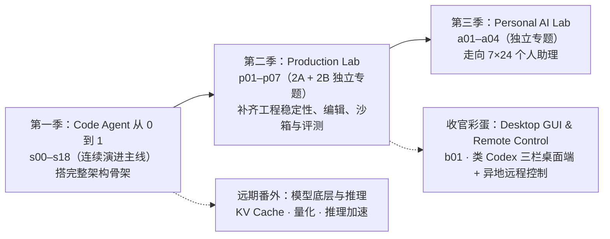
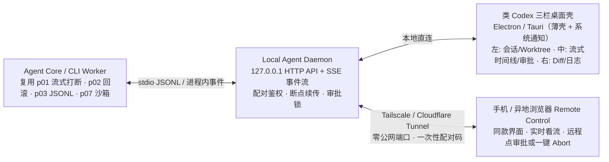

# Build Your Agent：三季课程总路线图

本项目按读者能力的**三级跃迁**划分为三季：**第一季搭出 Code Agent 核心骨架 -> 第二季打磨成可上线的生产化组件 -> 第三季把内核进化成 7×24 Personal AI 个人助理**。

三季共享同一套核心理念：**零黑盒、零重框架依赖、离线可测试、每节都能在本地直接跑通**。

---

## 三季全景对比

| 季 | 主题定位 | 代码组织方式 | 范围 | 当前状态 |
|---|---|---|---|---|
| **第一季** | **Code Agent 从 0 到 1**（搭完整骨架） | 单文件逐章演进（`s00`–`s17` 共 128 帧 + `s18` 路线图） | `s00`–`s18` | 已定稿并上线交互式博客 |
| **第二季** | **Production Lab**（从能跑到真好用） | 独立最小基座（每节 230–420 行，含 CLI/夹具，零耦合、可单独运行） | `p01`–`p07`（2A `p01–p05` + 2B `p06–p07`） | 2A/2B 源码、离线单测与流程文档已齐备，2A 优先拆帧上线 |
| **第三季** | **Personal AI Lab**（从写代码到个人助理） | 独立最小基座（复用前两季内核 + 4 块专属积木） | `a01`–`a04` | 路线与边界已定，待开工 |
| **收官彩蛋** | **Desktop GUI & Remote Control**（命令行变桌面工作台 + 远程接管） | Local Agent Daemon + 类 Codex 三栏 Web/桌面薄壳 + 安全隧道 | `b01` | 架构规划已纳入路线图，待开工 |
| **远期番外** | **模型底层与推理原理**（可选深挖） | 原理图文 + 精简实验脚本 | 承接 `s18` 清单 | 长期预留 |

---

## 第一季：Code Agent 从 0 到 1（`s00`–`s18`，已上线）

第一季保持连续代码演进不断档，为了减轻阅读压力，逻辑上分为 **4 幕**：

| 幕 | 章节 | 核心主题 |
|---|---|---|
| **第一幕：最小闭环** | `s00`–`s05` | 原生 HTTP 调用、Agent Loop、5 大基础工具、权限确认、Hooks 拦截、Todo 清单 |
| **第二幕：长程续航** | `s06`–`s11` | Subagent 子代理、Skill 按需加载、上下文压缩、跨会话 Memory、System Prompt 组装、错误恢复 |
| **第三幕：异步与协作** | `s12`–`s17` | 持久化 Task Graph、后台异步任务、进程内 Cron 定时调度、Agent Teams、团队协议（含 `s16-read`）、MCP 控制面合并 |
| **第四幕：底层视野** | `s18` | 从 Attention 到 KV Cache 原理拆解与后续 10 大进阶阅读清单 |

---

## 第二季：Production Lab（`p01`–`p07`，分两波发布）

第一季走完 `s17` 后单文件已超过 1500 行。第二季不再继续叠加单文件，而是每节回到约 50–60 行的最小工具循环基座，**一节只打透一个真实上线必然遇到的工程痛点**。为保证发布节奏轻快、不阻塞已有内容上线，第二季拆分为 **2A + 2B 两波**：

### Season 2A（`p01`–`p05`，优先拆帧上线）

| Lab | 主题 | 核心解决的问题 | 关键产物 |
|---|---|---|---|
| `p01` | **Streaming & Abort** | SSE 逐字吐字、思考/正文分离、分片重组 `tool_calls`、`Ctrl+C` 优雅打断与孤立 `tool_call_id` 自愈、Steering 中途纠偏 | `p01-streaming-abort.js` |
| `p02` | **Checkpoint & Diagnostics** | 写前读校验与 SHA-256 防 stale-read、唯一匹配检查、写后自动语法诊断（LSP 闭环思想）、多轮 `/rewind` 一键回滚 | `p02-checkpoint-diagnostics.js` |
| `p03` | **Session Event Log** | Append-only JSONL 步级落盘、断电坏行容错与中断自愈、`--resume` 续跑、`/fork` 分叉、无损多次 `/compact` 投影 | `p03-session-persistence.js` |
| `p04` | **Real MCP stdio** | 零依赖真实 JSON-RPC 2.0 stdio 客户端 + 独立 demo Server、`stderr` 日志隔离、`destructiveHint` 审批门、超时/崩溃降级与任意本地 Server 接入 | `p04-mcp-stdio.js` + `p04-mcp-demo-server.js` |
| `p05` | **Mini Eval & Trace** | 隔离临时沙箱 + 确定性 Verifier 打分、跨厂商 Prompt Cache 命中率与成本观测、规范化 Doom-Loop 死循环熔断、Scorecard / `--json` | `p05-mini-eval.js` |

### Season 2B（`p06`–`p07`，第二季收官补齐）

| Lab | 主题 | 核心解决的问题 | 关键产物 |
|---|---|---|---|
| `p06` | **Code Search & Line-Anchored Edits** | 大仓库纯 Node 有界递归检索、分页带行号读取 + SHA-256 `revision` 与已读行窗口跟踪、按行号范围 + `expected_lines` 精确替换重复代码块并保真 LF/CRLF 与末尾换行 | `p06-search-exact-edit.js` |
| `p07` | **OS Sandbox & Supervised Shell** | `argv` 级隔离与严格 Fail-Closed（绝不静默降级裸跑）、Linux `bwrap` 参考后端 + macOS `sandbox-exec` 轻量适配、`--doctor` 真实策略探针、环境变量最小白名单、双流共享字节上限与超时进程树级联清理 | `p07-os-sandbox-shell.js` |

> **后续可选扩展（不塞入本轮）**：`Shadow Git`（捕获外部 shell 改动的 Git 临时树快照）与 `并发子任务 / Plan Mode` 留作第二季上线后的远期增量扩展，避免主线过重。

---

## 第三季：Personal AI Lab（`a01`–`a04`，规划已定）

爆火的“Personal AI / 个人超级助理”并不是另起炉灶的新物种——**它大约 80% 的内核就是前两季的 Code Agent**（工具循环 + 长期记忆 + 定时唤醒 + 事件日志 + MCP 外部连接器）。第三季用 4 个轻量 Lab 彻底祛魅，只补个人助理真正多出来的 **4 块增量积木**：

> **安全边界划分（`p07` vs `a04`）**：`p07` 解决的是**本地 OS 执行面隔离**——把子进程锁在工作区目录内，断网、剥离密钥环境变量并在超时后杀光进程树；`a04` 解决的是**外部数据面防间接 Prompt Injection 与外发强审批**——即便本地工具完全合法，也要防止网页/邮件里的恶意指令诱导 Agent 读取敏感数据并对外发邮件、发消息或调外部 Webhook。

| Lab | 主题 | 核心解决的问题 |
|---|---|---|
| `a01` | **Channel Gateway（消息网关）** | 抽象轻量 Webhook / Bot 消息网关，补齐签名鉴权、事件幂等去重、多会话路由与持久化 Pending Action（跨重启可续接异步确认与推送回复），从“开终端干活”变成“手机发消息让家里电脑干活” |
| `a02` | **Heartbeat & Memory Consolidation（心跳巡检与记忆整理）** | 打通定时心跳与个人长期记忆，落地防空转（无新变化不调模型）、防重叠执行（租约/锁）与每日预算上限，并实现跨天记忆的去重、冲突合并与过期淘汰 |
| `a03` | **Browser Use（浏览器与网页触手）** | 基于结构化页面快照（Accessibility Tree / 精简 DOM）实现默认只读查询与受控写操作分层，加入 DOM 变更后的过期引用（stale ref）自动重抓恢复，并界定“有 API 走 MCP、无 API 走浏览器”的选型边界 |
| `a04` | **Personal AI Security（防间接 Prompt Injection）** | 隔离外部网页/邮件不可信内容并拦截敏感路径访问，手写**跨重启异步外发审批闸门**（审批票据强绑定收件人/目标 + 载荷哈希 + 过期时间 + 一次性消费，防止重放与审批后篡改） |

### 给 Personal AI 读者的前置速通指引

如果你的主要目标是快速做出第三季的 Personal AI，不需要先按顺序啃完全部 26 节，可以按下面 **4 节最短路径** 速通核心地基后再直接进入 `a01`–`a04`：

1. **`s01`（Agent Loop）**：掌握“模型输出 `tool_calls` -> 宿主执行 -> 结果回传”的最小主循环。
2. **`s09`（跨会话 Memory）**：理解个人偏好与长期事实如何跨对话落盘并在每轮自动注入。
3. **`s14`（进程内 Cron 定时调度）**：掌握如何定时唤醒 Agent 主动巡检，为 `a02` 心跳打底。
4. **`p03`（Session Event Log）**：掌握 Append-only JSONL 落盘与跨重启续跑，为 `a01` 网关多会话与 `a04` 跨重启审批打底。

---

## 收官彩蛋：类 Codex 桌面客户端与 Remote Control（`b01`，规划已定）

很多读者跑通命令行 Agent 后，最常问的一个问题是：**“像 Codex App / Claude Code 桌面版那样，怎么给自己的 CLI Agent 套一个好用的桌面端，而且出门在外还能用手机远程接着控？”**

本彩蛋不把逻辑写死在 UI 里，而是展示现代桌面 Coding Agent 最核心的分层架构——**CLI/Agent 内核作为本地 Daemon，桌面端与手机远程端共享同一套实时事件流**：

核心拆解为 **3 层积木**：

| 层级 | 核心内容 | 复用与设计要点 |
|---|---|---|
| **1. Local Daemon 协议层** | 把命令行工具包装成 `127.0.0.1` 的 HTTP + SSE（或 WebSocket）本地服务，将用户输入、流式输出、工具卡片、权限审批、打断指令全部结构化 | 直接复用 `p03` JSONL 事件日志做 `Last-Event-ID` 断线重连与多端同步；支持直接托管现成 CLI 子进程，不靠正则硬刮终端 ANSI 文本 |
| **2. 类 Codex 三栏桌面 GUI** | **左栏**（多会话与 Git Worktree 切换 + 运行状态灯）、**中栏**（流式对话、折叠工具卡片、内联审批条、Stop/Steer 输入框）、**右栏**（实时 Git Diff 审阅与终端输出） | 先做成 Daemon 直接托管的单页 Web UI，再用极薄的 **Electron**（全栈 JS 零新语言）或 **Tauri**（轻量原生壳）包一层窗口、托盘与系统完成通知 |
| **3. 安全 Remote Control** | 通过 **Tailscale**（私网直连）或 **Cloudflare Tunnel + Access** 零公网端口暴露，实现手机/异地浏览器实时接管家里电脑的 Agent | 默认只绑定 `127.0.0.1`；接入一次性配对码与设备会话；远程与本地共享一次性审批锁（复用 `a04` 思路）并保留一键全局 `Abort` 总开关 |

---

## 博客与 Vlog / 视频联动节奏

这套三季架构同时适配**互动式技术博客**与**实操视频 / Vlog**：

- **第一季**：博客常青主干（左文右码 129 步 + 浏览器 Live Demo）；视频版可按 4 幕浓缩为 4 期长干货或精选高光章节，无需逐章照读 19 期。
- **第二季（7 期：2A 5 期 + 2B 2 期）与第三季（4 期）**：每节独立、终端/交互效果直观，天然适合做成 **一节一期、10 分钟左右的精品实操 Vlog**，视频展示效果、博客承接代码逐帧演进与动手体验。
- **收官彩蛋（`b01` 桌面客户端 + Remote Control）**：作为整套课程的高潮收官期，非常适合做一期“用自己手写的 Agent 打包成类 Codex 桌面端，并用手机远程下发任务 + 点审批”的爆款实操演示。
