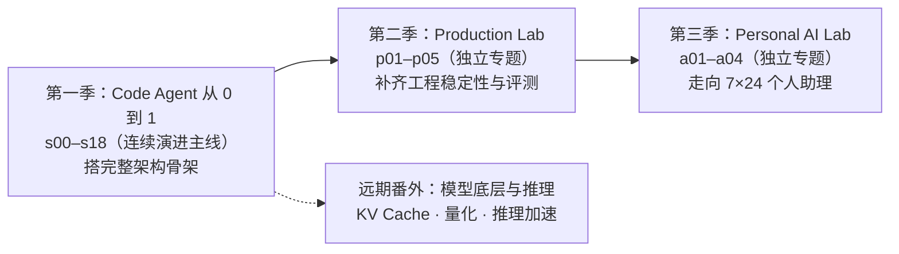

# Build Your Agent：三季课程总路线图

本项目按读者能力的**三级跃迁**划分为三季：**第一季搭出 Code Agent 核心骨架 -> 第二季打磨成可上线的生产化组件 -> 第三季把内核进化成 7×24 Personal AI 个人助理**。

三季共享同一套核心理念：**零黑盒、零重框架依赖、离线可测试、每节都能在本地直接跑通**。

---

## 三季全景对比

| 季 | 主题定位 | 代码组织方式 | 范围 | 当前状态 |
|---|---|---|---|---|
| **第一季** | **Code Agent 从 0 到 1**（搭完整骨架） | 单文件逐章演进（`s00`–`s17` 共 128 帧 + `s18` 路线图） | `s00`–`s18` | 已定稿并上线交互式博客 |
| **第二季** | **Production Lab**（从能跑到真好用） | 独立最小基座（每节 230–420 行，含 CLI/夹具，零耦合、可单独运行） | `p01`–`p05`（预留 `p06`） | 源码、单测与流程文档已打磨，待拆帧上线 |
| **第三季** | **Personal AI Lab**（从写代码到个人助理） | 独立最小基座（复用前两季内核 + 4 块专属积木） | `a01`–`a04` | 路线已定，待开工 |
| **远期番外** | **模型底层与推理原理**（可选深挖） | 原理图文 + 精简实验脚本 | 承接 `s18` 清单 | 长期预留 |

---

## 第一季：Code Agent 从 0 到 1（`s00`–`s18`，已上线）

第一季保持连续代码演进不断档，为了减轻阅读压力，逻辑上分为 **4 幕**：

| 幕 | 章节 | 核心主题 |
|---|---|---|
| **第一幕：最小闭环** | `s00`–`s05` | 原生 HTTP 调用、Agent Loop、5 大基础工具、权限确认、Hooks 拦截、Todo 清单 |
| **第二幕：长程续航** | `s06`–`s11` | Subagent 子代理、Skill 按需加载、上下文压缩、跨会话 Memory、System Prompt 组装、错误恢复 |
| **第三幕：异步与协作** | `s12`–`s17` | 持久化 Task Graph、后台异步任务、进程内 Cron 定时调度、Agent Teams、团队协议（含 `s16-read`）、MCP 控制面合并 |
| **第四幕：底层视野** | `s18` | 从 Attention 到 KV Cache 原理拆解与后续 10 大进阶阅读清单 |

---

## 第二季：Production Lab（`p01`–`p05`，当前打磨中）

第一季走完 `s17` 后单文件已超过 1500 行。第二季不再继续叠加单文件，而是每节回到约 50–60 行的最小工具循环基座，**一节只打透一个真实上线必然遇到的工程痛点**：

| Lab | 主题 | 核心解决的问题 | 关键产物 |
|---|---|---|---|
| `p01` | **Streaming & Abort** | SSE 逐字吐字、思考/正文分离、分片重组 `tool_calls`、`Ctrl+C` 优雅打断与孤立 `tool_call_id` 自愈、Steering 中途纠偏 | `p01-streaming-abort.js` |
| `p02` | **Checkpoint & Diagnostics** | 写前读校验与 SHA-256 防 stale-read、唯一匹配检查、写后自动语法诊断（LSP 闭环思想）、多轮 `/rewind` 一键回滚 | `p02-checkpoint-diagnostics.js` |
| `p03` | **Session Event Log** | Append-only JSONL 步级落盘、断电坏行容错与中断自愈、`--resume` 续跑、`/fork` 分叉、无损多次 `/compact` 投影 | `p03-session-persistence.js` |
| `p04` | **Real MCP stdio** | 零依赖真实 JSON-RPC 2.0 stdio 客户端 + 独立 demo Server、`stderr` 日志隔离、`destructiveHint` 审批门、超时/崩溃降级与任意本地 Server 接入 | `p04-mcp-stdio.js` + `p04-mcp-demo-server.js` |
| `p05` | **Mini Eval & Trace** | 隔离临时沙箱 + 确定性 Verifier 打分、跨厂商 Prompt Cache 命中率与成本观测、规范化 Doom-Loop 死循环熔断、Scorecard / `--json` | `p05-mini-eval.js` |

> **可选扩展位 `p06`**：OS 级命令沙箱与执行隔离（容器 / Seatbelt / 权限策略文件），视第二季上线后的读者反馈决定是否增补。

---

## 第三季：Personal AI Lab（`a01`–`a04`，规划已定）

爆火的“Personal AI / 个人超级助理”并不是另起炉灶的新物种——**它大约 80% 的内核就是前两季的 Code Agent**（工具循环 + 长期记忆 + 定时唤醒 + 事件日志 + MCP 外部连接器）。第三季用 4 个轻量 Lab 彻底祛魅，只补个人助理真正多出来的 **4 块增量积木**：

| Lab | 主题 | 核心解决的问题 |
|---|---|---|
| `a01` | **Channel Gateway（消息网关）** | 把命令行交互抽象成轻量消息网关（Webhook / Bot 适配器），实现多会话路由、异步推送回复——从“开终端干活”变成“手机发条消息让家里电脑干活” |
| `a02` | **Heartbeat & Memory Consolidation（心跳巡检与记忆整理）** | 打通定时心跳与个人长期记忆，实现主动早报/待办巡检，并解决跨天记忆的去重、冲突合并与过期淘汰 |
| `a03` | **Browser Use（浏览器与网页触手）** | 用结构化页面快照（Accessibility Tree / 精简 DOM）让 Agent 浏览网页、查资料、填表，并对比“有 API 走 MCP、无 API 走浏览器”的选型边界 |
| `a04` | **Personal AI Security（防间接 Prompt Injection）** | 模拟外部网页/邮件藏匿恶意指令诱骗外发敏感文件，手写“不可信数据隔离 + 敏感路径拦截 + 外发动作强审批闸门”的安全防线 |

---

## 博客与 Vlog / 视频联动节奏

这套三季架构同时适配**互动式技术博客**与**实操视频 / Vlog**：

- **第一季**：博客常青主干（左文右码 129 步 + 浏览器 Live Demo）；视频版可按 4 幕浓缩为 4 期长干货或精选高光章节，无需逐章照读 19 期。
- **第二季（5 期）与第三季（4 期）**：每节独立、终端/交互效果直观，天然适合做成 **一节一期、10 分钟左右的精品实操 Vlog**，视频展示效果、博客承接代码逐帧演进与动手体验。
