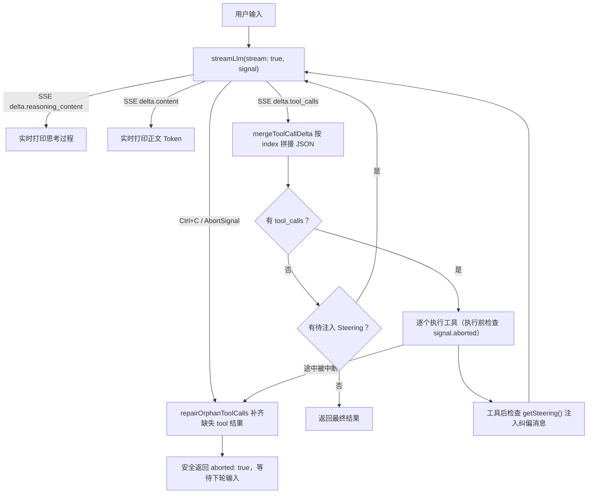

# p01：Streaming & Abort - 流式输出、随时打断与中途纠偏

第一季 `s00` 到 `s17` 的 `callLlm()` 全程等待整包 HTTP JSON 返回后再打印，既没有打字机式的即时反馈，也不能在模型跑偏时随时按 `Ctrl+C` 叫停或插话纠偏。

这一节作为第二季的第一个生产专题 Lab，我们抛开 `s17` 的 1500 行历史包袱，回到约 60 行的最小工具循环基座，专门跑通流式交互与中断恢复。**流式 Agent 的难点不在“边收边打印”，而在分片拼接 `tool_calls` 参数，以及被打断后修好残缺的 `assistant / tool` 配对，让下一轮对话不报 400。**

## 问题

把真实 Code Agent 搬到终端里，非流式、不可打断的循环会立刻暴露三个痛点：

| 痛点 | 现象 | 真实后果 |
|---|---|---|
| 首字延迟高 | 长输出或深度思考要干等十几秒才蹦出一整屏 | 用户分不清是卡死了还是在思考 |
| 无法优雅打断 | 按 `Ctrl+C` 直接杀掉整个进程，内存上下文全丢 | 刚才探索了十轮的背景全白费 |
| 中断破坏消息协议 | 刚收到两个 `tool_calls`，跑完第 1 个就被打断 | `messages` 里留下孤立的 `tool_call_id`，下一轮 API 直接返回 HTTP 400 |

## 解决方案

我们用原生 `fetch` + `ReadableStream` + `AbortController` 改造请求层和循环层，核心由三块组成：SSE 增量解析、`repairOrphanToolCalls` 历史自愈、以及工具批次间隙的 Steering 纠偏注入。



三个关键设计边界：

- **跨分片缓冲拼接**：网络层一次 `reader.read()` 可能把一整行 `data: {...}` 甚至多字节中文切在半截。`TextDecoder({ stream: true })` 加上行尾 `buffer = lines.pop()` 确保只解析完整行，遇到心跳注释行（`: keepalive`）自动忽略，并在 `finally` 中安全释放未读完的流句柄。
- **按 `index` 重组工具参数与容错**：OpenAI 兼容流式协议里，`tool_calls` 的 `id`、`name`、`arguments` 会拆成几十个小碎片到达，必须按 `delta.index` 逐段累加字符串（同时兼容部分代理重复回传相同 `id` 的怪癖），流结束后用 `safeParseArgs()` 解析；哪怕参数 JSON 被截坏，也只回传一条 `tool` 错误消息让模型自愈，不炸掉整个循环。
- **中断自愈与轮次合法**：只要 `messages` 里出现了带 `tool_calls` 的 `assistant` 消息，后面就必须紧跟对应每一个 `call.id` 的 `role: "tool"` 消息；若在正文流式阶段被打断，则自动补一条带 `[Aborted by user]` 标记的 `assistant` 记录，保证后续在任何严格校验轮次交替的 Provider 上都能顺利续聊。

## 核心代码流程

本节源码位于 `code-agent-course/p01-streaming-abort.js`（约 355 行，含 CLI），核心执行链路只有四步：

1. **`mergeToolCallDelta()` + `parseSseLine()`**：按 `delta.index` 把流式碎片里的 `id`、`function.name`、`function.arguments` 拼回完整工具调用对象，并把 `reasoning_content` 与正文分别派发给回调。
2. **`streamLlm(messages, { signal, onToken, onReasoning })`**：发送 `stream: true`，逐块读取 `response.body.getReader()`，中断时主动取消底层流，返回与 `helper.js` 兼容的 `{ message, finish_reason }`。
3. **`repairOrphanToolCalls()` + `finalizeAbortedTurn()`**：扫描 `assistant.tool_calls` 与后续连续 `tool` 消息的配对缺口并原位补齐，同时在正文中断时闭合轮次，彻底消除中断后的 HTTP 400。
4. **`agentLoop(messages, { signal, getSteering })`**：每轮请求前、每个工具执行前检查 `signal.aborted`；工具批次结束后消费 `getSteering()` 队列，把用户中途追加的纠偏指令以 `[Steering]` 形式送入下一轮（终端里可直接用 `/steer <指令>` 体验）。

## 测试 Prompt

```text
请先用 bash 列出当前目录的文件，再详细解释每个文件的作用，写慢一点长一点。
```

运行后观察两点：正文会逐字流式吐出，不再卡住等整包；输出到一半时按一次 `Ctrl+C`，程序会打印 `[aborted] 已中断本轮流式生成，历史已修复，可继续输入。` 而不会退出，接着直接输入“只要一句话总结就行”，下一轮能正常衔接。你也可以先输入 `/steer 只需要列出最核心的 3 个文件` 再发上面的 Prompt，观察工具执行后自动注入 `[Steering]` 纠偏。

## 扩展阅读：商业级 Agent 怎么做流式与打断

- **Claude Code**：终端实时流式渲染思考块、正文与工具进度，按 `Esc` 中断当前生成或工具调用时会自动收敛未完成状态，同时支持在 Agent 执行过程中直接排入下一条纠偏消息（steering / queued prompt）。
- **Codex**：底层 turn loop 把模型响应建模为细粒度流事件（text delta、reasoning delta、tool call start/end、turn aborted），任何阶段收到中断信号都会写入明确的终止事件，确保会话状态机不悬空。
- **opencode**：服务端用统一事件总线向客户端推送流式增量与工具状态，客户端发起取消时通过 `AbortController` 穿透到 provider HTTP 连接和子进程，避免后台泄漏。

**能让用户随时安全叫停、并且叫停后还能接着聊，才算真正可用的交互式 Agent。**

## 本地运行与测试

交互运行（从仓库根目录执行）：

```bash
cd code-agent-course && node p01-streaming-abort.js
```

离线单测（在仓库根目录执行，无需 API Token）：

```bash
pnpm vitest run code-agent-course/p01-streaming-abort.test.js
```

> **本节思考题**：如果在执行一条耗时 30 秒的 `bash` 命令中途按 `Ctrl+C`，同步的 `runBash()`（基于 `execSync`）还能立刻停下来吗？如果要连正在跑的慢命令一起优雅中止，应该怎么改造工具执行层？
