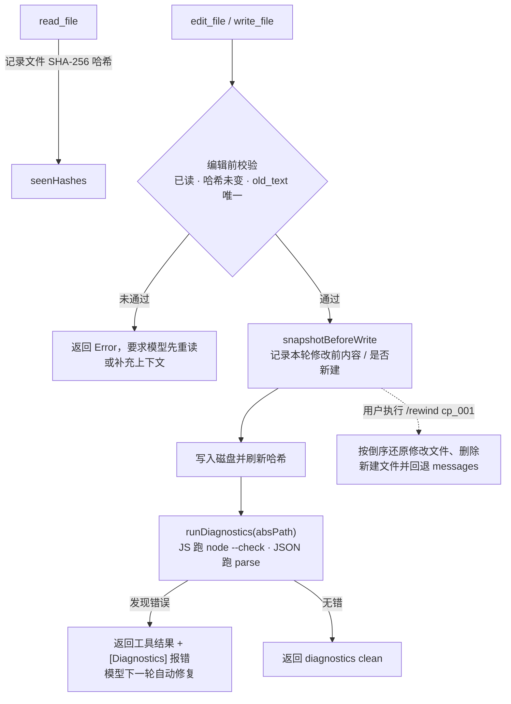

# p02：Checkpoint & Diagnostics - 防改脏、自动诊断闭环与一键回滚

第一季 `s02` 的 `edit_file` 只有最简单的字符串替换：不检查文件是否被外部改过、不检查写完的代码有没有语法错，一旦 Agent 连续改坏三五个文件，用户只能自己手动 `git checkout` 救场。

这一节我们在最小文件工具基座上补齐生产级编辑护栏。**好的编辑层不只是“把字符串写进去”，而是形成“先读校验 -> 写前快照 -> 写后诊断 -> 随时回滚”的闭环，让 Agent 自己发现低级错误，也给人类留好后悔药。**

## 问题

真实写代码时，裸 `write_file / edit_file` 最容易踩中三个坑：

| 场景 | 裸编辑的行为 | 真实后果 |
|---|---|---|
| 文件已被用户或格式化工具改动 | 照旧拿旧认知直接 `replace` | 静默覆盖用户刚写好的代码（stale edit） |
| 替换片段出现多处或写坏括号 | 偷偷只改第一处，或返回 `Edited` 假装成功 | 语法错一路带到很后面，甚至最后交付坏代码 |
| 连续两三轮改歪方向 | 没有版本记录，只能手工逐个删改恢复 | 用户不敢放手让 Agent 批量动文件 |

## 解决方案

我们用一个 `createWorkspaceGuard()` 封装文件工具，把三道防线织进同一条读写链路里：



三个关键设计边界：

- **写前鲜度与唯一性护栏**：不管是 `edit_file` 还是覆写一个已存在文件的 `write_file`，都必须先通过 `read_file` 记录 SHA-256 哈希；若磁盘内容已被外部改动（stale read）、`old_text` 为空或匹配多处，直接拒绝写入并提示重读，杜绝盲改。
- **写前懒快照（Lazy Snapshot）与倒序回滚**：每轮对话开一个新 `checkpoint`，只有某个文件在当前轮**第一次**被写或被改时才记录原始状态（存在存全文，不存在标 `existed: false`）。回滚时支持不传 ID 只撤销最新一轮，也支持指定更早的 `cp_001` 按倒序连带撤销后续轮次并同步截断 `messages.length`。
- **零依赖实时诊断（LSP 思想的最小闭环）**：写完 `.js/.mjs/.cjs` 自动跑 `node --check`（自动兼容 ESM 与 CommonJS），写完 `.json` 自动做 `JSON.parse`，把报错直接拼在工具返回值里喂回模型。`createWorkspaceGuard({ diagnose })` 预留了可插拔诊断器，换成 `tsc --noEmit` 或真实 LSP 的 `textDocument/publishDiagnostics` 只需替换这一个函数。

## 核心代码流程

本节源码位于 `code-agent-course/p02-checkpoint-diagnostics.js`（约 325 行，含 CLI），由四个部件构成：

1. **`runDiagnostics(absPath)`**：按扩展名执行快速无副作用检查（JS 语法检查 / JSON 解析），有错返回精简报错片段，无错返回 `null`。
2. **`createWorkspaceGuard({ cwd, diagnose })`**：集中管理 `seenHashes`（防陈旧读取）与 `checkpoints`（按轮记录文件写前快照），对外暴露 `readFileChecked`、`writeFileChecked`、`editFileChecked`、`listCheckpoints`、`rewind`。
3. **`agentLoop(messages, { guard })`**：每轮先调 `beginCheckpoint()` 记录当前 `messages` 长度；模型执行编辑后，如果返回值带 `[Diagnostics]`，就会在当前循环内立刻自我修复。
4. **`main()`**：命令行交互支持 `/checkpoints` 查看历史快照、`/rewind [id]` 一键还原文件与对话。

## 测试 Prompt

```text
请创建一个 demo-math.js，导出 add(a, b) 函数；再故意先写错括号测试诊断，然后修好。
```

完成一轮修改后，再输入 `/checkpoints` 查看本轮生成的 `cp_001`，接着输入 `/rewind cp_001`，可以看到新建的 `demo-math.js` 被自动删除，对话也回到修改前的状态。

## 扩展阅读：商业级 Agent 怎么做编辑护栏与回滚

- **Claude Code**：内置 read-before-edit 鲜度校验与精确唯一匹配检查，同时维护会话级 Checkpoint，允许用户随时执行 `/rewind` 把代码与对话同步回退到任意检查点。
- **Codex**：偏好结构化 `apply_patch` 补丁协议，避免模糊替换破坏邻近代码，并结合 Git / Worktree 隔离让多轮改动随时可审可撤。
- **opencode**：集成真实 LSP 客户端，每次工具改完文件都会自动拉取语言服务器的实时类型/语法诊断并附带在工具输出里，让模型不用跑全量构建就能秒修错误。

**把“防错”和“可撤回”做进工具层，比在提示词里叮嘱模型“写代码要小心”可靠一百倍。**

## 本地运行与测试

交互运行（从仓库根目录执行）：

```bash
cd code-agent-course && node p02-checkpoint-diagnostics.js
```

离线单测（在仓库根目录执行，无需 API Token）：

```bash
pnpm vitest run code-agent-course/p02-checkpoint-diagnostics.test.js
```

> **本节思考题**：本节的 Checkpoint 只捕获了通过 `write_file / edit_file` 做的改动。如果 Agent 通过 `bash` 跑了一条 `npm install` 或 `sed -i` 改了文件，内存快照就看不到了——换成 Git 临时树对象（Shadow Git Snapshot）或 Worktree 会怎么解决这个问题？
