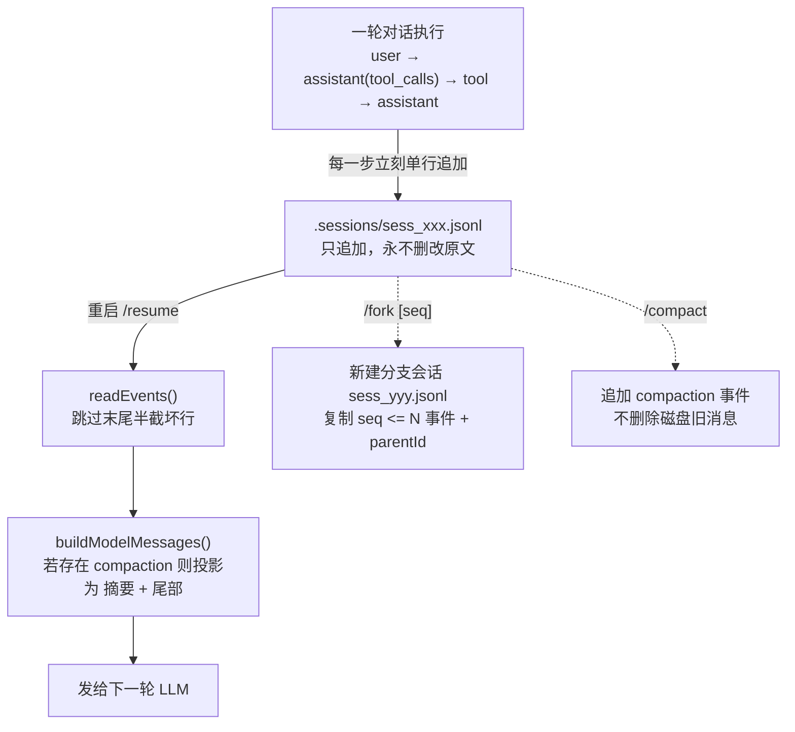

# p03：Session Event Log - 会话持久化、断点续跑与分叉

第一季我们在 `s09` 持久化了长期记忆、在 `s12` 持久化了任务图、在 `s14` 持久化了定时任务，唯独最核心的 `messages[]` 对话本身一直活在内存里。终端一关、进程一崩，刚才聊了二十轮的上下文瞬间清零。

这一节我们把会话历史改造成只追加的 JSONL 事件日志（Append-only Event Log）。**生产级会话持久化不是每轮覆写一个 `messages.json`，而是把磁盘上的“完整原始事件流”和发给模型的“压缩投影视图”彻底解耦，同时天然获得崩溃恢复、断点续跑与分叉试错能力。**

## 问题

如果只是简单在每轮结束时 `writeFileSync("session.json", JSON.stringify(messages))`，上线后立刻会碰到三个问题：

| 痛点 | 覆写单个 JSON 的缺陷 | Append-only JSONL 事件流的解法 |
|---|---|---|
| 进程崩溃 / 断电 | 覆写到一半文件截断，整份 JSON 损坏打不开 | 每条消息单行追加；末尾半截坏行忽略即可，前面事件全完好 |
| 上下文压缩后想回溯 | 原地把 `messages` 替换成摘要，原始工具输出永久丢失 | 追加一条 `compaction` 事件；磁盘保留全部原文，视图按投影生成 |
| 想从第 3 轮换条路试错 | 只能删掉后面几轮，没法保留原分支对比 | 复制前 N 条事件生成子会话并记录 `parentId`，原会话零污染 |

## 解决方案

我们给每个会话分配一个 `.sessions/<id>.jsonl` 文件，记录三种事件（`session_meta`、`message`、`compaction`），并通过纯函数 `buildModelMessages(events)` 把磁盘日志实时投影为发给 LLM 的消息数组：



三个关键设计边界：

- **工具步级实时落盘与路径防护**：不是等整轮 `agentLoop` 返回才写磁盘，而是每收到一条 `user`、每产出一条 `assistant(tool_calls)`、每跑完一个 `tool` 结果都立刻追加一行；同时用 `assertValidSessionId()` 限制会话 ID 字符集，防止 `/resume` 路径穿越。
- **损坏容错与中断自愈（Crash Tolerance）**：`readEvents()` 逐行 `JSON.parse()`，遇到崩溃留下的残缺行直接计数跳过；若进程恰好崩在 `assistant(tool_calls)` 落盘之后、`tool` 结果落盘之前，`buildModelMessages()` 会在投影视图里自动补上 `[Recovered: tool did not finish before crash]`，保证 `--resume` 后绝不报 HTTP 400。
- **Event Sourcing 式增量无损压缩**：`compactSession()` 不会改写或删除 `.jsonl` 里的旧消息，只是追加一条 `{ type: "compaction", summary, keepFromSeq }`。同时做了两项生产级护栏：切分点遇到 `role: "tool"` 时自动前移对齐到对应的 `assistant(tool_calls)`，避免切出孤立工具消息；第 2 次压缩时直接基于上一次摘要加增量消息汇总，避免重复吞吐早期原文。

## 核心代码流程

本节源码位于 `code-agent-course/p03-session-persistence.js`（约 390 行，含 CLI），核心链路分四块：

1. **`buildModelMessages()` + `repairRecoveredToolCalls()`**：纯投影函数。找到最新一条 `compaction` 事件并拼接 `seq >= keepFromSeq` 的尾部消息，同时自动修复崩溃留下的未闭合 `tool_calls`。
2. **`createSessionStore(sessionsDir)`**：封装安全 ID 校验、`.jsonl` 读写、顺序号 `seq` 递增、断行容错读取，以及 `forkSession(sourceId, { upToSeq })` 分叉拷贝。
3. **`compactSession(store, sessionId, { keepTail })`**：对齐工具调用边界后，基于上一份摘要与增量消息请模型生成新摘要并追加 `compaction` 事件，保持磁盘原文只增不减。
4. **`runSessionTurn(store, sessionId, userPrompt)`**：把最小工具循环的每一步状态流转即时写入事件日志，并通过 CLI 的 `--resume`、`/sessions`、`/fork`、`/compact`、`/log` 展示完整生命周期。

## 测试 Prompt

```text
先用 bash 查看当前目录有哪些 .js 文件，记住它们。
```

拿到回复后按 `q` 退出进程，再用终端里显示的会话 ID 重新启动 `node p03-session-persistence.js --resume <sessionId>`，直接问“刚才我们查到了什么？”验证跨进程续跑；接着输入 `/log` 查看事件序号，再试 `/fork 2` 从第 2 条事件分叉出一条新分支。

## 扩展阅读：商业级 Agent 怎么做会话持久化

- **Claude Code**：把每个项目会话以只追加 JSONL 记录在本地会话目录中，支持 `--resume` 恢复、`/compact` 压缩与会话分叉，同时保留完整工具调用轨迹用于排错与回放。
- **Codex**：用 Rollout / Thread Event Log 持久化每个 turn 的 item、工具调用和 compaction 记录，实现断线重连、历史回放以及基于既有线程的分叉（fork）。
- **opencode**：用结构化本地存储把 session、message、part 与父子会话树分开建模，支持按消息粒度回溯、汇总与多分支切换。

**只要事件日志是只追加的，恢复、审计、回放、分叉和无损压缩都会顺理成章地长出来。**

## 本地运行与测试

交互运行（从仓库根目录执行）：

```bash
cd code-agent-course && node p03-session-persistence.js
```

离线单测（在仓库根目录执行，无需 API Token）：

```bash
pnpm vitest run code-agent-course/p03-session-persistence.test.js
```

> **本节思考题**：当 `.sessions/` 目录下积累了上千个会话文件、且用户想要按关键词全文检索“上周我们改过哪个配置”，或者两个终端同时 `--resume` 同一个会话时，纯 `.jsonl` 文件会遇到什么瓶颈？怎样在保留 JSONL 作为追加日志的同时，叠加文件锁或轻量 SQLite 索引层？
