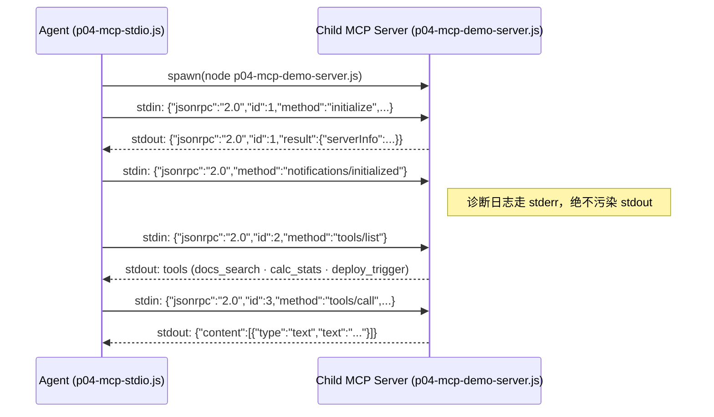

# p04：Real MCP stdio - 用零依赖 JSON-RPC 2.0 接通真实 MCP 服务

第一季 `s17` 为了让读者零外部依赖理解控制面合并，用了内存里的 `createMockMcpHub()` 模拟 MCP 工具发现与调用。但真实生态里的 MCP Server 都是独立进程（Node、Python、Go、Rust 写的都有），和 Agent 之间隔着一条进程管道。

这一节我们把模拟 Hub 换成**真实可用的 MCP stdio 客户端 + 真实独立的 demo MCP Server**，全程依然零第三方包。**MCP stdio 传输的本质并不神秘：父进程 `spawn` 子进程，双方在 `stdin / stdout` 上按行收发 JSON-RPC 2.0，按 `initialize -> initialized -> tools/list -> tools/call` 走完生命周期，日志一律走 `stderr`。**

## 问题

一旦从内存函数调用跨进真实的跨进程 MCP 通信，四个生产级细节会立刻浮出水面：

| 细节 | 模拟 Hub 看不到的坑 | 真实 stdio 客户端必须处理 |
|---|---|---|
| 协议握手 | 函数调用拿来就用 | 必须先发 `initialize` 并收到能力声明，再发 `notifications/initialized` 通知 |
| stdout 污染 | 随便 `console.log` 都没事 | Server 往 `stdout` 多打一行日志就会让 Client 的 JSON-RPC 解析崩溃；日志只能写 `stderr` |
| 异步关联与超时 | 同步调用不会悬空 | 并发请求必须靠 `id -> Promise` 映射表匹配，并给每个请求配超时定时器 |
| 子进程崩溃 | 不存在进程退出 | Server 意外退出时必须批量 `reject` 所有 `pending` 请求，防止主循环永久卡死 |

## 解决方案

我们拆成两个文件演练真实边界：`p04-mcp-demo-server.js` 作为独立子进程运行，`p04-mcp-stdio.js` 启动它、走完标准 JSON-RPC 2.0 握手，再把发现的工具以 `mcp__demo__<name>` 并入主循环，并依据官方注解字段 `annotations.destructiveHint` 走用户确认闸门：



三个关键设计边界：

- **规范注解字段 `destructiveHint`**：对齐 MCP 正式规范中的 `annotations.destructiveHint`（而非 `s17` 的教学简写 `destructive`）。命中高危标记时不是盲放行，而是走 `confirm` 交互确认，拒绝则回传 `Permission blocked`。
- **请求超时、自动清理与优雅降级**：`pending` 表记录每个在途请求的 `{ resolve, reject, timer }`。握手失败或超时会自动 `close()` 杀掉子进程、释放管道，绝不留僵尸进程；如果在对话中途 MCP 服务崩溃或超时，`agentLoop()` 会把异常收敛成 `MCP Call Error: ...` 喂回模型，主循环不会崩溃。
- **命令行即插即用任何本地 stdio MCP Server**：默认启动自带的 `p04-mcp-demo-server.js`，也可以直接在命令行通过 `-- <cmd> [args...]` 接入任意真实社区 stdio MCP Server（例如 `node p04-mcp-stdio.js -- npx -y @modelcontextprotocol/server-filesystem .`），零改代码直接体验。

## 核心代码流程

本节由两份短小源码组成：

1. **`code-agent-course/p04-mcp-demo-server.js`（约 120 行）**：零依赖真实 stdio MCP Server，用 `readline` 逐行读 `stdin`，处理 `initialize`、`notifications/initialized`、`ping`、`tools/list`、`tools/call`，暴露 `docs_search`、`calc_stats` 与带 `destructiveHint: true` 的 `deploy_trigger`。
2. **`code-agent-course/p04-mcp-stdio.js`（约 240 行）**：
   - `createStdioMcpClient()`：管理子进程生命周期、JSON-RPC 请求-响应匹配表、超时熔断、`EPIPE` 防护与握手失败自动清理。
   - `agentLoop()`：把动态发现的 MCP 工具标准化成 OpenAI `function` schema，与内置 `read_file` 合并，在调用前对 `destructiveHint` 工具触发确认门，并在调用失败时优雅降级。
   - `main()`：默认连接本地 demo server，也支持 `-- <cmd> [args...]` 直连外部 stdio Server，退出时在 `finally` 里优雅关闭子进程。

## 测试 Prompt

```text
先查一下 MCP 文档里关于 stdio 的说明，再帮我算 [12, 25, 38, 45] 的统计值，最后尝试触发 billing 的部署。
```

运行后可以看到 Agent 通过真实子进程管道调用 `mcp__demo__docs_search` 和 `mcp__demo__calc_stats` 拿到结果；轮到带 `destructiveHint: true` 的 `mcp__demo__deploy_trigger` 时，终端会停下来向你确认 `[y/N]`，输入 `n` 即被拦截。

## 扩展阅读：商业级 Agent 怎么接 MCP

- **Claude Code**：支持 stdio 与远程 Streamable HTTP 两种传输，按项目配置动态发现并校验用户信任，同时处理 OAuth 认证、工具变更通知（`notifications/tools/list_changed`）以及超大工具集下的延迟检索。
- **Codex**：既可以作为 MCP Client 连接外部 stdio/HTTP 服务，也能作为 MCP Server 暴露给上层编排器调用。
- **opencode**：把每个 MCP Server 的工具统一纳入本地权限策略树，允许按单个工具或整组服务配置 allow / ask / deny，避免只依赖远端声明的 hint 字段。

**别把外部工具的 `annotations` 当绝对安全边界——它们只是服务端自报的提示（Hint），真正的放行权必须握在客户端本地策略与用户手里。**

## 本地运行与测试

交互运行（从仓库根目录执行）：

```bash
cd code-agent-course && node p04-mcp-stdio.js
```

离线单测（在仓库根目录执行，真实拉起子进程跑通协议，无需 API Token）：

```bash
pnpm vitest run code-agent-course/p04-mcp-stdio.test.js
```

> **本节思考题**：如果一个项目同时接了 6 个 MCP Server、暴露出 120 个工具，每次请求把 120 个 JSON Schema 全塞进 `tools` 参数会发生什么？结合第一季 `s07` 的 Skill 按需加载思路，怎样设计一层 `tool_search` 让模型按需拉取工具定义？
