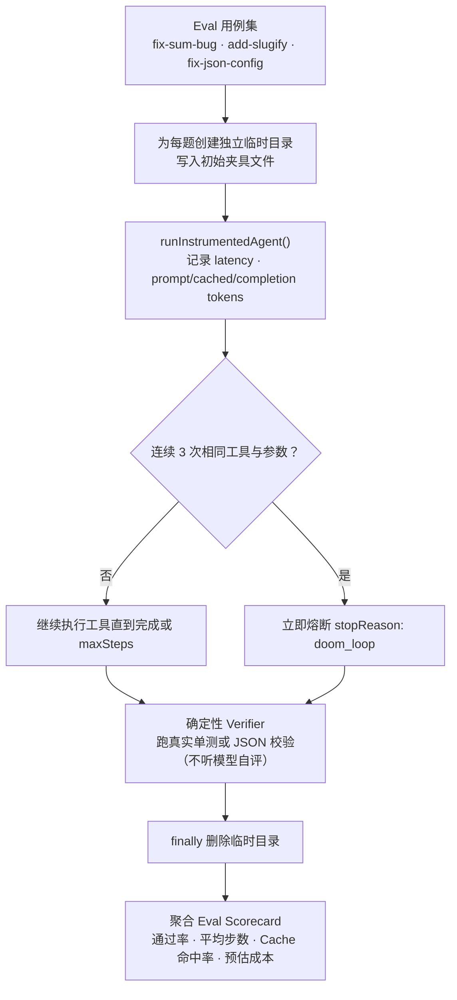

# p05：Mini Eval & Trace - 客观评测集、Prompt Cache 观测与死循环熔断

改完一条 System Prompt、换了一个模型，或者调整了压缩策略之后，怎么证明你的 Code Agent 真的变强、变省了，而不是靠“体感不错”拍脑袋上线？

这一节我们搭一套零依赖的微型 Agent 评测与观测框架。**没有客观 Verifier 的 Agent 迭代就是盲飞：评测的核心是用隔离临时目录跑固定题集，以真实测试结果打分（绝不轻信模型口头说“完成了”），同时记录步数、Prompt Cache 命中率、成本，并用 Doom-Loop 熔断守住预算底线。**

## 问题

把 Code Agent 投入日常开发或持续演进时，缺少评测与观测会带来三个隐患：

| 隐患 | 典型表现 | 真实损失 |
|---|---|---|
| 凭体感改 Prompt | 刚修好场景 A，不知不觉把场景 B 改退化了 | 越改越不稳定，不敢重构主循环 |
| 缓存失效无感知 | 每轮变动前缀或乱序拼接工具，但一直没看 `cached_tokens` | 同样一轮长对话，账单暴涨 3-4 倍 |
| 死循环烧干预算 | 某个文件不存在或命令反复报错，模型死磕 20 轮不回头 | 白烧 Token 且耗光用户耐心 |

## 解决方案

我们把请求层升级为 `callLlmWithUsage()` 采集延迟与 Token 明细，用 `runInstrumentedAgent()` 加上死循环检测，再由 `runEvalSuite()` 在独立临时沙箱里批量执行内置题集并输出评分卡：



三个关键设计边界：

- **确定性 Verifier 独立裁判**：哪怕模型最后回复“全部搞定啦！”，评测系统只信 `item.verify(cwd)` 在隔离目录里跑出来的真实断言结果（用 `execFileSync` 直接拉起当前 Node 进程，跨 macOS / Linux / Windows 稳定运行）。
- **跨厂商兼容的 Prompt Cache 统计**：OpenAI 返回 `usage.prompt_tokens_details.cached_tokens`，DeepSeek 返回 `usage.prompt_cache_hit_tokens`，`callLlmWithUsage()` 统一归一化后汇总整套评测的 `cacheHitRate`，一眼就能看出你的前缀装配是否命中缓存。
- **规范化 Doom-Loop 自动刹车**：对每轮连续工具调用做键排序后的 `name:canonicalJson(args)` 签名（即使参数字段顺序颠倒也能识别为同一调用），连续命中 `doomLoopThreshold`（默认 3 次）立刻终止并标记 `stopReason: "doom_loop"`；单题遭遇上游 5xx 报错时也隔离记录为 `stopReason: "error"`，不拖垮整套评分卡。

## 核心代码流程

本节源码位于 `code-agent-course/p05-mini-eval.js`（约 420 行，含 3 道内置评测题与报表输出），结构很清晰：

1. **`callLlmWithUsage()` + `estimateCostUsd()`**：请求 `/chat/completions`，安全解析非 JSON 错误页，同步提取 `promptTokens`、`cachedTokens`、`completionTokens` 与 `latencyMs`，并按非缓存输入 / 缓存输入 / 输出三档单价估算成本。
2. **`runInstrumentedAgent()`**：在隔离目录 `cwd` 中跑最小工具循环，按步收集 `trace[]`，在工具调用前用 `canonicalJson()` 做连续重复签名检测实现 Doom-Loop 熔断。
3. **`DEFAULT_EVAL_CASES`**：内置 3 道开箱即用的小型编码题（修数组越界 Bug、实现 `slugify`、修复损坏 JSON 并改端口），每题自带独立确定性校验器。
4. **`runEvalSuite()` + `formatScorecard()`**：逐题建临时沙箱、跑 Agent、验结果、清目录，最后输出人类可读评分卡（支持 `--case <id>` 单题调试与 `--json` 导出给 CI 对比回归）。

## 运行演示

配置好 `code-agent-course/.env.local` 后，直接对当前模型跑一轮微型基准评测（也可加 `--case fix-sum-bug` 单独复现某一题，或加 `--json` 导出完整 trace）：

```bash
cd code-agent-course && node p05-mini-eval.js
```

终端会打印类似下面的评分卡（传 `--json` 可导出完整 trace 做 A/B 对比）：

```text
Eval Scorecard: 3/3 passed (100%) | avgSteps=2.67 | cacheHit=42% | estCost=$0.004120

  [PASS] fix-sum-bug      stop=completed steps=3 prompt=2410 cached=1020 cost=$0.001420
  [PASS] add-slugify      stop=completed steps=2 prompt=1580 cached=640  cost=$0.001180
  [PASS] fix-json-config  stop=completed steps=3 prompt=2290 cached=980  cost=$0.001520
```

## 扩展阅读：商业级 Agent 怎么做评测与可观测性

- **SWE-bench / Terminal-Bench 范式**：真实编码 Agent 评测都坚持“独立容器 + 真实测试套件 Verifier”，评估指标除了 Pass@1，还重点跟踪平均步数、墙钟耗时、Token 成本与失败模式分布。
- **Prompt Cache 观测**：把第一季 `s18` 讲的 KV Cache 原理落进线上监控——追踪每会话的 `cached_tokens / prompt_tokens`，一旦某次改动导致缓存命中率骤降，往往意味着动态时间、随机 ID 或工具列表乱序破坏了前缀稳定性。
- **Trace 与循环护栏**：商业运行时普遍内置最大步数、Token/美元预算上限和重复失败检测（doom-loop guard），把异常轨迹落盘用于离线复盘与回归题集扩充。

**凡是值得反复调优的 Agent 能力，都应该先写进 5 分钟能跑完的 Eval 套件里。**

## 本地运行与测试

用真实 LLM 跑内置 3 题评测（从仓库根目录执行）：

```bash
cd code-agent-course && node p05-mini-eval.js
```

离线单测（验证沙箱打分、缓存统计与 Doom-Loop 熔断，无需 API Token）：

```bash
pnpm vitest run code-agent-course/p05-mini-eval.test.js
```

> **本节思考题**：当前 `p05` 的 Doom-Loop 检测只拦“连续 3 次完全相同的 `tool + args`”。如果模型陷入 A -> B -> A -> B 的两步振荡循环（例如反复 `edit_file` 改坏、`bash` 报错、再改回原样），应该怎样把检测逻辑升级为滑动窗口循环检测？
