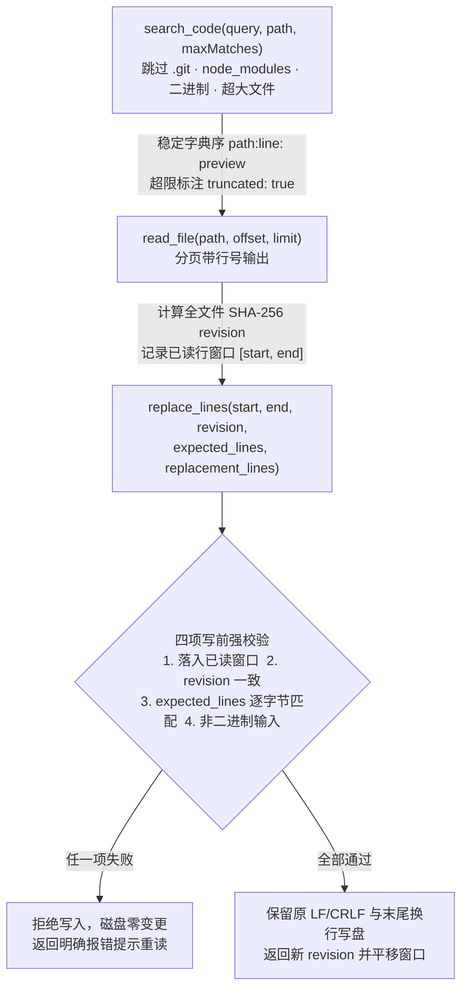

# p06：Code Search & Line-Anchored Edits - 大文件精准检索与行锚定精确替换

第一季 `s02` 与第二季 `p02` 的 `edit_file` 都靠 `old_text` 全文子串匹配来定位修改。一旦进入几百上千行的大文件，两段结构一模一样的样板代码同时出现时，模型要么被迫拷贝几十行冗余上下文来凑“唯一匹配”，要么一不小心改错第一段而不是目标那一段。

这一节我们回到最小工具循环基座，把读写链路升级为 **有界检索 + 分页带行号读取 + 行号锚定校验替换**。**精确编辑的核心不在于写复杂的模糊匹配算法，而是让每一次修改都同时锁死“文件版本（revision）+ 已读行窗口 + 期望原行（expected_lines）”三把锁，既能精准命中重复代码块里的第二段，又绝不破坏原文件的换行符约定。**

## 问题

把基于 `old_text` 字符串替换的编辑器放进真实大仓库，会立刻遇到三个工程痛点：

| 痛点 | 朴素工具的表现 | 真实后果 |
|---|---|---|
| 大仓库检索失控 | 无上限扫全盘，把 `.git`、`node_modules`、二进制、大文件全读进内存 | 上下文被噪音撑爆，甚至卡死主循环 |
| 重复代码块难定位 | `old_text` 命中多处直接报错，模型只能贴一大段无关上下文碰运气 | 白烧 Token，且容易误改同名样板块 |
| 盲改破坏文件格式 | 没读全目标区域就按猜测行号写，或把 CRLF/无末尾换行一律改成 `\n` | Diff 满屏格式污染，或覆盖外部新改动 |

## 解决方案

我们用 `createCodeEditor()` 封装三个零依赖工具，形成“先检索定位 -> 再分页读取拿 `revision` -> 最后行锚定校验写入”的确定性闭环：



三个关键设计边界：

- **纯 Node 有界递归检索与路径护栏**：`search_code` 不依赖外部 `rg`，按严格码位字典序遍历目录，跳过 `.git`、`node_modules`、二进制与超大文件；无论命中条数超限、单行预览超字节（按 UTF-8 字符边界安全截断）还是扫描文件数超限，都显式返回 `truncated: true`。所有路径先做词法校验再用 `realpathSync` 验证，统一拦截 `../` 越界与指向工作区外的 symlink。
- **分页窗口与全文件 `revision` 绑定**：`read_file` 只返回请求页的带行号片段，但 `revision` 始终按**完整文件字节**计算 SHA-256 短哈希，同时把本次读到的 `[startLine, endLine]` 合并进该文件的已读窗口表。文件一旦被外部改动，旧 `revision` 自动失效，旧窗口全部作废。
- **确定性行锚定替换与格式保真**：`replace_lines` 不做任何模糊匹配或自动猜行——必须同时满足“目标区间完全落在已读窗口内”“传入 `revision` 与当前磁盘一致”“`expected_lines` 与目标行逐字节相等”“输入不含二进制 NUL 或裸换行符”四项才落盘，并原样保留原文件的 `LF` / `CRLF` 与末尾换行约定。

## 核心代码流程

本节源码位于 `code-agent-course/p06-search-exact-edit.js`（约 360 行，含 CLI），由四个部件构成：

1. **路径与文本元信息工具**：`resolveInsideWorkspace()` 结合词法边界与 `realpathSync` 拦截越界和外部 symlink；`decodeUtf8File()` 拒绝 NUL 字节与非法 UTF-8；`splitLinesWithMeta()` / `serializeLinesWithMeta()` 无损记录并还原 `eol` 与 `hasTrailingNewline`。
2. **`searchCode()`**：纯 Node 有界递归扫描，稳定字典序输出 `path:line: preview`，提供匹配数、行字节与文件数三类截断标志及跳过统计。
3. **`readFile()` 与 `replaceLines()`**：在 `createCodeEditor()` 内维护 `seenFiles`（`revision` + 合并后的已读行区间），写前校验四项全部通过后才原子更新磁盘并平移后续已读窗口。
4. **`agentLoop()` 与 `main()`**：回到约 50 行的最小工具循环与交互 CLI，把 `search_code`、`read_file`、`replace_lines` 接给模型使用。

## 测试 Prompt

```text
请先用 search_code 找出 service.js 中所有包含 "timeoutMs: 1000" 的位置，再用 read_file 分页查看第二处所在行区间，最后用 replace_lines 只把第二处的 timeoutMs 改成 3000，不要改动第一处。
```

运行后可以看到模型先拿到两处行号，再只分页读取第二处附近代码获取 `revision`，最后通过 `replace_lines` 精确改完第二段重复块，第一段逐字节保持不变。

## 扩展阅读：商业级 Agent 怎么做大文件检索与精确编辑

- **Claude Code**：把 `Grep` / `Glob` 与带 `offset`/`limit` 的 `Read` 拆成独立高频工具，并要求编辑前必须先读文件、核对磁盘新鲜度，避免把整个大文件塞满上下文窗口。
- **Codex**：通过 `rg` 快速定位行号，再用带上下文锚点的结构化 `apply_patch` 做确定性修改，明确拒绝模糊替换，减少模型在重复代码上的误编辑率。
- **opencode**：结合大文件分页读取、基于内容哈希的乐观锁（optimistic concurrency）与行级编辑校验，确保外部格式化工具或并行子任务改过文件时立刻触发重读而不是静默覆盖。

**给编辑工具加上“行号 + 版本哈希 + 期望原行”三把锁，模型再也不用靠背诵几十行上下文来避免改错位置。**

## 本地运行与测试

交互运行（从仓库根目录执行）：

```bash
cd code-agent-course && node p06-search-exact-edit.js
```

离线单测（在仓库根目录执行，无需 API Token）：

```bash
pnpm vitest run code-agent-course/p06-search-exact-edit.test.js
```

> **本节思考题**：本节的 `replace_lines` 每次只修改一个连续行区间。如果一次重构需要同时改同一文件里的第 12 行和第 88 行，并且要求“要么两处都成功，要么整份文件保持原样”，你会怎样把单区替换升级为原子批量行替换（batch edits）并处理行号偏移？
