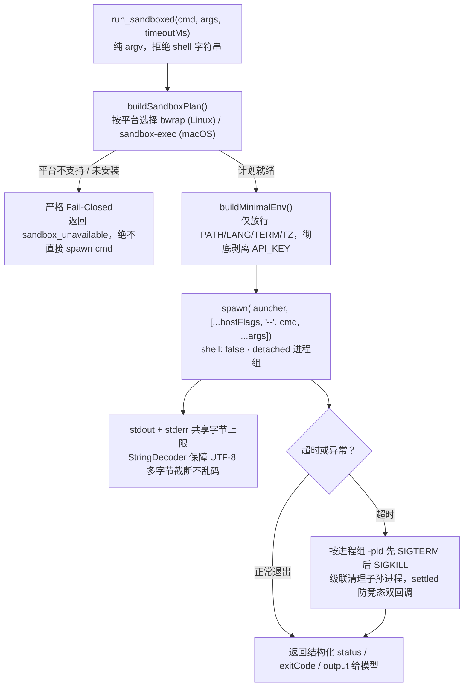

# p07：OS Sandbox & Supervised Shell - OS 级命令沙箱与子进程监管

第一季 `s02` 的 `runBash` 只用几条关键词黑名单拦截 `rm -rf /` 或 `sudo`，既挡不住 `sh -c`、变量拼接和脚本间接执行，也挡不住子进程顺手读走 `.env`、把 `API_KEY` 发到外网，或者超时后留下永远杀不死的孙进程。

这一节我们回到最小工具循环基座，把危险的裸 Shell 字符串替换成 **OS 级沙箱 + `argv` 级进程监管**。**真正的执行隔离不是在提示词或正则里猜坏命令，而是由宿主用内核边界锁死文件系统、网络和环境变量，并在任何沙箱不可用路径上严格 Fail-Closed，绝不静默降级裸跑宿主命令。**

## 问题

把裸 `execSync(command)` 放进真实开发机或 CI，存在四类结构性风险：

| 风险 | 裸 Shell 的表现 | 真实后果 |
|---|---|---|
| 命令与参数注入 | 模型传整段 shell 字符串，宿主直接丢给 `/bin/sh -c` | 任意管道、重定向、反引号均可绕过关键词过滤 |
| 密钥与宿主文件暴露 | 子进程完整继承 `process.env` 且能读写全盘、访问外网 | 一次误操作或依赖脚本即可读走 `~/.ssh` 与 `API_KEY` |
| 静默降级裸跑 | 沙箱工具未安装或容器禁止命名空间时，悄悄退回直接执行 | 开发者以为在沙箱里跑，实际已完全失去隔离保护 |
| 输出撑爆与孤儿进程 | 子进程狂打日志或 fork 后台孙进程后超时 | 内存/上下文被冲爆，超时杀父进程后孙进程仍在后台跑 |

## 解决方案

我们用 `buildSandboxPlan()` + `createSandboxRunner()` 把命令执行拆成“宿主构造沙箱启动计划 -> 最小环境白名单隔离 -> 共享字节上限与进程树监管”三道闸门：



三个关键设计边界：

- **argv 级参数隔离与严格 Fail-Closed**：模型只能提供 `cmd` 和 `args[]`，宿主始终以 `shell: false` 调用沙箱启动器，并在启动器参数与目标命令之间插入 `--` 分隔符，确保模型参数绝不能冒充 `--bind` 或 `-p` 污染沙箱策略。Linux 以 `bwrap` 为标准参考后端（`--ro-bind` 最小系统目录 + `--bind` 工作区 + `--unshare-net` + `--unshare-pid` + `--die-with-parent`）；macOS 提供约 30 行 `.sb` Seatbelt 策略的 `sandbox-exec` 轻量适配（注意：Apple 已将 `sandbox-exec` 标记为 deprecated，本节保留它以便 Mac 读者本地体验，生产环境建议 Linux 容器 / `bwrap` 或专用 VM）；Windows 或受限嵌套环境统一返回 `sandbox_unavailable`，绝不降级裸跑。
- **`--doctor` 真实策略探测**：不靠 `which` 猜状态，而是实际通过沙箱拉起一次无害探针进程，精准区分 `not_installed`（未安装）、`blocked_by_env`（如容器内禁用 user namespace 导致启动被阻）与 `available`（真实可用）。
- **子进程全链路监管**：从源头用最小环境变量白名单隔离宿主密钥；用按流独立的 `StringDecoder("utf8")` 配合共享字节预算控制 `stdout + stderr` 总量，避免截断中文或 Emoji 时产生乱码替换符；通过独立进程组（`detached: true` + `kill(-pid)`）在超时后级联清理子进程与 fork 出的孙进程，并用 `settled` 守卫彻底消除超时与正常退出竞态。

## 核心代码流程

本节源码位于 `code-agent-course/p07-os-sandbox-shell.js`（约 365 行，含 CLI 与 `--doctor`），由四个部件构成：

1. **策略与环境构造器**：`buildMinimalEnv()` 只拷贝白名单环境变量；`buildBwrapArgs()` 构造 Linux Bubblewrap 只读/读写绑定与断网隔离参数；`buildMacOsSeatbeltPolicy()` 生成约 25 行默认拒绝（`deny default`）的 macOS Seatbelt 策略。
2. **`buildSandboxPlan()`**：校验 `cmd` / `args` 与路径合法性，按 OS 分发后端并插入 `--` 防参数污染，不支持平台直接 Fail-Closed。
3. **`createSandboxRunner()`**：封装 `runSandboxed()`（含 `createCappedCollector` 双流 UTF-8 安全字节上限、超时进程树 `SIGTERM -> SIGKILL` 清理与单次完成竞态守卫）和 `doctor()` 真实探针。
4. **`agentLoop()` 与 `main()`**：提供最小单工具循环与交互 CLI，支持 `node p07-os-sandbox-shell.js --doctor` 一键自检当前机器沙箱可用性。

## 测试 Prompt

先用 `--doctor` 检查本机沙箱是否就绪，再启动交互模式测试：

```text
请用 run_sandboxed 运行 node -e 打印当前目录并检查环境变量里是否存在 API_KEY；再尝试访问 127.0.0.1 验证断网隔离。
```

运行后可以看到命令在工作区内正常执行，环境变量里看不到宿主的 `API_KEY` / `LLM_API_TOKEN`，且任何网络请求或工作区外文件读取都会被内核直接拦截。

## 扩展阅读：商业级 Agent 怎么落地 OS 沙箱

- **Claude Code**：在 Linux 上结合 `bubblewrap`（`bwrap`）与网络代理做文件系统和域名级隔离，在 macOS 上结合 Seatbelt 限制可写目录与敏感路径，所有受限失败都会明确回报用户或请求显式审批，不静默放行。
- **Codex**：默认在只读/工作区可写 + 断网沙箱（Linux Landlock/seccomp 或 macOS Seatbelt）内执行命令，并对环境变量与输出字节做严格裁剪，防止凭证泄露与上下文爆炸。
- **opencode**：在工具权限层与 OS 执行沙箱之间做分层设计，把只读探索、工作区修改和需要联网/越权的操作拆开管控。

**提示词防不住越界命令，只有内核级沙箱 + Fail-Closed 才能把执行面风险真正锁进笼子里。**

## 本地运行与测试

先探测本机沙箱状态，再交互运行（从仓库根目录执行）：

```bash
cd code-agent-course && node p07-os-sandbox-shell.js --doctor
cd code-agent-course && node p07-os-sandbox-shell.js
```

默认离线单测（无需 API Token，无需系统安装 `bwrap`；其中真实沙箱用例默认跳过并标明 `unverified`）：

```bash
pnpm vitest run code-agent-course/p07-os-sandbox-shell.test.js
```

在支持 `bwrap`（Linux）或 `sandbox-exec`（macOS）的本机显式开启真实沙箱拦截与宿主正对照测试：

```bash
P07_REAL_SANDBOX=1 pnpm vitest run code-agent-course/p07-os-sandbox-shell.test.js
```

> **本节思考题**：本节的沙箱默认完全断网（`--unshare-net` / `(deny network*)`）。如果实际开发需要允许 `pnpm install` 仅访问 `registry.npmjs.org`，同时继续禁止访问内网 IP 与任意未知域名，为什么不能直接在沙箱里开放全部网络，而需要“断网沙箱 + 宿主机白名单 HTTP 代理（Unix Socket 转发）”？
