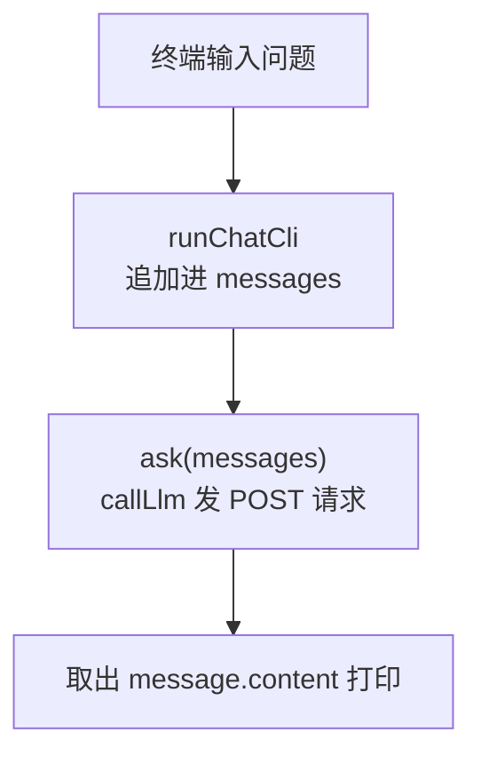

# s00：HTTP 调用 - 先和模型接通电话

把大模型看成一位坐在远程办公室的聪明实习生，给他派活之前，第一步是先把电话接通。[learn-claude-code](https://github.com/shareAI-lab/learn-claude-code) 直接从 `s01` 开始写循环，我们特意在前面补上这节 `s00`：**先用 20 多行代码跑通一次最朴素的 HTTP 对话，拿到第一个可见的正反馈。**

## 问题

大模型不在本地运行，而且本身没有记忆。每次发 HTTP 请求，程序需要把 API Token 放进 `Authorization` 请求头，再把模型名和历史 `messages` 数组放进 JSON 请求体发给对应接口。本章靠每次重发完整 `messages` 数组来维持多轮上下文。

## 解决方案

为了让主线代码保持极简，我们把底层 `fetch` 请求和命令行输入收进右侧的公共文件 `helper.js`，后面所有章节直接复用。当前文件只留最核心的两件事：用 `ask()` 调模型取回复，用 `main()` 接上命令行。

## 流程图



## 测试 Prompt

```text
用两句话解释什么是 Code Agent，并试着帮我在当前目录创建一个 hello.txt。
```

你会看到模型能流利解释概念，但做不到真建文件，因为我们还没给它发工具。

## 本地运行与测试

在浏览器里滚到本章最后一帧，点右上角运行按钮即可试玩；如果要在本地终端跑真实模型，先复制 [.env.local.example](.env.local.example) 为 `.env.local` 并填好 `LLM_PROVIDER` 与 `LLM_API_TOKEN`。从仓库根目录进入课程目录运行交互 CLI：

```bash
cd code-agent-course && node s00-llm-http.js
```

在仓库根目录跑离线单测（无需 API Token）：

```bash
pnpm vitest run code-agent-course/s00-llm-http.test.js
```

## 博客代码演进

### 1. 搭起文件骨架

老规矩，先从 `helper.js` 引入三个现成帮手：`callLlm` 负责发 HTTP 请求，`runChatCli` 负责命令行问答循环，`isMainModule` 负责启动判断。想看底层 `fetch` 怎么写的，随时可以点右侧顶部的 `helper.js` 标签。

```diff agent-step
@@
+import {
+  callLlm,
+  runChatCli,
+  isMainModule,
+} from "./helper.js";
```

### 2. 新增 ask：取回模型文本

写下本章唯一的核心函数 `ask(messages)`：调 `callLlm` 拿到第一条候选结果 `choice`，取出 `choice.message.content` 里的文本并用 `|| ""` 兜底。注意 `callLlm` 故意返回完整的 `choice` 而不是纯文本，因为下一章模型还要在里面返回工具调用指令。

```diff agent-step
@@
 } from "./helper.js";
 
+export async function ask(messages) {
+  const choice = await callLlm(messages);
+  return choice.message.content || "";
+}
+
```

### 3. 接到命令行

新增 `main()`，把 `ask` 挂到 `runChatCli` 的 `onPrompt` 回调上。每次你在终端输入一句话回车，`runChatCli` 都会把问题和模型回复按顺序推进同一个 `messages` 数组再整包重发。这一帧只定义了 `main()`，下一步加上启动守卫后运行才会出现 `prompt >> `。

```diff agent-step
@@
 }
 
+async function main() {
+  await runChatCli({
+    promptLabel: "prompt >> ",
+    onPrompt: ({ messages }) => ask(messages),
+  });
+}
+
```

### 4. 加上启动守卫

最后用 `isMainModule` 包住 `main()`：只有直接运行当前文件时才启动命令行，跑单测 `import { ask }` 时不会卡住等待输入。现在填好 API Token 点右上角运行按钮，看到 `prompt >> ` 就能和模型对话了（输入 `q` 或 `exit` 退出）。

> **本章思考题**：试着问它：“当前目录下有哪些 JS 文件？”你会发现它只会教你敲 `ls`，自己却动不了手。不想每次都人工复制命令、粘贴结果当“传话筒”，代码里还得加哪两样东西？下一章 `s01` 我们直接加上。

```diff agent-step
@@
   });
 }
 
+if (isMainModule(import.meta.url)) {
+  main().catch((error) => {
+    console.error(error.message);
+    process.exit(1);
+  });
+}
+
```

## 首章代码 diff（不含 helper.js）

```diff
--- /dev/null
+++ s00-llm-http.js
@@
+import {
+  callLlm,
+  runChatCli,
+  isMainModule,
+} from "./helper.js";
+
+export async function ask(messages) {
+  const choice = await callLlm(messages);
+  return choice.message.content || "";
+}
+
+async function main() {
+  await runChatCli({
+    promptLabel: "prompt >> ",
+    onPrompt: ({ messages }) => ask(messages),
+  });
+}
+
+if (isMainModule(import.meta.url)) {
+  main().catch((error) => {
+    console.error(error.message);
+    process.exit(1);
+  });
+}
```
