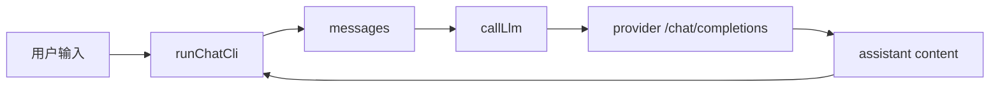

# s00：HTTP 调用 —— 先打通模型入口

想象你刚招来一个很聪明的实习生，他脑子很好，但你们还没有建立任何沟通方式。`s00` 做的就是先接通电话：你把问题按固定格式发过去，他把回答按固定格式回给你。

参考仓库从 `s01_agent_loop` 直接开始讲 agent loop。

我们的 JavaScript 版多加一个 `s00`，原因很简单：在进入 agent 之前，先把最基础的一件事讲清楚：

**怎么通过 HTTP 把 `messages` 发给 LLM provider，再拿回模型回复。**

后面的 `s01-s04` 会参考 [shareAI-lab/learn-claude-code](https://github.com/shareAI-lab/learn-claude-code) 中的 `s01_agent_loop`、`s02_tool_use`、`s03_permission` 和 `s04_hooks`。

但 `s00` 是 JS 版的前置底座：先不要 agent，不要工具，不要权限，只确认 LLM 可以被调用。


## 问题

所有 agent 最后都要回到一次普通的模型调用。

如果这条链路还没通，后面的 loop、tool、permission、hook 都跑不起来。

所以这一节只解决一个问题：

```text
用户输入 -> HTTP POST -> LLM provider -> assistant 文本
```

## 解决方案

把 provider 差异收进配置表，主逻辑只认一个函数：

```js
callLlm(messages)
```

OpenAI、DeepSeek、Kimi 都是 OpenAI-compatible 的 `/chat/completions` 风格。它们主要差在三处：

| 配置 | 含义 |
|---|---|
| `baseUrl` | 请求地址 |
| `model` | 默认模型名 |
| `token` | API token |

主流程不关心是哪家，只从 `llmProviderConfigs` 里取当前 provider 的配置。



## 工作原理

一次最小请求就是一个普通的 HTTP POST：

```http
POST {baseUrl}/chat/completions
Authorization: Bearer {token}
Content-Type: application/json
```

请求体里最重要的是：

```json
{
  "model": "deepseek-chat",
  "messages": [
    { "role": "user", "content": "hello" }
  ]
}
```

模型回你一个 JSON。OpenAI-compatible 接口的最小返回大概长这样：

```json
{
  "choices": [
    {
      "message": {
        "role": "assistant",
        "content": "agent 就是能调用工具并持续完成任务的程序。"
      }
    }
  ]
}
```

所以代码里真正读取的是：

```js
data.choices[0].message.content
```

这就是后面所有章节共同使用的基本数据结构：

```text
我们发 messages，模型回一条 assistant message。
```

## 新增函数速览

- `ask(messages)`：本章最小的业务函数，把当前对话交给 `callLlm()`，再取出模型回复文本。
- `main()`：命令行入口，把 `ask()` 接到 `runChatCli()`，让用户可以在终端里反复输入 prompt。
- `callLlm(messages)`：在 `helper.js` 里封装 HTTP 调用，负责把 `messages` 发到当前 provider 的 `/chat/completions` 接口。
- `runChatCli(options)`：在 `helper.js` 里封装命令行交互，负责读取用户输入、维护 messages、打印 assistant 回复。

## 对应代码

- 主文件：[s00-llm-http.js](./s00-llm-http.js)
- 共用底座：[helper.js](./helper.js)

### `callLlm`

```js
export async function callLlm(messages, { system, tools, model, provider = llmProvider } = {}) {
  const config = llmProviderConfigs[provider] || llmProviderConfigs.openai;

  const body = {
    model: model || config.model,
    messages: system ? [{ role: "system", content: system }, ...messages] : messages,
  };
  if (tools?.length) {
    body.tools = tools;
    body.tool_choice = "auto";
  }

  const response = await fetch(`${config.baseUrl.replace(/\/$/, "")}/chat/completions`, {
    method: "POST",
    headers: {
      "content-type": "application/json",
      authorization: `Bearer ${config.token}`,
    },
    body: JSON.stringify(body),
  });

  const data = await response.json();
  return data.choices[0];
}
```

这里先看最小路径：取配置、拼 body、发 `fetch`、返回 `choice`。

`system` 和 `tools` 在 `s00` 暂时用不到，但它们会在 `s01` 开始变重要。

### helper 函数语义

| 名字 | 是什么 |
|---|---|
| `llmProviderConfigs` | 所有 provider 的 `baseUrl`、`model`、`token` 配置表 |
| `llmProvider` / `apiToken` | 当前选择哪家模型服务商、使用哪个 token |
| `callLlm(messages, opts)` | 整套教程唯一的模型调用函数：发 HTTP 请求，返回 `data.choices[0]` |
| `runChatCli(...)` | 命令行交互外壳：读用户输入、维护 `messages`、打印模型输出 |

这一步要记住的不是某个库，而是请求/响应结构：**发 `messages`，收 `choice.message`。**

### `s00` 主文件

```js
export async function ask(messages) {
  const choice = await callLlm(messages);
  return choice.message.content || "";
}
```

`s00` 的主文件只做一件事：把 CLI 维护的 `messages` 交给 `callLlm`，然后打印模型文本。

## 相对参考教程的位置

| 章节 | 作用 |
|---|---|
| 参考仓库 `s01_agent_loop` | 直接从 agent loop 开始 |
| 本教程 `s00` | 先补一层 HTTP 调用，让读者知道模型请求到底长什么样 |
| 本教程 `s01` | 再进入 agent loop |

这一步不是 agent，只是给 agent 准备网络入口。

## 试一下

先在 [helper.js](./helper.js) 里设置当前 provider 和 token，然后运行：

```bash
node code-agent-course/s00-llm-http.js
```

可以输入：

```text
用一句话解释什么是 code agent
```

观察重点：终端输入如何变成 `messages`，`messages` 如何通过 HTTP 送到模型。

## 测试

测试不会请求真实 provider，而是用本地 fake LLM 返回固定结果。

```bash
pnpm test
```

这样后面改 `helper.js` 时，可以确认最基础的 LLM 调用没有坏。

## 一句话总结

`s00` 打通 agent 的最底层入口：**把 `messages` 通过 HTTP 发给模型，拿回一条 assistant message。**

## 测试 Prompt

```text
用两句话解释什么是 code agent，并举一个文件操作例子
```

观察重点：这一讲只验证 HTTP 调用和模型返回文本，不应该出现工具调用。


## API Key 和接口文档

如果你想接真实模型，可以先去对应平台申请 API Key，再把 provider、token 和 model 配到 [helper.js](./helper.js) 里。

| Provider | API Key | 文档 |
|---|---|---|
| Anthropic | https://platform.claude.com/settings/keys | https://platform.claude.com/docs/zh-CN/home |
| Kimi | https://platform.kimi.com/console/api-keys | https://platform.kimi.com/docs/guide/kimi-k2-7-code-quickstart |
| DeepSeek | https://platform.deepseek.com/usage | https://api-docs.deepseek.com/ |
| OpenAI | https://platform.openai.com/api-keys | https://developers.openai.com/api/docs |

## 首章代码 diff（不含 helper.js）

`s00` 是第一章，没有上一步；这里用“新增文件 diff”展示最小入口。

```diff
--- /dev/null
+++ s00-llm-http.js
@@
+import { callLlm, runChatCli, isMainModule } from "./helper.js";
+
+// s00：最小的“调用大模型”示例 —— 一个 HTTP 请求换一句回答。
+// s00: the smallest "call an LLM" example — one HTTP request, one reply.
+
+// 问模型，返回纯文本回答。
+// Ask the model and return its plain-text reply.
+export async function ask(messages) {
+  const choice = await callLlm(messages);
+  return choice.message.content || "";
+}
+
+async function main() {
+  // runChatCli 只管命令行输入输出；真正的 LLM 调用放在 onPrompt 里。
+  await runChatCli({
+    promptLabel: "prompt >> ",
+    onPrompt: ({ messages }) => ask(messages),
+  });
+}
+
+// 只有直接运行才启动命令行；被测试 import 时不会启动。
+// Only start the CLI when run directly; importing (e.g. in tests) won't start it.
+if (isMainModule(import.meta.url)) {
+  main().catch((error) => {
+    console.error(error.message);
+    process.exit(1);
+  });
+}
```
