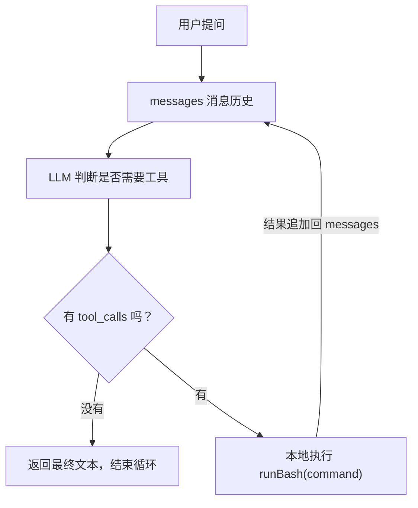

# s01：Agent Loop - 一个工具加一个循环，让模型真正动手

上一章 `s00` 里，你让模型查目录文件，它只会写一行 `ls` 让你自己去敲，敲完还得你把结果粘回去。

其实这套“复制命令 -> 终端执行 -> 粘贴结果”的人工动作，就是最原始的 Agent Loop。这一章（对应 [learn-claude-code](https://github.com/shareAI-lab/learn-claude-code) 的 `s01_agent_loop`）我们把它变成自动代码：**一把 `bash` 工具加上一个 `while` 循环，就是最小可用的 Code Agent。**

## 问题

光会聊天的模型只能“纸上谈兵”。只要程序不能替它执行命令并把输出喂回去，每次查文件、跑测试都得靠人在中间当传话筒。

## 解决方案

我们给 `callLlm` 外面套一层 `while (true)` 循环，再配上一份 `bash` 工具说明书：



循环只认一个信号：模型返回的 `message` 里有 `tool_calls`，就在本地执行 `runBash` 并把输出塞回 `messages` 继续下一轮；一旦没有 `tool_calls`，说明模型拿够了信息，直接返回最终文本。

## 测试 Prompt

```text
列出当前目录下所有 JavaScript 文件，并告诉我一共有多少个。
```

你会看到终端先打印 `$ ls ...` 或 `$ find ...` 的真实执行结果，再给出准确数量。

## 扩展阅读：商业级 Agent 怎么做主循环

商业级产品外层工程更厚，但最核心的骨架依然是这个循环：

- **Claude Code**：由 `query` 驱动流式响应与工具循环，结果写回同一消息流，直到模型不再返回工具调用。
- **Codex**：在 Rust 核心层把循环做成标准的 Turn Loop，统一管理请求组装、工具分发与轨迹持久化。
- **opencode**：在循环外包了一层事件流，把每轮工具状态实时推给终端界面。

**不管外围功能怎么变，Agent 跳动的心脏始终是“模型发意图 -> 本地跑工具 -> 结果回灌模型”这个闭环。**

## 本地运行与测试

```bash
cd code-agent-course
node s01-agent-loop.js
pnpm vitest run code-agent-course/s01-agent-loop.test.js
```

## 博客代码演进

### 1. 引入 runBash

我们在 `s00` 的代码上直接往下改。第一步先从 `helper.js` 引入真正执行 shell 命令的 `runBash`（内部已自带基础的危险命令拦截）。

```diff agent-step
@@
 import {
   callLlm,
+  runBash,
   runChatCli,
   isMainModule,
```

### 2. 声明 SYSTEM 提示词

给模型立一条简短的工作规矩：用 `process.cwd()` 告诉它当前所在目录，并强调“直接用 `bash` 动手解决，别光靠嘴解释（Act, don't explain）”。

```diff agent-step
@@
 } from "./helper.js";
 
+const SYSTEM = `You are a coding agent at ${process.cwd()}. Use bash to solve tasks. Act, don't explain.`;
+
 export async function ask(messages) {
   const choice = await callLlm(messages);
```

### 3. 声明 bashTool schema

远端大模型碰不到你本地的 `runBash` 函数，怎么知道有工具可用？靠这份 JSON 说明书。**`bashTool` 是给模型看的说明书，`runBash` 才是本地干活的真函数。** 这里声明工具名叫 `"bash"`，接收必填字符串参数 `command`。

```diff agent-step
@@
 const SYSTEM = `You are a coding agent at ${process.cwd()}. Use bash to solve tasks. Act, don't explain.`;
 
+const bashTool = [{
+  type: "function",
+  function: {
+    name: "bash",
+    description: "Run a shell command.",
+    parameters: {
+      type: "object",
+      properties: { command: { type: "string" } },
+      required: ["command"],
+    },
+  },
+}];
+
 export async function ask(messages) {
   const choice = await callLlm(messages);
```

### 4. 搭起 agentLoop 骨架

搭起 `agentLoop` 外层循环：每次调 `callLlm` 时把 `SYSTEM` 和 `bashTool` 一起传过去。如果返回的 `message.tool_calls` 为空，说明模型不需要调工具，直接返回文本退出循环。

```diff agent-step
@@
 }];
 
+export async function agentLoop(messages) {
+  while (true) {
+    const choice = await callLlm(messages, { system: SYSTEM, tools: bashTool });
+    const { message } = choice;
+
+    if (!message.tool_calls?.length) {
+      return message.content || "";
+    }
+  }
+}
+
 export async function ask(messages) {
   const choice = await callLlm(messages);
```

### 5. 执行工具并回灌结果

当模型返回 `tool_calls` 时，按三步完成闭环（这三点也是新手最容易写漏的地方）：

1. **先存意图**：先把带 `tool_calls` 的 `message` 原样推进 `messages`，否则下一轮模型不知道工具输出在回应谁；
2. **解析参数**：`call.function.arguments` 是 JSON 字符串，先 `JSON.parse()` 取出 `command` 再调 `runBash`；
3. **回灌结果**：用 `role: "tool"` 带上对应的 `tool_call_id: call.id` 推回 `messages`，循环自动进入下一轮。

```diff agent-step
@@
       return message.content || "";
     }
+
+    messages.push(message);
+    for (const call of message.tool_calls) {
+      const { command } = JSON.parse(call.function.arguments || "{}");
+      const output =
+        call.function.name === "bash"
+          ? runBash(command)
+          : `Unknown tool: ${call.function.name}`;
+
+      console.log(`$ ${command}\n${output.slice(0, 500)}`);
+      messages.push({ role: "tool", tool_call_id: call.id, content: output });
+    }
   }
 }
```

### 6. 切换 main 入口，删掉 ask

最后把 `main()` 里的 `ask` 换成 `agentLoop`，删掉旧的 `ask`，提示符改成 `"s01 >> "`。现在点右上角运行，它就能自己敲命令查目录了！

> **本章思考题**：靠一个 `bash` 虽然能跑通，但如果读文件总拼 `cat`、改代码总拼 `sed`，既费 Token 又容易把引号转义改坏。要是再加读写改查 4 个新工具，难道在循环里连写 5 个 `if / else`？下一章 `s02` 我们用一张表把它解耦。

```diff agent-step
@@
 }
 
-export async function ask(messages) {
-  const choice = await callLlm(messages);
-  return choice.message.content || "";
-}
-
 async function main() {
   await runChatCli({
-    promptLabel: "prompt >> ",
-    onPrompt: ({ messages }) => ask(messages),
+    promptLabel: "s01 >> ",
+    onPrompt: ({ messages }) => agentLoop(messages),
   });
 }
```

## 和上一步的关键代码 diff（不含 helper.js）

```diff
--- s00-llm-http.js
+++ s01-agent-loop.js
@@ -1,16 +1,50 @@
 import {
   callLlm,
+  runBash,
   runChatCli,
   isMainModule,
 } from "./helper.js";

-export async function ask(messages) {
-  const choice = await callLlm(messages);
-  return choice.message.content || "";
+const SYSTEM = `You are a coding agent at ${process.cwd()}. Use bash to solve tasks. Act, don't explain.`;
+
+const bashTool = [{
+  type: "function",
+  function: {
+    name: "bash",
+    description: "Run a shell command.",
+    parameters: {
+      type: "object",
+      properties: { command: { type: "string" } },
+      required: ["command"],
+    },
+  },
+}];
+
+export async function agentLoop(messages) {
+  while (true) {
+    const choice = await callLlm(messages, { system: SYSTEM, tools: bashTool });
+    const { message } = choice;
+
+    if (!message.tool_calls?.length) {
+      return message.content || "";
+    }
+
+    messages.push(message);
+    for (const call of message.tool_calls) {
+      const { command } = JSON.parse(call.function.arguments || "{}");
+      const output =
+        call.function.name === "bash"
+          ? runBash(command)
+          : `Unknown tool: ${call.function.name}`;
+
+      console.log(`$ ${command}\n${output.slice(0, 500)}`);
+      messages.push({ role: "tool", tool_call_id: call.id, content: output });
+    }
+  }
 }

 async function main() {
   await runChatCli({
-    promptLabel: "prompt >> ",
-    onPrompt: ({ messages }) => ask(messages),
+    promptLabel: "s01 >> ",
+    onPrompt: ({ messages }) => agentLoop(messages),
   });
 }
```
