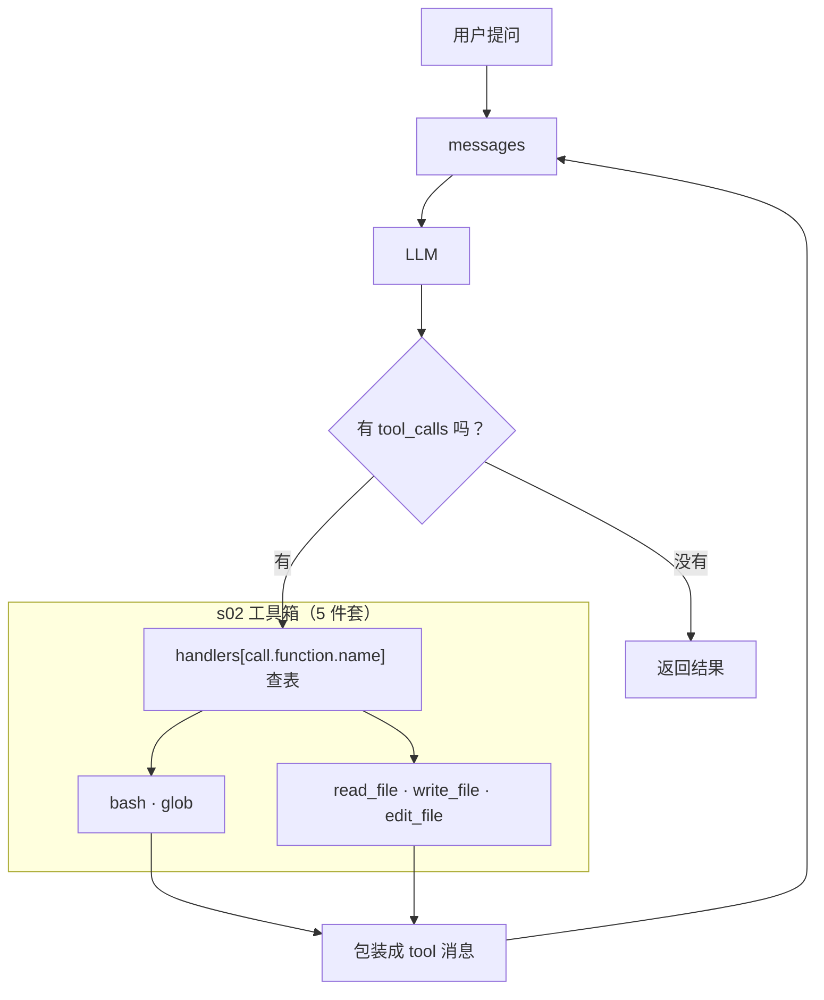
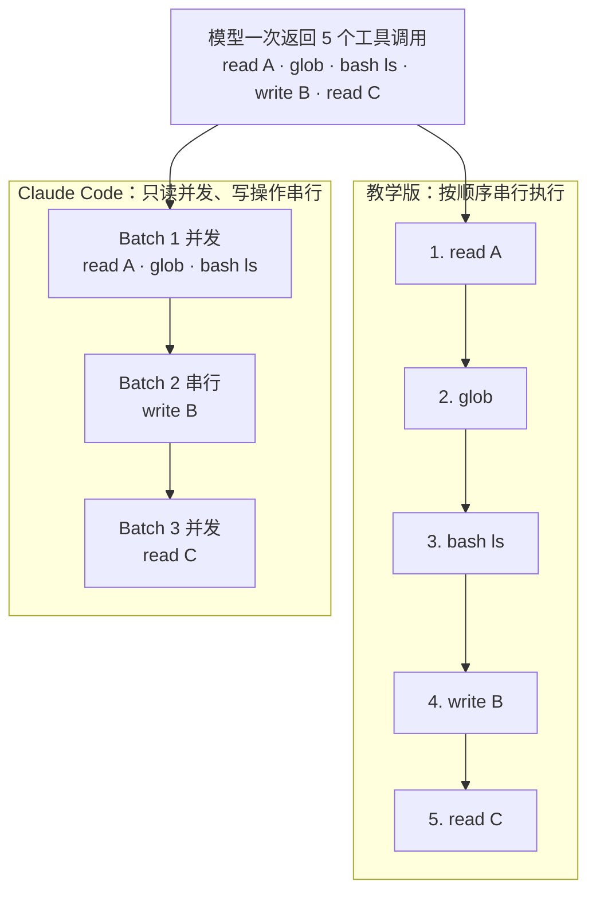

# s02：Tool Use - 用分发表解耦工具，加工具不改主循环

上一章 `s01` 只有一个 `bash`，读文件得拼 `cat`，改代码得拼 `sed`，既费 Token 又容易被引号转义搞崩。如果再加几个新工具就在 `agentLoop` 里连写 `if / else`，主循环很快就会变成面条代码。

这一章（对应 [learn-claude-code](https://github.com/shareAI-lab/learn-claude-code) 的 `s02_tool_use`）我们用日常开发最顺手的查表法来解耦：**`tools` 数组给模型看说明书，`handlers` 对象给程序查函数；以后加工具只填表，主循环一行不改。**

## 问题

靠单一 `bash` 操作文件，每次都要多绕一层脆弱的 shell 命令：

| 想做的事 | 硬拼 bash 的痛点 |
|---|---|
| 读 / 写文件 | 拼 `cat` 和重定向，多行文本极易转义出错 |
| 改几行代码 | 拼 `sed`，不同系统参数还不兼容 |
| 扩充新工具 | 分支写死在循环里，每加一个工具都要改核心逻辑 |

## 解决方案

我们把工具拆成名字一一对齐的两张表，并配齐读写改查 5 件套（`helper.js` 里的文件函数已内置 `safeJoin` 防止路径越界）：



`agentLoop` 只管拿 `call.function.name` 去 `handlers` 里查函数：查到就传参执行，查不到就返回 `"Unknown tool: ..."`。

## 测试 Prompt

```text
创建 s02-tmp-note.txt，写入 hello s02，然后读出来确认内容。
```

终端会依次打印 `> write_file:` 和 `> read_file:`，不再绕弯拼 shell 命令。

## 扩展阅读：商业级 Agent 怎么做工具扩展

商业级 Agent 同样靠注册表（Tool Registry）管理几十个内置与 MCP 工具，并且会进一步区分只读与写操作的并发策略：



教学版统一按顺序串行跑，最稳妥好懂；而像 Claude Code 会把连续的只读调用打包并发提速，遇到写文件再切回串行防冲突。

## 本地运行与测试

```bash
cd code-agent-course
node s02-tool-use.js
pnpm vitest run code-agent-course/s02-tool-use.test.js
```

## 博客代码演进

### 1. 引入新工具的实现

先从 `helper.js` 引入四个文件工具（`readFile`、`writeFile`、`editFile`、`glob`）和拼装 schema 的小帮手 `tool`，顺手把 `SYSTEM` 里的 `"Use bash"` 改成 `"Use tools"`。

```diff agent-step
@@
   callLlm,
   runBash,
+  readFile,
+  writeFile,
+  editFile,
+  glob,
+  tool,
   runChatCli,
   isMainModule,
 } from "./helper.js";
 
-const SYSTEM = `You are a coding agent at ${process.cwd()}. Use bash to solve tasks. Act, don't explain.`;
+const SYSTEM = `You are a coding agent at ${process.cwd()}. Use tools to solve tasks. Act, don't explain.`;
 
 const bashTool = [{
```

### 2. 用 tool() 重写 bash 的 schema

`s01` 手写一个 `bashTool` JSON 就占了 12 行，写 5 个太啰嗦。我们用 `tool(name, description, parameters)` 把它压成清爽的配置项，并将数组改名为复数的 `tools`。

```diff agent-step
@@
 const SYSTEM = `You are a coding agent at ${process.cwd()}. Use tools to solve tasks. Act, don't explain.`;
 
-const bashTool = [{
-  type: "function",
-  function: {
-    name: "bash",
-    description: "Run a shell command.",
-    parameters: {
-      type: "object",
-      properties: { command: { type: "string" } },
-      required: ["command"],
-    },
-  },
-}];
+const tools = [
+  tool("bash", "Run a shell command.", {
+    type: "object",
+    properties: { command: { type: "string" } },
+    required: ["command"],
+  }),
+];
 
 export async function agentLoop(messages) {
   while (true) {
-    const choice = await callLlm(messages, { system: SYSTEM, tools: bashTool });
+    const choice = await callLlm(messages, { system: SYSTEM, tools });
     const { message } = choice;
```

### 3. 建立 handlers 分发表

本章最关键的一步：新建 `handlers` 对象，把工具名映射到执行函数；主循环里的三元判断直接换成 `handlers[call.function.name]` 查表调用（注意 `tools` 里的名字必须和 `handlers` 的 key 完全一致）。**从这一刻起，`agentLoop` 的结构就定型了，下面加新工具再也不用碰它。**

```diff agent-step
@@
 ];
 
+const handlers = {
+  bash: ({ command }) => runBash(command),
+};
+
 export async function agentLoop(messages) {
   while (true) {
@@
     messages.push(message);
     for (const call of message.tool_calls) {
-      const { command } = JSON.parse(call.function.arguments || "{}");
-      const output =
-        call.function.name === "bash"
-          ? runBash(command)
-          : `Unknown tool: ${call.function.name}`;
+      const handler = handlers[call.function.name];
+      const args = JSON.parse(call.function.arguments || "{}");
+      const output = handler ? handler(args) : `Unknown tool: ${call.function.name}`;
 
-      console.log(`$ ${command}\n${output.slice(0, 500)}`);
-      messages.push({ role: "tool", tool_call_id: call.id, content: output });
+      console.log(`> ${call.function.name}: ${String(output).slice(0, 200)}`);
+      messages.push({ role: "tool", tool_call_id: call.id, content: String(output) });
     }
   }
```

### 4. 加入 read_file 和 write_file

试一下往表里挂新工具：在 `tools` 里补两段参数说明，在 `handlers` 里加两行函数映射，`read_file` 和 `write_file` 就接通了。往下瞄一眼，`agentLoop` 一行没动。

```diff agent-step
@@
     required: ["command"],
   }),
+  tool("read_file", "Read a file (optional line limit).", {
+    type: "object",
+    properties: { path: { type: "string" }, limit: { type: "integer" } },
+    required: ["path"],
+  }),
+  tool("write_file", "Write content to a file.", {
+    type: "object",
+    properties: { path: { type: "string" }, content: { type: "string" } },
+    required: ["path", "content"],
+  }),
 ];
 
 const handlers = {
   bash: ({ command }) => runBash(command),
+  read_file: ({ path, limit }) => readFile(path, limit),
+  write_file: ({ path, content }) => writeFile(path, content),
 };
```

### 5. 加入 edit_file 和 glob

按同样的套路补齐局部替换 `edit_file` 和搜文件 `glob`，再把命令行提示符改成 `"s02 >> "`，开发五件套正式配齐！

> **本章思考题**：工具配齐后，Agent 干活利索多了，但闯祸半径也跟着变大了。万一你随口说句“清理一下项目”，模型调 `bash` 跑起 `rm -rf /` 甚至误删重要文件，现在的循环可是拿来就执行的！怎么在不破坏查表结构的前提下加一道“权限门”？下一章 `s03` 我们接着改。

```diff agent-step
@@
     required: ["path", "content"],
   }),
+  tool("edit_file", "Replace exact text in a file once.", {
+    type: "object",
+    properties: {
+      path: { type: "string" },
+      old_text: { type: "string" },
+      new_text: { type: "string" },
+    },
+    required: ["path", "old_text", "new_text"],
+  }),
+  tool("glob", "Find files by glob pattern.", {
+    type: "object",
+    properties: { pattern: { type: "string" } },
+    required: ["pattern"],
+  }),
 ];
@@
   read_file: ({ path, limit }) => readFile(path, limit),
   write_file: ({ path, content }) => writeFile(path, content),
+  edit_file: ({ path, old_text, new_text }) => editFile(path, old_text, new_text),
+  glob: ({ pattern }) => glob(pattern),
 };
@@
 async function main() {
   await runChatCli({
-    promptLabel: "s01 >> ",
+    promptLabel: "s02 >> ",
     onPrompt: ({ messages }) => agentLoop(messages),
   });
```

## 和上一步的关键代码 diff（不含 helper.js）

```diff
--- s01-agent-loop.js
+++ s02-tool-use.js
@@ -1,50 +1,75 @@
 import {
   callLlm,
   runBash,
+  readFile,
+  writeFile,
+  editFile,
+  glob,
+  tool,
   runChatCli,
   isMainModule,
 } from "./helper.js";

-const SYSTEM = `You are a coding agent at ${process.cwd()}. Use bash to solve tasks. Act, don't explain.`;
+const SYSTEM = `You are a coding agent at ${process.cwd()}. Use tools to solve tasks. Act, don't explain.`;

-const bashTool = [{
-  type: "function",
-  function: {
-    name: "bash",
-    description: "Run a shell command.",
-    parameters: {
-      type: "object",
-      properties: { command: { type: "string" } },
-      required: ["command"],
-    },
-  },
-}];
+const tools = [
+  tool("bash", "Run a shell command.", {
+    type: "object",
+    properties: { command: { type: "string" } },
+    required: ["command"],
+  }),
+  tool("read_file", "Read a file (optional line limit).", {
+    type: "object",
+    properties: { path: { type: "string" }, limit: { type: "integer" } },
+    required: ["path"],
+  }),
+  tool("write_file", "Write content to a file.", {
+    type: "object",
+    properties: { path: { type: "string" }, content: { type: "string" } },
+    required: ["path", "content"],
+  }),
+  tool("edit_file", "Replace exact text in a file once.", {
+    type: "object",
+    properties: {
+      path: { type: "string" },
+      old_text: { type: "string" },
+      new_text: { type: "string" },
+    },
+    required: ["path", "old_text", "new_text"],
+  }),
+  tool("glob", "Find files by glob pattern.", {
+    type: "object",
+    properties: { pattern: { type: "string" } },
+    required: ["pattern"],
+  }),
+];
+
+const handlers = {
+  bash: ({ command }) => runBash(command),
+  read_file: ({ path, limit }) => readFile(path, limit),
+  write_file: ({ path, content }) => writeFile(path, content),
+  edit_file: ({ path, old_text, new_text }) => editFile(path, old_text, new_text),
+  glob: ({ pattern }) => glob(pattern),
+};

 export async function agentLoop(messages) {
   while (true) {
-    const choice = await callLlm(messages, { system: SYSTEM, tools: bashTool });
+    const choice = await callLlm(messages, { system: SYSTEM, tools });
     const { message } = choice;

     if (!message.tool_calls?.length) {
       return message.content || "";
     }

     messages.push(message);
     for (const call of message.tool_calls) {
-      const { command } = JSON.parse(call.function.arguments || "{}");
-      const output =
-        call.function.name === "bash"
-          ? runBash(command)
-          : `Unknown tool: ${call.function.name}`;
+      const handler = handlers[call.function.name];
+      const args = JSON.parse(call.function.arguments || "{}");
+      const output = handler ? handler(args) : `Unknown tool: ${call.function.name}`;

-      console.log(`$ ${command}\n${output.slice(0, 500)}`);
-      messages.push({ role: "tool", tool_call_id: call.id, content: output });
+      console.log(`> ${call.function.name}: ${String(output).slice(0, 200)}`);
+      messages.push({ role: "tool", tool_call_id: call.id, content: String(output) });
     }
   }
 }

 async function main() {
   await runChatCli({
-    promptLabel: "s01 >> ",
+    promptLabel: "s02 >> ",
     onPrompt: ({ messages }) => agentLoop(messages),
   });
 }
```
