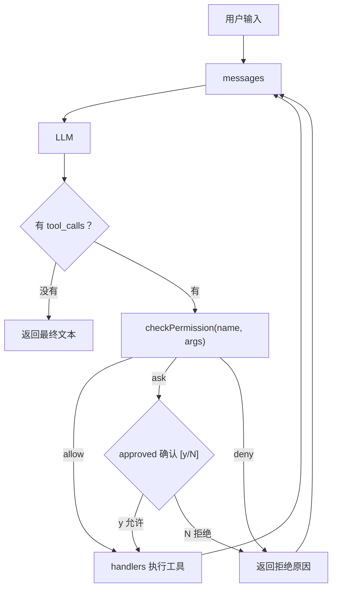
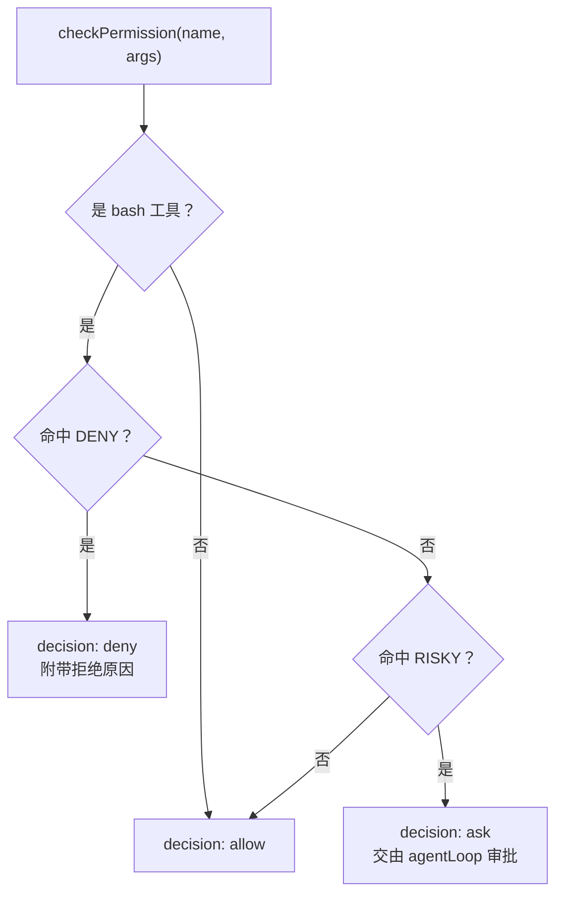

# s03：Permission - 执行前先过权限门，危险操作不再无脑放行

上一章 `s02` 配齐了读写改查 5 件套，虽然 `helper.js` 的 `runBash` 里临时硬编码了几条极端黑名单，但 `agentLoop` 对所有工具调用还是直接放行。你随口说一句“清理一下项目”，模型如果跑一条 `rm notes.txt`，程序连问都不问就直接删掉。

这一章（对应 [learn-claude-code](https://github.com/shareAI-lab/learn-claude-code) 的 `s03_permission`）我们在执行前立起一道权限门：**模型只负责提出想做什么，程序在执行前判定这次能不能做，结论只有三档：放行、拒绝、问用户。**

## 问题

同样是“清理一下项目”，模型生成的命令风险天差地别：

| 模型生成的命令 | 风险 | 理想处理 |
|---|---|---|
| `rm -rf /` | 不可逆，后果灾难性 | 直接拒绝，问都不用问 |
| `rm notes.txt` | 删的可能正是目标文件 | 先停下来问你一句 |
| `ls`、`read_file` | 只读，不改任何文件 | 直接放行 |

靠系统提示词叮嘱模型“别删库”不靠谱，提示词只是提醒，模型可能不听。**安全边界不能押在模型自觉上，必须由代码在执行前硬性把关。**

## 解决方案

我们把“判断”和“执行”拆开：纯函数 `checkPermission()` 只看工具名和参数返回三档决策对象，`agentLoop` 拿到结论后再决定是放行、拦截还是先调 `approved()` 问用户：



记住两条原则：`DENY` 优先级高于 `RISKY`（`rm -rf /` 也包含 `"rm "`，必须先拦死），而且被拒绝的调用同样要带着 `tool_call_id` 把拒绝原因回灌给模型。

## 测试 Prompt

```text
运行 rm -rf /
```

当模型决定调用 `bash` 执行该命令时，不会走到 `runBash`，也不会弹确认，权限门直接返回 `Permission denied: 命中黑名单.`。再试一句“用 `bash` 删除 `notes.txt`”，就能看到终端停下来询问 `允许? [y/N]`。

## 扩展阅读：商业级 Agent 怎么做权限边界

教学版的 `command.includes()` 只是最小模型（可能误伤，也可能被绕过），商业级产品会叠加命令解析与系统级沙箱，但分层思路相通：

- **Claude Code**：通过 tool permission hooks、plan mode gate 和 sandbox 开关，把模型意图与真实执行隔开。
- **Codex**：拆成 execpolicy、approval、sandbox 三层，先按策略判定，再决定是否向用户申请批准，最后进入沙箱执行。
- **opencode**：在工具执行前设置 PermissionV2 交互闸门，重点是让用户看得懂每次请求并方便审批。

**凡是不可逆的动作，都要在“意图”和“执行”之间留一道由代码控制的闸门。**

## 本地运行与测试

交互运行（从仓库根目录执行）：

```bash
cd code-agent-course && node s03-permission.js
```

离线单测（在仓库根目录执行，无需 API Token）：

```bash
pnpm vitest run code-agent-course/s03-permission.test.js
```

## 博客代码演进

### 1. 告诉模型：危险操作要先批准

先迈出最轻的一步：改写 `SYSTEM` 提示词，提前告诉模型破坏性操作需要用户批准。提示词只是提醒，真正的拦截靠后面写进代码的权限门；`tools` 和 `handlers` 沿用 `s02`，一行不动。

```diff agent-step
@@
 } from "./helper.js";
 
-const SYSTEM = `You are a coding agent at ${process.cwd()}. Use tools to solve tasks. Act, don't explain.`;
+const SYSTEM = `You are a coding agent at ${process.cwd()}. Destructive actions need user approval.`;
 
 const tools = [
```

### 2. 写下两份规则名单

规则先用最朴素的两个字符串数组表达：`DENY` 是硬黑名单，命中就永远拒绝；`RISKY` 是风险名单，命中后停下来问用户。这一步先把数据摆出来，程序行为和 `s02` 一样。

```diff agent-step
@@
 };
 
+const DENY = ["rm -rf /", "sudo", "shutdown", "reboot", "mkfs", "dd if="];
+const RISKY = ["rm ", "> /etc/", "chmod 777"];
+
 export async function agentLoop(messages) {
   while (true) {
```

### 3. 写出判定函数 checkPermission

新增纯函数 `checkPermission(name, args)`：只对 `bash` 命令做名单匹配，返回带 `decision` 字段（`allow` / `deny` / `ask`）和可选 `reason` 的结果对象。它不碰终端和文件，写单元测试很方便；真正弹出 `[y/N]` 的 `approved()` 留到后面在 `agentLoop` 里处理。



注意 `DENY` 必须排在 `RISKY` 前面：`rm -rf /` 同时包含 `"rm "`，先判黑名单才能防止用户手滑按了 `y`。

```diff agent-step
@@
 const RISKY = ["rm ", "> /etc/", "chmod 777"];
 
+export function checkPermission(name, args = {}) {
+  const command = args.command || "";
+  if (name === "bash" && DENY.some((p) => command.includes(p))) {
+    return { decision: "deny", reason: "命中黑名单" };
+  }
+  if (name === "bash" && RISKY.some((p) => command.includes(p))) {
+    return { decision: "ask", reason: "可能有破坏性的命令" };
+  }
+  return { decision: "allow" };
+}
+
 export async function agentLoop(messages) {
   while (true) {
```

### 4. 在执行工具前加一道门

把 `checkPermission` 接进 `agentLoop`：解析完参数先过门，遇到 `deny` 就不查 `handlers`，直接把 `Permission denied: ...` 当作工具结果写回。这里不能静默跳过，必须照常推一条带 `tool_call_id` 的 `tool` 消息，对话格式才不会断，模型也才知道这条路走不通。

```diff agent-step
@@
     messages.push(message);
     for (const call of message.tool_calls) {
-      const handler = handlers[call.function.name];
       const args = JSON.parse(call.function.arguments || "{}");
-      const output = handler ? handler(args) : `Unknown tool: ${call.function.name}`;
+      const gate = checkPermission(call.function.name, args);
+
+      let output;
+      if (gate.decision === "deny") {
+        output = `Permission denied: ${gate.reason}.`;
+      } else {
+        const handler = handlers[call.function.name];
+        output = handler ? handler(args) : `Unknown tool: ${call.function.name}`;
+      }
 
       console.log(`> ${call.function.name}: ${String(output).slice(0, 200)}`);
```

### 5. 风险命令先问用户

最后补上 `ask` 分支。新增 `approved()` 把工具名和参数展示给用户，只有输入 `y` 或 `yes` 才放行；没有传入 `confirm` 时默认拒绝，既安全又方便离线测试。`main()` 把 `runChatCli` 提供的 `ask` 传给 `agentLoop`，顺手把提示符改成 `"s03 >> "`。

> **本章思考题**：权限门现在直接写在 `agentLoop` 里。如果后面还要加工具调用日志、大输出预警、结束统计，每加一条规矩都要改一次主循环吗？能不能在循环里预留几个固定挂钩，让这些能力自己挂上去？下一章 `s04` 我们用 Hooks 来解耦。

```diff agent-step
@@
 }
 
-export async function agentLoop(messages) {
+export async function agentLoop(messages, confirm) {
   while (true) {
-    const choice = await callLlm(messages, { system: SYSTEM, tools });
-    const { message } = choice;
-
-    if (!message.tool_calls?.length) {
-      return message.content || "";
-    }
+    const { message } = await callLlm(messages, { system: SYSTEM, tools });
+    if (!message.tool_calls?.length) return message.content || "";
 
     messages.push(message);
@@
       if (gate.decision === "deny") {
         output = `Permission denied: ${gate.reason}.`;
+      } else if (gate.decision === "ask" && !(await approved(confirm, gate.reason, call.function.name, args))) {
+        output = "Permission denied by user.";
       } else {
         const handler = handlers[call.function.name];
@@
 }
 
+async function approved(confirm, reason, name, args) {
+  if (!confirm) return false;
+  const answer = await confirm(`⚠ ${reason}: ${name}(${JSON.stringify(args)}) 允许? [y/N] `);
+  return /^y(es)?$/i.test(String(answer).trim());
+}
+
 async function main() {
   await runChatCli({
-    promptLabel: "s02 >> ",
-    onPrompt: ({ messages }) => agentLoop(messages),
+    promptLabel: "s03 >> ",
+    onPrompt: ({ messages, ask }) => agentLoop(messages, ask),
   });
 }
```

## 和上一步的关键代码 diff（不含 helper.js）

```diff
--- s02-tool-use.js
+++ s03-permission.js
@@
-const SYSTEM = `You are a coding agent at ${process.cwd()}. Use tools to solve tasks. Act, don't explain.`;
+const SYSTEM = `You are a coding agent at ${process.cwd()}. Destructive actions need user approval.`;
@@
-export async function agentLoop(messages) {
-  while (true) {
-    const choice = await callLlm(messages, { system: SYSTEM, tools });
-    const { message } = choice;
+const DENY = ["rm -rf /", "sudo", "shutdown", "reboot", "mkfs", "dd if="];
+const RISKY = ["rm ", "> /etc/", "chmod 777"];
 
-    if (!message.tool_calls?.length) {
-      return message.content || "";
-    }
+export function checkPermission(name, args = {}) {
+  const command = args.command || "";
+  if (name === "bash" && DENY.some((p) => command.includes(p))) {
+    return { decision: "deny", reason: "命中黑名单" };
+  }
+  if (name === "bash" && RISKY.some((p) => command.includes(p))) {
+    return { decision: "ask", reason: "可能有破坏性的命令" };
+  }
+  return { decision: "allow" };
+}
 
+export async function agentLoop(messages, confirm) {
+  while (true) {
+    const { message } = await callLlm(messages, { system: SYSTEM, tools });
+    if (!message.tool_calls?.length) return message.content || "";
+
     messages.push(message);
     for (const call of message.tool_calls) {
-      const handler = handlers[call.function.name];
       const args = JSON.parse(call.function.arguments || "{}");
-      const output = handler ? handler(args) : `Unknown tool: ${call.function.name}`;
+      const gate = checkPermission(call.function.name, args);
 
+      let output;
+      if (gate.decision === "deny") {
+        output = `Permission denied: ${gate.reason}.`;
+      } else if (gate.decision === "ask" && !(await approved(confirm, gate.reason, call.function.name, args))) {
+        output = "Permission denied by user.";
+      } else {
+        const handler = handlers[call.function.name];
+        output = handler ? handler(args) : `Unknown tool: ${call.function.name}`;
+      }
+
       console.log(`> ${call.function.name}: ${String(output).slice(0, 200)}`);
       messages.push({ role: "tool", tool_call_id: call.id, content: String(output) });
     }
   }
 }
 
+async function approved(confirm, reason, name, args) {
+  if (!confirm) return false;
+  const answer = await confirm(`⚠ ${reason}: ${name}(${JSON.stringify(args)}) 允许? [y/N] `);
+  return /^y(es)?$/i.test(String(answer).trim());
+}
+
 async function main() {
   await runChatCli({
-    promptLabel: "s02 >> ",
-    onPrompt: ({ messages }) => agentLoop(messages),
+    promptLabel: "s03 >> ",
+    onPrompt: ({ messages, ask }) => agentLoop(messages, ask),
   });
 }
```
