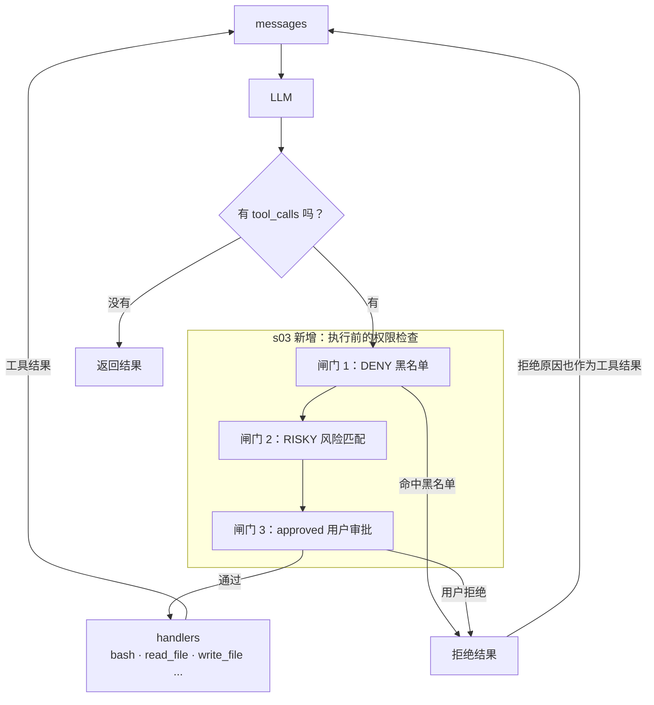
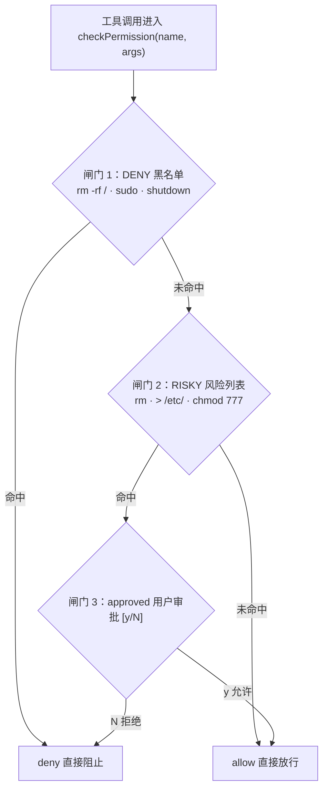

# s03：Permission - 执行前先过权限门，危险操作不再无脑放行

接着上一章 `s02` 的思考题往下走：配齐读写改查五件套之后，这位远程实习生干活利索多了，但 `agentLoop` 对模型的每一次工具调用都是拿来就执行。你随口说一句“清理一下项目”，模型理解偏了，调起 `bash` 跑一条 `rm -rf /`，程序也会老老实实交给 shell。

公司给新人开权限，从来不是“信任就全给，不信任就全收”，而是分级：看文档随便看，删库要审批，改生产配置直接不行。这正是 `s03`（对应 [shareAI-lab/learn-claude-code](https://github.com/shareAI-lab/learn-claude-code) 的 `s03_permission`）要练的内力：**模型只负责提出想做什么，程序在执行前判断这次能不能做；判断结果只有三档：放行、拒绝、问用户。**

## 问题

`s02` 之后，Agent 有了 5 个工具，能力越强，闯祸的半径也越大。同样是“清理一下项目”，模型可能生成两种完全不同的命令：

| 模型生成的命令 | 风险 | 理想处理 |
|---|---|---|
| `rm -rf /` | 不可逆，后果灾难性 | 直接拒绝，问都不用问 |
| `rm notes.txt` | 删的可能正是你要删的 | 先停下来问你一句 |
| `ls`、`read_file` | 只读，不改任何东西 | 直接放行 |

现在的 `s02` 分不清这三种情况。你可能会想，在系统提示词里写一句“不要执行危险命令”不就行了？提示词只是提醒，模型可能听也可能不听；**安全边界不能押在模型自觉上，必须由代码在执行前把关。**

## 本章目标

在 `s02` 多工具循环的基础上，给每一次工具执行前加一道权限门：新增纯函数 `checkPermission()` 返回 `allow / deny / ask` 三档结论，新增 `approved()` 在 `ask` 时向用户确认，主循环的查表分发结构保持不变。

## 解决方案

我更推荐把“判断”和“执行”拆开：`checkPermission()` 只看工具名和参数给结论，不执行命令、不读写文件、不问用户；`agentLoop` 拿到结论后再决定是执行 handler、直接拒绝，还是先问用户。



三档结论分别对应三种处理：

| 决策 | 含义 | 例子 |
|---|---|---|
| `allow` | 直接放行 | `read_file`、`glob`、普通命令 |
| `deny` | 永远拒绝 | `rm -rf /`、`sudo`、`shutdown` |
| `ask` | 先问用户 | `rm notes.txt`、`chmod 777` |

这里的目标不是做一个完美的安全沙箱，而是在 Agent 运行时里立住一条关键边界：**模型可以提出行动意图，但执行前必须经过系统判断。**

## 流程图

```text
LLM 返回 tool_calls
      |
      v
JSON.parse(arguments)
      |
      v
checkPermission(name, args)
      |
      +-- deny  -> "Permission denied: ..."（不执行）
      |
      +-- ask   -> approved() 问用户 [y/N]
      |              +-- y -> 执行 handler
      |              +-- N -> "Permission denied by user."
      |
      +-- allow -> 执行 handler
      |
      v
不管执行还是拒绝，结果都作为 tool 消息回灌 messages
```

## 新增能力

- **硬黑名单 `DENY`**：`rm -rf /`、`sudo`、`shutdown` 这类命令永远拒绝，后面的确认流程也绕不过去。
- **风险名单 `RISKY`**：`rm `、`chmod 777`、写 `/etc/` 这类命令不直接拒绝，而是暂停下来交给用户拍板。
- **拒绝也回灌**：被拦下的调用同样带着 `tool_call_id` 返回一条 `tool` 消息，模型知道这条路走不通，会换方案或者如实告诉你做不了。

## 新增函数速览

- `checkPermission(name, args)`：本章的权限门，按工具名和参数返回 `allow`、`ask` 或 `deny`，是一个可以单独测试的纯函数。
- `approved(confirm, reason, name, args)`：结论是 `ask` 时，把工具名和参数展示给用户，只有回答 `y` 或 `yes` 才算同意；没有传入 `confirm` 时一律当作拒绝。
- `agentLoop(messages, confirm)`：在 `s02` 循环的基础上多了一个 `confirm` 参数，执行 handler 之前先过 `checkPermission()`。

## 工作原理

### 1. 权限判断写成纯函数

规则先用最朴素的办法表达：两个字符串数组，加一个只看输入给结论的函数。

```js
const DENY = ["rm -rf /", "sudo", "shutdown", "reboot", "mkfs", "dd if="];
const RISKY = ["rm ", "> /etc/", "chmod 777"];

export function checkPermission(name, args = {}) {
  const command = args.command || "";
  if (name === "bash" && DENY.some((p) => command.includes(p))) {
    return { decision: "deny", reason: "命中黑名单" };
  }
  if (name === "bash" && RISKY.some((p) => command.includes(p))) {
    return { decision: "ask", reason: "可能有破坏性的命令" };
  }
  return { decision: "allow" };
}
```

注意两个 `if` 的顺序：`rm -rf /` 同时包含 `"rm "`，也会命中风险名单，但黑名单先判断，所以它直接被拒绝，不会落到“问用户”那一档。**硬拒绝的优先级必须最高**，否则用户手一抖按了 `y`，灾难命令照样会执行。

### 2. 把权限门插在 handler 之前

`s03` 的循环和 `s02` 几乎一样，只是在查表执行之前先拿一次结论：

```js
const gate = checkPermission(call.function.name, args);
let output;
if (gate.decision === "deny") {
  output = `Permission denied: ${gate.reason}.`;
} else if (gate.decision === "ask" && !(await approved(confirm, gate.reason, call.function.name, args))) {
  output = "Permission denied by user.";
} else {
  const handler = handlers[call.function.name];
  output = handler ? handler(args) : `Unknown tool: ${call.function.name}`;
}
```

顺序是这条链路的关键：先解析参数，再过权限门，只有放行才执行 handler；不管执行还是拒绝，`output` 最后都作为 `tool` 消息回灌。

### 3. 为什么拒绝也要回灌

模型发起了一次工具调用，就在等这次调用的结果。OpenAI 兼容接口要求每个 `tool_call_id` 都有对应的 `tool` 消息，如果程序被拒绝后静默跳过，下一次请求的消息格式就断了；即使接口不报错，模型也不知道刚才发生了什么，很可能原样再试一次。

```js
messages.push({
  role: "tool",
  tool_call_id: call.id,
  content: "Permission denied by user.",
});
```

模型看到这条结果，下一轮就会换一个方案，或者直接告诉你这件事做不了。

### 4. 用户确认从哪里来

`ask` 这一档需要在命令行里再问用户一次。[helper.js](./helper.js) 里的 `runChatCli` 会把同一个 readline 的提问能力作为 `ask` 传给 `onPrompt`，`s03` 接住它，再作为 `confirm` 传给 `agentLoop`：

```js
await runChatCli({
  promptLabel: "s03 >> ",
  onPrompt: ({ messages, ask }) => agentLoop(messages, ask),
});
```

这样风险命令就能暂停，等你输入 `y/N`。测试里则可以传一个假的 `confirm`，不用真的敲键盘。

## 参考实现提醒

在拆开看具体源码前，有三个边界值得你提前记住：

- **硬拒绝优先级最高**：黑名单必须先于风险名单判断，命中后不能被后面的确认流程绕过。
- **`ask` 不是失败**：它是把风险决策交还给用户，同意了就照常执行。
- **字符串匹配只是最小模型**：`command.includes()` 会误伤（`rm -rf /tmp/x` 也包含 `rm -rf /`），也能被绕过（`bash -c "s""udo ..."`）。教学版先用它把“执行前判断”这条边界立起来，真实产品会叠加命令解析、白名单和系统级沙箱。

## 相对 s02 的变更

| 组件 | s02 | s03 |
|---|---|---|
| 工具执行 | 查到 handler 就执行 | 执行前先过权限门 |
| 新函数 | 无 | `checkPermission`、`approved` |
| 决策 | 信任模型 | `allow / deny / ask` 三档 |
| `agentLoop` 参数 | `messages` | `messages, confirm` |

## 试一下

```bash
cd code-agent-course
node s03-permission.js
```

先输入“删除 notes.txt”。如果模型调用 `rm notes.txt`，终端会停下来问你 `允许? [y/N]`；直接回车或输入 `n`，模型会收到 `Permission denied by user.`。再输入“运行 rm -rf /”，这条命令会被直接拒绝，根本不会问你。

## 测试 Prompt

```text
运行 rm -rf /
```

观察重点：危险命令在执行前就被权限门拒绝，终端不会弹出确认，模型收到 `Permission denied: 命中黑名单.` 后会告诉你它做不了。

## 测试

本章测试覆盖三件事：`checkPermission` 能返回三档结果；硬黑名单命令不会执行；风险命令只有用户同意后才执行。

```bash
pnpm vitest run code-agent-course/s03-permission.test.js
```

## 接下来

权限门已经立起来了，但它是直接写在 `agentLoop` 里的。如果接下来还想加执行日志、输出检查、收工统计，每次都继续往循环里塞代码，主循环很快又会变胖。`s04` 会把这些扩展逻辑挂到生命周期的固定节点上，而不是写进循环里。

## 扩展阅读：商业级 Agent 怎么做权限边界

权限系统的核心不是“拦几个危险字符串”，而是把模型意图和真实动作隔开：

- **Claude Code**：公开资料和源码快照里能看到 toolPermission hooks、plan mode gate、sandbox toggle 和权限 UI。模型想执行动作，必须先经过权限层。
- **Codex**：架构里有 execpolicy、approval 和 sandbox 三层。execpolicy 先做最严格的规则决策，再决定是否请求用户批准，最后才进入系统级沙箱执行。
- **opencode**：公开架构里有 PermissionV2 UX gate，把权限体验放在工具执行前，重点是让用户看得懂、批得了。

本章的黑名单和确认框只是最小模型，但内力是相通的：**凡是不可逆的动作，都要在“意图”和“执行”之间留一道由代码控制的闸门。** 这条思路放到日常业务里同样成立，比如后台的批量删除、资金操作，也都是“前端提出请求，服务端按规则和审批决定是否执行”。

## 博客代码演进

下面 5 个 patch 专门用于博客右侧的代码切换。第一步基于 `s02-tool-use.js`，后面的每一步都继续修改上一帧，最后必须得到完整的 `s03-permission.js`。

每一步的代码都可以运行。前三步只是准备规则和判定函数，行为和 s02 一样；第 4 步开始真正拦截黑名单命令；第 5 步再补上“问用户”这条路。

### 1. 告诉模型：危险操作要先批准

我们先从最轻的一步开始：改系统提示词，在里面加一句“破坏性操作需要用户批准”，让模型提前知道有这条规矩。不过提示词只是提醒，模型不一定听，真正的保证要靠后面写进代码的权限门。工具列表和 `handlers` 分发表沿用 `s02`，一行不动。

```diff agent-step
@@
 } from "./helper.js";
 
-const SYSTEM = `You are a coding agent at ${process.cwd()}. Use tools to solve tasks. Act, don't explain.`;
+const SYSTEM = `You are a coding agent at ${process.cwd()}. Destructive actions need user approval.`;
 
 const tools = [
```

### 2. 写下两份规则名单

规则先用最朴素的办法表达：两个字符串数组。`DENY` 是硬黑名单，命中就永远拒绝，比如 `sudo`、`rm -rf /`；`RISKY` 是风险名单，命中后不直接拒绝，而是停下来问用户。这一步只是把数据摆出来，还没有任何地方用到它们，程序行为和 `s02` 完全一样。

```diff agent-step
@@
 };
 
+const DENY = ["rm -rf /", "sudo", "shutdown", "reboot", "mkfs", "dd if="];
+const RISKY = ["rm ", "> /etc/", "chmod 777"];
+
 export async function agentLoop(messages) {
   while (true) {
```

### 3. 写出判定函数 checkPermission

接着写判定函数 `checkPermission`：接收工具名和参数，返回 `allow`（放行）、`deny`（拒绝）、`ask`（问用户）三者之一。它是一个纯函数，不执行命令、不读写文件、不打印，只看输入给结论，所以很容易单独测试。注意黑名单写在风险名单前面：`rm -rf /` 也包含 `"rm "`，先判黑名单才能保证它被直接拒绝。目前只检查 `bash` 命令，其他工具一律放行。

```diff agent-step
@@
 const RISKY = ["rm ", "> /etc/", "chmod 777"];
 
+export function checkPermission(name, args = {}) {
+  const command = args.command || "";
+  if (name === "bash" && DENY.some((p) => command.includes(p))) {
+    return { decision: "deny", reason: "命中黑名单" };
+  }
+  if (name === "bash" && RISKY.some((p) => command.includes(p))) {
+    return { decision: "ask", reason: "可能有破坏性的命令" };
+  }
+  return { decision: "allow" };
+}
+
 export async function agentLoop(messages) {
   while (true) {
```

### 4. 在执行工具前加一道门

现在把判定函数接进循环：解析完参数后先调用 `checkPermission`，结论是 `deny` 就不执行工具，直接把 `Permission denied: ...` 当作工具结果交还给模型。模型看到这句话，会换一种做法或者告诉你做不了。被拒绝时同样要回一条带 `tool_call_id` 的 `tool` 消息，否则对话格式就断了。这一步之后，黑名单命令已经真的执行不了。

```diff agent-step
@@
     messages.push(message);
     for (const call of message.tool_calls) {
-      const handler = handlers[call.function.name];
       const args = JSON.parse(call.function.arguments || "{}");
-      const output = handler ? handler(args) : `Unknown tool: ${call.function.name}`;
+      const gate = checkPermission(call.function.name, args);
+
+      let output;
+      if (gate.decision === "deny") {
+        output = `Permission denied: ${gate.reason}.`;
+      } else {
+        const handler = handlers[call.function.name];
+        output = handler ? handler(args) : `Unknown tool: ${call.function.name}`;
+      }
 
       console.log(`> ${call.function.name}: ${String(output).slice(0, 200)}`);
```

### 5. 风险命令先问用户

最后补上 `ask` 这条路。新增 `approved`：用 `confirm` 把工具名和参数展示给用户并等待输入，只有回答 `y` 或 `yes` 才算同意；没有传入 `confirm` 时一律当作拒绝，宁可保守。`agentLoop` 多了一个 `confirm` 参数，由 `runChatCli` 提供的 `ask` 传进来；循环开头顺手用解构写短了一些，逻辑和原来相同。现在点击运行，输入“删除 notes.txt”，你会看到终端停下来问你 `允许? [y/N]`。

> **本章思考题**：权限门是直接写在 `agentLoop` 里的。如果接下来还想在每次工具执行前打一条审计日志、执行后检查输出有没有泄露密钥、模型收工时统计这一轮调用了几次工具，难道每加一条规矩都要再改一次主循环吗？能不能在循环里预留几个固定的“挂钩”，让权限判断、日志、统计都挂上去，而主循环自己只管调度？这就是下一章 `s04`（Hooks）要解决的问题。

```diff agent-step
@@
 }
 
-export async function agentLoop(messages) {
+export async function agentLoop(messages, confirm) {
   while (true) {
-    const choice = await callLlm(messages, { system: SYSTEM, tools });
-    const { message } = choice;
-
-    if (!message.tool_calls?.length) {
-      return message.content || "";
-    }
+    const { message } = await callLlm(messages, { system: SYSTEM, tools });
+    if (!message.tool_calls?.length) return message.content || "";
 
     messages.push(message);
@@
       if (gate.decision === "deny") {
         output = `Permission denied: ${gate.reason}.`;
+      } else if (gate.decision === "ask" && !(await approved(confirm, gate.reason, call.function.name, args))) {
+        output = "Permission denied by user.";
       } else {
         const handler = handlers[call.function.name];
@@
 }
 
+async function approved(confirm, reason, name, args) {
+  if (!confirm) return false;
+  const answer = await confirm(`⚠ ${reason}: ${name}(${JSON.stringify(args)}) 允许? [y/N] `);
+  return /^y(es)?$/i.test(String(answer).trim());
+}
+
 async function main() {
   await runChatCli({
-    promptLabel: "s02 >> ",
-    onPrompt: ({ messages }) => agentLoop(messages),
+    promptLabel: "s03 >> ",
+    onPrompt: ({ messages, ask }) => agentLoop(messages, ask),
   });
 }
```

## 和上一步的关键代码 diff（不含 helper.js）

下面只对比当前步骤文件和上一步步骤文件：`s03-permission.js` 相对 `s02-tool-use.js` 的变化。

这里展示的是最能说明本章新增机制的关键变化；完整差异以相邻 JS 文件为准。

```diff
--- s02-tool-use.js
+++ s03-permission.js
   isMainModule,
 } from "./helper.js";

-// s02：把工具从“写死在 loop 里”改成“挂进分发表”——新增工具不改 loop 的形状。
-// s02: move tools out of the loop into a dispatch table — adding a tool never reshapes the loop.
+// s03：在 s02（多工具）基础上，给工具执行加一道权限门。
+// s03: add a permission gate before tool execution, on top of s02 (multi-tool).
+// 模型负责“想做什么”，权限门负责“这次能不能做”。
+// The model decides what to attempt; the gate decides whether it's allowed this time.

-const SYSTEM = `You are a coding agent at ${process.cwd()}. Use tools to solve tasks. Act, don't explain.`;
+const SYSTEM = `You are a coding agent at ${process.cwd()}. Destructive actions need user approval.`;

-// tools：给模型看的工具描述（schema）。
-// tools: the tool schemas shown to the model.
+// 工具和分发表与 s02 完全一样（沿用上一步）。
+// Tools and dispatch table are identical to s02 (carried over).
 const tools = [
   tool("bash", "Run a shell command.", {
     type: "object",
   glob: ({ pattern }) => glob(pattern),
 };

-// agent loop：和 s01 几乎一样，唯一区别是工具执行改成查 handlers 表。
-// The agent loop: almost identical to s01; only tool execution now looks up the handlers table.
-export async function agentLoop(messages) {
-  while (true) {
-    const choice = await callLlm(messages, { system: SYSTEM, tools });
-    const { message } = choice;
+const DENY = ["rm -rf /", "sudo", "shutdown", "reboot", "mkfs", "dd if="];
+const RISKY = ["rm ", "> /etc/", "chmod 777"];

-    if (!message.tool_calls?.length) {
-      return message.content || "";
-    }
+export function checkPermission(name, args = {}) {
+  const command = args.command || "";
+  if (name === "bash" && DENY.some((p) => command.includes(p))) {
+    return { decision: "deny", reason: "命中黑名单" };
+  }
+  if (name === "bash" && RISKY.some((p) => command.includes(p))) {
+    return { decision: "ask", reason: "可能有破坏性的命令" };
+  }
+  return { decision: "allow" };
+}
+
+export async function agentLoop(messages, confirm) {
+  while (true) {
+    const { message } = await callLlm(messages, { system: SYSTEM, tools });
+    if (!message.tool_calls?.length) return message.content || "";

     messages.push(message);
     for (const call of message.tool_calls) {
-      const handler = handlers[call.function.name];
       const args = JSON.parse(call.function.arguments || "{}");
-      const output = handler ? handler(args) : `Unknown tool: ${call.function.name}`;
+      const gate = checkPermission(call.function.name, args); // ← s03 新增的一道门

+      let output;
+      if (gate.decision === "deny") {
+        output = `Permission denied: ${gate.reason}.`;
+      } else if (gate.decision === "ask" && !(await approved(confirm, gate.reason, call.function.name, args))) {
+        output = "Permission denied by user.";
+      } else {
+        const handler = handlers[call.function.name];
+        output = handler ? handler(args) : `Unknown tool: ${call.function.name}`;
+      }
+
       console.log(`> ${call.function.name}: ${String(output).slice(0, 200)}`);
       messages.push({ role: "tool", tool_call_id: call.id, content: String(output) });
     }
   }
 }

+async function approved(confirm, reason, name, args) {
+  if (!confirm) return false;
+  const answer = await confirm(`⚠ ${reason}: ${name}(${JSON.stringify(args)}) 允许? [y/N] `);
+  return /^y(es)?$/i.test(String(answer).trim());
+}
+
 async function main() {
   await runChatCli({
-    promptLabel: "s02 >> ",
-    onPrompt: ({ messages }) => agentLoop(messages),
+    promptLabel: "s03 >> ",
+    onPrompt: ({ messages, ask }) => agentLoop(messages, ask),
   });
 }
```
