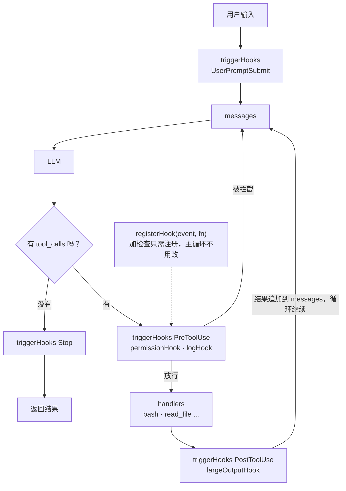

# s04：Hooks —— 挂在循环上，不写进循环里

新人开始承担更多流程：干活前要打卡，干活后要记录，收工前要总结。如果每条规矩都写进他的主工作步骤里，流程会乱成一团；`s04` 就是给工作流预留挂钩，让这些规矩挂在固定节点上。

参考：[shareAI-lab/learn-claude-code](https://github.com/shareAI-lab/learn-claude-code) 中的 `s04_hooks`。

参考教程的核心是：**扩展逻辑应该挂在 hook 上，而不是不断写进 agent loop。**

我们的 JS 版延续这个思路：保留 `s03` 的权限能力，但把权限判断变成 `PreToolUse` hook。


## 问题

`s03` 已经能在工具执行前做权限判断。

但如果后面继续加机制，比如：

- 记录每次工具调用
- 工具执行后检查输出大小
- 用户输入后注入上下文
- agent 结束时做统计
- 后续章节里的 todo、skill、memory、compact

如果这些都写进 `agentLoop()`，主循环很快会变成这样：

```text
调模型
权限判断
日志
输出检查
统计
记忆
压缩
更多 if/else
```

循环会越来越难读。

所以 `s04` 要做的事是：**给主循环留插口。**

## 解决方案

定义一组生命周期事件，然后允许外部注册回调。


Python 原版源码里的完整结构图是这样：

```text
User types query
     |
     v
+------------------+
| UserPromptSubmit | -- triggerHooks() before LLM
+--------+---------+
         |
         v
+----------+     +-----------------------------+
| messages | --> | LLM (has tool_calls?)       |
+----------+     | No  --> Stop hooks --> exit |
                 | Yes --> tool call --------+ |
                 +---------------------------+-+
                                             |
                                             v
                                   +------------------+
                                   | triggerHooks()   |
                                   | PreToolUse:      |
                                   |  permissionHook  |
                                   |  logHook         |
                                   +--------+---------+
                                            |
                                            | not blocked
                                            v
                                   +------------------+
                                   | handlers[name]   |
                                   +--------+---------+
                                            |
                                            v
                                   +------------------+
                                   | triggerHooks()   |
                                   | PostToolUse:     |
                                   |  largeOutputHook |
                                   +--------+---------+
                                            |
                                            v
                                   results back to messages
                                            |
                                            +----> loop continues
```

主循环只负责在关键时刻触发 hook：

```text
triggerHooks("PreToolUse", ...)
triggerHooks("PostToolUse", ...)
triggerHooks("Stop", ...)
```

具体要做什么，交给注册进去的 callback。

## 四个生命周期点

| 事件 | 触发时机 | 典型用途 |
|---|---|---|
| `UserPromptSubmit` | 用户输入后、进入 agent 前 | 输入日志、上下文注入 |
| `PreToolUse` | 工具执行前 | 权限检查、工具日志、拦截 |
| `PostToolUse` | 工具执行后 | 输出检查、统计、副作用 |
| `Stop` | agent 准备结束时 | 收尾统计、最后检查、强制续跑 |

这四个点覆盖了一次 agent cycle 的主干。

教程版只讲这四个，因为它们已经足够表达 hook 的本质。

## 新增函数速览

- `registerHook(event, callback)`：把一个回调挂到指定生命周期事件上。
- `triggerHooks(event, ...args)`：按顺序执行某个事件上的 hook；如果 hook 返回结果，就可以拦截或改写流程。
- `permissionHook(name, args, confirm)`：把 s03 的权限判断搬进 `PreToolUse` 生命周期。
- `logHook()` / `largeOutputHook()` / `summaryHook()` / `contextHook()`：分别演示日志、输出检查、结束统计和用户输入前处理。

## 工作原理

### hook 注册表

```js
const hooks = { UserPromptSubmit: [], PreToolUse: [], PostToolUse: [], Stop: [] };
```

它是一张表：

```text
事件名 -> 回调数组
```

### 注册 hook

```js
function registerHook(event, callback) {
  hooks[event].push(callback);
}
```

比如把权限逻辑挂到工具执行前：

```js
registerHook("PreToolUse", permissionHook);
```

### 触发 hook

```js
async function triggerHooks(event, ...args) {
  for (const callback of hooks[event]) {
    const result = await callback(...args);
    if (result != null) return result;
  }
  return null;
}
```

这里约定：

| 返回值 | 含义 |
|---|---|
| `null` | 没有拦截，继续 |
| 非空值 | 提前停止这组 hook，并把结果交给主循环 |

对 `PreToolUse` 来说，非空值就是“拦截这次工具调用”。

## 权限门搬到 PreToolUse

`s03` 的权限判断没有消失，只是从 loop 里搬出来：

```js
async function permissionHook(name, args, confirm) {
  if (name !== "bash") return null;

  const command = args.command || "";
  if (DENY.some((p) => command.includes(p))) {
    return "Permission denied: 命中黑名单。";
  }

  if (RISKY.some((p) => command.includes(p))) {
    const answer = confirm ? await confirm(`⚠ 可能有破坏性的命令: ${command} 允许? [y/N] `) : "";
    if (!/^y(es)?$/i.test(String(answer).trim())) {
      return "Permission denied by user.";
    }
  }

  return null;
}
```

然后注册：

```js
registerHook("PreToolUse", permissionHook);
```

这让 loop 不再关心权限细节，只关心“工具执行前先触发 PreToolUse”。

## loop 里的变化

`s03` 是直接调用权限函数。

`s04` 改成触发 hook：

```js
const blocked = await triggerHooks("PreToolUse", name, args, confirm);
let output;

if (blocked != null) {
  output = String(blocked);
} else {
  const handler = handlers[name];
  output = handler ? handler(args) : `Unknown tool: ${name}`;
  await triggerHooks("PostToolUse", name, output);
}

messages.push({ role: "tool", tool_call_id: call.id, content: String(output) });
```

现在主循环只知道五件事：

1. 工具执行前触发 `PreToolUse`。
2. 如果被 hook 拦截，就回灌拦截结果。
3. 如果没被拦截，就执行 handler。
4. 工具执行后触发 `PostToolUse`。
5. 最后把结果回灌给模型。

权限、日志、输出检查都长在 loop 周围，而不是塞进 loop 里面。

## 对应代码

- 主文件：[s04-hooks.js](./s04-hooks.js)
- 测试文件：[s04-hooks.test.js](./s04-hooks.test.js)

本章核心代码在 `hooks`、`registerHook`、`triggerHooks`，以及 `PreToolUse` / `PostToolUse` / `Stop` 的触发点。

## 这一节挂了哪些 hook

| hook | 事件 | 作用 |
|---|---|---|
| `contextHook` | `UserPromptSubmit` | 打印当前工作目录 |
| `permissionHook` | `PreToolUse` | 执行前权限检查 |
| `logHook` | `PreToolUse` | 记录工具名 |
| `largeOutputHook` | `PostToolUse` | 输出太大时提醒 |
| `summaryHook` | `Stop` | 结束时统计工具调用次数 |

这些 hook 都很小，目的是让生命周期点变得可见。

## Stop hook

当模型不再返回 `tool_calls`，agent 准备结束。

这时会触发：

```js
const force = await triggerHooks("Stop", messages);
if (force != null) {
  messages.push({ role: "user", content: String(force) });
  continue;
}
return message.content || "";
```

现在的 `summaryHook` 只打印统计，返回 `null`。

但这个入口很有用：未来如果某个 Stop hook 认为“还不能结束”，可以返回一段文本，让 agent 再跑一轮。

## 相对 s03 的变更

| 组件 | s03 | s04 |
|---|---|---|
| 权限逻辑 | 写在 loop 前后 | 挂到 `PreToolUse` |
| 扩展方式 | 继续改 loop | `registerHook` |
| 新函数 | 无 | `registerHook`、`triggerHooks` |
| 生命周期 | 隐含在代码里 | 明确成四个事件 |
| Stop 阶段 | 直接返回 | 先触发 `Stop` hook |

## 试一下

```bash
node code-agent-course/s04-hooks.js
```

可以输入：

```text
读取 package.json，告诉我项目名字
```

你会看到类似日志：

```text
[hook] UserPromptSubmit -> cwd ...
[hook] PreToolUse -> read_file
[hook] Stop -> 本轮用了 1 次工具
```

也可以输入：

```text
删除 notes.txt
```

权限确认仍然会出现，只是这次它来自 `PreToolUse` hook。

观察重点：权限被拒时，是 hook 拦截的，而不是 loop 里硬编码的分支。

## 测试

测试覆盖三件事：

- `permissionHook` 能返回“拦截”或“放行”。
- `PreToolUse` hook 能拦住危险命令。
- `PostToolUse` hook 会在工具执行后触发。

```bash
pnpm test
```

## 接下来

现在主循环有了 hook 插口。

下一步就可以把新的 agent 能力挂到这些插口上，而不用每次重写 loop。

例如参考教程后面的 TodoWrite：复杂任务开始前，agent 需要先列计划，再执行。

## 一句话总结

`s04` 让扩展逻辑从“写进循环”变成“挂在循环上”：**主循环保持稳定，权限、日志、统计等能力围绕生命周期 hook 生长。**

## 参考实现提醒

Hook 的价值不是“多一层回调”，而是把扩展点固定下来：

- `PreToolUse` 可以拦截工具，但不能绕过更高优先级的安全规则。
- `PostToolUse` 适合做日志、输出检查、统计，不应该改变已经发生的工具动作。
- `Stop` 是收尾点，不是随便结束；真实系统里常用它做总结、记忆写入或强制续跑判断。

## 测试 Prompt

```text
尝试删除 notes.txt，然后告诉我这次操作有没有被拦截。
```

观察重点：拦截逻辑应该来自 `PreToolUse` hook，工具执行后还会经过 `PostToolUse` hook。

## 扩展阅读：商业级 Agent 怎么做 Hook

Hook 的价值是让系统围绕主循环生长，而不是把主循环改成一坨判断：

- Claude Code：公开 hooks 里有 `PreToolUse`、`PostToolUse`、`Stop`、`PreCompact`、`PostCompact` 等生命周期点。权限、日志、压缩前后处理都可以挂在事件上。
- Codex：更偏把可拦截点放在执行策略、审批、沙箱和工具事件周围；核心思想一样：动作进入系统前后要能被策略层接管。
- opencode：Plugin Hooks 是工具运行时的一部分，应用工具和插件可以接入 session runner，而不是改 runner 本体。

本章把权限门搬进 `PreToolUse`，就是商业 agent 的基本设计方向：核心 loop 保持稳定，扩展点挂在生命周期上。


## 博客代码演进

下面 7 个 patch 专门用于博客右侧的代码切换。第一步基于 `s03-permission.js`，后面的每一步都继续修改上一帧，最后必须得到完整的 `s04-hooks.js`。

每一步的代码都可以运行。前两步先搭好 hook 的登记和触发机制，并把权限判断改写成一个 hook；第 3 步让 loop 改为触发 hook；后面四步每次只挂一个新 hook，对应一个生命周期事件。

### 1. 搭好 hook 的登记表和触发函数

hook 系统只有三样东西。`hooks` 是一张表，四个事件名各对应一个回调数组。`registerHook` 往某个事件里加一个回调。`triggerHooks` 按顺序执行某个事件的所有回调，只要有一个返回了非空值，就立刻停下并把这个值交回去，后面会用它来拦截工具。系统提示词改回 s02 的写法，因为权限说明不再靠提示词。这一步还没有任何地方调用它们，程序行为不变。

```diff agent-step
@@
 } from "./helper.js";
 
-const SYSTEM = `You are a coding agent at ${process.cwd()}. Destructive actions need user approval.`;
+const SYSTEM = `You are a coding agent at ${process.cwd()}. Use tools to solve tasks. Act, don't explain.`;
 
 const tools = [
@@
   glob: ({ pattern }) => glob(pattern),
 };
+
+const hooks = { UserPromptSubmit: [], PreToolUse: [], PostToolUse: [], Stop: [] };
+
+function registerHook(event, callback) {
+  hooks[event].push(callback);
+}
+
+async function triggerHooks(event, ...args) {
+  for (const callback of hooks[event]) {
+    const result = await callback(...args);
+    if (result != null) return result;
+  }
+  return null;
+}
 
 const DENY = ["rm -rf /", "sudo", "shutdown", "reboot", "mkfs", "dd if="];
```

### 2. 把权限判断改写成一个 hook

s03 的 `checkPermission` 返回 allow / deny / ask，再由 loop 决定怎么处理。现在把整件事装进 `permissionHook`：不是 bash 就放行；命中黑名单返回一句拒绝的话；命中风险名单就问用户，不同意也返回一句拒绝的话；其他情况返回 `null`。约定很简单：返回字符串表示拦截，返回 `null` 表示不管。写好后用 `registerHook` 挂到 `PreToolUse` 上。旧的 `checkPermission` 暂时还留着，loop 也还在用它。

```diff agent-step
@@
 const RISKY = ["rm ", "> /etc/", "chmod 777"];
 
+async function permissionHook(name, args, confirm) {
+  if (name !== "bash") return null;
+  const command = args.command || "";
+  if (DENY.some((p) => command.includes(p))) return "Permission denied: 命中黑名单。";
+  if (RISKY.some((p) => command.includes(p))) {
+    const answer = confirm ? await confirm(`⚠ 可能有破坏性的命令: ${command} 允许? [y/N] `) : "";
+    if (!/^y(es)?$/i.test(String(answer).trim())) return "Permission denied by user.";
+  }
+  return null;
+}
+
+registerHook("PreToolUse", permissionHook);
+
 export function checkPermission(name, args = {}) {
   const command = args.command || "";
@@
   });
 }
+
+export { registerHook, triggerHooks, permissionHook };
 
 if (isMainModule(import.meta.url)) {
```

### 3. loop 改为触发 PreToolUse

现在让 loop 用上 hook。执行工具前调用 `triggerHooks("PreToolUse", ...)`，如果有 hook 返回了内容，就把它当作工具结果交还给模型，不再执行工具。原来写在 loop 里的三种权限分支缩成一个 `if`，`checkPermission` 和 `approved` 也可以整个删掉了。loop 从此不知道“权限”这个词，它只知道“执行前问一下 hook”。

```diff agent-step
@@
 registerHook("PreToolUse", permissionHook);
 
-export function checkPermission(name, args = {}) {
-  const command = args.command || "";
-  if (name === "bash" && DENY.some((p) => command.includes(p))) {
-    return { decision: "deny", reason: "命中黑名单" };
-  }
-  if (name === "bash" && RISKY.some((p) => command.includes(p))) {
-    return { decision: "ask", reason: "可能有破坏性的命令" };
-  }
-  return { decision: "allow" };
-}
-
 export async function agentLoop(messages, confirm) {
   while (true) {
@@
     messages.push(message);
     for (const call of message.tool_calls) {
+      const name = call.function.name;
       const args = JSON.parse(call.function.arguments || "{}");
-      const gate = checkPermission(call.function.name, args);
 
+      const blocked = await triggerHooks("PreToolUse", name, args, confirm);
       let output;
-      if (gate.decision === "deny") {
-        output = `Permission denied: ${gate.reason}.`;
-      } else if (gate.decision === "ask" && !(await approved(confirm, gate.reason, call.function.name, args))) {
-        output = "Permission denied by user.";
+      if (blocked != null) {
+        output = String(blocked);
       } else {
-        const handler = handlers[call.function.name];
-        output = handler ? handler(args) : `Unknown tool: ${call.function.name}`;
+        const handler = handlers[name];
+        output = handler ? handler(args) : `Unknown tool: ${name}`;
       }
@@
     }
   }
-}
-
-async function approved(confirm, reason, name, args) {
-  if (!confirm) return false;
-  const answer = await confirm(`⚠ ${reason}: ${name}(${JSON.stringify(args)}) 允许? [y/N] `);
-  return /^y(es)?$/i.test(String(answer).trim());
 }
```

### 4. 再挂一个 hook：记录工具调用

同一个事件可以挂多个 hook。`logHook` 也挂在 `PreToolUse` 上，它只打印工具名，然后返回 `null`，所以不会拦截任何调用。原来 loop 里那行打印工具输出的日志可以删掉了：记录这件事从 loop 搬到了 hook 里。注意顺序：`permissionHook` 先登记，所以被拦截的调用不会走到 `logHook`。

```diff agent-step
@@
 }
 
+function logHook(name) {
+  console.log(`[hook] PreToolUse → ${name}`);
+  return null;
+}
+
 registerHook("PreToolUse", permissionHook);
+registerHook("PreToolUse", logHook);
 
 export async function agentLoop(messages, confirm) {
@@
       }
 
-      console.log(`> ${call.function.name}: ${String(output).slice(0, 200)}`);
       messages.push({ role: "tool", tool_call_id: call.id, content: String(output) });
     }
```

### 5. PostToolUse：工具执行之后

第二个生命周期点在工具执行完之后。loop 里只加一行 `triggerHooks("PostToolUse", name, output)`。挂在上面的 `largeOutputHook` 检查输出长度，超过 10 万字符就打印一条提醒。它只观察不修改，返回 `null`。

```diff agent-step
@@
 }
 
+function largeOutputHook(name, output) {
+  if (String(output).length > 100000) {
+    console.log(`[hook] PostToolUse → ${name} 输出过大`);
+  }
+  return null;
+}
+
 registerHook("PreToolUse", permissionHook);
 registerHook("PreToolUse", logHook);
+registerHook("PostToolUse", largeOutputHook);
 
 export async function agentLoop(messages, confirm) {
@@
         const handler = handlers[name];
         output = handler ? handler(args) : `Unknown tool: ${name}`;
+        await triggerHooks("PostToolUse", name, output);
       }
```

### 6. Stop：循环准备结束时

第三个点在模型不再请求工具、loop 准备返回的时候。这里的约定稍有不同：Stop hook 如果返回了内容，loop 会把它作为一条新的 user 消息加进去，然后继续跑一轮，这就给了 hook “要求再检查一遍”的机会。本章挂的 `summaryHook` 只统计这一轮用了几次工具并打印，返回 `null`，所以 loop 正常结束。

```diff agent-step
@@
 }
 
+function summaryHook(messages) {
+  const used = messages.filter((m) => m.role === "tool").length;
+  console.log(`[hook] Stop → 本轮用了 ${used} 次工具`);
+  return null;
+}
+
 registerHook("PreToolUse", permissionHook);
 registerHook("PreToolUse", logHook);
 registerHook("PostToolUse", largeOutputHook);
+registerHook("Stop", summaryHook);
 
 export async function agentLoop(messages, confirm) {
   while (true) {
     const { message } = await callLlm(messages, { system: SYSTEM, tools });
-    if (!message.tool_calls?.length) return message.content || "";
+
+    if (!message.tool_calls?.length) {
+      const force = await triggerHooks("Stop", messages);
+      if (force != null) {
+        messages.push({ role: "user", content: String(force) });
+        continue;
+      }
+      return message.content || "";
+    }
 
     messages.push(message);
```

### 7. UserPromptSubmit：用户输入到达模型之前

最后一个点在 loop 之外：用户按下回车后、进入 `agentLoop` 之前。所以它写在 `runChatCli` 的 `onPrompt` 里。`contextHook` 这里只打印当前目录，真实系统会在这个位置检查输入或补充上下文。四个事件都接好了：以后想加新行为，写一个函数、登记一行就够，不用再改 loop。

```diff agent-step
@@
 }
 
+function contextHook() {
+  console.log(`[hook] UserPromptSubmit → cwd ${process.cwd()}`);
+  return null;
+}
+
+registerHook("UserPromptSubmit", contextHook);
 registerHook("PreToolUse", permissionHook);
 registerHook("PreToolUse", logHook);
@@
 async function main() {
   await runChatCli({
-    promptLabel: "s03 >> ",
-    onPrompt: ({ messages, ask }) => agentLoop(messages, ask),
+    promptLabel: "s04 >> ",
+    onPrompt: async ({ prompt, messages, ask }) => {
+      await triggerHooks("UserPromptSubmit", prompt);
+      return agentLoop(messages, ask);
+    },
   });
 }
```

## 和上一步的关键代码 diff（不含 helper.js）

下面只对比当前步骤文件和上一步步骤文件：`s04-hooks.js` 相对 `s03-permission.js` 的变化。

这里展示的是最能说明本章新增机制的关键变化；完整差异以相邻 JS 文件为准。

```diff
--- s03-permission.js
+++ s04-hooks.js
   isMainModule,
 } from "./helper.js";

-// s03：在 s02（多工具）基础上，给工具执行加一道权限门。
-// s03: add a permission gate before tool execution, on top of s02 (multi-tool).
-// 模型负责“想做什么”，权限门负责“这次能不能做”。
-// The model decides what to attempt; the gate decides whether it's allowed this time.
+// s04：把扩展逻辑从主循环里搬到生命周期 hook 上 —— 主循环保持干净。
+// s04: move extension logic out of the loop onto lifecycle hooks — the loop stays clean.
+// s03 的权限判断不再写死在 loop 里，而是变成挂在 PreToolUse 上的一个 hook。
+// s03's permission check is no longer hard-coded in the loop; it becomes a PreToolUse hook.

-const SYSTEM = `You are a coding agent at ${process.cwd()}. Destructive actions need user approval.`;
+const SYSTEM = `You are a coding agent at ${process.cwd()}. Use tools to solve tasks. Act, don't explain.`;

-// 工具和分发表与 s02 完全一样（沿用上一步）。
-// Tools and dispatch table are identical to s02 (carried over).
+// ── 工具与分发表：与 s02 / s03 相同（沿用）。/ Tools + handlers: same as s02 / s03. ──
 const tools = [
   tool("bash", "Run a shell command.", {
     type: "object",
   glob: ({ pattern }) => glob(pattern),
 };

-// ── s03 新增：权限门 / NEW in s03: the permission gate ──
+const hooks = { UserPromptSubmit: [], PreToolUse: [], PostToolUse: [], Stop: [] };

-// 硬黑名单：永远拒绝。/ Hard deny-list: always refused.
+function registerHook(event, callback) {
+  hooks[event].push(callback);
+}
+
+async function triggerHooks(event, ...args) {
+  for (const callback of hooks[event]) {
+    const result = await callback(...args);
+    if (result != null) return result;
+  }
+  return null;
+}
+
 const DENY = ["rm -rf /", "sudo", "shutdown", "reboot", "mkfs", "dd if="];
-// 风险命令：执行前问用户。/ Risky commands: ask the user first.
 const RISKY = ["rm ", "> /etc/", "chmod 777"];

-// 权限判定（纯函数，方便测试）：返回 allow / deny / ask 三档之一。
-// Permission check (pure, easy to test): returns one of allow / deny / ask.
-export function checkPermission(name, args = {}) {
+async function permissionHook(name, args, confirm) {
+  if (name !== "bash") return null;
   const command = args.command || "";
-  if (name === "bash" && DENY.some((p) => command.includes(p))) {
-    return { decision: "deny", reason: "命中黑名单" };
+  if (DENY.some((p) => command.includes(p))) return "Permission denied: 命中黑名单。";
+  if (RISKY.some((p) => command.includes(p))) {
+    const answer = confirm ? await confirm(`⚠ 可能有破坏性的命令: ${command} 允许? [y/N] `) : "";
+    if (!/^y(es)?$/i.test(String(answer).trim())) return "Permission denied by user.";
   }
-  if (name === "bash" && RISKY.some((p) => command.includes(p))) {
-    return { decision: "ask", reason: "可能有破坏性的命令" };
+  return null;
+}
+
+function logHook(name) {
+  console.log(`[hook] PreToolUse → ${name}`);
+  return null;
+}
+
+function largeOutputHook(name, output) {
+  if (String(output).length > 100000) {
+    console.log(`[hook] PostToolUse → ${name} 输出过大`);
   }
-  return { decision: "allow" };
+  return null;
 }

-// agent loop：和 s02 完全一样，只在执行工具前插入一道权限门。
-// Same loop as s02, with a single permission gate inserted before tool execution.
+function summaryHook(messages) {
+  const used = messages.filter((m) => m.role === "tool").length;
+  console.log(`[hook] Stop → 本轮用了 ${used} 次工具`);
+  return null;
+}
+
+function contextHook() {
+  console.log(`[hook] UserPromptSubmit → cwd ${process.cwd()}`);
+  return null;
+}
+
+registerHook("UserPromptSubmit", contextHook);
+registerHook("PreToolUse", permissionHook);
+registerHook("PreToolUse", logHook);
+registerHook("PostToolUse", largeOutputHook);
+registerHook("Stop", summaryHook);
+
 export async function agentLoop(messages, confirm) {
   while (true) {
     const { message } = await callLlm(messages, { system: SYSTEM, tools });
-    if (!message.tool_calls?.length) return message.content || "";

+    if (!message.tool_calls?.length) {
+      const force = await triggerHooks("Stop", messages);
+      if (force != null) {
+        messages.push({ role: "user", content: String(force) });
+        continue;
+      }
+      return message.content || "";
+    }
+
     messages.push(message);
     for (const call of message.tool_calls) {
+      const name = call.function.name;
       const args = JSON.parse(call.function.arguments || "{}");
-      const gate = checkPermission(call.function.name, args); // ← s03 新增的一道门

+      const blocked = await triggerHooks("PreToolUse", name, args, confirm);
       let output;
-      if (gate.decision === "deny") {
-        output = `Permission denied: ${gate.reason}.`;
-      } else if (gate.decision === "ask" && !(await approved(confirm, gate.reason, call.function.name, args))) {
-        output = "Permission denied by user.";
+      if (blocked != null) {
+        output = String(blocked);
       } else {
-        const handler = handlers[call.function.name];
-        output = handler ? handler(args) : `Unknown tool: ${call.function.name}`;
+        const handler = handlers[name];
+        output = handler ? handler(args) : `Unknown tool: ${name}`;
+        await triggerHooks("PostToolUse", name, output);
       }

-      console.log(`> ${call.function.name}: ${String(output).slice(0, 200)}`);
       messages.push({ role: "tool", tool_call_id: call.id, content: String(output) });
     }
   }
 }

-// 问用户 y/N（confirm 由 runChatCli 注入；缺省视为拒绝）。
-// Ask the user y/N (confirm is injected by runChatCli; default to deny when absent).
-async function approved(confirm, reason, name, args) {
-  if (!confirm) return false;
-  const answer = await confirm(`⚠ ${reason}: ${name}(${JSON.stringify(args)}) 允许? [y/N] `);
-  return /^y(es)?$/i.test(String(answer).trim());
-}
-
 async function main() {
   await runChatCli({
-    promptLabel: "s03 >> ",
-    onPrompt: ({ messages, ask }) => agentLoop(messages, ask),
+    promptLabel: "s04 >> ",
+    onPrompt: async ({ prompt, messages, ask }) => {
+      await triggerHooks("UserPromptSubmit", prompt);
+      return agentLoop(messages, ask);
+    },
   });
 }

+export { registerHook, triggerHooks, permissionHook };
```
