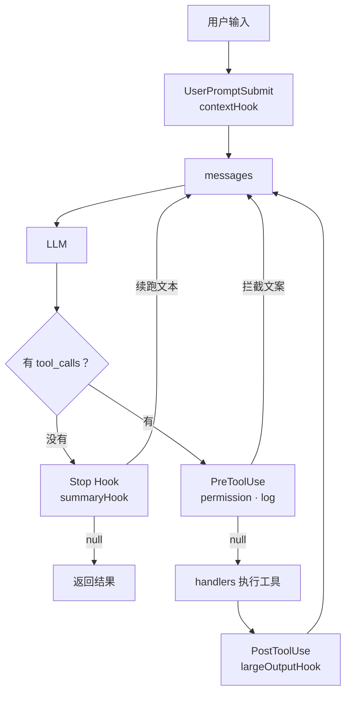

# s04：Hooks - 扩展逻辑挂在循环上，不再写进循环里

上一章 `s03` 给工具加上了权限门，但判断分支是直接写死在 `agentLoop` 里的。如果后面还要加工具日志、大输出检查、结束统计，每次都往循环里塞代码，主循环很快就会又长又乱。

这一章（对应 [learn-claude-code](https://github.com/shareAI-lab/learn-claude-code) 的 `s04_hooks`）我们给主循环预留生命周期插口：**扩展逻辑应该挂在 Hook 上，而不是写进主循环里；我们顺手把 `s03` 的权限门搬成第一个 `PreToolUse` Hook。**

## 问题

真实 Agent 除了调工具，还会不断长出外围需求：用户输入前补上下文、执行前做权限与日志、执行后检查输出大小、结束前做统计或复核。把这些横切逻辑都写进 `agentLoop`，主循环很快会变成一团 `if / else`，越改越脆弱。

## 解决方案

我们在主循环的 4 个固定节点调用 `triggerHooks(event, ...args)`，外围功能只管用 `registerHook(event, callback)` 挂上去，主循环本身不用再改：



四个生命周期点覆盖了一次对话循环的主干：

| 事件 | 触发时机 | 本章挂的 Hook |
|---|---|---|
| `UserPromptSubmit` | 用户输入后、进循环前 | `contextHook`（打印目录） |
| `PreToolUse` | 工具执行前 | `permissionHook`、`logHook` |
| `PostToolUse` | 工具执行后 | `largeOutputHook`（超长预警） |
| `Stop` | 模型准备结束时 | `summaryHook`（统计历史工具消息数） |

回调链的短路约定很统一：`triggerHooks` 遇到第一个 `!= null` 的返回值就会立刻停止后续回调并返回它。返回值怎么用取决于触发点：`PreToolUse` 用它拦截工具，`Stop` 用它追加一条 `user` 消息续跑一轮。`UserPromptSubmit` 和 `PostToolUse` 则只触发副作用，丢弃返回值。

## 测试 Prompt

```text
尝试删除 notes.txt，然后告诉我这次操作有没有被拦截。
```

输入后终端会先打印 `[hook] UserPromptSubmit`。当模型调用 `bash` 执行删除命令时，会触发 `PreToolUse` 的权限确认提示，结束前再打印 `[hook] Stop` 统计，权限拦截已经来自注册上去的 Hook，而不是主循环里的硬编码分支。

## 扩展阅读：商业级 Agent 怎么做 Hook

Hook 机制让商业 Agent 能围绕稳定的主循环持续长出新能力：

- **Claude Code**：内置 `PreToolUse`、`PostToolUse`、`Stop`、`PreCompact` 等事件，权限、审计和压缩前后处理都挂在上面。
- **Codex**：把可拦截点放在执行策略、审批、沙箱与工具事件周围，让动作前后都能被策略层接管。
- **opencode**：用 Plugin Hooks 接入 session runner，工具和插件按事件扩展，无需改动核心循环本体。

**主循环只管在关键节点发出信号，具体规矩交给外部注册的回调，系统才能越长越稳。**

## 本地运行与测试

交互运行（从仓库根目录执行）：

```bash
cd code-agent-course && node s04-hooks.js
```

离线单测（在仓库根目录执行，无需 API Token）：

```bash
pnpm vitest run code-agent-course/s04-hooks.test.js
```

## 博客代码演进

### 1. 搭好 Hook 登记表和触发函数

整个 Hook 机制只有三样东西：`hooks` 表存四个事件对应的回调数组，`registerHook` 负责登记，`triggerHooks` 按顺序执行回调。只要某个回调返回非空值，`triggerHooks` 就立刻短路并返回它。顺手把 `SYSTEM` 改回 `s02`，因为权限约束不再靠提示词强调。

```diff agent-step
@@
 } from "./helper.js";
 
-const SYSTEM = `You are a coding agent at ${process.cwd()}. Destructive actions need user approval.`;
+const SYSTEM = `You are a coding agent at ${process.cwd()}. Use tools to solve tasks. Act, don't explain.`;
 
 const tools = [
@@
   glob: ({ pattern }) => glob(pattern),
 };
+
+const hooks = { UserPromptSubmit: [], PreToolUse: [], PostToolUse: [], Stop: [] };
+
+function registerHook(event, callback) {
+  hooks[event].push(callback);
+}
+
+async function triggerHooks(event, ...args) {
+  for (const callback of hooks[event]) {
+    const result = await callback(...args);
+    if (result != null) return result;
+  }
+  return null;
+}
 
 const DENY = ["rm -rf /", "sudo", "shutdown", "reboot", "mkfs", "dd if="];
```

### 2. 把权限判断改写成一个 Hook

把 `s03` 的权限判定和用户确认收进 `permissionHook`：不是 `bash` 或安全命令返回 `null` 放行，命中黑名单或用户拒绝就直接返回拒绝文案。写好后注册到 `PreToolUse` 并导出方便测试；旧的 `checkPermission` 暂时留着，保证这一帧照常可运行。

```diff agent-step
@@
 const RISKY = ["rm ", "> /etc/", "chmod 777"];
 
+async function permissionHook(name, args, confirm) {
+  if (name !== "bash") return null;
+  const command = args.command || "";
+  if (DENY.some((p) => command.includes(p))) return "Permission denied: 命中黑名单。";
+  if (RISKY.some((p) => command.includes(p))) {
+    const answer = confirm ? await confirm(`⚠ 可能有破坏性的命令: ${command} 允许? [y/N] `) : "";
+    if (!/^y(es)?$/i.test(String(answer).trim())) return "Permission denied by user.";
+  }
+  return null;
+}
+
+registerHook("PreToolUse", permissionHook);
+
 export function checkPermission(name, args = {}) {
   const command = args.command || "";
@@
   });
 }
+
+export { registerHook, triggerHooks, permissionHook };
 
 if (isMainModule(import.meta.url)) {
```

### 3. 主循环改为触发 PreToolUse

把 `agentLoop` 里写死的权限判断换成一行 `triggerHooks("PreToolUse", name, args, confirm)`：拿到非空结果就直接回灌给模型，不再调工具。旧的 `checkPermission` 和 `approved` 可以一起删掉，主循环从此不知道“权限”细节，只管在执行前问一次 Hook。

```diff agent-step
@@
 registerHook("PreToolUse", permissionHook);
 
-export function checkPermission(name, args = {}) {
-  const command = args.command || "";
-  if (name === "bash" && DENY.some((p) => command.includes(p))) {
-    return { decision: "deny", reason: "命中黑名单" };
-  }
-  if (name === "bash" && RISKY.some((p) => command.includes(p))) {
-    return { decision: "ask", reason: "可能有破坏性的命令" };
-  }
-  return { decision: "allow" };
-}
-
 export async function agentLoop(messages, confirm) {
   while (true) {
@@
     messages.push(message);
     for (const call of message.tool_calls) {
+      const name = call.function.name;
       const args = JSON.parse(call.function.arguments || "{}");
-      const gate = checkPermission(call.function.name, args);
 
+      const blocked = await triggerHooks("PreToolUse", name, args, confirm);
       let output;
-      if (gate.decision === "deny") {
-        output = `Permission denied: ${gate.reason}.`;
-      } else if (gate.decision === "ask" && !(await approved(confirm, gate.reason, call.function.name, args))) {
-        output = "Permission denied by user.";
+      if (blocked != null) {
+        output = String(blocked);
       } else {
-        const handler = handlers[call.function.name];
-        output = handler ? handler(args) : `Unknown tool: ${call.function.name}`;
+        const handler = handlers[name];
+        output = handler ? handler(args) : `Unknown tool: ${name}`;
       }
@@
     }
   }
-}
-
-async function approved(confirm, reason, name, args) {
-  if (!confirm) return false;
-  const answer = await confirm(`⚠ ${reason}: ${name}(${JSON.stringify(args)}) 允许? [y/N] `);
-  return /^y(es)?$/i.test(String(answer).trim());
 }
```

### 4. 同一个事件再挂 logHook

同一个事件可以按顺序挂多个 Hook。我们把 `logHook` 也挂到 `PreToolUse` 上，同时删掉循环里原来的 `console.log`。注意注册顺序：`permissionHook` 排在前面，所以被拦下的危险调用会直接短路，不会走到 `logHook`。

```diff agent-step
@@
 }
 
+function logHook(name) {
+  console.log(`[hook] PreToolUse → ${name}`);
+  return null;
+}
+
 registerHook("PreToolUse", permissionHook);
+registerHook("PreToolUse", logHook);
 
 export async function agentLoop(messages, confirm) {
@@
       }
 
-      console.log(`> ${call.function.name}: ${String(output).slice(0, 200)}`);
       messages.push({ role: "tool", tool_call_id: call.id, content: String(output) });
     }
```

### 5. 接入 PostToolUse：检查大输出

在工具执行完成后补上 `triggerHooks("PostToolUse", name, output)`。挂在上面的 `largeOutputHook` 只做观察，发现输出超过 10 万字符就打印一条提醒，随后返回 `null` 不改动结果。

```diff agent-step
@@
 }
 
+function largeOutputHook(name, output) {
+  if (String(output).length > 100000) {
+    console.log(`[hook] PostToolUse → ${name} 输出过大`);
+  }
+  return null;
+}
+
 registerHook("PreToolUse", permissionHook);
 registerHook("PreToolUse", logHook);
+registerHook("PostToolUse", largeOutputHook);
 
 export async function agentLoop(messages, confirm) {
@@
         const handler = handlers[name];
         output = handler ? handler(args) : `Unknown tool: ${name}`;
+        await triggerHooks("PostToolUse", name, output);
       }
```

### 6. 接入 Stop：结束前统计与续跑入口

当模型不再请求工具、循环准备返回前触发 `Stop`。如果某个 `Stop` Hook 返回非 `null` 值，循环会把它转成新的 `user` 消息推回 `messages` 并 `continue` 再跑一轮。本章挂的 `summaryHook` 统计整个 `messages` 里累计的 `tool` 消息条数（含历史对话与拦截结果），打印后返回 `null`，让循环正常结束。

```diff agent-step
@@
 }
 
+function summaryHook(messages) {
+  const used = messages.filter((m) => m.role === "tool").length;
+  console.log(`[hook] Stop → 本轮用了 ${used} 次工具`);
+  return null;
+}
+
 registerHook("PreToolUse", permissionHook);
 registerHook("PreToolUse", logHook);
 registerHook("PostToolUse", largeOutputHook);
+registerHook("Stop", summaryHook);
 
 export async function agentLoop(messages, confirm) {
   while (true) {
     const { message } = await callLlm(messages, { system: SYSTEM, tools });
-    if (!message.tool_calls?.length) return message.content || "";
+
+    if (!message.tool_calls?.length) {
+      const force = await triggerHooks("Stop", messages);
+      if (force != null) {
+        messages.push({ role: "user", content: String(force) });
+        continue;
+      }
+      return message.content || "";
+    }
 
     messages.push(message);
```

### 7. 接入 UserPromptSubmit：输入前处理

最后一个节点在循环外面：用户回车后、进入 `agentLoop` 前，写在 `runChatCli` 的 `onPrompt` 里。挂上 `contextHook` 打印当前目录并把提示符改成 `"s04 >> "`，四个生命周期点全部打通。

> **本章思考题**：工具、权限、Hook 都稳住了，但如果你一次交给它五六个连贯步骤，模型常常做到第三步就忘了开头、漏掉收尾。怎么让 Agent 在动手前先列出一份可见清单，边干活边打勾？下一章 `s05` 我们加上 `todo_write`。

```diff agent-step
@@
 }
 
+function contextHook() {
+  console.log(`[hook] UserPromptSubmit → cwd ${process.cwd()}`);
+  return null;
+}
+
+registerHook("UserPromptSubmit", contextHook);
 registerHook("PreToolUse", permissionHook);
 registerHook("PreToolUse", logHook);
@@
 async function main() {
   await runChatCli({
-    promptLabel: "s03 >> ",
-    onPrompt: ({ messages, ask }) => agentLoop(messages, ask),
+    promptLabel: "s04 >> ",
+    onPrompt: async ({ prompt, messages, ask }) => {
+      await triggerHooks("UserPromptSubmit", prompt);
+      return agentLoop(messages, ask);
+    },
   });
 }
```

## 和上一步的关键代码 diff（不含 helper.js）

```diff
--- s03-permission.js
+++ s04-hooks.js
@@
-const SYSTEM = `You are a coding agent at ${process.cwd()}. Destructive actions need user approval.`;
+const SYSTEM = `You are a coding agent at ${process.cwd()}. Use tools to solve tasks. Act, don't explain.`;
@@
+const hooks = { UserPromptSubmit: [], PreToolUse: [], PostToolUse: [], Stop: [] };
+
+function registerHook(event, callback) {
+  hooks[event].push(callback);
+}
+
+async function triggerHooks(event, ...args) {
+  for (const callback of hooks[event]) {
+    const result = await callback(...args);
+    if (result != null) return result;
+  }
+  return null;
+}
+
 const DENY = ["rm -rf /", "sudo", "shutdown", "reboot", "mkfs", "dd if="];
 const RISKY = ["rm ", "> /etc/", "chmod 777"];
 
-export function checkPermission(name, args = {}) {
+async function permissionHook(name, args, confirm) {
+  if (name !== "bash") return null;
   const command = args.command || "";
-  if (name === "bash" && DENY.some((p) => command.includes(p))) {
-    return { decision: "deny", reason: "命中黑名单" };
+  if (DENY.some((p) => command.includes(p))) return "Permission denied: 命中黑名单。";
+  if (RISKY.some((p) => command.includes(p))) {
+    const answer = confirm ? await confirm(`⚠ 可能有破坏性的命令: ${command} 允许? [y/N] `) : "";
+    if (!/^y(es)?$/i.test(String(answer).trim())) return "Permission denied by user.";
   }
-  if (name === "bash" && RISKY.some((p) => command.includes(p))) {
-    return { decision: "ask", reason: "可能有破坏性的命令" };
+  return null;
+}
+
+function logHook(name) {
+  console.log(`[hook] PreToolUse → ${name}`);
+  return null;
+}
+
+function largeOutputHook(name, output) {
+  if (String(output).length > 100000) {
+    console.log(`[hook] PostToolUse → ${name} 输出过大`);
   }
-  return { decision: "allow" };
+  return null;
 }
 
+function summaryHook(messages) {
+  const used = messages.filter((m) => m.role === "tool").length;
+  console.log(`[hook] Stop → 本轮用了 ${used} 次工具`);
+  return null;
+}
+
+function contextHook() {
+  console.log(`[hook] UserPromptSubmit → cwd ${process.cwd()}`);
+  return null;
+}
+
+registerHook("UserPromptSubmit", contextHook);
+registerHook("PreToolUse", permissionHook);
+registerHook("PreToolUse", logHook);
+registerHook("PostToolUse", largeOutputHook);
+registerHook("Stop", summaryHook);
+
 export async function agentLoop(messages, confirm) {
   while (true) {
     const { message } = await callLlm(messages, { system: SYSTEM, tools });
-    if (!message.tool_calls?.length) return message.content || "";
+
+    if (!message.tool_calls?.length) {
+      const force = await triggerHooks("Stop", messages);
+      if (force != null) {
+        messages.push({ role: "user", content: String(force) });
+        continue;
+      }
+      return message.content || "";
+    }
 
     messages.push(message);
     for (const call of message.tool_calls) {
+      const name = call.function.name;
       const args = JSON.parse(call.function.arguments || "{}");
-      const gate = checkPermission(call.function.name, args);
 
+      const blocked = await triggerHooks("PreToolUse", name, args, confirm);
       let output;
-      if (gate.decision === "deny") {
-        output = `Permission denied: ${gate.reason}.`;
-      } else if (gate.decision === "ask" && !(await approved(confirm, gate.reason, call.function.name, args))) {
-        output = "Permission denied by user.";
+      if (blocked != null) {
+        output = String(blocked);
       } else {
-        const handler = handlers[call.function.name];
-        output = handler ? handler(args) : `Unknown tool: ${call.function.name}`;
+        const handler = handlers[name];
+        output = handler ? handler(args) : `Unknown tool: ${name}`;
+        await triggerHooks("PostToolUse", name, output);
       }
 
-      console.log(`> ${call.function.name}: ${String(output).slice(0, 200)}`);
       messages.push({ role: "tool", tool_call_id: call.id, content: String(output) });
     }
   }
 }
 
-async function approved(confirm, reason, name, args) {
-  if (!confirm) return false;
-  const answer = await confirm(`⚠ ${reason}: ${name}(${JSON.stringify(args)}) 允许? [y/N] `);
-  return /^y(es)?$/i.test(String(answer).trim());
-}
-
 async function main() {
   await runChatCli({
-    promptLabel: "s03 >> ",
-    onPrompt: ({ messages, ask }) => agentLoop(messages, ask),
+    promptLabel: "s04 >> ",
+    onPrompt: async ({ prompt, messages, ask }) => {
+      await triggerHooks("UserPromptSubmit", prompt);
+      return agentLoop(messages, ask);
+    },
   });
 }
+
+export { registerHook, triggerHooks, permissionHook };
```
