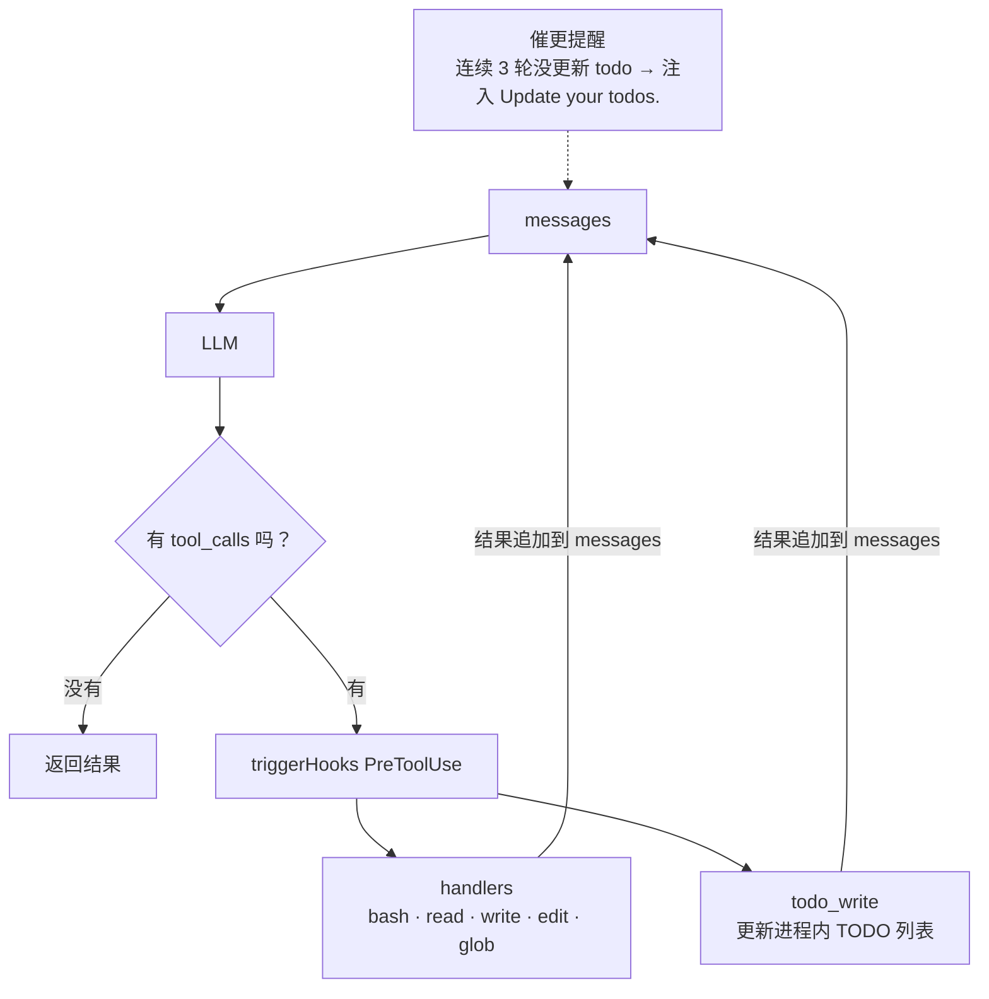

# s05：待办写入

新人接到复杂任务时，最怕脑子里一团线：先做什么、做到哪了、还有什么没做都不清楚。`s05` 教他先写备忘录，把任务拆成可见的 todo，这样执行时不容易跑偏。


## 本章目标

让 agent 在多步骤任务开始前，先把计划写出来。

这一章只新增一个能力：`todo_write`。它不执行外部动作，只把当前任务拆成可见列表，避免模型做着做着忘记主线。

## 新增能力

上一章已经有了 hook 和权限门。`s05` 在此基础上加了两件小东西：

- `todo_write`：模型用它写入当前计划。
- `roundsSinceTodo`：如果模型太久不更新计划，就往上下文里塞一条提醒。

这里不需要 `normalizeTodos` 这类详细校验。工具 schema 已经告诉模型 todo 的形状，教程重点是“计划如何进入 agent loop”，不是把输入校验系统做完整。

## 流程图


```text
用户输入
  |
  v
agent loop
  |
  +--> 太久没更新 todo?
  |        |
  |        +--> 注入提醒: <reminder>Update your todos.</reminder>
  |
  v
LLM 决定下一步
  |
  +--> 调用 todo_write
  |        |
  |        +--> 写入 currentTodos
  |        +--> roundsSinceTodo = 0
  |
  +--> 每个包含工具调用的模型回合
           |
           +--> roundsSinceTodo + 1
```

## 对应代码

- JS：[s05-todo-write.js](./s05-todo-write.js)
- Test：[s05-todo-write.test.js](./s05-todo-write.test.js)

## 新增函数速览

- `getTodos()`：读取当前内存里的 todo 列表，方便测试和观察 agent 的计划状态。
- `runTodoWrite({ todos })`：`todo_write` 的实际处理函数，把模型给出的 todo 列表保存到 `currentTodos`。
- `agentLoop(messages, confirm)`：在 s04 的 hook loop 基础上，增加 todo 更新计数和 `<reminder>` 提醒。

## 关键代码

核心有两处：先把 `todo_write` 注册成工具，再在 loop 里用 `roundsSinceTodo` 做轻提醒。

`todo_write` 的 handler 很短：

```js
function runTodoWrite({ todos = [] }) {
  currentTodos = todos;
  const icon = { pending: " ", in_progress: "▸", completed: "✓" };
  console.log("## Current Tasks");
  for (const t of currentTodos) console.log(`  [${icon[t.status]}] ${t.content}`);
  return `Updated ${currentTodos.length} tasks`;
}
```

loop 里只多了一个计数器：

```js
if (roundsSinceTodo >= 3) {
  messages.push({ role: "user", content: "<reminder>Update your todos.</reminder>" });
  roundsSinceTodo = 0;
}

roundsSinceTodo += 1;
if (name === "todo_write") roundsSinceTodo = 0;
```

真实项目里可以再加校验、持久化、UI 展示。但在这一讲里，保留这三行更清楚：模型给计划，系统保存计划，loop 根据计划状态继续推进。

## 为什么重要

没有 todo 的 agent，也能调用工具，但很容易漂移：

- 做到一半忘记原目标
- 跳过关键步骤
- 工具执行完就提前说完成

`todo_write` 的价值不是“清单本身”，而是让任务结构进入上下文循环。模型每次看到自己的计划，下一步就更稳定。

## 运行

```bash
node code-agent-course/s05-todo-write.js
```

## 参考实现提醒

TodoWrite 容易被误解成“任务系统”，但这一章还不是：

- `todo_write` 只维护当前会话里的可见计划，不负责跨会话持久化。
- todo 的状态变化是给模型和用户看的工作记忆，不等于文件已经真的改完。
- `<reminder>` 只是注入给模型看的提醒标签，没有 HTML 语义，也不会被浏览器解析。

## 测试 Prompt

```text
用 todo_write 规划：创建、读取、更新 notes.txt；创建含三条⬜任务的 notes.txt，读取后把文件和 todo 都改成全部✅。
```

观察重点：模型应该先调用 `todo_write` 写计划，再穿插文件工具，最后同时更新文件内容和 todo 状态。

## 一句话总结

`s05` 让 agent 第一次拥有了“显式工作计划”，任务推进不再只藏在模型脑子里。

## 扩展阅读：商业级 Agent 怎么做会话内计划

`todo_write` 不是持久任务系统，它更像“当前会话的工作记忆”：

- Claude Code：交互会话已使用 `TaskCreate` / `TaskUpdate` / `TaskList` 等结构化工具；`TodoWrite` 仍可用于 Agent SDK 和非交互模式。两者都让状态从 `pending` 逐步变为 `in_progress` 和 `completed`。参考 [Claude Code Todo Lists](https://code.claude.com/docs/en/agent-sdk/todo-tracking)。
- Codex：`update_plan` 维护当前任务的步骤和状态，与本章一样属于执行期检查清单，不是长期任务库。参考 [Codex 默认指令中的 `update_plan`](https://github.com/openai/codex/blob/main/codex-rs/protocol/src/prompts/base_instructions/default.md)。
- opencode：内置 `todowrite` 用于复杂操作的会话内进度跟踪，而且默认不对子代理开放。参考 [OpenCode Tools](https://opencode.ai/docs/tools/)。

所以本章要守住边界：todo 解决“这一轮怎么做”，后面的 task system 才解决“跨轮次、跨队友怎么协作”。


## 博客代码演进

下面 5 个 patch 专门用于博客右侧的代码切换。第一步基于 `s04-hooks.js`，后面的每一步都继续修改上一帧，最后必须得到完整的 `s05-todo-write.js`。

每一步的代码都可以运行。前两步是整理：把上一章用来演示的 hook 收起来，只留下权限 hook。后三步才是本章的新内容：保存计划、让模型能调用 `todo_write`、忘记更新时提醒它。

### 1. 收起上一章的演示 hook

s04 为了讲清四个生命周期事件，挂了四个只打印日志的 hook。它们已经完成任务，从这一章起不再需要，先删掉，让代码短一些。负责权限的 `permissionHook` 保留，hook 的登记和触发机制也保留。

```diff agent-step
@@
 }
 
-function logHook(name) {
-  console.log(`[hook] PreToolUse → ${name}`);
-  return null;
-}
-
-function largeOutputHook(name, output) {
-  if (String(output).length > 100000) {
-    console.log(`[hook] PostToolUse → ${name} 输出过大`);
-  }
-  return null;
-}
-
-function summaryHook(messages) {
-  const used = messages.filter((m) => m.role === "tool").length;
-  console.log(`[hook] Stop → 本轮用了 ${used} 次工具`);
-  return null;
-}
-
-function contextHook() {
-  console.log(`[hook] UserPromptSubmit → cwd ${process.cwd()}`);
-  return null;
-}
-
-registerHook("UserPromptSubmit", contextHook);
 registerHook("PreToolUse", permissionHook);
-registerHook("PreToolUse", logHook);
-registerHook("PostToolUse", largeOutputHook);
-registerHook("Stop", summaryHook);
 
 export async function agentLoop(messages, confirm) {
```

### 2. 去掉暂时用不到的触发点

演示 hook 删掉以后，`PostToolUse`、`Stop`、`UserPromptSubmit` 这三个事件上已经没有回调，loop 里对应的触发代码也一起拿掉，只留下执行工具前的 `PreToolUse`（权限就靠它）。现在的程序相当于“s02 的工具 + 权限 hook”，这是本章的起点。

```diff agent-step
@@
 
     if (!message.tool_calls?.length) {
-      const force = await triggerHooks("Stop", messages);
-      if (force != null) {
-        messages.push({ role: "user", content: String(force) });
-        continue;
-      }
       return message.content || "";
     }
@@
         const handler = handlers[name];
         output = handler ? handler(args) : `Unknown tool: ${name}`;
-        await triggerHooks("PostToolUse", name, output);
       }
@@
     promptLabel: "s04 >> ",
     onPrompt: async ({ prompt, messages, ask }) => {
-      await triggerHooks("UserPromptSubmit", prompt);
       return agentLoop(messages, ask);
     },
   });
 }
-
-export { registerHook, triggerHooks, permissionHook };
 
 if (isMainModule(import.meta.url)) {
```

### 3. 保存计划并打印出来

先写计划放在哪里。`currentTodos` 是一个数组，保存当前的任务清单；`getTodos` 让测试能读到它。`runTodoWrite` 是工具的实现：用模型传来的清单整个替换旧清单，然后打印成一眼能看懂的列表，`▸` 表示进行中，`✓` 表示已完成。注意它不做任何实际工作，只记录和显示。最后在 `handlers` 里登记一行。模型现在还不知道这个工具，下一步再告诉它。

```diff agent-step
@@
 ];
 
+let currentTodos = [];
+export function getTodos() {
+  return currentTodos;
+}
+
+function runTodoWrite({ todos = [] }) {
+  currentTodos = todos;
+  const icon = { pending: " ", in_progress: "▸", completed: "✓" };
+  console.log("## Current Tasks");
+  for (const t of currentTodos) console.log(`  [${icon[t.status]}] ${t.content}`);
+  return `Updated ${currentTodos.length} tasks`;
+}
+
 const handlers = {
   bash: ({ command }) => runBash(command),
@@
   edit_file: ({ path, old_text, new_text }) => editFile(path, old_text, new_text),
   glob: ({ pattern }) => glob(pattern),
+  todo_write: runTodoWrite,
 };
```

### 4. 让模型知道 todo_write

给 `tools` 加上 `todo_write` 的 schema。参数是一个 `todos` 数组，每一项有内容 `content` 和状态 `status`，状态只能是 `pending`、`in_progress`、`completed` 三种之一。系统提示词也加一句：多步任务先用 `todo_write` 做计划，边做边更新状态。到这一步，模型已经会在动手前先列计划。

```diff agent-step
@@
 } from "./helper.js";
 
-const SYSTEM = `You are a coding agent at ${process.cwd()}. Use tools to solve tasks. Act, don't explain.`;
+const SYSTEM = `You are a coding agent at ${process.cwd()}. Before a multi-step task, use todo_write to plan; update status as you go.`;
 
 const tools = [
@@
     properties: { pattern: { type: "string" } },
     required: ["pattern"],
+  }),
+  tool("todo_write", "Create and manage a task list for the current session.", {
+    type: "object",
+    properties: {
+      todos: {
+        type: "array",
+        items: {
+          type: "object",
+          properties: {
+            content: { type: "string" },
+            status: { type: "string", enum: ["pending", "in_progress", "completed"] },
+          },
+          required: ["content", "status"],
+        },
+      },
+    },
+    required: ["todos"],
   }),
 ];
```

### 5. 忘了更新计划就提醒

模型做着做着常会忘记回头更新计划。在 loop 里加一个计数器 `roundsSinceTodo`：每调用一轮模型加 1，只要这一轮用了 `todo_write` 就清零。连续 3 轮没更新，就往 `messages` 里加一条提醒，把它的注意力拉回来。提醒也只是一条普通消息，写不写计划仍然由模型决定。

```diff agent-step
@@
 
 export async function agentLoop(messages, confirm) {
+  let roundsSinceTodo = 0;
   while (true) {
+    if (roundsSinceTodo >= 3) {
+      messages.push({ role: "user", content: "<reminder>Update your todos.</reminder>" });
+      roundsSinceTodo = 0;
+    }
+
     const { message } = await callLlm(messages, { system: SYSTEM, tools });
@@
 
     messages.push(message);
+    roundsSinceTodo += 1;
     for (const call of message.tool_calls) {
       const name = call.function.name;
@@
       }
 
+      if (name === "todo_write") roundsSinceTodo = 0;
       messages.push({ role: "tool", tool_call_id: call.id, content: String(output) });
     }
@@
 async function main() {
   await runChatCli({
-    promptLabel: "s04 >> ",
+    promptLabel: "s05 >> ",
     onPrompt: async ({ prompt, messages, ask }) => {
       return agentLoop(messages, ask);
```

## 和上一步的关键代码 diff（不含 helper.js）

下面只保留 s04 到 s05 的关键变化：新增 `todo_write` 工具和计划提醒。

这里展示的是最能说明本章新增机制的关键变化；完整差异以相邻 JS 文件为准。

```diff
--- s04-hooks.js
+++ s05-todo-write.js
@@
-const SYSTEM = `You are a coding agent at ${process.cwd()}. Use tools to solve tasks. Act, don't explain.`;
+const SYSTEM = `You are a coding agent at ${process.cwd()}. Before a multi-step task, use todo_write to plan; update status as you go.`;
@@
   tool("glob", "Find files by glob pattern.", {
     type: "object",
     properties: { pattern: { type: "string" } },
     required: ["pattern"],
   }),
+  tool("todo_write", "Create and manage a task list for the current session.", {
+    type: "object",
+    properties: {
+      todos: {
+        type: "array",
+        items: {
+          type: "object",
+          properties: {
+            content: { type: "string" },
+            status: { type: "string", enum: ["pending", "in_progress", "completed"] },
+          },
+          required: ["content", "status"],
+        },
+      },
+    },
+    required: ["todos"],
+  }),
 ];
@@
+let currentTodos = [];
+export function getTodos() {
+  return currentTodos;
+}
+
+function runTodoWrite({ todos = [] }) {
+  currentTodos = todos;
+  const icon = { pending: " ", in_progress: "▸", completed: "✓" };
+  console.log("## Current Tasks");
+  for (const t of currentTodos) console.log(`  [${icon[t.status]}] ${t.content}`);
+  return `Updated ${currentTodos.length} tasks`;
+}
@@
   edit_file: ({ path, old_text, new_text }) => editFile(path, old_text, new_text),
   glob: ({ pattern }) => glob(pattern),
+  todo_write: runTodoWrite,
 };
@@
 export async function agentLoop(messages, confirm) {
+  let roundsSinceTodo = 0;
   while (true) {
+    if (roundsSinceTodo >= 3) {
+      messages.push({ role: "user", content: "<reminder>Update your todos.</reminder>" });
+      roundsSinceTodo = 0;
+    }
@@
     messages.push(message);
+    roundsSinceTodo += 1;
     for (const call of message.tool_calls) {
@@
+      if (name === "todo_write") roundsSinceTodo = 0; // 更新了计划，计数清零
       messages.push({ role: "tool", tool_call_id: call.id, content: String(output) });
     }
   }
 }
```
