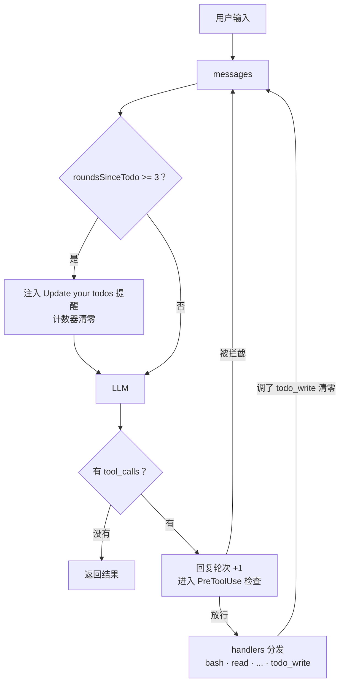

# s05：Todo Write - 先列可见计划，让长任务稳住主线

前四章搭好了工具、权限和 Hook 骨架，但遇到包含五六个步骤的复杂任务，模型还是容易做到一半忘了开头，要么漏掉步骤，要么提前宣布完工。

这一章我们给它配上一块随时可见的会话内白板：**用 `todo_write` 把计划写进上下文，再加一个小计数器，连续几轮不更新就轻轻催它一下。**

## 问题

前四章搭好了工具、权限和 Hook 骨架，但只要任务拉长到五六个步骤，模型就会在反复读文件、跑命令之后忘了开头定好的目标，不是漏掉某一步，就是干到一半提前宣布完工。仅靠纯对话上下文“记在心里”，长任务很难稳住主线。

## 解决方案

在保留 `s04` 权限 Hook 的基础上，我们只补两件小东西：第一件是内存工具 `todo_write`，把任务清单（`pending` / `in_progress` / `completed`）写进当前会话。第二件是 `roundsSinceTodo` 计数器：每收到一条带 `tool_calls` 的模型回复加 1（同一回复并发多个工具也只算 1 轮），调用 `todo_write` 时清零；连续 3 轮没更新，就在下一次请求前往 `messages` 注入一条提醒：



注入的 `<reminder>` 只是给模型看的纯文本标签，没有 HTML 语义；看到提醒后怎么更新计划，依然由模型自己决定。一两步的小活没必要写清单，超过三四步的长任务才值得维护这份会话内白板，跨会话的持久化任务系统留到后面 `s12` 再做。

## 测试 Prompt

```text
用 todo_write 规划：创建、读取、更新 notes.txt；创建含三条⬜任务的 notes.txt，读取后把文件和 todo 都改成全部✅。
```

当模型按指令先调 `todo_write` 再操作文件时，你会看到终端先打印任务清单，再穿插读写 `notes.txt`，最后把文件内容和 todo 状态一起更新为完成。

## 扩展阅读：商业级 Agent 怎么做会话内计划

`todo_write` 本质上是当前会话的可见工作记忆，商业级产品也都把它和长期任务库区分开：

- **Claude Code**：交互会话使用结构化任务工具，Agent SDK 中保留 `TodoWrite`，同样让状态按 `pending` → `in_progress` → `completed` 推进。参考 [Claude Code Todo Lists](https://code.claude.com/docs/en/agent-sdk/todo-tracking)。
- **Codex**：通过 `update_plan` 维护当前任务的步骤与进度，定位同样是执行期检查清单。参考 [Codex `update_plan` 指令](https://github.com/openai/codex/blob/main/codex-rs/protocol/src/prompts/base_instructions/default.md)。
- **opencode**：同样把会话内任务清单和持久化任务区分开，用来跟踪当前复杂会话的步骤进度。参考 [OpenCode Docs](https://opencode.ai/docs/)。

**`todo_write` 的价值不在清单本身，而在让计划进入上下文循环，帮模型每轮都稳住主线。**

## 本地运行与测试

交互运行（从仓库根目录执行）：

```bash
cd code-agent-course && node s05-todo-write.js
```

离线单测（在仓库根目录执行，无需 API Token）：

```bash
pnpm vitest run code-agent-course/s05-todo-write.test.js
```

## 博客代码演进

### 1. 收起上一章的演示 Hook

`s04` 为了展示四个生命周期事件，挂了四个只打印日志的演示 Hook。从本章起先把它们收起来让代码保持清爽；这一步删掉后终端不再刷 `[hook]` 日志，但 `permissionHook` 照常拦截危险命令。

```diff agent-step
@@
 }
 
-function logHook(name) {
-  console.log(`[hook] PreToolUse → ${name}`);
-  return null;
-}
-
-function largeOutputHook(name, output) {
-  if (String(output).length > 100000) {
-    console.log(`[hook] PostToolUse → ${name} 输出过大`);
-  }
-  return null;
-}
-
-function summaryHook(messages) {
-  const used = messages.filter((m) => m.role === "tool").length;
-  console.log(`[hook] Stop → 本轮用了 ${used} 次工具`);
-  return null;
-}
-
-function contextHook() {
-  console.log(`[hook] UserPromptSubmit → cwd ${process.cwd()}`);
-  return null;
-}
-
-registerHook("UserPromptSubmit", contextHook);
 registerHook("PreToolUse", permissionHook);
-registerHook("PreToolUse", logHook);
-registerHook("PostToolUse", largeOutputHook);
-registerHook("Stop", summaryHook);
 
 export async function agentLoop(messages, confirm) {
```

### 2. 去掉暂时用不到的触发点

演示 Hook 拿掉后，`PostToolUse`、`Stop`、`UserPromptSubmit` 上暂时没有回调，把这三处触发调用和多余导出一起清掉，只保留工具执行前的 `PreToolUse`。整理完后代码回到干净的权限骨架，下一帧把 `todo_write` 接进来。

```diff agent-step
@@
 
     if (!message.tool_calls?.length) {
-      const force = await triggerHooks("Stop", messages);
-      if (force != null) {
-        messages.push({ role: "user", content: String(force) });
-        continue;
-      }
       return message.content || "";
     }
@@
         const handler = handlers[name];
         output = handler ? handler(args) : `Unknown tool: ${name}`;
-        await triggerHooks("PostToolUse", name, output);
       }
@@
     promptLabel: "s04 >> ",
     onPrompt: async ({ prompt, messages, ask }) => {
-      await triggerHooks("UserPromptSubmit", prompt);
       return agentLoop(messages, ask);
     },
   });
 }
-
-export { registerHook, triggerHooks, permissionHook };
 
 if (isMainModule(import.meta.url)) {
```

### 3. 加入 todo_write 工具并更新 SYSTEM

把 `todo_write` 的实现、schema 和分发注册放进同一帧，让这一步就能直接运行。我们用内存数组 `currentTodos` 存清单（`getTodos()` 留给测试读取），`runTodoWrite` 负责整份替换旧清单并按状态打印空格、`▸` 和 `✓`。接着在 `tools` 里声明 `content` 与三选一 `status` 的 schema、在 `handlers` 里挂上 `runTodoWrite`，再改写 `SYSTEM` 引导模型先列计划再动手。

```diff agent-step
@@
 } from "./helper.js";
 
-const SYSTEM = `You are a coding agent at ${process.cwd()}. Use tools to solve tasks. Act, don't explain.`;
+const SYSTEM = `You are a coding agent at ${process.cwd()}. Before a multi-step task, use todo_write to plan; update status as you go.`;
 
 const tools = [
@@
     properties: { pattern: { type: "string" } },
     required: ["pattern"],
+  }),
+  tool("todo_write", "Create and manage a task list for the current session.", {
+    type: "object",
+    properties: {
+      todos: {
+        type: "array",
+        items: {
+          type: "object",
+          properties: {
+            content: { type: "string" },
+            status: { type: "string", enum: ["pending", "in_progress", "completed"] },
+          },
+          required: ["content", "status"],
+        },
+      },
+    },
+    required: ["todos"],
   }),
 ];
 
+let currentTodos = [];
+export function getTodos() {
+  return currentTodos;
+}
+
+function runTodoWrite({ todos = [] }) {
+  currentTodos = todos;
+  const icon = { pending: " ", in_progress: "▸", completed: "✓" };
+  console.log("## Current Tasks");
+  for (const t of currentTodos) console.log(`  [${icon[t.status]}] ${t.content}`);
+  return `Updated ${currentTodos.length} tasks`;
+}
+
 const handlers = {
   bash: ({ command }) => runBash(command),
   read_file: ({ path, limit }) => readFile(path, limit),
   write_file: ({ path, content }) => writeFile(path, content),
   edit_file: ({ path, old_text, new_text }) => editFile(path, old_text, new_text),
   glob: ({ pattern }) => glob(pattern),
+  todo_write: runTodoWrite,
 };
```

### 4. 忘了更新计划就提醒

模型干起活来常会忘记回头改清单。我们在 `agentLoop` 里加一个 `roundsSinceTodo`：每收到一条带 `tool_calls` 的模型回复加 1（同一回复并发多个工具也只算 1 轮），只要其中调用了 `todo_write` 就清零。连续 3 轮回复没更新（哪怕一共调了 6 次工具），就在下一次请求前往 `messages` 推一条 `<reminder>Update your todos.</reminder>`。最后顺手把提示符改成 `"s05 >> "`。

> **本章思考题**：先预测一下：如果模型第 1 轮读文件、第 2 轮调了 `todo_write`、第 3 和第 4 轮继续查文件，第 5 次请求前会触发提醒吗？另外，如果其中一步要翻十几个文件做调研，所有读取输出都塞进主 `messages` 很快会撑爆上下文。能不能临时派一个助理去独立上下文里调研，最后只带回一段摘要？下一章 `s06` 我们来做 Subagent。

```diff agent-step
@@
 
 export async function agentLoop(messages, confirm) {
+  let roundsSinceTodo = 0;
   while (true) {
+    if (roundsSinceTodo >= 3) {
+      messages.push({ role: "user", content: "<reminder>Update your todos.</reminder>" });
+      roundsSinceTodo = 0;
+    }
+
     const { message } = await callLlm(messages, { system: SYSTEM, tools });
@@
 
     messages.push(message);
+    roundsSinceTodo += 1;
     for (const call of message.tool_calls) {
       const name = call.function.name;
@@
       }
 
+      if (name === "todo_write") roundsSinceTodo = 0;
       messages.push({ role: "tool", tool_call_id: call.id, content: String(output) });
     }
@@
 async function main() {
   await runChatCli({
-    promptLabel: "s04 >> ",
+    promptLabel: "s05 >> ",
     onPrompt: async ({ prompt, messages, ask }) => {
       return agentLoop(messages, ask);
```

## 和上一步的关键代码 diff（不含 helper.js）

以下节选 `todo_write` 与催更计数器的核心新增（省略了清理 `s04` 演示 Hook 的删除行与提示符变更）：

```diff
--- s04-hooks.js
+++ s05-todo-write.js
@@
-const SYSTEM = `You are a coding agent at ${process.cwd()}. Use tools to solve tasks. Act, don't explain.`;
+const SYSTEM = `You are a coding agent at ${process.cwd()}. Before a multi-step task, use todo_write to plan; update status as you go.`;
@@
   tool("glob", "Find files by glob pattern.", {
     type: "object",
     properties: { pattern: { type: "string" } },
     required: ["pattern"],
+  }),
+  tool("todo_write", "Create and manage a task list for the current session.", {
+    type: "object",
+    properties: {
+      todos: {
+        type: "array",
+        items: {
+          type: "object",
+          properties: {
+            content: { type: "string" },
+            status: { type: "string", enum: ["pending", "in_progress", "completed"] },
+          },
+          required: ["content", "status"],
+        },
+      },
+    },
+    required: ["todos"],
   }),
 ];
@@
+let currentTodos = [];
+export function getTodos() {
+  return currentTodos;
+}
+
+function runTodoWrite({ todos = [] }) {
+  currentTodos = todos;
+  const icon = { pending: " ", in_progress: "▸", completed: "✓" };
+  console.log("## Current Tasks");
+  for (const t of currentTodos) console.log(`  [${icon[t.status]}] ${t.content}`);
+  return `Updated ${currentTodos.length} tasks`;
+}
@@
   edit_file: ({ path, old_text, new_text }) => editFile(path, old_text, new_text),
   glob: ({ pattern }) => glob(pattern),
+  todo_write: runTodoWrite,
 };
@@
 export async function agentLoop(messages, confirm) {
+  let roundsSinceTodo = 0;
   while (true) {
+    if (roundsSinceTodo >= 3) {
+      messages.push({ role: "user", content: "<reminder>Update your todos.</reminder>" });
+      roundsSinceTodo = 0;
+    }
@@
     messages.push(message);
+    roundsSinceTodo += 1;
     for (const call of message.tool_calls) {
@@
+      if (name === "todo_write") roundsSinceTodo = 0;
       messages.push({ role: "tool", tool_call_id: call.id, content: String(output) });
     }
   }
 }
```
