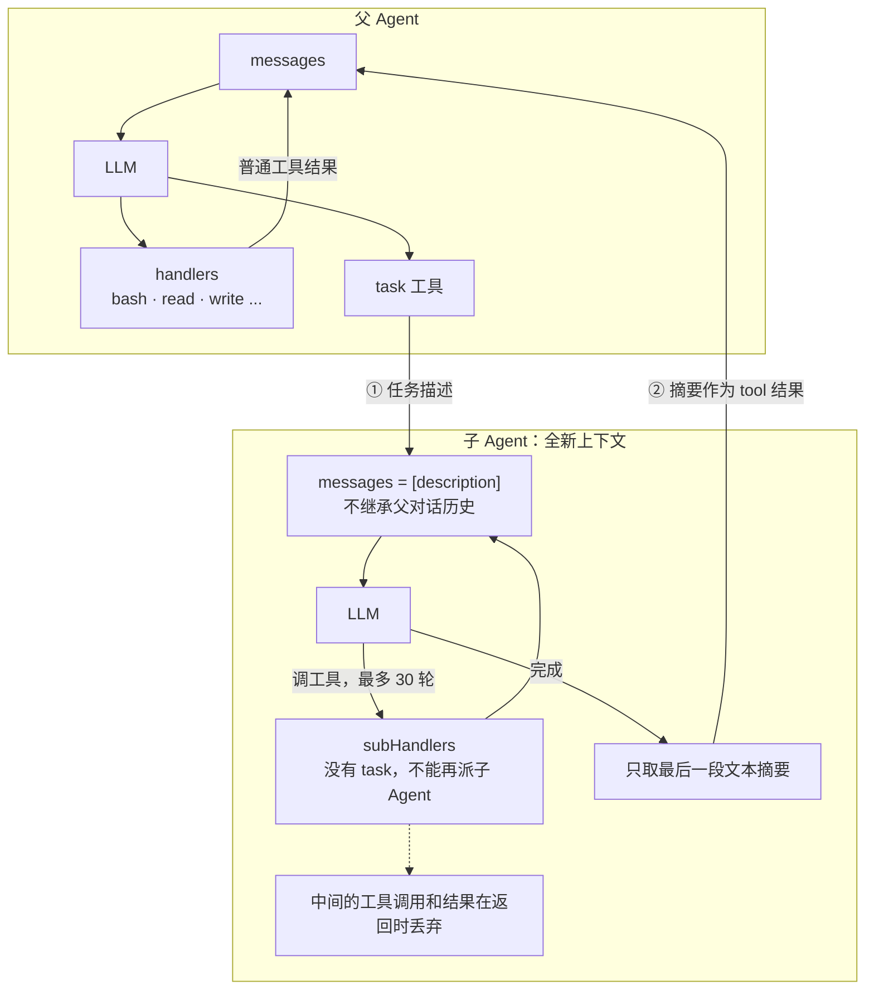

# s06：Subagent —— 把探索放进干净上下文

新人遇到一堆资料要查时，如果所有草稿、试错和中间结论都塞进主汇报里，领导很快看不清主线。`s06` 像是让他临时拉一个助理去单独调研，最后只把摘要带回来。


## 本章目标

前面几章里，主 agent 既要负责主任务，又要负责探索细节。探索一多，主对话就会变乱。

`s06` 加入一个 `task` 工具：主 agent 把一段子任务交给 subagent，subagent 用自己的 `messages[]` 跑完，只把最终摘要交回主对话。

## 新增能力

本章不是替换 s05 的计划能力，而是在保留 `todo_write` 的基础上，新增子代理。

- `task`：启动一次性 subagent。
- subagent 有独立上下文。
- subagent 可以使用基础工具。
- 父 agent 只收到最终摘要，不收中间过程。

## 流程图


```text
s06: Subagent — spawn sub-agents with fresh messages[] for context isolation.

  Parent Agent                           Subagent
  +------------------+                  +------------------+
  | messages=[...]   |                  | messages=[task]  | <-- fresh
  |                  |   dispatch       |                  |
  | tool: task       | ---------------> | own while loop   |
  |   prompt="..."   |                  |   bash/read/...  |
  |                  |   summary only   |   (max 30 turns) |
  | result = "..."   | <--------------- | return last text |
  +------------------+                  +------------------+
        ^                                      |
        |       intermediate results DISCARDED  |
        +--------------------------------------+
```

## 为什么这一步重要

subagent 的重点不是“多一个人”，而是“隔离上下文”。

主 agent 不需要把所有搜索、试错、读文件细节都背在当前对话里。它只需要拿到一句可靠结论，然后继续推进主目标。

## 新增函数速览

- `spawnSubagent(description, confirm)`：用一份新的 `messages[]` 启动子代理，让探索性任务在干净上下文里运行。
- `agentLoop(messages, confirm)`：在 s05 基础上支持异步 handler，所以 `task` 工具可以等待子代理完成后再回灌摘要。

## 关键代码

`task` 只是一个新工具，它的 handler 会启动 `spawnSubagent()`：

```js
tool("task", "Launch a subagent to handle a complex subtask. Returns only the final summary.", {
  type: "object",
  properties: { description: { type: "string" } },
  required: ["description"],
});
```

子代理的核心是一个新的 `messages[]`：

```js
async function spawnSubagent(description, confirm) {
  const messages = [{ role: "user", content: description }];
  for (let turn = 0; turn < MAX_SUB_TURNS; turn += 1) {
    const { message } = await callLlm(messages, { system: SUB_SYSTEM, tools: subTools });
    messages.push(message);
    if (!message.tool_calls?.length) return message.content || "(subagent returned no text)";
    // 工具结果只留在子代理自己的 messages 里。
  }
}
```

父 agent 最后只会收到这个函数返回的摘要，中间工具过程不会塞回父 `messages`。

## 代码入口

- JS：[s06-subagent.js](./s06-subagent.js)
- Test：[s06-subagent.test.js](./s06-subagent.test.js)

## 运行

```bash
node code-agent-course/s06-subagent.js
```

## 参考实现提醒

Subagent 的关键不是“再开一个函数”，而是上下文隔离：

- 子 agent 用新的 `messages[]` 开始，父 agent 不继承它的中间推理和工具流水。
- 父 agent 只拿最终摘要，避免主上下文被探索过程污染。
- 教程版通常禁止子 agent 再继续创建子 agent，防止递归失控。

## 测试 Prompt

```text
派一个子代理检查当前目录有哪些 Markdown 文件，主代理只需要返回子代理的总结。
```

观察重点：主代理应该调用 `task`，探索过程留在子代理上下文里，主对话只拿到最终摘要。

## 一句话总结

`s06` 把探索性工作放进独立上下文，让父 agent 保持主线清晰。

## 扩展阅读：商业级 Agent 怎么做子代理

子代理的关键不是“多调一次模型”，而是给子任务一个独立上下文和清晰返回边界：

- Claude Code：普通 subagent 使用独立上下文，完成后只把结果返回主对话；子代理还可以单独限制工具。参考 [Claude Code Subagents](https://code.claude.com/docs/en/sub-agents)。
- Codex：开源实现使用 `spawn_agent` / `wait_agent` / `close_agent` 管理子线程生命周期，比本章的一次性函数多了状态和回收。参考 [Codex agent tool 源码](https://github.com/openai/codex/blob/main/codex-rs/tools/src/agent_tool.rs)。
- opencode：自定义 agent 可以标记为 `subagent`，并通过 `task` 工具调用，同时能为它单独设置权限。参考 [OpenCode Agents](https://opencode.ai/docs/agents/)。

本章的 `spawnSubagent()` 是最小实现：新建 `messages[]`，跑自己的 loop，只把最终摘要还给父 agent。


## 博客代码演进

下面 5 个 patch 专门用于博客右侧的代码切换。第一步基于 `s05-todo-write.js`，后面的每一步都继续修改上一帧，最后必须得到完整的 `s06-subagent.js`。

每一步的代码都可以运行。前四步都在准备子代理：它的提示词、它能用的工具、它自己的循环。这些代码写好后先放着，行为和 s05 一样；最后一步把 `task` 工具交给模型，子代理才真正用起来。

### 1. 给子代理写一份提示词

子代理也是在调用同一个模型，区别只在于给它什么提示词、什么消息、什么工具。先准备提示词 `SUB_SYSTEM`：完成任务，返回一段简短的总结，不要再往下派任务。

```diff agent-step
@@
 
 const SYSTEM = `You are a coding agent at ${process.cwd()}. Before a multi-step task, use todo_write to plan; update status as you go.`;
+const SUB_SYSTEM = `You are a coding subagent at ${process.cwd()}. Complete the task, then return a concise summary. Do not delegate further.`;
 
 const tools = [
```

### 2. 划定子代理能用的工具

子代理的工具是从父代理的工具里筛出来的，去掉两个：`task`（否则子代理还能再派子代理，没完没了）和 `todo_write`（一个小任务不需要再列计划）。`subTools` 是给模型看的 schema，`subHandlers` 是对应的执行函数，两边用同一份排除名单，保证一致。`MAX_SUB_TURNS` 限制子代理最多跑 30 轮，防止它停不下来。

```diff agent-step
@@
 };
 
+const SUB_EXCLUDE = ["task", "todo_write"];
+const subTools = tools.filter((t) => !SUB_EXCLUDE.includes(t.function.name));
+const subHandlers = Object.fromEntries(
+  Object.entries(handlers).filter(([name]) => !SUB_EXCLUDE.includes(name)),
+);
+const MAX_SUB_TURNS = 30;
+
 const hooks = { UserPromptSubmit: [], PreToolUse: [], PostToolUse: [], Stop: [] };
```

### 3. 子代理的循环：从一份全新的 messages 开始

`spawnSubagent` 的第一行就是本章的核心：`messages` 是一个新数组，里面只有一条任务描述。父代理之前聊过什么，子代理完全看不到。接着是一个熟悉的循环：调用模型，模型不再请求工具时，把它最后说的那段话作为返回值。函数返回后，这个 `messages` 数组就被丢掉，中间过程不会进入父代理的上下文。这一步先搭骨架，执行工具的部分下一步补。

```diff agent-step
@@
 const MAX_SUB_TURNS = 30;
 
+async function spawnSubagent(description, confirm) {
+  const messages = [{ role: "user", content: description }];
+  for (let turn = 0; turn < MAX_SUB_TURNS; turn += 1) {
+    const { message } = await callLlm(messages, { system: SUB_SYSTEM, tools: subTools });
+    messages.push(message);
+    if (!message.tool_calls?.length) return message.content || "(subagent returned no text)";
+  }
+  return "Subagent stopped after 30 turns without a final answer.";
+}
+
 const hooks = { UserPromptSubmit: [], PreToolUse: [], PostToolUse: [], Stop: [] };
@@
   }
 }
+
+export { spawnSubagent };
 
 async function main() {
```

### 4. 子代理执行工具，同样要过权限

补上子循环里执行工具的部分，写法和主循环一样：解析参数、查 `subHandlers`、把结果用 `tool_call_id` 放回 `messages`。要注意的是，执行前同样触发 `PreToolUse`。上下文是隔离的，但权限不是：子代理想执行危险命令，一样会被拦截或者问用户。

```diff agent-step
@@
     messages.push(message);
     if (!message.tool_calls?.length) return message.content || "(subagent returned no text)";
+
+    for (const call of message.tool_calls) {
+      const name = call.function.name;
+      const args = JSON.parse(call.function.arguments || "{}");
+      const blocked = await triggerHooks("PreToolUse", name, args, confirm);
+      const handler = subHandlers[name];
+      const output =
+        blocked != null ? String(blocked) : handler ? handler(args) : `Unknown tool: ${name}`;
+      messages.push({ role: "tool", tool_call_id: call.id, content: String(output) });
+    }
   }
   return "Subagent stopped after 30 turns without a final answer.";
```

### 5. 把 task 工具交给模型

最后把子代理接到父代理上。`tools` 里加上 `task` 的 schema，参数只有一个 `description`；`handlers` 里加一行，调用 `spawnSubagent`。因为子代理是异步的，而且可能要问用户，主循环调用工具时改成 `await handler(args, confirm)`。系统提示词补一句：复杂的子问题可以用 `task` 派给子代理。现在父代理派出任务后，只会收到一段总结。

```diff agent-step
@@
 } from "./helper.js";
 
-const SYSTEM = `You are a coding agent at ${process.cwd()}. Before a multi-step task, use todo_write to plan; update status as you go.`;
+const SYSTEM = `You are a coding agent at ${process.cwd()}. Use tools to solve tasks. Before a multi-step task, use todo_write to plan and update status as you go. For a complex sub-problem, use the task tool to spawn a subagent.`;
 const SUB_SYSTEM = `You are a coding subagent at ${process.cwd()}. Complete the task, then return a concise summary. Do not delegate further.`;
@@
     required: ["todos"],
   }),
+  tool("task", "Launch a subagent to handle a complex subtask. Returns only the final summary.", {
+    type: "object",
+    properties: { description: { type: "string" } },
+    required: ["description"],
+  }),
 ];
@@
   glob: ({ pattern }) => glob(pattern),
   todo_write: runTodoWrite,
+  task: ({ description }, confirm) => spawnSubagent(description, confirm),
 };
@@
       } else {
         const handler = handlers[name];
-        output = handler ? handler(args) : `Unknown tool: ${name}`;
+        output = handler ? await handler(args, confirm) : `Unknown tool: ${name}`;
       }
@@
 async function main() {
   await runChatCli({
-    promptLabel: "s05 >> ",
+    promptLabel: "s06 >> ",
     onPrompt: async ({ prompt, messages, ask }) => {
       return agentLoop(messages, ask);
```

## 和上一步的关键代码 diff（不含 helper.js）

下面只保留 s05 到 s06 的关键变化：新增 `task` 工具、子代理循环、以及父 loop 对异步 handler 的支持。

这里展示的是最能说明本章新增机制的关键变化；完整差异以相邻 JS 文件为准。

```diff
--- s05-todo-write.js
+++ s06-subagent.js
@@
-const SYSTEM = `You are a coding agent at ${process.cwd()}. Before a multi-step task, use todo_write to plan; update status as you go.`;
+const SYSTEM = `You are a coding agent at ${process.cwd()}. Use tools to solve tasks. Before a multi-step task, use todo_write to plan and update status as you go. For a complex sub-problem, use the task tool to spawn a subagent.`;
+const SUB_SYSTEM = `You are a coding subagent at ${process.cwd()}. Complete the task, then return a concise summary. Do not delegate further.`;
@@
+  tool("task", "Launch a subagent to handle a complex subtask. Returns only the final summary.", {
+    type: "object",
+    properties: { description: { type: "string" } },
+    required: ["description"],
+  }),
 ];
@@
   glob: ({ pattern }) => glob(pattern),
   todo_write: runTodoWrite,
+  task: ({ description }, confirm) => spawnSubagent(description, confirm),
 };
@@
+const SUB_EXCLUDE = ["task", "todo_write"];
+const subTools = tools.filter((t) => !SUB_EXCLUDE.includes(t.function.name));
+const subHandlers = Object.fromEntries(
+  Object.entries(handlers).filter(([name]) => !SUB_EXCLUDE.includes(name)),
+);
+const MAX_SUB_TURNS = 30;
+
+async function spawnSubagent(description, confirm) {
+  const messages = [{ role: "user", content: description }];
+  for (let turn = 0; turn < MAX_SUB_TURNS; turn += 1) {
+    const { message } = await callLlm(messages, { system: SUB_SYSTEM, tools: subTools });
+    messages.push(message);
+    if (!message.tool_calls?.length) return message.content || "(subagent returned no text)";
+
+    for (const call of message.tool_calls) {
+      const name = call.function.name;
+      const args = JSON.parse(call.function.arguments || "{}");
+      const blocked = await triggerHooks("PreToolUse", name, args, confirm);
+      const handler = subHandlers[name];
+      const output =
+        blocked != null ? String(blocked) : handler ? handler(args) : `Unknown tool: ${name}`;
+      messages.push({ role: "tool", tool_call_id: call.id, content: String(output) });
+    }
+  }
+  return "Subagent stopped after 30 turns without a final answer.";
+}
@@
-        output = handler ? handler(args) : `Unknown tool: ${name}`;
+        output = handler ? await handler(args, confirm) : `Unknown tool: ${name}`;
@@
+export { spawnSubagent };
```
