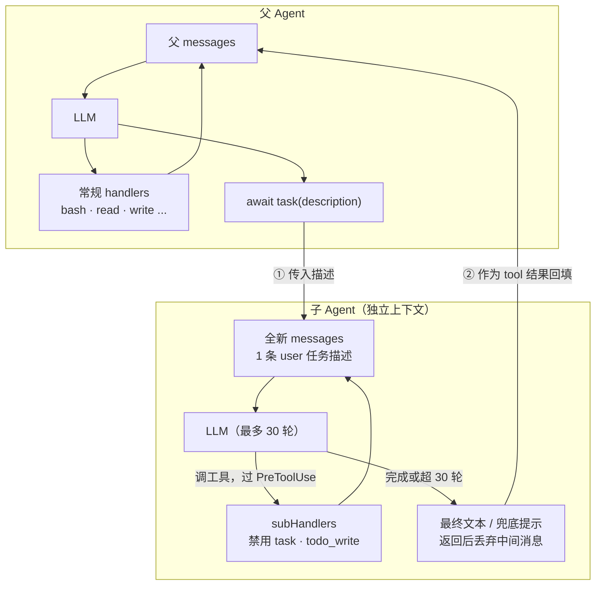

# s06：Subagent - 把探索放进干净上下文，只把摘要带回来

上一章 `s05` 学会了列计划，但一旦遇到“把目录里十几个文件都查一遍”的调研任务，大量文件读取和搜索输出会瞬间塞满主 `messages`，把主线冲淡。

这一章我们给 Agent 加一把 `task` 工具，专门承接这类调研。**Subagent 的核心不是“多一个人”，而是把子代理的中间输出留在它自己的 `messages[]` 里，主对话只收最终摘要。**

## 问题

主 Agent 既要盯着最终目标，又要亲自翻文件、跑搜索、做试错。所有探索细节都堆在同一份 `messages` 里，主上下文很快膨胀，既浪费 Token，又容易让模型分心。

## 解决方案

我们把子代理做成一个普通的 `task` 工具，背后调用 `spawnSubagent(description, confirm)`，让它在只含一条 `user` 任务描述的新 `messages` 里跑完循环，返回时丢弃所有中间流水，只交回最后一段文本或兜底提示：



这里同时做好三项约束：子代理禁用 `task` 和 `todo_write` 防止无限套娃，最多发起 30 次模型调用兜底，工具执行依然要过 `PreToolUse` 权限门。父循环会 `await` 等子代理跑完再继续，双方仍共享当前工作目录和文件工具。平时顺手查一两个文件让主代理直接读就行，只有需要大范围翻文件时才值得拆出子上下文。

## 测试 Prompt

```text
派一个子代理检查当前目录有哪些 Markdown 文件，主代理只需要返回子代理的总结。
```

当模型按要求调用 `task` 委派调研时，所有查目录的中间工具输出都留在子代理内部，主对话只拿到一段最终总结。

## 扩展阅读：商业级 Agent 怎么做子代理

商业级产品的子代理形态各异，但核心同样是独立上下文和清晰的返回边界：

- **Claude Code**：普通 subagent 拥有独立上下文，可单独限制可用工具，完成后只把最终结果返回主对话。参考 [Claude Code Subagents](https://code.claude.com/docs/en/sub-agents)。
- **Codex**：通过 `spawn_agent`、`wait_agent` 等工具管理子线程的创建、等待与回收，比一次性函数多了完整的生命周期控制。参考 [OpenAI Codex](https://github.com/openai/codex)。
- **opencode**：支持将自定义 agent 配置为 `subagent` 模式供主代理委派，还能单独配置工具与权限。参考 [OpenCode Agents](https://opencode.ai/docs/agents/)。

**新建一份干净的 `messages[]`，跑完只交回摘要，就是 Subagent 最本质的抽象。**

## 本地运行与测试

交互运行（从仓库根目录执行）：

```bash
cd code-agent-course && node s06-subagent.js
```

离线单测（在仓库根目录执行，无需 API Token）：

```bash
pnpm vitest run code-agent-course/s06-subagent.test.js
```

## 博客代码演进

### 1. 给子代理写一份提示词

子代理调的依然是同一个模型，区别只在给它什么提示词、消息和工具。先加一条简短的 `SUB_SYSTEM`：专注完成手头子任务，返回精炼摘要，不要再往下派任务。这一步只是先备好常量，程序运行行为还没变，等第 5 帧接上 `task` 工具后才会启用。

```diff agent-step
@@
 
 const SYSTEM = `You are a coding agent at ${process.cwd()}. Before a multi-step task, use todo_write to plan; update status as you go.`;
+const SUB_SYSTEM = `You are a coding subagent at ${process.cwd()}. Complete the task, then return a concise summary. Do not delegate further.`;
 
 const tools = [
```

### 2. 划定子代理能用的工具

从父代理的 `tools` 和 `handlers` 里筛出子代理可用的子集，用同一份 `SUB_EXCLUDE` 剔除 `task`（防无限递归）和 `todo_write`（小任务不必另列计划），保证两张表严格一致。再设 `MAX_SUB_TURNS = 30` 限制子代理最多发起 30 次模型调用。这一步仍在准备配置，下一帧才写出子循环。

```diff agent-step
@@
 };
 
+const SUB_EXCLUDE = ["task", "todo_write"];
+const subTools = tools.filter((t) => !SUB_EXCLUDE.includes(t.function.name));
+const subHandlers = Object.fromEntries(
+  Object.entries(handlers).filter(([name]) => !SUB_EXCLUDE.includes(name)),
+);
+const MAX_SUB_TURNS = 30;
+
 const hooks = { UserPromptSubmit: [], PreToolUse: [], PostToolUse: [], Stop: [] };
```

### 3. 子代理的循环：从一份全新的 messages 开始

`spawnSubagent` 第一行就是本章核心：`messages` 是全新数组，只装一条 `{ role: "user", content: description }`，完全不继承父对话历史。模型不再调工具时返回最终文本（空文本或超 30 轮各有兜底提示），函数一结束局部 `messages` 就随作用域丢弃。这一帧先立起循环外壳，下一帧补齐工具执行与回填后才能跑通工具闭环。

```diff agent-step
@@
 const MAX_SUB_TURNS = 30;
 
+async function spawnSubagent(description, confirm) {
+  const messages = [{ role: "user", content: description }];
+  for (let turn = 0; turn < MAX_SUB_TURNS; turn += 1) {
+    const { message } = await callLlm(messages, { system: SUB_SYSTEM, tools: subTools });
+    messages.push(message);
+    if (!message.tool_calls?.length) return message.content || "(subagent returned no text)";
+  }
+  return "Subagent stopped after 30 turns without a final answer.";
+}
+
 const hooks = { UserPromptSubmit: [], PreToolUse: [], PostToolUse: [], Stop: [] };
@@
   }
 }
+
+export { spawnSubagent };
 
 async function main() {
```

### 4. 子代理执行工具，同样要过权限

补齐子循环里的工具执行逻辑：解析参数、查 `subHandlers`、用 `tool_call_id` 把结果塞回子代理自己的 `messages`。特别注意：上下文是隔离的，但权限不是，子代理调工具前同样要触发 `PreToolUse`，危险命令照样拦截或问用户。

```diff agent-step
@@
     messages.push(message);
     if (!message.tool_calls?.length) return message.content || "(subagent returned no text)";
+
+    for (const call of message.tool_calls) {
+      const name = call.function.name;
+      const args = JSON.parse(call.function.arguments || "{}");
+      const blocked = await triggerHooks("PreToolUse", name, args, confirm);
+      const handler = subHandlers[name];
+      const output =
+        blocked != null ? String(blocked) : handler ? handler(args) : `Unknown tool: ${name}`;
+      messages.push({ role: "tool", tool_call_id: call.id, content: String(output) });
+    }
   }
   return "Subagent stopped after 30 turns without a final answer.";
```

### 5. 把 task 工具交给模型

最后把子代理挂进父代理：`tools` 增加 `task` 的 schema，`handlers` 指向 `spawnSubagent`，并更新 `SYSTEM` 告知模型遇到复杂子问题可以派子代理。因为 `spawnSubagent` 是异步的且可能需要用户确认，主循环执行工具改为 `await handler(args, confirm)`，提示符切到 `"s06 >> "`。

> **本章思考题**：先确认一下权限边界：如果让子代理执行 `rm notes.txt`，终端还会弹出 `[y/N]` 确认吗？（回头看第 4 帧的 `PreToolUse` 就知道答案。）另外，项目里还有代码规范、发布流程、排障手册等专业文档，全塞进 `SYSTEM` 每轮都在烧 Token。能不能只在提示词里放目录，模型需要时再按需加载全文？下一章 `s07` 我们来做 Skill Loading。

```diff agent-step
@@
 } from "./helper.js";
 
-const SYSTEM = `You are a coding agent at ${process.cwd()}. Before a multi-step task, use todo_write to plan; update status as you go.`;
+const SYSTEM = `You are a coding agent at ${process.cwd()}. Use tools to solve tasks. Before a multi-step task, use todo_write to plan and update status as you go. For a complex sub-problem, use the task tool to spawn a subagent.`;
 const SUB_SYSTEM = `You are a coding subagent at ${process.cwd()}. Complete the task, then return a concise summary. Do not delegate further.`;
@@
     required: ["todos"],
   }),
+  tool("task", "Launch a subagent to handle a complex subtask. Returns only the final summary.", {
+    type: "object",
+    properties: { description: { type: "string" } },
+    required: ["description"],
+  }),
 ];
@@
   glob: ({ pattern }) => glob(pattern),
   todo_write: runTodoWrite,
+  task: ({ description }, confirm) => spawnSubagent(description, confirm),
 };
@@
       } else {
         const handler = handlers[name];
-        output = handler ? handler(args) : `Unknown tool: ${name}`;
+        output = handler ? await handler(args, confirm) : `Unknown tool: ${name}`;
       }
@@
 async function main() {
   await runChatCli({
-    promptLabel: "s05 >> ",
+    promptLabel: "s06 >> ",
     onPrompt: async ({ prompt, messages, ask }) => {
       return agentLoop(messages, ask);
```

## 和上一步的关键代码 diff（不含 helper.js）

```diff
--- s05-todo-write.js
+++ s06-subagent.js
@@
-const SYSTEM = `You are a coding agent at ${process.cwd()}. Before a multi-step task, use todo_write to plan; update status as you go.`;
+const SYSTEM = `You are a coding agent at ${process.cwd()}. Use tools to solve tasks. Before a multi-step task, use todo_write to plan and update status as you go. For a complex sub-problem, use the task tool to spawn a subagent.`;
+const SUB_SYSTEM = `You are a coding subagent at ${process.cwd()}. Complete the task, then return a concise summary. Do not delegate further.`;
@@
+  tool("task", "Launch a subagent to handle a complex subtask. Returns only the final summary.", {
+    type: "object",
+    properties: { description: { type: "string" } },
+    required: ["description"],
+  }),
 ];
@@
   glob: ({ pattern }) => glob(pattern),
   todo_write: runTodoWrite,
+  task: ({ description }, confirm) => spawnSubagent(description, confirm),
 };
@@
+const SUB_EXCLUDE = ["task", "todo_write"];
+const subTools = tools.filter((t) => !SUB_EXCLUDE.includes(t.function.name));
+const subHandlers = Object.fromEntries(
+  Object.entries(handlers).filter(([name]) => !SUB_EXCLUDE.includes(name)),
+);
+const MAX_SUB_TURNS = 30;
+
+async function spawnSubagent(description, confirm) {
+  const messages = [{ role: "user", content: description }];
+  for (let turn = 0; turn < MAX_SUB_TURNS; turn += 1) {
+    const { message } = await callLlm(messages, { system: SUB_SYSTEM, tools: subTools });
+    messages.push(message);
+    if (!message.tool_calls?.length) return message.content || "(subagent returned no text)";
+
+    for (const call of message.tool_calls) {
+      const name = call.function.name;
+      const args = JSON.parse(call.function.arguments || "{}");
+      const blocked = await triggerHooks("PreToolUse", name, args, confirm);
+      const handler = subHandlers[name];
+      const output =
+        blocked != null ? String(blocked) : handler ? handler(args) : `Unknown tool: ${name}`;
+      messages.push({ role: "tool", tool_call_id: call.id, content: String(output) });
+    }
+  }
+  return "Subagent stopped after 30 turns without a final answer.";
+}
@@
-        output = handler ? handler(args) : `Unknown tool: ${name}`;
+        output = handler ? await handler(args, confirm) : `Unknown tool: ${name}`;
@@
+export { spawnSubagent };
@@
-    promptLabel: "s05 >> ",
+    promptLabel: "s06 >> ",
```
