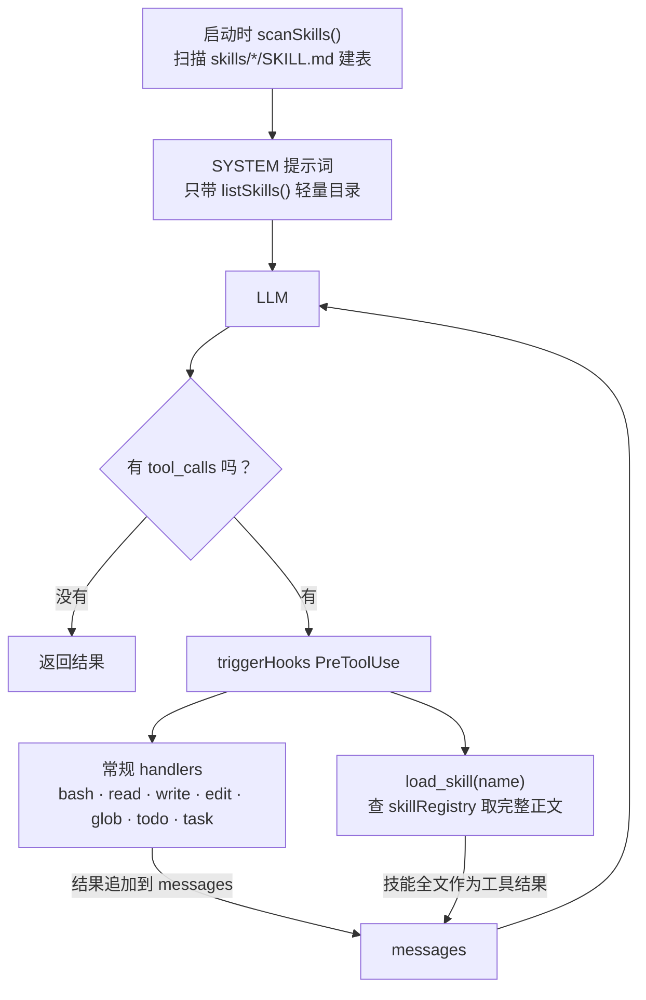

# s07：Skill Loading - 先给技能目录，需要时再按需加载全文

上一章 `s06` 用子代理把探索过程隔离开了，但项目里还有代码规范、发布流程、方案评审清单这类专业手册。如果把它们全塞进 `SYSTEM`，每轮对话都在烧 Token，而且大多数时候根本用不到。

这一章我们给 Agent 加上两级技能加载。**技能系统的核心不是把知识全部预装进提示词，而是常驻一份轻量目录，模型真用得上时再调用 `load_skill` 取全文。**

## 问题

团队经验一多，各类规范和指南动辄几千字。启动时一股脑塞进 `SYSTEM`，会持续挤压上下文窗口，也容易分散模型对当前任务的注意力。反过来，如果完全不放，模型根本不知道仓库里有这些指南，每次还得靠用户口头重复。

## 解决方案

我们把技能加载拆成“启动扫目录、运行时取全文”两级。程序启动时，`scanSkills()` 扫描 `skills/` 下的直接子目录，复用 `helper.js` 的 `parseFrontmatter()` 读出每个 `SKILL.md` 头部的 `name` 和 `description`，存入内存表 `skillRegistry`。

`SYSTEM` 里只拼入 `listSkills()` 生成的简短清单。模型判断需要某个技能时，再调用普通工具 `load_skill(name)`，把完整正文作为工具结果注入对话：



这样设计同时兼顾成本和安全：目录每个技能只占一行，常驻上下文非常便宜；`loadSkill` 只拿名字去查启动时建好的 `skillRegistry`，不拿模型参数拼路径，避免了路径穿越读取任意文件。同时要注意，技能正文属于外部知识数据，真实生产系统仍要防范内容里的 prompt injection。

## 测试 Prompt

```text
先看看你有哪些可用技能；如果有适合帮我推敲和挑刺方案的技能，就加载它，然后针对“给博客加全文搜索”这个计划提出第一个问题。
```

仓库里自带示例技能 `code-agent-course/skills/grilling/SKILL.md`。运行后能看到模型先根据 `SYSTEM` 里的目录识别出 `grilling`，再调用 `load_skill` 取出全文，并按照技能要求一次只提一个关键设计问题。

## 扩展阅读：商业级 Agent 怎么做技能加载

商业级产品对技能、规则和插件的处理，本质上都遵循“先发现、再按需展开”的两级模式：

- **Claude Code**：启动时只向模型展示各 skill 的名称与简短描述，命中任务后才加载正文，和本章结构直接对应。参考 [Claude Code Skills](https://code.claude.com/docs/en/slash-commands)。
- **Codex**：通过 `SKILL.md` 的 `name` 和 `description` 做发现与触发，真正使用时才把正文装入上下文。参考 [Codex Skill Creator](https://github.com/openai/codex/blob/main/codex-rs/skills/src/assets/samples/skill-creator/SKILL.md)。
- **opencode**：扫描 `.opencode/skills/`、`.claude/skills/` 和 `.agents/skills/` 汇总清单，再由原生 `skill` 工具按需返回完整正文。参考 [OpenCode Agent Skills](https://opencode.ai/docs/skills)。

**把“目录”和“正文”拆成两级，是控制上下文膨胀最稳妥的知识挂载方式。**

## 本地运行与测试

交互运行（从仓库根目录执行）：

```bash
cd code-agent-course && node s07-skill-loading.js
```

离线单测（在仓库根目录执行，无需 API Token）：

```bash
pnpm vitest run code-agent-course/s07-skill-loading.test.js
```

## 博客代码演进

### 1. 准备读取 skills 目录

技能本质上是放在 `skills/` 目录下的 Markdown 文件。我们先从 `node:fs` 和 `node:path` 引入目录和文件读取函数，并从 `helper.js` 引入负责解析文件头部元信息的 `parseFrontmatter`，再定好 `SKILLS_DIR` 路径。这一步只做准备，程序行为还没有变化。

```diff agent-step
@@
+import { readdirSync, readFileSync, existsSync } from "node:fs";
+import path from "node:path";
 import {
   callLlm,
@@
   runChatCli,
   isMainModule,
+  parseFrontmatter,
 } from "./helper.js";
+
+const SKILLS_DIR = path.join(process.cwd(), "skills");
 
 const SYSTEM = `You are a coding agent at ${process.cwd()}. Use tools to solve tasks. Before a multi-step task, use todo_write to plan and update status as you go. For a complex sub-problem, use the task tool to spawn a subagent.`;
```

### 2. 启动时扫描所有技能

`scanSkills` 遍历 `skills/` 下的直接子目录，找到里面的 `SKILL.md`，用 `parseFrontmatter` 解析头部的名字和描述，连同原文一起放进一张按名字索引的对象表。目录不存在或缺少 `SKILL.md` 时直接跳过，不报错。程序启动时调用一次存进 `skillRegistry`，后面所有技能查询都直接读内存表。

```diff agent-step
@@
 const SKILLS_DIR = path.join(process.cwd(), "skills");
 
+export function scanSkills(dir = SKILLS_DIR) {
+  const registry = {};
+  if (!existsSync(dir)) return registry;
+  for (const entry of readdirSync(dir, { withFileTypes: true })) {
+    if (!entry.isDirectory()) continue;
+    const manifest = path.join(dir, entry.name, "SKILL.md");
+    if (!existsSync(manifest)) continue;
+    const raw = readFileSync(manifest, "utf8");
+    const { meta } = parseFrontmatter(raw);
+    const name = meta.name || entry.name;
+    registry[name] = { name, description: meta.description || "", content: raw };
+  }
+  return registry;
+}
+
+export const skillRegistry = scanSkills();
+
 const SYSTEM = `You are a coding agent at ${process.cwd()}. Use tools to solve tasks. Before a multi-step task, use todo_write to plan and update status as you go. For a complex sub-problem, use the task tool to spawn a subagent.`;
 const SUB_SYSTEM = `You are a coding subagent at ${process.cwd()}. Complete the task, then return a concise summary. Do not delegate further.`;
```

### 3. 第一级：把技能目录写进系统提示词

`listSkills` 把内存表里的每个技能压缩成一行“名字: 描述”。我们把 `SYSTEM` 展开成多行模板，拼入这份目录，并告诉模型需要时用 `load_skill` 取完整正文。目录每轮都会发给模型，但体量极小，模型从此知道仓库里有哪些技能可用。

```diff agent-step
@@
 export const skillRegistry = scanSkills();
 
-const SYSTEM = `You are a coding agent at ${process.cwd()}. Use tools to solve tasks. Before a multi-step task, use todo_write to plan and update status as you go. For a complex sub-problem, use the task tool to spawn a subagent.`;
+function listSkills() {
+  const all = Object.values(skillRegistry);
+  return all.length ? all.map((s) => `- ${s.name}: ${s.description}`).join("\n") : "(no skills found)";
+}
+
+const SYSTEM = `You are a coding agent at ${process.cwd()}. Use tools to solve tasks.
+Before a multi-step task, use todo_write to plan and update status as you go.
+For a complex sub-problem, use the task tool to spawn a subagent.
+Skills available:
+${listSkills()}
+Use load_skill to get a skill's full content when you need it.`;
 const SUB_SYSTEM = `You are a coding subagent at ${process.cwd()}. Complete the task, then return a concise summary. Do not delegate further.`;
```

### 4. 第二级：用 load_skill 按需取全文

`loadSkill` 按名字从 `skillRegistry` 取出完整的 `SKILL.md`，查不到就返回提示文案。因为它只查内存表、不拼磁盘路径，模型无法借此读取越权文件。接着按老办法一口气接齐：`tools` 加 schema，`handlers` 登记 `load_skill`，`SUB_EXCLUDE` 也顺手排除它。注意主循环 `agentLoop` 一行都没改。

```diff agent-step
@@
 }
 
+function loadSkill({ name }) {
+  const skill = skillRegistry[name];
+  return skill ? skill.content : `Skill not found: ${name}`;
+}
+
 const SYSTEM = `You are a coding agent at ${process.cwd()}. Use tools to solve tasks.
 Before a multi-step task, use todo_write to plan and update status as you go.
@@
     required: ["description"],
   }),
+  tool("load_skill", "Load a skill's full content by name (see the catalog in the system prompt).", {
+    type: "object",
+    properties: { name: { type: "string" } },
+    required: ["name"],
+  }),
 ];
@@
   todo_write: runTodoWrite,
   task: ({ description }, confirm) => spawnSubagent(description, confirm),
+  load_skill: loadSkill,
 };
 
-const SUB_EXCLUDE = ["task", "todo_write"];
+const SUB_EXCLUDE = ["task", "todo_write", "load_skill"];
 const subTools = tools.filter((t) => !SUB_EXCLUDE.includes(t.function.name));
 const subHandlers = Object.fromEntries(
```

### 5. 收尾：整理导出位置并更新提示符

最后把 `export { spawnSubagent }` 挪到子代理定义紧后面，顺手把交互提示符切到 `s07 >> `。回顾整章改动，主循环 `agentLoop` 纹丝未动，技能系统只是启动时的一次目录扫描外加一把普通工具。

> **本章思考题**：现在专业知识不会一开始就塞满提示词了，但只要对话一长，模型反复读文件、跑命令、看报错，`messages` 还是会越滚越大直到超限。如果不靠重开会话，怎么在尽量不丢关键线索的前提下给长对话瘦身？下一章 `s08` 我们来做 Context Compact。

```diff agent-step
@@
 }
 
+export { spawnSubagent };
+
 const hooks = { UserPromptSubmit: [], PreToolUse: [], PostToolUse: [], Stop: [] };
@@
 }
 
-export { spawnSubagent };
-
 async function main() {
   await runChatCli({
-    promptLabel: "s06 >> ",
+    promptLabel: "s07 >> ",
     onPrompt: async ({ prompt, messages, ask }) => {
       return agentLoop(messages, ask);
```

## 和上一步的关键代码 diff（不含 helper.js）

```diff
--- s06-subagent.js
+++ s07-skill-loading.js
@@
+import { readdirSync, readFileSync, existsSync } from "node:fs";
+import path from "node:path";
 import {
   callLlm,
   runBash,
@@
   isMainModule,
+  parseFrontmatter,
 } from "./helper.js";
@@
+const SKILLS_DIR = path.join(process.cwd(), "skills");
+
+export function scanSkills(dir = SKILLS_DIR) {
+  const registry = {};
+  if (!existsSync(dir)) return registry;
+  for (const entry of readdirSync(dir, { withFileTypes: true })) {
+    if (!entry.isDirectory()) continue;
+    const manifest = path.join(dir, entry.name, "SKILL.md");
+    if (!existsSync(manifest)) continue;
+    const raw = readFileSync(manifest, "utf8");
+    const { meta } = parseFrontmatter(raw);
+    const name = meta.name || entry.name;
+    registry[name] = { name, description: meta.description || "", content: raw };
+  }
+  return registry;
+}
+
+export const skillRegistry = scanSkills();
+
+function listSkills() {
+  const all = Object.values(skillRegistry);
+  return all.length ? all.map((s) => `- ${s.name}: ${s.description}`).join("\n") : "(no skills found)";
+}
+
+function loadSkill({ name }) {
+  const skill = skillRegistry[name];
+  return skill ? skill.content : `Skill not found: ${name}`;
+}
+
-const SYSTEM = `You are a coding agent at ${process.cwd()}. Use tools to solve tasks. Before a multi-step task, use todo_write to plan and update status as you go. For a complex sub-problem, use the task tool to spawn a subagent.`;
+const SYSTEM = `You are a coding agent at ${process.cwd()}. Use tools to solve tasks.
+Before a multi-step task, use todo_write to plan and update status as you go.
+For a complex sub-problem, use the task tool to spawn a subagent.
+Skills available:
+${listSkills()}
+Use load_skill to get a skill's full content when you need it.`;
@@
+  tool("load_skill", "Load a skill's full content by name (see the catalog in the system prompt).", {
+    type: "object",
+    properties: { name: { type: "string" } },
+    required: ["name"],
+  }),
@@
   todo_write: runTodoWrite,
   task: ({ description }, confirm) => spawnSubagent(description, confirm),
+  load_skill: loadSkill,
 };
@@
-const SUB_EXCLUDE = ["task", "todo_write"];
+const SUB_EXCLUDE = ["task", "todo_write", "load_skill"];
```
