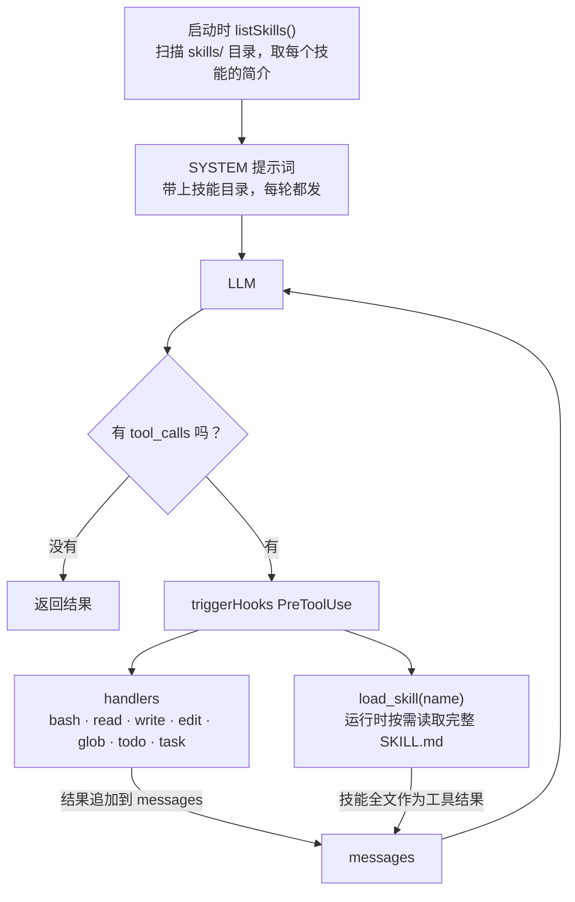

# s07：Skill Loading —— 知识按需加载

新人不可能第一天就背完整本公司手册，更不该每次开会都把所有资料搬上桌。`s07` 教他先看目录，需要某项专业知识时再去翻对应手册，这样脑子里只装当下用得上的内容。


## 本章目标

如果一开始把所有专业知识都塞进 system prompt，上下文会很快变大，而且很多知识根本用不上。

`s07` 加入技能系统：system prompt 里只放技能目录，模型需要时再调用 `load_skill` 读取完整内容。

## 新增能力

本章沿用前面的 `todo_write` 和 `task`，只新增“技能按需加载”。

- 扫描 `skills/` 目录。
- 从 `SKILL.md` 读取 `name` 和 `description`。
- system prompt 只展示技能列表。
- `load_skill(name)` 按需返回完整技能文本。

## 流程图


```text
启动时
  |
  v
扫描 skills/
  |
  v
system prompt 只放目录
  |
  | 需要某个技能
  v
tool_call: load_skill(name)
  |
  v
完整技能内容作为 tool_result 回到模型
```

## 为什么这一步重要

技能系统解决的是“知识不要预加载”的问题。

目录常驻很便宜，全文按需加载才可控。后续 MCP、插件、团队能力，本质上也会用类似的“发现 -> 按需展开”模式。

## 代码入口

- JS：[s07-skill-loading.js](./s07-skill-loading.js)
- Test：[s07-skill-loading.test.js](./s07-skill-loading.test.js)

## 运行

```bash
node code-agent-course/s07-skill-loading.js
```

## 参考实现提醒

Skill Loading 的重点是“两级加载”：

- system prompt 里只放技能名和一句话描述，避免启动时塞满上下文。
- 真的需要某个技能时，再通过 `load_skill` 把完整内容作为 tool result 注入。
- 技能文件是知识数据，不是越权指令；真实系统还要防 prompt injection。

## 测试 Prompt

```text
先查看当前有哪些可用技能，如果有适合仓库检查的技能，就加载它并用它检查 README。
```

观察重点：模型应该先从 skills catalog 判断是否需要技能，再调用 `load_skill` 读取完整内容。

## 一句话总结

`s07` 把知识从“全部塞进 prompt”改成“先发现，再按需加载”。

## 新增函数速览

- `scanSkills(dir)`：扫描 `skills/` 的直接子目录，读取其中的 `SKILL.md` frontmatter 和正文。
- `listSkills()`：把已发现的 skill 压成一段简短清单，注入 system prompt 让模型知道有哪些技能。
- `loadSkill({ name })`：按名称读取某个 skill 的完整内容，并通过工具结果按需交给模型。
- `agentLoop(messages, confirm)`：在 s06 基础上多暴露一个 `load_skill` 工具。

## 关键代码

`s07` 的关键不是把技能全文塞进 system prompt，而是启动时先扫描 `skills/`，生成一个轻量目录。

`parseFrontmatter` 是纯工具函数，放在 `helper.js` 里复用；本章只负责调用它：

```js
import { parseFrontmatter } from "./helper.js";

const SKILLS_DIR = path.join(process.cwd(), "skills");

export function scanSkills(dir = SKILLS_DIR) {
  const registry = {};
  if (!existsSync(dir)) return registry;
  for (const entry of readdirSync(dir, { withFileTypes: true })) {
    if (!entry.isDirectory()) continue;
    const manifest = path.join(dir, entry.name, "SKILL.md");
    if (!existsSync(manifest)) continue;
    const raw = readFileSync(manifest, "utf8");
    const { meta } = parseFrontmatter(raw);
    const name = meta.name || entry.name;
    registry[name] = { name, description: meta.description || "", content: raw };
  }
  return registry;
}

export const skillRegistry = scanSkills();
```

然后 system prompt 里只放技能名和描述：

```js
const SYSTEM = `You are a coding agent at ${process.cwd()}. Use tools to solve tasks.
Before a multi-step task, use todo_write to plan and update status as you go.
For a complex sub-problem, use the task tool to spawn a subagent.
Skills available:
${listSkills()}
Use load_skill to get a skill's full content when you need it.`;
```

模型真正需要某个技能时，再通过工具加载全文：

```js
function loadSkill({ name }) {
  const skill = skillRegistry[name];
  return skill ? skill.content : `Skill not found: ${name}`;
}
```

## 扩展阅读：商业级 Agent 怎么做技能和插件

技能系统的本质是“能力发现”和“按需加载”，不是把所有知识一开始塞进 system prompt：

- Claude Code：启动时先让模型看到 skill 的描述，只在实际使用时加载正文，这与本章的两级加载直接对应。参考 [Claude Code Skills](https://code.claude.com/docs/en/slash-commands)。
- Codex：`SKILL.md` 的 `name` 和 `description` 用于发现与触发，正文只在 skill 触发后加载。参考 [Codex Skill Creator](https://github.com/openai/codex/blob/main/codex-rs/skills/src/assets/samples/skill-creator/SKILL.md)。
- opencode：扫描 `.opencode/skills/`、`.claude/skills/` 和 `.agents/skills/`，再由原生 `skill` 工具按需返回完整内容。参考 [OpenCode Agent Skills](https://opencode.ai/docs/skills)。

本章只做最小版：`scanSkills()` 先给模型一个目录，`load_skill` 再把完整技能内容作为 tool result 注入。

## 博客代码演进

下面 5 个 patch 专门用于博客右侧的代码切换。第一步基于 `s06-subagent.js`，后面的每一步都继续修改上一帧，最后必须得到完整的 `s07-skill-loading.js`。

每一步的代码都可以运行。前两步在启动时把 `skills/` 目录扫一遍；第 3 步把技能的名字和描述写进系统提示词；第 4 步加上 `load_skill` 工具，模型需要时才取完整内容。

### 1. 准备读取 skills 目录

技能就是放在 `skills/` 目录下的 Markdown 文件，所以先引入读目录、读文件要用的 Node.js 内置函数，以及 `helper.js` 里解析文件头部信息的 `parseFrontmatter`。`SKILLS_DIR` 指向当前目录下的 `skills/`。这一步只做准备，行为不变。

```diff agent-step
@@
+import { readdirSync, readFileSync, existsSync } from "node:fs";
+import path from "node:path";
 import {
   callLlm,
@@
   runChatCli,
   isMainModule,
+  parseFrontmatter,
 } from "./helper.js";
+
+const SKILLS_DIR = path.join(process.cwd(), "skills");
 
 const SYSTEM = `You are a coding agent at ${process.cwd()}. Use tools to solve tasks. Before a multi-step task, use todo_write to plan and update status as you go. For a complex sub-problem, use the task tool to spawn a subagent.`;
```

### 2. 启动时扫描所有技能

`scanSkills` 遍历 `skills/` 下的每个子目录，找到里面的 `SKILL.md`，从文件头部读出名字和描述，连同全文一起放进一张表。表的键是技能名。目录不存在或者没有 `SKILL.md` 就跳过，不报错。程序启动时执行一次，结果保存在 `skillRegistry` 里。之后所有和技能有关的操作都查这张表，不再碰文件系统。

```diff agent-step
@@
 const SKILLS_DIR = path.join(process.cwd(), "skills");
 
+export function scanSkills(dir = SKILLS_DIR) {
+  const registry = {};
+  if (!existsSync(dir)) return registry;
+  for (const entry of readdirSync(dir, { withFileTypes: true })) {
+    if (!entry.isDirectory()) continue;
+    const manifest = path.join(dir, entry.name, "SKILL.md");
+    if (!existsSync(manifest)) continue;
+    const raw = readFileSync(manifest, "utf8");
+    const { meta } = parseFrontmatter(raw);
+    const name = meta.name || entry.name;
+    registry[name] = { name, description: meta.description || "", content: raw };
+  }
+  return registry;
+}
+
+export const skillRegistry = scanSkills();
+
 const SYSTEM = `You are a coding agent at ${process.cwd()}. Use tools to solve tasks. Before a multi-step task, use todo_write to plan and update status as you go. For a complex sub-problem, use the task tool to spawn a subagent.`;
 const SUB_SYSTEM = `You are a coding subagent at ${process.cwd()}. Complete the task, then return a concise summary. Do not delegate further.`;
```

### 3. 第一级：把技能目录写进系统提示词

`listSkills` 把每个技能变成一行“名字: 描述”。系统提示词改成多行，把这份目录放进去，并告诉模型：需要时用 `load_skill` 取完整内容。目录每一轮都会发给模型，但每个技能只占一行，很便宜。模型从此知道有哪些技能可用，只是还看不到正文。

```diff agent-step
@@
 export const skillRegistry = scanSkills();
 
-const SYSTEM = `You are a coding agent at ${process.cwd()}. Use tools to solve tasks. Before a multi-step task, use todo_write to plan and update status as you go. For a complex sub-problem, use the task tool to spawn a subagent.`;
+function listSkills() {
+  const all = Object.values(skillRegistry);
+  return all.length ? all.map((s) => `- ${s.name}: ${s.description}`).join("\n") : "(no skills found)";
+}
+
+const SYSTEM = `You are a coding agent at ${process.cwd()}. Use tools to solve tasks.
+Before a multi-step task, use todo_write to plan and update status as you go.
+For a complex sub-problem, use the task tool to spawn a subagent.
+Skills available:
+${listSkills()}
+Use load_skill to get a skill's full content when you need it.`;
 const SUB_SYSTEM = `You are a coding subagent at ${process.cwd()}. Complete the task, then return a concise summary. Do not delegate further.`;
```

### 4. 第二级：load_skill 按需取全文

`loadSkill` 按名字到 `skillRegistry` 里取出完整的 `SKILL.md`，找不到就返回一句提示。它只查表，不拿模型给的名字去拼文件路径，所以模型没办法借它读到别的文件。然后照老办法接入：`tools` 加 schema，`handlers` 加一行。子代理的排除名单里也加上 `load_skill`。主循环一行没改。

```diff agent-step
@@
 }
 
+function loadSkill({ name }) {
+  const skill = skillRegistry[name];
+  return skill ? skill.content : `Skill not found: ${name}`;
+}
+
 const SYSTEM = `You are a coding agent at ${process.cwd()}. Use tools to solve tasks.
 Before a multi-step task, use todo_write to plan and update status as you go.
@@
     required: ["description"],
   }),
+  tool("load_skill", "Load a skill's full content by name (see the catalog in the system prompt).", {
+    type: "object",
+    properties: { name: { type: "string" } },
+    required: ["name"],
+  }),
 ];
@@
   todo_write: runTodoWrite,
   task: ({ description }, confirm) => spawnSubagent(description, confirm),
+  load_skill: loadSkill,
 };
 
-const SUB_EXCLUDE = ["task", "todo_write"];
+const SUB_EXCLUDE = ["task", "todo_write", "load_skill"];
 const subTools = tools.filter((t) => !SUB_EXCLUDE.includes(t.function.name));
 const subHandlers = Object.fromEntries(
```

### 5. 收尾：挪动导出，更新提示符

最后把导出 `spawnSubagent` 的那一行挪到子代理代码后面，提示符改成 `s07 >> `。这一步不改变行为。回头看整章：`agentLoop` 完全没动，技能只是多了一段启动时的扫描和一个普通工具。

```diff agent-step
@@
 }
 
+export { spawnSubagent };
+
 const hooks = { UserPromptSubmit: [], PreToolUse: [], PostToolUse: [], Stop: [] };
@@
 }
 
-export { spawnSubagent };
-
 async function main() {
   await runChatCli({
-    promptLabel: "s06 >> ",
+    promptLabel: "s07 >> ",
     onPrompt: async ({ prompt, messages, ask }) => {
       return agentLoop(messages, ask);
```

## 和上一步的关键代码 diff（不含 helper.js）

下面只展示 s06 到 s07 最能说明“先发现、再按需加载”的变化；完整差异以相邻 JS 文件为准。

```diff
--- s06-subagent.js
+++ s07-skill-loading.js
@@
+import { readdirSync, readFileSync, existsSync } from "node:fs";
+import path from "node:path";
 import {
   callLlm,
   runBash,
@@
   isMainModule,
+  parseFrontmatter,
 } from "./helper.js";
@@
+const SKILLS_DIR = path.join(process.cwd(), "skills");
+
+export function scanSkills(dir = SKILLS_DIR) {
+  const registry = {};
+  if (!existsSync(dir)) return registry;
+  for (const entry of readdirSync(dir, { withFileTypes: true })) {
+    if (!entry.isDirectory()) continue;
+    const manifest = path.join(dir, entry.name, "SKILL.md");
+    if (!existsSync(manifest)) continue;
+    const raw = readFileSync(manifest, "utf8");
+    const { meta } = parseFrontmatter(raw);
+    const name = meta.name || entry.name;
+    registry[name] = { name, description: meta.description || "", content: raw };
+  }
+  return registry;
+}
+
+export const skillRegistry = scanSkills();
+
+function listSkills() {
+  const all = Object.values(skillRegistry);
+  return all.length ? all.map((s) => `- ${s.name}: ${s.description}`).join("\n") : "(no skills found)";
+}
+
+function loadSkill({ name }) {
+  const skill = skillRegistry[name];
+  return skill ? skill.content : `Skill not found: ${name}`;
+}
+
-const SYSTEM = `You are a coding agent at ${process.cwd()}. Use tools to solve tasks. Before a multi-step task, use todo_write to plan and update status as you go. For a complex sub-problem, use the task tool to spawn a subagent.`;
+const SYSTEM = `You are a coding agent at ${process.cwd()}. Use tools to solve tasks.
+Before a multi-step task, use todo_write to plan and update status as you go.
+For a complex sub-problem, use the task tool to spawn a subagent.
+Skills available:
+${listSkills()}
+Use load_skill to get a skill's full content when you need it.`;
@@
+  tool("load_skill", "Load a skill's full content by name (see the catalog in the system prompt).", {
+    type: "object",
+    properties: { name: { type: "string" } },
+    required: ["name"],
+  }),
@@
   todo_write: runTodoWrite,
   task: ({ description }, confirm) => spawnSubagent(description, confirm),
+  load_skill: loadSkill, // s07 新增：按需加载技能内容
 };
@@
-const SUB_EXCLUDE = ["task", "todo_write"];
+const SUB_EXCLUDE = ["task", "todo_write", "load_skill"];
```
