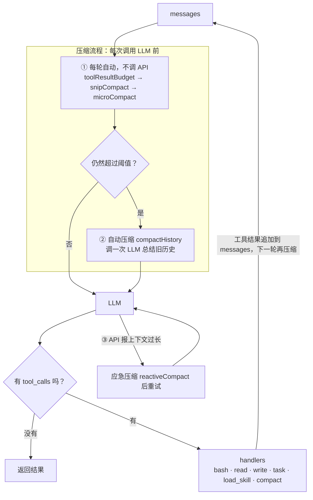
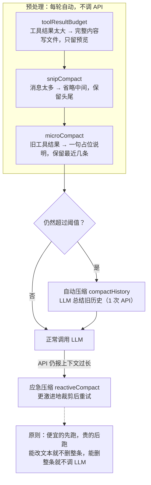
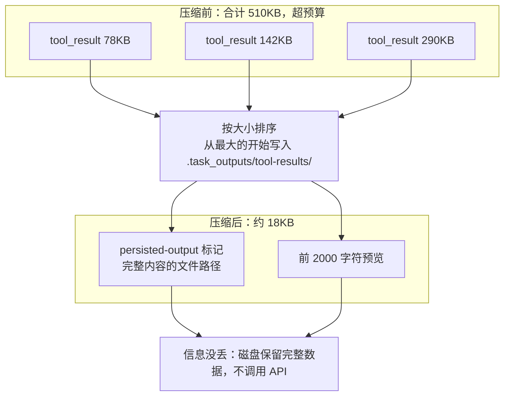
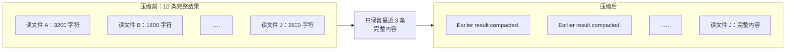
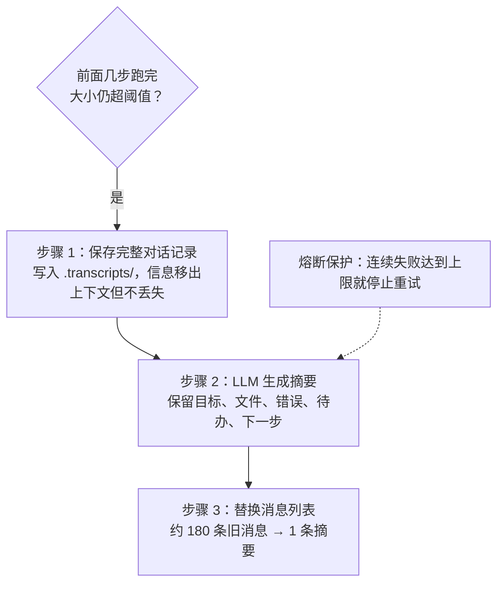

# s08：Context Compact —— 给长会话腾空间

新人连续工作几个小时后，桌面会堆满便签、日志和临时资料。`s08` 教他整理桌面：重要结论留下，超长输出保存到文件，旧过程压缩成摘要，让后面的工作还能继续。


## 本章目标

agent 一直跑，`messages` 一定会越来越长。上下文满了以后，不处理就会失败。

`s08` 加入分层压缩流程：先用不调用模型的简单规则缩短历史，再必要时让模型总结旧历史。

## 新增能力

本章沿用前面的计划、子代理和技能加载，只新增上下文压缩。

- `toolResultBudget`：如果工具结果太大，就把完整内容写入文件，并在 `messages` 里只保留文件路径和预览。
- `snipCompact`：消息太多时省略中间较旧的部分。
- `microCompact`：较早的工具结果缩成一句简短说明。
- `compact` 工具：模型可主动请求压缩。
- 应急压缩：API 报上下文过长时，先总结旧历史再重试。

## 流程图






```text
messages 变大
    |
    v
大工具结果写入文件保存
    |
    v
省略中间较旧消息
    |
    v
旧工具结果缩成一句说明
    |
    v
仍然太大？
    |
    +-- 否 --> 调 LLM
    |
    +-- 是 --> 摘要旧历史 --> 调 LLM
```

## 为什么这一步重要

压缩不是删除历史，而是保住“下一步需要的连续性”。

不调用模型的简单规则先跑，LLM 摘要后跑。这样可以减少模型输入长度，也让长会话不容易失败。

## 代码入口

- JS：[s08-context-compact.js](./s08-context-compact.js)
- Test：[s08-context-compact.test.js](./s08-context-compact.test.js)

## 运行

```bash
node code-agent-course/s08-context-compact.js
```

## 参考实现提醒

压缩不是一次性“总结一下”，而是一组分层策略：

- 大工具结果优先写入文件保存，`messages` 里只留下文件路径和一小段预览，避免上下文变得过大。
- 旧消息可以省略或总结，但当前任务、最新计划和未完成状态要保留。
- API 报上下文太长时，要先做应急压缩再重试，而不是直接放弃会话。
- 本教程把 `CONTEXT_LIMIT` 设成 `12000`，方便在命令行里观察自动压缩；真实项目可以按模型上下文窗口调大。
- 本章的 `estimateSize()` 和 `toolResultBudget()` 使用 JavaScript 字符串长度做近似，不是真实 byte 或 token；生产系统应使用模型 tokenizer 或 Provider 返回的 usage。
- 摘要输入超过 80,000 字符时，`prepareHistoryForSummary()` 会保留稳定头部和最新尾部。只保留最旧前缀会丢掉当前任务，只保留最新尾部又可能丢掉用户最初的硬约束。

## 测试 Prompt

在同一个 CLI 会话里依次输入下面三条 Prompt：

```text
读取 code-agent-course/helper.js 的前 200 行，然后主动 compact，再总结你仍然记得哪些关键信息。


不要调用任何工具。请输出一段很长的中文说明，主题是“agent loop 为什么需要上下文压缩”，至少 9000 个汉字，分成 30 段，每段都以 MEMORY_BLOCK 开头，最后写 LONG_CONTEXT_DONE。

不要调用 bash。请告诉我：你是否还能记得上一轮的主题，以及当前对话为什么需要上下文压缩。
```

观察重点：大工具结果进入消息后，压缩逻辑应该保留后续回答需要的工作记忆。

## 一句话总结

`s08` 让 agent 能在上下文变大时继续工作，而不是因为历史太长直接失败。

## 新增函数速览

- `snipCompact(messages)`：删除中间的旧消息，只保留开头和最近对话。
- `microCompact(messages)`：压短较早的 tool result，保留“这个工具曾经跑过”的线索。
- `toolResultBudget(messages)`：当工具输出太大时，把完整内容写入文件，只在上下文里保留文件路径和预览。
- `compactHistory(messages)`：调用模型总结历史，把长对话压成一条可继续工作的摘要。
- `reactiveCompact(messages)`：当模型提示上下文过长时，立即触发一次总结式压缩。

## 关键代码

压缩流程在每次调用模型前运行，先做不需要调用模型的简单处理，必要时再让模型总结旧历史：

```js
// L3：超大的工具输出先写入文件，只在上下文里留下文件路径和预览。
apply(messages, toolResultBudget(messages));
// L1：消息太多时省略中间较旧的消息，保留开头和最近上下文。
apply(messages, snipCompact(messages));
// L2：较早的工具结果换成一句说明，只保留最近几条工具结果全文。
apply(messages, microCompact(messages));
if (estimateSize(messages) > CONTEXT_LIMIT) {
  console.log("[auto compact] compactHistory");
  apply(messages, await compactHistory(messages));
}
```

模型也可以主动调用 `compact`：

```js
if (name === "compact") {
  console.log("[manual compact] compactHistory");
  apply(messages, await compactHistory(messages));
  compacted = true;
  break;
}
```

### 两个保存目录有什么不同

- `.task_outputs/tool-results/`：保存单次过大的工具输出。`messages` 中只留路径和预览，需要时还能重新读文件。
- `.transcripts/`：在 LLM 摘要历史前，把当时的完整 `messages` 保存为 JSONL。每行是一条 JSON 消息，便于调试和追溯。

`<persisted-output>...</persisted-output>` 不是 HTML，而是给模型看的结构标记：它明确告诉模型“完整输出已保存在文件里，当前只是预览”。

## 扩展阅读：商业级 Agent 怎么做上下文压缩

下面只整理公开文档和开源代码能确认的部分。商业产品的完整内部实现不一定公开，所以这里不猜细节，只看它们暴露出来的设计信号。

真正成熟的上下文压缩，通常不是一个 `summarize(messages)` 函数，而是一套运行时能力：

```text
token 估算
  |
  v
工具输出先变短或写入文件
  |
  v
保留最近对话和当前任务状态
  |
  v
旧历史总结成 summary
  |
  v
必要时写入 transcript / memory
  |
  v
继续下一轮 agent loop
```

| Agent | 公开能看到的做法 | 对应本章代码 |
| --- | --- | --- |
| Claude Code | 自动 compact、手动 `/compact`、`PreCompact` / `PostCompact` hook | `CONTEXT_LIMIT`、`compact` 工具、`compactHistory()` |
| Codex | `/compact` 手动压缩，配置里有自动压缩 token 阈值和模型上下文窗口 | `CONTEXT_LIMIT = 12000` |
| opencode | `compaction.auto`、`compaction.prune`、`compaction.reserved` | `toolResultBudget()`、`microCompact()`、预留空间可后续补 |

### Claude Code：把 compact 放进生命周期

Claude Code 的 `autoCompactEnabled` 默认开启，表示上下文接近上限时会自动压缩；用户也可以通过 `/compact` 手动触发。更重要的是，它有 `PreCompact` 和 `PostCompact` hook，而且 hook 输入里会标明触发来源是 `manual` 还是 `auto`。

这说明在真实产品里，compact 不只是“把旧消息总结一下”。它是一个生命周期事件：压缩前可以记录、拦截、保存现场；压缩后可以刷新状态、写日志、做审计。

本章还没有做 hook，但 `compact` 工具、`compactHistory()` 和 `writeTranscript()` 已经是这条路的最小版本。

参考：[Claude Code settings](https://code.claude.com/docs/en/settings)、[Claude Code hooks](https://code.claude.com/docs/en/hooks)

### Codex：把窗口和阈值变成配置

Codex CLI 文档里，`/compact` 会把早期对话替换成简洁摘要，从而释放上下文。配置项里还有 `model_auto_compact_token_limit`，表示触发自动历史压缩的 token 阈值；`model_context_window` 表示当前模型可用的上下文窗口。

也就是说，Codex 不把压缩阈值写死在代码里，而是和模型上下文窗口绑定。不同模型窗口不同，自动压缩阈值也应该跟着变。

本章为了方便观察，把 `CONTEXT_LIMIT` 固定成 `12000`。如果继续升级，可以把它改成从 provider config 或模型配置里读取。

参考：[Codex slash commands](https://developers.openai.com/codex/cli/slash-commands)、[Codex config reference](https://developers.openai.com/codex/config-reference)

### opencode：先处理工具输出，再做总结

opencode 的配置里有三项很值得学：`compaction.auto` 控制是否自动压缩；`compaction.prune` 控制是否移除旧工具输出；`compaction.reserved` 表示给压缩过程预留一段 token 空间。

这个设计很实用：不要等上下文完全满了才想起来总结，因为那时你可能连“请总结旧历史”这条请求都塞不进去。真实 agent 往往会提前留出空间。

本章的 `toolResultBudget()` 和 `microCompact()` 就是在做 `prune` 的教学版：先把大工具结果变短，再让 LLM 摘要旧历史。后续可以补一个 `RESERVED_TOKENS`，让自动压缩更接近真实产品。

参考：[opencode compaction config](https://opencode.ai/docs/config/)、[opencode compaction source](https://github.com/sst/opencode/blob/dev/packages/opencode/src/session/compaction.ts)

### 这一章真正要学会什么

从 Claude Code、Codex 和 opencode 能看到，商业级 coding agent 的上下文压缩会收敛到几条原则：

- 自动压缩和手动压缩都要有。
- 压缩前先处理超长工具输出。
- 最近几轮对话、当前任务、未完成计划要尽量保留。
- 要提前预留 token 空间，别等窗口满了才压缩。
- 压缩前后最好有 hook 或事件，方便记录、调试和审计。
- 完整历史可以写入文件，压缩后的上下文只保留继续工作需要的摘要。

本章 `s08` 是这些策略的最小可读版本。看懂它，就能理解为什么成熟 agent 不会把所有历史都硬塞进 prompt，而是会把上下文当成一个需要管理的运行时资源。

## 博客代码演进

下面 9 个 patch 专门用于博客右侧的代码切换。第一步基于 `s07-skill-loading.js`，后面的每一步都继续修改上一帧，最后必须得到完整的 `s08-context-compact.js`。

每一步的代码都可以运行。压缩分成几层，这里一层一层加：每加一层，就同时把它接进 loop，所以每一步之后程序都比上一步多一种省空间的办法。日志放在最后一步统一补上。

### 1. 准备：引入写文件的函数

压缩时要把内容保存到磁盘，所以从 `node:fs` 多引入 `mkdirSync` 和 `writeFileSync`，再从 `helper.js` 引入 `prepareHistoryForSummary`，它负责把一段对话整理成适合交给模型做摘要的文本。这一步行为不变。

```diff agent-step
@@
-import { readdirSync, readFileSync, existsSync } from "node:fs";
+import { readdirSync, readFileSync, existsSync, mkdirSync, writeFileSync } from "node:fs";
 import path from "node:path";
 import {
@@
   isMainModule,
   parseFrontmatter,
+  prepareHistoryForSummary,
 } from "./helper.js";
```

### 2. 先量一量上下文有多大

要压缩，先得知道现在有多大。`estimateSize` 用最粗的办法：把 `messages` 转成 JSON 字符串，数字符数。`CONTEXT_LIMIT` 是触发压缩的门槛，教程里故意设得很低，方便你在命令行里看到压缩发生。`isToolResult` 判断一条消息是不是工具结果。`apply` 把压缩后的内容写回原来的数组，而不是换一个新数组，这样 loop 外面拿着这个数组的代码也能看到变化。

```diff agent-step
@@
 }
 
+const CONTEXT_LIMIT = 12000;
+
+export const estimateSize = (messages) => JSON.stringify(messages).length;
+
+const isToolResult = (m) => m.role === "tool";
+
+function apply(messages, next) {
+  if (next !== messages) messages.splice(0, messages.length, ...next);
+  return messages;
+}
+
 const SYSTEM = `You are a coding agent at ${process.cwd()}. Use tools to solve tasks.
 Before a multi-step task, use todo_write to plan and update status as you go.
```

### 3. 第一层：消息太多就省略中间

`snipCompact` 处理“条数太多”的情况：超过 50 条时，保留开头 3 条和最近的一批，中间换成一句“省略了多少条”。两个 `while` 是为了不把一次工具调用和它的结果拆开：工具结果必须跟在发起调用的那条 assistant 消息后面，否则 API 会报错。写好后在 loop 里、调用模型之前接上。这一层不调用模型，不花钱。

```diff agent-step
@@
 }
 
+export function snipCompact(messages, maxMessages = 50) {
+  if (messages.length <= maxMessages) return messages;
+  let head = 3;
+  let tail = messages.length - (maxMessages - 3);
+  while (head < messages.length && isToolResult(messages[head])) head += 1;
+  while (tail < messages.length && isToolResult(messages[tail])) tail += 1;
+  if (head >= tail) return messages;
+  return [
+    ...messages.slice(0, head),
+    { role: "user", content: `[snipped ${tail - head} messages from the middle]` },
+    ...messages.slice(tail),
+  ];
+}
+
 const SYSTEM = `You are a coding agent at ${process.cwd()}. Use tools to solve tasks.
 Before a multi-step task, use todo_write to plan and update status as you go.
@@
       roundsSinceTodo = 0;
     }
+
+    apply(messages, snipCompact(messages));
 
     const { message } = await callLlm(messages, { system: SYSTEM, tools });
```

### 4. 第二层：旧的工具结果缩成一句话

上下文里最占地方的通常是工具结果，而模型一般只需要最近几条。`microCompact` 保留最近 3 条工具结果的全文，更早的如果超过 120 个字符，就换成一句“较早的结果已压缩，需要可以重新执行”。消息条数不变，只是内容变短，所以不会破坏对话结构。

```diff agent-step
@@
 
 const CONTEXT_LIMIT = 12000;
+const KEEP_RECENT = 3;
 
 export const estimateSize = (messages) => JSON.stringify(messages).length;
@@
 }
 
+export function microCompact(messages) {
+  const toolMsgs = messages.filter(isToolResult);
+  if (toolMsgs.length <= KEEP_RECENT) return messages;
+  for (const m of toolMsgs.slice(0, -KEEP_RECENT)) {
+    if (m.content.length > 120) m.content = "[Earlier tool result compacted. Re-run if needed.]";
+  }
+  return messages;
+}
+
 const SYSTEM = `You are a coding agent at ${process.cwd()}. Use tools to solve tasks.
 Before a multi-step task, use todo_write to plan and update status as you go.
@@
 
     apply(messages, snipCompact(messages));
+    apply(messages, microCompact(messages));
 
     const { message } = await callLlm(messages, { system: SYSTEM, tools });
```

### 5. 第三层：超大的结果写到文件里

有时一条工具结果就有几万个字符。`toolResultBudget` 看最近一批工具结果的总大小，超过预算时，从最大的那条开始，调用 `persistLargeOutput` 把全文写到 `.task_outputs/tool-results/` 下的文件里，上下文中只留文件路径和前 2000 个字符的预览。模型需要全文时，可以自己用 `read_file` 去读。这一层在 loop 里排在最前面，先把最大的块拿掉。

```diff agent-step
@@
 }
 
+const TOOL_RESULTS_DIR = path.join(process.cwd(), ".task_outputs", "tool-results");
+
 const CONTEXT_LIMIT = 12000;
 const KEEP_RECENT = 3;
+const PERSIST_THRESHOLD = 30000;
 
 export const estimateSize = (messages) => JSON.stringify(messages).length;
@@
 }
 
+function persistLargeOutput(id, output) {
+  if (output.length <= PERSIST_THRESHOLD) return output;
+  mkdirSync(TOOL_RESULTS_DIR, { recursive: true });
+  const file = path.join(TOOL_RESULTS_DIR, `${id}.txt`);
+  if (!existsSync(file)) writeFileSync(file, output);
+  return `<persisted-output>\nFull output: ${file}\nPreview:\n${output.slice(0, 2000)}\n</persisted-output>`;
+}
+
+export function toolResultBudget(messages, maxBytes = 200000) {
+  const tail = [];
+  for (let i = messages.length - 1; i >= 0 && isToolResult(messages[i]); i -= 1) tail.push(messages[i]);
+  let total = tail.reduce((n, m) => n + m.content.length, 0);
+  if (total <= maxBytes) return messages;
+  for (const m of [...tail].sort((a, b) => b.content.length - a.content.length)) {
+    if (total <= maxBytes) break;
+    if (m.content.length <= PERSIST_THRESHOLD) continue;
+    const before = m.content.length;
+    m.content = persistLargeOutput(m.tool_call_id, m.content);
+    total -= before - m.content.length;
+  }
+  return messages;
+}
+
 const SYSTEM = `You are a coding agent at ${process.cwd()}. Use tools to solve tasks.
 Before a multi-step task, use todo_write to plan and update status as you go.
@@
     }
 
+    apply(messages, toolResultBudget(messages));
     apply(messages, snipCompact(messages));
     apply(messages, microCompact(messages));
```

### 6. 第四层：还是太大，就让模型写摘要

前三层都是简单规则，不调用模型。如果处理完还是超过 `CONTEXT_LIMIT`，就用最后一招 `compactHistory`：先把完整对话保存到 `.transcripts/` 下的文件里，方便以后查，再调用一次模型，让它把目标、已做的决定、读过改过的文件、剩余工作总结出来，然后用一条以 `[Compacted]` 开头的消息替换整段历史。这一步要多花一次 API 调用，所以放在最后。

```diff agent-step
@@
 }
 
+const TRANSCRIPT_DIR = path.join(process.cwd(), ".transcripts");
 const TOOL_RESULTS_DIR = path.join(process.cwd(), ".task_outputs", "tool-results");
@@
 }
 
+function writeTranscript(messages) {
+  mkdirSync(TRANSCRIPT_DIR, { recursive: true });
+  const file = path.join(TRANSCRIPT_DIR, `transcript-${Date.now()}.jsonl`);
+  writeFileSync(file, messages.map((m) => JSON.stringify(m)).join("\n"));
+  return file;
+}
+
+async function summarizeHistory(messages) {
+  const conversation = prepareHistoryForSummary(messages);
+  const prompt = `Summarize this coding-agent conversation so work can continue.
+Preserve: 1) current goal, 2) key findings/decisions, 3) files read/changed, 4) remaining work, 5) user constraints.
+Be compact but concrete.
+
+${conversation}`;
+  const { message } = await callLlm([{ role: "user", content: prompt }], {});
+  return (message.content || "").trim() || "(empty summary)";
+}
+
+export async function compactHistory(messages) {
+  writeTranscript(messages);
+  const summary = await summarizeHistory(messages);
+  return [{ role: "user", content: `[Compacted]\n\n${summary}` }];
+}
+
 const SYSTEM = `You are a coding agent at ${process.cwd()}. Use tools to solve tasks.
 Before a multi-step task, use todo_write to plan and update status as you go.
@@
     apply(messages, snipCompact(messages));
     apply(messages, microCompact(messages));
+    if (estimateSize(messages) > CONTEXT_LIMIT) {
+      apply(messages, await compactHistory(messages));
+    }
 
     const { message } = await callLlm(messages, { system: SYSTEM, tools });
```

### 7. 应急：API 说太长了

估算毕竟是粗略的，有时发出去才被 API 拒绝，报“prompt too long”。把调用模型包进 `try/catch`：如果错误属于这一类，就用 `reactiveCompact` 做一次更狠的压缩，只保留最后几条消息，前面的全部总结成一段，然后重试。`MAX_REACTIVE_RETRIES` 限制只重试一次，避免反复失败时死循环。其他错误照常抛出。

```diff agent-step
@@
 const KEEP_RECENT = 3;
 const PERSIST_THRESHOLD = 30000;
+const MAX_REACTIVE_RETRIES = 1;
 
 export const estimateSize = (messages) => JSON.stringify(messages).length;
@@
 }
 
+export async function reactiveCompact(messages) {
+  writeTranscript(messages);
+  let tail = Math.max(0, messages.length - 5);
+  while (tail < messages.length && isToolResult(messages[tail])) tail += 1;
+  const summary = await summarizeHistory(messages.slice(0, tail));
+  return [{ role: "user", content: `[Reactive compact]\n\n${summary}` }, ...messages.slice(tail)];
+}
+
+const isPromptTooLong = (error) =>
+  /prompt.*too.*long|too many tokens|context.*length/i.test(String(error.message));
+
 const SYSTEM = `You are a coding agent at ${process.cwd()}. Use tools to solve tasks.
 Before a multi-step task, use todo_write to plan and update status as you go.
@@
 export async function agentLoop(messages, confirm) {
   let roundsSinceTodo = 0;
+  let reactiveRetries = 0;
   while (true) {
     if (roundsSinceTodo >= 3) {
@@
     }
 
-    const { message } = await callLlm(messages, { system: SYSTEM, tools });
+    let message;
+    try {
+      ({ message } = await callLlm(messages, { system: SYSTEM, tools }));
+      reactiveRetries = 0;
+    } catch (error) {
+      if (reactiveRetries < MAX_REACTIVE_RETRIES && isPromptTooLong(error)) {
+        apply(messages, await reactiveCompact(messages));
+        reactiveRetries += 1;
+        continue;
+      }
+      throw error;
+    }
 
     if (!message.tool_calls?.length) {
```

### 8. 让模型自己也能要求压缩

最后加一个 `compact` 工具，模型觉得上下文太乱时可以主动调用。它不放进 `handlers`，因为它要替换整段历史，这件事只有 loop 能做：遇到 `compact` 就执行 `compactHistory`，丢掉这一批里剩下的工具调用，用压缩后的上下文重新开始一轮。系统提示词补一句说明，子代理的排除名单里也加上它。

```diff agent-step
@@
 Skills available:
 ${listSkills()}
-Use load_skill to get a skill's full content when you need it.`;
+Use load_skill to get a skill's full content when you need it.
+When context gets large, call compact to summarize earlier work and free space.`;
 const SUB_SYSTEM = `You are a coding subagent at ${process.cwd()}. Complete the task, then return a concise summary. Do not delegate further.`;
@@
     required: ["name"],
   }),
+  tool("compact", "Summarize earlier conversation to free context space.", {
+    type: "object",
+    properties: { focus: { type: "string" } },
+  }),
 ];
@@
 };
 
-const SUB_EXCLUDE = ["task", "todo_write", "load_skill"];
+const SUB_EXCLUDE = ["task", "todo_write", "load_skill", "compact"];
 const subTools = tools.filter((t) => !SUB_EXCLUDE.includes(t.function.name));
 const subHandlers = Object.fromEntries(
@@
     messages.push(message);
     roundsSinceTodo += 1;
+    let compacted = false;
     for (const call of message.tool_calls) {
       const name = call.function.name;
       const args = JSON.parse(call.function.arguments || "{}");
 
+      if (name === "compact") {
+        apply(messages, await compactHistory(messages));
+        compacted = true;
+        break;
+      }
+
       const blocked = await triggerHooks("PreToolUse", name, args, confirm);
       let output;
@@
       messages.push({ role: "tool", tool_call_id: call.id, content: String(output) });
     }
+    if (compacted) continue;
   }
 }
@@
 async function main() {
   await runChatCli({
-    promptLabel: "s07 >> ",
+    promptLabel: "s08 >> ",
     onPrompt: async ({ prompt, messages, ask }) => {
       return agentLoop(messages, ask);
```

### 9. 补上压缩日志

压缩是悄悄发生的，不打印就看不出来。最后给三种“调用模型做摘要”的时机各加一行日志：`[auto compact]` 是超过门槛自动触发，`[reactive compact]` 是 API 拒绝后的应急，`[manual compact]` 是模型主动调用工具。运行时看到哪一行，就知道是哪条路径在起作用。

```diff agent-step
@@
     apply(messages, microCompact(messages));
     if (estimateSize(messages) > CONTEXT_LIMIT) {
+      console.log("[auto compact] compactHistory");
       apply(messages, await compactHistory(messages));
     }
@@
     } catch (error) {
       if (reactiveRetries < MAX_REACTIVE_RETRIES && isPromptTooLong(error)) {
+        console.log("[reactive compact] reactiveCompact");
         apply(messages, await reactiveCompact(messages));
         reactiveRetries += 1;
@@
 
       if (name === "compact") {
+        console.log("[manual compact] compactHistory");
         apply(messages, await compactHistory(messages));
         compacted = true;
```

## 和上一步的关键代码 diff（不含 helper.js）

下面只展示 s07 到 s08 的压缩管线、手动 `compact` 和应急重试；完整差异以相邻 JS 文件为准。

```diff
--- s07-skill-loading.js
+++ s08-context-compact.js
@@
-import { readdirSync, readFileSync, existsSync } from "node:fs";
+import { readdirSync, readFileSync, existsSync, mkdirSync, writeFileSync } from "node:fs";
@@
+const TRANSCRIPT_DIR = path.join(process.cwd(), ".transcripts");
+const TOOL_RESULTS_DIR = path.join(process.cwd(), ".task_outputs", "tool-results");
+const CONTEXT_LIMIT = 12000; // 教程阈值故意调低，方便在命令行里触发 compact
+const KEEP_RECENT = 3; // micro 压缩保留最近几条工具结果的全文
+const PERSIST_THRESHOLD = 30000; // 单条工具结果超过它才写入文件保存
+const MAX_REACTIVE_RETRIES = 1;
+
+export const estimateSize = (messages) => JSON.stringify(messages).length;
+const isToolResult = (m) => m.role === "tool";
+
+function apply(messages, next) {
+  if (next !== messages) messages.splice(0, messages.length, ...next);
+  return messages;
+}
+
+export function snipCompact(messages, maxMessages = 50) {
+  if (messages.length <= maxMessages) return messages;
+  let head = 3;
+  let tail = messages.length - (maxMessages - 3);
+  while (head < messages.length && isToolResult(messages[head])) head += 1; // 头部别停在半截工具结果上
+  while (tail < messages.length && isToolResult(messages[tail])) tail += 1; // 尾部别以孤立工具结果开头
+  if (head >= tail) return messages;
+  return [
+    ...messages.slice(0, head),
+    { role: "user", content: `[snipped ${tail - head} messages from the middle]` },
+    ...messages.slice(tail),
+  ];
+}
+
+export function microCompact(messages) {
+  const toolMsgs = messages.filter(isToolResult);
+  if (toolMsgs.length <= KEEP_RECENT) return messages;
+  for (const m of toolMsgs.slice(0, -KEEP_RECENT)) {
+    if (m.content.length > 120) m.content = "[Earlier tool result compacted. Re-run if needed.]";
+  }
+  return messages;
+}
+
+function persistLargeOutput(id, output) {
+  if (output.length <= PERSIST_THRESHOLD) return output;
+  mkdirSync(TOOL_RESULTS_DIR, { recursive: true });
+  const file = path.join(TOOL_RESULTS_DIR, `${id}.txt`);
+  if (!existsSync(file)) writeFileSync(file, output);
+  return `<persisted-output>\nFull output: ${file}\nPreview:\n${output.slice(0, 2000)}\n</persisted-output>`;
+}
+
+export function toolResultBudget(messages, maxBytes = 200000) {
+  const tail = []; // 末尾连续的 tool 消息 = 最近一次工具执行产生的结果
+  for (let i = messages.length - 1; i >= 0 && isToolResult(messages[i]); i -= 1) tail.push(messages[i]);
+  let total = tail.reduce((n, m) => n + m.content.length, 0);
+  if (total <= maxBytes) return messages;
+  for (const m of [...tail].sort((a, b) => b.content.length - a.content.length)) {
+    if (total <= maxBytes) break;
+    if (m.content.length <= PERSIST_THRESHOLD) continue;
+    const before = m.content.length;
+    m.content = persistLargeOutput(m.tool_call_id, m.content);
+    total -= before - m.content.length;
+  }
+  return messages;
+}
+
+function writeTranscript(messages) {
+  mkdirSync(TRANSCRIPT_DIR, { recursive: true });
+  const file = path.join(TRANSCRIPT_DIR, `transcript-${Date.now()}.jsonl`);
+  writeFileSync(file, messages.map((m) => JSON.stringify(m)).join("\n"));
+  return file;
+}
+
+async function summarizeHistory(messages) {
+  const conversation = prepareHistoryForSummary(messages);
+  const prompt = `Summarize this coding-agent conversation so work can continue.
+Preserve: 1) current goal, 2) key findings/decisions, 3) files read/changed, 4) remaining work, 5) user constraints.
+Be compact but concrete.
+
+${conversation}`;
+  const { message } = await callLlm([{ role: "user", content: prompt }], {});
+  return (message.content || "").trim() || "(empty summary)";
+}
+
+export async function compactHistory(messages) {
+  writeTranscript(messages);
+  const summary = await summarizeHistory(messages);
+  return [{ role: "user", content: `[Compacted]\n\n${summary}` }];
+}
+
+export async function reactiveCompact(messages) {
+  writeTranscript(messages);
+  let tail = Math.max(0, messages.length - 5);
+  while (tail < messages.length && isToolResult(messages[tail])) tail += 1; // 别让尾部以孤立工具结果开头
+  const summary = await summarizeHistory(messages.slice(0, tail));
+  return [{ role: "user", content: `[Reactive compact]\n\n${summary}` }, ...messages.slice(tail)];
+}
+
+const isPromptTooLong = (error) =>
+  /prompt.*too.*long|too many tokens|context.*length/i.test(String(error.message));
@@
 const SYSTEM = `You are a coding agent at ${process.cwd()}. Use tools to solve tasks.
 Before a multi-step task, use todo_write to plan and update status as you go.
 For a complex sub-problem, use the task tool to spawn a subagent.
 Skills available:
 ${listSkills()}
-Use load_skill to get a skill's full content when you need it.`;
+Use load_skill to get a skill's full content when you need it.
+When context gets large, call compact to summarize earlier work and free space.`;
@@
+  tool("compact", "Summarize earlier conversation to free context space.", {
+    type: "object",
+    properties: { focus: { type: "string" } },
+  }),
@@
-const SUB_EXCLUDE = ["task", "todo_write", "load_skill"];
+const SUB_EXCLUDE = ["task", "todo_write", "load_skill", "compact"];
@@
 export async function agentLoop(messages, confirm) {
   let roundsSinceTodo = 0;
+  let reactiveRetries = 0;
   while (true) {
@@
+    // L3 先控制大小：超大的工具输出写入 .task_outputs 文件夹，只在上下文里留下文件路径和预览。
+    apply(messages, toolResultBudget(messages));
+    // L1 再缩短历史：消息太多时省略中间较旧的消息，保留开头和最近上下文。
+    apply(messages, snipCompact(messages));
+    // L2 最后精简旧结果：较早的工具结果换成一句说明，只保留最近几条工具结果全文。
+    apply(messages, microCompact(messages));
+    if (estimateSize(messages) > CONTEXT_LIMIT) {
+      console.log("[auto compact] compactHistory");
+      apply(messages, await compactHistory(messages));
+    }
@@
+    let message;
+    try {
+      ({ message } = await callLlm(messages, { system: SYSTEM, tools }));
+      reactiveRetries = 0;
+    } catch (error) {
+      if (reactiveRetries < MAX_REACTIVE_RETRIES && isPromptTooLong(error)) {
+        console.log("[reactive compact] reactiveCompact");
+        apply(messages, await reactiveCompact(messages));
+        reactiveRetries += 1;
+        continue;
+      }
+      throw error;
+    }
@@
     messages.push(message);
     roundsSinceTodo += 1;
+    let compacted = false;
     for (const call of message.tool_calls) {
@@
+      if (name === "compact") {
+        console.log("[manual compact] compactHistory");
+        apply(messages, await compactHistory(messages));
+        compacted = true;
+        break;
+      }
@@
+    if (compacted) continue;
```
