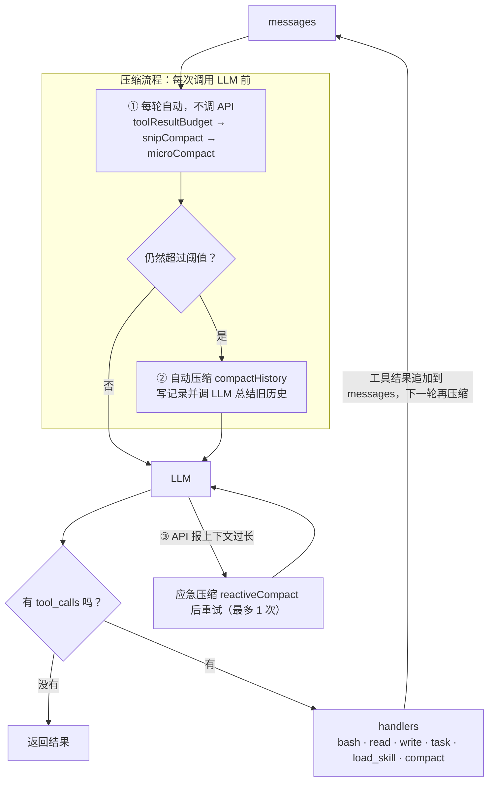
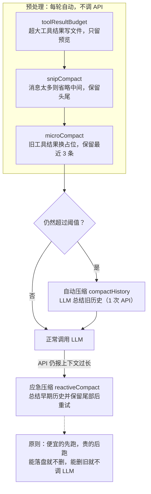
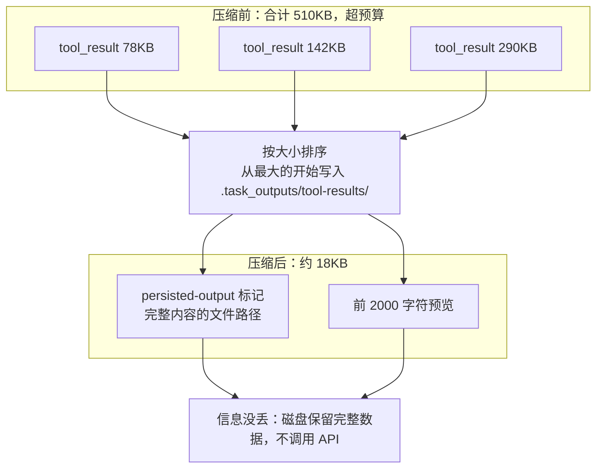
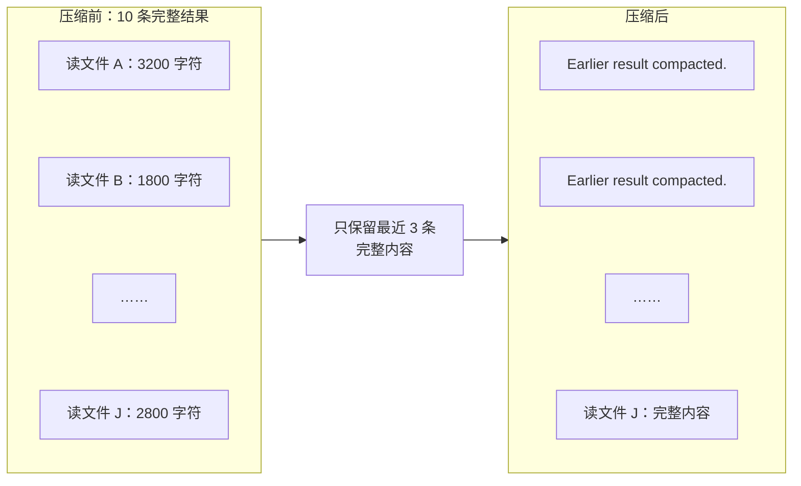
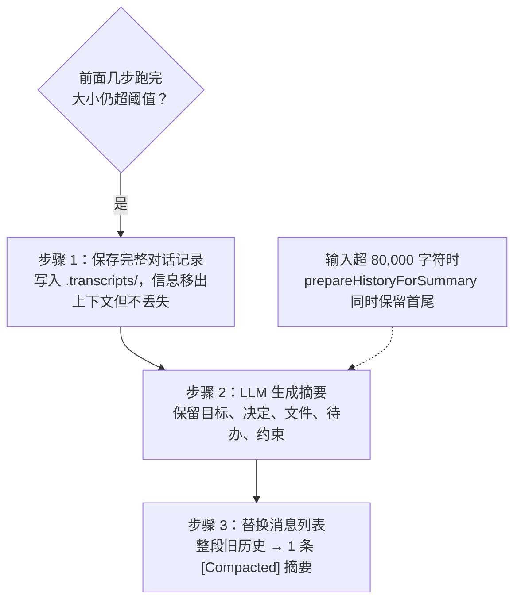

# s08：Context Compact - 给长会话分层瘦身，腾出上下文空间

上一章 `s07` 解决了专业知识不要预加载的问题，但只要任务一长，模型反复读文件、跑测试、看报错，`messages` 依然会像滚雪球一样膨胀，直到撞上模型的上下文上限直接报错。

这一章我们给 Agent 装上一套分层压缩流水线。**上下文压缩不是粗暴删历史，而是按成本从低到高逐层瘦身：先用零 API 成本的规则减重，实在装不下时再请模型写摘要。**

## 问题

长会话里，`messages` 最占空间的是几十 KB 的工具输出和几十轮前的探索过程。什么都不做，对话很快会触发“prompt too long”直接失败；如果每轮都调模型总结，既烧钱又拖慢节奏，还容易把刚做到一半的细节总结丢。

## 解决方案

我们在每次调用 LLM 前按“便宜先跑、贵的后跑”串起四层压缩，并在 API 真报超限时留一条应急路径，同时给模型一把主动压缩的 `compact` 工具：



五种手段各司其职，且都通过 `apply()` 原地改写 `messages`：

| 机制 | 触发条件 | 核心动作 |
|---|---|---|
| `toolResultBudget`（L3） | 尾部工具结果总长超 200,000 | 超过 30,000 字符的结果落盘到 `.task_outputs/tool-results/`，只留路径与前 2,000 字符预览 |
| `snipCompact`（L1） | 消息超过 50 条 | 保留开头 3 条和最近一批，省略中间段，并避开孤立的 `tool` 结果 |
| `microCompact`（L2） | 工具结果超过 3 条 | 保留最近 3 条全文，更早且超 120 字符的结果换成一句占位提示 |
| `compactHistory`（L4） | 估算超 `CONTEXT_LIMIT` 或调用 `compact` | 全量写入 `.transcripts/`，再请模型总结成一条 `[Compacted]` 摘要 |
| `reactiveCompact`（应急） | API 报上下文过长 | 写入 `.transcripts/`，总结早期历史并保留最近几条消息后重试（限 1 次） |

说明两点教学边界。为了方便在终端观察自动压缩，本章把 `CONTEXT_LIMIT` 设为 `12000`，并用 JSON 字符串长度做近似估算（生产系统应改用 tokenizer 或接口返回的 usage）。摘要输入超过 80,000 字符时，`helper.js` 里的 `prepareHistoryForSummary()` 会同时保留稳定头部和最新尾部，避免丢掉初始约束或当前进度。

## 流程图

四层规则与应急路径的协作顺序：



`toolResultBudget` 如何把超大工具结果挪到磁盘（`<persisted-output>` 是给模型看的结构标记）：



`microCompact` 如何收起较早的工具结果，只留最近 3 条全文：



`compactHistory` 执行 LLM 摘要的三步法：



## 测试 Prompt

在同一个 CLI 会话里依次输入下面三条 Prompt：

```text
读取 helper.js 的前 200 行，然后主动 compact，再总结你仍然记得哪些关键信息。
```

```text
不要调用任何工具。请输出一段很长的中文说明，主题是“agent loop 为什么需要上下文压缩”，至少 9000 个汉字，分成 30 段，每段都以 MEMORY_BLOCK 开头，最后写 LONG_CONTEXT_DONE。
```

```text
不要调用 bash。请告诉我：你是否还能记得上一轮的主题，以及当前对话为什么需要上下文压缩。
```

第一条会触发 `[manual compact] compactHistory`，第二条输出后下一轮会触发 `[auto compact] compactHistory`，同时 `.transcripts/` 下会留下完整 JSONL 对话记录，而第三条里模型依然能接着回答核心问题。

## 扩展阅读：商业级 Agent 怎么做上下文压缩

从公开文档和开源代码看，成熟产品的上下文压缩会收敛到同一套原则：自动与手动并存、先剪大工具输出、再摘要旧历史，同时提前给压缩留出缓冲空间。

- **Claude Code**：默认开启 `autoCompactEnabled`，也支持 `/compact` 手动触发，并提供 `PreCompact` / `PostCompact` Hook（入参标明 `auto` 或 `manual`），把压缩当成可观测、可审计的生命周期事件。参考 [Claude Code settings](https://code.claude.com/docs/en/settings) 与 [Claude Code hooks](https://code.claude.com/docs/en/hooks)。
- **Codex**：提供 `/compact` 命令，并通过 `model_auto_compact_token_limit` 和 `model_context_window` 把压缩阈值与模型窗口绑定成配置，而不是写死常量。参考 [Codex slash commands](https://developers.openai.com/codex/cli/slash-commands) 与 [Codex config reference](https://developers.openai.com/codex/config-reference)。
- **opencode**：用 `compaction.auto`、`compaction.prune`、`compaction.reserved` 三项分别控制自动压缩、清理旧工具输出和预留压缩空间，避免窗口彻底塞满时连摘要请求都塞不进去。参考 [opencode compaction config](https://opencode.ai/docs/config/) 与 [opencode compaction source](https://github.com/sst/opencode/blob/dev/packages/opencode/src/session/compaction.ts)。

**把上下文当成受限内存来分层管理，长会话才能稳稳跑完全程。**

## 本地运行与测试

交互运行（从仓库根目录执行）：

```bash
cd code-agent-course && node s08-context-compact.js
```

离线单测（在仓库根目录执行，无需 API Token）：

```bash
pnpm vitest run code-agent-course/s08-context-compact.test.js
```

## 博客代码演进

### 1. 准备：引入写文件和摘要预处理函数

压缩时要把大输出和历史记录写到磁盘，所以先从 `node:fs` 补引 `mkdirSync` 和 `writeFileSync`，再从 `helper.js` 引入 `prepareHistoryForSummary`，它负责把过长的历史整理成首尾兼顾的摘要输入。这一步只做准备，行为不变。

```diff agent-step
@@
-import { readdirSync, readFileSync, existsSync } from "node:fs";
+import { readdirSync, readFileSync, existsSync, mkdirSync, writeFileSync } from "node:fs";
 import path from "node:path";
 import {
@@
   isMainModule,
   parseFrontmatter,
+  prepareHistoryForSummary,
 } from "./helper.js";
```

### 2. 先量一量上下文有多大

想做压缩，先要有尺子。`estimateSize` 用最直接的办法：把 `messages` 序列化成 JSON 字符串数字符数。`CONTEXT_LIMIT` 故意调低到 `12000`，方便在本地终端触发观察。`apply` 用 `splice` 原地替换数组内容，保证循环外持有 `messages` 引用的调用方也能看到最新历史。

```diff agent-step
@@
 }
 
+const CONTEXT_LIMIT = 12000;
+
+export const estimateSize = (messages) => JSON.stringify(messages).length;
+
+const isToolResult = (m) => m.role === "tool";
+
+function apply(messages, next) {
+  if (next !== messages) messages.splice(0, messages.length, ...next);
+  return messages;
+}
+
 const SYSTEM = `You are a coding agent at ${process.cwd()}. Use tools to solve tasks.
 Before a multi-step task, use todo_write to plan and update status as you go.
```

### 3. 第一层：消息太多就省略中间

`snipCompact` 处理“条数太多”的问题：超过 50 条时保留开头 3 条和最近一批，中间换成一句省略提示。两个 `while` 很关键，它们保证切点不会拆开一次工具调用和它的返回结果，否则模型接口会报格式错。写完直接挂到 `agentLoop` 调用模型前，零 API 成本。

```diff agent-step
@@
 }
 
+export function snipCompact(messages, maxMessages = 50) {
+  if (messages.length <= maxMessages) return messages;
+  let head = 3;
+  let tail = messages.length - (maxMessages - 3);
+  while (head < messages.length && isToolResult(messages[head])) head += 1;
+  while (tail < messages.length && isToolResult(messages[tail])) tail += 1;
+  if (head >= tail) return messages;
+  return [
+    ...messages.slice(0, head),
+    { role: "user", content: `[snipped ${tail - head} messages from the middle]` },
+    ...messages.slice(tail),
+  ];
+}
+
 const SYSTEM = `You are a coding agent at ${process.cwd()}. Use tools to solve tasks.
 Before a multi-step task, use todo_write to plan and update status as you go.
@@
       roundsSinceTodo = 0;
     }
+
+    apply(messages, snipCompact(messages));
 
     const { message } = await callLlm(messages, { system: SYSTEM, tools });
```

### 4. 第二层：旧的工具结果缩成一句话

对话里最占地方的往往是工具输出，而模型通常只关心最近几次结果。`microCompact` 保留最近 3 条工具结果的全文，更早且超过 120 字符的内容全部换成一句占位提示。消息条数和角色配对不变，只是把旧内容收短。

```diff agent-step
@@
 
 const CONTEXT_LIMIT = 12000;
+const KEEP_RECENT = 3;
 
 export const estimateSize = (messages) => JSON.stringify(messages).length;
@@
 }
 
+export function microCompact(messages) {
+  const toolMsgs = messages.filter(isToolResult);
+  if (toolMsgs.length <= KEEP_RECENT) return messages;
+  for (const m of toolMsgs.slice(0, -KEEP_RECENT)) {
+    if (m.content.length > 120) m.content = "[Earlier tool result compacted. Re-run if needed.]";
+  }
+  return messages;
+}
+
 const SYSTEM = `You are a coding agent at ${process.cwd()}. Use tools to solve tasks.
 Before a multi-step task, use todo_write to plan and update status as you go.
@@
 
     apply(messages, snipCompact(messages));
+    apply(messages, microCompact(messages));
 
     const { message } = await callLlm(messages, { system: SYSTEM, tools });
```

### 5. 第三层：超大工具结果落盘只留预览

有时单条工具输出就有几万字符。`toolResultBudget` 检查最近一批连续工具结果的总长度，超过预算时从最大的一条开始调用 `persistLargeOutput` 写入 `.task_outputs/tool-results/`，上下文里只留文件路径和前 2000 字符预览。模型真要看全文时，自己调 `read_file` 就行。在循环里把它排在最前，先把大块头挪走。

```diff agent-step
@@
 }
 
+const TOOL_RESULTS_DIR = path.join(process.cwd(), ".task_outputs", "tool-results");
+
 const CONTEXT_LIMIT = 12000;
 const KEEP_RECENT = 3;
+const PERSIST_THRESHOLD = 30000;
 
 export const estimateSize = (messages) => JSON.stringify(messages).length;
@@
 }
 
+function persistLargeOutput(id, output) {
+  if (output.length <= PERSIST_THRESHOLD) return output;
+  mkdirSync(TOOL_RESULTS_DIR, { recursive: true });
+  const file = path.join(TOOL_RESULTS_DIR, `${id}.txt`);
+  if (!existsSync(file)) writeFileSync(file, output);
+  return `<persisted-output>\nFull output: ${file}\nPreview:\n${output.slice(0, 2000)}\n</persisted-output>`;
+}
+
+export function toolResultBudget(messages, maxBytes = 200000) {
+  const tail = [];
+  for (let i = messages.length - 1; i >= 0 && isToolResult(messages[i]); i -= 1) tail.push(messages[i]);
+  let total = tail.reduce((n, m) => n + m.content.length, 0);
+  if (total <= maxBytes) return messages;
+  for (const m of [...tail].sort((a, b) => b.content.length - a.content.length)) {
+    if (total <= maxBytes) break;
+    if (m.content.length <= PERSIST_THRESHOLD) continue;
+    const before = m.content.length;
+    m.content = persistLargeOutput(m.tool_call_id, m.content);
+    total -= before - m.content.length;
+  }
+  return messages;
+}
+
 const SYSTEM = `You are a coding agent at ${process.cwd()}. Use tools to solve tasks.
 Before a multi-step task, use todo_write to plan and update status as you go.
@@
     }
 
+    apply(messages, toolResultBudget(messages));
     apply(messages, snipCompact(messages));
     apply(messages, microCompact(messages));
```

### 6. 第四层：还是太大，就请模型写摘要

前三层都不花 API 费用。如果跑完仍然超过 `CONTEXT_LIMIT`，再启动 `compactHistory`：先把完整对话存成 JSONL 放进 `.transcripts/` 留档，再调一次模型提炼当前目标、关键决定、涉及文件、剩余工作和用户约束，用一条 `[Compacted]` 消息替换整段历史。

```diff agent-step
@@
 }
 
+const TRANSCRIPT_DIR = path.join(process.cwd(), ".transcripts");
 const TOOL_RESULTS_DIR = path.join(process.cwd(), ".task_outputs", "tool-results");
@@
 }
 
+function writeTranscript(messages) {
+  mkdirSync(TRANSCRIPT_DIR, { recursive: true });
+  const file = path.join(TRANSCRIPT_DIR, `transcript-${Date.now()}.jsonl`);
+  writeFileSync(file, messages.map((m) => JSON.stringify(m)).join("\n"));
+  return file;
+}
+
+async function summarizeHistory(messages) {
+  const conversation = prepareHistoryForSummary(messages);
+  const prompt = `Summarize this coding-agent conversation so work can continue.
+Preserve: 1) current goal, 2) key findings/decisions, 3) files read/changed, 4) remaining work, 5) user constraints.
+Be compact but concrete.
+
+${conversation}`;
+  const { message } = await callLlm([{ role: "user", content: prompt }], {});
+  return (message.content || "").trim() || "(empty summary)";
+}
+
+export async function compactHistory(messages) {
+  writeTranscript(messages);
+  const summary = await summarizeHistory(messages);
+  return [{ role: "user", content: `[Compacted]\n\n${summary}` }];
+}
+
 const SYSTEM = `You are a coding agent at ${process.cwd()}. Use tools to solve tasks.
 Before a multi-step task, use todo_write to plan and update status as you go.
@@
     apply(messages, snipCompact(messages));
     apply(messages, microCompact(messages));
+    if (estimateSize(messages) > CONTEXT_LIMIT) {
+      apply(messages, await compactHistory(messages));
+    }
 
     const { message } = await callLlm(messages, { system: SYSTEM, tools });
```

### 7. 应急：API 报上下文过长时立刻兜底

字符数估算只是近似，有时请求发出去才被接口拒收，报“prompt too long”。我们把 `callLlm` 包进 `try/catch`：命中超限错误时，用 `reactiveCompact` 把前面的历史总结成 `[Reactive compact]` 并保留最后几条消息，然后重跑本轮。`MAX_REACTIVE_RETRIES = 1` 保证最多兜底一次，避免无限循环。

```diff agent-step
@@
 const KEEP_RECENT = 3;
 const PERSIST_THRESHOLD = 30000;
+const MAX_REACTIVE_RETRIES = 1;
 
 export const estimateSize = (messages) => JSON.stringify(messages).length;
@@
 }
 
+export async function reactiveCompact(messages) {
+  writeTranscript(messages);
+  let tail = Math.max(0, messages.length - 5);
+  while (tail < messages.length && isToolResult(messages[tail])) tail += 1;
+  const summary = await summarizeHistory(messages.slice(0, tail));
+  return [{ role: "user", content: `[Reactive compact]\n\n${summary}` }, ...messages.slice(tail)];
+}
+
+const isPromptTooLong = (error) =>
+  /prompt.*too.*long|too many tokens|context.*length/i.test(String(error.message));
+
 const SYSTEM = `You are a coding agent at ${process.cwd()}. Use tools to solve tasks.
 Before a multi-step task, use todo_write to plan and update status as you go.
@@
 export async function agentLoop(messages, confirm) {
   let roundsSinceTodo = 0;
+  let reactiveRetries = 0;
   while (true) {
     if (roundsSinceTodo >= 3) {
@@
     }
 
-    const { message } = await callLlm(messages, { system: SYSTEM, tools });
+    let message;
+    try {
+      ({ message } = await callLlm(messages, { system: SYSTEM, tools }));
+      reactiveRetries = 0;
+    } catch (error) {
+      if (reactiveRetries < MAX_REACTIVE_RETRIES && isPromptTooLong(error)) {
+        apply(messages, await reactiveCompact(messages));
+        reactiveRetries += 1;
+        continue;
+      }
+      throw error;
+    }
 
     if (!message.tool_calls?.length) {
```

### 8. 给模型一把主动压缩的 compact 工具

再加一个 `compact` 工具，让模型在觉得历史太长时主动整理上下文。它不放进 `handlers`，因为压缩要替换整份 `messages`，必须由主循环接管：收到 `compact` 调用就执行 `compactHistory`，跳过本批剩余工具调用，立刻用摘要进入下一轮。顺手更新 `SYSTEM`、`SUB_EXCLUDE` 和 `s08 >> ` 提示符。

```diff agent-step
@@
 Skills available:
 ${listSkills()}
-Use load_skill to get a skill's full content when you need it.`;
+Use load_skill to get a skill's full content when you need it.
+When context gets large, call compact to summarize earlier work and free space.`;
 const SUB_SYSTEM = `You are a coding subagent at ${process.cwd()}. Complete the task, then return a concise summary. Do not delegate further.`;
@@
     required: ["name"],
   }),
+  tool("compact", "Summarize earlier conversation to free context space.", {
+    type: "object",
+    properties: { focus: { type: "string" } },
+  }),
 ];
@@
 };
 
-const SUB_EXCLUDE = ["task", "todo_write", "load_skill"];
+const SUB_EXCLUDE = ["task", "todo_write", "load_skill", "compact"];
 const subTools = tools.filter((t) => !SUB_EXCLUDE.includes(t.function.name));
 const subHandlers = Object.fromEntries(
@@
     messages.push(message);
     roundsSinceTodo += 1;
+    let compacted = false;
     for (const call of message.tool_calls) {
       const name = call.function.name;
       const args = JSON.parse(call.function.arguments || "{}");
 
+      if (name === "compact") {
+        apply(messages, await compactHistory(messages));
+        compacted = true;
+        break;
+      }
+
       const blocked = await triggerHooks("PreToolUse", name, args, confirm);
       let output;
@@
       messages.push({ role: "tool", tool_call_id: call.id, content: String(output) });
     }
+    if (compacted) continue;
   }
 }
@@
 async function main() {
   await runChatCli({
-    promptLabel: "s07 >> ",
+    promptLabel: "s08 >> ",
     onPrompt: async ({ prompt, messages, ask }) => {
       return agentLoop(messages, ask);
```

### 9. 补上教学日志

压缩默认悄悄发生，不打印就看不出走的是哪条分支。最后给三种触发模型摘要的入口各补一行日志：`[auto compact]` 对应超阈值自动压缩，`[reactive compact]` 对应超限应急压缩，`[manual compact]` 对应模型主动调用。运行时一眼就能看到是哪一档在工作。

> **本章思考题**：现在单次长会话能稳稳跑下去了，但一旦退出终端、明天重新打开，`messages` 依然从零开始，你的代码偏好和项目约定还得再说一遍。怎么把“下次还要用”的长期信息自动留下来，同时又不让记忆变成新的垃圾堆？下一章 `s09` 我们来做 Memory。

```diff agent-step
@@
     apply(messages, microCompact(messages));
     if (estimateSize(messages) > CONTEXT_LIMIT) {
+      console.log("[auto compact] compactHistory");
       apply(messages, await compactHistory(messages));
     }
@@
     } catch (error) {
       if (reactiveRetries < MAX_REACTIVE_RETRIES && isPromptTooLong(error)) {
+        console.log("[reactive compact] reactiveCompact");
         apply(messages, await reactiveCompact(messages));
         reactiveRetries += 1;
@@
 
       if (name === "compact") {
+        console.log("[manual compact] compactHistory");
         apply(messages, await compactHistory(messages));
         compacted = true;
```

## 和上一步的关键代码 diff（不含 helper.js）

```diff
--- s07-skill-loading.js
+++ s08-context-compact.js
@@
-import { readdirSync, readFileSync, existsSync } from "node:fs";
+import { readdirSync, readFileSync, existsSync, mkdirSync, writeFileSync } from "node:fs";
@@
+const TRANSCRIPT_DIR = path.join(process.cwd(), ".transcripts");
+const TOOL_RESULTS_DIR = path.join(process.cwd(), ".task_outputs", "tool-results");
+const CONTEXT_LIMIT = 12000;
+const KEEP_RECENT = 3;
+const PERSIST_THRESHOLD = 30000;
+const MAX_REACTIVE_RETRIES = 1;
+
+export const estimateSize = (messages) => JSON.stringify(messages).length;
+const isToolResult = (m) => m.role === "tool";
+
+function apply(messages, next) {
+  if (next !== messages) messages.splice(0, messages.length, ...next);
+  return messages;
+}
+
+export function snipCompact(messages, maxMessages = 50) {
+  if (messages.length <= maxMessages) return messages;
+  let head = 3;
+  let tail = messages.length - (maxMessages - 3);
+  while (head < messages.length && isToolResult(messages[head])) head += 1;
+  while (tail < messages.length && isToolResult(messages[tail])) tail += 1;
+  if (head >= tail) return messages;
+  return [
+    ...messages.slice(0, head),
+    { role: "user", content: `[snipped ${tail - head} messages from the middle]` },
+    ...messages.slice(tail),
+  ];
+}
+
+export function microCompact(messages) {
+  const toolMsgs = messages.filter(isToolResult);
+  if (toolMsgs.length <= KEEP_RECENT) return messages;
+  for (const m of toolMsgs.slice(0, -KEEP_RECENT)) {
+    if (m.content.length > 120) m.content = "[Earlier tool result compacted. Re-run if needed.]";
+  }
+  return messages;
+}
+
+function persistLargeOutput(id, output) {
+  if (output.length <= PERSIST_THRESHOLD) return output;
+  mkdirSync(TOOL_RESULTS_DIR, { recursive: true });
+  const file = path.join(TOOL_RESULTS_DIR, `${id}.txt`);
+  if (!existsSync(file)) writeFileSync(file, output);
+  return `<persisted-output>\nFull output: ${file}\nPreview:\n${output.slice(0, 2000)}\n</persisted-output>`;
+}
+
+export function toolResultBudget(messages, maxBytes = 200000) {
+  const tail = [];
+  for (let i = messages.length - 1; i >= 0 && isToolResult(messages[i]); i -= 1) tail.push(messages[i]);
+  let total = tail.reduce((n, m) => n + m.content.length, 0);
+  if (total <= maxBytes) return messages;
+  for (const m of [...tail].sort((a, b) => b.content.length - a.content.length)) {
+    if (total <= maxBytes) break;
+    if (m.content.length <= PERSIST_THRESHOLD) continue;
+    const before = m.content.length;
+    m.content = persistLargeOutput(m.tool_call_id, m.content);
+    total -= before - m.content.length;
+  }
+  return messages;
+}
+
+export async function compactHistory(messages) {
+  writeTranscript(messages);
+  const summary = await summarizeHistory(messages);
+  return [{ role: "user", content: `[Compacted]\n\n${summary}` }];
+}
+
+export async function reactiveCompact(messages) {
+  writeTranscript(messages);
+  let tail = Math.max(0, messages.length - 5);
+  while (tail < messages.length && isToolResult(messages[tail])) tail += 1;
+  const summary = await summarizeHistory(messages.slice(0, tail));
+  return [{ role: "user", content: `[Reactive compact]\n\n${summary}` }, ...messages.slice(tail)];
+}
@@
+    apply(messages, toolResultBudget(messages));
+    apply(messages, snipCompact(messages));
+    apply(messages, microCompact(messages));
+    if (estimateSize(messages) > CONTEXT_LIMIT) {
+      console.log("[auto compact] compactHistory");
+      apply(messages, await compactHistory(messages));
+    }
@@
+      if (name === "compact") {
+        console.log("[manual compact] compactHistory");
+        apply(messages, await compactHistory(messages));
+        compacted = true;
+        break;
+      }
```
