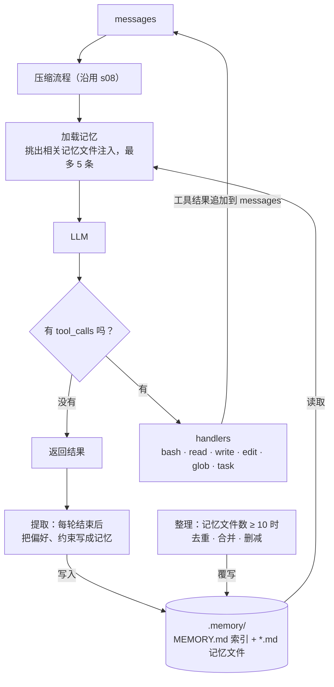
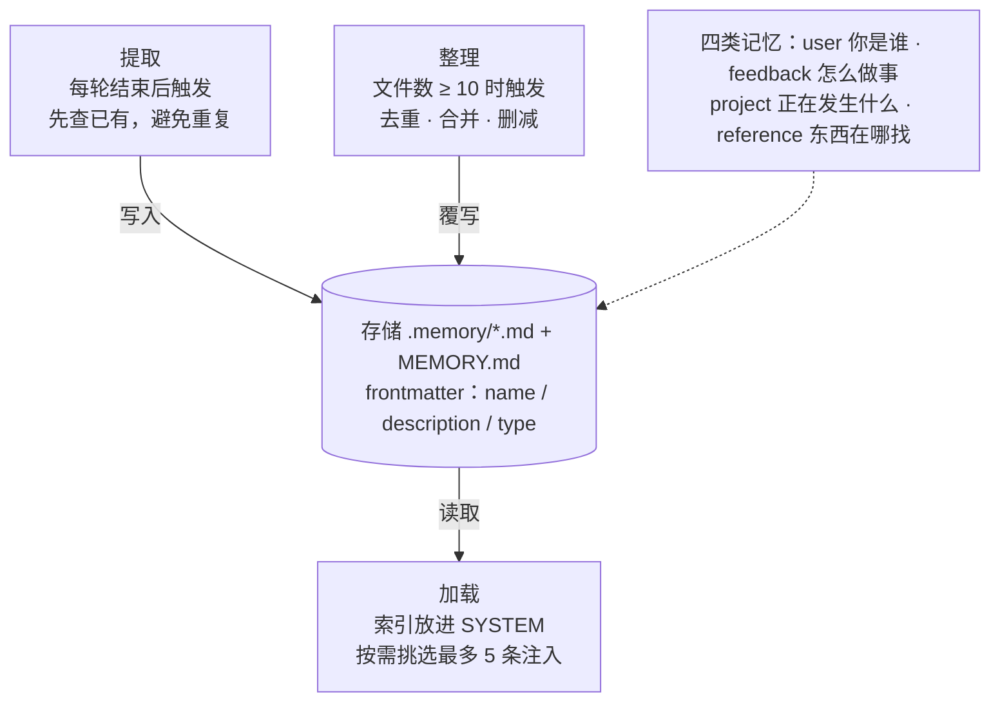

# s09：Memory —— 只保存下次还要用的信息

新人工作久了会遇到两类信息：一类是当前任务里的临时过程，比如命令输出、探索路径、一次性结论；另一类是以后还会反复用到的事实，比如用户偏好、项目约定、长期规则。

`s08` 的 compact 负责让当前会话继续跑下去，`s09` 的 memory 负责把“下次还要用”的信息保存下来。

## 本章目标

压缩可以缩短当前会话历史，但压缩后的摘要不适合保存所有长期知识。

`s09` 加入 memory 层：

- 长期记忆保存到 `.memory/` 文件夹。
- `MEMORY.md` 是记忆索引，只放名字和一句话描述。
- 每轮请求开始时，只挑和当前问题相关的记忆临时放进请求里。
- 每轮请求结束后，从本轮对话里提取新的长期记忆。
- 记忆文件太多时，再做整理合并。

## 流程图



```text
用户输入
  |
  v
读取 MEMORY.md 索引
  |
  v
选择相关记忆
  |
  v
临时放进本次请求
  |
  v
agent loop
  |
  v
回合结束：提取新的长期记忆
  |
  v
写入 .memory/*.md，并重建 MEMORY.md
```

```text
.memory/
  MEMORY.md          # 索引：每条记忆一行，便宜、常驻
  tutorial-style.md  # 单条记忆：Markdown + frontmatter
  project-facts.md

每一轮 agent_loop：
  1. 读取 MEMORY.md 索引
  2. 选择和当前任务相关的记忆
  3. 把记忆正文临时注入本轮请求
  4. 继续沿用 s08 的上下文压缩
  5. 回合结束后，从原始消息里提取新记忆
```

## 为什么这一步重要

memory 不是“把聊天记录永久保存”。

只有下次很难从当前代码和当前对话重新推导出来的信息，才值得保存。例如：

- 用户偏好：喜欢简洁教程、喜欢先看代码再看解释。
- 项目约定：这个项目统一使用 ES Module。
- 长期规则：文档里不要使用难懂黑话。
- 反馈结论：某类 prompt 更适合这个教程。

临时命令、一次性输出、当前任务的中间推理，不应该进入 memory。否则 memory 会变成另一个越来越大的上下文。

## 代码入口

- JS：[s09-memory.js](./s09-memory.js)
- Test：[s09-memory.test.js](./s09-memory.test.js)

## 运行

```bash
node code-agent-course/s09-memory.js
```

## 新增函数速览

- `writeMemoryFile(name, type, description, body)`：把一条长期记忆保存成 Markdown 文件。
- `listMemoryFiles()` / `readMemoryIndex()`：读取已有记忆和索引，给后续选择与注入使用。
- `selectRelevantMemories(messages, maxItems)`：让模型从记忆索引里挑出当前任务相关的记忆。
- `loadMemories(messages)`：把选中的记忆正文合并成一段上下文，只在本轮请求时注入。
- `extractMemories(messages)`：任务结束后调用模型，判断哪些信息值得跨会话保存。
- `consolidateMemories()`：定期整理记忆，减少重复和过期内容。

## 核心流程

### 1. 保存记忆文件

每条记忆都是一个 Markdown 文件，带 frontmatter：

```md
---
name: tutorial-style
description: prefers concise runnable tutorials
type: user
---

User prefers concise tutorials with runnable code first.
```

写入后会重建 `MEMORY.md`，它只保存轻量索引：

```md
- [tutorial-style](tutorial-style.md) — prefers concise runnable tutorials
```

这里解析 frontmatter 的逻辑没有写在 `s09-memory.js` 里，而是复用 `helper.js` 的 `parseFrontmatter`。原因很简单：它只是“把 Markdown 头部元信息拆出来”的纯工具函数，不属于 memory 机制本身。

### 2. 每次用户请求开始时读取索引

`buildSystem()` 会把 `MEMORY.md` 的索引放进 system prompt。这样模型知道“有哪些记忆可以用”，但不会一开始就把所有记忆全文塞进去。 

```js
function buildSystem() {
  const index = readMemoryIndex();
  return `You are a coding agent at ${process.cwd()}. Use tools to solve tasks.
Before a multi-step task, use todo_write to plan and update status as you go.
For a complex sub-problem, use the task tool to spawn a subagent.
Skills available:
${listSkills()}
Use load_skill to get a skill's full content when you need it.
When context gets large, call compact to summarize earlier work and free space.${
    index
      ? `\n\nMemories available:\n${index}\nRespect user preferences from memory. When the user says "remember" or reveals a stable preference, it will be saved.`
      : ""
  }`;
}
```

### 3. 只加载相关记忆

`loadMemories()` 会先调用 `selectRelevantMemories()`，让模型从记忆目录里选出和当前问题相关的文件。如果这次辅助模型调用失败，教程代码会退回到简单的关键词匹配。

选中的记忆会包进 `<relevant_memories>`，只用于本次请求：

```js
function buildRequest(messages, memoriesContent) {
  if (!memoriesContent) return messages;
  const idx = messages.findLastIndex((m) => m.role === "user" && typeof m.content === "string");
  if (idx === -1) return messages;
  const copy = messages.slice();
  copy[idx] = { ...messages[idx], content: `${memoriesContent}\n\n${messages[idx].content}` };
  return copy;
}
```

注意：这里没有修改原始 `messages`。记忆只是临时放进本次模型请求，不会污染对话历史。

### 4. 回合结束后提取新记忆

当模型没有继续调用工具，说明本轮对话结束。这时才提取长期记忆：

```js
if (!message.tool_calls?.length) {
  await extractMemories(preCompress);
  await consolidateMemories();
  return message.content || "";
}
```

这里用 `preCompress`，是为了避免刚刚发生上下文压缩时，把用户原话压没了。提取记忆时更适合看压缩前的本轮内容。

`consolidateMemories()` 只在记忆文件达到 10 个时调用模型整理：合并重复内容、清理过期内容，再重建索引。因此 memory 会调用 LLM 三类辅助请求：选择相关记忆、提取新记忆、达到阈值后整理记忆。

## 测试 Prompt

第一次运行：让 agent 保存一个长期偏好。

```text
remember: 我写教程时喜欢先给最小可运行代码，再解释原理。请记住这个长期偏好，并用一句话回复。
```

观察重点：

- 命令行里应该看到类似 `[Memory: extracted 1 new memories]`。
- `.memory/` 下应该出现新的 `.md` 记忆文件。
- `.memory/MEMORY.md` 应该出现一条索引。

输入 `q` 退出，重新运行 `node code-agent-course/s09-memory.js`，再验证跨会话记忆：

```text
下次帮我写教程时，我喜欢什么顺序？请根据 memory 回答，不要读取文件。
```

观察重点：模型应该能说出“先给最小可运行代码，再解释原理”。

如果想直接查看文件，也可以再输入：

```text
用 glob 查找 .memory/*.md，然后总结这些 memory 文件保存了什么。
```

## 一句话总结

`s09` 让 agent 有跨会话记忆，但只保存真正长期有用的信息。

## 扩展阅读：商业级 Agent 怎么做 Memory

Memory 和 context 不一样：context 是当前工作台，memory 是下次还要用、但当前文件和对话不一定能重新推导的信息。

- Claude Code：区分人工编写的 `CLAUDE.md` 和自动记忆。自动记忆保存模型从更正、偏好和项目中学到的内容，并在后续会话加载。参考 [Claude Code Memory](https://code.claude.com/docs/en/memory)。
- Codex：开源 core 有两阶段 memory pipeline：先从近期 rollout 提取结构化记忆，再由内部子代理做 consolidation。这说明记忆不是原样保存全部聊天。参考 [Codex Memories Pipeline](https://github.com/openai/codex/blob/main/codex-rs/core/src/memories/README.md)。
- opencode：公开文档重点是项目级和全局 `AGENTS.md` 规则，它们会进入后续会话的上下文；这更接近人工维护的长期指令，不等于本章的自动提取。参考 [OpenCode Rules](https://opencode.ai/docs/rules)。

本章的 `.memory/*.md` 是最小版本：先保存长期事实，再用索引和相关性选择控制注入量。

## 博客代码演进

下面 13 个 patch 专门用于博客右侧的代码切换。第一步基于 `s08-context-compact.js`，后面的每一步都继续修改上一帧，最后必须得到完整的 `s09-memory.js`。

这一章新增的代码最多，所以拆得比较细。顺序是：先整理开头的引入，再依次写“记忆怎么存”“怎么读回来”“怎么从对话里提取”“太多了怎么整理”。每一步的代码都可以运行；第 7 步之后记忆开始被读取，第 10 步之后开始自动写入。

### 1. 整理开头：多引入一个 rmSync

本章要在 s08 的基础上再加两百多行，先从最小的改动开始：`node:fs` 的引入改成多行，并加上后面整理记忆时删除文件要用的 `rmSync`。这一步不改变行为。

```diff agent-step
@@
-import { readdirSync, readFileSync, existsSync, mkdirSync, writeFileSync } from "node:fs";
+import {
+  readdirSync,
+  readFileSync,
+  existsSync,
+  mkdirSync,
+  writeFileSync,
+  rmSync,
+} from "node:fs";
 import path from "node:path";
 import {
```

### 2. 记忆存在哪里，怎么读出来

记忆就是文件：`.memory/` 目录下，每条记忆一个 Markdown 文件，文件开头几行记录名字、描述和类型。`setMemoryDir` 让测试可以把目录换到临时位置。`listMemoryFiles` 读出目录里所有记忆文件，解析开头的信息，返回一个数组；目录不存在就返回空数组。`MEMORY.md` 是索引文件，不算一条记忆，所以要排除掉。

```diff agent-step
@@
 }
 
+let memoryDir = path.join(process.cwd(), ".memory");
+export function setMemoryDir(dir) {
+  memoryDir = dir;
+}
+const indexPath = () => path.join(memoryDir, "MEMORY.md");
+
+export function listMemoryFiles() {
+  if (!existsSync(memoryDir)) return [];
+  return readdirSync(memoryDir)
+    .filter((f) => f.endsWith(".md") && f !== "MEMORY.md")
+    .sort()
+    .map((filename) => {
+      const raw = readFileSync(path.join(memoryDir, filename), "utf8");
+      const { meta, body } = parseFrontmatter(raw);
+      return {
+        filename,
+        name: meta.name || filename.replace(/\.md$/, ""),
+        description: meta.description || "",
+        type: meta.type || "user",
+        body,
+        content: raw,
+      };
+    });
+}
+
 const TRANSCRIPT_DIR = path.join(process.cwd(), ".transcripts");
 const TOOL_RESULTS_DIR = path.join(process.cwd(), ".task_outputs", "tool-results");
@@
 
 export const estimateSize = (messages) => JSON.stringify(messages).length;
-
 const isToolResult = (m) => m.role === "tool";
```

### 3. 写入一条记忆，并维护索引

`writeMemoryFile` 把一条记忆写成文件：文件名由记忆的名字转换而来，内容是开头的信息加正文。每次写完都调用 `rebuildIndex`，把所有记忆整理成一份清单写进 `MEMORY.md`，每条一行，包含名字、文件名和描述。`readMemoryIndex` 读出这份清单，后面会把它放进系统提示词。到这里，存储部分完成了，但还没有任何地方调用它。

```diff agent-step
@@
 const indexPath = () => path.join(memoryDir, "MEMORY.md");
 
+export function writeMemoryFile(name, type, description, body) {
+  mkdirSync(memoryDir, { recursive: true });
+  const slug = name.toLowerCase().replace(/[\s/]+/g, "-");
+  writeFileSync(
+    path.join(memoryDir, `${slug}.md`),
+    `---\nname: ${name}\ndescription: ${description}\ntype: ${type}\n---\n\n${body}\n`,
+  );
+  rebuildIndex();
+}
+
 export function listMemoryFiles() {
   if (!existsSync(memoryDir)) return [];
@@
       };
     });
+}
+
+function rebuildIndex() {
+  const lines = listMemoryFiles().map((m) => `- [${m.name}](${m.filename}) — ${m.description}`);
+  mkdirSync(memoryDir, { recursive: true });
+  writeFileSync(indexPath(), lines.length ? `${lines.join("\n")}\n` : "");
+}
+
+export function readMemoryIndex() {
+  return existsSync(indexPath()) ? readFileSync(indexPath(), "utf8").trim() : "";
 }
```

### 4. 挑出相关的记忆：先用关键词

记忆多了以后，不可能每次都把全文发给模型，需要先挑。`selectRelevantMemories` 取用户最近 3 条消息，和每条记忆的名字、描述做比较，最多返回 5 个文件名。这一步先写最简单的办法：把用户的话拆成词，看哪条记忆的名字或描述里包含这些词。

```diff agent-step
@@
 }
 
+export async function selectRelevantMemories(messages, maxItems = 5) {
+  const files = listMemoryFiles();
+  if (!files.length) return [];
+  const recent = messages
+    .filter((m) => m.role === "user" && typeof m.content === "string")
+    .slice(-3)
+    .map((m) => m.content)
+    .join(" ")
+    .slice(0, 2000);
+  if (!recent.trim()) return [];
+  const catalog = files.map((f, i) => `${i}: ${f.name} — ${f.description}`).join("\n");
+  const keywords = recent.toLowerCase().split(/\s+/).filter((w) => w.length > 3);
+  return files
+    .filter((f) => keywords.some((kw) => `${f.name} ${f.description}`.toLowerCase().includes(kw)))
+    .slice(0, maxItems)
+    .map((f) => f.filename);
+}
+
 const TRANSCRIPT_DIR = path.join(process.cwd(), ".transcripts");
 const TOOL_RESULTS_DIR = path.join(process.cwd(), ".task_outputs", "tool-results");
```

### 5. 挑出相关的记忆：让模型来选

关键词匹配很粗糙，换个说法就匹配不上。所以优先让模型来选：把最近的对话和记忆清单一起发给模型，要求只返回相关条目的序号，比如 `[0, 2]`。返回的内容要检查，只接受范围内的整数。如果这次调用失败，或者返回的内容解析不了，就落到上一步写的关键词匹配上。这次调用和主对话无关，用的是一份独立的 `messages`。

```diff agent-step
@@
   if (!recent.trim()) return [];
   const catalog = files.map((f, i) => `${i}: ${f.name} — ${f.description}`).join("\n");
+  try {
+    const { message } = await callLlm(
+      [
+        {
+          role: "user",
+          content: `Given the recent conversation and the memory catalog, return ONLY a JSON array of the indices that are clearly relevant (e.g. [0, 2]). If none, return [].
+
+Recent conversation:
+${recent}
+
+Memory catalog:
+${catalog}`,
+        },
+      ],
+      {},
+    );
+    const match = (message.content || "").match(/\[.*?\]/s);
+    if (match) {
+      const indices = JSON.parse(match[0]);
+      return indices
+        .filter((i) => Number.isInteger(i) && i >= 0 && i < files.length)
+        .slice(0, maxItems)
+        .map((i) => files[i].filename);
+    }
+  } catch {
+  }
   const keywords = recent.toLowerCase().split(/\s+/).filter((w) => w.length > 3);
   return files
```

### 6. 把选中的记忆临时拼进请求

`loadMemories` 读出选中记忆的全文，包在 `<relevant_memories>` 标签里。`buildRequest` 把这段内容拼到最近一条用户消息的前面，但它返回的是 `messages` 的一份副本，原数组不变。也就是说，记忆只出现在这一次发给模型的请求里，不会留在对话历史中。这样历史不会越积越长，下一轮也可以换一批更相关的记忆。

```diff agent-step
@@
 }
 
+export async function loadMemories(messages) {
+  const selected = await selectRelevantMemories(messages);
+  if (!selected.length) return "";
+  const parts = ["<relevant_memories>"];
+  for (const filename of selected) parts.push(readFileSync(path.join(memoryDir, filename), "utf8"));
+  parts.push("</relevant_memories>");
+  return parts.join("\n\n");
+}
+
+function buildRequest(messages, memoriesContent) {
+  if (!memoriesContent) return messages;
+  let idx = -1;
+  for (let i = messages.length - 1; i >= 0; i -= 1) {
+    if (messages[i].role === "user" && typeof messages[i].content === "string") {
+      idx = i;
+      break;
+    }
+  }
+  if (idx === -1) return messages;
+  const copy = messages.slice();
+  copy[idx] = { ...messages[idx], content: `${memoriesContent}\n\n${messages[idx].content}` };
+  return copy;
+}
+
 const TRANSCRIPT_DIR = path.join(process.cwd(), ".transcripts");
 const TOOL_RESULTS_DIR = path.join(process.cwd(), ".task_outputs", "tool-results");
```

### 7. 接进 loop：两条读取路径

现在把读取接进 loop，一共两条路径。第一条：`SYSTEM` 从常量改成函数 `buildSystem`，每次用户提问时读一次索引，放进系统提示词，模型因此始终知道“有哪些记忆”。第二条：进入循环前调用 `loadMemories` 选出相关记忆，调用模型时用 `buildRequest` 临时拼进去，模型因此能看到“相关记忆的全文”。如果 `.memory/` 里已经有文件，这一步之后模型就会用上它们。

```diff agent-step
@@
   /prompt.*too.*long|too many tokens|context.*length/i.test(String(error.message));
 
-const SYSTEM = `You are a coding agent at ${process.cwd()}. Use tools to solve tasks.
+function buildSystem() {
+  const index = readMemoryIndex();
+  return `You are a coding agent at ${process.cwd()}. Use tools to solve tasks.
 Before a multi-step task, use todo_write to plan and update status as you go.
 For a complex sub-problem, use the task tool to spawn a subagent.
@@
 ${listSkills()}
 Use load_skill to get a skill's full content when you need it.
-When context gets large, call compact to summarize earlier work and free space.`;
+When context gets large, call compact to summarize earlier work and free space.${
+    index
+      ? `\n\nMemories available:\n${index}\nRespect user preferences from memory. When the user says "remember" or reveals a stable preference, it will be saved.`
+      : ""
+  }`;
+}
 const SUB_SYSTEM = `You are a coding subagent at ${process.cwd()}. Complete the task, then return a concise summary. Do not delegate further.`;
@@
   let roundsSinceTodo = 0;
   let reactiveRetries = 0;
+  const system = buildSystem();
+  const memoriesContent = await loadMemories(messages);
+
   while (true) {
     if (roundsSinceTodo >= 3) {
@@
     let message;
     try {
-      ({ message } = await callLlm(messages, { system: SYSTEM, tools }));
+      ({ message } = await callLlm(buildRequest(messages, memoriesContent), { system, tools }));
       reactiveRetries = 0;
     } catch (error) {
```

### 8. 提取记忆：先整理出要分析的对话

接下来写“记忆从哪来”。`MEMORY_TYPES` 列出四种记忆类型。`extractMemories` 的第一部分是准备材料：从对话里取最近 10 条有文字内容的 user 和 assistant 消息，拼成一段文本，最多 4000 个字符；再把已有记忆的名字和描述列出来，稍后告诉模型“这些已经记过了”。

```diff agent-step
@@
 }
 
+const MEMORY_TYPES = ["user", "feedback", "project", "reference"];
+
 let memoryDir = path.join(process.cwd(), ".memory");
 export function setMemoryDir(dir) {
@@
   parts.push("</relevant_memories>");
   return parts.join("\n\n");
+}
+
+export async function extractMemories(messages) {
+  const dialogue = messages
+    .filter((m) => (m.role === "user" || m.role === "assistant") && typeof m.content === "string" && m.content.trim())
+    .slice(-10)
+    .map((m) => `${m.role}: ${m.content}`)
+    .join("\n")
+    .slice(0, 4000);
+  if (!dialogue.trim()) return 0;
+  const existing = listMemoryFiles();
+  const existingDesc = existing.length
+    ? existing.map((m) => `- ${m.name}: ${m.description}`).join("\n")
+    : "(none)";
 }
```

### 9. 提取记忆：请模型找出值得记住的内容

把刚才准备的对话和已有记忆交给模型，请它找出长期有用的信息：用户的偏好、约束、项目里的事实。要求返回 JSON 数组，每一项包含名字、类型、一句话描述和正文；没有新内容就返回空数组。整个调用放在 `try/catch` 里，失败就当作没有提取到，不能因为记忆出错而打断用户的对话。

```diff agent-step
@@
     ? existing.map((m) => `- ${m.name}: ${m.description}`).join("\n")
     : "(none)";
+  try {
+    const { message } = await callLlm(
+      [
+        {
+          role: "user",
+          content: `Extract durable user preferences, constraints, or project facts from this dialogue.
+Return a JSON array; each item: {name, type, description, body}.
+- name: short kebab-case id; type: one of ${MEMORY_TYPES.join("/")}; description: one-line; body: markdown detail.
+If nothing new or already covered, return [].
+
+Existing memories:
+${existingDesc}
+
+Dialogue:
+${dialogue}`,
+        },
+      ],
+      {},
+    );
+  } catch {
+    return 0;
+  }
 }
```

### 10. 提取记忆：写成文件，并接到一轮对话的末尾

解析模型返回的 JSON，每一项只要有描述和正文，就调用 `writeMemoryFile` 写成文件，类型不合法的按 `user` 处理，最后打印提取了几条。然后接进 loop：模型不再请求工具、准备返回答案时，调用 `extractMemories`。传进去的是 `preCompress`，也就是每一轮压缩之前保存的对话副本，因为压缩之后细节可能已经丢了。从这一步起，你告诉 agent 的偏好会被自动记下来。

```diff agent-step
@@
       {},
     );
+    const match = (message.content || "").match(/\[.*\]/s);
+    if (!match) return 0;
+    const items = JSON.parse(match[0]);
+    let count = 0;
+    for (const m of items) {
+      if (m.description && m.body) {
+        writeMemoryFile(
+          m.name || `memory-${count}`,
+          MEMORY_TYPES.includes(m.type) ? m.type : "user",
+          m.description,
+          m.body,
+        );
+        count += 1;
+      }
+    }
+    if (count) console.log(`[Memory: extracted ${count} new memories]`);
+    return count;
   } catch {
     return 0;
@@
   const system = buildSystem();
   const memoriesContent = await loadMemories(messages);
+  let preCompress = messages.map((m) => ({ role: m.role, content: m.content }));
 
   while (true) {
@@
     }
 
+    preCompress = messages.map((m) => ({ role: m.role, content: m.content }));
+
     apply(messages, toolResultBudget(messages));
     apply(messages, snipCompact(messages));
@@
 
     if (!message.tool_calls?.length) {
+      await extractMemories(preCompress);
       return message.content || "";
     }
```

### 11. 整理记忆：先判断需不需要

记忆只增不减，时间长了会出现重复和过时的内容。`consolidateMemories` 负责整理。先写前半部分：记忆文件不到 10 个就直接返回，什么都不做；够了就把所有记忆的名字、描述和正文拼成一份材料，最多 16000 个字符。

```diff agent-step
@@
 }
 
+const CONSOLIDATE_THRESHOLD = 10;
+export async function consolidateMemories() {
+  const files = listMemoryFiles();
+  if (files.length < CONSOLIDATE_THRESHOLD) return;
+  const catalog = files
+    .map((f) => `## ${f.filename}\nname: ${f.name}\ndescription: ${f.description}\n${f.body}`)
+    .join("\n\n")
+    .slice(0, 16000);
+}
+
 function buildRequest(messages, memoriesContent) {
   if (!memoriesContent) return messages;
```

### 12. 整理记忆：让模型合并去重，再整体重写

把材料交给模型，请它合并重复的、去掉过时或互相矛盾的，并且优先保留用户的偏好，返回整理后的完整列表。拿到结果后，先删掉旧的记忆文件，再把新列表逐条写回去。和提取一样，整个过程放在 `try/catch` 里，失败就保持原样。最后在 loop 里、提取之后调用它。

```diff agent-step
@@
     .join("\n\n")
     .slice(0, 16000);
+  try {
+    const { message } = await callLlm(
+      [
+        {
+          role: "user",
+          content: `Consolidate these memory files: merge duplicates, drop outdated/contradicted ones, keep under 30, preserve user preferences above all.
+Return a JSON array; each item: {name, type, description, body}.
+
+${catalog}`,
+        },
+      ],
+      {},
+    );
+    const match = (message.content || "").match(/\[.*\]/s);
+    if (!match) return;
+    const items = JSON.parse(match[0]);
+    for (const f of readdirSync(memoryDir)) {
+      if (f.endsWith(".md") && f !== "MEMORY.md") rmSync(path.join(memoryDir, f));
+    }
+    for (const m of items) {
+      if (m.description && m.body) {
+        writeMemoryFile(
+          m.name || "memory",
+          MEMORY_TYPES.includes(m.type) ? m.type : "user",
+          m.description,
+          m.body,
+        );
+      }
+    }
+  } catch {
+  }
 }
@@
     if (!message.tool_calls?.length) {
       await extractMemories(preCompress);
+      await consolidateMemories();
       return message.content || "";
     }
```

### 13. 收尾：日志和提示符

最后补一行整理完成时的日志，能看到记忆从多少条变成了多少条，提示符改成 `s09 >> `。回头看：记忆系统就是“文件 + 四次模型调用的时机”，读取在一轮开始，写入在一轮结束。

```diff agent-step
@@
       }
     }
+    console.log(`[Memory: consolidated ${files.length} → ${items.length} memories]`);
   } catch {
   }
@@
 async function main() {
   await runChatCli({
-    promptLabel: "s08 >> ",
+    promptLabel: "s09 >> ",
     onPrompt: async ({ prompt, messages, ask }) => {
       return agentLoop(messages, ask);
```

## 和上一步的关键代码 diff（不含 helper.js）

下面只展示 s08 到 s09 的记忆保存、选择、临时注入和轮末提取；完整差异以相邻 JS 文件为准。

```diff
--- s08-context-compact.js
+++ s09-memory.js
@@
-import { readdirSync, readFileSync, existsSync, mkdirSync, writeFileSync } from "node:fs";
+import {
+  readdirSync,
+  readFileSync,
+  existsSync,
+  mkdirSync,
+  writeFileSync,
+  rmSync,
+} from "node:fs";
@@
+const MEMORY_TYPES = ["user", "feedback", "project", "reference"];
+
+let memoryDir = path.join(process.cwd(), ".memory");
+export function setMemoryDir(dir) {
+  memoryDir = dir;
+}
+const indexPath = () => path.join(memoryDir, "MEMORY.md");
+
+export function writeMemoryFile(name, type, description, body) {
+  mkdirSync(memoryDir, { recursive: true });
+  const slug = name.toLowerCase().replace(/[\s/]+/g, "-");
+  writeFileSync(
+    path.join(memoryDir, `${slug}.md`),
+    `---\nname: ${name}\ndescription: ${description}\ntype: ${type}\n---\n\n${body}\n`,
+  );
+  rebuildIndex();
+}
+
+export function listMemoryFiles() {
+  if (!existsSync(memoryDir)) return [];
+  return readdirSync(memoryDir)
+    .filter((f) => f.endsWith(".md") && f !== "MEMORY.md")
+    .sort()
+    .map((filename) => {
+      const raw = readFileSync(path.join(memoryDir, filename), "utf8");
+      const { meta, body } = parseFrontmatter(raw);
+      return {
+        filename,
+        name: meta.name || filename.replace(/\.md$/, ""),
+        description: meta.description || "",
+        type: meta.type || "user",
+        body,
+        content: raw,
+      };
+    });
+}
+
+function rebuildIndex() {
+  const lines = listMemoryFiles().map((m) => `- [${m.name}](${m.filename}) — ${m.description}`);
+  mkdirSync(memoryDir, { recursive: true });
+  writeFileSync(indexPath(), lines.length ? `${lines.join("\n")}\n` : "");
+}
+
+export function readMemoryIndex() {
+  return existsSync(indexPath()) ? readFileSync(indexPath(), "utf8").trim() : "";
+}
@@
+export async function selectRelevantMemories(messages, maxItems = 5) {
+  const files = listMemoryFiles();
+  if (!files.length) return [];
+  const recent = messages
+    .filter((m) => m.role === "user" && typeof m.content === "string")
+    .slice(-3)
+    .map((m) => m.content)
+    .join(" ")
+    .slice(0, 2000);
+  if (!recent.trim()) return [];
+  const catalog = files.map((f, i) => `${i}: ${f.name} — ${f.description}`).join("\n");
+  try {
+    const { message } = await callLlm(
+      [
+        {
+          role: "user",
+          content: `Given the recent conversation and the memory catalog, return ONLY a JSON array of the indices that are clearly relevant (e.g. [0, 2]). If none, return [].
+
+Recent conversation:
+${recent}
+
+Memory catalog:
+${catalog}`,
+        },
+      ],
+      {},
+    );
+    const match = (message.content || "").match(/\[.*?\]/s);
+    if (match) {
+      const indices = JSON.parse(match[0]);
+      return indices
+        .filter((i) => Number.isInteger(i) && i >= 0 && i < files.length)
+        .slice(0, maxItems)
+        .map((i) => files[i].filename);
+    }
+  } catch {
+    // 降级到关键词匹配
+  }
+  const keywords = recent.toLowerCase().split(/\s+/).filter((w) => w.length > 3);
+  return files
+    .filter((f) => keywords.some((kw) => `${f.name} ${f.description}`.toLowerCase().includes(kw)))
+    .slice(0, maxItems)
+    .map((f) => f.filename);
+}
+
+export async function loadMemories(messages) {
+  const selected = await selectRelevantMemories(messages);
+  if (!selected.length) return "";
+  const parts = ["<relevant_memories>"];
+  for (const filename of selected) parts.push(readFileSync(path.join(memoryDir, filename), "utf8"));
+  parts.push("</relevant_memories>");
+  return parts.join("\n\n");
+}
+
+export async function extractMemories(messages) {
+  const dialogue = messages
+    .filter((m) => (m.role === "user" || m.role === "assistant") && typeof m.content === "string" && m.content.trim())
+    .slice(-10)
+    .map((m) => `${m.role}: ${m.content}`)
+    .join("\n")
+    .slice(0, 4000);
+  if (!dialogue.trim()) return 0;
+  const existing = listMemoryFiles();
+  const existingDesc = existing.length
+    ? existing.map((m) => `- ${m.name}: ${m.description}`).join("\n")
+    : "(none)";
+  try {
+    const { message } = await callLlm(
+      [
+        {
+          role: "user",
+          content: `Extract durable user preferences, constraints, or project facts from this dialogue.
+Return a JSON array; each item: {name, type, description, body}.
+- name: short kebab-case id; type: one of ${MEMORY_TYPES.join("/")}; description: one-line; body: markdown detail.
+If nothing new or already covered, return [].
+
+Existing memories:
+${existingDesc}
+
+Dialogue:
+${dialogue}`,
+        },
+      ],
+      {},
+    );
+    const match = (message.content || "").match(/\[.*\]/s);
+    if (!match) return 0;
+    const items = JSON.parse(match[0]);
+    let count = 0;
+    for (const m of items) {
+      if (m.description && m.body) {
+        writeMemoryFile(
+          m.name || `memory-${count}`,
+          MEMORY_TYPES.includes(m.type) ? m.type : "user",
+          m.description,
+          m.body,
+        );
+        count += 1;
+      }
+    }
+    if (count) console.log(`[Memory: extracted ${count} new memories]`);
+    return count;
+  } catch {
+    return 0;
+  }
+}
+
+function buildRequest(messages, memoriesContent) {
+  if (!memoriesContent) return messages;
+  let idx = -1;
+  for (let i = messages.length - 1; i >= 0; i -= 1) {
+    if (messages[i].role === "user" && typeof messages[i].content === "string") {
+      idx = i;
+      break;
+    }
+  }
+  if (idx === -1) return messages;
+  const copy = messages.slice();
+  copy[idx] = { ...messages[idx], content: `${memoriesContent}\n\n${messages[idx].content}` };
+  return copy;
+}
@@
-const SYSTEM = `You are a coding agent at ${process.cwd()}. Use tools to solve tasks.
+function buildSystem() {
+  const index = readMemoryIndex();
+  return `You are a coding agent at ${process.cwd()}. Use tools to solve tasks.
 Before a multi-step task, use todo_write to plan and update status as you go.
 For a complex sub-problem, use the task tool to spawn a subagent.
 Skills available:
 ${listSkills()}
 Use load_skill to get a skill's full content when you need it.
-When context gets large, call compact to summarize earlier work and free space.`;
+When context gets large, call compact to summarize earlier work and free space.${
+    index
+      ? `\n\nMemories available:\n${index}\nRespect user preferences from memory. When the user says "remember" or reveals a stable preference, it will be saved.`
+      : ""
+  }`;
+}
@@
 export async function agentLoop(messages, confirm) {
   let roundsSinceTodo = 0;
   let reactiveRetries = 0;
+  const system = buildSystem(); // s09：含记忆索引，每个用户请求构建一次
+  const memoriesContent = await loadMemories(messages); // s09：选出相关记忆，临时注入
+  let preCompress = messages.map((m) => ({ role: m.role, content: m.content }));
@@
+    preCompress = messages.map((m) => ({ role: m.role, content: m.content })); // s09：压缩前快照（提取用）
@@
-      ({ message } = await callLlm(messages, { system: SYSTEM, tools }));
+      ({ message } = await callLlm(buildRequest(messages, memoriesContent), { system, tools }));
@@
     if (!message.tool_calls?.length) {
+      await extractMemories(preCompress);
+      await consolidateMemories();
       return message.content || "";
     }
```
