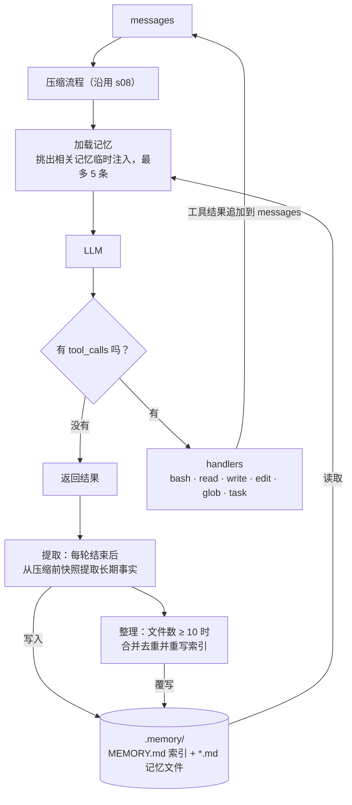
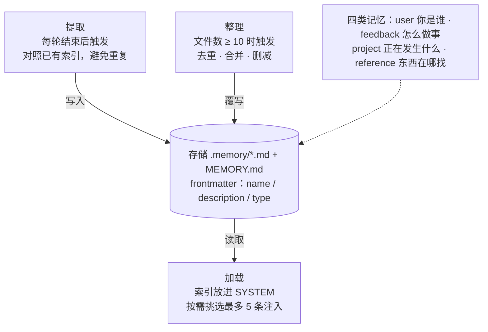

# s09：Memory - 只保存下次还要用的长期信息

上一章 `s08` 给当前会话装上了压缩流水线，但那只保住“这一次对话”。一旦退出终端明天重开，`messages` 清零，你的代码风格、输出偏好和项目约定又得从头交代。

这一章我们给 Agent 加上跨会话记忆层。**Memory 不是把聊天记录永久备份，而是只保存下次很难从代码和当前对话推出来的长期事实，并在需要时按相关性挑出来用。**

## 问题

用户偏好、团队习惯、隐性规则会反复派上用场，但它们不会写在代码文件里。如果每次开新会话都靠人工重复，非常烦琐；反过来，如果把所有历史对话原封不动存起来并全量塞进上下文，记忆很快就会膨胀成新的噪音堆。

## 解决方案

我们在 `.memory/` 目录下落地一套“存、选、注、提、理”闭环：每条记忆是带 frontmatter 的独立 Markdown 文件（分 `user`、`feedback`、`project`、`reference` 四类），同时维护一份轻量索引 `MEMORY.md`，每条只占一行：



记忆数据的四类划分与读写闭环如下：



这里有两个关键的工程细节：

- **临时注入不污染历史**：`buildRequest()` 返回 `messages` 的浅拷贝，只在发送本次请求时把 `<relevant_memories>` 拼到最新用户消息前。原数组不变，下一轮还能换一批更相关的记忆。
- **三类辅助调用彼此兜底**：选记忆（失败时降级关键词匹配）、提记忆（读取压缩前快照 `preCompress`，防止压缩把原话压没）和理记忆（文件数满 10 个触发）都包在 `try/catch` 里，任何一步失败都不会打断主对话。

## 测试 Prompt

第一次运行，让 Agent 保存一条长期偏好：

```text
remember: 我写教程时喜欢先给最小可运行代码，再解释原理。请记住这个长期偏好，并用一句话回复。
```

观察终端是否打印 `[Memory: extracted 1 new memories]`，同时 `.memory/` 下生成新的 `.md` 文件并更新了 `MEMORY.md`。接着输入 `q` 退出，重新运行 `cd code-agent-course && node s09-memory.js`，验证跨会话回忆：

```text
下次帮我写教程时，我喜欢什么顺序？请根据 memory 回答，不要读取文件。
```

模型应该能直接答出“先给最小可运行代码，再解释原理”。如果想核对落盘内容，也可以接着输入：

```text
用 glob 查找 .memory/*.md，然后总结这些 memory 文件保存了什么。
```

## 扩展阅读：商业级 Agent 怎么做 Memory

成熟产品都把“当前工作台（context）”和“跨会话沉淀（memory）”分开对待，不会把聊天记录原样全塞回下一次对话：

- **Claude Code**：区分人工维护的 `CLAUDE.md` 和自动记忆，自动记忆从用户更正、偏好与项目事实里提炼独立文件，并在后续会话按需加载。参考 [Claude Code Memory](https://code.claude.com/docs/en/memory)。
- **Codex**：开源 core 采用两阶段 memory pipeline，先从近期 rollout 提取结构化记忆，再由内部子代理执行合并整理（consolidation）。参考 [Codex Memories Pipeline](https://github.com/openai/codex/blob/main/codex-rs/core/src/memories/README.md)。
- **opencode**：公开文档重点是项目级与全局 `AGENTS.md` 规则文件，由人工维护并载入后续会话，偏向长期指令而非自动提取。参考 [OpenCode Rules](https://opencode.ai/docs/rules)。

**写得克制、读得精准、定期整理，跨会话记忆才不会越积越乱。**

## 本地运行与测试

交互运行（从仓库根目录执行）：

```bash
cd code-agent-course && node s09-memory.js
```

离线单测（在仓库根目录执行，无需 API Token）：

```bash
pnpm vitest run code-agent-course/s09-memory.test.js
```

## 博客代码演进

### 1. 整理开头：多引入一个 rmSync

这一章要新增读写和整理记忆文件的逻辑，先从最小的一步开始：把 `node:fs` 的引入整理成多行，顺手加上后面重写记忆目录时要用的 `rmSync`。这一步不改变运行行为。

```diff agent-step
@@
-import { readdirSync, readFileSync, existsSync, mkdirSync, writeFileSync } from "node:fs";
+import {
+  readdirSync,
+  readFileSync,
+  existsSync,
+  mkdirSync,
+  writeFileSync,
+  rmSync,
+} from "node:fs";
 import path from "node:path";
 import {
```

### 2. 记忆存在哪里，怎么读出来

记忆直接落成 `.memory/` 下的普通 Markdown 文件，头部用 frontmatter 存名字、描述和类型。`setMemoryDir` 方便测试切换到临时目录；`listMemoryFiles` 扫描所有 `.md` 并复用 `parseFrontmatter` 解析出来，排除索引文件 `MEMORY.md`。目录还不存在时直接返回空数组。

```diff agent-step
@@
 }
 
+let memoryDir = path.join(process.cwd(), ".memory");
+export function setMemoryDir(dir) {
+  memoryDir = dir;
+}
+const indexPath = () => path.join(memoryDir, "MEMORY.md");
+
+export function listMemoryFiles() {
+  if (!existsSync(memoryDir)) return [];
+  return readdirSync(memoryDir)
+    .filter((f) => f.endsWith(".md") && f !== "MEMORY.md")
+    .sort()
+    .map((filename) => {
+      const raw = readFileSync(path.join(memoryDir, filename), "utf8");
+      const { meta, body } = parseFrontmatter(raw);
+      return {
+        filename,
+        name: meta.name || filename.replace(/\.md$/, ""),
+        description: meta.description || "",
+        type: meta.type || "user",
+        body,
+        content: raw,
+      };
+    });
+}
+
 const TRANSCRIPT_DIR = path.join(process.cwd(), ".transcripts");
 const TOOL_RESULTS_DIR = path.join(process.cwd(), ".task_outputs", "tool-results");
@@
 
 export const estimateSize = (messages) => JSON.stringify(messages).length;
-
 const isToolResult = (m) => m.role === "tool";
```

### 3. 写入一条记忆，并维护索引

`writeMemoryFile` 把记忆名字转成文件 slug，拼好 frontmatter 和正文后写盘，再调用 `rebuildIndex` 重建 `MEMORY.md` 索引清单。`readMemoryIndex` 负责读出这份清单供系统提示词使用。到这里存储层就齐了，但还没接入主循环。

```diff agent-step
@@
 const indexPath = () => path.join(memoryDir, "MEMORY.md");
 
+export function writeMemoryFile(name, type, description, body) {
+  mkdirSync(memoryDir, { recursive: true });
+  const slug = name.toLowerCase().replace(/[\s/]+/g, "-");
+  writeFileSync(
+    path.join(memoryDir, `${slug}.md`),
+    `---\nname: ${name}\ndescription: ${description}\ntype: ${type}\n---\n\n${body}\n`,
+  );
+  rebuildIndex();
+}
+
 export function listMemoryFiles() {
   if (!existsSync(memoryDir)) return [];
@@
       };
     });
+}
+
+function rebuildIndex() {
+  const lines = listMemoryFiles().map((m) => `- [${m.name}](${m.filename}) — ${m.description}`);
+  mkdirSync(memoryDir, { recursive: true });
+  writeFileSync(indexPath(), lines.length ? `${lines.join("\n")}\n` : "");
+}
+
+export function readMemoryIndex() {
+  return existsSync(indexPath()) ? readFileSync(indexPath(), "utf8").trim() : "";
 }
```

### 4. 挑出相关记忆：先写关键词兜底版

记忆多了不能每次都全量塞进请求，需要先筛选。`selectRelevantMemories` 取出用户最近 3 条文本消息，这一步先实现最简单的兜底版：按词拆分后匹配记忆的名字和描述，最多返回 5 个文件名。

```diff agent-step
@@
 }
 
+export async function selectRelevantMemories(messages, maxItems = 5) {
+  const files = listMemoryFiles();
+  if (!files.length) return [];
+  const recent = messages
+    .filter((m) => m.role === "user" && typeof m.content === "string")
+    .slice(-3)
+    .map((m) => m.content)
+    .join(" ")
+    .slice(0, 2000);
+  if (!recent.trim()) return [];
+  const catalog = files.map((f, i) => `${i}: ${f.name} — ${f.description}`).join("\n");
+  const keywords = recent.toLowerCase().split(/\s+/).filter((w) => w.length > 3);
+  return files
+    .filter((f) => keywords.some((kw) => `${f.name} ${f.description}`.toLowerCase().includes(kw)))
+    .slice(0, maxItems)
+    .map((f) => f.filename);
+}
+
 const TRANSCRIPT_DIR = path.join(process.cwd(), ".transcripts");
 const TOOL_RESULTS_DIR = path.join(process.cwd(), ".task_outputs", "tool-results");
```

### 5. 挑出相关记忆：优先请模型来选

关键词匹配换个说法就容易漏，所以优先让模型挑：把近期对话和编号后的记忆清单发给一次独立的 `callLlm`，要求只返回相关序号的 JSON 数组（例如 `[0, 2]`），校验下标范围后取出对应文件名。一旦调用失败或返回格式不对，立刻无感回退到上一步的关键词匹配。

```diff agent-step
@@
   if (!recent.trim()) return [];
   const catalog = files.map((f, i) => `${i}: ${f.name} — ${f.description}`).join("\n");
+  try {
+    const { message } = await callLlm(
+      [
+        {
+          role: "user",
+          content: `Given the recent conversation and the memory catalog, return ONLY a JSON array of the indices that are clearly relevant (e.g. [0, 2]). If none, return [].
+
+Recent conversation:
+${recent}
+
+Memory catalog:
+${catalog}`,
+        },
+      ],
+      {},
+    );
+    const match = (message.content || "").match(/\[.*?\]/s);
+    if (match) {
+      const indices = JSON.parse(match[0]);
+      return indices
+        .filter((i) => Number.isInteger(i) && i >= 0 && i < files.length)
+        .slice(0, maxItems)
+        .map((i) => files[i].filename);
+    }
+  } catch {
+  }
   const keywords = recent.toLowerCase().split(/\s+/).filter((w) => w.length > 3);
   return files
```

### 6. 把选中的记忆临时拼进本次请求

`loadMemories` 读出选中记忆的全文，用 `<relevant_memories>` 包起来。`buildRequest` 找到最近一条用户文本消息，把记忆正文拼在前面，但只改浅拷贝 `copy`，绝不动原 `messages` 数组。这样记忆只对当前这次请求生效，不会把旧记忆永久留在对话历史里。

```diff agent-step
@@
 }
 
+export async function loadMemories(messages) {
+  const selected = await selectRelevantMemories(messages);
+  if (!selected.length) return "";
+  const parts = ["<relevant_memories>"];
+  for (const filename of selected) parts.push(readFileSync(path.join(memoryDir, filename), "utf8"));
+  parts.push("</relevant_memories>");
+  return parts.join("\n\n");
+}
+
+function buildRequest(messages, memoriesContent) {
+  if (!memoriesContent) return messages;
+  let idx = -1;
+  for (let i = messages.length - 1; i >= 0; i -= 1) {
+    if (messages[i].role === "user" && typeof messages[i].content === "string") {
+      idx = i;
+      break;
+    }
+  }
+  if (idx === -1) return messages;
+  const copy = messages.slice();
+  copy[idx] = { ...messages[idx], content: `${memoriesContent}\n\n${messages[idx].content}` };
+  return copy;
+}
+
 const TRANSCRIPT_DIR = path.join(process.cwd(), ".transcripts");
 const TOOL_RESULTS_DIR = path.join(process.cwd(), ".task_outputs", "tool-results");
```

### 7. 接进 loop：打通两条读取路径

现在把记忆读取接进 `agentLoop`，一共两条线：第一条把固定常量 `SYSTEM` 改成 `buildSystem()`，每次提问时读入 `MEMORY.md` 索引，让模型知道记忆库里有什么；第二条在进入循环前调 `loadMemories(messages)`，调用模型时通过 `buildRequest` 临时注入选中记忆全文。

```diff agent-step
@@
   /prompt.*too.*long|too many tokens|context.*length/i.test(String(error.message));
 
-const SYSTEM = `You are a coding agent at ${process.cwd()}. Use tools to solve tasks.
+function buildSystem() {
+  const index = readMemoryIndex();
+  return `You are a coding agent at ${process.cwd()}. Use tools to solve tasks.
 Before a multi-step task, use todo_write to plan and update status as you go.
 For a complex sub-problem, use the task tool to spawn a subagent.
@@
 ${listSkills()}
 Use load_skill to get a skill's full content when you need it.
-When context gets large, call compact to summarize earlier work and free space.`;
+When context gets large, call compact to summarize earlier work and free space.${
+    index
+      ? `\n\nMemories available:\n${index}\nRespect user preferences from memory. When the user says "remember" or reveals a stable preference, it will be saved.`
+      : ""
+  }`;
+}
 const SUB_SYSTEM = `You are a coding subagent at ${process.cwd()}. Complete the task, then return a concise summary. Do not delegate further.`;
@@
   let roundsSinceTodo = 0;
   let reactiveRetries = 0;
+  const system = buildSystem();
+  const memoriesContent = await loadMemories(messages);
+
   while (true) {
     if (roundsSinceTodo >= 3) {
@@
     let message;
     try {
-      ({ message } = await callLlm(messages, { system: SYSTEM, tools }));
+      ({ message } = await callLlm(buildRequest(messages, memoriesContent), { system, tools }));
       reactiveRetries = 0;
     } catch (error) {
```

### 8. 提取记忆：先整理待分析的对话材料

读通了，接下来写“记忆从哪来”。先定义四种合法类型 `MEMORY_TYPES`，再写 `extractMemories` 的前半段：挑出最近 10 条带文本的 `user` / `assistant` 消息（最多 4000 字符），同时列出已有记忆清单，准备下一步交给模型避免重复提取。

```diff agent-step
@@
 }
 
+const MEMORY_TYPES = ["user", "feedback", "project", "reference"];
+
 let memoryDir = path.join(process.cwd(), ".memory");
 export function setMemoryDir(dir) {
@@
   parts.push("</relevant_memories>");
   return parts.join("\n\n");
+}
+
+export async function extractMemories(messages) {
+  const dialogue = messages
+    .filter((m) => (m.role === "user" || m.role === "assistant") && typeof m.content === "string" && m.content.trim())
+    .slice(-10)
+    .map((m) => `${m.role}: ${m.content}`)
+    .join("\n")
+    .slice(0, 4000);
+  if (!dialogue.trim()) return 0;
+  const existing = listMemoryFiles();
+  const existingDesc = existing.length
+    ? existing.map((m) => `- ${m.name}: ${m.description}`).join("\n")
+    : "(none)";
 }
```

### 9. 提取记忆：请模型挑出长期事实

把对话片段和已有记忆清单发给一次独立的 `callLlm`，要求只提取长期有效的偏好、约束或项目事实，并按 `{name, type, description, body}` 的 JSON 数组返回；没有新信息就返回 `[]`。整个调用包在 `try/catch` 里，提取失败返回 `0`，绝不影响正常回复。

```diff agent-step
@@
     ? existing.map((m) => `- ${m.name}: ${m.description}`).join("\n")
     : "(none)";
+  try {
+    const { message } = await callLlm(
+      [
+        {
+          role: "user",
+          content: `Extract durable user preferences, constraints, or project facts from this dialogue.
+Return a JSON array; each item: {name, type, description, body}.
+- name: short kebab-case id; type: one of ${MEMORY_TYPES.join("/")}; description: one-line; body: markdown detail.
+If nothing new or already covered, return [].
+
+Existing memories:
+${existingDesc}
+
+Dialogue:
+${dialogue}`,
+        },
+      ],
+      {},
+    );
+  } catch {
+    return 0;
+  }
 }
```

### 10. 提取记忆：落盘并接到回合末尾

解析模型返回的 JSON 数组，把合法条目逐个调用 `writeMemoryFile` 写入磁盘（未知类型回落到 `user`），有新增时顺手打印提示。随后接入 `agentLoop`：每轮压缩前先拷贝一份 `preCompress`，等模型不再调工具、准备返回答案时再从 `preCompress` 提取，避免刚压缩完把用户原话弄丢。

```diff agent-step
@@
       {},
     );
+    const match = (message.content || "").match(/\[.*\]/s);
+    if (!match) return 0;
+    const items = JSON.parse(match[0]);
+    let count = 0;
+    for (const m of items) {
+      if (m.description && m.body) {
+        writeMemoryFile(
+          m.name || `memory-${count}`,
+          MEMORY_TYPES.includes(m.type) ? m.type : "user",
+          m.description,
+          m.body,
+        );
+        count += 1;
+      }
+    }
+    if (count) console.log(`[Memory: extracted ${count} new memories]`);
+    return count;
   } catch {
     return 0;
@@
   const system = buildSystem();
   const memoriesContent = await loadMemories(messages);
+  let preCompress = messages.map((m) => ({ role: m.role, content: m.content }));
 
   while (true) {
@@
     }
 
+    preCompress = messages.map((m) => ({ role: m.role, content: m.content }));
+
     apply(messages, toolResultBudget(messages));
     apply(messages, snipCompact(messages));
@@
 
     if (!message.tool_calls?.length) {
+      await extractMemories(preCompress);
       return message.content || "";
     }
```

### 11. 整理记忆：先判断是否达到门槛

只写不理，记忆迟早会出现重复或前后矛盾。`consolidateMemories` 负责大扫除，先写前半段：文件数不到 `CONSOLIDATE_THRESHOLD`（10 个）就直接返回；达到门槛才把所有记忆拼成最多 16000 字符的完整清单。

```diff agent-step
@@
 }
 
+const CONSOLIDATE_THRESHOLD = 10;
+export async function consolidateMemories() {
+  const files = listMemoryFiles();
+  if (files.length < CONSOLIDATE_THRESHOLD) return;
+  const catalog = files
+    .map((f) => `## ${f.filename}\nname: ${f.name}\ndescription: ${f.description}\n${f.body}`)
+    .join("\n\n")
+    .slice(0, 16000);
+}
+
 function buildRequest(messages, memoriesContent) {
   if (!memoriesContent) return messages;
```

### 12. 整理记忆：让模型合并去重并重写目录

把清单交给模型合并重复条目、剔除过时和冲突内容，同时优先保住用户偏好。拿到新的 JSON 列表后，先删掉 `.memory/` 下除 `MEMORY.md` 外的旧 `.md` 文件，再逐条写回并自动刷新索引。最后把它挂在 `agentLoop` 回合末尾、`extractMemories` 之后。

```diff agent-step
@@
     .join("\n\n")
     .slice(0, 16000);
+  try {
+    const { message } = await callLlm(
+      [
+        {
+          role: "user",
+          content: `Consolidate these memory files: merge duplicates, drop outdated/contradicted ones, keep under 30, preserve user preferences above all.
+Return a JSON array; each item: {name, type, description, body}.
+
+${catalog}`,
+        },
+      ],
+      {},
+    );
+    const match = (message.content || "").match(/\[.*\]/s);
+    if (!match) return;
+    const items = JSON.parse(match[0]);
+    for (const f of readdirSync(memoryDir)) {
+      if (f.endsWith(".md") && f !== "MEMORY.md") rmSync(path.join(memoryDir, f));
+    }
+    for (const m of items) {
+      if (m.description && m.body) {
+        writeMemoryFile(
+          m.name || "memory",
+          MEMORY_TYPES.includes(m.type) ? m.type : "user",
+          m.description,
+          m.body,
+        );
+      }
+    }
+  } catch {
+  }
 }
@@
     if (!message.tool_calls?.length) {
       await extractMemories(preCompress);
+      await consolidateMemories();
       return message.content || "";
     }
```

### 13. 补上教学日志并更新提示符

最后补一行整理完成的日志，直观显示记忆条数从多少精简成了多少，再把提示符切到 `s09 >> `。回头看，整个记忆层不过是“本地 Markdown 文件 + 三类辅助模型调用（选记忆、提记忆、理记忆）”，读在回合前，写在回合后。

> **本章思考题**：看看刚才写的 `buildSystem()`，身份说明、技能目录、压缩规则、记忆索引全都硬拼在一条大模板字符串里，工具清单甚至还没动态同步。等后面再加任务系统、团队协作和 MCP 工具，这样硬拼很快会失控。能不能把系统提示词改造成按当前状态拼装的流水线？下一章 `s10` 我们来重构 System Prompt。

```diff agent-step
@@
       }
     }
+    console.log(`[Memory: consolidated ${files.length} → ${items.length} memories]`);
   } catch {
   }
@@
 async function main() {
   await runChatCli({
-    promptLabel: "s08 >> ",
+    promptLabel: "s09 >> ",
     onPrompt: async ({ prompt, messages, ask }) => {
       return agentLoop(messages, ask);
```

## 和上一步的关键代码 diff（不含 helper.js）

```diff
--- s08-context-compact.js
+++ s09-memory.js
@@
-import { readdirSync, readFileSync, existsSync, mkdirSync, writeFileSync } from "node:fs";
+import {
+  readdirSync,
+  readFileSync,
+  existsSync,
+  mkdirSync,
+  writeFileSync,
+  rmSync,
+} from "node:fs";
@@
+const MEMORY_TYPES = ["user", "feedback", "project", "reference"];
+
+let memoryDir = path.join(process.cwd(), ".memory");
+export function setMemoryDir(dir) {
+  memoryDir = dir;
+}
+const indexPath = () => path.join(memoryDir, "MEMORY.md");
+
+export function writeMemoryFile(name, type, description, body) {
+  mkdirSync(memoryDir, { recursive: true });
+  const slug = name.toLowerCase().replace(/[\s/]+/g, "-");
+  writeFileSync(
+    path.join(memoryDir, `${slug}.md`),
+    `---\nname: ${name}\ndescription: ${description}\ntype: ${type}\n---\n\n${body}\n`,
+  );
+  rebuildIndex();
+}
+
+export async function loadMemories(messages) {
+  const selected = await selectRelevantMemories(messages);
+  if (!selected.length) return "";
+  const parts = ["<relevant_memories>"];
+  for (const filename of selected) parts.push(readFileSync(path.join(memoryDir, filename), "utf8"));
+  parts.push("</relevant_memories>");
+  return parts.join("\n\n");
+}
+
+function buildRequest(messages, memoriesContent) {
+  if (!memoriesContent) return messages;
+  let idx = -1;
+  for (let i = messages.length - 1; i >= 0; i -= 1) {
+    if (messages[i].role === "user" && typeof messages[i].content === "string") {
+      idx = i;
+      break;
+    }
+  }
+  if (idx === -1) return messages;
+  const copy = messages.slice();
+  copy[idx] = { ...messages[idx], content: `${memoriesContent}\n\n${messages[idx].content}` };
+  return copy;
+}
@@
-const SYSTEM = `You are a coding agent at ${process.cwd()}. Use tools to solve tasks.
+function buildSystem() {
+  const index = readMemoryIndex();
+  return `You are a coding agent at ${process.cwd()}. Use tools to solve tasks.
@@
+When context gets large, call compact to summarize earlier work and free space.${
+    index
+      ? `\n\nMemories available:\n${index}\nRespect user preferences from memory. When the user says "remember" or reveals a stable preference, it will be saved.`
+      : ""
+  }`;
+}
@@
 export async function agentLoop(messages, confirm) {
   let roundsSinceTodo = 0;
   let reactiveRetries = 0;
+  const system = buildSystem();
+  const memoriesContent = await loadMemories(messages);
+  let preCompress = messages.map((m) => ({ role: m.role, content: m.content }));
@@
+    preCompress = messages.map((m) => ({ role: m.role, content: m.content }));
@@
-      ({ message } = await callLlm(messages, { system: SYSTEM, tools }));
+      ({ message } = await callLlm(buildRequest(messages, memoriesContent), { system, tools }));
@@
     if (!message.tool_calls?.length) {
+      await extractMemories(preCompress);
+      await consolidateMemories();
       return message.content || "";
     }
```
