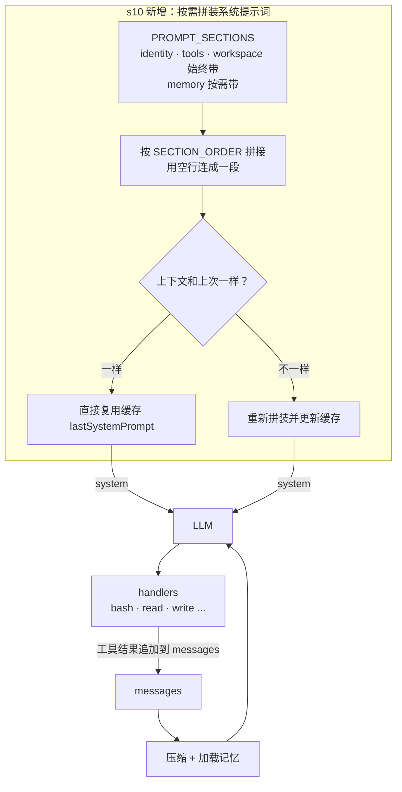

# s10：System Prompt —— 从固定文本变成装配流水线

新人每天上班前需要一份任务说明，但不同场景需要不同提醒：有时要强调安全，有时要带上记忆，有时要加载技能。`s10` 把这份说明书变成装配线，每轮按当前情况组装给他看。


## 本章目标

system prompt 不应该是一大段永远不变的字符串。

`s10` 把 prompt 拆成多个 section，每轮根据当前运行时状态装配。

## 新增能力

本章不减少已有能力，只把已有的工具、技能、压缩和记忆说明改成按段装配。

- `assembleSystemPrompt(context)`：按 section 拼 prompt。
- `getSystemPrompt(context)`：相同 context 走缓存。
- `buildContext()`：收集工具、技能、记忆等运行时状态。
- 工具执行后重新计算 prompt。

## 流程图


```text
运行时状态
  |
  +--> tools
  +--> skills
  +--> memory index
  +--> compact policy
  |
  v
assembleSystemPrompt(context)
  |
  v
system prompt
  |
  v
call LLM
```

## 为什么这一步重要

prompt 是输入流水线，不是固定文案。

当工具、技能、记忆变化时，模型看到的系统信息也应该变化。后面的 MCP 动态工具池就是这个思想的延伸。

## 代码入口

- JS：[s10-system-prompt.js](./s10-system-prompt.js)
- Test：[s10-system-prompt.test.js](./s10-system-prompt.test.js)

## 运行

```bash
node code-agent-course/s10-system-prompt.js
```

## 参考实现提醒

System Prompt 不是一段越写越长的常量，而是运行时输入流水线：

- 身份、工具、技能目录、记忆、MCP 状态都应该按当前状态装配。
- prompt section 要有稳定顺序，避免同样状态下模型看到的规则忽前忽后。
- 缓存 prompt 可以省成本，但状态变化后必须失效，否则模型会看见旧世界。

## 新增函数速览

- `assembleSystemPrompt(context)`：按固定顺序把身份、工具、技能、压缩规则和记忆拼成最终 system prompt。
- `getSystemPrompt(context)`：按上下文 key 缓存 system prompt，避免每一轮重复拼装。
- `resetSystemPromptCache()`：测试或配置变化时清空 prompt 缓存。
- `buildContext()`：读取当前工具名、skill 列表和 memory 索引，生成 prompt 装配所需的 context；工作目录由 `identity` section 直接读取。

## 关键代码

`s10` 把一整坨 prompt 拆成 section：

```js
const PROMPT_SECTIONS = {
  identity: () =>
    `You are a coding agent at ${process.cwd()}. Use tools to solve tasks. Before a multi-step task, use todo_write to plan and update status as you go. For a complex sub-problem, use the task tool to spawn a subagent.`,
  tools: (ctx) => (ctx.tools.length ? `Available tools: ${ctx.tools.join(", ")}.` : null),
  skills: (ctx) =>
    ctx.skills ? `Skills available:\n${ctx.skills}\nUse load_skill to load a skill's full content when needed.` : null,
  compaction: () => "When context gets large, call compact to summarize earlier work and free space.",
  memory: (ctx) =>
    ctx.memories
      ? `Memories available:\n${ctx.memories}\nRespect user preferences from memory; new ones are saved automatically.`
      : null,
};
const SECTION_ORDER = ["identity", "tools", "skills", "compaction", "memory"];
```

每轮根据真实运行状态装配：

```js
export function assembleSystemPrompt(context) {
  return SECTION_ORDER.map((key) => PROMPT_SECTIONS[key](context)).filter(Boolean).join("\n\n");
}
```

`agentLoop()` 在开始时取得一次 prompt；每轮工具执行后重新构建 context。context 没变时，`getSystemPrompt()` 会命中缓存：

```js
let context = buildContext();
let system = getSystemPrompt(context);

// 工具轮结束后
context = buildContext();
system = getSystemPrompt(context);
```

注意：技能和记忆仍复用 `helper.js` 里的 `parseFrontmatter`，本章没有新增 frontmatter 解析逻辑。源码同时去掉了 s09 的三条压缩日志，但自动压缩、手动压缩和应急压缩能力仍然保留。

## 测试 Prompt

```text
先列出当前可用工具和技能，再创建一个小文件 prompt-check.txt。
```

观察重点：system prompt 应该按当前工具、技能、记忆等运行时状态组装，而不是固定字符串。

## 扩展阅读：商业级 Agent 怎么做 Prompt 装配

成熟 agent 看到的 system prompt 通常由运行时状态组装，而不是一段永远不变的文本：

- Claude Code 会把工具、权限、项目规则和记忆等当前信息加入模型上下文。
- Codex 由运行时把会话状态、工具、sandbox / approval 约束和 memory 组合成 provider 请求。
- OpenCode 会按系统上下文、项目规则、工具和会话状态组织模型输入。

可继续阅读：[Claude Code memory](https://code.claude.com/docs/en/memory)、[Codex app-server protocol](https://github.com/openai/codex/blob/main/codex-rs/app-server/README.md)、[OpenCode system prompt 源码](https://github.com/anomalyco/opencode/tree/dev/packages/opencode/src/session/prompt)。本章的 `PROMPT_SECTIONS` 就是最小教学版：section 的顺序固定，是否出现由当前 context 决定。

## 一句话总结

`s10` 把 system prompt 变成按状态装配的输入流水线。

## 与 s09 的关键代码 diff（不含 helper.js）

下面只展示 system prompt 装配方式和 loop 接入点；压缩日志等非核心变化不放进主 diff。

```diff
--- s09-memory.js
+++ s10-system-prompt.js
-function buildSystem() {
-  const index = readMemoryIndex();
+const PROMPT_SECTIONS = {
+  identity: () =>
+    `You are a coding agent at ${process.cwd()}. Use tools to solve tasks. Before a multi-step task, use todo_write to plan and update status as you go. For a complex sub-problem, use the task tool to spawn a subagent.`,
+  tools: (ctx) => (ctx.tools.length ? `Available tools: ${ctx.tools.join(", ")}.` : null),
+  skills: (ctx) =>
+    ctx.skills ? `Skills available:\n${ctx.skills}\nUse load_skill to load a skill's full content when needed.` : null,
+  compaction: () => "When context gets large, call compact to summarize earlier work and free space.",
+  memory: (ctx) =>
+    ctx.memories
+      ? `Memories available:\n${ctx.memories}\nRespect user preferences from memory; new ones are saved automatically.`
+      : null,
+};
+const SECTION_ORDER = ["identity", "tools", "skills", "compaction", "memory"];
+
+export function assembleSystemPrompt(context) {
+  return SECTION_ORDER.map((key) => PROMPT_SECTIONS[key](context)).filter(Boolean).join("\n\n");
+}
+
+let lastContextKey = null;
+let lastSystemPrompt = null;
+export function getSystemPrompt(context) {
+  const key = JSON.stringify(context);
+  if (key === lastContextKey && lastSystemPrompt) return lastSystemPrompt;
+  lastContextKey = key;
+  lastSystemPrompt = assembleSystemPrompt(context);
+  return lastSystemPrompt;
+}
+
+export function buildContext() {
+  const skills = listSkills();
+  return {
+    tools: tools.map((t) => t.function.name),
+    skills: skills === "(no skills found)" ? "" : skills,
+    memories: readMemoryIndex(),
+  };
+}

-  const system = buildSystem(); // s09：含记忆索引，每个用户请求构建一次
+  let context = buildContext(); // s10：从真实状态派生 context
+  let system = getSystemPrompt(context); // s10：运行时组装（替换 s09 的 buildSystem）

+    context = buildContext();
+    system = getSystemPrompt(context);
```

## 博客代码演进

下面 7 个 patch 专门用于博客右侧的代码切换。第一步基于 `s09-memory.js`，后面的每一步都继续修改上一帧，最后必须得到完整的 `s10-system-prompt.js`。

每一步的代码都可以运行。前五步把新的拼装方式一点点写出来，旧的 `buildSystem` 一直留着并继续工作；第 6 步才让 loop 换用新的写法，同时删掉旧函数。

### 1. 把提示词拆成小段：先写“身份”

s09 的 `buildSystem` 把所有内容写在一个长字符串里，想改其中一部分很不方便。现在换一种组织方式：`PROMPT_SECTIONS` 是一张表，每一项是一个小函数，负责生成提示词的一段。先放第一段 `identity`，说明“你是谁、该怎么干活”，它不依赖任何状态，每次都一样。旧的 `buildSystem` 先不动。

```diff agent-step
@@
   /prompt.*too.*long|too many tokens|context.*length/i.test(String(error.message));
 
+const PROMPT_SECTIONS = {
+  identity: () =>
+    `You are a coding agent at ${process.cwd()}. Use tools to solve tasks. Before a multi-step task, use todo_write to plan and update status as you go. For a complex sub-problem, use the task tool to spawn a subagent.`,
+};
+
 function buildSystem() {
   const index = readMemoryIndex();
```

### 2. 再加四段：工具、技能、压缩、记忆

继续往表里加段落。每个函数接收一个 `ctx`，里面是当前的真实状态。关键在于可以返回 `null`：没有工具就不写工具那段，没有技能就不写技能那段，没有记忆就不写记忆那段。这样提示词里不会出现“可用技能：（无）”这种空话，模型看到的每一段都有用。

```diff agent-step
@@
   identity: () =>
     `You are a coding agent at ${process.cwd()}. Use tools to solve tasks. Before a multi-step task, use todo_write to plan and update status as you go. For a complex sub-problem, use the task tool to spawn a subagent.`,
+  tools: (ctx) => (ctx.tools.length ? `Available tools: ${ctx.tools.join(", ")}.` : null),
+  skills: (ctx) =>
+    ctx.skills ? `Skills available:\n${ctx.skills}\nUse load_skill to load a skill's full content when needed.` : null,
+  compaction: () => "When context gets large, call compact to summarize earlier work and free space.",
+  memory: (ctx) =>
+    ctx.memories
+      ? `Memories available:\n${ctx.memories}\nRespect user preferences from memory; new ones are saved automatically.`
+      : null,
 };
```

### 3. 按固定顺序拼起来

`SECTION_ORDER` 规定各段的先后顺序。`assembleSystemPrompt` 按这个顺序依次调用每一段的函数，去掉返回 `null` 的，剩下的用空行连接成完整的提示词。顺序固定很重要：同样的状态永远得到完全相同的文本，后面做缓存才有意义。

```diff agent-step
@@
       : null,
 };
+const SECTION_ORDER = ["identity", "tools", "skills", "compaction", "memory"];
+
+export function assembleSystemPrompt(context) {
+  return SECTION_ORDER.map((key) => PROMPT_SECTIONS[key](context)).filter(Boolean).join("\n\n");
+}
+
 
 function buildSystem() {
```

### 4. 从真实状态得到 context

各段函数需要的 `ctx` 从哪来？`buildContext` 直接读程序当前的状态：`tools` 数组里登记了哪些工具，`skills/` 里扫描到了哪些技能，记忆索引里有什么。注意它不去分析用户说了什么，只看事实。以后新增一个工具或一条记忆，提示词会自动跟着变，不需要手动同步。

```diff agent-step
@@
 }
 
+export function buildContext() {
+  const skills = listSkills();
+  return {
+    tools: tools.map((t) => t.function.name),
+    skills: skills === "(no skills found)" ? "" : skills,
+    memories: readMemoryIndex(),
+  };
+}
 
 function buildSystem() {
```

### 5. 状态没变就不重新拼

拼装提示词虽然不慢，但每一轮都重复拼出一模一样的文本没有必要。`getSystemPrompt` 把 `context` 转成 JSON 字符串当作标记，和上一次的比较：一样就直接返回上次的结果，不一样才重新拼装并记下来。`resetSystemPromptCache` 清空这份记录，测试时会用到。

```diff agent-step
@@
 }
 
+let lastContextKey = null;
+let lastSystemPrompt = null;
+export function getSystemPrompt(context) {
+  const key = JSON.stringify(context);
+  if (key === lastContextKey && lastSystemPrompt) return lastSystemPrompt;
+  lastContextKey = key;
+  lastSystemPrompt = assembleSystemPrompt(context);
+  return lastSystemPrompt;
+}
+export function resetSystemPromptCache() {
+  lastContextKey = null;
+  lastSystemPrompt = null;
+}
+
 export function buildContext() {
   const skills = listSkills();
```

### 6. loop 换用新的拼装方式

现在可以替换了。进入循环前，先 `buildContext` 再 `getSystemPrompt`，得到这一轮的提示词。每执行完一批工具，再做一次同样的事：工具可能刚写了一条记忆，状态变了就会重新拼装，没变就直接用缓存。旧的 `buildSystem` 不再有人调用，整个删掉。

```diff agent-step
@@
 }
 
-function buildSystem() {
-  const index = readMemoryIndex();
-  return `You are a coding agent at ${process.cwd()}. Use tools to solve tasks.
-Before a multi-step task, use todo_write to plan and update status as you go.
-For a complex sub-problem, use the task tool to spawn a subagent.
-Skills available:
-${listSkills()}
-Use load_skill to get a skill's full content when you need it.
-When context gets large, call compact to summarize earlier work and free space.${
-    index
-      ? `\n\nMemories available:\n${index}\nRespect user preferences from memory. When the user says "remember" or reveals a stable preference, it will be saved.`
-      : ""
-  }`;
-}
 const SUB_SYSTEM = `You are a coding subagent at ${process.cwd()}. Complete the task, then return a concise summary. Do not delegate further.`;
@@
   let roundsSinceTodo = 0;
   let reactiveRetries = 0;
-  const system = buildSystem();
+  let context = buildContext();
+  let system = getSystemPrompt(context);
   const memoriesContent = await loadMemories(messages);
   let preCompress = messages.map((m) => ({ role: m.role, content: m.content }));
@@
     }
     if (compacted) continue;
+
+    context = buildContext();
+    system = getSystemPrompt(context);
   }
 }
```

### 7. 收尾：压缩判断写成一行

最后做一点整理：自动压缩的判断缩成一行，上一章为了演示而加的三行压缩日志在这一章的源码里去掉了，提示符改成 `s10 >> `。本章没有增加任何新工具，改变的只是系统提示词的生成方式：从一个写死的字符串，变成按当前状态一段段拼出来的结果。

```diff agent-step
@@
     apply(messages, snipCompact(messages));
     apply(messages, microCompact(messages));
-    if (estimateSize(messages) > CONTEXT_LIMIT) {
-      console.log("[auto compact] compactHistory");
-      apply(messages, await compactHistory(messages));
-    }
+    if (estimateSize(messages) > CONTEXT_LIMIT) apply(messages, await compactHistory(messages));
 
     let message;
@@
     } catch (error) {
       if (reactiveRetries < MAX_REACTIVE_RETRIES && isPromptTooLong(error)) {
-        console.log("[reactive compact] reactiveCompact");
         apply(messages, await reactiveCompact(messages));
         reactiveRetries += 1;
@@
 
       if (name === "compact") {
-        console.log("[manual compact] compactHistory");
         apply(messages, await compactHistory(messages));
         compacted = true;
@@
 async function main() {
   await runChatCli({
-    promptLabel: "s09 >> ",
+    promptLabel: "s10 >> ",
     onPrompt: async ({ prompt, messages, ask }) => {
       return agentLoop(messages, ask);
```
