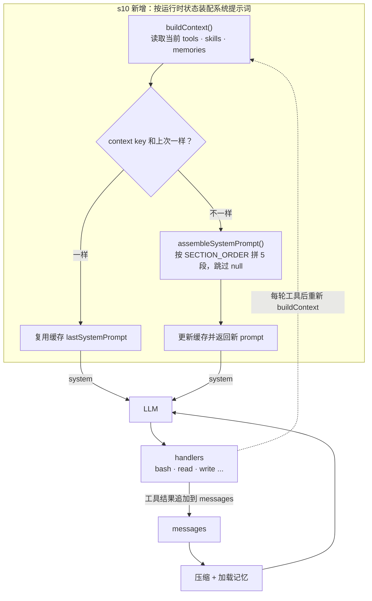

# s10：System Prompt - 从固定文案升级为按状态装配的流水线

上一章 `s09` 给 Agent 加上了跨会话记忆，但系统提示词还是靠 `buildSystem()` 在一条大模板字符串里硬拼出来的。工具列表没有自动同步，技能为空时还会拼出 `(no skills found)`，后面再叠加任务图、团队协作和 MCP 工具只会越拼越乱。

这一章我们把系统提示词改造成分段装配流水线。**System Prompt 不是写死的静态文案，而是根据当前运行时状态动态拼出的输入流水线：状态没变走缓存，状态一变立刻刷新。**

## 问题

Agent 的运行时状态随时在变：当前注册了哪些工具、扫描到了哪些技能、`MEMORY.md` 索引里有没有新记忆，每一轮都可能不同。把所有指令揉进一段长字符串，不仅越改越难维护，还很容易让空段落占位，或者工具改了状态后模型看到的仍然是过期提示词。

## 解决方案

我们把大字符串拆成 `PROMPT_SECTIONS` 五个分段函数，用 `SECTION_ORDER` 固定拼接顺序，由 `buildContext()` 从真实运行状态派生上下文，再通过 `getSystemPrompt()` 按状态做缓存：



这套装配流水线有三个关键设计：

- **固定顺序、空段省略**：`SECTION_ORDER` 锁定为 `["identity", "tools", "skills", "compaction", "memory"]`。`identity`（读取当前工作目录）和 `compaction` 始终输出；`tools`、`skills`、`memory` 在为空时返回 `null` 自动跳过，不往提示词里塞废话。
- **同态缓存、变动失效**：`getSystemPrompt()` 把 `context` 序列化为 key，状态没变就直接复用上次结果（保持前缀稳定，也有利于服务端 Prompt Cache）；一旦变动立即重拼。
- **每轮工具后刷新**：`agentLoop` 在进入循环前和每批工具跑完后都会重新调用 `buildContext()` 和 `getSystemPrompt()`，让后续动态增删工具或写入记忆能马上反映到提示词里。

顺手说明：本章源码同时去掉了 `s09` 里的三行压缩教学日志，但自动压缩、手动压缩和应急压缩能力全部保留。

## 测试 Prompt

```text
先列出当前可用工具和技能，再创建一个小文件 prompt-check.txt。
```

运行后可以看到模型能准确列出当前注册的全部工具名（来自 `tools` 段）以及已扫描到的技能（若有），说明系统提示词已经按真实运行状态动态拼装，随后再正常调用 `write_file` 创建文件。

## 扩展阅读：商业级 Agent 怎么做 Prompt 装配

商业级 Agent 发给模型的 system prompt 通常都不是静态文案，而是由运行时按当前会话状态逐段装配出来的：

- **Claude Code**：运行时会把当前可用工具、权限模式、项目规则与记忆状态动态装配进模型上下文。参考 [Claude Code Memory](https://code.claude.com/docs/en/memory)。
- **Codex**：由核心运行时把会话状态、工具清单、sandbox / approval 约束和 memory 统一组装成 provider 请求。参考 [Codex app-server protocol](https://github.com/openai/codex/blob/main/codex-rs/app-server/README.md)。
- **opencode**：按系统上下文、项目规则、工具与会话状态分段组织提示词输入，方便不同环境按需裁剪。参考 [OpenCode system prompt 源码](https://github.com/anomalyco/opencode/tree/dev/packages/opencode/src/session/prompt)。

**顺序固定保缓存、按状态裁剪防陈旧，这就是动态 System Prompt 装配的核心原则。**

## 本地运行与测试

交互运行（从仓库根目录执行）：

```bash
cd code-agent-course && node s10-system-prompt.js
```

离线单测（在仓库根目录执行，无需 API Token）：

```bash
pnpm vitest run code-agent-course/s10-system-prompt.test.js
```

## 博客代码演进

### 1. 把提示词拆成小段：先写“身份”

`s09` 的 `buildSystem` 把所有规则都写死在一条长字符串里，改一段就要动整块。现在换一种组织法：`PROMPT_SECTIONS` 是一张表，每一项都是负责生成一段文案的小函数。我们先放第一段 `identity`，说明“你是谁、在哪里、该怎么干活”。旧的 `buildSystem` 暂时留着，保证当前帧仍可运行。

```diff agent-step
@@
   /prompt.*too.*long|too many tokens|context.*length/i.test(String(error.message));
 
+const PROMPT_SECTIONS = {
+  identity: () =>
+    `You are a coding agent at ${process.cwd()}. Use tools to solve tasks. Before a multi-step task, use todo_write to plan and update status as you go. For a complex sub-problem, use the task tool to spawn a subagent.`,
+};
+
 function buildSystem() {
   const index = readMemoryIndex();
```

### 2. 再补四段：工具、技能、压缩、记忆

接着往 `PROMPT_SECTIONS` 里补齐其余四段。每个函数接收当前状态对象 `ctx`，最大的好处是支持返回 `null`：没有工具、没有技能或没有记忆时直接跳过对应段落，不再往提示词里拼“可用技能：(no skills found)”这种无效空话。

```diff agent-step
@@
   identity: () =>
     `You are a coding agent at ${process.cwd()}. Use tools to solve tasks. Before a multi-step task, use todo_write to plan and update status as you go. For a complex sub-problem, use the task tool to spawn a subagent.`,
+  tools: (ctx) => (ctx.tools.length ? `Available tools: ${ctx.tools.join(", ")}.` : null),
+  skills: (ctx) =>
+    ctx.skills ? `Skills available:\n${ctx.skills}\nUse load_skill to load a skill's full content when needed.` : null,
+  compaction: () => "When context gets large, call compact to summarize earlier work and free space.",
+  memory: (ctx) =>
+    ctx.memories
+      ? `Memories available:\n${ctx.memories}\nRespect user preferences from memory; new ones are saved automatically.`
+      : null,
 };
```

### 3. 按固定顺序拼成完整提示词

`SECTION_ORDER` 显式规定五段的先后顺序，`assembleSystemPrompt` 按序调用每个段落函数，用 `.filter(Boolean)` 滤掉 `null`，再用空行拼成最终文案。顺序必须固定：同样的状态每次都会产出逐字节一致的提示词，后面的缓存和服务端前缀复用才立得住。

```diff agent-step
@@
       : null,
 };
+const SECTION_ORDER = ["identity", "tools", "skills", "compaction", "memory"];
+
+export function assembleSystemPrompt(context) {
+  return SECTION_ORDER.map((key) => PROMPT_SECTIONS[key](context)).filter(Boolean).join("\n\n");
+}
+
 
 function buildSystem() {
```

### 4. 从真实运行时状态派生 context

段落函数需要的 `ctx` 从哪里来？`buildContext` 直接读取程序当下的真实状态：从 `tools` 提取工具名列表，从 `listSkills()` 拿技能目录（空提示归一成空串），从 `readMemoryIndex()` 读记忆索引。以后新增工具或写入新记忆，提示词会自动跟着变，不用再人工两头同步。

```diff agent-step
@@
 }
 
+export function buildContext() {
+  const skills = listSkills();
+  return {
+    tools: tools.map((t) => t.function.name),
+    skills: skills === "(no skills found)" ? "" : skills,
+    memories: readMemoryIndex(),
+  };
+}
 
 function buildSystem() {
```

### 5. 状态没变就直接走缓存

虽然拼字符串本身很快，但状态没变时每轮重拼也没必要。`getSystemPrompt` 把 `context` 转成 JSON 字符串作为缓存键，和上次一样就直接返回 `lastSystemPrompt`，不一样才重新调用 `assembleSystemPrompt` 并刷新缓存。顺手提供 `resetSystemPromptCache`，方便单测隔离状态。

```diff agent-step
@@
 }
 
+let lastContextKey = null;
+let lastSystemPrompt = null;
+export function getSystemPrompt(context) {
+  const key = JSON.stringify(context);
+  if (key === lastContextKey && lastSystemPrompt) return lastSystemPrompt;
+  lastContextKey = key;
+  lastSystemPrompt = assembleSystemPrompt(context);
+  return lastSystemPrompt;
+}
+export function resetSystemPromptCache() {
+  lastContextKey = null;
+  lastSystemPrompt = null;
+}
+
 export function buildContext() {
   const skills = listSkills();
```

### 6. 把主循环切换到动态装配

准备工作全就绪，现在正式切换：进入 `agentLoop` 前先 `buildContext()` 再 `getSystemPrompt(context)`；每执行完一批工具后再刷新一次，状态没变直接命中缓存，状态变了立刻拿到新提示词。旧的 `buildSystem` 不再需要，直接删掉。

```diff agent-step
@@
 }
 
-function buildSystem() {
-  const index = readMemoryIndex();
-  return `You are a coding agent at ${process.cwd()}. Use tools to solve tasks.
-Before a multi-step task, use todo_write to plan and update status as you go.
-For a complex sub-problem, use the task tool to spawn a subagent.
-Skills available:
-${listSkills()}
-Use load_skill to get a skill's full content when you need it.
-When context gets large, call compact to summarize earlier work and free space.${
-    index
-      ? `\n\nMemories available:\n${index}\nRespect user preferences from memory. When the user says "remember" or reveals a stable preference, it will be saved.`
-      : ""
-  }`;
-}
 const SUB_SYSTEM = `You are a coding subagent at ${process.cwd()}. Complete the task, then return a concise summary. Do not delegate further.`;
@@
   let roundsSinceTodo = 0;
   let reactiveRetries = 0;
-  const system = buildSystem();
+  let context = buildContext();
+  let system = getSystemPrompt(context);
   const memoriesContent = await loadMemories(messages);
   let preCompress = messages.map((m) => ({ role: m.role, content: m.content }));
@@
     }
     if (compacted) continue;
+
+    context = buildContext();
+    system = getSystemPrompt(context);
   }
 }
```

### 7. 收尾：精简压缩日志并更新提示符

最后做点收尾整理：把自动压缩判断收成一行，清掉前两章演示压缩时加的三条日志（压缩逻辑本身不变），再把交互提示符切到 `s10 >> `。这一章没有新增工具，而是把系统提示词从“手写常量”升级成了“按状态装配的流水线”。

> **本章思考题**：到这里，技能、压缩、记忆、动态提示词都就位了。但只要放进真实网络环境，模型接口随时可能返回 `429` 限流、`529` 过载，或者回答太长被半路截断，现在的循环一碰就断。怎么按错误类型走不同的恢复分支，让 Agent 抗住真实抖动？下一章 `s11` 我们来做 Error Recovery。

```diff agent-step
@@
     apply(messages, snipCompact(messages));
     apply(messages, microCompact(messages));
-    if (estimateSize(messages) > CONTEXT_LIMIT) {
-      console.log("[auto compact] compactHistory");
-      apply(messages, await compactHistory(messages));
-    }
+    if (estimateSize(messages) > CONTEXT_LIMIT) apply(messages, await compactHistory(messages));
 
     let message;
@@
     } catch (error) {
       if (reactiveRetries < MAX_REACTIVE_RETRIES && isPromptTooLong(error)) {
-        console.log("[reactive compact] reactiveCompact");
         apply(messages, await reactiveCompact(messages));
         reactiveRetries += 1;
@@
 
       if (name === "compact") {
-        console.log("[manual compact] compactHistory");
         apply(messages, await compactHistory(messages));
         compacted = true;
@@
 async function main() {
   await runChatCli({
-    promptLabel: "s09 >> ",
+    promptLabel: "s10 >> ",
     onPrompt: async ({ prompt, messages, ask }) => {
       return agentLoop(messages, ask);
```

## 和上一步的关键代码 diff（不含 helper.js）

```diff
--- s09-memory.js
+++ s10-system-prompt.js
@@
-function buildSystem() {
-  const index = readMemoryIndex();
+const PROMPT_SECTIONS = {
+  identity: () =>
+    `You are a coding agent at ${process.cwd()}. Use tools to solve tasks. Before a multi-step task, use todo_write to plan and update status as you go. For a complex sub-problem, use the task tool to spawn a subagent.`,
+  tools: (ctx) => (ctx.tools.length ? `Available tools: ${ctx.tools.join(", ")}.` : null),
+  skills: (ctx) =>
+    ctx.skills ? `Skills available:\n${ctx.skills}\nUse load_skill to load a skill's full content when needed.` : null,
+  compaction: () => "When context gets large, call compact to summarize earlier work and free space.",
+  memory: (ctx) =>
+    ctx.memories
+      ? `Memories available:\n${ctx.memories}\nRespect user preferences from memory; new ones are saved automatically.`
+      : null,
+};
+const SECTION_ORDER = ["identity", "tools", "skills", "compaction", "memory"];
+
+export function assembleSystemPrompt(context) {
+  return SECTION_ORDER.map((key) => PROMPT_SECTIONS[key](context)).filter(Boolean).join("\n\n");
+}
+
+let lastContextKey = null;
+let lastSystemPrompt = null;
+export function getSystemPrompt(context) {
+  const key = JSON.stringify(context);
+  if (key === lastContextKey && lastSystemPrompt) return lastSystemPrompt;
+  lastContextKey = key;
+  lastSystemPrompt = assembleSystemPrompt(context);
+  return lastSystemPrompt;
+}
+export function resetSystemPromptCache() {
+  lastContextKey = null;
+  lastSystemPrompt = null;
+}
+
+export function buildContext() {
+  const skills = listSkills();
+  return {
+    tools: tools.map((t) => t.function.name),
+    skills: skills === "(no skills found)" ? "" : skills,
+    memories: readMemoryIndex(),
+  };
+}
@@
-  const system = buildSystem();
+  let context = buildContext();
+  let system = getSystemPrompt(context);
@@
+    context = buildContext();
+    system = getSystemPrompt(context);
```
