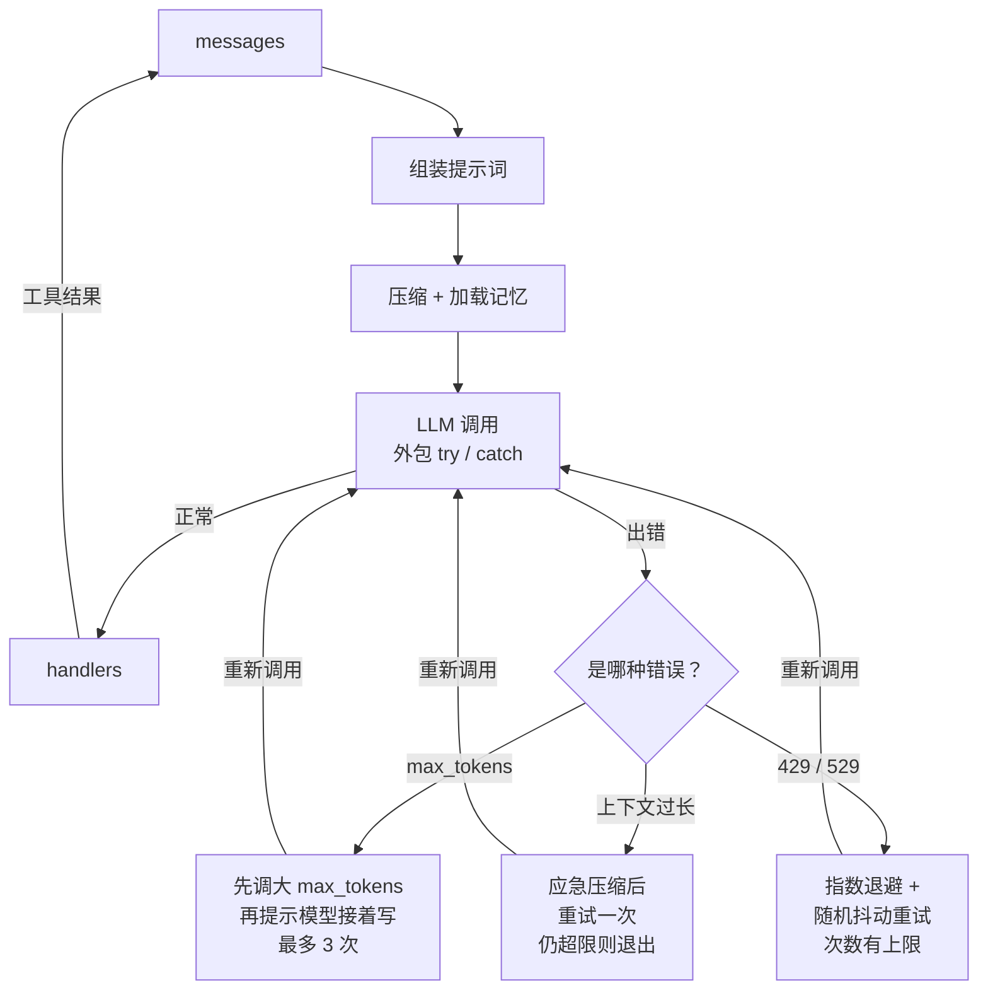

# s11：Error Recovery —— 失败进入恢复分支

真实工作里，新人会遇到接口限流、服务过载、输出写到一半和材料太长。`s11` 不再让 agent 遇错就退出，而是先判断错误类型，再选择等待重试、续写、压缩或停止。

## 本章目标

`s10` 已经能动态组装 system prompt，但一次 LLM 请求失败时，主循环仍缺少恢复策略。

`s11` 保留前面的工具、计划、子代理、技能、压缩、记忆和动态 prompt，只给 LLM 调用增加四条恢复路径：

- `429` 限流：等待后重试。
- `529` 服务过载：等待后重试，连续发生时可切换备用模型。
- `finish_reason: "length"`：提高输出上限，仍被截断时继续生成。
- 上下文过长：先做一次应急压缩，再重试当前请求。

## 流程图


```text
call LLM
  |
  +-- 成功 ------------------------> 正常处理
  |
  +-- 429 / 529 ------------------> 等待 --> 重试
  |
  +-- finish_reason = length -----> 提高上限 / 续写
  |
  +-- prompt too long ------------> reactiveCompact --> 重试一次
  |
  +-- 其他错误 --------------------> 返回 [Error]
```

## 为什么这一步重要

重试不是简单地再调用一次接口。限流需要等待，输出截断需要续写，上下文超限需要先腾出空间，不可恢复错误则应该停止。`RecoveryState` 把这些状态集中保存，主循环才知道自己是在正常执行还是恢复。

## 代码入口

- JS：[s11-error-recovery.js](./s11-error-recovery.js)
- Test：[s11-error-recovery.test.js](./s11-error-recovery.test.js)

## 运行

```bash
node code-agent-course/s11-error-recovery.js
```

## 新增函数速览

- `RecoveryState`：记录是否提高过输出上限、续写次数、连续 `529` 次数、是否做过应急压缩，以及当前备用模型。
- `retryDelay(attempt, retryAfter)`：计算指数退避时间；第二个参数是已经换算成毫秒的等待时间。
- `withRetry(fn, state)`：包住一次 LLM 请求，只对 `429` 和 `529` 这类瞬态错误退避重试。
- `setSleepFn(fn)`：测试入口，用立即返回的函数替换真实等待。

`reactiveCompact(messages)` 来自 s08，本章只是把它接到“上下文过长”的恢复分支，不是重新实现一套压缩。

## 关键代码

恢复状态集中在一个对象里：

```js
export class RecoveryState {
  constructor() {
    this.escalated = false; // 是否已把 max_tokens 升到 64K
    this.recoveryCount = 0; // 已续写次数
    this.consecutive529 = 0; // 连续 529 次数
    this.attemptedReactiveCompact = false; // 是否已应急压缩过
    this.currentModel = null; // null = provider 默认模型；切换后 = 备用模型
  }
}
```

`withRetry()` 负责处理接口暂时不可用。成功后会清零连续 `529` 计数；普通错误不在这里吞掉，而是交回主循环：

```js
export async function withRetry(fn, state) {
  for (let attempt = 0; attempt < MAX_RETRIES; attempt += 1) {
    try {
      const result = await fn();
      state.consecutive529 = 0;
      return result;
    } catch (error) {
      const msg = String(error.message);
      if (isOverloaded(msg)) {
        state.consecutive529 += 1;
        const fallback = process.env.FALLBACK_MODEL_ID;
        if (state.consecutive529 >= MAX_CONSECUTIVE_529 && fallback) {
          state.currentModel = fallback;
          state.consecutive529 = 0;
          console.log(`[529 x${MAX_CONSECUTIVE_529}] switching to ${fallback}`);
        }
        await sleep(retryDelay(attempt));
        continue;
      }
      if (isRateLimit(msg)) {
        await sleep(retryDelay(attempt));
        continue;
      }
      throw error;
    }
  }
  throw new Error(`Max retries (${MAX_RETRIES}) exceeded`);
}
```

主循环把真正的 LLM 请求传给 `withRetry()`：

```js
choice = await withRetry(
  () =>
    callLlm(buildRequest(messages, memoriesContent), {
      system,
      tools,
      model: state.currentModel,
      maxTokens,
    }),
  state,
);
```

如果第一次收到 `finish_reason: "length"`，代码把 `maxTokens` 从 `8000` 提高到 `64000`，然后重新请求。这一次不会先保存被截断的文本。若提高上限后仍被截断，才把当前 assistant 文本加入 `messages`，再追加续写提示，最多续写三次。

上下文过长走另一条路径：`reactiveCompact()` 只允许自动执行一次；再次失败就返回 `[Error]`，避免无限压缩重试。

## 接口差异：`max_tokens` 和 `length`

Python 参考代码判断：

```py
if response.stop_reason == "max_tokens":
```

JavaScript 版本判断：

```js
if (choice.finish_reason === "length") {
```

两者表示同一件事：模型还没说完，本次请求的输出额度已经用完。字段不同是因为接口规范不同：

| 接口 | 截断字段 | 截断值 | 工具调用值 | 自然结束值 |
| --- | --- | --- | --- | --- |
| Anthropic Messages API | `response.stop_reason` | `max_tokens` | `tool_use` | `end_turn` |
| OpenAI-compatible Chat Completions | `choices[0].finish_reason` | `length` | `tool_calls` | `stop` |

Python 参考实现使用 Anthropic SDK；JS 版通过 OpenAI-compatible `/chat/completions` 接口统一调用 OpenAI、DeepSeek 和 Kimi，所以读取 `data.choices[0]`。

参考：[Anthropic stop reasons](https://platform.claude.com/docs/en/build-with-claude/handling-stop-reasons)；[OpenAI Chat Completions](https://developers.openai.com/api/reference/resources/chat/subresources/completions/methods/create)。

## 测试 Prompt

```text
请输出一份尽可能详细的 80 步 agent 开发计划；如果输出被截断，请继续，不要从头重复。
```

自然 prompt 不一定触发 `429` 或 `529`，但可能触发 `finish_reason: "length"`。测试文件通过模拟响应稳定覆盖限流、过载、截断和上下文超限分支。

## 进阶需求：支持 `Retry-After`

本章的 `withRetry()` 目前只从错误文本识别 `429` / `529`，然后调用 `retryDelay(attempt)` 自己计算等待时间。真实 HTTP API 有时会返回：

```http
HTTP/1.1 429 Too Many Requests
Retry-After: 10
```

`Retry-After` 可以是秒数，也可以是一个 HTTP 日期。实际接入时，应先把 header 换算成毫秒，再传给 `retryDelay(attempt, retryAfterMs)`；不能把字符串 `"10"` 直接当成 10 毫秒。

本教程暂时没有把 response header 放进错误对象。升级方向是：`callLlm()` 读取 header，附到抛出的错误上；`withRetry()` 优先采用服务端给出的等待时间，没有 header 时再使用指数退避。

## 扩展阅读：商业级 Agent 怎么做错误恢复

商业级 agent 通常按失败发生的阶段决定恢复动作，而不是用一个大 `try/catch` 处理所有问题：

- Claude Code 会区分模型请求、工具执行、权限确认和上下文管理；不同阶段的失败需要不同恢复方式。
- Codex 的 turn loop 同时跟踪 provider、sandbox、approval、持久会话和 compaction 状态，因此能判断应该重试请求、恢复会话还是返回工具错误。
- OpenCode 把 provider 调用、工具注册、session 事件和上下文处理分开，错误可以归属到具体阶段。

可继续阅读：[Claude Code 文档](https://code.claude.com/docs/en/overview)、[Codex 开源代码](https://github.com/openai/codex/tree/main/codex-rs/core)、[OpenCode session 源码](https://github.com/anomalyco/opencode/tree/dev/packages/opencode/src/session)。本章的 `RecoveryState` 是这些机制的最小教学版。

## 一句话总结

`s11` 先给失败分类，再选择重试、续写、压缩或停止。

## 与 s10 的关键代码 diff（不含 helper.js）

下面只展示错误恢复新增的状态、重试器和主循环接入点。

```diff
--- s10-system-prompt.js
+++ s11-error-recovery.js
+const DEFAULT_MAX_TOKENS = 8000;
+const ESCALATED_MAX_TOKENS = 64000;
+const MAX_RECOVERY_RETRIES = 3; // 续写次数上限
+const MAX_RETRIES = 10; // 瞬态错误退避次数上限
+const BASE_DELAY_MS = 500;
+const MAX_CONSECUTIVE_529 = 3; // 连续过载达到此数 → 切换备用模型
+const CONTINUATION_PROMPT =
+  "Output token limit hit. Resume directly — no apology, no recap. Pick up mid-thought.";
+
+export class RecoveryState {
+  constructor() {
+    this.escalated = false; // 是否已把 max_tokens 升到 64K
+    this.recoveryCount = 0; // 已续写次数
+    this.consecutive529 = 0; // 连续 529 次数
+    this.attemptedReactiveCompact = false; // 是否已应急压缩过
+    this.currentModel = null; // null = provider 默认模型；切换后 = 备用模型
+  }
+}

+export async function withRetry(fn, state) {
+  for (let attempt = 0; attempt < MAX_RETRIES; attempt += 1) {
+    try {
+      const result = await fn();
+      state.consecutive529 = 0;
+      return result;
+    } catch (error) {
+      const msg = String(error.message);
+      if (isOverloaded(msg)) {
+        state.consecutive529 += 1;
+        const fallback = process.env.FALLBACK_MODEL_ID;
+        if (state.consecutive529 >= MAX_CONSECUTIVE_529 && fallback) {
+          state.currentModel = fallback;
+          state.consecutive529 = 0;
+          console.log(`[529 x${MAX_CONSECUTIVE_529}] switching to ${fallback}`);
+        }
+        await sleep(retryDelay(attempt));
+        continue;
+      }
+      if (isRateLimit(msg)) {
+        await sleep(retryDelay(attempt));
+        continue;
+      }
+      throw error; // 非瞬态 → 交给外层 try/catch
+    }
+  }
+  throw new Error(`Max retries (${MAX_RETRIES}) exceeded`);
+}

-  let reactiveRetries = 0;
+  const state = new RecoveryState(); // s11：跟踪截断升级 / 压缩 / 529 / 模型切换
+  let maxTokens = DEFAULT_MAX_TOKENS; // s11：输出截断时升级到 64K

-    let message;
+    let choice;

+    const message = choice.message;
+
+    if (choice.finish_reason === "length") {
+      if (!state.escalated) {
+        maxTokens = ESCALATED_MAX_TOKENS;
+        state.escalated = true;
+        continue;
+      }
+      messages.push(message);
+      if (state.recoveryCount < MAX_RECOVERY_RETRIES) {
+        messages.push({ role: "user", content: CONTINUATION_PROMPT });
+        state.recoveryCount += 1;
+        continue;
+      }
+      return message.content || "";
+    }
```

## 博客代码演进

下面 8 个 patch 专门用于博客右侧的代码切换。第一步基于 `s10-system-prompt.js`，后面的每一步都继续修改上一帧，最后必须得到完整的 `s11-error-recovery.js`。

每一步的代码都可以运行。前三步写出“失败后等一等再试”的重试函数，第 4 步把它接进 loop；之后每一步增加一种出错后的处理办法。日志放在最后一步统一补上。

### 1. 用一个对象记录恢复进度

出错后要不要再试、试过几次、用过哪些办法，这些信息需要在循环的多轮之间保存。`RecoveryState` 把它们集中放在一个对象里：是否已经提高过输出上限、已经续写了几次、连续遇到几次服务器过载、是否已经做过应急压缩、当前用的是哪个模型。每次用户提问会新建一个，所以这些计数只在一次提问内有效。这一步只是定义，还没有用到。

```diff agent-step
@@
   /prompt.*too.*long|too many tokens|context.*length/i.test(String(error.message));
 
+export class RecoveryState {
+  constructor() {
+    this.escalated = false;
+    this.recoveryCount = 0;
+    this.consecutive529 = 0;
+    this.attemptedReactiveCompact = false;
+    this.currentModel = null;
+  }
+}
+
 const PROMPT_SECTIONS = {
   identity: () =>
```

### 2. 失败后等多久再试

遇到限流或服务器繁忙，马上重试多半还是失败，应该等一会儿。`retryDelay` 计算等待时间：第一次 0.5 秒，之后每次翻倍，最长 32 秒，这叫指数退避。再加上最多 25% 的随机量，避免很多客户端在同一时刻一起重试。如果服务器明确告诉了要等多久，就按服务器说的来。`sleep` 负责真正等待，`setSleepFn` 让测试可以把它换成不等待的版本。

```diff agent-step
@@
   /prompt.*too.*long|too many tokens|context.*length/i.test(String(error.message));
 
+const BASE_DELAY_MS = 500;
+
 export class RecoveryState {
   constructor() {
@@
     this.currentModel = null;
   }
+}
+
+export function retryDelay(attempt, retryAfter) {
+  if (retryAfter) return retryAfter;
+  const base = Math.min(BASE_DELAY_MS * 2 ** attempt, 32000);
+  return base + Math.random() * base * 0.25;
+}
+
+let sleep = (ms) => new Promise((resolve) => setTimeout(resolve, ms));
+export function setSleepFn(fn) {
+  sleep = fn;
 }
```

### 3. withRetry：遇到限流就重试

`withRetry` 接收一个函数并执行它，成功就返回结果。失败时看错误信息：如果是 429 或“rate limit”这类限流错误，就等一会儿再执行一次，最多 10 次。其他错误不属于“等一等就会好”的情况，原样抛出，交给外层处理。它不关心函数里面做了什么，所以可以包住任何一次模型调用。

```diff agent-step
@@
   /prompt.*too.*long|too many tokens|context.*length/i.test(String(error.message));
 
+const MAX_RETRIES = 10;
 const BASE_DELAY_MS = 500;
@@
 export function setSleepFn(fn) {
   sleep = fn;
+}
+
+const isRateLimit = (msg) => /\b429\b|rate.?limit/i.test(msg);
+
+export async function withRetry(fn, state) {
+  for (let attempt = 0; attempt < MAX_RETRIES; attempt += 1) {
+    try {
+      const result = await fn();
+      state.consecutive529 = 0;
+      return result;
+    } catch (error) {
+      const msg = String(error.message);
+      if (isRateLimit(msg)) {
+        await sleep(retryDelay(attempt));
+        continue;
+      }
+      throw error;
+    }
+  }
+  throw new Error(`Max retries (${MAX_RETRIES}) exceeded`);
 }
```

### 4. 把模型调用包进 withRetry

现在在 loop 里用上它。循环开始前新建一个 `RecoveryState`，调用模型的那一行用 `withRetry` 包起来。调用时多传两个参数：`model` 来自状态对象，目前是 `null`，表示用默认模型；`maxTokens` 是输出长度上限，默认 8000。另外，返回值改为保存整个 `choice`，因为后面要读其中的 `finish_reason` 来判断输出有没有被截断。从这一步起，偶尔的限流不会再让对话中断。

```diff agent-step
@@
   /prompt.*too.*long|too many tokens|context.*length/i.test(String(error.message));
 
+const DEFAULT_MAX_TOKENS = 8000;
 const MAX_RETRIES = 10;
 const BASE_DELAY_MS = 500;
@@
   let roundsSinceTodo = 0;
   let reactiveRetries = 0;
+  const state = new RecoveryState();
+  let maxTokens = DEFAULT_MAX_TOKENS;
   let context = buildContext();
   let system = getSystemPrompt(context);
@@
     if (estimateSize(messages) > CONTEXT_LIMIT) apply(messages, await compactHistory(messages));
 
-    let message;
+    let choice;
     try {
-      ({ message } = await callLlm(buildRequest(messages, memoriesContent), { system, tools }));
       reactiveRetries = 0;
+      choice = await withRetry(
+        () =>
+          callLlm(buildRequest(messages, memoriesContent), {
+            system,
+            tools,
+            model: state.currentModel,
+            maxTokens,
+          }),
+        state,
+      );
     } catch (error) {
       if (reactiveRetries < MAX_REACTIVE_RETRIES && isPromptTooLong(error)) {
@@
       throw error;
     }
+
+    const message = choice.message;
 
     if (!message.tool_calls?.length) {
```

### 5. 上下文超限：压缩一次，不行就停

s08 已经处理过“prompt too long”：应急压缩后重试。这里改用状态对象来记录，去掉原来单独的计数器，规则更明确：一次提问内只做一次应急压缩。同时改变最后的处理方式：遇到确实无法恢复的错误，不再抛出异常让整个程序退出，而是把错误信息作为这一轮的回答返回给用户，对话还可以继续。

```diff agent-step
@@
 const KEEP_RECENT = 3;
 const PERSIST_THRESHOLD = 30000;
-const MAX_REACTIVE_RETRIES = 1;
 
 export const estimateSize = (messages) => JSON.stringify(messages).length;
@@
 export async function agentLoop(messages, confirm) {
   let roundsSinceTodo = 0;
-  let reactiveRetries = 0;
   const state = new RecoveryState();
   let maxTokens = DEFAULT_MAX_TOKENS;
@@
     let choice;
     try {
-      reactiveRetries = 0;
       choice = await withRetry(
         () =>
@@
       );
     } catch (error) {
-      if (reactiveRetries < MAX_REACTIVE_RETRIES && isPromptTooLong(error)) {
+      if (isPromptTooLong(error) && !state.attemptedReactiveCompact) {
         apply(messages, await reactiveCompact(messages));
-        reactiveRetries += 1;
+        state.attemptedReactiveCompact = true;
         continue;
       }
-      throw error;
+      return `[Error] ${error.message}`;
     }
```

### 6. 服务器过载：换一个模型

529 表示服务器过载，和限流一样需要等待后重试，但它可能持续很久。所以多做一件事：在状态里累计连续过载的次数，达到 3 次并且环境变量 `FALLBACK_MODEL_ID` 配置了备用模型，就把 `state.currentModel` 换成它。上一步已经把这个字段传给了 `callLlm`，所以下一次重试会自动使用备用模型。只要有一次调用成功，计数就清零。

```diff agent-step
@@
 const MAX_RETRIES = 10;
 const BASE_DELAY_MS = 500;
+const MAX_CONSECUTIVE_529 = 3;
 
 export class RecoveryState {
@@
 
 const isRateLimit = (msg) => /\b429\b|rate.?limit/i.test(msg);
+const isOverloaded = (msg) => /\b529\b|overloaded/i.test(msg);
 
 export async function withRetry(fn, state) {
@@
     } catch (error) {
       const msg = String(error.message);
+      if (isOverloaded(msg)) {
+        state.consecutive529 += 1;
+        const fallback = process.env.FALLBACK_MODEL_ID;
+        if (state.consecutive529 >= MAX_CONSECUTIVE_529 && fallback) {
+          state.currentModel = fallback;
+          state.consecutive529 = 0;
+        }
+        await sleep(retryDelay(attempt));
+        continue;
+      }
       if (isRateLimit(msg)) {
         await sleep(retryDelay(attempt));
```

### 7. 输出被截断：先加大上限，再接着写

模型的回答有长度上限，写到一半被截断时，`finish_reason` 是 `"length"`。分两步处理。第一次遇到：把上限从 8000 提高到 64000，原样重新请求一次。如果还是被截断：把已经写出的部分保存到 `messages`，再加一条消息让模型“直接接着写，不要道歉，不要重复”，最多续写 3 次。超过次数就把现有内容返回。三种恢复办法到这里都齐了，提示符改成 `s11 >> `。

```diff agent-step
@@
 
 const DEFAULT_MAX_TOKENS = 8000;
+const ESCALATED_MAX_TOKENS = 64000;
+const MAX_RECOVERY_RETRIES = 3;
 const MAX_RETRIES = 10;
 const BASE_DELAY_MS = 500;
 const MAX_CONSECUTIVE_529 = 3;
+const CONTINUATION_PROMPT =
+  "Output token limit hit. Resume directly — no apology, no recap. Pick up mid-thought.";
 
 export class RecoveryState {
@@
     const message = choice.message;
 
+    if (choice.finish_reason === "length") {
+      if (!state.escalated) {
+        maxTokens = ESCALATED_MAX_TOKENS;
+        state.escalated = true;
+        continue;
+      }
+      messages.push(message);
+      if (state.recoveryCount < MAX_RECOVERY_RETRIES) {
+        messages.push({ role: "user", content: CONTINUATION_PROMPT });
+        state.recoveryCount += 1;
+        continue;
+      }
+      return message.content || "";
+    }
+
     if (!message.tool_calls?.length) {
       await extractMemories(preCompress);
@@
 async function main() {
   await runChatCli({
-    promptLabel: "s10 >> ",
+    promptLabel: "s11 >> ",
     onPrompt: async ({ prompt, messages, ask }) => {
       return agentLoop(messages, ask);
```

### 8. 补上恢复日志

最后补两行日志。切换到备用模型时打印一行，说明连续过载了几次、换成了哪个模型；遇到无法恢复的错误时，用 `console.error` 打印原因。恢复过程大多是自动的，有了这两行，出问题时至少知道程序做了什么决定。

```diff agent-step
@@
           state.currentModel = fallback;
           state.consecutive529 = 0;
+          console.log(`[529 x${MAX_CONSECUTIVE_529}] switching to ${fallback}`);
         }
         await sleep(retryDelay(attempt));
@@
         continue;
       }
+      console.error(`[unrecoverable] ${error.message}`);
       return `[Error] ${error.message}`;
     }
```
