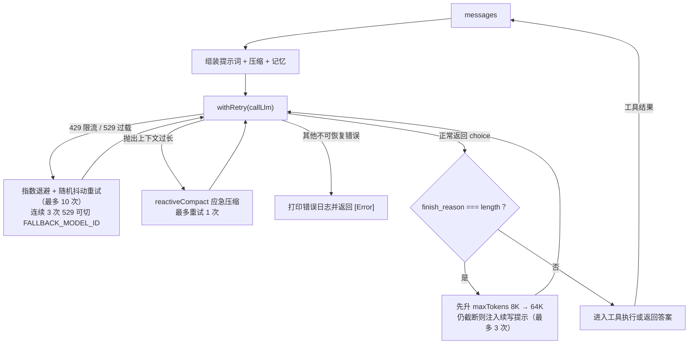

# s11：Error Recovery - 给失败分类，让循环进入恢复分支

上一章 `s10` 把系统提示词改造成了按状态装配的流水线，但眼下只要真实接口抛一次 `429` 限流、`529` 过载，或者回答写太长被半路截断，主循环就会直接中断，把半成品或异常堆栈直接甩给用户。

这一章我们给模型调用装上分类恢复机制。**错误恢复不是闭着眼把请求套一层循环死重试，而是先给失败分清类型，再分别走退避等待、切换备用模型、提额续写或应急压缩。**

## 问题

调用真实 LLM 接口时，不同故障的对策完全相反：`429` 限流和 `529` 过载属于瞬态抖动，需要退避等待甚至切备用模型；输出被截断需要拉高 `max_tokens` 并接着写；上下文超限必须先压缩再重发；而参数错、鉴权错这类硬伤重试再多次也没用。不加区分，要么一碰抖动就崩，要么在必败错误上白白空转。

## 解决方案

我们用 `RecoveryState` 集中跟踪一次提问里的所有恢复计数，用 `withRetry()` 包住瞬态重试，再在 `agentLoop` 里分别处理上下文超限与输出截断：



四条恢复路径的触发条件和上限都很明确：

| 异常或状态 | 处理方式 | 保护上限 |
|---|---|---|
| `429` 限流 | `withRetry()` 指数退避（500ms 起翻倍，封顶 32s，加 0%–25% 抖动） | 最多重试 10 次 |
| `529` 过载 | 退避重试，连续 3 次且配置了 `FALLBACK_MODEL_ID` 时切备用模型 | 共享 10 次重试上限 |
| `finish_reason: "length"` | 首次把 `maxTokens` 从 8000 升到 64000 重试；再截断则追加续写提示 | 最多续写 3 次 |
| 上下文过长 | 调用 `s08` 的 `reactiveCompact()` 压缩早期历史后重试 | 每次提问限 1 次 |

补充两点接口细节：

- **协议字段差异**：Anthropic Messages API 用 `response.stop_reason == "max_tokens"` 表示截断。本教程 JS 版走 OpenAI-compatible `/chat/completions`，对应判断 `choice.finish_reason === "length"`（工具调用是 `"tool_calls"`，正常结束是 `"stop"`）。
- **预留 `Retry-After` 参数**：`retryDelay(attempt, retryAfter)` 已留出毫秒级的 `retryAfter` 参数。后续在 `callLlm()` 里把 HTTP `Retry-After` 响应头换算成毫秒挂到错误对象上，就能直接优先遵守服务端等待时间。

## 测试 Prompt

```text
请输出一份尽可能详细的 80 步 agent 开发计划；如果输出被截断，请继续，不要从头重复。
```

自然对话不一定刚好撞上 `429` 或 `529`，但超长回答容易触发 `finish_reason: "length"` 的提额与续写分支。限流退避、连续 `529` 切备用模型、上下文超限应急压缩以及不可恢复错误的安全返回，都可以通过下面的离线单测稳定覆盖。

## 扩展阅读：商业级 Agent 怎么做错误恢复

商业级 Agent 通常按失败发生的阶段决定恢复动作，而不会用一个大 `try/catch` 笼统处理所有异常：

- **Claude Code**：区分模型请求、工具执行、权限确认和上下文管理等环节，不同阶段的故障走各自的恢复或回退策略。参考 [Claude Code 文档](https://code.claude.com/docs/en/overview)。
- **Codex**：turn loop 显式维护 provider、sandbox、approval、会话持久化与 compaction 状态，能准确判断该重试请求、恢复会话还是把工具报错交回模型。参考 [Codex 开源代码](https://github.com/openai/codex/tree/main/codex-rs/core)。
- **opencode**：把 provider 调用、工具注册、session 事件和上下文管理拆层隔离，让每类错误都能归属到具体执行环节。参考 [OpenCode session 源码](https://github.com/anomalyco/opencode/tree/dev/packages/opencode/src/session)。

**把恢复状态收进显式对象、给每条故障路径设好熔断上限，Agent 才敢在真实网络里长时间自动运行。**

## 本地运行与测试

交互运行（从仓库根目录执行）：

```bash
cd code-agent-course && node s11-error-recovery.js
```

离线单测（在仓库根目录执行，无需 API Token）：

```bash
pnpm vitest run code-agent-course/s11-error-recovery.test.js
```

## 博客代码演进

### 1. 用一个对象集中记录恢复状态

出错后要不要重试、已经续写了几次、连续遇到多少次过载、当前切到哪个模型，这些信息要在多轮循环之间保持。`RecoveryState` 把它们统一收在一个对象里，每次用户提问新建一份，作用域清晰可控。这一步只先定义类，暂未接进循环。

```diff agent-step
@@
   /prompt.*too.*long|too many tokens|context.*length/i.test(String(error.message));
 
+export class RecoveryState {
+  constructor() {
+    this.escalated = false;
+    this.recoveryCount = 0;
+    this.consecutive529 = 0;
+    this.attemptedReactiveCompact = false;
+    this.currentModel = null;
+  }
+}
+
 const PROMPT_SECTIONS = {
   identity: () =>
```

### 2. 计算退避等待时间并留好测试入口

撞上限流或服务繁忙时，立刻重发往往继续撞墙。`retryDelay` 实现指数退避：首次 0.5 秒，每次翻倍，最高封顶 32 秒，再叠 0% 到 25% 的随机抖动防止多个客户端同时重试；若传入服务端指定的 `retryAfter`（毫秒），则直接采用。`setSleepFn` 让单测能替换掉真实定时器，跑测试无需干等。

```diff agent-step
@@
   /prompt.*too.*long|too many tokens|context.*length/i.test(String(error.message));
 
+const BASE_DELAY_MS = 500;
+
 export class RecoveryState {
   constructor() {
@@
     this.currentModel = null;
   }
+}
+
+export function retryDelay(attempt, retryAfter) {
+  if (retryAfter) return retryAfter;
+  const base = Math.min(BASE_DELAY_MS * 2 ** attempt, 32000);
+  return base + Math.random() * base * 0.25;
+}
+
+let sleep = (ms) => new Promise((resolve) => setTimeout(resolve, ms));
+export function setSleepFn(fn) {
+  sleep = fn;
 }
```

### 3. 写出 withRetry：先处理 429 限流

`withRetry` 接收一个异步请求函数 `fn` 和状态对象 `state`：成功就清零连续 `529` 计数并返回结果；失败时若命中 `429` 或 `rate limit`，就退避等待后继续尝试，最多 10 次。其余非瞬态错误不做吞没，原样抛给外层循环决定怎么处理。

```diff agent-step
@@
   /prompt.*too.*long|too many tokens|context.*length/i.test(String(error.message));
 
+const MAX_RETRIES = 10;
 const BASE_DELAY_MS = 500;
@@
 export function setSleepFn(fn) {
   sleep = fn;
+}
+
+const isRateLimit = (msg) => /\b429\b|rate.?limit/i.test(msg);
+
+export async function withRetry(fn, state) {
+  for (let attempt = 0; attempt < MAX_RETRIES; attempt += 1) {
+    try {
+      const result = await fn();
+      state.consecutive529 = 0;
+      return result;
+    } catch (error) {
+      const msg = String(error.message);
+      if (isRateLimit(msg)) {
+        await sleep(retryDelay(attempt));
+        continue;
+      }
+      throw error;
+    }
+  }
+  throw new Error(`Max retries (${MAX_RETRIES}) exceeded`);
 }
```

### 4. 把主循环里的模型调用包进 withRetry

现在把 `withRetry` 接进 `agentLoop`。循环开始前新建 `RecoveryState` 和默认 8000 的 `maxTokens`，调用 `callLlm` 时传入 `model: state.currentModel` 和 `maxTokens`。返回值也改成完整的 `choice`，方便后面读取 `choice.finish_reason`。从这一步起，偶发限流不会再打断对话。

```diff agent-step
@@
   /prompt.*too.*long|too many tokens|context.*length/i.test(String(error.message));
 
+const DEFAULT_MAX_TOKENS = 8000;
 const MAX_RETRIES = 10;
 const BASE_DELAY_MS = 500;
@@
   let roundsSinceTodo = 0;
   let reactiveRetries = 0;
+  const state = new RecoveryState();
+  let maxTokens = DEFAULT_MAX_TOKENS;
   let context = buildContext();
   let system = getSystemPrompt(context);
@@
     if (estimateSize(messages) > CONTEXT_LIMIT) apply(messages, await compactHistory(messages));
 
-    let message;
+    let choice;
     try {
-      ({ message } = await callLlm(buildRequest(messages, memoriesContent), { system, tools }));
       reactiveRetries = 0;
+      choice = await withRetry(
+        () =>
+          callLlm(buildRequest(messages, memoriesContent), {
+            system,
+            tools,
+            model: state.currentModel,
+            maxTokens,
+          }),
+        state,
+      );
     } catch (error) {
       if (reactiveRetries < MAX_REACTIVE_RETRIES && isPromptTooLong(error)) {
@@
       throw error;
     }
+
+    const message = choice.message;
 
     if (!message.tool_calls?.length) {
```

### 5. 收口上下文超限与不可恢复错误

`s08` 里的应急压缩原本靠局部变量 `reactiveRetries` 计数，现在统一收进 `state.attemptedReactiveCompact`，明确每次提问只做一次应急压缩。同时改进兜底出口：遇到确实无法恢复的错误，不再直接抛异常把整个 CLI 进程炸掉，而是返回 `[Error] ...` 让对话体面继续。

```diff agent-step
@@
 const KEEP_RECENT = 3;
 const PERSIST_THRESHOLD = 30000;
-const MAX_REACTIVE_RETRIES = 1;
 
 export const estimateSize = (messages) => JSON.stringify(messages).length;
@@
 export async function agentLoop(messages, confirm) {
   let roundsSinceTodo = 0;
-  let reactiveRetries = 0;
   const state = new RecoveryState();
   let maxTokens = DEFAULT_MAX_TOKENS;
@@
     let choice;
     try {
-      reactiveRetries = 0;
       choice = await withRetry(
         () =>
@@
       );
     } catch (error) {
-      if (reactiveRetries < MAX_REACTIVE_RETRIES && isPromptTooLong(error)) {
+      if (isPromptTooLong(error) && !state.attemptedReactiveCompact) {
         apply(messages, await reactiveCompact(messages));
-        reactiveRetries += 1;
+        state.attemptedReactiveCompact = true;
         continue;
       }
-      throw error;
+      return `[Error] ${error.message}`;
     }
```

### 6. 服务器 529 过载：连续触发就切备用模型

`529` 表示服务端过载，有时会持续几分钟。我们在 `withRetry` 里识别 `isOverloaded`，每次失败递增 `state.consecutive529`。如果连续 3 次过载且环境变量 `FALLBACK_MODEL_ID` 配了备用模型，就把 `state.currentModel` 切过去并重置计数，下一轮重试自动走备用模型；只要有一次请求成功，计数也会清零。

```diff agent-step
@@
 const MAX_RETRIES = 10;
 const BASE_DELAY_MS = 500;
+const MAX_CONSECUTIVE_529 = 3;
 
 export class RecoveryState {
@@
 
 const isRateLimit = (msg) => /\b429\b|rate.?limit/i.test(msg);
+const isOverloaded = (msg) => /\b529\b|overloaded/i.test(msg);
 
 export async function withRetry(fn, state) {
@@
     } catch (error) {
       const msg = String(error.message);
+      if (isOverloaded(msg)) {
+        state.consecutive529 += 1;
+        const fallback = process.env.FALLBACK_MODEL_ID;
+        if (state.consecutive529 >= MAX_CONSECUTIVE_529 && fallback) {
+          state.currentModel = fallback;
+          state.consecutive529 = 0;
+        }
+        await sleep(retryDelay(attempt));
+        continue;
+      }
       if (isRateLimit(msg)) {
         await sleep(retryDelay(attempt));
```

### 7. 输出被截断：先升上限，再续写

当 `choice.finish_reason === "length"` 时，说明模型没说完但输出额度用尽了。我们分两步救场：第一次先把 `maxTokens` 从 8000 提到 64000 原样重发（不保存残缺回答）；升过上限还被截断，才把已有文本存入 `messages`，追加 `CONTINUATION_PROMPT` 让模型接着写，最多续写 3 次。顺手把提示符切到 `s11 >> `。

```diff agent-step
@@
 
 const DEFAULT_MAX_TOKENS = 8000;
+const ESCALATED_MAX_TOKENS = 64000;
+const MAX_RECOVERY_RETRIES = 3;
 const MAX_RETRIES = 10;
 const BASE_DELAY_MS = 500;
 const MAX_CONSECUTIVE_529 = 3;
+const CONTINUATION_PROMPT =
+  "Output token limit hit. Resume directly — no apology, no recap. Pick up mid-thought.";
 
 export class RecoveryState {
@@
     const message = choice.message;
 
+    if (choice.finish_reason === "length") {
+      if (!state.escalated) {
+        maxTokens = ESCALATED_MAX_TOKENS;
+        state.escalated = true;
+        continue;
+      }
+      messages.push(message);
+      if (state.recoveryCount < MAX_RECOVERY_RETRIES) {
+        messages.push({ role: "user", content: CONTINUATION_PROMPT });
+        state.recoveryCount += 1;
+        continue;
+      }
+      return message.content || "";
+    }
+
     if (!message.tool_calls?.length) {
       await extractMemories(preCompress);
@@
 async function main() {
   await runChatCli({
-    promptLabel: "s10 >> ",
+    promptLabel: "s11 >> ",
     onPrompt: async ({ prompt, messages, ask }) => {
       return agentLoop(messages, ask);
```

### 8. 补上恢复日志

最后补上两行关键日志：连续 `529` 切换备用模型时打印切换信息，遇到不可恢复错误时用 `console.error` 输出原因。恢复机制大多在后台自动触发，留出这两行日志，出问题时才能迅速看清程序做过什么决策。

> **本章思考题**：到这里，单个会话里的 Agent 已经很抗造了。但回头看 `s05` 的 `todo_write`，那份清单只活在内存里，进程一退就消失，也描述不了“任务 B 必须等任务 A 完成后才能认领”的先后依赖。要让大型工程跨会话推进，怎么把计划持久化成一张带依赖的任务图？下一章 `s12` 我们来做 Task System。

```diff agent-step
@@
           state.currentModel = fallback;
           state.consecutive529 = 0;
+          console.log(`[529 x${MAX_CONSECUTIVE_529}] switching to ${fallback}`);
         }
         await sleep(retryDelay(attempt));
@@
         continue;
       }
+      console.error(`[unrecoverable] ${error.message}`);
       return `[Error] ${error.message}`;
     }
```

## 和上一步的关键代码 diff（不含 helper.js）

```diff
--- s10-system-prompt.js
+++ s11-error-recovery.js
@@
+const DEFAULT_MAX_TOKENS = 8000;
+const ESCALATED_MAX_TOKENS = 64000;
+const MAX_RECOVERY_RETRIES = 3;
+const MAX_RETRIES = 10;
+const BASE_DELAY_MS = 500;
+const MAX_CONSECUTIVE_529 = 3;
+const CONTINUATION_PROMPT =
+  "Output token limit hit. Resume directly — no apology, no recap. Pick up mid-thought.";
+
+export class RecoveryState {
+  constructor() {
+    this.escalated = false;
+    this.recoveryCount = 0;
+    this.consecutive529 = 0;
+    this.attemptedReactiveCompact = false;
+    this.currentModel = null;
+  }
+}
+
+export async function withRetry(fn, state) {
+  for (let attempt = 0; attempt < MAX_RETRIES; attempt += 1) {
+    try {
+      const result = await fn();
+      state.consecutive529 = 0;
+      return result;
+    } catch (error) {
+      const msg = String(error.message);
+      if (isOverloaded(msg)) {
+        state.consecutive529 += 1;
+        const fallback = process.env.FALLBACK_MODEL_ID;
+        if (state.consecutive529 >= MAX_CONSECUTIVE_529 && fallback) {
+          state.currentModel = fallback;
+          state.consecutive529 = 0;
+          console.log(`[529 x${MAX_CONSECUTIVE_529}] switching to ${fallback}`);
+        }
+        await sleep(retryDelay(attempt));
+        continue;
+      }
+      if (isRateLimit(msg)) {
+        await sleep(retryDelay(attempt));
+        continue;
+      }
+      throw error;
+    }
+  }
+  throw new Error(`Max retries (${MAX_RETRIES}) exceeded`);
+}
@@
-  let reactiveRetries = 0;
+  const state = new RecoveryState();
+  let maxTokens = DEFAULT_MAX_TOKENS;
@@
-    let message;
+    let choice;
@@
+    const message = choice.message;
+
+    if (choice.finish_reason === "length") {
+      if (!state.escalated) {
+        maxTokens = ESCALATED_MAX_TOKENS;
+        state.escalated = true;
+        continue;
+      }
+      messages.push(message);
+      if (state.recoveryCount < MAX_RECOVERY_RETRIES) {
+        messages.push({ role: "user", content: CONTINUATION_PROMPT });
+        state.recoveryCount += 1;
+        continue;
+      }
+      return message.content || "";
+    }
```
