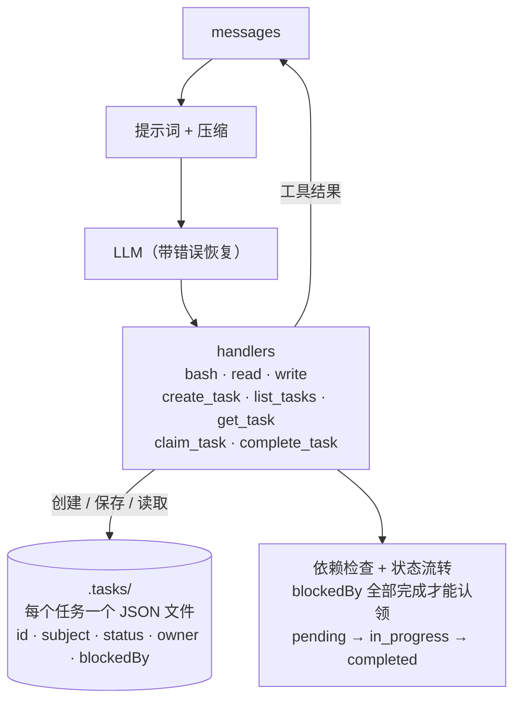
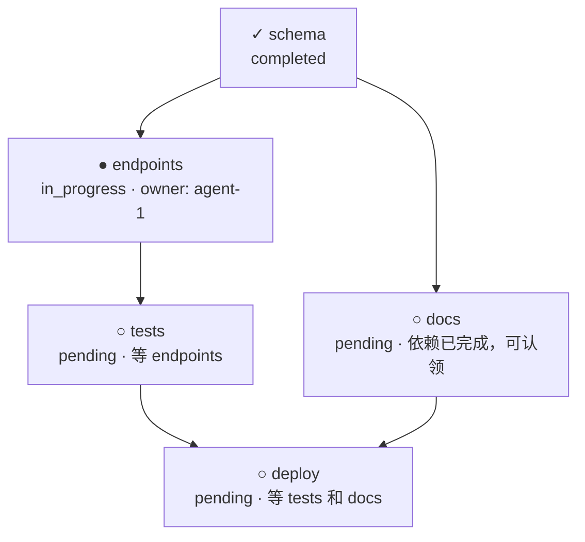

# s12：Task System —— 把目标持久化成任务图

Todo 像当前会话里的便签；跨会话、跨阶段协作时，则需要一块能保存下来的任务板。`s12` 在 `todo_write` 之外增加 task system，让任务有独立文件、依赖关系、状态和负责人。

## 本章目标

`s05` 的 todo 负责“这次对话接下来做什么”，只存在于当前 Node 进程。`s12` 的 task 负责“整个项目有哪些工作、先后关系是什么”，每个任务保存到 `.tasks/`，进程重启后仍可读取。

本章保留 s11 的全部能力，只新增五个任务工具：

- `create_task`：创建任务。
- `list_tasks`：查看任务板。
- `get_task`：读取一个任务的完整信息。
- `claim_task`：认领依赖已完成的任务。
- `complete_task`：完成任务，并报告刚被解锁的下游任务。

## 流程图



```text
create_task
    |
    v
.tasks/{task_id}.json
    |
    v
pending
    |
    | canStart：blockedBy 全部 completed？
    v
claim_task
    |
    v
in_progress + owner
    |
    v
complete_task
    |
    v
completed + 解锁下游任务
```

## Todo 和 Task 的区别

| 机制 | 解决的问题 | 保存位置 | 生命周期 | 依赖关系 |
| --- | --- | --- | --- | --- |
| `todo_write` | 当前会话怎样一步步执行 | 内存 | 当前进程 | 无 |
| Task System | 项目工作怎样跨阶段协调 | `.tasks/*.json` | 跨进程 | `blockedBy` |

两者不是替代关系。Agent 可以先用 task graph 管理项目级工作，再用 todo 拆解自己正在处理的某个 task。

## 代码入口

- JS：[s12-task-system.js](./s12-task-system.js)
- Test：[s12-task-system.test.js](./s12-task-system.test.js)

## 运行

```bash
node code-agent-course/s12-task-system.js
```

## 新增函数速览

- `setTasksDir(dir)`：测试入口，把任务目录临时切换到测试目录。
- `createTask(subject, description, blockedBy)`：创建 `pending` 任务并写入 JSON 文件。
- `listTasks()`：读取并按文件名排序所有任务。
- `canStart(id)`：检查 `blockedBy` 中的任务是否全部存在且已完成。
- `claimTask(id, owner)`：把可开始的任务从 `pending` 改为 `in_progress`，并记录 owner。
- `completeTask(id)`：把进行中的任务改为 `completed`，再找出刚被解锁的下游任务。
- `runCreateTask()` / `runListTasks()` / `runGetTask()`：把底层任务函数转换成适合返回给模型的文本。

## 任务文件格式

每个任务单独保存为 `.tasks/{task_id}.json`：

```json
{
  "id": "task_1784000000000_0000",
  "subject": "创建数据库 schema",
  "description": "定义 users 表",
  "status": "pending",
  "owner": null,
  "blockedBy": []
}
```

`blockedBy` 保存的是上游任务的 **id**，不是任务标题。例如 API 任务依赖 schema，就把 schema 的 `task_id` 放进 API 任务的 `blockedBy`。

## 关键代码

创建任务时写一个 JSON 文件。时间戳加进程内序号，避免同一毫秒创建多个任务时 id 冲突：

```js
export function createTask(subject, description = "", blockedBy = []) {
  const id = `task_${Date.now()}_${String(taskSeq++).padStart(4, "0")}`;
  const task = { id, subject, description, status: "pending", owner: null, blockedBy };
  saveTask(task);
  return task;
}
```

认领前先检查所有依赖。依赖不存在也视为未完成：

```js
export function canStart(id) {
  const task = loadTask(id);
  if (!task) return false;
  return task.blockedBy.every((dep) => existsSync(taskPath(dep)) && loadTask(dep).status === "completed");
}
```

完成一个任务后，再扫描所有 `pending` 任务，把现在可以开始的标题附在返回值里：

```js
const unblocked = listTasks()
  .filter((t) => t.status === "pending" && t.blockedBy.length && canStart(t.id))
  .map((t) => t.subject);
let msg = `Completed ${id} (${task.subject})`;
if (unblocked.length) msg += `\nUnblocked: ${unblocked.join(", ")}`;
```

工具 schema 告诉模型 `blockedBy` 是字符串数组；handler 再把工具参数转给任务函数：

```js
tool("create_task", "Create a persistent task with optional blockedBy dependencies.", {
  type: "object",
  properties: {
    subject: { type: "string" },
    description: { type: "string" },
    blockedBy: { type: "array", items: { type: "string" } },
  },
  required: ["subject"],
})
```

## 测试 Prompt

```text
创建三个持久任务：数据库 schema、依赖 schema 的 API、依赖 API 的测试；列出任务，认领并完成第一个任务，再说明哪个任务被解锁。
```

观察 `.tasks/`：应出现三个 JSON 文件；第二、三个任务的 `blockedBy` 应保存前置任务 id。第一个任务完成后，API 任务应变为可认领，但测试任务仍被阻塞。

## 教学版边界

这里的“持久化”只表示进程重启后还能从文件恢复，不表示多进程并发安全：

- `claimTask()` 是读取、判断、再写回，两个进程同时认领时可能都以为自己成功；
- JSON 文件没有数据库事务、版本号、文件锁或 lease；
- `Date.now() + 进程内序号` 适合教学，不是全局唯一 ID；
- 生产系统应使用唯一约束、条件更新或 compare-and-swap 抢占任务，并保存事件日志来审计每次状态迁移。

所以本章证明的是“任务图如何建模和恢复”，不是“分布式调度器已经完成”。

## 扩展阅读：商业级 Agent 怎么管理 Task

真实产品里的 task 通常不仅是一个数组，还要能恢复、分派、审计和展示：

- Claude Code 把会话内 todo 与可委派的 agent 工作分开；子代理负责一次委派，长期自动化则由独立运行入口管理。
- Codex 以持久 thread、turn 和 rollout 保存工作过程，多 agent 能把工作委派到独立 agent；任务状态需要和会话状态一起恢复。
- OpenCode 以 session、message、part 和事件保存执行记录，UI 与 runner 都从持久状态还原工作进度。

可继续阅读：[Claude Code subagents](https://code.claude.com/docs/en/sub-agents)、[Codex 开源代码](https://github.com/openai/codex)、[OpenCode session 源码](https://github.com/anomalyco/opencode/tree/dev/packages/opencode/src/session)。本章的 `.tasks/{id}.json` 是最小任务图：先保存 `status`、`owner` 和 `blockedBy`，后面的团队协作才能安全认领任务。

## 一句话总结

`s12` 保留会话内 todo，同时增加可跨进程读取、带依赖和 owner 的项目任务图。

## 与 s11 的关键代码 diff（不含 helper.js）

下面只展示任务存储、依赖状态流转、工具 schema 和 handler 接入点。

```diff
--- s11-error-recovery.js
+++ s12-task-system.js
+let tasksDir = path.join(process.cwd(), ".tasks");
+export function setTasksDir(dir) {
+  tasksDir = dir;
+}
+let taskSeq = 0; // 进程内自增，保证同毫秒创建多个任务也不撞 id
+const taskPath = (id) => path.join(tasksDir, `${id}.json`);
+
+function saveTask(task) {
+  mkdirSync(tasksDir, { recursive: true });
+  writeFileSync(taskPath(task.id), JSON.stringify(task, null, 2));
+}
+function loadTask(id) {
+  if (!existsSync(taskPath(id))) return null;
+  return JSON.parse(readFileSync(taskPath(id), "utf8"));
+}
+
+export function createTask(subject, description = "", blockedBy = []) {
+  const id = `task_${Date.now()}_${String(taskSeq++).padStart(4, "0")}`;
+  const task = { id, subject, description, status: "pending", owner: null, blockedBy };
+  saveTask(task);
+  return task;
+}
+
+export function canStart(id) {
+  const task = loadTask(id);
+  if (!task) return false;
+  return task.blockedBy.every((dep) => existsSync(taskPath(dep)) && loadTask(dep).status === "completed");
+}
+
+export function claimTask(id, owner = "agent") {
+  const task = loadTask(id);
+  if (!task) return `Error: Task ${id} not found`;
+  if (task.status !== "pending") return `Task ${id} is ${task.status}, cannot claim`;
+  if (!canStart(id)) {
+    const deps = task.blockedBy.filter((d) => !existsSync(taskPath(d)) || loadTask(d).status !== "completed");
+    return `Blocked by: ${deps.join(", ")}`;
+  }
+  task.owner = owner;
+  task.status = "in_progress";
+  saveTask(task);
+  return `Claimed ${id} (${task.subject})`;
+}
+
+export function completeTask(id) {
+  const task = loadTask(id);
+  if (!task) return `Error: Task ${id} not found`;
+  if (task.status !== "in_progress") return `Task ${id} is ${task.status}, cannot complete`;
+  task.status = "completed";
+  saveTask(task);
+  const unblocked = listTasks()
+    .filter((t) => t.status === "pending" && t.blockedBy.length && canStart(t.id))
+    .map((t) => t.subject);
+  let msg = `Completed ${id} (${task.subject})`;
+  if (unblocked.length) msg += `\nUnblocked: ${unblocked.join(", ")}`;
+  return msg;
+}

+  tool("create_task", "Create a persistent task with optional blockedBy dependencies.", {
+    type: "object",
+    properties: {
+      subject: { type: "string" },
+      description: { type: "string" },
+      blockedBy: { type: "array", items: { type: "string" } },
+    },
+    required: ["subject"],
+  }),

+  create_task: runCreateTask,
+  list_tasks: runListTasks,
+  get_task: runGetTask,
+  claim_task: ({ task_id }) => claimTask(task_id),
+  complete_task: ({ task_id }) => completeTask(task_id),
```

## 博客代码演进

下面 6 个 patch 专门用于博客右侧的代码切换。第一步基于 `s11-error-recovery.js`，后面的每一步都继续修改上一帧，最后必须得到完整的 `s12-task-system.js`。

每一步的代码都可以运行。这一章全是新增，没有改动旧代码。第 1 步准备文件读写，之后每一步加一个完整的工具：实现、schema、`handlers` 里的登记一起加，所以每一步之后模型都多一个真正能用的任务工具。

### 1. 一个任务就是一个 JSON 文件

s05 的 `todo_write` 把计划放在内存里，程序一退出就没了。任务系统换一种做法：每个任务保存成 `.tasks/` 目录下的一个 JSON 文件，文件名就是任务的 id。先写最基础的读写：`saveTask` 把任务对象写成文件，`loadTask` 按 id 读回来，文件不存在就返回 `null`。`setTasksDir` 让测试可以换目录，`taskSeq` 是一个递增的序号，稍后用来生成不重复的 id。

```diff agent-step
@@
 }
 
+let tasksDir = path.join(process.cwd(), ".tasks");
+export function setTasksDir(dir) {
+  tasksDir = dir;
+}
+let taskSeq = 0;
+const taskPath = (id) => path.join(tasksDir, `${id}.json`);
+
+function saveTask(task) {
+  mkdirSync(tasksDir, { recursive: true });
+  writeFileSync(taskPath(task.id), JSON.stringify(task, null, 2));
+}
+function loadTask(id) {
+  if (!existsSync(taskPath(id))) return null;
+  return JSON.parse(readFileSync(taskPath(id), "utf8"));
+}
+
 const TRANSCRIPT_DIR = path.join(process.cwd(), ".transcripts");
 const TOOL_RESULTS_DIR = path.join(process.cwd(), ".task_outputs", "tool-results");
```

### 2. create_task：创建任务

`createTask` 生成一个任务并保存。id 由当前时间加序号组成，同一毫秒内创建多个也不会重复。新任务的状态是 `pending`（待办），`owner` 为空，`blockedBy` 记录它依赖哪些任务：这些任务没完成之前，它不能开始。`runCreateTask` 是给模型用的那一层，负责把结果整理成一句话。然后照老办法加 schema、在 `handlers` 里登记。s10 的提示词会自动把新工具名列进去，不用手动改。

```diff agent-step
@@
 }
 
+export function createTask(subject, description = "", blockedBy = []) {
+  const id = `task_${Date.now()}_${String(taskSeq++).padStart(4, "0")}`;
+  const task = { id, subject, description, status: "pending", owner: null, blockedBy };
+  saveTask(task);
+  return task;
+}
+
+function runCreateTask({ subject, description, blockedBy }) {
+  const task = createTask(subject, description || "", blockedBy || []);
+  const deps = task.blockedBy.length ? ` (blockedBy: ${task.blockedBy.join(", ")})` : "";
+  return `Created ${task.id}: ${task.subject}${deps}`;
+}
+
 const TRANSCRIPT_DIR = path.join(process.cwd(), ".transcripts");
 const TOOL_RESULTS_DIR = path.join(process.cwd(), ".task_outputs", "tool-results");
@@
     properties: { focus: { type: "string" } },
   }),
+  tool("create_task", "Create a persistent task with optional blockedBy dependencies.", {
+    type: "object",
+    properties: {
+      subject: { type: "string" },
+      description: { type: "string" },
+      blockedBy: { type: "array", items: { type: "string" } },
+    },
+    required: ["subject"],
+  }),
 ];
@@
   task: ({ description }, confirm) => spawnSubagent(description, confirm),
   load_skill: loadSkill,
+  create_task: runCreateTask,
 };
```

### 3. list_tasks：查看所有任务

`listTasks` 读出 `.tasks/` 目录下所有任务文件，按文件名排序，也就是按创建顺序。`runListTasks` 把它们排成一份清单，每行一个任务：图标表示状态（`○` 待办、`●` 进行中、`✓` 完成），后面是 id、标题、负责人和依赖。因为数据在磁盘上，退出程序再启动，这份清单还在。

```diff agent-step
@@
 }
 
+export function listTasks() {
+  if (!existsSync(tasksDir)) return [];
+  return readdirSync(tasksDir)
+    .filter((f) => f.startsWith("task_") && f.endsWith(".json"))
+    .sort()
+    .map((f) => JSON.parse(readFileSync(path.join(tasksDir, f), "utf8")));
+}
+
 function runCreateTask({ subject, description, blockedBy }) {
   const task = createTask(subject, description || "", blockedBy || []);
@@
   return `Created ${task.id}: ${task.subject}${deps}`;
 }
+function runListTasks() {
+  const tasks = listTasks();
+  if (!tasks.length) return "No tasks. Use create_task to add some.";
+  const icon = { pending: "○", in_progress: "●", completed: "✓" };
+  return tasks
+    .map((t) => {
+      const deps = t.blockedBy.length ? ` (blockedBy: ${t.blockedBy.join(", ")})` : "";
+      const owner = t.owner ? ` [${t.owner}]` : "";
+      return `${icon[t.status] || "?"} ${t.id}: ${t.subject} [${t.status}]${owner}${deps}`;
+    })
+    .join("\n");
+}
 
 const TRANSCRIPT_DIR = path.join(process.cwd(), ".transcripts");
@@
     required: ["subject"],
   }),
+  tool("list_tasks", "List all tasks with status, owner, and dependencies.", {
+    type: "object",
+    properties: {},
+  }),
 ];
@@
   load_skill: loadSkill,
   create_task: runCreateTask,
+  list_tasks: runListTasks,
 };
```

### 4. get_task：查看一个任务的详情

清单里只有标题。模型需要看某个任务的完整内容时，用 `get_task` 传入 id，拿到整个 JSON，包括创建时写的详细描述。找不到就返回一句错误提示。

```diff agent-step
@@
     .join("\n");
 }
+function runGetTask({ task_id }) {
+  const task = loadTask(task_id);
+  return task ? JSON.stringify(task, null, 2) : `Error: Task ${task_id} not found`;
+}
 
 const TRANSCRIPT_DIR = path.join(process.cwd(), ".transcripts");
@@
     properties: {},
   }),
+  tool("get_task", "Get full details of a task by id.", {
+    type: "object",
+    properties: { task_id: { type: "string" } },
+    required: ["task_id"],
+  }),
 ];
@@
   create_task: runCreateTask,
   list_tasks: runListTasks,
+  get_task: runGetTask,
 };
```

### 5. claim_task：认领任务，先检查依赖

开始做一个任务之前要先认领。`canStart` 检查依赖：`blockedBy` 里的每个任务都必须存在并且已经完成。`claimTask` 依次检查三件事：任务存在、状态是 `pending`、依赖都已完成。任何一条不满足，就返回原因，比如被哪几个任务挡住了。都满足才把状态改成 `in_progress`，写上负责人并保存。顺序就是这样被保证的：模型想跳过前置任务，会被这里拦住。

```diff agent-step
@@
 }
 
+export function canStart(id) {
+  const task = loadTask(id);
+  if (!task) return false;
+  return task.blockedBy.every((dep) => existsSync(taskPath(dep)) && loadTask(dep).status === "completed");
+}
+
+export function claimTask(id, owner = "agent") {
+  const task = loadTask(id);
+  if (!task) return `Error: Task ${id} not found`;
+  if (task.status !== "pending") return `Task ${id} is ${task.status}, cannot claim`;
+  if (!canStart(id)) {
+    const deps = task.blockedBy.filter((d) => !existsSync(taskPath(d)) || loadTask(d).status !== "completed");
+    return `Blocked by: ${deps.join(", ")}`;
+  }
+  task.owner = owner;
+  task.status = "in_progress";
+  saveTask(task);
+  return `Claimed ${id} (${task.subject})`;
+}
+
 function runCreateTask({ subject, description, blockedBy }) {
   const task = createTask(subject, description || "", blockedBy || []);
@@
     required: ["task_id"],
   }),
+  tool("claim_task", "Claim a pending task (sets owner, pending → in_progress).", {
+    type: "object",
+    properties: { task_id: { type: "string" } },
+    required: ["task_id"],
+  }),
 ];
@@
   list_tasks: runListTasks,
   get_task: runGetTask,
+  claim_task: ({ task_id }) => claimTask(task_id),
 };
```

### 6. complete_task：完成任务，告诉模型接下来能做什么

`completeTask` 只接受状态是 `in_progress` 的任务，把它改成 `completed` 并保存。然后多做一步：找出那些原本被挡住、现在依赖已经全部完成的待办任务，把它们的标题附在返回结果里。模型看到“Unblocked: …”，就知道下一步可以认领哪个。五个任务工具到这里都齐了，提示符改成 `s12 >> `。

```diff agent-step
@@
 }
 
+export function completeTask(id) {
+  const task = loadTask(id);
+  if (!task) return `Error: Task ${id} not found`;
+  if (task.status !== "in_progress") return `Task ${id} is ${task.status}, cannot complete`;
+  task.status = "completed";
+  saveTask(task);
+  const unblocked = listTasks()
+    .filter((t) => t.status === "pending" && t.blockedBy.length && canStart(t.id))
+    .map((t) => t.subject);
+  let msg = `Completed ${id} (${task.subject})`;
+  if (unblocked.length) msg += `\nUnblocked: ${unblocked.join(", ")}`;
+  return msg;
+}
+
 function runCreateTask({ subject, description, blockedBy }) {
   const task = createTask(subject, description || "", blockedBy || []);
@@
     required: ["task_id"],
   }),
+  tool("complete_task", "Complete an in-progress task; reports unblocked downstream tasks.", {
+    type: "object",
+    properties: { task_id: { type: "string" } },
+    required: ["task_id"],
+  }),
 ];
@@
   get_task: runGetTask,
   claim_task: ({ task_id }) => claimTask(task_id),
+  complete_task: ({ task_id }) => completeTask(task_id),
 };
@@
 async function main() {
   await runChatCli({
-    promptLabel: "s11 >> ",
+    promptLabel: "s12 >> ",
     onPrompt: async ({ prompt, messages, ask }) => {
       return agentLoop(messages, ask);
```
