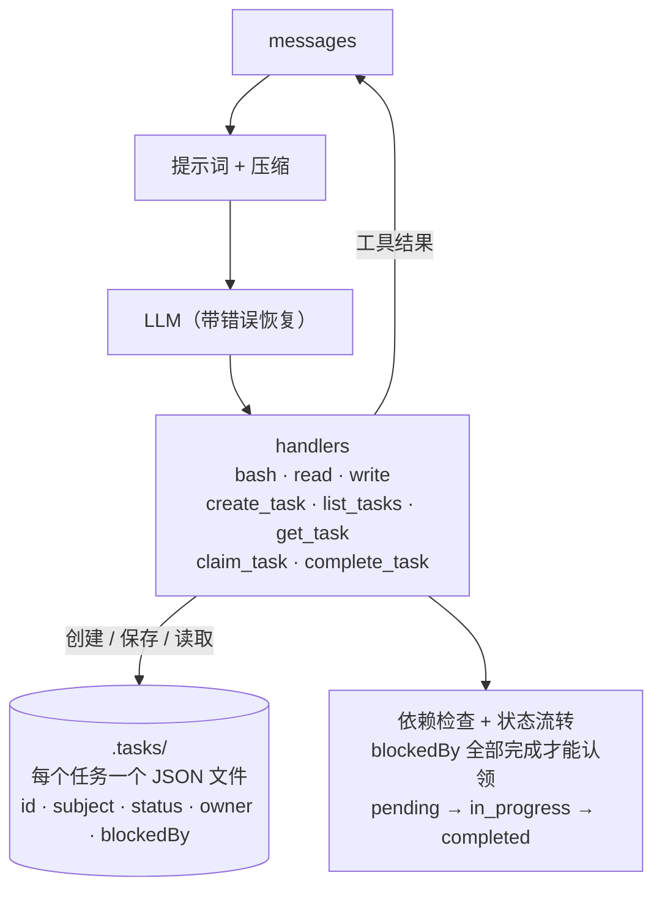
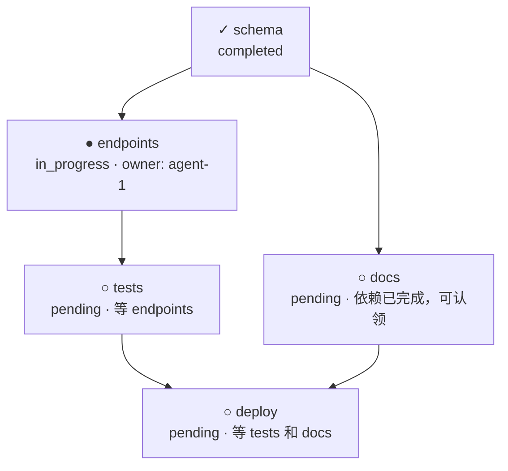

# s12：Task System - 把目标持久化成带依赖的任务图

上一章 `s11` 让单次会话里的 Agent 抗住了限流、过载和截断，但回头看 `s05` 的 `todo_write`，那份清单只活在内存里，进程一退就清空，也管不住任务之间的先后依赖。

这一章我们引入独立的 Task System。**Todo 管“这一轮怎么做”，Task System 管“整个项目有哪些工作、谁挡着谁、谁在负责”，把计划从内存便签升级成跨进程可恢复的任务图。**

## 问题

只要工程跨过单次对话，就会遇到三个现实痛点：进程重启后进度不能丢；数据库 schema 没建完之前，不能抢先去写接口或跑测试；多阶段协作时需要明确每件事由谁认领。内存里的 `todo_write` 撑不起这些需求。

## 解决方案

我们把每个任务单独保存为 `.tasks/{task_id}.json`（含 `id`、`subject`、`description`、`status`、`owner`、`blockedBy` 六个字段），再向模型暴露 `create_task`、`list_tasks`、`get_task`、`claim_task`、`complete_task` 五个工具：



多个任务靠 `blockedBy` 串成有向无环图（DAG），上游完成后下游自动就绪：



这里有三个关键设计点：

- **Todo 与 Task 分工互补**：`todo_write` 留在内存里拆解当前正在做的单个任务，Task System 落盘到 `.tasks/` 管理项目级依赖图，两者配合而非替代。
- **依赖按 ID 校验、完成自动提示就绪任务**：`blockedBy` 存的是上游 `task_id`（不是标题），依赖缺失或未完成都会挡住 `claim_task`；`complete_task` 写完状态后会顺手扫出所有当前已满足依赖的 `pending` 任务并附在返回值里。
- **教学版边界**：当前落盘只保证进程重启能恢复，不含文件锁、数据库事务或 lease，多进程并发认领不安全。生产系统应使用条件更新或 CAS 抢占，并记录事件日志。

## 测试 Prompt

```text
创建三个持久任务：数据库 schema、依赖 schema 的 API、依赖 API 的测试；列出任务，认领并完成第一个任务，再说明哪个任务被解锁。
```

运行后查看 `.tasks/` 目录，应该会多出三个 JSON 文件，后两个任务的 `blockedBy` 保存着前置任务 ID。第一个任务完成后，返回结果会提示 API 任务已解锁（`Unblocked`），测试任务则仍处于阻塞状态。

## 扩展阅读：商业级 Agent 怎么管理任务图

商业产品里的任务系统不仅要记录清单，还要支持恢复、委派、审计与界面展示：

- **Claude Code**：将会话内 todo 与可委派的子代理工作分开，子代理负责单次委派，长期自动化则由独立运行入口承载。参考 [Claude Code subagents](https://code.claude.com/docs/en/sub-agents)。
- **Codex**：以持久化的 thread、turn 和 rollout 记录执行过程，多 Agent 协作时任务状态与会话状态一并恢复。参考 [Codex 开源代码](https://github.com/openai/codex)。
- **opencode**：用 session、message、part 与事件流落盘执行记录，前端与 runner 都从持久状态还原进度。参考 [OpenCode 开源仓库](https://github.com/anomalyco/opencode)。

**先把状态、负责人和前置依赖落到磁盘，后面的后台执行与多 Agent 协作才有共同的事实来源。**

## 本地运行与测试

交互运行（从仓库根目录执行）：

```bash
cd code-agent-course && node s12-task-system.js
```

离线单测（在仓库根目录执行，无需 API Token）：

```bash
pnpm vitest run code-agent-course/s12-task-system.test.js
```

## 博客代码演进

### 1. 一个任务就是一个 JSON 文件

`s05` 的 `todo_write` 把清单放在内存里，进程一退就清空。任务系统换一条思路：每个任务存成 `.tasks/` 下的独立 JSON 文件，文件名就是任务 ID。先写最底层的读写 helper：`saveTask` 负责建目录写盘，`loadTask` 按 ID 读取（文件不存在返回 `null`），`setTasksDir` 供测试切换临时目录，`taskSeq` 用于生成不冲突的序号。

```diff agent-step
@@
 }
 
+let tasksDir = path.join(process.cwd(), ".tasks");
+export function setTasksDir(dir) {
+  tasksDir = dir;
+}
+let taskSeq = 0;
+const taskPath = (id) => path.join(tasksDir, `${id}.json`);
+
+function saveTask(task) {
+  mkdirSync(tasksDir, { recursive: true });
+  writeFileSync(taskPath(task.id), JSON.stringify(task, null, 2));
+}
+function loadTask(id) {
+  if (!existsSync(taskPath(id))) return null;
+  return JSON.parse(readFileSync(taskPath(id), "utf8"));
+}
+
 const TRANSCRIPT_DIR = path.join(process.cwd(), ".transcripts");
 const TOOL_RESULTS_DIR = path.join(process.cwd(), ".task_outputs", "tool-results");
```

### 2. create_task：创建任务并写盘

`createTask` 用当前时间戳加递增序号拼出 ID，同一毫秒连建多个任务也不会撞名。新建任务默认状态为 `pending`、`owner` 为 `null`，`blockedBy` 存它依赖的前置任务 ID。`runCreateTask` 负责把结果整理成返回给模型的简短文本，再连同工具 schema 和 `handlers` 一起注册。因为 `s10` 已经实现了动态提示词，新工具会自动出现在系统提示词里。

```diff agent-step
@@
 }
 
+export function createTask(subject, description = "", blockedBy = []) {
+  const id = `task_${Date.now()}_${String(taskSeq++).padStart(4, "0")}`;
+  const task = { id, subject, description, status: "pending", owner: null, blockedBy };
+  saveTask(task);
+  return task;
+}
+
+function runCreateTask({ subject, description, blockedBy }) {
+  const task = createTask(subject, description || "", blockedBy || []);
+  const deps = task.blockedBy.length ? ` (blockedBy: ${task.blockedBy.join(", ")})` : "";
+  return `Created ${task.id}: ${task.subject}${deps}`;
+}
+
 const TRANSCRIPT_DIR = path.join(process.cwd(), ".transcripts");
 const TOOL_RESULTS_DIR = path.join(process.cwd(), ".task_outputs", "tool-results");
@@
     properties: { focus: { type: "string" } },
   }),
+  tool("create_task", "Create a persistent task with optional blockedBy dependencies.", {
+    type: "object",
+    properties: {
+      subject: { type: "string" },
+      description: { type: "string" },
+      blockedBy: { type: "array", items: { type: "string" } },
+    },
+    required: ["subject"],
+  }),
 ];
@@
   task: ({ description }, confirm) => spawnSubagent(description, confirm),
   load_skill: loadSkill,
+  create_task: runCreateTask,
 };
```

### 3. list_tasks：查看整张任务板

`listTasks` 扫描 `.tasks/` 下的任务文件并按文件名排序（即按创建时间排序）。`runListTasks` 把所有任务排成一目了然的清单：图标标示状态（`○` 待办、`●` 进行中、`✓` 完成），后面依次跟着 ID、标题、负责人和依赖列表。由于数据落在磁盘上，退出重开依然能读回完整进度。

```diff agent-step
@@
 }
 
+export function listTasks() {
+  if (!existsSync(tasksDir)) return [];
+  return readdirSync(tasksDir)
+    .filter((f) => f.startsWith("task_") && f.endsWith(".json"))
+    .sort()
+    .map((f) => JSON.parse(readFileSync(path.join(tasksDir, f), "utf8")));
+}
+
 function runCreateTask({ subject, description, blockedBy }) {
   const task = createTask(subject, description || "", blockedBy || []);
@@
   return `Created ${task.id}: ${task.subject}${deps}`;
 }
+function runListTasks() {
+  const tasks = listTasks();
+  if (!tasks.length) return "No tasks. Use create_task to add some.";
+  const icon = { pending: "○", in_progress: "●", completed: "✓" };
+  return tasks
+    .map((t) => {
+      const deps = t.blockedBy.length ? ` (blockedBy: ${t.blockedBy.join(", ")})` : "";
+      const owner = t.owner ? ` [${t.owner}]` : "";
+      return `${icon[t.status] || "?"} ${t.id}: ${t.subject} [${t.status}]${owner}${deps}`;
+    })
+    .join("\n");
+}
 
 const TRANSCRIPT_DIR = path.join(process.cwd(), ".transcripts");
@@
     required: ["subject"],
   }),
+  tool("list_tasks", "List all tasks with status, owner, and dependencies.", {
+    type: "object",
+    properties: {},
+  }),
 ];
@@
   load_skill: loadSkill,
   create_task: runCreateTask,
+  list_tasks: runListTasks,
 };
```

### 4. get_task：按 ID 查看单个任务详情

清单里只列标题和状态，不展示长篇 `description`。当模型需要读取某个任务的完整说明时，调用 `get_task` 传入 `task_id` 即可拿到格式化后的完整 JSON；找不到对应文件就返回明确的错误提示。

```diff agent-step
@@
     .join("\n");
 }
+function runGetTask({ task_id }) {
+  const task = loadTask(task_id);
+  return task ? JSON.stringify(task, null, 2) : `Error: Task ${task_id} not found`;
+}
 
 const TRANSCRIPT_DIR = path.join(process.cwd(), ".transcripts");
@@
     properties: {},
   }),
+  tool("get_task", "Get full details of a task by id.", {
+    type: "object",
+    properties: { task_id: { type: "string" } },
+    required: ["task_id"],
+  }),
 ];
@@
   create_task: runCreateTask,
   list_tasks: runListTasks,
+  get_task: runGetTask,
 };
```

### 5. claim_task：先查依赖，再认领任务

开工前必须先认领。`canStart` 检查 `blockedBy` 里的每一项前置任务是否都存在且已完成；`claimTask` 依次校验“任务存在、状态为 `pending`、依赖全部就绪”三个条件。不存在或状态不符会直接报错，依赖未满足则把未完成的依赖 ID 拼成 `Blocked by: ...` 返回给模型；全部通过才把状态改为 `in_progress`、写上 `owner` 并落盘。依赖顺序就是靠这道门锁住的。

```diff agent-step
@@
 }
 
+export function canStart(id) {
+  const task = loadTask(id);
+  if (!task) return false;
+  return task.blockedBy.every((dep) => existsSync(taskPath(dep)) && loadTask(dep).status === "completed");
+}
+
+export function claimTask(id, owner = "agent") {
+  const task = loadTask(id);
+  if (!task) return `Error: Task ${id} not found`;
+  if (task.status !== "pending") return `Task ${id} is ${task.status}, cannot claim`;
+  if (!canStart(id)) {
+    const deps = task.blockedBy.filter((d) => !existsSync(taskPath(d)) || loadTask(d).status !== "completed");
+    return `Blocked by: ${deps.join(", ")}`;
+  }
+  task.owner = owner;
+  task.status = "in_progress";
+  saveTask(task);
+  return `Claimed ${id} (${task.subject})`;
+}
+
 function runCreateTask({ subject, description, blockedBy }) {
   const task = createTask(subject, description || "", blockedBy || []);
@@
     required: ["task_id"],
   }),
+  tool("claim_task", "Claim a pending task (sets owner, pending → in_progress).", {
+    type: "object",
+    properties: { task_id: { type: "string" } },
+    required: ["task_id"],
+  }),
 ];
@@
   list_tasks: runListTasks,
   get_task: runGetTask,
+  claim_task: ({ task_id }) => claimTask(task_id),
 };
```

### 6. complete_task：完工并顺手报告解锁的下游任务

`completeTask` 只允许结束 `in_progress` 状态的任务，将其改写为 `completed` 并落盘。接着它顺手扫一遍所有 `pending` 且带依赖的任务，把当前满足 `canStart` 的任务标题拼成 `Unblocked: ...` 一并返回（若之前已有其他带依赖任务就绪但尚未认领，也会一并列出）。模型看到这条线索，马上就能接上一步去认领后续任务。最后把 CLI 提示符切到 `s12 >> `。

> **本章思考题**：任务图已经能跨会话保存、按依赖解锁了，但工具调用依然是同步阻塞的。如果某个任务要跑一次耗时几分钟的 `npm install` 或全量测试，整条主循环就会卡在原地什么都干不了。怎么把慢命令丢到后台异步执行，让 Agent 先干别的、跑完再收通知？下一章 `s13` 我们来做 Background Tasks。

```diff agent-step
@@
 }
 
+export function completeTask(id) {
+  const task = loadTask(id);
+  if (!task) return `Error: Task ${id} not found`;
+  if (task.status !== "in_progress") return `Task ${id} is ${task.status}, cannot complete`;
+  task.status = "completed";
+  saveTask(task);
+  const unblocked = listTasks()
+    .filter((t) => t.status === "pending" && t.blockedBy.length && canStart(t.id))
+    .map((t) => t.subject);
+  let msg = `Completed ${id} (${task.subject})`;
+  if (unblocked.length) msg += `\nUnblocked: ${unblocked.join(", ")}`;
+  return msg;
+}
+
 function runCreateTask({ subject, description, blockedBy }) {
   const task = createTask(subject, description || "", blockedBy || []);
@@
     required: ["task_id"],
   }),
+  tool("complete_task", "Complete an in-progress task; reports unblocked downstream tasks.", {
+    type: "object",
+    properties: { task_id: { type: "string" } },
+    required: ["task_id"],
+  }),
 ];
@@
   get_task: runGetTask,
   claim_task: ({ task_id }) => claimTask(task_id),
+  complete_task: ({ task_id }) => completeTask(task_id),
 };
@@
 async function main() {
   await runChatCli({
-    promptLabel: "s11 >> ",
+    promptLabel: "s12 >> ",
     onPrompt: async ({ prompt, messages, ask }) => {
       return agentLoop(messages, ask);
```

## 和上一步的关键代码 diff（不含 helper.js）

```diff
--- s11-error-recovery.js
+++ s12-task-system.js
@@
+let tasksDir = path.join(process.cwd(), ".tasks");
+export function setTasksDir(dir) {
+  tasksDir = dir;
+}
+let taskSeq = 0;
+const taskPath = (id) => path.join(tasksDir, `${id}.json`);
+
+function saveTask(task) {
+  mkdirSync(tasksDir, { recursive: true });
+  writeFileSync(taskPath(task.id), JSON.stringify(task, null, 2));
+}
+function loadTask(id) {
+  if (!existsSync(taskPath(id))) return null;
+  return JSON.parse(readFileSync(taskPath(id), "utf8"));
+}
+
+export function createTask(subject, description = "", blockedBy = []) {
+  const id = `task_${Date.now()}_${String(taskSeq++).padStart(4, "0")}`;
+  const task = { id, subject, description, status: "pending", owner: null, blockedBy };
+  saveTask(task);
+  return task;
+}
+
+export function canStart(id) {
+  const task = loadTask(id);
+  if (!task) return false;
+  return task.blockedBy.every((dep) => existsSync(taskPath(dep)) && loadTask(dep).status === "completed");
+}
+
+export function claimTask(id, owner = "agent") {
+  const task = loadTask(id);
+  if (!task) return `Error: Task ${id} not found`;
+  if (task.status !== "pending") return `Task ${id} is ${task.status}, cannot claim`;
+  if (!canStart(id)) {
+    const deps = task.blockedBy.filter((d) => !existsSync(taskPath(d)) || loadTask(d).status !== "completed");
+    return `Blocked by: ${deps.join(", ")}`;
+  }
+  task.owner = owner;
+  task.status = "in_progress";
+  saveTask(task);
+  return `Claimed ${id} (${task.subject})`;
+}
+
+export function completeTask(id) {
+  const task = loadTask(id);
+  if (!task) return `Error: Task ${id} not found`;
+  if (task.status !== "in_progress") return `Task ${id} is ${task.status}, cannot complete`;
+  task.status = "completed";
+  saveTask(task);
+  const unblocked = listTasks()
+    .filter((t) => t.status === "pending" && t.blockedBy.length && canStart(t.id))
+    .map((t) => t.subject);
+  let msg = `Completed ${id} (${task.subject})`;
+  if (unblocked.length) msg += `\nUnblocked: ${unblocked.join(", ")}`;
+  return msg;
+}
@@
+  create_task: runCreateTask,
+  list_tasks: runListTasks,
+  get_task: runGetTask,
+  claim_task: ({ task_id }) => claimTask(task_id),
+  complete_task: ({ task_id }) => completeTask(task_id),
```
