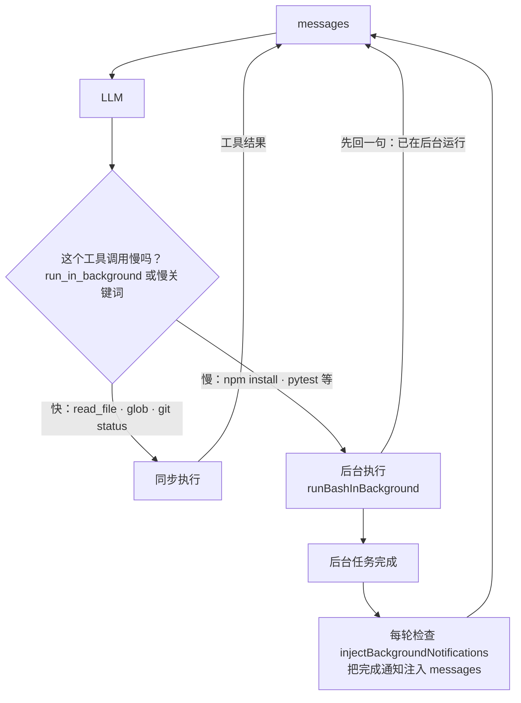

# s13：Background Tasks - 把慢命令丢到后台，不堵死主循环

上一章 `s12` 给 Agent 配好了跨会话持久化的任务图，但所有工具依然是同步执行的。只要跑一条耗时的 `npm install`、`pytest` 或构建命令，整条 `agentLoop` 就会停在原地干等，什么别的活都干不了。

这一章我们把慢命令改造成后台异步执行。**后台任务的本质是把“发起命令”和“回收结果”拆成两步：先立刻交回任务 ID 让主循环继续工作，等子进程跑完再把结果包成通知消息送回对话。**

## 问题

之前的 `runBash()` 底层用的是同步执行，子进程没退出前，整个 Node.js 事件循环都会被冻住。哪怕把同步函数硬套进 `Promise`，照样阻塞主线程。想让 Agent 一边装依赖、一边继续读文件写代码，必须做到“异步派发 + 结果回流”。

## 解决方案

我们给 `bash` 工具加上 `run_in_background` 参数，配合慢命令关键词启发式判断，将慢操作交给 `spawn()` 启动的异步子进程，并用内存表 `backgroundTasks` 跟踪状态，完成后通过 `<task_notification>` 注入回 `messages`：



这里有三个关键工程细节：

- **显式参数 + 关键词兜底**：`shouldRunBackground()` 用逻辑或连接两项条件（`Boolean(args.run_in_background) || isSlowOperation(name, args)`）：只要显式传入 `run_in_background: true`，或者 `bash` 命令命中 `SLOW_KEYWORDS`（`install`、`build`、`test` 等）就会放进后台（因此即使显式传 `false`，命中慢关键词仍会走后台）。
- **必须用异步 `spawn()` 且不复用旧 `tool_call_id`**：同步命令无法释放事件循环，必须换成 `node:child_process` 的 `spawn()` 边跑边收集输出；原工具调用已经回过占位 `tool_result`，所以最终结果要包成 `<task_notification>`（摘要保留前 200 字符）作为独立 `user` 消息注入。
- **内存态与 25ms 时间边界**：后台运行槽位只存在内存 `backgroundTasks` Map 中，和 `.tasks/` 里的持久化任务图分工不同，进程退出即清空。`waitForBackgroundTick()` 只等 25ms 照顾超快演示命令；真正跑几秒的命令若在本轮结束后才完成，会在下一次进入循环时被回收。

## 测试 Prompt

```text
用 bash 后台运行 `sleep 0.01 && echo background done`，同时继续读取 package.json。
```

运行后可以在终端日志里看到两件事交错推进：第 1 轮先派发后台任务 `bg_0001` 并立刻拿到占位结果，同时同步读取 `package.json`；下一轮收集到 `bg_0001` 的 `<task_notification>` 注入对话，模型同时看到文件内容和后台执行结果再作总结。

## 扩展阅读：商业级 Agent 怎么做后台任务

生产环境里的后台任务不仅要异步启动，还要支持查看实时日志、取消任务、限制并发以及刷新界面后恢复展示：

- **Claude Code**：支持将 `bash` 命令放入后台运行，并用可追踪的 task ID 持续读取后台输出，与子代理任务统一管理。参考 [Claude Code background bash commands](https://code.claude.com/docs/en/interactive-mode#background-bash-commands)。
- **Codex**：用 thread / turn 事件流持续上报工具状态与输出，长耗时工作通常放进独立线程或后台工作区执行。参考 [Codex 开源代码](https://github.com/openai/codex)。
- **opencode**：通过 session 事件和 tool part 实时更新执行状态，长输出按受管理结果存放，不直接塞爆模型上下文。参考 [OpenCode tools 文档](https://opencode.ai/docs/tools/)。

**同步工具拿即时结果，后台工具拿“回执 + 异步通知”，Agent 主循环才不会被慢命令拖死。**

## 本地运行与测试

交互运行（从仓库根目录执行）：

```bash
cd code-agent-course && node s13-background-tasks.js
```

离线单测（在仓库根目录执行，无需 API Token）：

```bash
pnpm vitest run code-agent-course/s13-background-tasks.test.js
```

## 博客代码演进

### 1. 准备后台任务登记表

到目前为止，每个工具都是“做完才往下走”。遇到 `npm install` 这类耗时命令，整个 Agent 就卡在原地。我们先建一张内存表 `backgroundTasks` 记录每个后台任务的命令、状态和输出，用 `bgCounter` 生成递增编号，`resetBackgroundTasks` 供测试重置；同时引入 `node:child_process` 的 `spawn`，准备后面启动非阻塞子进程。

```diff agent-step
@@
 } from "node:fs";
 import path from "node:path";
+import { spawn } from "node:child_process";
 import {
   callLlm,
@@
   const task = loadTask(task_id);
   return task ? JSON.stringify(task, null, 2) : `Error: Task ${task_id} not found`;
+}
+
+let bgCounter = 0;
+const backgroundTasks = new Map();
+export function resetBackgroundTasks() {
+  backgroundTasks.clear();
+  bgCounter = 0;
 }
```

### 2. 判断哪些调用应该放进后台

我们提供两套判断逻辑：一是模型主动声明，给 `bash` 工具 schema 加上 `run_in_background` 布尔参数；二是程序自动兜底，`isSlowOperation` 检查命令里是否包含 `install`、`build`、`test` 等慢关键词。`shouldRunBackground` 把两者合在一起，只要满足其一就走后台分支。

```diff agent-step
@@
 }
 
+const SLOW_KEYWORDS = ["install", "build", "test", "deploy", "compile", "pytest", "make", "cargo"];
+
+export function isSlowOperation(name, args) {
+  if (name !== "bash") return false;
+  const cmd = (args.command || "").toLowerCase();
+  return SLOW_KEYWORDS.some((kw) => cmd.includes(kw));
+}
+
+export function shouldRunBackground(name, args) {
+  return Boolean(args.run_in_background) || isSlowOperation(name, args);
+}
+
 const TRANSCRIPT_DIR = path.join(process.cwd(), ".transcripts");
 const TOOL_RESULTS_DIR = path.join(process.cwd(), ".task_outputs", "tool-results");
@@
 
 const tools = [
-  tool("bash", "Run a shell command.", {
+  tool("bash", "Run a shell command. Set run_in_background for slow ops (install/build/test).", {
     type: "object",
-    properties: { command: { type: "string" } },
+    properties: { command: { type: "string" }, run_in_background: { type: "boolean" } },
     required: ["command"],
   }),
```

### 3. startBackgroundTask：先发回执，不等待完成

这是本章的核心函数。它先生成 `bg_XXXX` 编号，在表里登记一条 `running` 记录，然后用 `Promise.resolve().then(run)` 触发异步执行。关键在于这里**没有 `await`**，函数立刻把 `bgId` 返回给调用方；等 `run` 真正跑完，`.then` 回调再把状态更新为 `completed` 并填好结果。

```diff agent-step
@@
 }
 
+export function startBackgroundTask(name, args, run) {
+  bgCounter += 1;
+  const bgId = `bg_${String(bgCounter).padStart(4, "0")}`;
+  backgroundTasks.set(bgId, { command: args.command || name, status: "running", result: "" });
+  Promise.resolve()
+    .then(run)
+    .then((result) => {
+      const task = backgroundTasks.get(bgId);
+      if (task) {
+        task.status = "completed";
+        task.result = String(result);
+      }
+    });
+  return bgId;
+}
+
 const TRANSCRIPT_DIR = path.join(process.cwd(), ".transcripts");
 const TOOL_RESULTS_DIR = path.join(process.cwd(), ".task_outputs", "tool-results");
```

### 4. runBashInBackground：真正不卡事件循环的异步 bash

之前的 `runBash` 底层走同步执行，命令不结束整个 Node 进程就动弹不得，包进 `Promise` 也没用。后台执行必须换成 `spawn`：子进程一拉起就立刻交还控制权，通过 `stdout`/`stderr` 的 `data` 事件累积输出，等 `close` 事件触发时 `resolve` 完整文本；子进程启动失败（`error` 事件）也会转成错误字符串而不抛出未捕获异常。注意教学版没有按退出码区分状态，非零退出码的命令在 `close` 后同样记为 `completed`，但 `stderr` 会一并随结果摘要回传。

```diff agent-step
@@
 }
 
+function runBashInBackground(command) {
+  return new Promise((resolve) => {
+    const child = spawn(command, { cwd: process.cwd(), shell: true });
+    let output = "";
+    child.stdout.on("data", (chunk) => {
+      output += chunk;
+    });
+    child.stderr.on("data", (chunk) => {
+      output += chunk;
+    });
+    child.on("error", (error) => {
+      resolve(`Error: ${error.message}`);
+    });
+    child.on("close", () => {
+      resolve(output.trim() || "(no output)");
+    });
+  });
+}
+
 const TRANSCRIPT_DIR = path.join(process.cwd(), ".transcripts");
 const TOOL_RESULTS_DIR = path.join(process.cwd(), ".task_outputs", "tool-results");
```

### 5. 接入主循环：慢命令先回占位结果

在 `agentLoop` 的工具分发处增加一条后台分支。只要 `shouldRunBackground` 返回 `true`，就用 `startBackgroundTask` 丢到后台（`bash` 走 `runBashInBackground`），然后立刻返回占位结果 `[Background task bg_0001 started] ...`。这样既满足协议里“每个 `tool_call` 必须有对应 `tool_result`”的要求，又让主循环马上继续处理后续工具。

```diff agent-step
@@
       const name = call.function.name;
       const args = JSON.parse(call.function.arguments || "{}");
+      const runInBackground = shouldRunBackground(name, args);
 
       if (name === "compact") {
@@
       if (blocked != null) {
         output = String(blocked);
+      } else if (runInBackground) {
+        const bgId = startBackgroundTask(name, args, () => {
+          const handler = handlers[name];
+          if (name === "bash") return runBashInBackground(args.command);
+          return handler ? handler(args, confirm) : `Unknown tool: ${name}`;
+        });
+        output = `[Background task ${bgId} started] ${args.command || name}. Result will arrive when complete.`;
       } else {
         const handler = handlers[name];
```

### 6. 把后台结果包成 `<task_notification>` 注入对话

`collectBackgroundResults` 挑出已完成的记录，拼成带任务 ID、命令和前 200 字符摘要的 `<task_notification>`，随后从表里删除防止重复通知。`injectBackgroundNotifications` 将这些通知作为新的 `user` 消息追加进 `messages`，分别在每轮调模型前和每批工具跑完后触发，让异步结果顺畅回到模型视野里。

```diff agent-step
@@
 }
 
+export function collectBackgroundResults() {
+  const notifications = [];
+  for (const [bgId, task] of backgroundTasks) {
+    if (task.status !== "completed") continue;
+    backgroundTasks.delete(bgId);
+    notifications.push(
+      `<task_notification>\n  <task_id>${bgId}</task_id>\n  <status>completed</status>\n  <command>${task.command}</command>\n  <summary>${task.result.slice(0, 200)}</summary>\n</task_notification>`,
+    );
+  }
+  return notifications;
+}
+
+function injectBackgroundNotifications(messages) {
+  const notifications = collectBackgroundResults();
+  for (const notification of notifications) {
+    messages.push({ role: "user", content: notification });
+  }
+  return notifications.length;
+}
+
 const TRANSCRIPT_DIR = path.join(process.cwd(), ".transcripts");
 const TOOL_RESULTS_DIR = path.join(process.cwd(), ".task_outputs", "tool-results");
@@
 
   while (true) {
+    injectBackgroundNotifications(messages);
+
     if (roundsSinceTodo >= 3) {
       messages.push({ role: "user", content: "<reminder>Update your todos.</reminder>" });
@@
     }
     if (compacted) continue;
+
+    injectBackgroundNotifications(messages);
 
     context = buildContext();
```

### 7. 返回前多等 25ms，别错过刚跑完的后台任务

有时模型已经准备给出最终答复，但后台任务刚好在几毫秒内收尾。我们加上 `waitForBackgroundTick`：只要还有运行中的后台任务，就等待 `25ms` 再检查一次通知，有新通知就 `continue` 让模型看完结果再回答。顺手把 CLI 提示符更新为 `s13 >> `。

```diff agent-step
@@
 
 const SLOW_KEYWORDS = ["install", "build", "test", "deploy", "compile", "pytest", "make", "cargo"];
+const BACKGROUND_POLL_MS = 25;
 
 export function isSlowOperation(name, args) {
@@
 }
 
+async function waitForBackgroundTick() {
+  if (backgroundTasks.size) {
+    await new Promise((resolve) => setTimeout(resolve, BACKGROUND_POLL_MS));
+  }
+}
+
 const TRANSCRIPT_DIR = path.join(process.cwd(), ".transcripts");
 const TOOL_RESULTS_DIR = path.join(process.cwd(), ".task_outputs", "tool-results");
@@
 
     if (!message.tool_calls?.length) {
+      if (injectBackgroundNotifications(messages)) continue;
+      await waitForBackgroundTick();
+      if (injectBackgroundNotifications(messages)) continue;
       await extractMemories(preCompress);
       await consolidateMemories();
@@
     if (compacted) continue;
 
+    await waitForBackgroundTick();
     injectBackgroundNotifications(messages);
@@
 async function main() {
   await runChatCli({
-    promptLabel: "s12 >> ",
+    promptLabel: "s13 >> ",
     onPrompt: async ({ prompt, messages, ask }) => {
       return agentLoop(messages, ask);
```

### 8. 补上教学日志

异步执行的先后顺序光靠脑补很难看清，最后一步统一补齐观察日志：`preview` 负责截断长文本，`describeToolCall` 一行展示工具是同步还是后台派发，`notificationTaskId` 提取通知里的任务编号。再配合每轮的 `Turn N`、派发与回收日志，跑一次“后台命令 + 同步读文件”就能直观看到两件事交错推进。

> **本章思考题**：现在慢命令放进后台不会卡住主循环了，但整个循环依然是被动的：只有你敲一句输入，它才会启动一次。如果希望 Agent 每天早上定时巡检，或者每隔几分钟自动检查任务板，怎么让“时间”本身变成触发循环的入口？下一章 `s14` 我们来做 Cron Scheduler。

```diff agent-step
@@
   const bgId = `bg_${String(bgCounter).padStart(4, "0")}`;
   backgroundTasks.set(bgId, { command: args.command || name, status: "running", result: "" });
+  console.log(`  [background] dispatched ${bgId}: ${preview(args.command || name, 60)}`);
   Promise.resolve()
     .then(run)
@@
 }
 
+function preview(value, max = 80) {
+  const text = String(value ?? "").replace(/\s+/g, " ").trim();
+  return text.length > max ? `${text.slice(0, max)}...` : text;
+}
+
+function describeToolCall(name, args, background) {
+  if (name === "bash") {
+    return `bash "${preview(args.command, 60)}" (${background ? "run_in_background=true" : "fast, sync"})`;
+  }
+  if (name === "read_file") return `read_file "${args.path}" (fast, sync)`;
+  if (name === "write_file") return `write_file "${args.path}" (fast, sync)`;
+  return `${name} ${preview(JSON.stringify(args), 60)} (${background ? "run_in_background=true" : "fast, sync"})`;
+}
+
+function notificationTaskId(notification) {
+  return notification.match(/<task_id>(.*?)<\/task_id>/)?.[1] || "background task";
+}
+
 function injectBackgroundNotifications(messages) {
   const notifications = collectBackgroundResults();
   for (const notification of notifications) {
     messages.push({ role: "user", content: notification });
+    console.log(`  → collect: ${notificationTaskId(notification)} done! inject <task_notification>`);
   }
   return notifications.length;
@@
   const memoriesContent = await loadMemories(messages);
   let preCompress = messages.map((m) => ({ role: m.role, content: m.content }));
+  let turn = 0;
 
   while (true) {
+    turn += 1;
+    console.log(`\nTurn ${turn}:`);
     injectBackgroundNotifications(messages);
@@
       await waitForBackgroundTick();
       if (injectBackgroundNotifications(messages)) continue;
+      console.log(`  LLM → ${preview(message.content || "(no text)", 100)}`);
       await extractMemories(preCompress);
       await consolidateMemories();
@@
       const args = JSON.parse(call.function.arguments || "{}");
       const runInBackground = shouldRunBackground(name, args);
+      console.log(`  LLM → ${describeToolCall(name, args, runInBackground)}`);
 
       if (name === "compact") {
@@
           return handler ? handler(args, confirm) : `Unknown tool: ${name}`;
         });
+        console.log(`  → start_background_task → ${bgId}`);
         output = `[Background task ${bgId} started] ${args.command || name}. Result will arrive when complete.`;
       } else {
@@
       if (name === "todo_write") roundsSinceTodo = 0;
       messages.push({ role: "tool", tool_call_id: call.id, content: String(output) });
+      console.log(`  → tool_result: "${preview(output, 90)}"`);
     }
     if (compacted) continue;
```

## 和上一步的关键代码 diff（不含 helper.js）

```diff
--- s12-task-system.js
+++ s13-background-tasks.js
@@
+import { spawn } from "node:child_process";
@@
+let bgCounter = 0;
+const backgroundTasks = new Map();
+const SLOW_KEYWORDS = ["install", "build", "test", "deploy", "compile", "pytest", "make", "cargo"];
+const BACKGROUND_POLL_MS = 25;
+
+export function isSlowOperation(name, args) {
+  if (name !== "bash") return false;
+  const cmd = (args.command || "").toLowerCase();
+  return SLOW_KEYWORDS.some((kw) => cmd.includes(kw));
+}
+
+export function shouldRunBackground(name, args) {
+  return Boolean(args.run_in_background) || isSlowOperation(name, args);
+}
+
+export function startBackgroundTask(name, args, run) {
+  bgCounter += 1;
+  const bgId = `bg_${String(bgCounter).padStart(4, "0")}`;
+  backgroundTasks.set(bgId, { command: args.command || name, status: "running", result: "" });
+  Promise.resolve()
+    .then(run)
+    .then((result) => {
+      const task = backgroundTasks.get(bgId);
+      if (task) {
+        task.status = "completed";
+        task.result = String(result);
+      }
+    });
+  return bgId;
+}
+
+function runBashInBackground(command) {
+  return new Promise((resolve) => {
+    const child = spawn(command, { cwd: process.cwd(), shell: true });
+    let output = "";
+    child.stdout.on("data", (chunk) => {
+      output += chunk;
+    });
+    child.stderr.on("data", (chunk) => {
+      output += chunk;
+    });
+    child.on("error", (error) => {
+      resolve(`Error: ${error.message}`);
+    });
+    child.on("close", () => {
+      resolve(output.trim() || "(no output)");
+    });
+  });
+}
+
+export function collectBackgroundResults() {
+  const notifications = [];
+  for (const [bgId, task] of backgroundTasks) {
+    if (task.status !== "completed") continue;
+    backgroundTasks.delete(bgId);
+    notifications.push(
+      `<task_notification>\n  <task_id>${bgId}</task_id>\n  <status>completed</status>\n  <command>${task.command}</command>\n  <summary>${task.result.slice(0, 200)}</summary>\n</task_notification>`,
+    );
+  }
+  return notifications;
+}
@@
-  tool("bash", "Run a shell command.", {
+  tool("bash", "Run a shell command. Set run_in_background for slow ops (install/build/test).", {
     type: "object",
-    properties: { command: { type: "string" } },
+    properties: { command: { type: "string" }, run_in_background: { type: "boolean" } },
     required: ["command"],
   }),
@@
+      } else if (runInBackground) {
+        const bgId = startBackgroundTask(name, args, () => {
+          const handler = handlers[name];
+          if (name === "bash") return runBashInBackground(args.command);
+          return handler ? handler(args, confirm) : `Unknown tool: ${name}`;
+        });
+        output = `[Background task ${bgId} started] ${args.command || name}. Result will arrive when complete.`;
       } else {
         const handler = handlers[name];
         output = handler ? await handler(args, confirm) : `Unknown tool: ${name}`;
       }
@@
+    await waitForBackgroundTick();
+    injectBackgroundNotifications(messages);
```
