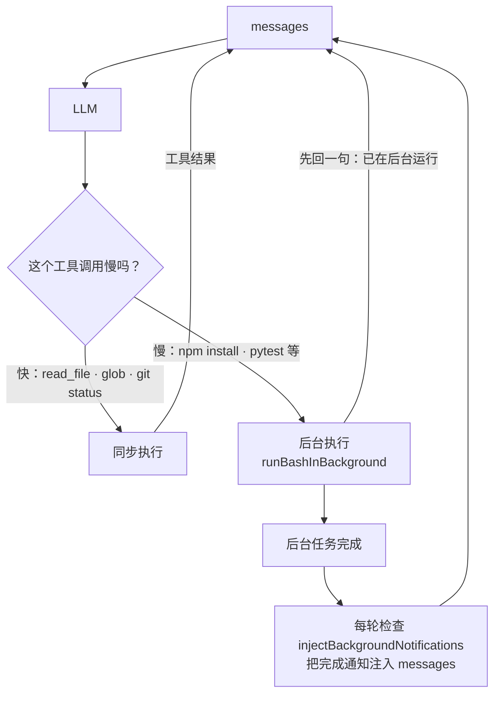

# s13：Background Tasks —— 慢操作放到后台

新人去打印一百页资料时，不该站在打印机旁什么都不做。`s13` 让 agent 把慢命令交给后台子进程，先拿到任务 id，继续处理别的工作，完成后再接收通知。

## 本章目标

`s12` 已经能保存任务图，但工具仍是同步执行：一次 `bash` 不结束，agent loop 就不能继续。

`s13` 保留前面的全部能力，只改变慢工具的执行方式：

1. 模型发出带 `run_in_background: true` 的 `bash` 调用，或命令命中慢操作关键词。
2. 系统启动异步子进程，立即返回后台任务 id。
3. 主 loop 把占位 `tool_result` 回给模型，继续处理其他工具。
4. 子进程完成后，结果以新的 `<task_notification>` 消息注入对话。

## 流程图


```text
LLM: bash(..., run_in_background=true)
                 |
                 v
          spawn 异步子进程
                 |
                 +------> 立即返回 bg_0001
                 |             |
                 |             v
                 |       主 loop 继续工作
                 |
                 v
             子进程完成
                 |
                 v
      <task_notification> 注入 messages
                 |
                 v
              LLM 继续
```

## 为什么这一步重要

持久 task 和后台运行槽位是两件事：

- Task System 记录“要完成什么、依赖谁、由谁负责”。
- Background Task 记录“这条命令是否还在运行、结果是什么”。

本章的后台任务只保存在 `backgroundTasks` 内存 Map 中，不会写入 `.tasks/`，进程退出后也不会恢复。

## 代码入口

- JS：[s13-background-tasks.js](./s13-background-tasks.js)
- Test：[s13-background-tasks.test.js](./s13-background-tasks.test.js)

## 运行

```bash
node code-agent-course/s13-background-tasks.js
```

## 新增函数速览

- `isSlowOperation(name, args)`：只对 `bash` 命令做关键词判断，例如 `install`、`build`、`test`。
- `shouldRunBackground(name, args)`：模型显式传 `run_in_background` 时优先，否则使用慢命令启发式。
- `startBackgroundTask(name, args, run)`：创建 `bg_XXXX` 记录，异步启动 `run`，立即返回任务 id。
- `runBashInBackground(command)`：使用 `spawn()` 启动异步 shell 子进程并收集 stdout / stderr。
- `collectBackgroundResults()`：取出已完成任务，生成 `<task_notification>`，并从 Map 删除任务。
- `injectBackgroundNotifications(messages)`：把完成通知作为新的 `user` 消息加入对话。
- `waitForBackgroundTick()`：等待 25ms，让超快命令有机会在本轮结束前完成。
- `resetBackgroundTasks()`：测试入口，清空后台任务状态。

## 关键代码

模型可以显式要求后台运行，也可以由关键词启发式兜底：

```js
export function shouldRunBackground(name, args) {
  return Boolean(args.run_in_background) || isSlowOperation(name, args);
}
```

真正的“派发后不等待”发生在这里。`Promise.resolve().then(run)` 没有被 `await`，所以函数先返回 `bgId`；`run` 完成后再更新 Map：

```js
export function startBackgroundTask(name, args, run) {
  bgCounter += 1;
  const bgId = `bg_${String(bgCounter).padStart(4, "0")}`;
  backgroundTasks.set(bgId, { command: args.command || name, status: "running", result: "" });
  console.log(`  [background] dispatched ${bgId}: ${preview(args.command || name, 60)}`);
  Promise.resolve()
    .then(run)
    .then((result) => {
      const task = backgroundTasks.get(bgId);
      if (task) {
        task.status = "completed";
        task.result = String(result);
      }
    });
  return bgId;
}
```

只把同步的 `runBash()` 放进 Promise 仍然会阻塞 Node 事件循环。后台 bash 必须改用异步 `spawn()`：

```js
function runBashInBackground(command) {
  return new Promise((resolve) => {
    const child = spawn(command, { cwd: process.cwd(), shell: true });
    let output = "";
    child.stdout.on("data", (chunk) => {
      output += chunk;
    });
    child.stderr.on("data", (chunk) => {
      output += chunk;
    });
    child.on("error", (error) => {
      resolve(`Error: ${error.message}`);
    });
    child.on("close", () => {
      resolve(output.trim() || "(no output)");
    });
  });
}
```

原始工具调用已经收到一个占位 `tool_result`，因此后台完成结果不能再次复用原来的 `tool_call_id`。代码把它变成独立的 `user` 消息：

```xml
<task_notification>
  <task_id>bg_0001</task_id>
  <status>completed</status>
  <command>sleep 0.01 && echo background done</command>
  <summary>background done</summary>
</task_notification>
```

`summary` 最多保留 200 个字符，避免后台输出直接塞满上下文。

## 教学版的时间边界

`waitForBackgroundTick()` 只等待 25ms，它的目的不是等所有后台任务完成，而是让 `echo`、`sleep 0.01` 这类超快演示更稳定。

如果后台命令是 `sleep 1`，而模型先给出最终答案，本轮 `agentLoop()` 可能已经返回。任务仍会在后台完成，但通知要等下一次进入 loop 时才会被收集。商业系统通常使用独立事件队列或常驻 queue processor，不依赖下一次用户输入。

## 测试 Prompt

```text
用 bash 后台运行 `sleep 0.01 && echo background done`，同时继续读取 README.md。
```

预期日志顺序大致如下，具体 turn 数取决于模型一次返回多少个 tool call：

```text
Turn 1:
  LLM → bash "sleep 0.01 && echo background done" (run_in_background=true)
  [background] dispatched bg_0001: sleep 0.01 && echo background done
  → start_background_task → bg_0001
  → tool_result: "[Background task bg_0001 started]..."
  LLM → read_file "README.md" (fast, sync)
  → tool_result: "# build-your-agent..."

Turn 2:
  → collect: bg_0001 done! inject <task_notification>
  LLM → 同时看到 README 内容和后台完成通知
```

## 扩展阅读：商业级 Agent 怎么做 Background Tasks

商业实现不仅要“异步启动”，还要能查看状态、持续读取输出、取消任务、限制并发，并在进程或界面恢复后继续展示结果：

- Claude Code 支持把 bash 命令放到后台，并通过任务输出工具继续读取结果；后台 shell 与子代理任务使用可追踪的 task id。
- Codex 把运行过程保存为 thread / turn 事件，工具执行状态和输出可被界面持续观察；长时间工作通常在独立线程或后台工作区中运行。
- OpenCode 通过 session 事件和 tool part 更新工具状态，长输出可以保存为受管理的结果，而不是全部留在模型上下文。

真实系统判断“是否慢”通常结合显式后台参数、命令类型、运行时长和持续输出。本章只使用 `run_in_background` 加关键词启发式，以最少代码讲清异步派发和通知回流。

可继续阅读：[Claude Code background commands](https://code.claude.com/docs/en/common-workflows#run-bash-commands-in-the-background)、[Codex 开源代码](https://github.com/openai/codex)、[OpenCode tool 源码](https://github.com/anomalyco/opencode/tree/dev/packages/opencode/src/tool)。

## 一句话总结

`s13` 让慢命令先返回后台任务 id，真正结果稍后以独立通知回到 agent loop。

## 与 s12 的关键代码 diff（不含 helper.js）

下面只展示异步子进程、后台状态、通知注入和 loop 分流。

```diff
--- s12-task-system.js
+++ s13-background-tasks.js
+import { spawn } from "node:child_process";

+let bgCounter = 0;
+const backgroundTasks = new Map(); // bgId → { command, status, result }
+
+const SLOW_KEYWORDS = ["install", "build", "test", "deploy", "compile", "pytest", "make", "cargo"];
+const BACKGROUND_POLL_MS = 25;
+
+export function isSlowOperation(name, args) {
+  if (name !== "bash") return false;
+  const cmd = (args.command || "").toLowerCase();
+  return SLOW_KEYWORDS.some((kw) => cmd.includes(kw));
+}
+
+export function shouldRunBackground(name, args) {
+  return Boolean(args.run_in_background) || isSlowOperation(name, args);
+}
+
+export function startBackgroundTask(name, args, run) {
+  bgCounter += 1;
+  const bgId = `bg_${String(bgCounter).padStart(4, "0")}`;
+  backgroundTasks.set(bgId, { command: args.command || name, status: "running", result: "" });
+  console.log(`  [background] dispatched ${bgId}: ${preview(args.command || name, 60)}`);
+  Promise.resolve()
+    .then(run)
+    .then((result) => {
+      const task = backgroundTasks.get(bgId);
+      if (task) {
+        task.status = "completed";
+        task.result = String(result);
+      }
+    });
+  return bgId;
+}
+
+function runBashInBackground(command) {
+  return new Promise((resolve) => {
+    const child = spawn(command, { cwd: process.cwd(), shell: true });
+    let output = "";
+    child.stdout.on("data", (chunk) => {
+      output += chunk;
+    });
+    child.stderr.on("data", (chunk) => {
+      output += chunk;
+    });
+    child.on("error", (error) => {
+      resolve(`Error: ${error.message}`);
+    });
+    child.on("close", () => {
+      resolve(output.trim() || "(no output)");
+    });
+  });
+}
+
+export function collectBackgroundResults() {
+  const notifications = [];
+  for (const [bgId, task] of backgroundTasks) {
+    if (task.status !== "completed") continue;
+    backgroundTasks.delete(bgId);
+    notifications.push(
+      `<task_notification>\n  <task_id>${bgId}</task_id>\n  <status>completed</status>\n  <command>${task.command}</command>\n  <summary>${task.result.slice(0, 200)}</summary>\n</task_notification>`,
+    );
+  }
+  return notifications;
+}

-  tool("bash", "Run a shell command.", {
+  tool("bash", "Run a shell command. Set run_in_background for slow ops (install/build/test).", {
     type: "object",
-    properties: { command: { type: "string" } },
+    properties: { command: { type: "string" }, run_in_background: { type: "boolean" } },
     required: ["command"],
   }),

+      const runInBackground = shouldRunBackground(name, args);
+      console.log(`  LLM → ${describeToolCall(name, args, runInBackground)}`);

+      } else if (runInBackground) {
+        const bgId = startBackgroundTask(name, args, () => {
+          const handler = handlers[name];
+          if (name === "bash") return runBashInBackground(args.command);
+          return handler ? handler(args, confirm) : `Unknown tool: ${name}`;
+        });
+        console.log(`  → start_background_task → ${bgId}`);
+        output = `[Background task ${bgId} started] ${args.command || name}. Result will arrive when complete.`;
       } else {
         const handler = handlers[name];
         output = handler ? await handler(args, confirm) : `Unknown tool: ${name}`;
       }

+    await waitForBackgroundTick();
+    injectBackgroundNotifications(messages);
```

## 博客代码演进

下面 8 个 patch 专门用于博客右侧的代码切换。第一步基于 `s12-task-system.js`，后面的每一步都继续修改上一帧，最后必须得到完整的 `s13-background-tasks.js`。

每一步的代码都可以运行。前四步准备“把命令放到后台执行”需要的函数；第 5 步让 loop 开始把慢命令放到后台；第 6、7 步把后台的结果送回对话。日志和只为日志服务的小函数放在最后一步统一补上。

### 1. 登记后台任务的表

到目前为止，工具执行是“等它做完再继续”。遇到 `npm install` 这种要跑几分钟的命令，整个 agent 都卡在那里。本章让慢命令在后台执行。先准备一张表 `backgroundTasks`，用编号记录每个后台任务：执行的命令、状态、结果。`bgCounter` 用来生成编号，`resetBackgroundTasks` 给测试清空用。开头还引入了 `spawn`，稍后用它启动不会卡住程序的子进程。

```diff agent-step
@@
 } from "node:fs";
 import path from "node:path";
+import { spawn } from "node:child_process";
 import {
   callLlm,
@@
   const task = loadTask(task_id);
   return task ? JSON.stringify(task, null, 2) : `Error: Task ${task_id} not found`;
+}
+
+let bgCounter = 0;
+const backgroundTasks = new Map();
+export function resetBackgroundTasks() {
+  backgroundTasks.clear();
+  bgCounter = 0;
 }
```

### 2. 哪些调用该放到后台

有两种判断方式。第一种：模型自己说。给 `bash` 工具的 schema 加一个 `run_in_background` 参数，模型知道命令会很慢时可以把它设为 `true`。第二种：程序猜。`isSlowOperation` 检查命令里有没有 `install`、`build`、`test` 这类词。`shouldRunBackground` 把两者合起来：模型明确要求的优先，否则用关键词判断。

```diff agent-step
@@
 }
 
+const SLOW_KEYWORDS = ["install", "build", "test", "deploy", "compile", "pytest", "make", "cargo"];
+
+export function isSlowOperation(name, args) {
+  if (name !== "bash") return false;
+  const cmd = (args.command || "").toLowerCase();
+  return SLOW_KEYWORDS.some((kw) => cmd.includes(kw));
+}
+
+export function shouldRunBackground(name, args) {
+  return Boolean(args.run_in_background) || isSlowOperation(name, args);
+}
+
 const TRANSCRIPT_DIR = path.join(process.cwd(), ".transcripts");
 const TOOL_RESULTS_DIR = path.join(process.cwd(), ".task_outputs", "tool-results");
@@
 
 const tools = [
-  tool("bash", "Run a shell command.", {
+  tool("bash", "Run a shell command. Set run_in_background for slow ops (install/build/test).", {
     type: "object",
-    properties: { command: { type: "string" } },
+    properties: { command: { type: "string" }, run_in_background: { type: "boolean" } },
     required: ["command"],
   }),
```

### 3. startBackgroundTask：不等结果，先返回编号

这是本章的核心函数。它先生成一个编号，在表里登记这个任务，状态是 `running`。然后启动任务，但是不写 `await`：`Promise.resolve().then(run)` 让 `run` 稍后执行，函数自己马上返回编号。等 `run` 真正完成时，`.then` 里的回调把状态改成 `completed`，并把结果填进表里。JavaScript 是单线程的，这里说的“后台”就是一个没有被等待的 Promise。

```diff agent-step
@@
 }
 
+export function startBackgroundTask(name, args, run) {
+  bgCounter += 1;
+  const bgId = `bg_${String(bgCounter).padStart(4, "0")}`;
+  backgroundTasks.set(bgId, { command: args.command || name, status: "running", result: "" });
+  Promise.resolve()
+    .then(run)
+    .then((result) => {
+      const task = backgroundTasks.get(bgId);
+      if (task) {
+        task.status = "completed";
+        task.result = String(result);
+      }
+    });
+  return bgId;
+}
+
 const TRANSCRIPT_DIR = path.join(process.cwd(), ".transcripts");
 const TOOL_RESULTS_DIR = path.join(process.cwd(), ".task_outputs", "tool-results");
```

### 4. 真正不卡住程序的 bash

之前的 `runBash` 用的是同步执行，命令没结束，整个 Node.js 程序什么都做不了，即使把它包进 Promise 也一样。后台执行必须换成 `spawn`：它启动一个子进程后立刻返回，输出通过事件一点点收集，子进程结束时触发 `close` 事件，这时才把完整输出交出去。出错时也交出一段错误文字，而不是抛异常。

```diff agent-step
@@
 }
 
+function runBashInBackground(command) {
+  return new Promise((resolve) => {
+    const child = spawn(command, { cwd: process.cwd(), shell: true });
+    let output = "";
+    child.stdout.on("data", (chunk) => {
+      output += chunk;
+    });
+    child.stderr.on("data", (chunk) => {
+      output += chunk;
+    });
+    child.on("error", (error) => {
+      resolve(`Error: ${error.message}`);
+    });
+    child.on("close", () => {
+      resolve(output.trim() || "(no output)");
+    });
+  });
+}
+
 const TRANSCRIPT_DIR = path.join(process.cwd(), ".transcripts");
 const TOOL_RESULTS_DIR = path.join(process.cwd(), ".task_outputs", "tool-results");
```

### 5. loop：慢命令放到后台，先回一个占位结果

在 loop 里执行工具的地方加一个分支。如果 `shouldRunBackground` 判断这次调用该放后台，就调用 `startBackgroundTask`，然后立刻给模型一个占位的工具结果：“后台任务 bg_0001 已启动，完成后会通知你”。对话格式要求每个工具调用都必须有结果，占位结果满足了这一点，模型可以接着做别的事。不过到这一步，后台任务的真正结果还没有办法回到对话里。

```diff agent-step
@@
       const name = call.function.name;
       const args = JSON.parse(call.function.arguments || "{}");
+      const runInBackground = shouldRunBackground(name, args);
 
       if (name === "compact") {
@@
       if (blocked != null) {
         output = String(blocked);
+      } else if (runInBackground) {
+        const bgId = startBackgroundTask(name, args, () => {
+          const handler = handlers[name];
+          if (name === "bash") return runBashInBackground(args.command);
+          return handler ? handler(args, confirm) : `Unknown tool: ${name}`;
+        });
+        output = `[Background task ${bgId} started] ${args.command || name}. Result will arrive when complete.`;
       } else {
         const handler = handlers[name];
```

### 6. 把完成的结果作为通知送回对话

`collectBackgroundResults` 检查表里哪些任务已经完成，把每个任务包成一段 `<task_notification>`，里面有编号、状态、命令和结果的前 200 个字符，然后把它从表里删掉，保证只通知一次。`injectBackgroundNotifications` 把这些通知作为新的 user 消息加进 `messages`。在 loop 里有两个时机调用它：每一轮调用模型之前，以及每批工具执行完之后。注意通知是一条独立的消息，不是原来那次工具调用的结果，那次调用已经用占位结果回复过了。

```diff agent-step
@@
 }
 
+export function collectBackgroundResults() {
+  const notifications = [];
+  for (const [bgId, task] of backgroundTasks) {
+    if (task.status !== "completed") continue;
+    backgroundTasks.delete(bgId);
+    notifications.push(
+      `<task_notification>\n  <task_id>${bgId}</task_id>\n  <status>completed</status>\n  <command>${task.command}</command>\n  <summary>${task.result.slice(0, 200)}</summary>\n</task_notification>`,
+    );
+  }
+  return notifications;
+}
+
+function injectBackgroundNotifications(messages) {
+  const notifications = collectBackgroundResults();
+  for (const notification of notifications) {
+    messages.push({ role: "user", content: notification });
+  }
+  return notifications.length;
+}
+
 const TRANSCRIPT_DIR = path.join(process.cwd(), ".transcripts");
 const TOOL_RESULTS_DIR = path.join(process.cwd(), ".task_outputs", "tool-results");
@@
 
   while (true) {
+    injectBackgroundNotifications(messages);
+
     if (roundsSinceTodo >= 3) {
       messages.push({ role: "user", content: "<reminder>Update your todos.</reminder>" });
@@
     }
     if (compacted) continue;
+
+    injectBackgroundNotifications(messages);
 
     context = buildContext();
```

### 7. 结束前再看一眼后台

还有一种情况：模型说“我做完了”，但后台还有任务在跑，或者刚好完成。所以在返回最终回答之前再检查一次：有新通知就继续循环，让模型看到结果后再回答。`waitForBackgroundTick` 在还有后台任务时等 25 毫秒，给那些非常快的命令一点完成的时间，避免刚好错过。提示符改成 `s13 >> `。

```diff agent-step
@@
 
 const SLOW_KEYWORDS = ["install", "build", "test", "deploy", "compile", "pytest", "make", "cargo"];
+const BACKGROUND_POLL_MS = 25;
 
 export function isSlowOperation(name, args) {
@@
 }
 
+async function waitForBackgroundTick() {
+  if (backgroundTasks.size) {
+    await new Promise((resolve) => setTimeout(resolve, BACKGROUND_POLL_MS));
+  }
+}
+
 const TRANSCRIPT_DIR = path.join(process.cwd(), ".transcripts");
 const TOOL_RESULTS_DIR = path.join(process.cwd(), ".task_outputs", "tool-results");
@@
 
     if (!message.tool_calls?.length) {
+      if (injectBackgroundNotifications(messages)) continue;
+      await waitForBackgroundTick();
+      if (injectBackgroundNotifications(messages)) continue;
       await extractMemories(preCompress);
       await consolidateMemories();
@@
     if (compacted) continue;
 
+    await waitForBackgroundTick();
     injectBackgroundNotifications(messages);
@@
 async function main() {
   await runChatCli({
-    promptLabel: "s12 >> ",
+    promptLabel: "s13 >> ",
     onPrompt: async ({ prompt, messages, ask }) => {
       return agentLoop(messages, ask);
```

### 8. 补上教学日志

后台任务的执行顺序不容易凭空想清楚，所以这一章的日志比较多。`preview` 把长文本截短，`describeToolCall` 把一次工具调用写成一行，并标出它是同步执行还是放到后台，`notificationTaskId` 从通知里取出任务编号。然后在各个环节打印：第几轮、模型请求了什么、后台任务什么时候派发、结果什么时候被收回。运行一次“安装依赖的同时读文件”的例子，对照日志就能看到两件事是交错进行的。

```diff agent-step
@@
   const bgId = `bg_${String(bgCounter).padStart(4, "0")}`;
   backgroundTasks.set(bgId, { command: args.command || name, status: "running", result: "" });
+  console.log(`  [background] dispatched ${bgId}: ${preview(args.command || name, 60)}`);
   Promise.resolve()
     .then(run)
@@
 }
 
+function preview(value, max = 80) {
+  const text = String(value ?? "").replace(/\s+/g, " ").trim();
+  return text.length > max ? `${text.slice(0, max)}...` : text;
+}
+
+function describeToolCall(name, args, background) {
+  if (name === "bash") {
+    return `bash "${preview(args.command, 60)}" (${background ? "run_in_background=true" : "fast, sync"})`;
+  }
+  if (name === "read_file") return `read_file "${args.path}" (fast, sync)`;
+  if (name === "write_file") return `write_file "${args.path}" (fast, sync)`;
+  return `${name} ${preview(JSON.stringify(args), 60)} (${background ? "run_in_background=true" : "fast, sync"})`;
+}
+
+function notificationTaskId(notification) {
+  return notification.match(/<task_id>(.*?)<\/task_id>/)?.[1] || "background task";
+}
+
 function injectBackgroundNotifications(messages) {
   const notifications = collectBackgroundResults();
   for (const notification of notifications) {
     messages.push({ role: "user", content: notification });
+    console.log(`  → collect: ${notificationTaskId(notification)} done! inject <task_notification>`);
   }
   return notifications.length;
@@
   const memoriesContent = await loadMemories(messages);
   let preCompress = messages.map((m) => ({ role: m.role, content: m.content }));
+  let turn = 0;
 
   while (true) {
+    turn += 1;
+    console.log(`\nTurn ${turn}:`);
     injectBackgroundNotifications(messages);
@@
       await waitForBackgroundTick();
       if (injectBackgroundNotifications(messages)) continue;
+      console.log(`  LLM → ${preview(message.content || "(no text)", 100)}`);
       await extractMemories(preCompress);
       await consolidateMemories();
@@
       const args = JSON.parse(call.function.arguments || "{}");
       const runInBackground = shouldRunBackground(name, args);
+      console.log(`  LLM → ${describeToolCall(name, args, runInBackground)}`);
 
       if (name === "compact") {
@@
           return handler ? handler(args, confirm) : `Unknown tool: ${name}`;
         });
+        console.log(`  → start_background_task → ${bgId}`);
         output = `[Background task ${bgId} started] ${args.command || name}. Result will arrive when complete.`;
       } else {
@@
       if (name === "todo_write") roundsSinceTodo = 0;
       messages.push({ role: "tool", tool_call_id: call.id, content: String(output) });
+      console.log(`  → tool_result: "${preview(output, 90)}"`);
     }
     if (compacted) continue;
```
