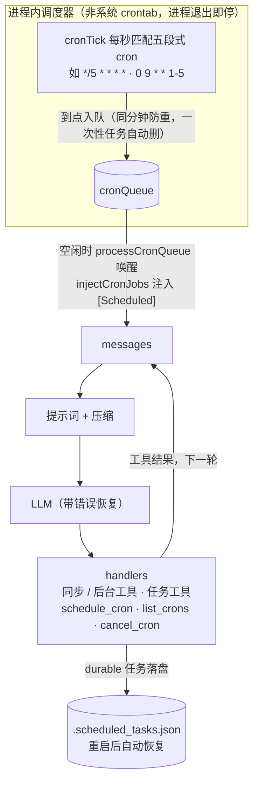

# s14：Cron Scheduler - 让时间也能主动唤醒 Agent

上一章 `s13` 把慢命令放进了后台，但整条循环依然只有等你敲一句话才会启动。很多日常工作不该靠人盯着：比如每天早上巡检项目、每隔几分钟查看一次构建或任务板状态。

这一章我们给 Agent 装上一个**进程内定时调度器**。**定时调度按三层解耦：`cronTick` 只管按表发现到点任务并入队，`processCronQueue` 在 Agent 空闲时自动唤醒，原有的 `agentLoop` 照常把到点任务当作 `[Scheduled]` 消息处理。**

## 问题

有了后台执行后，Agent 能“慢慢跑”了，却还不能“到点自己跑”。如果把定时逻辑直接硬塞进主循环，既可能和正在进行的交互对话撞车，又容易在无人值守时卡死在终端权限确认上。

## 解决方案

我们复用 `helper.js` 的五段式 cron 解析工具，新增 `schedule_cron`、`list_crons`、`cancel_cron` 三个工具，并在进程内用每秒一次的心跳串起“检测 → 入队 → 空闲交付 → 注入执行”闭环：



这套调度机制有四个容易踩坑的细节：

- **纯进程内运行，不安装系统 cron**：定时器靠 `setInterval(..., 1000)` + `ticker.unref?.()` 驱动，只在本进程存活时生效，输入 `q` 退出后调度即停止，不会写入操作系统 `crontab`。
- **五段式 cron 对齐整点分钟**：格式为 `分 时 日 月 周`。`*/2 * * * *` 表示“分钟数能被 2 整除时触发”，不是“从登记起等满 2 分钟”；例如 21:55 登记，21:56 就会触发，且 `lastFired` 按“年-月-日 时:分”防重，同一分钟只入队一次。
- **互斥锁 + 无人值守默认拒绝**：`agentRunning` 标志让 `processCronQueue()` 与用户输入 `runInteractiveAgentTurn()` 错开执行，避免并发修改共享状态；自动触发时无人看守终端，`confirm` 固定返回 `"n"` 拒绝高危操作。
- **持久化恢复**：`durable: true` 的任务写入 `.scheduled_tasks.json`，下次启动自动加载。若刚运行脚本就看到日期输出，说明恢复了历史持久任务；退出后执行 `rm .scheduled_tasks.json` 即可清空。

## 测试 Prompt

```text
Schedule a task to print the current date every 1 minutes
```

注册成功后，什么都不用输入；因为 `* * * * *` 匹配任意分钟且心跳每秒检测一次，在当前分钟的下一次 1 秒心跳（以及之后的每一整分钟）就会自动触发，你可以看到完整的教学日志链：`[cron register]` → `[cron fire]` → `[queue processor]` → `[inject cron]` → `> bash "date"` 自动输出当前时间。测试完毕退出后，若不想下次启动继续触发，记得删除 `.scheduled_tasks.json`。

## 扩展阅读：商业级 Agent 怎么做定时调度

真实产品通常会把“何时唤醒”与“唤醒后做什么”彻底拆开，把进程内心跳替换成常驻守护服务或云端调度器：

- **Claude Code**：会话内提供 `/loop` 及 `CronCreate` / `CronList` / `CronDelete` 工具，在运行期间趁空闲低优先级入队；需要脱离当前终端长期可靠运行时，官方建议改用 cloud routines、Desktop scheduled task 或 GitHub Actions。参考 [Claude Code scheduled tasks](https://code.claude.com/docs/en/scheduled-tasks)。
- **Codex**：Codex App 的 Automations 支持按计划后台运行并将结果送入 review queue，本地运行时依赖机器保持唤醒且应用在线。参考 [Codex Automations](https://openai.com/academy/codex-automations/) 与 [Introducing the Codex app](https://openai.com/index/introducing-the-codex-app/)。
- **opencode**：核心保持精简，定时能力交给社区插件生态，例如 `opencode-scheduler` 在 macOS 注册 `launchd`、在 Linux 注册 `systemd`。参考 [OpenCode ecosystem](https://opencode.ai/docs/ecosystem/) 与 [opencode-scheduler](https://github.com/different-ai/opencode-scheduler)。

如果把本章改造成系统级 cron，核心只需换掉 `cronTick` 一层：由系统 `crontab` / `launchd` / `systemd` 每分钟拉起一个独立 runner，读取 `.scheduled_tasks.json`，用 `cronMatches()` 筛出到点任务并执行 `agentLoop`，同时补齐锁文件防重入、环境变量与日志轮转。

**`s14` 把“发现到点、排队交付、注入循环”的运行时闭环先立住，将来换上系统调度器或云调度器时，主循环一行都不用改。**

## 本地运行与测试

交互运行（从仓库根目录执行）：

```bash
cd code-agent-course && node s14-cron-scheduler.js
```

离线单测（在仓库根目录执行，无需 API Token）：

```bash
pnpm vitest run code-agent-course/s14-cron-scheduler.test.js
```

## 博客代码演进

### 1. 整理开头：引入 cron 表达式解析函数

五段式 cron 表达式（如 `*/2 * * * *`）的词法校验和匹配比较琐碎，和 Agent 主循环逻辑无关，因此我们把它作为纯工具函数收进 `helper.js`。这一步先引入 `validateCron`（校验合法性）和 `cronMatches`（判断当前时间是否命中）。

```diff agent-step
@@
   isMainModule,
   parseFrontmatter,
+  cronMatches,
+  validateCron,
   prepareHistoryForSummary,
 } from "./helper.js";
@@
 const SLOW_KEYWORDS = ["install", "build", "test", "deploy", "compile", "pytest", "make", "cargo"];
 const BACKGROUND_POLL_MS = 25;
-
 export function isSlowOperation(name, args) {
   if (name !== "bash") return false;
```

### 2. 声明调度器运行状态

先备好调度器的几个核心状态：`scheduledJobs` 保存所有已登记的定时任务；`cronQueue` 暂存已经到点、等待交付的任务；`lastFired` 记下每个任务上次触发的“分钟标记”，防止同一分钟内重复触发；`cronProcessing` 和 `agentRunning` 充当并发互斥锁；`cronStorePath` 和 `resetCron` 方便测试隔离文件路径与重置状态。

```diff agent-step
@@
 }
 
+let cronStorePath = path.join(process.cwd(), ".scheduled_tasks.json");
+export function setCronStorePath(p) {
+  cronStorePath = p;
+}
+
+const scheduledJobs = new Map();
+const cronQueue = [];
+const lastFired = new Map();
+let cronSeq = 0;
+let cronProcessing = false;
+let agentRunning = false;
+export function resetCron() {
+  scheduledJobs.clear();
+  cronQueue.length = 0;
+  lastFired.clear();
+  cronSeq = 0;
+  cronProcessing = false;
+  agentRunning = false;
+}
+
 const TRANSCRIPT_DIR = path.join(process.cwd(), ".transcripts");
 const TOOL_RESULTS_DIR = path.join(process.cwd(), ".task_outputs", "tool-results");
```

### 3. scheduleJob：登记定时任务并支持持久化

`scheduleJob` 先用 `validateCron` 校验表达式，不合法就直接返回错误说明。校验通过后生成 `cron_XXXX` 编号并写入登记表，同时支持两个布尔选项：`recurring` 控制周期触发还是一次性，`durable` 控制是否经由 `saveDurableJobs()` 同步落盘到 `.scheduled_tasks.json`。

```diff agent-step
@@
 }
 
+function saveDurableJobs() {
+  const durable = [...scheduledJobs.values()].filter((j) => j.durable);
+  writeFileSync(cronStorePath, JSON.stringify(durable, null, 2));
+}
+
+export function scheduleJob(cron, prompt, recurring = true, durable = true) {
+  const err = validateCron(cron);
+  if (err) return err;
+  const job = { id: `cron_${String(cronSeq++).padStart(4, "0")}`, cron, prompt, recurring, durable };
+  scheduledJobs.set(job.id, job);
+  if (durable) saveDurableJobs();
+  return job;
+}
+
 const TRANSCRIPT_DIR = path.join(process.cwd(), ".transcripts");
 const TOOL_RESULTS_DIR = path.join(process.cwd(), ".task_outputs", "tool-results");
```

### 4. schedule_cron 工具：让模型自己定闹钟

接着把登记能力包装成工具。`runScheduleCron` 调用 `scheduleJob`，成功时返回编号与摘要，失败时返回带 `Error:` 的提示让模型有机会修正 cron 表达式重试。再连同 schema 和 `handlers` 一起接入，这一步之后模型已经能登记定时任务，只是还没装上心跳去触发。

```diff agent-step
@@
   return job;
 }
+function runScheduleCron({ cron, prompt, recurring = true, durable = true }) {
+  const result = scheduleJob(cron, prompt, recurring, durable);
+  return typeof result === "string" ? `Error: ${result}` : `Scheduled ${result.id}: '${cron}' → ${prompt}`;
+}
 
 const TRANSCRIPT_DIR = path.join(process.cwd(), ".transcripts");
@@
     required: ["task_id"],
   }),
+  tool("schedule_cron", "Schedule a cron job (5-field: min hour dom month dow) to inject a prompt when it fires.", {
+    type: "object",
+    properties: {
+      cron: { type: "string" },
+      prompt: { type: "string" },
+      recurring: { type: "boolean" },
+      durable: { type: "boolean" },
+    },
+    required: ["cron", "prompt"],
+  }),
 ];
@@
   claim_task: ({ task_id }) => claimTask(task_id),
   complete_task: ({ task_id }) => completeTask(task_id),
+  schedule_cron: runScheduleCron,
 };
```

### 5. list_crons 和 cancel_cron：查看与取消任务

能建就得能查能删。`listCronJobs` 返回全部已登记任务，`cancelJob` 按 ID 删除并在需要时同步更新 `.scheduled_tasks.json`。我们把 `list_crons` 和 `cancel_cron` 两个工具的包装函数、schema 与 `handlers` 一次性配齐。

```diff agent-step
@@
   return job;
 }
+export function cancelJob(id) {
+  const job = scheduledJobs.get(id);
+  if (!job) return `Job ${id} not found`;
+  scheduledJobs.delete(id);
+  if (job.durable) saveDurableJobs();
+  return `Cancelled ${id}`;
+}
+export function listCronJobs() {
+  return [...scheduledJobs.values()];
+}
+
 function runScheduleCron({ cron, prompt, recurring = true, durable = true }) {
   const result = scheduleJob(cron, prompt, recurring, durable);
   return typeof result === "string" ? `Error: ${result}` : `Scheduled ${result.id}: '${cron}' → ${prompt}`;
 }
+function runListCrons() {
+  const jobs = listCronJobs();
+  if (!jobs.length) return "No cron jobs. Use schedule_cron to add one.";
+  return jobs
+    .map(
+      (j) =>
+        `${j.id}: '${j.cron}' → ${j.prompt.slice(0, 40)} [${j.recurring ? "recurring" : "one-shot"}, ${j.durable ? "durable" : "session"}]`,
+    )
+    .join("\n");
+}
+function runCancelCron({ job_id }) {
+  return cancelJob(job_id);
+}
 
 const TRANSCRIPT_DIR = path.join(process.cwd(), ".transcripts");
@@
     required: ["cron", "prompt"],
   }),
+  tool("list_crons", "List all registered cron jobs.", { type: "object", properties: {} }),
+  tool("cancel_cron", "Cancel a cron job by id.", {
+    type: "object",
+    properties: { job_id: { type: "string" } },
+    required: ["job_id"],
+  }),
 ];
@@
   complete_task: ({ task_id }) => completeTask(task_id),
   schedule_cron: runScheduleCron,
+  list_crons: runListCrons,
+  cancel_cron: runCancelCron,
 };
```

### 6. cronTick：每秒对表，到点入队

`cronTick` 是进程内调度器的心跳。每秒扫一遍登记表：时间命中 `cronMatches` 且当前分钟标记尚未触发过，就把任务推入 `cronQueue` 并写好 `lastFired`；若是一次性任务，顺手删除并更新磁盘。`main` 里用 `setInterval(..., 1000)` 驱动它并调用 `ticker.unref?.()`，退出 CLI 时清理定时器。它只负责入队，绝不直接调模型。

```diff agent-step
@@
 }
 
+export function cronTick(now = new Date()) {
+  const marker = `${now.getFullYear()}-${now.getMonth()}-${now.getDate()} ${now.getHours()}:${now.getMinutes()}`;
+  for (const job of [...scheduledJobs.values()]) {
+    try {
+      if (!cronMatches(job.cron, now)) continue;
+      if (lastFired.get(job.id) !== marker) {
+        cronQueue.push(job);
+        lastFired.set(job.id, marker);
+      }
+      if (!job.recurring) {
+        scheduledJobs.delete(job.id);
+        if (job.durable) saveDurableJobs();
+      }
+    } catch {
+    }
+  }
+}
+
 function runScheduleCron({ cron, prompt, recurring = true, durable = true }) {
   const result = scheduleJob(cron, prompt, recurring, durable);
@@
 
 async function main() {
+  const ticker = setInterval(() => {
+    cronTick(new Date());
+  }, 1000);
+  ticker.unref?.();
   await runChatCli({
     promptLabel: "s13 >> ",
@@
     },
   });
+  clearInterval(ticker);
 }
```

### 7. 在主循环轮首把到点任务注入对话

排进 `cronQueue` 的任务需要进入模型上下文。`consumeCronQueue` 一次性清空并取出所有待执行任务，`injectCronJobs` 给每条 prompt 加上 `[Scheduled]` 前缀，以普通 `user` 消息压入 `messages`。在 `agentLoop` 每轮开头调用它后，模型看到定时任务就像看到用户新发了一句需求。

```diff agent-step
@@
 }
 
+export function consumeCronQueue() {
+  return cronQueue.splice(0);
+}
+
+export function hasCronQueue() {
+  return cronQueue.length > 0;
+}
+
+function injectCronJobs(messages) {
+  const fired = consumeCronQueue();
+  for (const job of fired) {
+    messages.push({ role: "user", content: `[Scheduled] ${job.prompt}` });
+  }
+  return fired.length;
+}
+
 function runScheduleCron({ cron, prompt, recurring = true, durable = true }) {
   const result = scheduleJob(cron, prompt, recurring, durable);
@@
     injectBackgroundNotifications(messages);
 
+    injectCronJobs(messages);
     if (roundsSinceTodo >= 3) {
       messages.push({ role: "user", content: "<reminder>Update your todos.</reminder>" });
```

### 8. processCronQueue：空闲时自动唤醒，并与交互回合互斥

闹钟不能干等用户再开口。`processCronQueue` 趁队列非空且 `agentRunning` 为 `false` 时，直接以空历史启动一轮 `agentLoop`（开头的 `injectCronJobs` 会自动消费队列），并把 `confirm` 固定成返回 `"n"` 避免无人值守时卡死。同时交互输入改走 `runInteractiveAgentTurn`，轮询等待运行锁释放后再进循环，彻底防住并发撞车。

```diff agent-step
@@
 }
 
+export async function processCronQueue(confirm = async () => "n") {
+  if (cronProcessing || agentRunning || !hasCronQueue()) return false;
+  cronProcessing = true;
+  agentRunning = true;
+  try {
+    if (!hasCronQueue()) return false;
+    const text = await agentLoop([], confirm);
+    if (text) console.log(text);
+    return true;
+  } catch (error) {
+    return false;
+  } finally {
+    agentRunning = false;
+    cronProcessing = false;
+  }
+}
+
 function runScheduleCron({ cron, prompt, recurring = true, durable = true }) {
   const result = scheduleJob(cron, prompt, recurring, durable);
@@
 }
 
+async function runInteractiveAgentTurn(messages, confirm) {
+  while (agentRunning) {
+    await new Promise((resolve) => setTimeout(resolve, 50));
+  }
+  agentRunning = true;
+  try {
+    return await agentLoop(messages, confirm);
+  } finally {
+    agentRunning = false;
+  }
+}
+
 async function main() {
   const ticker = setInterval(() => {
     cronTick(new Date());
+    processCronQueue(async () => "n");
   }, 1000);
   ticker.unref?.();
@@
     promptLabel: "s13 >> ",
     onPrompt: async ({ prompt, messages, ask }) => {
-      return agentLoop(messages, ask);
+      return runInteractiveAgentTurn(messages, ask);
     },
   });
```

### 9. 启动时恢复持久化定时任务

补上持久化的另一半：`loadDurableJobs` 在 `main()` 启动时读取 `.scheduled_tasks.json`，只恢复表达式校验通过的任务并打印数量；文件损坏则安静忽略。所以如果刚启动脚本就看到恢复提示甚至立刻输出日期，正是旧的持久任务生效了。顺手把 CLI 提示符更新为 `s14 >> `。

```diff agent-step
@@
   writeFileSync(cronStorePath, JSON.stringify(durable, null, 2));
 }
+export function loadDurableJobs() {
+  if (!existsSync(cronStorePath)) return;
+  try {
+    let count = 0;
+    for (const j of JSON.parse(readFileSync(cronStorePath, "utf8"))) {
+      if (!validateCron(j.cron)) {
+        scheduledJobs.set(j.id, j);
+        count += 1;
+      }
+    }
+    if (count) console.log(`  [cron] loaded ${count} durable job(s)`);
+  } catch {
+  }
+}
 
 export function scheduleJob(cron, prompt, recurring = true, durable = true) {
@@
 
 async function main() {
+  loadDurableJobs();
   const ticker = setInterval(() => {
     cronTick(new Date());
@@
   ticker.unref?.();
   await runChatCli({
-    promptLabel: "s13 >> ",
+    promptLabel: "s14 >> ",
     onPrompt: async ({ prompt, messages, ask }) => {
       return runInteractiveAgentTurn(messages, ask);
```

### 10. 补上调度追踪日志并统一标签格式

定时触发发生在后台，没有清晰日志很难排查先后顺序。最后一步补齐 `[cron register]`、`[cron fire]`、`[inject cron]` 与 `[queue processor]` 日志，同时把上一章的轮次、工具和后台日志统一成 `[turn N]`、`[assistant]`、`[tool result]`、`[background start]`、`[task notification]` 方括号标签，一整条调度链路一目了然。

> **本章思考题**：到这里，单个 Agent 已经能管任务图、跑后台、按时自启动。但面对前后端联调、一边改实现一边补测试这种大活，单兵还是忙不过来。如果不再只派一次性的子代理，而是拉起几个有名字、有角色、靠收件箱异步沟通的队友，这套协作层该怎么设计？下一章 `s15` 我们来做 Agent Teams。

```diff agent-step
@@
   for (const notification of notifications) {
     messages.push({ role: "user", content: notification });
-    console.log(`  → collect: ${notificationTaskId(notification)} done! inject <task_notification>`);
+    console.log(`  [task notification] ${notificationTaskId(notification)} done → inject <task_notification>`);
   }
   return notifications.length;
@@
   scheduledJobs.set(job.id, job);
   if (durable) saveDurableJobs();
+  console.log(`  [cron register] ${job.id} '${cron}' → ${preview(prompt, 40)}`);
   return job;
 }
@@
         cronQueue.push(job);
         lastFired.set(job.id, marker);
+        console.log(`  [cron fire] ${job.id} → ${preview(job.prompt, 40)}`);
       }
       if (!job.recurring) {
@@
   for (const job of fired) {
     messages.push({ role: "user", content: `[Scheduled] ${job.prompt}` });
+    console.log(`  [inject cron] ${preview(job.prompt, 50)}`);
   }
   return fired.length;
@@
   try {
     if (!hasCronQueue()) return false;
+    console.log("\n  [queue processor] delivering scheduled work");
     const text = await agentLoop([], confirm);
     if (text) console.log(text);
+    console.log();
     return true;
   } catch (error) {
+    console.error(`[queue processor error] ${error.message}`);
     return false;
   } finally {
@@
   while (true) {
     turn += 1;
-    console.log(`\nTurn ${turn}:`);
+    console.log(`\n[turn ${turn}]`);
     injectBackgroundNotifications(messages);
@@
       await waitForBackgroundTick();
       if (injectBackgroundNotifications(messages)) continue;
-      console.log(`  LLM → ${preview(message.content || "(no text)", 100)}`);
+      console.log(`  [assistant] ${preview(message.content || "(no text)", 100)}`);
       await extractMemories(preCompress);
       await consolidateMemories();
@@
       const args = JSON.parse(call.function.arguments || "{}");
       const runInBackground = shouldRunBackground(name, args);
-      console.log(`  LLM → ${describeToolCall(name, args, runInBackground)}`);
+      console.log(`> ${describeToolCall(name, args, runInBackground)}`);
 
       if (name === "compact") {
@@
           return handler ? handler(args, confirm) : `Unknown tool: ${name}`;
         });
-        console.log(`  → start_background_task → ${bgId}`);
+        console.log(`  [background start] ${bgId}`);
         output = `[Background task ${bgId} started] ${args.command || name}. Result will arrive when complete.`;
       } else {
@@
       if (name === "todo_write") roundsSinceTodo = 0;
       messages.push({ role: "tool", tool_call_id: call.id, content: String(output) });
-      console.log(`  → tool_result: "${preview(output, 90)}"`);
+      console.log(`  [tool result] ${preview(output, 120)}`);
     }
     if (compacted) continue;
@@
 async function main() {
   loadDurableJobs();
+  console.log("  [queue processor] started");
   const ticker = setInterval(() => {
     cronTick(new Date());
```

## 和上一步的关键代码 diff（不含 helper.js）

```diff
--- s13-background-tasks.js
+++ s14-cron-scheduler.js
@@
+  cronMatches,
+  validateCron,
@@
+let cronStorePath = path.join(process.cwd(), ".scheduled_tasks.json");
+const scheduledJobs = new Map();
+const cronQueue = [];
+const lastFired = new Map();
+let cronSeq = 0;
+let cronProcessing = false;
+let agentRunning = false;
+
+export function scheduleJob(cron, prompt, recurring = true, durable = true) {
+  const err = validateCron(cron);
+  if (err) return err;
+  const job = { id: `cron_${String(cronSeq++).padStart(4, "0")}`, cron, prompt, recurring, durable };
+  scheduledJobs.set(job.id, job);
+  if (durable) saveDurableJobs();
+  return job;
+}
+
+export function cronTick(now = new Date()) {
+  const marker = `${now.getFullYear()}-${now.getMonth()}-${now.getDate()} ${now.getHours()}:${now.getMinutes()}`;
+  for (const job of [...scheduledJobs.values()]) {
+    try {
+      if (!cronMatches(job.cron, now)) continue;
+      if (lastFired.get(job.id) !== marker) {
+        cronQueue.push(job);
+        lastFired.set(job.id, marker);
+      }
+      if (!job.recurring) {
+        scheduledJobs.delete(job.id);
+        if (job.durable) saveDurableJobs();
+      }
+    } catch {
+    }
+  }
+}
+
+export async function processCronQueue(confirm = async () => "n") {
+  if (cronProcessing || agentRunning || !hasCronQueue()) return false;
+  cronProcessing = true;
+  agentRunning = true;
+  try {
+    if (!hasCronQueue()) return false;
+    const text = await agentLoop([], confirm);
+    if (text) console.log(text);
+    return true;
+  } catch (error) {
+    console.error(`[queue processor error] ${error.message}`);
+    return false;
+  } finally {
+    agentRunning = false;
+    cronProcessing = false;
+  }
+}
@@
+  schedule_cron: runScheduleCron,
+  list_crons: runListCrons,
+  cancel_cron: runCancelCron,
@@
+    injectCronJobs(messages);
@@
+  loadDurableJobs();
+  const ticker = setInterval(() => {
+    cronTick(new Date());
+    processCronQueue(async () => "n");
+  }, 1000);
+  ticker.unref?.();
```
