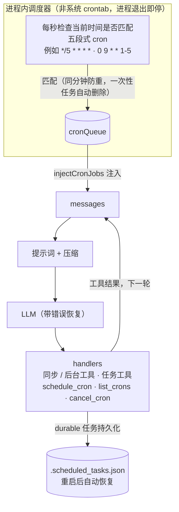

# s14：Cron Scheduler —— 时间也能触发 agent

有些任务不该一直等用户开口，比如每天早上检查日报、每隔几分钟看一次任务状态。`s14` 给 agent 装一个闹钟：时间到了，系统自动把预设 prompt 送进 agent loop。

这一章对齐 Python 版的核心设计：**scheduler 负责发现到点任务，queue processor 负责在 agent 空闲时自动交付任务。**

## 本章目标

有了 s13 的后台任务以后，agent 已经能“慢慢跑”。但它仍然需要用户输入来启动。

`s14` 新增时间触发入口：

```text
cron job 到点
  |
  v
进入 cronQueue
  |
  v
queue processor 自动启动 agentLoop
  |
  v
agent 处理 [Scheduled] prompt
```

注意：当前实现还是**进程内调度器**，不是操作系统的 cron。只要 `node s14-cron-scheduler.js` 这个进程活着，它就会自动执行到点任务。

## 新增能力

- `schedule_cron`：注册一个定时任务。
- `list_crons`：列出当前所有定时任务。
- `cancel_cron`：取消一个定时任务。
- `cronTick()`：每秒检查哪些任务到点。
- `cronQueue`：暂存已经到点、等待交付的任务。
- `processCronQueue()`：agent 空闲时自动消费队列，不等用户下一次输入。
- durable job：把任务定义写入 `.scheduled_tasks.json`，下次启动时恢复。

## 流程图


```text
用户要求 schedule_cron
    |
    v
scheduleJob 保存 CronJob
    |
    v
cronTick 每秒检查
    |
    v
到点任务进入 cronQueue
    |
    v
processCronQueue 自动交付
    |
    v
agentLoop 注入 [Scheduled] prompt
    |
    v
LLM 调用工具并输出结果
```

## 为什么这一步重要

s13 解决的是“工具已经开始后，怎样不阻塞主循环”；s14 解决的是“没有用户输入时，谁来启动一轮工作”。scheduler 只判断时间并入队，queue processor 负责在 agent 空闲时交付，原来的 agent loop 仍负责调用模型和工具。

## 代码入口

- JS：[s14-cron-scheduler.js](./s14-cron-scheduler.js)
- Test：[s14-cron-scheduler.test.js](./s14-cron-scheduler.test.js)

## CronJob 数据结构

每个 cron 任务本质上都是一个 `CronJob` 对象。Python 原版可以写成这样：

```python
@dataclass
class CronJob:
    id: str
    cron: str        # "0 9 * * *"（五段式 cron 表达式）
    prompt: str      # 触发时注入给 Agent 的消息
    recurring: bool  # True = 周期性，False = 一次性
    durable: bool    # True = 写入磁盘，跨会话保留
```

JavaScript 版不额外定义 class，直接保存同形状的普通对象：

```js
{
  id: "cron_0001",
  cron: "0 9 * * *",
  prompt: "检查任务板",
  recurring: true,
  durable: true,
}
```

`cron` 字段使用五段式表达式：

```text
分钟  小时  日  月  星期
 *    *   *   *   *      每分钟
 0    9   *   *   *      每天早上 9:00
*/5   *   *   *   *      每 5 分钟
 0    9   *   *  1-5     工作日早上 9:00
```

`*/2 * * * *` 的意思是“每个能被 2 整除的分钟触发”，不是“从现在开始等待满 2 分钟再触发”。所以 21:55 注册，21:56 就可能触发。

## 运行

```bash
node code-agent-course/s14-cron-scheduler.js
```

可以输入：

```text
Schedule a task to print the current date every 1 minutes
```

如果模型创建的是 durable job，它会写入 `.scheduled_tasks.json`。下次启动 s14 时，旧任务会自动恢复，所以你可能刚运行脚本就看到日期输出。要彻底清空历史任务，先退出当前进程，再删除这个文件：

```bash
rm .scheduled_tasks.json
```

## 观察日志

这一章的日志故意保留成教学 trace，方便看清楚调度链路：

```text
[cron register] cron_0000 '* * * * *' → Print the current date...
[cron fire] cron_0000 → Print the current date...
[queue processor] delivering scheduled work
[inject cron] Print the current date...
[turn 1]
> bash "date" (fast, sync)
[tool result] Wed Jul 1 21:55:52 CST 2026
[assistant] 当前日期是...
```

这些日志说明四件事：

- `[cron register]`：任务已经注册。
- `[cron fire]`：时间命中，任务进入队列。
- `[queue processor]`：系统自动交付队列，不需要用户再输入。
- `[inject cron]`：到点任务变成一条 `[Scheduled]` 用户消息。

## 新增函数速览

- `cronMatches(expr, date)`：判断某个时间是否命中五段式 cron 表达式；这是纯工具函数，放在 `helper.js`。
- `validateCron(expr)`：在保存前检查 cron 表达式；这是纯工具函数，放在 `helper.js`。
- `setCronStorePath(path)` / `resetCron()`：测试入口，替换持久化文件并清空进程内状态。
- `loadDurableJobs()`：启动时从 `.scheduled_tasks.json` 恢复合法的 durable job。
- `scheduleJob(cron, prompt, recurring, durable)`：创建定时任务，并决定是否写入 `.scheduled_tasks.json`。
- `cancelJob(id)` / `listCronJobs()`：取消或列出已注册任务。
- `cronTick(now)`：每秒扫描任务，把到点任务放入 `cronQueue`。
- `hasCronQueue()`：判断队列里是否有等待交付的任务。
- `consumeCronQueue()`：一次性取出队列里的到点任务。
- `processCronQueue()`：当 agent 空闲且队列里有任务时，自动启动一轮 agent loop。
- `runInteractiveAgentTurn()`：用户输入也要等待当前定时任务结束，避免两个 agent loop 同时修改共享状态。
- `runScheduleCron()` / `runListCrons()` / `runCancelCron()`：把 cron 能力包装成模型可调用的工具 handler。

## 关键代码

注册任务时，只保存任务定义，不立刻执行：

```js
export function scheduleJob(cron, prompt, recurring = true, durable = true) {
  const err = validateCron(cron);
  if (err) return err;
  const job = { id: `cron_${String(cronSeq++).padStart(4, "0")}`, cron, prompt, recurring, durable };
  scheduledJobs.set(job.id, job);
  if (durable) saveDurableJobs();
  console.log(`  [cron register] ${job.id} '${cron}' → ${preview(prompt, 40)}`);
  return job;
}
```

`cronTick()` 只负责发现到点任务，并放进队列：

```js
export function cronTick(now = new Date()) {
  const marker = `${now.getFullYear()}-${now.getMonth()}-${now.getDate()} ${now.getHours()}:${now.getMinutes()}`;
  for (const job of [...scheduledJobs.values()]) {
    try {
      if (!cronMatches(job.cron, now)) continue;
      if (lastFired.get(job.id) !== marker) {
        cronQueue.push(job);
        lastFired.set(job.id, marker);
        console.log(`  [cron fire] ${job.id} → ${preview(job.prompt, 40)}`);
      }
      if (!job.recurring) {
        scheduledJobs.delete(job.id);
        if (job.durable) saveDurableJobs();
      }
    } catch {
      // 单个坏 job 不拖垮整个调度
    }
  }
}
```

`lastFired` 用“年-月-日 时:分”作为标记。ticker 虽然每秒检查一次，同一个 job 在同一分钟也只会入队一次；一次性任务入队后会从任务表删除。

queue processor 不等用户下一次输入；只要 agent 空闲，就自动交付到点任务：

```js
export async function processCronQueue(confirm = async () => "n") {
  if (cronProcessing || agentRunning || !hasCronQueue()) return false;
  cronProcessing = true;
  agentRunning = true;
  try {
    if (!hasCronQueue()) return false;
    console.log("\n  [queue processor] delivering scheduled work");
    const text = await agentLoop([], confirm);
    if (text) console.log(text);
    console.log();
    return true;
  } catch (error) {
    console.error(`[queue processor error] ${error.message}`);
    return false;
  } finally {
    agentRunning = false;
    cronProcessing = false;
  }
}
```

agent loop 在轮首消费队列，把任务变成普通用户消息：

```js
function injectCronJobs(messages) {
  for (const job of consumeCronQueue()) {
    messages.push({ role: "user", content: `[Scheduled] ${job.prompt}` });
    console.log(`  [inject cron] ${preview(job.prompt, 50)}`);
  }
}
```

`main()` 把 scheduler 和 queue processor 接起来：

```js
const ticker = setInterval(() => {
  cronTick(new Date()); // 独立调度心跳，每秒一次
  processCronQueue(async () => "n"); // agent 空闲时自动交付到点任务
}, 1000);
ticker.unref?.(); // 不阻止进程退出
```

`ticker.unref()` 表示定时器本身不会强行阻止 Node 退出。交互 CLI 的 readline 仍会让程序保持运行；输入 `q` 退出后，进程内 scheduler 也随之停止。

## 测试 Prompt

```text
Schedule a task to print the current date every 1 minutes
```

观察重点：注册成功后，即使你不再输入，终端也会继续出现 `[cron fire]`、`[queue processor]`、`[inject cron]` 和 `date` 的执行结果。

## 一句话总结

`s14` 让 agent 可以被时间触发：scheduler 负责“什么时候”，queue processor 负责“自动交付”，agent loop 负责“怎么完成”。

## 扩展阅读：真实 Coding Agent 怎么做定时调度

这一章的实现是进程内调度器：Node 进程活着，`cronTick` 才会每秒检查一次；进程退出后，定时检查也会停止。真实产品通常会把“何时唤醒”和“唤醒后让 agent 做什么”拆成两层。

- Claude Code：官方文档里有会话内的 `/loop` 和 `CronCreate` / `CronList` / `CronDelete` 工具，用来反复执行 prompt、轮询状态或设置一次性提醒。它的会话内任务会在 Claude Code 运行时由调度器检查，并在 agent 空闲时低优先级入队；如果要脱离当前会话长期可靠运行，文档建议用 cloud routines、Desktop scheduled task 或 GitHub Actions。参考：[Claude Code scheduled tasks](https://code.claude.com/docs/en/scheduled-tasks)。
- Codex：Codex App 的 Automations 可以按计划在后台运行任务，完成结果进入 review queue，用户再继续检查或跟进。OpenAI 当前说明也提醒：本地运行时，电脑保持唤醒且 Codex App 正在运行最可靠。参考：[Codex Automations](https://openai.com/academy/codex-automations/) 和 [Introducing the Codex app](https://openai.com/index/introducing-the-codex-app/)。
- OpenCode：核心项目把定时能力交给插件生态。官方 ecosystem 列出的 `opencode-scheduler` 使用 cron 语法，在 macOS 注册 `launchd`，在 Linux 注册 `systemd`。这属于社区插件，不是 OpenCode 主循环内置的 scheduler。参考：[OpenCode ecosystem](https://opencode.ai/docs/ecosystem/) 和 [opencode-scheduler](https://github.com/different-ai/opencode-scheduler)。

所以可以这样理解本章的位置：`s14` 先把 agent runtime 里的调度闭环讲清楚；如果要做成真正可靠的产品，再把 `cronTick` 这一层替换成系统调度器、云调度器或桌面 App 的 automation 服务。

### 如果接入系统 cron，大概怎么写

下面只是扩展示例，不是本章正式代码。最小思路是：系统 cron 每分钟启动一次 runner，runner 读取 `.scheduled_tasks.json`，用 `cronMatches()` 判断哪些 job 到点，再把 prompt 注入 agent 执行。

```text
系统 cron 每分钟唤醒 runner
  |
  v
runner 读取 .scheduled_tasks.json
  |
  v
cronMatches 判断到点任务
  |
  v
agentLoop 执行 [Scheduled] prompt
```

安装 crontab 的示例：

```js
// install-system-cron.js
import { execSync } from "node:child_process";

function shellQuote(s) {
  return `'${String(s).replaceAll("'", "'\\''")}'`;
}

export function installSystemCron() {
  const cwd = process.cwd();
  const node = process.execPath;
  const markerStart = "# build-your-agent:s14:start";
  const markerEnd = "# build-your-agent:s14:end";

  const line =
    `* * * * * cd ${shellQuote(cwd)} && ${shellQuote(node)} code-agent-course/s14-cron-runner.js >> .scheduled_tasks.log 2>&1`;

  const oldCrontab = execSync("crontab -l 2>/dev/null || true", { encoding: "utf8" });
  const cleaned = oldCrontab.replace(
    new RegExp(`${markerStart}[\\s\\S]*?${markerEnd}\\n?`, "g"),
    "",
  );

  const next = `${cleaned.trim()}\n${markerStart}\n${line}\n${markerEnd}\n`;
  execSync("crontab -", { input: next });
}
```

被系统 cron 唤醒的 runner 示例：

```js
// s14-cron-runner.js
import { existsSync, readFileSync, writeFileSync } from "node:fs";
import { cronMatches } from "./helper.js";
import { agentLoop } from "./s14-cron-scheduler.js";

const jobsFile = ".scheduled_tasks.json";
const stateFile = ".scheduled_task_runs.json";

function readJson(file, fallback) {
  return existsSync(file) ? JSON.parse(readFileSync(file, "utf8")) : fallback;
}

function minuteMarker(date) {
  return date.toISOString().slice(0, 16);
}

const now = new Date();
const marker = minuteMarker(now);
const jobs = readJson(jobsFile, []);
const state = readJson(stateFile, {});

for (const job of jobs) {
  if (!cronMatches(job.cron, now)) continue;
  if (state[job.id] === marker) continue;

  state[job.id] = marker;

  const messages = [{ role: "user", content: `[Scheduled] ${job.prompt}` }];
  const result = await agentLoop(messages, async () => "n");

  console.log(`[${new Date().toISOString()}] ${job.id}: ${result}`);
}

writeFileSync(stateFile, JSON.stringify(state, null, 2));
```

这个版本的关键变化是：`cronTick` 不再依赖常驻 Node 进程，而是由操作系统负责“每分钟拉起一次”。但它仍然不是完整生产方案：还需要处理环境变量、锁文件防重入、日志轮转、失败重试、权限确认和跨平台差异。

## 递进审计说明

s14 的定时调度建立在 s13 后台任务之上，原有 agent 能力仍在。源码还包含两组非 cron 变化：教学日志改成 `[turn]`、`[tool result]` 等标签；任务读取移除了部分“找不到 id”预检查，正常 task id 路径不变，但无效 id 的错误表现与 s13 不同。后者不是本章机制，因此不放进下面的关键 diff。

## 与 s13 的关键代码 diff（不含 helper.js）

下面只展示 cron 状态、到点入队、自动交付、工具注册和 CLI 调度入口。

```diff
--- s13-background-tasks.js
+++ s14-cron-scheduler.js
+  cronMatches,
+  validateCron,

+let cronStorePath = path.join(process.cwd(), ".scheduled_tasks.json");
+export function setCronStorePath(p) {
+  cronStorePath = p;
+}
+
+const scheduledJobs = new Map(); // id → { id, cron, prompt, recurring, durable }
+const cronQueue = []; // 到点的 job 在这里排队，等 agent loop 消费
+const lastFired = new Map(); // id → "Y-M-D H:M"，同一分钟不重复触发
+let cronSeq = 0;
+let cronProcessing = false;
+let agentRunning = false;

+export function scheduleJob(cron, prompt, recurring = true, durable = true) {
+  const err = validateCron(cron);
+  if (err) return err;
+  const job = { id: `cron_${String(cronSeq++).padStart(4, "0")}`, cron, prompt, recurring, durable };
+  scheduledJobs.set(job.id, job);
+  if (durable) saveDurableJobs();
+  console.log(`  [cron register] ${job.id} '${cron}' → ${preview(prompt, 40)}`);
+  return job;
+}

+export function cronTick(now = new Date()) {
+  const marker = `${now.getFullYear()}-${now.getMonth()}-${now.getDate()} ${now.getHours()}:${now.getMinutes()}`;
+  for (const job of [...scheduledJobs.values()]) {
+    try {
+      if (!cronMatches(job.cron, now)) continue;
+      if (lastFired.get(job.id) !== marker) {
+        cronQueue.push(job);
+        lastFired.set(job.id, marker);
+        console.log(`  [cron fire] ${job.id} → ${preview(job.prompt, 40)}`);
+      }
+      if (!job.recurring) {
+        scheduledJobs.delete(job.id);
+        if (job.durable) saveDurableJobs();
+      }
+    } catch {
+      // 单个坏 job 不拖垮整个调度
+    }
+  }
+}

+export async function processCronQueue(confirm = async () => "n") {
+  if (cronProcessing || agentRunning || !hasCronQueue()) return false;
+  cronProcessing = true;
+  agentRunning = true;
+  try {
+    if (!hasCronQueue()) return false;
+    console.log("\n  [queue processor] delivering scheduled work");
+    const text = await agentLoop([], confirm);
+    if (text) console.log(text);
+    console.log();
+    return true;
+  } catch (error) {
+    console.error(`[queue processor error] ${error.message}`);
+    return false;
+  } finally {
+    agentRunning = false;
+    cronProcessing = false;
+  }
+}

+  tool("schedule_cron", "Schedule a cron job (5-field: min hour dom month dow) to inject a prompt when it fires.", {
+    type: "object",
+    properties: {
+      cron: { type: "string" },
+      prompt: { type: "string" },
+      recurring: { type: "boolean" },
+      durable: { type: "boolean" },
+    },
+    required: ["cron", "prompt"],
+  }),
+  tool("list_crons", "List all registered cron jobs.", { type: "object", properties: {} }),
+  tool("cancel_cron", "Cancel a cron job by id.", {
+    type: "object",
+    properties: { job_id: { type: "string" } },
+    required: ["job_id"],
+  }),

+  schedule_cron: runScheduleCron,
+  list_crons: runListCrons,
+  cancel_cron: runCancelCron,

+    // s14：每轮开头消费到点的定时任务，注入为 [Scheduled] 消息。
+    injectCronJobs(messages);

+async function runInteractiveAgentTurn(messages, confirm) {
+  while (agentRunning) {
+    await new Promise((resolve) => setTimeout(resolve, 50));
+  }
+  agentRunning = true;
+  try {
+    return await agentLoop(messages, confirm);
+  } finally {
+    agentRunning = false;
+  }
+}

+  loadDurableJobs(); // s14：恢复持久化的定时任务
+  console.log("  [queue processor] started");
+  const ticker = setInterval(() => {
+    cronTick(new Date()); // 独立调度心跳，每秒一次
+    processCronQueue(async () => "n"); // agent 空闲时自动交付到点任务
+  }, 1000);
+  ticker.unref?.(); // 不阻止进程退出
```

## 博客代码演进

下面 10 个 patch 专门用于博客右侧的代码切换。第一步基于 `s13-background-tasks.js`，后面的每一步都继续修改上一帧，最后必须得到完整的 `s14-cron-scheduler.js`。

每一步的代码都可以运行。顺序是：先能登记定时任务，再让它到点触发，再把触发的任务交给 agent 处理，最后让任务在重启后还在。注意这里的调度器是写在程序里面的，靠 `setInterval` 每秒检查一次，没有用到操作系统的 cron。日志放在最后一步统一补上。

### 1. 整理开头：引入 cron 表达式的解析函数

cron 表达式（比如 `*/2 * * * *`）的解析比较琐碎，和 agent 的主线关系不大，所以放在 `helper.js` 里：`validateCron` 检查表达式是否合法，`cronMatches` 判断某个时间点是否符合表达式。这一步把它们引入进来。另外 `loadTask` 不再提前检查文件是否存在，`get_task` 改用 `try/catch` 处理找不到任务的情况。

```diff agent-step
@@
   isMainModule,
   parseFrontmatter,
+  cronMatches,
+  validateCron,
   prepareHistoryForSummary,
 } from "./helper.js";
@@
 }
 function loadTask(id) {
-  if (!existsSync(taskPath(id))) return null;
   return JSON.parse(readFileSync(taskPath(id), "utf8"));
 }
@@
 export function canStart(id) {
   const task = loadTask(id);
-  if (!task) return false;
   return task.blockedBy.every((dep) => existsSync(taskPath(dep)) && loadTask(dep).status === "completed");
 }
@@
 export function claimTask(id, owner = "agent") {
   const task = loadTask(id);
-  if (!task) return `Error: Task ${id} not found`;
   if (task.status !== "pending") return `Task ${id} is ${task.status}, cannot claim`;
   if (!canStart(id)) {
@@
 export function completeTask(id) {
   const task = loadTask(id);
-  if (!task) return `Error: Task ${id} not found`;
   if (task.status !== "in_progress") return `Task ${id} is ${task.status}, cannot complete`;
   task.status = "completed";
@@
 }
 function runGetTask({ task_id }) {
-  const task = loadTask(task_id);
-  return task ? JSON.stringify(task, null, 2) : `Error: Task ${task_id} not found`;
+  try {
+    return JSON.stringify(loadTask(task_id), null, 2);
+  } catch {
+    return `Error: Task ${task_id} not found`;
+  }
 }
@@
 const SLOW_KEYWORDS = ["install", "build", "test", "deploy", "compile", "pytest", "make", "cargo"];
 const BACKGROUND_POLL_MS = 25;
-
 export function isSlowOperation(name, args) {
   if (name !== "bash") return false;
```

### 2. 调度器需要记住的东西

先声明调度器的状态。`scheduledJobs` 是登记表，记录所有定时任务。`cronQueue` 是队列，到点的任务先放在这里排队，等 agent 来取。`lastFired` 记录每个任务上一次触发在哪一分钟，防止同一分钟内重复触发。`cronProcessing` 和 `agentRunning` 是两个开关，后面用来保证同一时间只有一个 agent 在运行。`cronStorePath` 是保存任务的文件路径，`resetCron` 给测试清空用。

```diff agent-step
@@
 }
 
+let cronStorePath = path.join(process.cwd(), ".scheduled_tasks.json");
+export function setCronStorePath(p) {
+  cronStorePath = p;
+}
+
+const scheduledJobs = new Map();
+const cronQueue = [];
+const lastFired = new Map();
+let cronSeq = 0;
+let cronProcessing = false;
+let agentRunning = false;
+export function resetCron() {
+  scheduledJobs.clear();
+  cronQueue.length = 0;
+  lastFired.clear();
+  cronSeq = 0;
+  cronProcessing = false;
+  agentRunning = false;
+}
+
 const TRANSCRIPT_DIR = path.join(process.cwd(), ".transcripts");
 const TOOL_RESULTS_DIR = path.join(process.cwd(), ".task_outputs", "tool-results");
```

### 3. 登记一个定时任务

`scheduleJob` 接收一个 cron 表达式和一段 prompt：到点时，这段 prompt 会被当作用户的话交给 agent。它先验证表达式，不合法就返回错误说明；合法就生成编号、放进登记表。任务有两个选项：`recurring` 表示重复触发还是只触发一次，`durable` 表示是否保存到文件。`saveDurableJobs` 把需要保存的任务写进 `.scheduled_tasks.json`。

```diff agent-step
@@
 }
 
+function saveDurableJobs() {
+  const durable = [...scheduledJobs.values()].filter((j) => j.durable);
+  writeFileSync(cronStorePath, JSON.stringify(durable, null, 2));
+}
+
+export function scheduleJob(cron, prompt, recurring = true, durable = true) {
+  const err = validateCron(cron);
+  if (err) return err;
+  const job = { id: `cron_${String(cronSeq++).padStart(4, "0")}`, cron, prompt, recurring, durable };
+  scheduledJobs.set(job.id, job);
+  if (durable) saveDurableJobs();
+  return job;
+}
+
 const TRANSCRIPT_DIR = path.join(process.cwd(), ".transcripts");
 const TOOL_RESULTS_DIR = path.join(process.cwd(), ".task_outputs", "tool-results");
```

### 4. schedule_cron 工具：让模型能定闹钟

把登记功能做成工具交给模型。`runScheduleCron` 调用 `scheduleJob`，把结果整理成一句话：成功时说明编号和内容，失败时说明原因，模型看到错误可以改正表达式再试。然后加 schema、在 `handlers` 里登记。现在你对 agent 说“每两分钟检查一次某件事”，它已经能登记成功，只是还不会触发。

```diff agent-step
@@
   return job;
 }
+function runScheduleCron({ cron, prompt, recurring = true, durable = true }) {
+  const result = scheduleJob(cron, prompt, recurring, durable);
+  return typeof result === "string" ? `Error: ${result}` : `Scheduled ${result.id}: '${cron}' → ${prompt}`;
+}
 
 const TRANSCRIPT_DIR = path.join(process.cwd(), ".transcripts");
@@
     required: ["task_id"],
   }),
+  tool("schedule_cron", "Schedule a cron job (5-field: min hour dom month dow) to inject a prompt when it fires.", {
+    type: "object",
+    properties: {
+      cron: { type: "string" },
+      prompt: { type: "string" },
+      recurring: { type: "boolean" },
+      durable: { type: "boolean" },
+    },
+    required: ["cron", "prompt"],
+  }),
 ];
@@
   claim_task: ({ task_id }) => claimTask(task_id),
   complete_task: ({ task_id }) => completeTask(task_id),
+  schedule_cron: runScheduleCron,
 };
```

### 5. 查看和取消定时任务

有登记就要有查看和取消。`listCronJobs` 返回登记表里的所有任务，`cancelJob` 按编号删除一个任务，如果它保存过，就同步更新文件。对应的两个工具 `list_crons` 和 `cancel_cron` 一起加上。

```diff agent-step
@@
   return job;
 }
+export function cancelJob(id) {
+  const job = scheduledJobs.get(id);
+  if (!job) return `Job ${id} not found`;
+  scheduledJobs.delete(id);
+  if (job.durable) saveDurableJobs();
+  return `Cancelled ${id}`;
+}
+export function listCronJobs() {
+  return [...scheduledJobs.values()];
+}
+
 function runScheduleCron({ cron, prompt, recurring = true, durable = true }) {
   const result = scheduleJob(cron, prompt, recurring, durable);
   return typeof result === "string" ? `Error: ${result}` : `Scheduled ${result.id}: '${cron}' → ${prompt}`;
 }
+function runListCrons() {
+  const jobs = listCronJobs();
+  if (!jobs.length) return "No cron jobs. Use schedule_cron to add one.";
+  return jobs
+    .map(
+      (j) =>
+        `${j.id}: '${j.cron}' → ${j.prompt.slice(0, 40)} [${j.recurring ? "recurring" : "one-shot"}, ${j.durable ? "durable" : "session"}]`,
+    )
+    .join("\n");
+}
+function runCancelCron({ job_id }) {
+  return cancelJob(job_id);
+}
 
 const TRANSCRIPT_DIR = path.join(process.cwd(), ".transcripts");
@@
     required: ["cron", "prompt"],
   }),
+  tool("list_crons", "List all registered cron jobs.", { type: "object", properties: {} }),
+  tool("cancel_cron", "Cancel a cron job by id.", {
+    type: "object",
+    properties: { job_id: { type: "string" } },
+    required: ["job_id"],
+  }),
 ];
@@
   complete_task: ({ task_id }) => completeTask(task_id),
   schedule_cron: runScheduleCron,
+  list_crons: runListCrons,
+  cancel_cron: runCancelCron,
 };
```

### 6. cronTick：每秒看一次表，到点就排队

`cronTick` 是调度器的“心跳”。每次执行时，它拿当前时间去比对每一个任务：符合表达式，并且这一分钟还没触发过，就把任务放进 `cronQueue`。一次性的任务触发后从登记表里删掉。注意 `*/2 * * * *` 的意思是“分钟数能被 2 整除时触发”，不是“登记后过两分钟”。在 `main` 里用 `setInterval` 每秒调用一次 `cronTick`。它只负责排队，不执行任务，也不调用模型，所以和 agent 的循环互不干扰。

```diff agent-step
@@
 }
 
+export function cronTick(now = new Date()) {
+  const marker = `${now.getFullYear()}-${now.getMonth()}-${now.getDate()} ${now.getHours()}:${now.getMinutes()}`;
+  for (const job of [...scheduledJobs.values()]) {
+    try {
+      if (!cronMatches(job.cron, now)) continue;
+      if (lastFired.get(job.id) !== marker) {
+        cronQueue.push(job);
+        lastFired.set(job.id, marker);
+      }
+      if (!job.recurring) {
+        scheduledJobs.delete(job.id);
+        if (job.durable) saveDurableJobs();
+      }
+    } catch {
+    }
+  }
+}
+
 function runScheduleCron({ cron, prompt, recurring = true, durable = true }) {
   const result = scheduleJob(cron, prompt, recurring, durable);
@@
 
 async function main() {
+  const ticker = setInterval(() => {
+    cronTick(new Date());
+  }, 1000);
+  ticker.unref?.();
   await runChatCli({
     promptLabel: "s13 >> ",
@@
     },
   });
+  clearInterval(ticker);
 }
```

### 7. loop 每一轮开头取走到点的任务

排队的任务由 agent 来取。`consumeCronQueue` 一次取走队列里的全部任务，`injectCronJobs` 把每个任务的 prompt 加上 `[Scheduled]` 前缀，作为一条 user 消息放进 `messages`。在 loop 里每一轮开头调用它。对模型来说，这和用户亲自输入一句话没有区别。到这一步，任务到点后会在你下一次和 agent 说话时被处理。

```diff agent-step
@@
 }
 
+export function consumeCronQueue() {
+  return cronQueue.splice(0);
+}
+
+export function hasCronQueue() {
+  return cronQueue.length > 0;
+}
+
+function injectCronJobs(messages) {
+  const fired = consumeCronQueue();
+  for (const job of fired) {
+    messages.push({ role: "user", content: `[Scheduled] ${job.prompt}` });
+  }
+  return fired.length;
+}
+
 function runScheduleCron({ cron, prompt, recurring = true, durable = true }) {
   const result = scheduleJob(cron, prompt, recurring, durable);
@@
     injectBackgroundNotifications(messages);
 
+    injectCronJobs(messages);
     if (roundsSinceTodo >= 3) {
       messages.push({ role: "user", content: "<reminder>Update your todos.</reminder>" });
```

### 8. 没人说话时也要处理

闹钟不应该等用户开口才响。`processCronQueue` 在队列里有任务、并且没有 agent 在运行时，自己启动一次 `agentLoop`，从一份空的 `messages` 开始，loop 开头会把到点的任务放进去。`main` 的定时器每秒调用它一次。为了不让两个 agent 同时运行，用户的输入改由 `runInteractiveAgentTurn` 处理：它先等正在运行的那个结束，再开始自己的。自动运行时没有人确认危险操作，所以 `confirm` 固定回答 `n`。

```diff agent-step
@@
 }
 
+export async function processCronQueue(confirm = async () => "n") {
+  if (cronProcessing || agentRunning || !hasCronQueue()) return false;
+  cronProcessing = true;
+  agentRunning = true;
+  try {
+    if (!hasCronQueue()) return false;
+    const text = await agentLoop([], confirm);
+    if (text) console.log(text);
+    return true;
+  } catch (error) {
+    return false;
+  } finally {
+    agentRunning = false;
+    cronProcessing = false;
+  }
+}
+
 function runScheduleCron({ cron, prompt, recurring = true, durable = true }) {
   const result = scheduleJob(cron, prompt, recurring, durable);
@@
 }
 
+async function runInteractiveAgentTurn(messages, confirm) {
+  while (agentRunning) {
+    await new Promise((resolve) => setTimeout(resolve, 50));
+  }
+  agentRunning = true;
+  try {
+    return await agentLoop(messages, confirm);
+  } finally {
+    agentRunning = false;
+  }
+}
+
 async function main() {
   const ticker = setInterval(() => {
     cronTick(new Date());
+    processCronQueue(async () => "n");
   }, 1000);
   ticker.unref?.();
@@
     promptLabel: "s13 >> ",
     onPrompt: async ({ prompt, messages, ask }) => {
-      return agentLoop(messages, ask);
+      return runInteractiveAgentTurn(messages, ask);
     },
   });
```

### 9. 重启之后任务还在

最后处理持久化的另一半。登记时已经把 `durable` 的任务写进了文件，现在在启动时读回来：`loadDurableJobs` 读取 `.scheduled_tasks.json`，表达式合法的任务放回登记表，并打印恢复了几个。文件损坏也不报错，只当作没有任务。所以如果程序一启动就打印恢复了任务，说明是以前登记的任务被读回来了。提示符改成 `s14 >> `。

```diff agent-step
@@
   writeFileSync(cronStorePath, JSON.stringify(durable, null, 2));
 }
+export function loadDurableJobs() {
+  if (!existsSync(cronStorePath)) return;
+  try {
+    let count = 0;
+    for (const j of JSON.parse(readFileSync(cronStorePath, "utf8"))) {
+      if (!validateCron(j.cron)) {
+        scheduledJobs.set(j.id, j);
+        count += 1;
+      }
+    }
+    if (count) console.log(`  [cron] loaded ${count} durable job(s)`);
+  } catch {
+  }
+}
 
 export function scheduleJob(cron, prompt, recurring = true, durable = true) {
@@
 
 async function main() {
+  loadDurableJobs();
   const ticker = setInterval(() => {
     cronTick(new Date());
@@
   ticker.unref?.();
   await runChatCli({
-    promptLabel: "s13 >> ",
+    promptLabel: "s14 >> ",
     onPrompt: async ({ prompt, messages, ask }) => {
       return runInteractiveAgentTurn(messages, ask);
```

### 10. 补上教学日志

调度是在后台悄悄进行的，需要日志才能看清顺序。这一步补上：登记任务时的 `[cron register]`、到点时的 `[cron fire]`、放进对话时的 `[inject cron]`、自动处理时的 `[queue processor]`。同时把上一章的日志格式统一成方括号标签：`[turn N]`、`[assistant]`、`[tool result]`、`[background start]`、`[task notification]`。运行时按这些标签的先后顺序，就能看出一次定时任务从登记到执行的全过程。

```diff agent-step
@@
   for (const notification of notifications) {
     messages.push({ role: "user", content: notification });
-    console.log(`  → collect: ${notificationTaskId(notification)} done! inject <task_notification>`);
+    console.log(`  [task notification] ${notificationTaskId(notification)} done → inject <task_notification>`);
   }
   return notifications.length;
@@
   scheduledJobs.set(job.id, job);
   if (durable) saveDurableJobs();
+  console.log(`  [cron register] ${job.id} '${cron}' → ${preview(prompt, 40)}`);
   return job;
 }
@@
         cronQueue.push(job);
         lastFired.set(job.id, marker);
+        console.log(`  [cron fire] ${job.id} → ${preview(job.prompt, 40)}`);
       }
       if (!job.recurring) {
@@
   for (const job of fired) {
     messages.push({ role: "user", content: `[Scheduled] ${job.prompt}` });
+    console.log(`  [inject cron] ${preview(job.prompt, 50)}`);
   }
   return fired.length;
@@
   try {
     if (!hasCronQueue()) return false;
+    console.log("\n  [queue processor] delivering scheduled work");
     const text = await agentLoop([], confirm);
     if (text) console.log(text);
+    console.log();
     return true;
   } catch (error) {
+    console.error(`[queue processor error] ${error.message}`);
     return false;
   } finally {
@@
   while (true) {
     turn += 1;
-    console.log(`\nTurn ${turn}:`);
+    console.log(`\n[turn ${turn}]`);
     injectBackgroundNotifications(messages);
@@
       await waitForBackgroundTick();
       if (injectBackgroundNotifications(messages)) continue;
-      console.log(`  LLM → ${preview(message.content || "(no text)", 100)}`);
+      console.log(`  [assistant] ${preview(message.content || "(no text)", 100)}`);
       await extractMemories(preCompress);
       await consolidateMemories();
@@
       const args = JSON.parse(call.function.arguments || "{}");
       const runInBackground = shouldRunBackground(name, args);
-      console.log(`  LLM → ${describeToolCall(name, args, runInBackground)}`);
+      console.log(`> ${describeToolCall(name, args, runInBackground)}`);
 
       if (name === "compact") {
@@
           return handler ? handler(args, confirm) : `Unknown tool: ${name}`;
         });
-        console.log(`  → start_background_task → ${bgId}`);
+        console.log(`  [background start] ${bgId}`);
         output = `[Background task ${bgId} started] ${args.command || name}. Result will arrive when complete.`;
       } else {
@@
       if (name === "todo_write") roundsSinceTodo = 0;
       messages.push({ role: "tool", tool_call_id: call.id, content: String(output) });
-      console.log(`  → tool_result: "${preview(output, 90)}"`);
+      console.log(`  [tool result] ${preview(output, 120)}`);
     }
     if (compacted) continue;
@@
 async function main() {
   loadDurableJobs();
+  console.log("  [queue processor] started");
   const ticker = setInterval(() => {
     cronTick(new Date());
```
