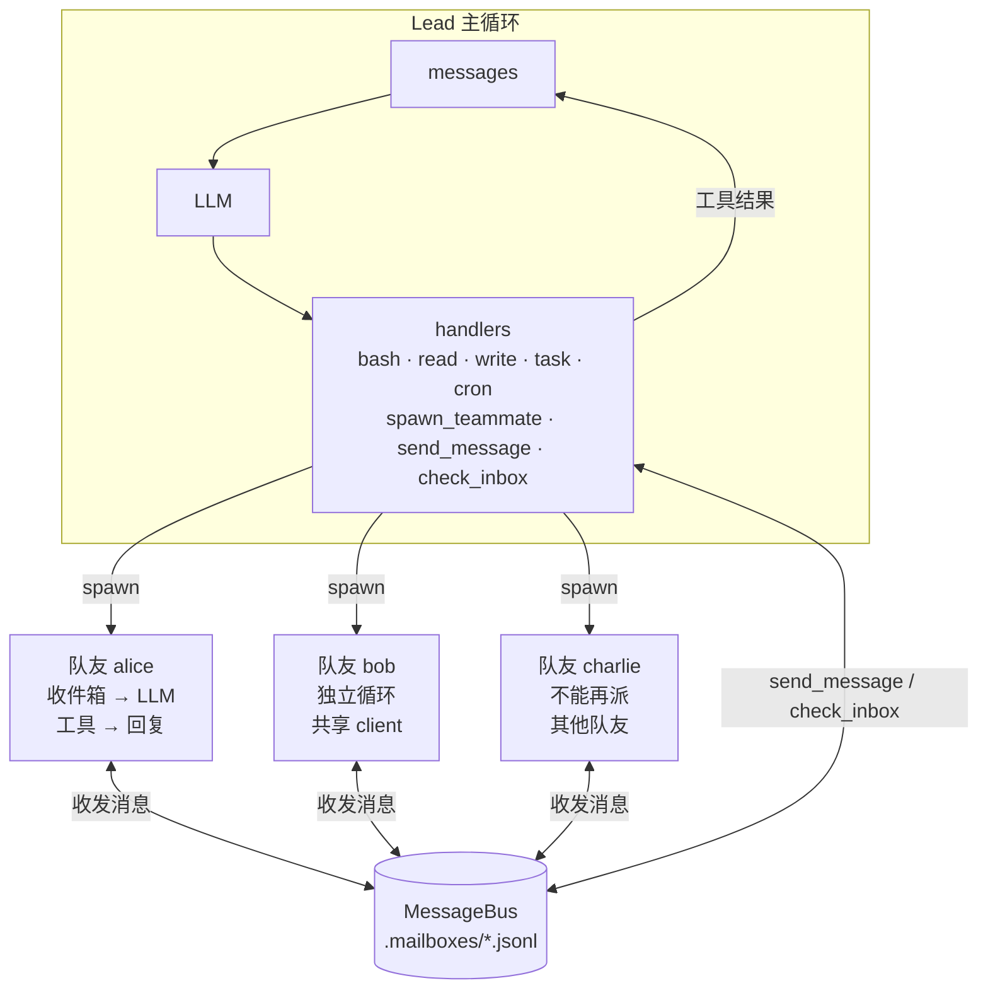
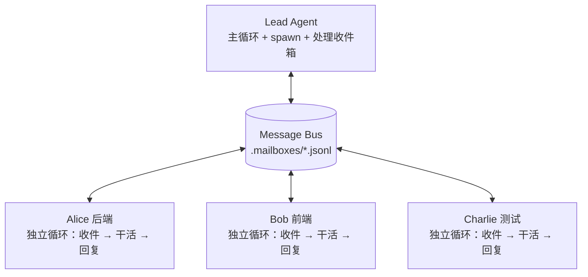

# s15：Agent Teams —— 有身份的队友和文件邮箱

当任务变大，一个 agent 不够用了。`s15` 开始搭一个小团队：每个队友有名字、角色、独立上下文和文件收件箱；lead 不必等待队友执行完，结果会通过邮箱稍后返回。

## 本章目标

`s06` 的 `task` 是一次性子代理：给它一个任务，它做完后只返回摘要。`s15` 的 teammate 有名字和角色，可以运行多轮，并通过邮箱向 lead 汇报。

这里要区分两个生命周期：`.mailboxes/*.jsonl` 会保留到被读取；teammate 本身仍是最多运行十轮的后台任务，给出最终文本后就退出。到 s16 才会加入短暂 idle loop，等待后续消息或关机请求。

这一章只新增团队通信层，前面章节的 todo、skill、memory、task、background task、cron queue processor 都继续保留。

## 新增能力

- `spawn_teammate`：启动一个有名字和角色的队友。
- `send_message`：把消息写入某个 agent 的文件收件箱。
- `check_inbox`：lead 主动查看自己的收件箱。
- `.mailboxes/*.jsonl`：每个 agent 一个收件箱文件，每一行是一条 JSON 消息。
- 队友独立多轮子循环：队友可以调用自己的工具，并把结果发回 lead。

## 流程图



```text
lead agent
   |
   | spawn_teammate(name, role, prompt)
   v
teammate messages[]          .mailboxes/
   |                              ^
   | 独立调用 LLM + tools          |
   v                              |
send_message(to="lead") ----------+
   |
   v
lead 下一轮 readInbox("lead")
   |
   v
[Inbox] From alice: ...
```

## 为什么这一步重要

团队不是“多调用几次 LLM”。真正关键的是通信结构变了：

- 子代理适合短任务，父 agent 只需要最终摘要。
- 队友适合长期协作，lead 需要知道谁说了什么、谁正在负责什么。
- 文件邮箱让通信可检查，调试时可以直接打开 `.mailboxes/lead.jsonl` 看消息。

## 新增函数速览

- `sendMessage(from, to, content, type)`：把一条消息追加写入 `to.jsonl`，例如发给 lead 就写 `.mailboxes/lead.jsonl`。
- `readInbox(agent)`：读取某个 agent 的收件箱，读完就删除文件，表示消息已经被消费。
- `spawnTeammate(name, role, prompt, confirm)`：启动一个后台队友，立即返回；队友稍后把总结写进 lead 的邮箱。
- `runSpawnTeammate`、`runSendMessage`、`runCheckInbox`：把 LLM 的 tool call 参数转成具体函数调用。
- `runInteractiveAgentTurn`：沿用 `s14` 的保护逻辑，避免用户输入回合和 cron 自动回合同一时间抢 `agentLoop`。

## 代码入口

- JS：[s15-agent-teams.js](./s15-agent-teams.js)
- Test：[s15-agent-teams.test.js](./s15-agent-teams.test.js)

## 运行

```bash
node code-agent-course/s15-agent-teams.js
```

## 关键代码

邮箱的格式很简单：每个 agent 一个 `.jsonl` 文件，每一行都是一条 JSON 消息。

```js
export function sendMessage(from, to, content, type = "message") {
  mkdirSync(mailboxDir, { recursive: true });
  appendFileSync(path.join(mailboxDir, `${to}.jsonl`), `${JSON.stringify({ from, to, content, type, ts: Date.now() })}\n`);
  colorLog("yellow", `[bus] ${from} → ${to}: ${preview(content, 50)}`);
}
```

读取收件箱时，文件会被删除。这叫“消费式读取”：读过的消息不再重复进入上下文。

```js
export function readInbox(agent) {
  const file = path.join(mailboxDir, `${agent}.jsonl`);
  if (!existsSync(file)) return [];
  const msgs = readFileSync(file, "utf8").split(/\r?\n/).filter(Boolean).map((l) => JSON.parse(l));
  rmSync(file);
  return msgs;
}
```

队友有自己的 `messages[]`，不是复用 lead 的历史。`spawnTeammate` 不等待队友做完，而是启动一个后台 Promise 后立刻返回；队友完成后再把结果写进 `.mailboxes/lead.jsonl`。

```js
export function spawnTeammate(name, role, prompt, confirm) {
  const system = `You are '${name}', a ${role}. Use tools to complete tasks. Send results via send_message to 'lead'.`;
  const run = async () => {
    // 队友自己的 messages[] 和工具循环。
  };

  Promise.resolve()
    .then(run)
    .catch((error) => sendMessage(name, "lead", `Error: ${error.message}`, "error"))
    .finally(() => {
      activeTeammates.delete(name);
      colorLog("green", `[teammate] ${name} finished`);
    });

  colorLog("cyan", `[teammate] ${name} spawned as ${role}`);
  return `Teammate '${name}' spawned as ${role}`;
}
```

这里的 Promise 链不只是“写成异步”：

- `Promise.resolve().then(run)`：让队友在当前函数返回之后继续跑，lead 可以立刻得到 `spawned` 的结果，不用等 Alice 完成。
- `.catch(...)`：后台队友出错时，把错误写进 lead 的邮箱，而不是让错误悄悄变成无人处理的 Promise rejection。
- `.finally(...)`：无论成功还是失败，都从 `activeTeammates` 里移除这个名字，并打印结束日志，避免下次再启动同名队友时被误判为还在运行。

lead 在每一轮开头读取自己的邮箱，把队友消息变成普通 user message。这样主循环不用为了团队系统重写。如果队友在本轮 lead 回复之后才完成，你会在磁盘上看到 `.mailboxes/lead.jsonl`，下一轮再读取它。

```js
for (const m of readInbox("lead")) {
  messages.push({ role: "user", content: `[Inbox] From ${m.from}: ${m.content.slice(0, 200)}` });
}
```

## 参考实现提醒

Agent Teams 的核心是“可检查的通信”，不是神秘多智能体：

- 文件邮箱比内存消息更容易调试，因为每条消息都能在磁盘上看到。
- lead 和 teammate 都应该有身份，否则日志和责任边界会混在一起。
- 队友也要走权限门，不能因为换了执行者就绕过主系统规则。
- 本章 JS 版用未 `await` 的 Promise 启动队友子循环。JavaScript 仍是单线程，但 LLM 和文件操作等待期间，lead 与 teammate 的异步流程可以交替推进。
- 本章新增日志用颜色区分：`[teammate]` 是队友生命周期，`[bus]` 是邮箱消息流。

一个完整的团队流程大概长这样：

```
1. Lead: "搭建后端：一个人搞不定，组队吧"
2. Lead → spawn_teammate("alice", "backend dev", "创建数据库 schema")
3. Lead → spawn_teammate("bob", "frontend dev", "写 API 客户端")
4. alice 线程启动 → 自己的 LLM 调用 → bash "python manage.py migrate"
5. bob 线程启动 → 自己的 LLM 调用 → write_file("client.ts", ...)
6. alice 完成 → BUS.send("alice", "lead", "Schema done: users, orders tables")
7. bob 完成 → BUS.send("bob", "lead", "Client written with types")
8. Lead 下次循环 → inbox 注入 history → LLM 看到 alice 和 bob 的结果
```


## 测试 Prompt

试试这些 prompt：

```text
Spawn alice as a backend developer. Ask her to create a file called schema.sql with a users table.
Check your inbox for alice's result.
```

观察重点：第一句应该触发 `spawn_teammate`，并看到彩色 `[teammate]` 日志；Alice 完成后会通过 `[bus] alice → lead` 写入 `.mailboxes/lead.jsonl`。第二句应该触发 `check_inbox` 或在下一轮读取 inbox，把 Alice 的结果带回主对话。

如果运行后看到 `.mailboxes/lead.jsonl` 里有 `alice -> lead` 的 JSONL 消息，这是正常结果：说明 Alice 在 lead 回复后才完成，消息还没被下一轮消费。

## 扩展阅读：真实 Coding Agent 怎么做团队

Claude Code 的 Agent Teams 是真正的多 Claude Code 实例协作：一个 session 是 lead，多个 teammate 各自有独立 context window，可以直接互相发消息，也可以通过共享任务列表协调工作。官方文档也强调它更适合并行研究、代码审查、跨层任务，不适合强顺序依赖或同文件频繁冲突的任务。参考：[Claude Code Agent Teams](https://code.claude.com/docs/en/agent-teams)。

Codex 当前公开文档更强调 subagents：它可以按你的明确要求并行 spawn 专门 agent，等待结果后汇总成一个回复。子代理会继承当前 sandbox 和 approval 策略，也可以定义 custom agents。Codex Web 还可以把任务放到云端后台并行运行，这更像“远程委派任务”，而不是本章这种本地文件邮箱团队。参考：[Codex Subagents](https://developers.openai.com/codex/subagents) 和 [Codex Web](https://developers.openai.com/codex/cloud)。

opencode 把 agent 分成 primary agent 和 subagent：primary agent 可以切换，subagent 可以由主 agent 自动调用，也可以用 `@` 手动点名。它内置了 Build、Plan、General、Explore、Scout 等角色，并支持给 agent 配模型、prompt 和权限。它更像“可配置角色 + 子会话导航”，不是 Claude Code 那种完整 teammate team。参考：[opencode Agents](https://opencode.ai/docs/agents/)。

## 一句话总结

`s15` 把单 agent 扩展成有名字、有角色、独立上下文和文件邮箱的队友，同时保留前面的后台任务与定时调度能力。

## 与 s14 的关键代码 diff（不含 helper.js）

下面只展示邮箱、队友子循环、团队工具和主 loop 接入点；完整的 `teamTools` schema 请看源码。

```diff
--- s14-cron-scheduler.js
+++ s15-agent-teams.js
+  appendFileSync,
+  colorLog,

+let mailboxDir = path.join(process.cwd(), ".mailboxes");
+export function setMailboxDir(dir) {
+  mailboxDir = dir;
+}
+
+export function sendMessage(from, to, content, type = "message") {
+  mkdirSync(mailboxDir, { recursive: true });
+  appendFileSync(path.join(mailboxDir, `${to}.jsonl`), `${JSON.stringify({ from, to, content, type, ts: Date.now() })}\n`);
+  colorLog("yellow", `[bus] ${from} → ${to}: ${preview(content, 50)}`);
+}
+
+export function readInbox(agent) {
+  const file = path.join(mailboxDir, `${agent}.jsonl`);
+  if (!existsSync(file)) return [];
+  const msgs = readFileSync(file, "utf8").split(/\r?\n/).filter(Boolean).map((l) => JSON.parse(l));
+  rmSync(file); // 消费式：读完删除
+  return msgs;
+}

+const activeTeammates = new Set();
+export function resetTeammates() {
+  activeTeammates.clear();
+}
+const TEAMMATE_TURNS = 10; // 教学版限轮数；真实 CC 用 idle loop 直到收到 shutdown
+
+export function spawnTeammate(name, role, prompt, confirm) {
+  if (activeTeammates.has(name)) return `Teammate '${name}' already exists`;
+  activeTeammates.add(name);
+  const system = `You are '${name}', a ${role}. Use tools to complete tasks. Send results via send_message to 'lead'.`;
+  const run = async () => {
+    const messages = [{ role: "user", content: prompt }];
+    let summary = "Done.";
+    for (let turn = 0; turn < TEAMMATE_TURNS; turn += 1) {
+      const inbox = readInbox(name); // 队友也有收件箱（Lead 可发指令）
+      if (inbox.length) messages.push({ role: "user", content: `<inbox>${JSON.stringify(inbox)}</inbox>` });
+      const { message } = await callLlm(messages.slice(-20), { system, tools: teamTools });
+      messages.push(message);
+      if (!message.tool_calls?.length) {
+        summary = message.content || summary;
+        break;
+      }
+      for (const call of message.tool_calls) {
+        const toolName = call.function.name;
+        const args = JSON.parse(call.function.arguments || "{}");
+        const blocked = await triggerHooks("PreToolUse", toolName, args, confirm); // 队友工具也走权限门
+        const handler = teamHandlers[toolName];
+        const output =
+          blocked != null ? String(blocked) : handler ? handler(args) : `Unknown tool: ${toolName}`;
+        messages.push({ role: "tool", tool_call_id: call.id, content: String(output) });
+      }
+    }
+    sendMessage(name, "lead", summary, "result"); // 完成后向 Lead 汇报
+  };
+
+  Promise.resolve()
+    .then(run)
+    .catch((error) => sendMessage(name, "lead", `Error: ${error.message}`, "error"))
+    .finally(() => {
+      activeTeammates.delete(name);
+      colorLog("green", `[teammate] ${name} finished`);
+    });
+
+  colorLog("cyan", `[teammate] ${name} spawned as ${role}`);
+  return `Teammate '${name}' spawned as ${role}`;
+}

+function runSpawnTeammate({ name, role, prompt }, confirm) {
+  return spawnTeammate(name, role, prompt, confirm);
+}
+function runSendMessage({ to, content }) {
+  sendMessage("lead", to, content);
+  return `Sent to ${to}`;
+}
+function runCheckInbox() {
+  const msgs = readInbox("lead");
+  if (!msgs.length) return "(inbox empty)";
+  return msgs.map((m) => `[${m.from}] ${m.content.slice(0, 200)}`).join("\n");
+}

+  tool("spawn_teammate", "Spawn a teammate agent (its own multi-round loop) to help with a task.", {
+    type: "object",
+    properties: { name: { type: "string" }, role: { type: "string" }, prompt: { type: "string" } },
+    required: ["name", "role", "prompt"],
+  }),
+  tool("send_message", "Send a message to a teammate via the message bus.", {
+    type: "object",
+    properties: { to: { type: "string" }, content: { type: "string" } },
+    required: ["to", "content"],
+  }),
+  tool("check_inbox", "Check the lead's inbox for teammate messages.", { type: "object", properties: {} }),

+  spawn_teammate: runSpawnTeammate,
+  send_message: runSendMessage,
+  check_inbox: runCheckInbox,

-const SUB_EXCLUDE = ["task", "todo_write", "load_skill", "compact"];
+const SUB_EXCLUDE = ["task", "todo_write", "load_skill", "compact", "spawn_teammate", "send_message", "check_inbox"];

+    // s15：把队友发到 Lead 收件箱的消息注入历史（轮询式收件箱）。
+    for (const m of readInbox("lead")) {
+      messages.push({ role: "user", content: `[Inbox] From ${m.from}: ${m.content.slice(0, 200)}` });
+    }

-    promptLabel: "s14 >> ",
+    promptLabel: "s15 >> ",
```

## 博客代码演进

下面 9 个 patch 专门用于博客右侧的代码切换。第一步基于 `s14-cron-scheduler.js`，后面的每一步都继续修改上一帧，最后必须得到完整的 `s15-agent-teams.js`。

每一步的代码都可以运行。前三步先把“互相发消息”做出来；第 4 到 7 步写出队友：它是谁、能用什么工具、怎么循环、怎么启动；第 8 步让主 agent（下面叫 Lead）每一轮都看一眼自己的收件箱。日志放在最后一步统一补上。

### 1. 发消息：往对方的文件里追加一行

s06 的子代理做完就消失，只留下一段总结。本章的队友不一样：它会持续工作，并且能和 Lead 来回通信。通信方式很朴素：每个 agent 在 `.mailboxes/` 目录下有一个自己的文件，就是它的收件箱。`sendMessage` 把一条消息（谁发的、发给谁、内容、类型、时间）转成一行 JSON，追加到对方的文件末尾。所以开头多引入了 `appendFileSync`。`setMailboxDir` 让测试可以换目录。

```diff agent-step
@@
   mkdirSync,
   writeFileSync,
+  appendFileSync,
   rmSync,
 } from "node:fs";
@@
 function runCancelCron({ job_id }) {
   return cancelJob(job_id);
+}
+
+let mailboxDir = path.join(process.cwd(), ".mailboxes");
+export function setMailboxDir(dir) {
+  mailboxDir = dir;
+}
+export function sendMessage(from, to, content, type = "message") {
+  mkdirSync(mailboxDir, { recursive: true });
+  appendFileSync(path.join(mailboxDir, `${to}.jsonl`), `${JSON.stringify({ from, to, content, type, ts: Date.now() })}\n`);
 }
```

### 2. 收消息：读完就清空

`readInbox` 读出某个 agent 收件箱里的所有消息：按行拆开，每行解析成一个对象。读完立刻把文件删掉，这样同一条消息不会被读到两次。收件箱不存在就返回空数组，表示没有新消息。发和收都只是普通的文件操作，不需要网络，也不需要两边同时在线。

```diff agent-step
@@
   appendFileSync(path.join(mailboxDir, `${to}.jsonl`), `${JSON.stringify({ from, to, content, type, ts: Date.now() })}\n`);
 }
+export function readInbox(agent) {
+  const file = path.join(mailboxDir, `${agent}.jsonl`);
+  if (!existsSync(file)) return [];
+  const msgs = readFileSync(file, "utf8").split(/\r?\n/).filter(Boolean).map((l) => JSON.parse(l));
+  rmSync(file);
+  return msgs;
+}
 
 const TRANSCRIPT_DIR = path.join(process.cwd(), ".transcripts");
```

### 3. 给 Lead 两个通信工具

把收发做成工具交给 Lead。`send_message` 以 `lead` 的名义给某个队友发消息；`check_inbox` 读出 Lead 自己的收件箱，整理成“[谁] 说了什么”的列表。照例加 schema、在 `handlers` 里登记。s06 的子代理不应该使用团队工具，所以把它们加进子代理的排除名单，其中 `spawn_teammate` 是稍后要加的工具，这里先一并写上。

```diff agent-step
@@
 }
 
+function runSendMessage({ to, content }) {
+  sendMessage("lead", to, content);
+  return `Sent to ${to}`;
+}
+function runCheckInbox() {
+  const msgs = readInbox("lead");
+  if (!msgs.length) return "(inbox empty)";
+  return msgs.map((m) => `[${m.from}] ${m.content.slice(0, 200)}`).join("\n");
+}
+
 const TRANSCRIPT_DIR = path.join(process.cwd(), ".transcripts");
 const TOOL_RESULTS_DIR = path.join(process.cwd(), ".task_outputs", "tool-results");
@@
     required: ["job_id"],
   }),
+  tool("send_message", "Send a message to a teammate via the message bus.", {
+    type: "object",
+    properties: { to: { type: "string" }, content: { type: "string" } },
+    required: ["to", "content"],
+  }),
+  tool("check_inbox", "Check the lead's inbox for teammate messages.", { type: "object", properties: {} }),
 ];
@@
   list_crons: runListCrons,
   cancel_cron: runCancelCron,
+  send_message: runSendMessage,
+  check_inbox: runCheckInbox,
 };
 
-const SUB_EXCLUDE = ["task", "todo_write", "load_skill", "compact"];
+const SUB_EXCLUDE = ["task", "todo_write", "load_skill", "compact", "spawn_teammate", "send_message", "check_inbox"];
 const subTools = tools.filter((t) => !SUB_EXCLUDE.includes(t.function.name));
 const subHandlers = Object.fromEntries(
```

### 4. 队友是谁：名字、角色、提示词

开始写 `spawnTeammate`。`activeTeammates` 记录当前有哪些队友在工作，同名的队友不能启动两次。每个队友有自己的系统提示词：你叫什么、是什么角色、用工具完成任务、结果用 `send_message` 发给 `lead`。`TEAMMATE_TURNS` 限制一个队友最多跑 10 轮。这一步函数只做了登记，然后返回一句话，队友还不会真的工作。

```diff agent-step
@@
 }
 
+const activeTeammates = new Set();
+export function resetTeammates() {
+  activeTeammates.clear();
+}
+const TEAMMATE_TURNS = 10;
+
+export function spawnTeammate(name, role, prompt, confirm) {
+  if (activeTeammates.has(name)) return `Teammate '${name}' already exists`;
+  activeTeammates.add(name);
+  const system = `You are '${name}', a ${role}. Use tools to complete tasks. Send results via send_message to 'lead'.`;
+  return `Teammate '${name}' spawned as ${role}`;
+}
+
 function runSendMessage({ to, content }) {
   sendMessage("lead", to, content);
```

### 5. 队友能用的工具

队友有自己的一套工具，只有四个：`bash`、`read_file`、`write_file`，加上 `send_message`。注意它的 `send_message` 和 Lead 的不是同一个实现：发件人固定是队友自己的名字。这里没有 `spawn_teammate`，所以队友不能再启动队友，团队只有一层。

```diff agent-step
@@
   activeTeammates.add(name);
   const system = `You are '${name}', a ${role}. Use tools to complete tasks. Send results via send_message to 'lead'.`;
+  const teamTools = [
+    tool("bash", "Run a shell command.", {
+      type: "object",
+      properties: { command: { type: "string" } },
+      required: ["command"],
+    }),
+    tool("read_file", "Read a file.", {
+      type: "object",
+      properties: { path: { type: "string" } },
+      required: ["path"],
+    }),
+    tool("write_file", "Write content to a file.", {
+      type: "object",
+      properties: { path: { type: "string" }, content: { type: "string" } },
+      required: ["path", "content"],
+    }),
+    tool("send_message", "Send a message to another agent (e.g. 'lead').", {
+      type: "object",
+      properties: { to: { type: "string" }, content: { type: "string" } },
+      required: ["to", "content"],
+    }),
+  ];
+  const teamHandlers = {
+    bash: ({ command }) => runBash(command),
+    read_file: ({ path }) => readFile(path),
+    write_file: ({ path, content }) => writeFile(path, content),
+    send_message: ({ to, content }) => {
+      sendMessage(name, to, content);
+      return `Sent to ${to}`;
+    },
+  };
   return `Teammate '${name}' spawned as ${role}`;
 }
```

### 6. 队友自己的循环，放到后台跑

`run` 是队友的循环，结构你已经很熟悉。有三点不同。第一，每一轮开头先读自己的收件箱，Lead 中途发来的指示会被放进对话。第二，执行工具前同样触发 `PreToolUse`，队友也受权限约束。第三，循环结束后，把最后的回答用 `sendMessage` 发给 `lead`，类型是 `result`。启动方式和 s13 的后台任务一样：`Promise.resolve().then(run)`，不写 `await`，所以 `spawnTeammate` 会马上返回，队友在后台继续。出错时把错误发给 Lead，结束时从 `activeTeammates` 里移除。

```diff agent-step
@@
     },
   };
+  const run = async () => {
+    const messages = [{ role: "user", content: prompt }];
+    let summary = "Done.";
+    for (let turn = 0; turn < TEAMMATE_TURNS; turn += 1) {
+      const inbox = readInbox(name);
+      if (inbox.length) messages.push({ role: "user", content: `<inbox>${JSON.stringify(inbox)}</inbox>` });
+      const { message } = await callLlm(messages.slice(-20), { system, tools: teamTools });
+      messages.push(message);
+      if (!message.tool_calls?.length) {
+        summary = message.content || summary;
+        break;
+      }
+      for (const call of message.tool_calls) {
+        const toolName = call.function.name;
+        const args = JSON.parse(call.function.arguments || "{}");
+        const blocked = await triggerHooks("PreToolUse", toolName, args, confirm);
+        const handler = teamHandlers[toolName];
+        const output =
+          blocked != null ? String(blocked) : handler ? handler(args) : `Unknown tool: ${toolName}`;
+        messages.push({ role: "tool", tool_call_id: call.id, content: String(output) });
+      }
+    }
+    sendMessage(name, "lead", summary, "result");
+  };
+
+  Promise.resolve()
+    .then(run)
+    .catch((error) => sendMessage(name, "lead", `Error: ${error.message}`, "error"))
+    .finally(() => {
+      activeTeammates.delete(name);
+    });
+
   return `Teammate '${name}' spawned as ${role}`;
 }
```

### 7. spawn_teammate 工具：让 Lead 能组队

最后把启动队友做成工具。Lead 调用 `spawn_teammate`，给出名字、角色和任务说明，队友就开始在后台工作，Lead 立刻拿到一句“已启动”，可以继续做自己的事或者再启动别的队友。

```diff agent-step
@@
 }
 
+function runSpawnTeammate({ name, role, prompt }, confirm) {
+  return spawnTeammate(name, role, prompt, confirm);
+}
 function runSendMessage({ to, content }) {
   sendMessage("lead", to, content);
@@
     required: ["job_id"],
   }),
+  tool("spawn_teammate", "Spawn a teammate agent (its own multi-round loop) to help with a task.", {
+    type: "object",
+    properties: { name: { type: "string" }, role: { type: "string" }, prompt: { type: "string" } },
+    required: ["name", "role", "prompt"],
+  }),
   tool("send_message", "Send a message to a teammate via the message bus.", {
     type: "object",
@@
   list_crons: runListCrons,
   cancel_cron: runCancelCron,
+  spawn_teammate: runSpawnTeammate,
   send_message: runSendMessage,
   check_inbox: runCheckInbox,
```

### 8. Lead 每一轮开头看一眼收件箱

队友做完会把结果发到 Lead 的收件箱，但 Lead 不一定记得去调用 `check_inbox`。所以在 loop 每一轮开头自动读一次：有消息就加上 `[Inbox] From 谁` 的前缀，作为 user 消息放进 `messages`。这和 s13 的后台通知、s14 的定时任务是同一种做法：外面发生的事，都变成一条消息进入对话。提示符改成 `s15 >> `。

```diff agent-step
@@
 
     injectCronJobs(messages);
+    for (const m of readInbox("lead")) {
+      messages.push({ role: "user", content: `[Inbox] From ${m.from}: ${m.content.slice(0, 200)}` });
+    }
     if (roundsSinceTodo >= 3) {
       messages.push({ role: "user", content: "<reminder>Update your todos.</reminder>" });
@@
   ticker.unref?.();
   await runChatCli({
-    promptLabel: "s14 >> ",
+    promptLabel: "s15 >> ",
     onPrompt: async ({ prompt, messages, ask }) => {
       return runInteractiveAgentTurn(messages, ask);
```

### 9. 补上彩色日志

多个 agent 同时工作，日志混在一起很难分辨，所以这一章从 `helper.js` 引入 `colorLog`，用颜色区分：黄色的 `[bus]` 表示有一条消息从谁发给了谁，青色表示队友启动，绿色表示队友结束。运行时看这三种颜色的先后顺序，就能看出团队是怎么配合的。

```diff agent-step
@@
   cronMatches,
   validateCron,
+  colorLog,
   prepareHistoryForSummary,
 } from "./helper.js";
@@
   mkdirSync(mailboxDir, { recursive: true });
   appendFileSync(path.join(mailboxDir, `${to}.jsonl`), `${JSON.stringify({ from, to, content, type, ts: Date.now() })}\n`);
+  colorLog("yellow", `[bus] ${from} → ${to}: ${preview(content, 50)}`);
 }
 export function readInbox(agent) {
@@
     .finally(() => {
       activeTeammates.delete(name);
+      colorLog("green", `[teammate] ${name} finished`);
     });
 
+  colorLog("cyan", `[teammate] ${name} spawned as ${role}`);
   return `Teammate '${name}' spawned as ${role}`;
 }
```
