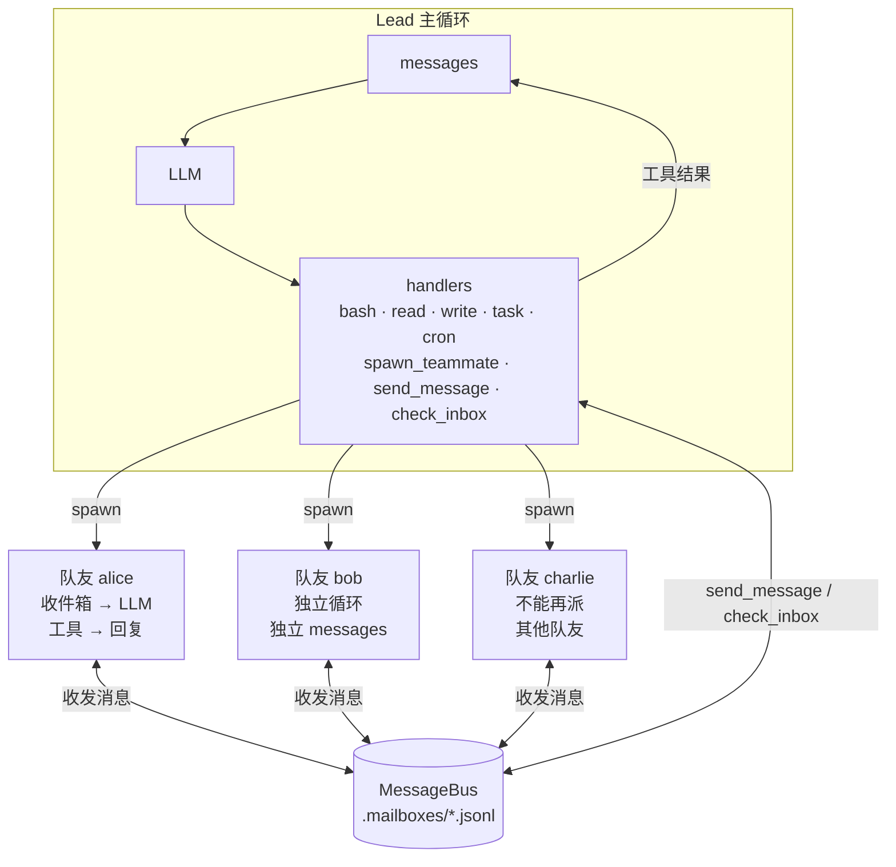
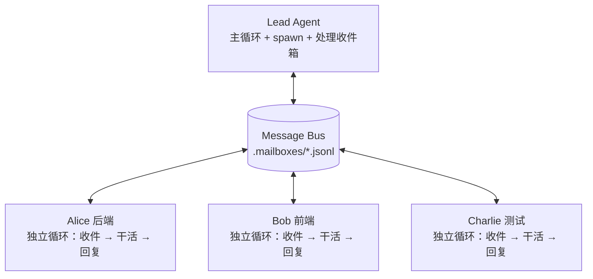

# s15：Agent Teams - 给队友起名字、建邮箱，把单兵变成团队

上一章 `s14` 让单个 Agent 具备了按时自启动的能力，但面对前后端联调、同时改代码和补测试这类大任务，单兵串行推进还是慢。回头看 `s06` 的 `task` 子代理，它像一次性的临时工，干完只交回一段摘要就解散，没法长期沟通。

这一章我们给 Agent 搭起团队协作层。**多 Agent 协作的关键不是“多调几次模型”，而是给每个队友独立身份、独立上下文和可检查的文件收件箱，让 Lead 派活后继续干自己的事，结果通过 `.mailboxes/*.jsonl` 异步回流。**

## 问题

一次性子代理有两个局限：主 Agent 必须同步干等它结束，而且中途无法追加指令，也分不清多个协作者各自负责什么。当多个角色需要并行干活、互相通信时，必须有一套带身份的异步消息总线。

## 解决方案

我们用 `.mailboxes/<agent>.jsonl` 实现文件邮箱，向 Lead 暴露 `spawn_teammate`、`send_message`、`check_inbox` 三个工具，让每个队友在后台跑自己的独立多轮循环：



按角色拆工后，整个团队围绕同一个文件消息总线协作：



这里有三个关键工程设计：

- **消费式 JSONL 文件邮箱**：`sendMessage()` 往 `.mailboxes/<to>.jsonl` 追加一行 JSON，`readInbox()` 读完立刻删除文件防止重复消费。未读消息落在磁盘上，排错时打开尚未消费的 `.mailboxes/lead.jsonl` 就能看清待处理内容。
- **异步派发 + 异常兜底**：`spawnTeammate()` 用未 `await` 的 `Promise.resolve().then(run)` 启动后台循环，最多跑 `TEAMMATE_TURNS`（10）轮；`.catch()` 把异常回写到 Lead 邮箱，`.finally()` 清理 `activeTeammates` 防止同名队友被永久锁死。
- **权限与生命周期边界**：队友只有 `bash`、`read_file`、`write_file`、`send_message` 四个工具（不能再派队友，避免无限裂变），执行前照样过 `PreToolUse` 权限门；普通子代理也在 `SUB_EXCLUDE` 里禁用了团队工具。本章队友交出最终回复即退出，下一章 `s16` 再补短暂空闲等待与协议握手。

## 测试 Prompt

依次输入下面两句：

```text
Spawn alice as a backend developer. Ask her to create a file called schema.sql with a users table.
Check your inbox for alice's result.
```

运行后可以看到彩色日志：青色 `[teammate]` 表示启动 Alice，黄色 `[bus] alice → lead` 表示她把结果写入 `.mailboxes/lead.jsonl`，绿色 `[teammate]` 表示她结束工作。第二句会触发 `check_inbox` 或由下一轮开头自动注入 `[Inbox] From alice:`。若某轮结束后磁盘上仍留着 `.mailboxes/lead.jsonl`，说明里面还有尚未被 Lead 消费的新消息，等下一次 `check_inbox` 或下一轮开头就会读出并清理。

## 扩展阅读：商业级 Agent 怎么做团队协作

不同产品对“多 Agent 协作”的定位各有侧重，重点在于隔离边界和协作成本的权衡：

- **Claude Code**：Agent Teams 支持真正的多实例协作，一个 Lead 协调多个带独立上下文窗口的 teammate，可互相发消息并共享任务列表；官方也明确建议用于并行调研、代码审查和跨层任务，避免多人频繁改同一文件。参考 [Claude Code Agent Teams](https://code.claude.com/docs/en/agent-teams)。
- **Codex**：公开能力侧重 subagents 与云端并行任务，主会话按需并行拉起继承当前 sandbox / approval 策略的子代理并汇总结果，更偏“受控委派”。参考 [Codex Subagents](https://developers.openai.com/codex/subagents) 与 [Codex Web](https://developers.openai.com/codex/cloud)。
- **opencode**：区分 primary agent 与 subagent（内置 Build、Plan、General、Explore 等角色），支持按角色配置独立模型、提示词和权限，也可用 `@` 手动点名。参考 [opencode Agents](https://opencode.ai/docs/agents/)。

**多 Agent 的核心不是堆数量，而是用可追踪的通信和清晰的权限边界把并行工作管起来。**

## 本地运行与测试

交互运行（从仓库根目录执行）：

```bash
cd code-agent-course && node s15-agent-teams.js
```

离线单测（在仓库根目录执行，无需 API Token）：

```bash
pnpm vitest run code-agent-course/s15-agent-teams.test.js
```

## 博客代码演进

### 1. 发消息：往对方邮箱文件追加一行 JSON

`s06` 的子代理做完就散，只留一段摘要。本章的队友需要和 Lead 异步互通，通信手段非常朴素：每个 Agent 在 `.mailboxes/` 下拥有一个 `.jsonl` 文件。我们引入 `appendFileSync`，让 `sendMessage` 把发件人、收件人、内容、类型和时间戳序列化为一行追加写入对方文件；同时提供 `setMailboxDir` 方便测试隔离目录。

```diff agent-step
@@
   mkdirSync,
   writeFileSync,
+  appendFileSync,
   rmSync,
 } from "node:fs";
@@
 function runCancelCron({ job_id }) {
   return cancelJob(job_id);
+}
+
+let mailboxDir = path.join(process.cwd(), ".mailboxes");
+export function setMailboxDir(dir) {
+  mailboxDir = dir;
+}
+export function sendMessage(from, to, content, type = "message") {
+  mkdirSync(mailboxDir, { recursive: true });
+  appendFileSync(path.join(mailboxDir, `${to}.jsonl`), `${JSON.stringify({ from, to, content, type, ts: Date.now() })}\n`);
 }
```

### 2. 收消息：消费式读取，读完即删

`readInbox` 按行解析 `<agent>.jsonl` 里的所有消息，读完立刻删除文件，保证每条消息只进入上下文一次。文件不存在说明暂无新信，直接返回空数组。收发双方不必同时在线，全靠磁盘文件异步解耦。

```diff agent-step
@@
   appendFileSync(path.join(mailboxDir, `${to}.jsonl`), `${JSON.stringify({ from, to, content, type, ts: Date.now() })}\n`);
 }
+export function readInbox(agent) {
+  const file = path.join(mailboxDir, `${agent}.jsonl`);
+  if (!existsSync(file)) return [];
+  const msgs = readFileSync(file, "utf8").split(/\r?\n/).filter(Boolean).map((l) => JSON.parse(l));
+  rmSync(file);
+  return msgs;
+}
 
 const TRANSCRIPT_DIR = path.join(process.cwd(), ".transcripts");
```

### 3. 给 Lead 接上 `send_message` 和 `check_inbox`

把收发封装成两个工具交给 Lead：`send_message` 固定以 `"lead"` 名义给指定队友写信，`check_inbox` 读取 Lead 收件箱并整理成 `[发件人] 内容` 列表。同时把 `spawn_teammate`、`send_message`、`check_inbox` 一并放进 `SUB_EXCLUDE`，防止 `s06` 的一次性子代理越权操作团队。

```diff agent-step
@@
 }
 
+function runSendMessage({ to, content }) {
+  sendMessage("lead", to, content);
+  return `Sent to ${to}`;
+}
+function runCheckInbox() {
+  const msgs = readInbox("lead");
+  if (!msgs.length) return "(inbox empty)";
+  return msgs.map((m) => `[${m.from}] ${m.content.slice(0, 200)}`).join("\n");
+}
+
 const TRANSCRIPT_DIR = path.join(process.cwd(), ".transcripts");
 const TOOL_RESULTS_DIR = path.join(process.cwd(), ".task_outputs", "tool-results");
@@
     required: ["job_id"],
   }),
+  tool("send_message", "Send a message to a teammate via the message bus.", {
+    type: "object",
+    properties: { to: { type: "string" }, content: { type: "string" } },
+    required: ["to", "content"],
+  }),
+  tool("check_inbox", "Check the lead's inbox for teammate messages.", { type: "object", properties: {} }),
 ];
@@
   list_crons: runListCrons,
   cancel_cron: runCancelCron,
+  send_message: runSendMessage,
+  check_inbox: runCheckInbox,
 };
 
-const SUB_EXCLUDE = ["task", "todo_write", "load_skill", "compact"];
+const SUB_EXCLUDE = ["task", "todo_write", "load_skill", "compact", "spawn_teammate", "send_message", "check_inbox"];
 const subTools = tools.filter((t) => !SUB_EXCLUDE.includes(t.function.name));
 const subHandlers = Object.fromEntries(
```

### 4. 给队友定身份：名字、角色与系统提示词

开始搭建 `spawnTeammate`。`activeTeammates` 集合用来防重名并发启动，每个队友都有专属 `system` 提示词（告知名字、角色和“完工后向 `lead` 发消息”），并设 `TEAMMATE_TURNS = 10` 控制最大轮数。这一步先立好骨架，下一帧给它配工具。

```diff agent-step
@@
 }
 
+const activeTeammates = new Set();
+export function resetTeammates() {
+  activeTeammates.clear();
+}
+const TEAMMATE_TURNS = 10;
+
+export function spawnTeammate(name, role, prompt, confirm) {
+  if (activeTeammates.has(name)) return `Teammate '${name}' already exists`;
+  activeTeammates.add(name);
+  const system = `You are '${name}', a ${role}. Use tools to complete tasks. Send results via send_message to 'lead'.`;
+  return `Teammate '${name}' spawned as ${role}`;
+}
+
 function runSendMessage({ to, content }) {
   sendMessage("lead", to, content);
```

### 5. 为队友配置最小工具集

队友拿到精简后的四个工具：`bash`、`read_file`、`write_file` 和 `send_message`。注意这里的 `send_message` 闭包绑定了队友自己的 `name` 作为发件人，而且故意不提供 `spawn_teammate`，把团队结构收束在“一层 Lead + 多个队友”，避免无限嵌套拉人。

```diff agent-step
@@
   activeTeammates.add(name);
   const system = `You are '${name}', a ${role}. Use tools to complete tasks. Send results via send_message to 'lead'.`;
+  const teamTools = [
+    tool("bash", "Run a shell command.", {
+      type: "object",
+      properties: { command: { type: "string" } },
+      required: ["command"],
+    }),
+    tool("read_file", "Read a file.", {
+      type: "object",
+      properties: { path: { type: "string" } },
+      required: ["path"],
+    }),
+    tool("write_file", "Write content to a file.", {
+      type: "object",
+      properties: { path: { type: "string" }, content: { type: "string" } },
+      required: ["path", "content"],
+    }),
+    tool("send_message", "Send a message to another agent (e.g. 'lead').", {
+      type: "object",
+      properties: { to: { type: "string" }, content: { type: "string" } },
+      required: ["to", "content"],
+    }),
+  ];
+  const teamHandlers = {
+    bash: ({ command }) => runBash(command),
+    read_file: ({ path }) => readFile(path),
+    write_file: ({ path, content }) => writeFile(path, content),
+    send_message: ({ to, content }) => {
+      sendMessage(name, to, content);
+      return `Sent to ${to}`;
+    },
+  };
   return `Teammate '${name}' spawned as ${role}`;
 }
```

### 6. 把队友的独立循环丢到后台跑

`run` 就是队友自己的多轮循环，核心结构与主循环一致，有三处关键细节：每轮开头先读自己收件箱接收 Lead 新指示；执行工具前照样走 `PreToolUse` 权限门；结束时用 `sendMessage` 把摘要作为 `result` 发回 `lead`。外层用不带 `await` 的 `Promise.resolve().then(run)` 派发，`.catch` 兜底上报错误，`.finally` 释放活跃名额。

```diff agent-step
@@
     },
   };
+  const run = async () => {
+    const messages = [{ role: "user", content: prompt }];
+    let summary = "Done.";
+    for (let turn = 0; turn < TEAMMATE_TURNS; turn += 1) {
+      const inbox = readInbox(name);
+      if (inbox.length) messages.push({ role: "user", content: `<inbox>${JSON.stringify(inbox)}</inbox>` });
+      const { message } = await callLlm(messages.slice(-20), { system, tools: teamTools });
+      messages.push(message);
+      if (!message.tool_calls?.length) {
+        summary = message.content || summary;
+        break;
+      }
+      for (const call of message.tool_calls) {
+        const toolName = call.function.name;
+        const args = JSON.parse(call.function.arguments || "{}");
+        const blocked = await triggerHooks("PreToolUse", toolName, args, confirm);
+        const handler = teamHandlers[toolName];
+        const output =
+          blocked != null ? String(blocked) : handler ? handler(args) : `Unknown tool: ${toolName}`;
+        messages.push({ role: "tool", tool_call_id: call.id, content: String(output) });
+      }
+    }
+    sendMessage(name, "lead", summary, "result");
+  };
+
+  Promise.resolve()
+    .then(run)
+    .catch((error) => sendMessage(name, "lead", `Error: ${error.message}`, "error"))
+    .finally(() => {
+      activeTeammates.delete(name);
+    });
+
   return `Teammate '${name}' spawned as ${role}`;
 }
```

### 7. spawn_teammate 工具：让 Lead 按需组队

把 `spawnTeammate` 包装成 `spawn_teammate` 工具接入 Lead 的 `tools` 和 `handlers`。只要模型给出 `name`、`role` 和 `prompt`，队友就会在后台启动，Lead 立刻收到“已启动”回执，可以继续派发其他队友或处理自己的工作。

```diff agent-step
@@
 }
 
+function runSpawnTeammate({ name, role, prompt }, confirm) {
+  return spawnTeammate(name, role, prompt, confirm);
+}
 function runSendMessage({ to, content }) {
   sendMessage("lead", to, content);
@@
     required: ["job_id"],
   }),
+  tool("spawn_teammate", "Spawn a teammate agent (its own multi-round loop) to help with a task.", {
+    type: "object",
+    properties: { name: { type: "string" }, role: { type: "string" }, prompt: { type: "string" } },
+    required: ["name", "role", "prompt"],
+  }),
   tool("send_message", "Send a message to a teammate via the message bus.", {
     type: "object",
@@
   list_crons: runListCrons,
   cancel_cron: runCancelCron,
+  spawn_teammate: runSpawnTeammate,
   send_message: runSendMessage,
   check_inbox: runCheckInbox,
```

### 8. Lead 每轮开头自动巡检收件箱

模型未必每次都记得主动调 `check_inbox`。我们在 `agentLoop` 每轮开头顺手读一次 `readInbox("lead")`，把收到的消息拼上 `[Inbox] From <发件人>:` 注入 `messages`。沿用 `s13` 后台通知、`s14` 定时任务的同一套路：外部事件一律转成 `user` 消息喂给主循环。最后把 CLI 提示符更新为 `s15 >> `。

```diff agent-step
@@
 
     injectCronJobs(messages);
+    for (const m of readInbox("lead")) {
+      messages.push({ role: "user", content: `[Inbox] From ${m.from}: ${m.content.slice(0, 200)}` });
+    }
     if (roundsSinceTodo >= 3) {
       messages.push({ role: "user", content: "<reminder>Update your todos.</reminder>" });
@@
   ticker.unref?.();
   await runChatCli({
-    promptLabel: "s14 >> ",
+    promptLabel: "s15 >> ",
     onPrompt: async ({ prompt, messages, ask }) => {
       return runInteractiveAgentTurn(messages, ask);
```

### 9. 补上彩色协作日志

多个 Agent 并发跑起来后，纯白文字混在一起很难分清谁在干什么。最后引入 `helper.js` 的 `colorLog`，用三种颜色标出关键事件：黄色 `[bus]` 表示邮箱投递，青色 `[teammate]` 表示队友启动，绿色 `[teammate]` 表示队友收尾。看着颜色交替，就能一眼理清团队协作的时序。

> **本章思考题**：现在队友能通过文件邮箱自由收发文字了，但只要团队一忙起来，同时出现多份待审批计划，或者 Lead 想请某个正干活的队友优雅停机，光靠自由聊天根本对不上“哪条回复对应哪次请求”。怎么在文件邮箱之上叠一层带 `request_id` 的请求-响应协议？下一章 `s16` 我们来做 Team Protocols。

```diff agent-step
@@
   cronMatches,
   validateCron,
+  colorLog,
   prepareHistoryForSummary,
 } from "./helper.js";
@@
   mkdirSync(mailboxDir, { recursive: true });
   appendFileSync(path.join(mailboxDir, `${to}.jsonl`), `${JSON.stringify({ from, to, content, type, ts: Date.now() })}\n`);
+  colorLog("yellow", `[bus] ${from} → ${to}: ${preview(content, 50)}`);
 }
 export function readInbox(agent) {
@@
     .finally(() => {
       activeTeammates.delete(name);
+      colorLog("green", `[teammate] ${name} finished`);
     });
 
+  colorLog("cyan", `[teammate] ${name} spawned as ${role}`);
   return `Teammate '${name}' spawned as ${role}`;
 }
```

## 和上一步的关键代码 diff（不含 helper.js）

```diff
--- s14-cron-scheduler.js
+++ s15-agent-teams.js
@@
+  appendFileSync,
+  colorLog,
@@
+let mailboxDir = path.join(process.cwd(), ".mailboxes");
+export function sendMessage(from, to, content, type = "message") {
+  mkdirSync(mailboxDir, { recursive: true });
+  appendFileSync(path.join(mailboxDir, `${to}.jsonl`), `${JSON.stringify({ from, to, content, type, ts: Date.now() })}\n`);
+  colorLog("yellow", `[bus] ${from} → ${to}: ${preview(content, 50)}`);
+}
+export function readInbox(agent) {
+  const file = path.join(mailboxDir, `${agent}.jsonl`);
+  if (!existsSync(file)) return [];
+  const msgs = readFileSync(file, "utf8").split(/\r?\n/).filter(Boolean).map((l) => JSON.parse(l));
+  rmSync(file);
+  return msgs;
+}
+
+export function spawnTeammate(name, role, prompt, confirm) {
+  if (activeTeammates.has(name)) return `Teammate '${name}' already exists`;
+  activeTeammates.add(name);
+  const system = `You are '${name}', a ${role}. Use tools to complete tasks. Send results via send_message to 'lead'.`;
+  const run = async () => {
+    const messages = [{ role: "user", content: prompt }];
+    let summary = "Done.";
+    for (let turn = 0; turn < TEAMMATE_TURNS; turn += 1) {
+      const inbox = readInbox(name);
+      if (inbox.length) messages.push({ role: "user", content: `<inbox>${JSON.stringify(inbox)}</inbox>` });
+      const { message } = await callLlm(messages.slice(-20), { system, tools: teamTools });
+      messages.push(message);
+      if (!message.tool_calls?.length) {
+        summary = message.content || summary;
+        break;
+      }
+      for (const call of message.tool_calls) {
+        const toolName = call.function.name;
+        const args = JSON.parse(call.function.arguments || "{}");
+        const blocked = await triggerHooks("PreToolUse", toolName, args, confirm);
+        const handler = teamHandlers[toolName];
+        const output =
+          blocked != null ? String(blocked) : handler ? handler(args) : `Unknown tool: ${toolName}`;
+        messages.push({ role: "tool", tool_call_id: call.id, content: String(output) });
+      }
+    }
+    sendMessage(name, "lead", summary, "result");
+  };
+  Promise.resolve()
+    .then(run)
+    .catch((error) => sendMessage(name, "lead", `Error: ${error.message}`, "error"))
+    .finally(() => {
+      activeTeammates.delete(name);
+      colorLog("green", `[teammate] ${name} finished`);
+    });
+  colorLog("cyan", `[teammate] ${name} spawned as ${role}`);
+  return `Teammate '${name}' spawned as ${role}`;
+}
@@
+  spawn_teammate: runSpawnTeammate,
+  send_message: runSendMessage,
+  check_inbox: runCheckInbox,
@@
+    for (const m of readInbox("lead")) {
+      messages.push({ role: "user", content: `[Inbox] From ${m.from}: ${m.content.slice(0, 200)}` });
+    }
```
