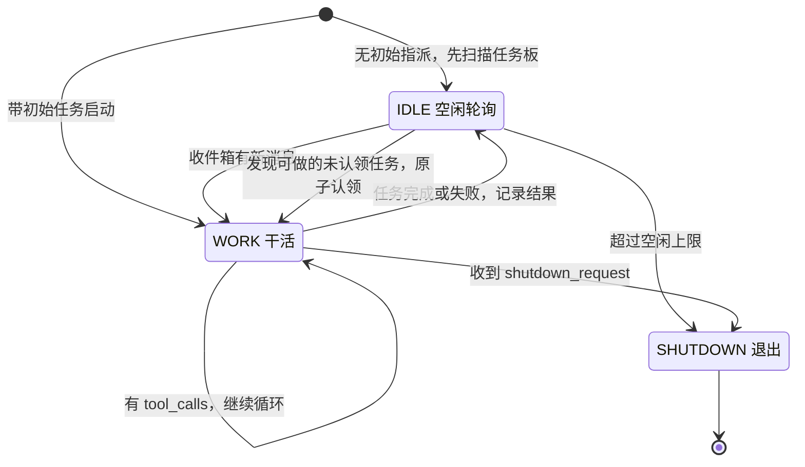

# 扩展阅读：Autonomous Agents - 让空闲队友自己认领任务

在 `s16` 里，Lead 和队友已经能按统一协议审批计划、优雅停机，但任务仍然主要由 Lead 逐一分派。一旦任务板上的待办堆起来，Lead 自己反而会成为整个团队的调度瓶颈。

这篇扩展阅读讨论的问题很直接：**空闲队友能不能自己去任务板找活干、安全认领、干完后再接下一件，而不是每一步都干等 Lead 点名？**

> 本文是 `s16` 之后的设计扩展，不属于 `s00`–`s18` 可运行主线。仓库里没有对应的 `sXX-autonomous-agents.js`，因此下面只讨论状态机、并发边界与最小实现草图，不提供伪造的代码 diff。

## 问题

把 `s12` 的持久化任务板和 `s16` 的团队协议拼在一起时，如果你希望多个队友并行消化大量待办，单靠 Lead 人工派活会卡在调度吞吐上；而一旦放手让队友“自主认领”，又会立刻撞上三个工程问题：哪些任务现在能做、怎么防止两个人同时抢到同一个任务、以及没活干时怎么停下来而不是死循环空转。

## 解决方案：三态生命周期与共享任务板

想让队友自主跑起来，核心不是“放任模型自由发挥”，而是给每个队友套上一层清晰的 **WORK / IDLE / SHUTDOWN** 状态机：



“自主”绝不等于无限循环。每个队友都必须带空闲上限、任务预算和显式退出条件，否则任务板一空，进程就会不停轮询、空烧资源。

如果后续要把这套机制落成正式代码，最小 API 面只需补 4 个函数（当前仓库尚未实现）：

| 函数 | 作用 |
| --- | --- |
| `scanUnclaimedTasks` | 筛出 `pending`、无 `owner`、且 `blockedBy` 已全部完成的任务 |
| `claimTask` | 原子写入 `owner`，防止两个队友同时抢走同一任务 |
| `findTaskForTeammate` | 按角色、权限和能力过滤出当前队友能接的任务 |
| `runTeammateLifecycle` | 驱动队友在 `WORK`、`IDLE`、`SHUTDOWN` 之间流转 |

### 一次完整的协同流程

假设后端任务板里有三个待办（为简化演示，下面暂略去任务依赖；真实项目里“写单元测试”应通过 `blockedBy` 等前两项完工后才进入可认领列表）：

```text
1. Lead 创建三个持久任务：创建数据库 schema、写 API 路由、写单元测试
2. Lead 启动两个后端队友：alice、bob（均无初始指派，进入 IDLE）
3. alice 扫描任务板 -> 原子认领“创建数据库 schema” -> WORK
4. bob   扫描任务板 -> 原子认领“写 API 路由”       -> WORK
5. alice 完成 schema -> complete_task -> 回到 IDLE
6. alice 再次扫描 -> 认领“写单元测试” -> WORK
7. bob   完成 API 路由 -> complete_task -> 回到 IDLE
8. alice 完成单元测试 -> complete_task -> 回到 IDLE
9. 两人超过空闲上限仍无新任务 -> SHUTDOWN，并把 summary 写回 Lead 收件箱
```

## 最小实现草图

### 1. 只扫描真正就绪的任务

```js
function scanUnclaimedTasks(tasks) {
  return tasks.filter(
    (task) =>
      task.status === "pending" &&
      !task.owner &&
      task.blockedBy.every((id) => tasks.find((item) => item.id === id)?.status === "completed"),
  );
}
```

这里只展示了筛选条件。真正落盘时，`claimTask` 必须保证“检查无主”和“写入 `owner`”是一个原子动作（例如数据库条件更新、CAS 或文件锁）；否则 Alice 和 Bob 极易在同一毫秒读到同一个无主任务，造成重复施工。

### 2. 把角色边界写进任务本身

有空不代表什么都能干。给任务结构补上一个 `requiredRole` 字段，就能在认领前做好能力与权限隔离：

```js
{
  id: "task_0001",
  subject: "创建数据库 schema",
  status: "pending",
  owner: null,
  requiredRole: "backend",
  blockedBy: [],
}
```

队友只认领 `requiredRole` 为空或与自身角色一致的任务。教学阶段直接做字符串相等判断就够用，不必一开始就堆复杂的技能评分模型。

## 落地前必须防住的三个坑

| 风险 | 为什么会发生 | 最小工程对策 |
| --- | --- | --- |
| 重复认领 | 两个队友同时扫描到同一个无主任务 | 原子 claim（CAS / 条件更新）或短期 lease |
| 权限扩散 | 空闲队友抢走了超出自身安全边界的任务 | `requiredRole` 匹配 + 每个队友独立工具权限 |
| 无限空转 | 任务板已空但轮询没有退出条件 | 轮询间隔 + 最大空闲次数 + 显式 `SHUTDOWN` |

进一步产品化时，建议给每次认领加上 **lease（租约过期时间）**：队友只在租约内持有任务并定期续约；一旦进程崩溃，租约到期后任务会自动退回可认领状态，避免永久卡死。

## 扩展阅读：商业级 Agent 怎么看“自主认领”

把这套设计和主流商业产品对照一下，能帮你避开一个常见误解：

- **Claude Code**：公开的 subagent 机制强调由主 Agent 显式委派明确任务，每个子 Agent 拥有独立上下文和工具范围，并没有默认描述成自由抢单的共享任务板。参考 [Claude Code subagents](https://code.claude.com/docs/en/sub-agents)。
- **Codex**：支持并行运行多个 Agent，并用独立 Git worktree 或云环境隔离改动，但公开产品重心仍是显式任务委派与并行监督，而不是队友自由抢单。参考 [Introducing the Codex app](https://openai.com/index/introducing-the-codex-app/)。
- **opencode**：通过 primary agent、subagent、细粒度工具权限与 `task` 调用划分职责，同样以显式委派为主。参考 [OpenCode agents](https://opencode.ai/docs/agents/)。

因此，“自主认领”更适合作为高吞吐批处理场景下的进阶课题，不应被误解为商业 Code Agent 的默认内部实现。

## 设计练习

本文没有配套可运行脚本，你可以用下面这道思考题检验自己的架构是否闭环：

```text
Alice 和 Bob 在同一时刻看到 task_0001 时，系统靠什么保证只有一人成功认领？如果 Alice 认领后进程意外崩溃，这个任务怎样自动恢复成可认领状态？
```

如果你的方案只能指望“在 Prompt 里叮嘱模型别抢重复任务”，就说明还缺 harness 层的原子 claim、lease 和崩溃恢复机制。

**Autonomous Agents 的本质不是让模型更自由，而是用状态机、原子认领、角色边界和退出条件，把多 Agent 的自主行为关进可控的工程护栏里。**
