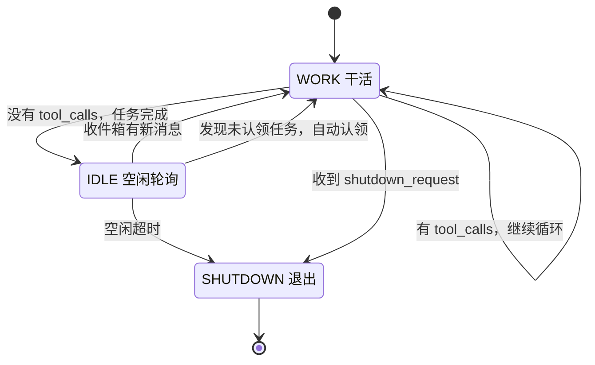

# 扩展阅读：Autonomous Agents —— 队友自己认领任务

s16 已经让 Lead 和 teammate 按统一协议沟通，但任务仍主要由 Lead 分配。如果任务板上有很多待办，Lead 会逐渐变成瓶颈。

Autonomous Agents 想解决的问题是：空闲队友能不能自己发现合适的任务、原子认领、完成后继续找下一件事？

> 本文是 s16 之后的设计扩展，不属于 s00-s18 可运行主线。仓库里没有对应的 `sXX-autonomous-agents.js`，因此本文只给出状态机和实现草图，不提供伪造的代码 diff。

## 阅读目标

看完这一节，你应该能分清三件事：

- **任务发现**：哪些任务现在可以开始。
- **任务认领**：如何保证同一个任务不会被两个队友同时拿走。
- **角色匹配**：有空不代表适合做，队友还要满足任务要求。

## 架构图


```text
                 shared task board
              +---------------------+
              | pending / no owner  |
              +----------+----------+
                         |
                   scan ready tasks
                         |
          +--------------+--------------+
          |                             |
          v                             v
   alice claims task A           bob claims task B
          |                             |
          v                             v
       WORKING                       WORKING
          |                             |
          +---------- complete ---------+
                         |
                         v
                       IDLE
                  scan again / exit
```

## 建议新增的函数

下面是未来实现时需要的最小函数，不是当前仓库已经存在的 API。

| 函数 | 作用 |
| --- | --- |
| `scanUnclaimedTasks` | 找出 pending、无 owner、依赖已完成的任务 |
| `claimTask` | 原子设置 owner，避免两个队友重复认领 |
| `findTaskForTeammate` | 按角色、权限和能力筛选可做任务 |
| `runTeammateLifecycle` | 在 WORK、IDLE、SHUTDOWN 三个状态间切换 |

## 最小状态机

```text
WORK
  |
  +-- 完成当前任务 --> IDLE
  +-- 任务失败 -----> IDLE，并记录失败原因

IDLE
  |
  +-- 找到并认领任务 --> WORK
  +-- 收到新消息 ------> WORK
  +-- 超过空闲上限 ----> SHUTDOWN

SHUTDOWN
  |
  +-- 写 summary，退出
```

“自主”不等于无限循环。每个队友都需要空闲上限、任务预算和退出条件，否则系统会不断轮询并消耗资源。

## 大致执行流程

```text
1. Lead: “搭建后端，任务很多，让队友自己认领”
2. Lead → create_task("创建数据库 schema")
3. Lead → create_task("写 API 路由")
4. Lead → create_task("写单元测试")
5. Lead → spawn_teammate("alice", "backend", "你是后端开发者")
6. Lead → spawn_teammate("bob", "backend", "你是后端开发者")

7. alice 没有初始任务 → IDLE
8. bob 没有初始任务 → IDLE
9. alice 扫描任务板 → 认领“创建数据库 schema” → WORK
10. bob 扫描任务板 → 认领“写 API 路由” → WORK
11. alice 完成 schema → complete_task → IDLE
12. alice 再次扫描 → 认领“写单元测试” → WORK
13. bob 完成 API 路由 → complete_task → IDLE
14. alice 完成单元测试 → complete_task → IDLE
15. 两人超过空闲上限仍无任务 → SHUTDOWN
16. Lead 从 inbox 收到两人的 summary
```

这里省略了任务依赖。真实项目中，“写单元测试”通常应依赖 schema 和 API 路由完成，`scanUnclaimedTasks` 只能返回依赖已经满足的任务。

## 实现草图

### 1. 只扫描真正 ready 的任务

```js
function scanUnclaimedTasks(tasks) {
  return tasks.filter(
    (task) =>
      task.status === "pending" &&
      !task.owner &&
      task.blockedBy.every((id) => tasks.find((item) => item.id === id)?.status === "completed"),
  );
}
```

这段代码只解释筛选条件。真正的 `claimTask` 还必须保证“检查 owner”和“写入 owner”是一个原子操作；否则 Alice 和 Bob 可能同时读到同一个无主任务。

### 2. 把角色要求放进任务

仅判断 `owner` 不够。更合理的任务结构可以增加：

```js
{
  id: "task_0001",
  subject: "创建数据库 schema",
  status: "pending",
  owner: null,
  requiredRole: "backend",
  blockedBy: [],
}
```

然后队友只认领 `requiredRole` 为空或与自己角色匹配的任务。教学版可以从字符串相等开始，不必一开始就设计复杂的技能评分系统。

## 需要提前防住的三个问题

| 问题 | 为什么发生 | 最小对策 |
| --- | --- | --- |
| 重复认领 | 两个队友同时读取任务板 | 原子 claim 或短期 lease |
| 权限扩散 | 空闲队友认领了不该做的任务 | `requiredRole` + 每个队友独立工具权限 |
| 无限空转 | 没任务时持续扫描 | 轮询间隔、最大空闲时间、退出条件 |

进一步产品化时，还可以为 claim 增加 lease：队友只在一段时间内拥有任务；如果进程崩溃，lease 过期后任务可以重新被认领。

## Claude Code、Codex 和 OpenCode 怎么做

- **Claude Code** 的公开 subagent 机制更接近“由主 Agent 委派一个明确任务”，每个子 Agent 拥有独立上下文和工具范围；公开文档没有把它描述成自动扫描共享任务板。
- **Codex** 支持并行运行多个 Agent，并用独立 worktree 或云环境隔离工作，但公开产品资料更强调用户委派和并行监督，而不是队友自由抢任务。
- **OpenCode** 通过 primary agent、subagent、工具权限和 `task` 调用划分角色。它同样更接近显式委派，不是默认的共享任务抢占系统。

因此，“自主认领”适合当作后续项目课，而不应该被误写成三个产品都采用的固定内部实现。

## 设计练习

本文没有可运行 CLI。可以用下面的问题检查自己的设计是否完整：

```text
Alice 和 Bob 同时看到 task_0001 时，系统怎样保证只有一人认领？Alice 崩溃后，这个任务怎样重新变成可认领？
```

如果答案只依赖“模型应该自觉”，说明还缺少 harness 层的原子 claim、lease 或恢复机制。

## 源码与 diff 说明

本文没有配套 JavaScript，因此不展示与 s16 的代码 diff。若未来实现为正式章节，应先新增 `.js` 和 `.test.js`，再从真实相邻源码生成关键 diff。

## 参考资料

- [Claude Code subagents](https://code.claude.com/docs/en/sub-agents)
- [Introducing the Codex app](https://openai.com/index/introducing-the-codex-app/)
- [OpenCode agents](https://opencode.ai/docs/agents/)

## 一句话总结

Autonomous Agents 的核心不是“让模型更自由”，而是给空闲队友一套安全的发现、认领、执行和退出规则。
