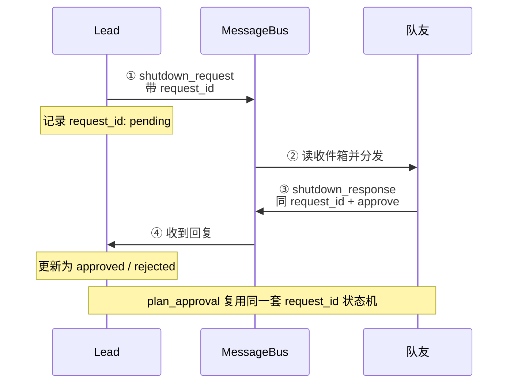

# s16：Team Protocols —— 协作用 request-response

队友变多以后，光靠“随口聊天”很快会乱：谁提出了请求，谁批准了计划，哪条回复对应哪件事，都需要一个可追踪的格式。`s16` 在 `s15` 的文件邮箱上加一层团队协议：每个请求都有 `request_id`，每个响应都带着同一个 `request_id` 回来。

## 本章目标

`s15` 解决了“队友怎么通信”：用 `.mailboxes/*.jsonl` 传消息。`s16` 解决的是“消息怎么对上号”：用 request-response 协议把请求和响应关联起来。

这一章保留 `s15` 的后台队友、cron queue processor 和文件邮箱，只新增团队协议层。日志上，`[bus]` / `[teammate]` 继续表示队友生命周期和邮箱消息流，`s16` 新增的 `[protocol]` 用来突出 request-response 协议事件。

## 新增能力

- `pendingRequests`：保存还没完成的协议请求。
- `request_id`：把请求和响应绑定在一起。
- `matchResponse`：收到响应后推进状态机。
- `consumeLeadInbox`：统一读取 lead inbox，并先路由协议响应。
- `sendMessage(..., metadata)`：邮箱消息新增结构化 metadata，用来保存 `request_id` 和审批结果。
- `request_shutdown`：lead 请求队友优雅退出。
- `request_plan`：lead 请求队友提交计划。
- `review_plan`：lead 审批队友提交的计划。
- `submit_plan`：队友侧工具，向 lead 提交计划审批请求。

## 流程图


```text
Lead                         Mailbox                         Teammate
 |                              |                               |
 | request_plan                 |                               |
 |----------------------------->| lead → bob: please plan       |
 |                              |------------------------------>|
 |                              |                               | submit_plan
 |                              |<------------------------------|
 |<-----------------------------| bob → lead: plan_approval_request(req_0000)
 | pendingRequests[req_0000] = pending                         |
 |                                                              |
 | review_plan(req_0000, approve=true)                         |
 |----------------------------->| lead → bob: plan_approval_response(req_0000)
 | pendingRequests[req_0000] = approved                        |
```

## 执行大致流程

完整团队系统里的关机握手，大概是这个流程：

```text
1. Lead: "让 Alice 创建一个文件，然后关机"
2. Lead → spawn_teammate("alice", "backend", "创建 config.py")
3. alice 子循环启动 → write_file("config.py", "...") → 完成 → idle
4. Lead → request_shutdown("alice")
   → BUS.send("shutdown_request", {request_id: "req_000142"})
5. alice idle 轮询收到 → 在 teammate loop 里处理 shutdown_request
   → BUS.send("shutdown_response", {request_id: "req_000142", approve: true})
6. Lead consumeLeadInbox → matchResponse("req_000142", approve=true)
   → pendingRequests["req_000142"].status = "approved"
   → inbox 消息注入 history，LLM 看到关机结果
```

当前 JS 教学版已经实现了一个短暂的 idle loop：队友完成一轮模型回复后，不会立刻退出，而是最多再检查 20 次 inbox，每次间隔 250ms，总计约 5 秒。这样 Lead 后续发来的 `send_message` 和 `shutdown_request` 还能被队友消费，不需要主 agent 用 `sleep` 反复轮询。

## 为什么这一步重要

协议让团队协作从“聊天记录”变成“可追踪事务”。

- 没有 `request_id`，多个队友同时发计划时，lead 很难知道自己批准的是哪一个。
- 没有状态机，重复响应、错类型响应、过期响应都会混在一起。
- 有了统一的 request-response 结构，后面可以继续扩展任务认领、交付确认、冲突协商。

## 新增函数速览

- `newRequestId()`：内部函数，生成 `req_0000` 这种进程内递增 ID。
- `resetProtocol()`：测试入口，清空 pending request 并重置序号。
- `matchResponse(responseType, requestId, approve)`：根据响应类型和 `request_id` 更新 pending 状态。
- `consumeLeadInbox(routeProtocol)`：读取 lead 收件箱，先把协议响应路由到状态机，再返回消息。
- `teammateSubmitPlan(fromName, plan)`：队友调用 `submit_plan` 时，创建 `plan_approval` pending request，并写入 lead inbox。
- teammate idle loop：队友没有新工具要调用时，短暂等待 inbox；收到普通消息就继续跑，收到 shutdown 就回复并退出。
- `runRequestShutdown({ teammate })`：lead 写入 `shutdown_request`，等待队友回 `shutdown_response`。
- `runRequestPlan({ teammate, task })`：lead 让队友先提交计划；真正的 pending request 会在队友调用 `submit_plan` 时创建。
- `runReviewPlan({ request_id, approve, feedback })`：lead 审批计划，并把 `plan_approval_response` 发回队友。

## 代码入口

- JS：[s16-team-protocols.js](./s16-team-protocols.js)
- Test：[s16-team-protocols.test.js](./s16-team-protocols.test.js)

## 运行

```bash
node code-agent-course/s16-team-protocols.js
```

## 日志说明

`s16` 去掉了 `[turn n]`、`[assistant]`、`[tool result]` 这类内部 trace。它们仍然是 agent loop 的真实过程，只是不再打印。

运行时主要看四类信息：

- `> tool_name`：模型这一步决定调用哪个工具。
- `[bus]`：继承自 `s15` 的普通邮箱消息。
- `[teammate]`：继承自 `s15` 的队友生命周期。
- 彩色 `[protocol]`：本章新增的 request-response 协议事件。

主 agent 给 teammate 发任务后，system prompt 会提醒它优先用 `check_inbox` 等队友回报，不要用 `sleep` 循环反复检查文件。这样日志会更接近 Python 参考实现，也更能突出协议本身。

## 关键代码

协议状态统一存在 `pendingRequests` 里。每条 pending request 都有类型、发送方、目标、状态和 payload。

```js
export const pendingRequests = new Map(); // request_id → { request_id, type, sender, target, status, payload }
let reqSeq = 0;
const newRequestId = () => `req_${String(reqSeq++).padStart(4, "0")}`;
```

收到响应时，不是看到 `request_id` 就直接改状态，还要检查响应类型是否匹配。比如 `shutdown_response` 不能拿来完成 `plan_approval`。

```js
export function matchResponse(responseType, requestId, approve) {
  const state = pendingRequests.get(requestId);
  if (!state) return;
  if (state.type === "shutdown" && responseType !== "shutdown_response") return;
  if (state.type === "plan_approval" && responseType !== "plan_approval_response") return;
  if (state.status !== "pending") return; // 已 approved/rejected，忽略重复
  state.status = approve ? "approved" : "rejected";
  colorLog(approve ? "green" : "yellow", `[protocol] ${requestId} ${state.status}`);
}
```

`consumeLeadInbox` 是本章的关键入口：lead 每次读 inbox 时，先把协议响应喂给状态机，再把消息注入主对话。

```js
export function consumeLeadInbox(routeProtocol = true) {
  const msgs = readInbox("lead");
  if (routeProtocol) {
    for (const msg of msgs) {
      const reqId = msg.metadata?.request_id;
      if (reqId && msg.type?.endsWith("_response")) {
        colorLog("cyan", `[protocol] route response ${reqId} from ${msg.from}`);
        matchResponse(msg.type, reqId, msg.metadata?.approve || false);
      }
    }
  }
  return msgs;
}
```

计划审批是“队友发起”的协议：lead 可以先 `request_plan`，但真正进入 pending 状态的是队友调用 `submit_plan` 的时候。

```js
function teammateSubmitPlan(fromName, plan) {
  const reqId = newRequestId();
  pendingRequests.set(reqId, { request_id: reqId, type: "plan_approval", sender: fromName, target: "lead", status: "pending", payload: plan });
  colorLog("cyan", `[protocol] ${fromName} submitted plan ${reqId}`);
  sendMessage(fromName, "lead", plan, "plan_approval_request", { request_id: reqId });
  return `Plan submitted (${reqId}). Waiting for approval...`;
}
```

审批时，lead 用同一个 `request_id` 找回 pending request，更新状态，并把响应发回原队友。

```js
function runReviewPlan({ request_id, approve, feedback = "" }) {
  const state = pendingRequests.get(request_id);
  if (!state) return `Request ${request_id} not found`;
  if (state.status !== "pending") return `Request ${request_id} already ${state.status}`;
  state.status = approve ? "approved" : "rejected";
  sendMessage("lead", state.sender, feedback || (approve ? "Approved" : "Rejected"), "plan_approval_response", { request_id, approve });
  return `Plan ${approve ? "approved" : "rejected"} (${request_id})`;
}
```

## 参考实现提醒

- `request_id` 是协作里的锚点，没有它就很难匹配异步回复。
- response 类型要和 request 类型对应，避免把 shutdown 回复当成 plan 回复。
- 队友协议工具 `submit_plan` 放在队友自己的 tool list 里，不放到 lead 的主工具列表。
- lead-only 协议工具要从普通 subagent 的工具列表里排除，避免子代理绕过 lead 发团队命令。
- 本章 JS 版继续沿用 `s15` 的后台 Promise 队友模型，但多了短暂 idle loop。
- idle loop 不是永久常驻线程；它只是为了教程演示，让队友在完成后还能处理一段时间的后续消息和 shutdown。
- `submit_plan` 目前只是协议消息，不是强制执行门。队友提交计划后，代码不会自动冻结所有其他工具；生产实现还要增加“等待审批”状态，并在审批前拒绝写文件或执行命令。
- Lead 不应该用 `sleep && cat file` 反复轮询 teammate 的结果；更清晰的方式是 `check_inbox` 等 teammate 回报，再验证文件。

## 测试 Prompt

试试这个 prompt：

```text
Spawn bob as a backend developer and ask only for a plan to update README.md. When the plan arrives, approve it by request_id and check your inbox.
```

观察重点：Bob 应该通过 `submit_plan` 发出 `plan_approval_request`，lead 用同一个 `request_id` 调用 `review_plan`，最后 `pendingRequests` 里的状态从 `pending` 变成 `approved`。本 prompt 不要求 Bob 修改文件，因为本章还没有实现强制审批门。

也可以单独测试关机握手：

```text
Spawn alice as a developer, then use request_shutdown for alice and check your inbox.
```

观察重点：lead 发 `shutdown_request`，Alice 回 `shutdown_response`，`matchResponse` 把对应请求推进到 `approved`。

## 扩展阅读：真实 Coding Agent 怎么做团队协议

Claude Code 的 Agent Teams 已经有更完整的团队控制面：lead 可以要求 teammate 先提交 plan，再由 lead 审批；也可以直接和 teammate 对话、分配任务、关闭 teammate。它的核心不是“随便发消息”，而是把团队管理、计划审批、任务列表和 shutdown 都放在一个统一控制面里。参考：[Claude Code Agent Teams](https://code.claude.com/docs/en/agent-teams)。

Codex 的公开文档更偏向 subagents。Codex 会负责 spawn、等待、汇总和关闭子代理，适合“把多个调查并行跑完再合并结果”。它不像本章这样暴露一个本地 `request_id` mailbox 协议，但它同样强调由主会话编排子代理，并让结果回到主会话统一处理。参考：[Codex Subagents](https://developers.openai.com/codex/subagents)。

opencode 把 agent 分成 primary agent 和 subagent，可以用配置定义角色、模型、权限和 prompt，也可以通过 `@agent` 方式点名。它更像“角色化代理 + 权限控制”，协议层可以放在 agent prompt 和工具约定里实现。参考：[opencode Agents](https://opencode.ai/docs/agents/)。

## 一句话总结

`s16` 给团队消息加上 `request_id` 和状态机，让队友协作从“聊天”变成可追踪、可调试的 request-response 流程。

## 与 s15 的关键代码 diff（不含 helper.js）

下面只展示 metadata、idle loop、协议状态机、协议工具和主 loop 接入点。日志注释等非核心变化不放进主 diff。

```diff
--- s15-agent-teams.js
+++ s16-team-protocols.js
-export function sendMessage(from, to, content, type = "message") {
+export function sendMessage(from, to, content, type = "message", metadata = {}) {
   mkdirSync(mailboxDir, { recursive: true });
-  appendFileSync(path.join(mailboxDir, `${to}.jsonl`), `${JSON.stringify({ from, to, content, type, ts: Date.now() })}\n`);
-  colorLog("yellow", `[bus] ${from} → ${to}: ${preview(content, 50)}`);
+  appendFileSync(path.join(mailboxDir, `${to}.jsonl`), `${JSON.stringify({ from, to, content, type, ts: Date.now(), metadata })}\n`);
+  console.log(`  [bus] ${from} → ${to}: ${preview(content, 50)}`);
+  if (type !== "message") {
+    const req = metadata.request_id ? ` ${metadata.request_id}` : "";
+    colorLog("cyan", `[protocol] ${type}${req}: ${from} → ${to}`);
+  }
 }

-const TEAMMATE_TURNS = 10; // 教学版限轮数；真实 CC 用 idle loop 直到收到 shutdown
+const TEAMMATE_TURNS = 20;
+const TEAMMATE_IDLE_TICKS = 20;
+const TEAMMATE_IDLE_MS = 250;

+    tool("submit_plan", "Submit a plan to the lead for approval before acting.", {
+      type: "object",
+      properties: { plan: { type: "string" } },
+      required: ["plan"],
+    }),

+    submit_plan: ({ plan }) => teammateSubmitPlan(name, plan),

+    let needsModel = true;
+    let idleTicks = 0;
+    let pendingShutdown = null;
     for (let turn = 0; turn < TEAMMATE_TURNS; turn += 1) {
-      const inbox = readInbox(name); // 队友也有收件箱（Lead 可发指令）
-      if (inbox.length) messages.push({ role: "user", content: `<inbox>${JSON.stringify(inbox)}</inbox>` });
+      const inbox = readInbox(name);
+      const nonProtocol = [];
+      for (const msg of inbox) {
+        if (msg.type === "shutdown_request") {
+          pendingShutdown = msg;
+        } else if (msg.type === "plan_approval_response") {
+          colorLog(msg.metadata?.approve ? "green" : "yellow", `[protocol] ${name} received plan review ${msg.metadata?.request_id}`);
+          messages.push({
+            role: "user",
+            content: msg.metadata?.approve ? "[Plan approved] Proceed." : `[Plan rejected] ${msg.content}`,
+          });
+          needsModel = true;
+          idleTicks = 0;
+        } else {
+          nonProtocol.push(msg);
+        }
+      }
+      if (nonProtocol.length) {
+        messages.push({ role: "user", content: `<inbox>${JSON.stringify(nonProtocol)}</inbox>` });
+        needsModel = true;
+        idleTicks = 0;
+      }
+      if (pendingShutdown && !needsModel) {
+        colorLog("cyan", `[protocol] ${name} received shutdown request ${pendingShutdown.metadata?.request_id}`);
+        sendMessage(name, "lead", "Shutting down gracefully.", "shutdown_response", {
+          request_id: pendingShutdown.metadata?.request_id,
+          approve: true,
+        });
+        summary = "Shut down gracefully.";
+        break;
+      }
+      if (!needsModel) {
+        idleTicks += 1;
+        if (idleTicks >= TEAMMATE_IDLE_TICKS) break;
+        await sleep(TEAMMATE_IDLE_MS);
+        continue;
+      }
       const { message } = await callLlm(messages.slice(-20), { system, tools: teamTools });
       messages.push(message);
       if (!message.tool_calls?.length) {
         summary = message.content || summary;
-        break;
+        needsModel = false;
+        continue;
       }
+      idleTicks = 0;

+export const pendingRequests = new Map(); // request_id → { request_id, type, sender, target, status, payload }
+let reqSeq = 0;
+export function resetProtocol() {
+  pendingRequests.clear();
+  reqSeq = 0;
+}
+const newRequestId = () => `req_${String(reqSeq++).padStart(4, "0")}`;
+
+export function matchResponse(responseType, requestId, approve) {
+  const state = pendingRequests.get(requestId);
+  if (!state) return;
+  if (state.type === "shutdown" && responseType !== "shutdown_response") return;
+  if (state.type === "plan_approval" && responseType !== "plan_approval_response") return;
+  if (state.status !== "pending") return; // 已 approved/rejected，忽略重复
+  state.status = approve ? "approved" : "rejected";
+  colorLog(approve ? "green" : "yellow", `[protocol] ${requestId} ${state.status}`);
+}
+
+export function consumeLeadInbox(routeProtocol = true) {
+  const msgs = readInbox("lead");
+  if (routeProtocol) {
+    for (const msg of msgs) {
+      const reqId = msg.metadata?.request_id;
+      if (reqId && msg.type?.endsWith("_response")) {
+        colorLog("cyan", `[protocol] route response ${reqId} from ${msg.from}`);
+        matchResponse(msg.type, reqId, msg.metadata?.approve || false);
+      }
+    }
+  }
+  return msgs;
+}

+function teammateSubmitPlan(fromName, plan) {
+  const reqId = newRequestId();
+  pendingRequests.set(reqId, { request_id: reqId, type: "plan_approval", sender: fromName, target: "lead", status: "pending", payload: plan });
+  colorLog("cyan", `[protocol] ${fromName} submitted plan ${reqId}`);
+  sendMessage(fromName, "lead", plan, "plan_approval_request", { request_id: reqId });
+  return `Plan submitted (${reqId}). Waiting for approval...`;
+}

+function runRequestShutdown({ teammate }) {
+  const reqId = newRequestId();
+  pendingRequests.set(reqId, { request_id: reqId, type: "shutdown", sender: "lead", target: teammate, status: "pending", payload: "" });
+  sendMessage("lead", teammate, "Please shut down gracefully.", "shutdown_request", { request_id: reqId });
+  return `Shutdown request sent to ${teammate} (req: ${reqId})`;
+}
+function runRequestPlan({ teammate, task }) {
+  colorLog("cyan", `[protocol] ask ${teammate} for a plan`);
+  sendMessage("lead", teammate, `Please submit a plan for: ${task}`, "message");
+  return `Asked ${teammate} to submit a plan`;
+}
+function runReviewPlan({ request_id, approve, feedback = "" }) {
+  const state = pendingRequests.get(request_id);
+  if (!state) return `Request ${request_id} not found`;
+  if (state.status !== "pending") return `Request ${request_id} already ${state.status}`;
+  state.status = approve ? "approved" : "rejected";
+  sendMessage("lead", state.sender, feedback || (approve ? "Approved" : "Rejected"), "plan_approval_response", { request_id, approve });
+  return `Plan ${approve ? "approved" : "rejected"} (${request_id})`;
+}

+  request_shutdown: runRequestShutdown,
+  request_plan: runRequestPlan,
+  review_plan: runReviewPlan,

-    for (const m of readInbox("lead")) {
+    for (const m of consumeLeadInbox()) {
       messages.push({ role: "user", content: `[Inbox] From ${m.from}: ${m.content.slice(0, 200)}` });
     }
```

## 博客代码演进

下面 9 个 patch 专门用于博客右侧的代码切换。第一步基于 `s15-agent-teams.js`，后面的每一步都继续修改上一帧，最后必须得到完整的 `s16-team-protocols.js`。

每一步的代码都可以运行。本章有两种协议，按顺序各做一遍：第 2 到 5 步是“请队友关机”，第 6 到 8 步是“队友的计划要先经过批准”。两者用的是同一套办法：给每个请求一个编号，回复时带上这个编号。日志放在最后一步统一补上。

### 1. 给消息加上附带信息，再准备一张请求表

s15 的消息只有一段文字，收到回复时分不清它回的是哪一次请求。所以先做两件事。第一，`sendMessage` 多一个 `metadata` 参数，可以随消息附带一些结构化的信息，比如请求编号。第二，新建一张表 `pendingRequests`，每发出一个需要对方答复的请求，就用编号登记一条，记录类型、谁发的、发给谁，以及状态。状态只有三种：`pending`（等待答复）、`approved`（同意）、`rejected`（拒绝）。`newRequestId` 负责生成编号。

```diff agent-step
@@
   mailboxDir = dir;
 }
-export function sendMessage(from, to, content, type = "message") {
+export function sendMessage(from, to, content, type = "message", metadata = {}) {
   mkdirSync(mailboxDir, { recursive: true });
-  appendFileSync(path.join(mailboxDir, `${to}.jsonl`), `${JSON.stringify({ from, to, content, type, ts: Date.now() })}\n`);
   colorLog("yellow", `[bus] ${from} → ${to}: ${preview(content, 50)}`);
+  appendFileSync(path.join(mailboxDir, `${to}.jsonl`), `${JSON.stringify({ from, to, content, type, ts: Date.now(), metadata })}\n`);
 }
 export function readInbox(agent) {
@@
   return msgs.map((m) => `[${m.from}] ${m.content.slice(0, 200)}`).join("\n");
 }
+
+export const pendingRequests = new Map();
+let reqSeq = 0;
+export function resetProtocol() {
+  pendingRequests.clear();
+  reqSeq = 0;
+}
+const newRequestId = () => `req_${String(reqSeq++).padStart(4, "0")}`;
 
 const TRANSCRIPT_DIR = path.join(process.cwd(), ".transcripts");
```

### 2. request_shutdown：Lead 请队友关机

第一种协议是关机。Lead 不能直接把队友停掉，因为队友可能正写到一半。正确的做法是发一个请求，让队友自己收尾。`runRequestShutdown` 生成请求编号，在表里登记一条 `pending` 的记录，然后发出一条类型为 `shutdown_request` 的消息，编号放在 `metadata` 里。照例加上工具的 schema 和登记。子代理的排除名单改成多行，把本章的三个协议工具都加进去。

```diff agent-step
@@
 const newRequestId = () => `req_${String(reqSeq++).padStart(4, "0")}`;
 
+function runRequestShutdown({ teammate }) {
+  const reqId = newRequestId();
+  pendingRequests.set(reqId, { request_id: reqId, type: "shutdown", sender: "lead", target: teammate, status: "pending", payload: "" });
+  sendMessage("lead", teammate, "Please shut down gracefully.", "shutdown_request", { request_id: reqId });
+  return `Shutdown request sent to ${teammate} (req: ${reqId})`;
+}
+
 const TRANSCRIPT_DIR = path.join(process.cwd(), ".transcripts");
 const TOOL_RESULTS_DIR = path.join(process.cwd(), ".task_outputs", "tool-results");
@@
   }),
   tool("check_inbox", "Check the lead's inbox for teammate messages.", { type: "object", properties: {} }),
+  tool("request_shutdown", "Ask a teammate to shut down gracefully (handshake).", {
+    type: "object",
+    properties: { teammate: { type: "string" } },
+    required: ["teammate"],
+  }),
 ];
@@
   send_message: runSendMessage,
   check_inbox: runCheckInbox,
+  request_shutdown: runRequestShutdown,
 };
 
-const SUB_EXCLUDE = ["task", "todo_write", "load_skill", "compact", "spawn_teammate", "send_message", "check_inbox"];
+const SUB_EXCLUDE = [
+  "task",
+  "todo_write",
+  "load_skill",
+  "compact",
+  "spawn_teammate",
+  "send_message",
+  "check_inbox",
+  "request_shutdown",
+  "request_plan",
+  "review_plan",
+];
 const subTools = tools.filter((t) => !SUB_EXCLUDE.includes(t.function.name));
 const subHandlers = Object.fromEntries(
```

### 3. 队友不再做完就走，而是空闲等待

要让队友能收到关机请求，它得一直在线。原来队友的模型一旦不再请求工具，循环就结束了。现在改成：这时只把 `needsModel` 设为 `false`，表示“暂时没事做”，然后进入空闲：每 250 毫秒看一次收件箱，有新消息就把 `needsModel` 改回 `true`，再去调用模型。连续空闲 20 次还没有消息，才真正结束。这样队友空闲时不调用模型，不花钱，但随时能被一条消息叫起来。

```diff agent-step
@@
   activeTeammates.clear();
 }
-const TEAMMATE_TURNS = 10;
+const TEAMMATE_TURNS = 20;
+const TEAMMATE_IDLE_TICKS = 20;
+const TEAMMATE_IDLE_MS = 250;
 
 export function spawnTeammate(name, role, prompt, confirm) {
@@
     const messages = [{ role: "user", content: prompt }];
     let summary = "Done.";
+    let needsModel = true;
+    let idleTicks = 0;
     for (let turn = 0; turn < TEAMMATE_TURNS; turn += 1) {
       const inbox = readInbox(name);
-      if (inbox.length) messages.push({ role: "user", content: `<inbox>${JSON.stringify(inbox)}</inbox>` });
+      const nonProtocol = [];
+      for (const msg of inbox) {
+          nonProtocol.push(msg);
+      }
+      if (nonProtocol.length) {
+        messages.push({ role: "user", content: `<inbox>${JSON.stringify(nonProtocol)}</inbox>` });
+        needsModel = true;
+        idleTicks = 0;
+      }
+      if (!needsModel) {
+        idleTicks += 1;
+        if (idleTicks >= TEAMMATE_IDLE_TICKS) break;
+        await sleep(TEAMMATE_IDLE_MS);
+        continue;
+      }
       const { message } = await callLlm(messages.slice(-20), { system, tools: teamTools });
       messages.push(message);
       if (!message.tool_calls?.length) {
         summary = message.content || summary;
-        break;
+        needsModel = false;
+        continue;
       }
+      idleTicks = 0;
       for (const call of message.tool_calls) {
         const toolName = call.function.name;
```

### 4. 队友回应关机请求

现在队友读收件箱时先看消息类型。如果是 `shutdown_request`，先记在 `pendingShutdown` 里，不放进对话。等手头的工作做完，也就是 `needsModel` 为 `false` 的时候，再发回一条 `shutdown_response`，带上同一个请求编号和 `approve: true`，然后退出循环。其他消息仍然作为普通内容交给模型。请求和回应用同一个编号对应，这就是“握手”。

```diff agent-step
@@
     let needsModel = true;
     let idleTicks = 0;
+    let pendingShutdown = null;
     for (let turn = 0; turn < TEAMMATE_TURNS; turn += 1) {
       const inbox = readInbox(name);
       const nonProtocol = [];
       for (const msg of inbox) {
+        if (msg.type === "shutdown_request") {
+          pendingShutdown = msg;
+        } else {
           nonProtocol.push(msg);
+        }
       }
       if (nonProtocol.length) {
@@
         needsModel = true;
         idleTicks = 0;
+      }
+      if (pendingShutdown && !needsModel) {
+        sendMessage(name, "lead", "Shutting down gracefully.", "shutdown_response", {
+          request_id: pendingShutdown.metadata?.request_id,
+          approve: true,
+        });
+        summary = "Shut down gracefully.";
+        break;
       }
       if (!needsModel) {
```

### 5. Lead 收到回应，更新请求的状态

回应到了 Lead 的收件箱，需要把它和原来的请求对上。`matchResponse` 按编号找到请求，检查回应的类型和请求的类型是否对应，并且请求还在 `pending` 状态，然后把状态改成 `approved` 或 `rejected`。已经处理过的请求不会被重复处理。`consumeLeadInbox` 把这件事和读收件箱合在一起：读出消息，凡是带请求编号的回应都先交给 `matchResponse`。主循环开头和 `check_inbox` 都改用它，这样无论从哪里读到回应，请求的状态都会更新。

```diff agent-step
@@
 }
 function runCheckInbox() {
-  const msgs = readInbox("lead");
+  const msgs = consumeLeadInbox(true);
   if (!msgs.length) return "(inbox empty)";
   return msgs.map((m) => `[${m.from}] ${m.content.slice(0, 200)}`).join("\n");
@@
 const newRequestId = () => `req_${String(reqSeq++).padStart(4, "0")}`;
 
+export function matchResponse(responseType, requestId, approve) {
+  const state = pendingRequests.get(requestId);
+  if (!state) return;
+  if (state.type === "shutdown" && responseType !== "shutdown_response") return;
+  if (state.type === "plan_approval" && responseType !== "plan_approval_response") return;
+  if (state.status !== "pending") return;
+  state.status = approve ? "approved" : "rejected";
+}
+
+export function consumeLeadInbox(routeProtocol = true) {
+  const msgs = readInbox("lead");
+  if (routeProtocol) {
+    for (const msg of msgs) {
+      const reqId = msg.metadata?.request_id;
+      if (reqId && msg.type?.endsWith("_response")) {
+        matchResponse(msg.type, reqId, msg.metadata?.approve || false);
+      }
+    }
+  }
+  return msgs;
+}
+
 function runRequestShutdown({ teammate }) {
   const reqId = newRequestId();
@@
 
     injectCronJobs(messages);
-    for (const m of readInbox("lead")) {
+    for (const m of consumeLeadInbox()) {
       messages.push({ role: "user", content: `[Inbox] From ${m.from}: ${m.content.slice(0, 200)}` });
     }
```

### 6. submit_plan：队友先交计划

第二种协议方向相反：队友向 Lead 请求批准。给队友加一个 `submit_plan` 工具。`teammateSubmitPlan` 的做法和关机请求一样：生成编号，登记一条类型为 `plan_approval` 的 `pending` 记录，把计划内容发给 Lead，编号放在 `metadata` 里。同时让 `check_inbox` 在显示消息时带上类型和请求编号，Lead 才知道该批复哪一个。

```diff agent-step
@@
       required: ["to", "content"],
     }),
+    tool("submit_plan", "Submit a plan to the lead for approval before acting.", {
+      type: "object",
+      properties: { plan: { type: "string" } },
+      required: ["plan"],
+    }),
   ];
   const teamHandlers = {
@@
       return `Sent to ${to}`;
     },
+    submit_plan: ({ plan }) => teammateSubmitPlan(name, plan),
   };
   const run = async () => {
@@
   const msgs = consumeLeadInbox(true);
   if (!msgs.length) return "(inbox empty)";
-  return msgs.map((m) => `[${m.from}] ${m.content.slice(0, 200)}`).join("\n");
+  return msgs
+    .map((m) => {
+      const reqId = m.metadata?.request_id;
+      const tag = reqId ? `[${m.type} req:${reqId}]` : `[${m.type}]`;
+      return `[${m.from}]${tag} ${m.content.slice(0, 200)}`;
+    })
+    .join("\n");
 }
@@
   }
   return msgs;
+}
+
+function teammateSubmitPlan(fromName, plan) {
+  const reqId = newRequestId();
+  pendingRequests.set(reqId, { request_id: reqId, type: "plan_approval", sender: fromName, target: "lead", status: "pending", payload: plan });
+  sendMessage(fromName, "lead", plan, "plan_approval_request", { request_id: reqId });
+  return `Plan submitted (${reqId}). Waiting for approval...`;
 }
```

### 7. request_plan 和 review_plan：Lead 要计划、批计划

给 Lead 两个工具。`request_plan` 只是发一条普通消息，请队友先提交计划再动手。`review_plan` 是真正的批复：按请求编号找到记录，确认它还在等待，把状态改成同意或拒绝，然后给提交计划的队友发回一条 `plan_approval_response`，带上编号、是否同意，以及反馈意见。同一个请求不能批复两次。

```diff agent-step
@@
   return `Shutdown request sent to ${teammate} (req: ${reqId})`;
 }
+function runRequestPlan({ teammate, task }) {
+  sendMessage("lead", teammate, `Please submit a plan for: ${task}`, "message");
+  return `Asked ${teammate} to submit a plan`;
+}
+function runReviewPlan({ request_id, approve, feedback = "" }) {
+  const state = pendingRequests.get(request_id);
+  if (!state) return `Request ${request_id} not found`;
+  if (state.status !== "pending") return `Request ${request_id} already ${state.status}`;
+  state.status = approve ? "approved" : "rejected";
+  sendMessage("lead", state.sender, feedback || (approve ? "Approved" : "Rejected"), "plan_approval_response", { request_id, approve });
+  return `Plan ${approve ? "approved" : "rejected"} (${request_id})`;
+}
 
 const TRANSCRIPT_DIR = path.join(process.cwd(), ".transcripts");
@@
     required: ["teammate"],
   }),
+  tool("request_plan", "Ask a teammate to submit a plan before acting.", {
+    type: "object",
+    properties: { teammate: { type: "string" }, task: { type: "string" } },
+    required: ["teammate", "task"],
+  }),
+  tool("review_plan", "Approve or reject a submitted plan by request_id.", {
+    type: "object",
+    properties: {
+      request_id: { type: "string" },
+      approve: { type: "boolean" },
+      feedback: { type: "string" },
+    },
+    required: ["request_id", "approve"],
+  }),
 ];
@@
   check_inbox: runCheckInbox,
   request_shutdown: runRequestShutdown,
+  request_plan: runRequestPlan,
+  review_plan: runReviewPlan,
 };
```

### 8. 队友收到批复后继续

最后让队友处理批复。读收件箱时如果遇到 `plan_approval_response`，就把它变成一条模型能看懂的消息：同意就是“计划已批准，继续”，拒绝就附上 Lead 的反馈。然后把 `needsModel` 设回 `true`，让模型接着工作。Lead 的系统提示词也补一句：把任务交给队友后，用 `check_inbox` 查看进展，不要用 sleep 循环去等文件。提示符改成 `s16 >> `。

```diff agent-step
@@
         if (msg.type === "shutdown_request") {
           pendingShutdown = msg;
+        } else if (msg.type === "plan_approval_response") {
+          messages.push({
+            role: "user",
+            content: msg.metadata?.approve ? "[Plan approved] Proceed." : `[Plan rejected] ${msg.content}`,
+          });
+          needsModel = true;
+          idleTicks = 0;
         } else {
           nonProtocol.push(msg);
@@
 const PROMPT_SECTIONS = {
   identity: () =>
-    `You are a coding agent at ${process.cwd()}. Use tools to solve tasks. Before a multi-step task, use todo_write to plan and update status as you go. For a complex sub-problem, use the task tool to spawn a subagent.`,
+    `You are a coding agent at ${process.cwd()}. Use tools to solve tasks. Before a multi-step task, use todo_write to plan and update status as you go. For a complex sub-problem, use the task tool to spawn a subagent. When delegating to a teammate, prefer check_inbox for teammate updates; do not use sleep loops to wait for files unless the user explicitly asks you to wait.`,
   tools: (ctx) => (ctx.tools.length ? `Available tools: ${ctx.tools.join(", ")}.` : null),
   skills: (ctx) =>
@@
   ticker.unref?.();
   await runChatCli({
-    promptLabel: "s15 >> ",
+    promptLabel: "s16 >> ",
     onPrompt: async ({ prompt, messages, ask }) => {
       return runInteractiveAgentTurn(messages, ask);
```

### 9. 补上协议日志

协议的每一步都加一行青色的 `[protocol]` 日志：发出请求、收到请求、提交计划、收到批复、状态变化。这样一次握手的来回可以在终端里完整看到。为了让协议日志更显眼，主循环里上一章的几行逐轮日志在这一章删掉了，消息总线和队友启动、结束的日志也改回普通输出。

```diff agent-step
@@
 export function sendMessage(from, to, content, type = "message", metadata = {}) {
   mkdirSync(mailboxDir, { recursive: true });
-  colorLog("yellow", `[bus] ${from} → ${to}: ${preview(content, 50)}`);
   appendFileSync(path.join(mailboxDir, `${to}.jsonl`), `${JSON.stringify({ from, to, content, type, ts: Date.now(), metadata })}\n`);
+  console.log(`  [bus] ${from} → ${to}: ${preview(content, 50)}`);
+  if (type !== "message") {
+    const req = metadata.request_id ? ` ${metadata.request_id}` : "";
+    colorLog("cyan", `[protocol] ${type}${req}: ${from} → ${to}`);
+  }
 }
 export function readInbox(agent) {
@@
           pendingShutdown = msg;
         } else if (msg.type === "plan_approval_response") {
+          colorLog(msg.metadata?.approve ? "green" : "yellow", `[protocol] ${name} received plan review ${msg.metadata?.request_id}`);
           messages.push({
             role: "user",
@@
       }
       if (pendingShutdown && !needsModel) {
+        colorLog("cyan", `[protocol] ${name} received shutdown request ${pendingShutdown.metadata?.request_id}`);
         sendMessage(name, "lead", "Shutting down gracefully.", "shutdown_response", {
           request_id: pendingShutdown.metadata?.request_id,
@@
     .finally(() => {
       activeTeammates.delete(name);
-      colorLog("green", `[teammate] ${name} finished`);
+      console.log(`  [teammate] ${name} finished`);
     });
 
-  colorLog("cyan", `[teammate] ${name} spawned as ${role}`);
+  console.log(`  [teammate] ${name} spawned as ${role}`);
   return `Teammate '${name}' spawned as ${role}`;
 }
@@
   if (state.status !== "pending") return;
   state.status = approve ? "approved" : "rejected";
+  colorLog(approve ? "green" : "yellow", `[protocol] ${requestId} ${state.status}`);
 }
@@
       const reqId = msg.metadata?.request_id;
       if (reqId && msg.type?.endsWith("_response")) {
+        colorLog("cyan", `[protocol] route response ${reqId} from ${msg.from}`);
         matchResponse(msg.type, reqId, msg.metadata?.approve || false);
       }
@@
   const reqId = newRequestId();
   pendingRequests.set(reqId, { request_id: reqId, type: "plan_approval", sender: fromName, target: "lead", status: "pending", payload: plan });
+  colorLog("cyan", `[protocol] ${fromName} submitted plan ${reqId}`);
   sendMessage(fromName, "lead", plan, "plan_approval_request", { request_id: reqId });
   return `Plan submitted (${reqId}). Waiting for approval...`;
@@
 }
 function runRequestPlan({ teammate, task }) {
+  colorLog("cyan", `[protocol] ask ${teammate} for a plan`);
   sendMessage("lead", teammate, `Please submit a plan for: ${task}`, "message");
   return `Asked ${teammate} to submit a plan`;
@@
   while (true) {
     turn += 1;
-    console.log(`\n[turn ${turn}]`);
     injectBackgroundNotifications(messages);
@@
       await waitForBackgroundTick();
       if (injectBackgroundNotifications(messages)) continue;
-      console.log(`  [assistant] ${preview(message.content || "(no text)", 100)}`);
       await extractMemories(preCompress);
       await consolidateMemories();
@@
           return handler ? handler(args, confirm) : `Unknown tool: ${name}`;
         });
-        console.log(`  [background start] ${bgId}`);
         output = `[Background task ${bgId} started] ${args.command || name}. Result will arrive when complete.`;
       } else {
@@
       if (name === "todo_write") roundsSinceTodo = 0;
       messages.push({ role: "tool", tool_call_id: call.id, content: String(output) });
-      console.log(`  [tool result] ${preview(output, 120)}`);
     }
     if (compacted) continue;
```
