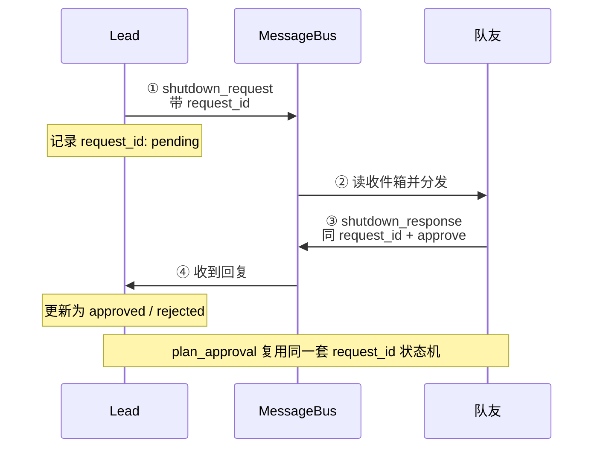

# s16：Team Protocols - 用 request-response 协议管住团队协作

上一章 `s15` 给团队搭起了文件邮箱，但消息只是自由文本。只要团队忙起来，多个队友同时发来计划、或者 Lead 想请某个队友优雅停机，光靠自然语言聊天很快就会对不上“哪条回复对应哪件事”。

这一章我们在文件邮箱上叠一层团队协议。**Team Protocols 的核心是把自由聊天升级成带 `request_id` 的请求-响应状态机：每个事务从 `pending` 出发，自动回执路由核对请求编号与响应类型，人工审批核对编号与 `pending` 状态，最终单向推进到 `approved` 或 `rejected`。**

## 问题

没有结构化协议时，异步多 Agent 协作容易在三个地方失控：多个队友同时提交方案，Lead 分不清自己批复的是哪一份；不能强杀正在改文件的队友，却缺少礼貌退出的握手约定；重复响应或错类型响应很容易把状态写乱。

## 解决方案

我们给 `sendMessage` 增加结构化 `metadata`（承载 `request_id` 和 `approve`），用 `pendingRequests` 统一管理“关机握手”和“计划审批”两类事务，并通过 `consumeLeadInbox()` 自动路由回执：



这套协议层有三个关键设计：

- **同一张表管两类握手**：Lead 侧新增 `request_shutdown`、`request_plan`、`review_plan`，队友侧新增 `submit_plan`（不放进 Lead 工具池）。`matchResponse()` 路由回执时会同时校验响应类型与 `status === "pending"`；`review_plan` 则按编号校验请求存在且为 `pending` 后写回 `plan_approval_response`（教学版未额外校验 `state.type`）。
- **队友短暂空闲轮询（idle loop）**：队友完成一轮回复后不立刻退出，而是把 `needsModel` 置为 `false`，每 250ms 检查一次收件箱（最多约 5 秒），空闲时不调模型不花钱，却能接住后续的 `shutdown_request` 或 `plan_approval_response`。
- **教学边界与日志降噪**：`submit_plan` 只是协议约定而非硬写锁；每轮开头自动注入收件箱只截取 `[Inbox] From ...` 文本（不含 `request_id`），因此查看编号需靠 `check_inbox` 输出或终端青色 `[protocol]` 日志。本章同时精简了上一章的逐轮日志，并在提示词里提醒 Lead 用 `check_inbox` 代替 `sleep` 轮询。

## 测试 Prompt

测试计划审批握手：

```text
Spawn bob as a backend developer and ask only for a plan to update package.json. When the plan arrives, approve it by request_id and check your inbox.
```

运行后可以看到 Bob 调用 `submit_plan` 发出 `plan_approval_request`。对照 `check_inbox` 输出或终端 `[protocol]` 日志拿到 `request_id` 后，Lead 调用 `review_plan` 将该请求推进到 `approved`（若本轮开头已自动消费收件箱，再调 `check_inbox` 可能返回 `(inbox empty)`，此时直接以日志里的 `request_id` 为准）。

也可以单独测试优雅关机握手：

```text
Spawn alice as a developer, then use request_shutdown for alice and check your inbox.
```

观察青色 `[protocol]` 日志：Lead 发出 `shutdown_request`，处于空闲轮询中的 Alice 回发同编号的 `shutdown_response`，`matchResponse` 随即把该请求更新为 `approved`。

## 扩展阅读：商业级 Agent 怎么做团队协议

成熟的商业产品同样把“团队控制面”和“自由对话”分开，让审批、派活与停机都有清晰状态：

- **Claude Code**：Agent Teams 提供统一的团队控制面，Lead 可以要求 teammate 先提交 plan 再审批，也能统一协调共享任务列表和优雅关闭。参考 [Claude Code Agent Teams](https://code.claude.com/docs/en/agent-teams)。
- **Codex**：公开设计偏向主会话编排 subagents，由运行时统一负责 spawn、等待、汇总与回收，把协作协议收拢在编排层内部。参考 [Codex Subagents](https://developers.openai.com/codex/subagents)。
- **opencode**：通过角色化 primary / subagent 配置与细粒度工具权限控制协作边界，再由提示词与工具约定承载审批流程。参考 [opencode Agents](https://opencode.ai/docs/agents/)。

**一旦给异步通信加上 `request_id` 和状态机，团队协作就从“随口聊天”变成了可追踪、可调试的事务。**

## 本地运行与测试

交互运行（从仓库根目录执行）：

```bash
cd code-agent-course && node s16-team-protocols.js
```

离线单测（在仓库根目录执行，无需 API Token）：

```bash
pnpm vitest run code-agent-course/s16-team-protocols.test.js
```

## 博客代码演进

### 1. 给消息加上 `metadata`，再建一张请求状态表

`s15` 的消息只有纯文本，收到回复时对不上它回应的是哪次请求。我们先补齐基础设施：给 `sendMessage` 增加可选的 `metadata` 参数用来携带 `request_id` 等结构化字段，再建一张 `pendingRequests` 表记录所有待处理请求的类型、收发方、负载与状态（`pending` / `approved` / `rejected`），配好 `newRequestId` 和测试用的 `resetProtocol`。

```diff agent-step
@@
   mailboxDir = dir;
 }
-export function sendMessage(from, to, content, type = "message") {
+export function sendMessage(from, to, content, type = "message", metadata = {}) {
   mkdirSync(mailboxDir, { recursive: true });
-  appendFileSync(path.join(mailboxDir, `${to}.jsonl`), `${JSON.stringify({ from, to, content, type, ts: Date.now() })}\n`);
   colorLog("yellow", `[bus] ${from} → ${to}: ${preview(content, 50)}`);
+  appendFileSync(path.join(mailboxDir, `${to}.jsonl`), `${JSON.stringify({ from, to, content, type, ts: Date.now(), metadata })}\n`);
 }
 export function readInbox(agent) {
@@
   return msgs.map((m) => `[${m.from}] ${m.content.slice(0, 200)}`).join("\n");
 }
+
+export const pendingRequests = new Map();
+let reqSeq = 0;
+export function resetProtocol() {
+  pendingRequests.clear();
+  reqSeq = 0;
+}
+const newRequestId = () => `req_${String(reqSeq++).padStart(4, "0")}`;
 
 const TRANSCRIPT_DIR = path.join(process.cwd(), ".transcripts");
```

### 2. request_shutdown：Lead 发起优雅关机请求

先实现第一种协议：关机握手。Lead 不能粗暴强杀队友，而是由 `runRequestShutdown` 生成编号、在 `pendingRequests` 记下 `pending` 状态，再发送一条带 `request_id` 的 `shutdown_request` 消息。同步注册工具 schema 与 `handlers`，并把本章三个 Lead 专属协议工具加入 `SUB_EXCLUDE`，避免子代理越权发号施令。

```diff agent-step
@@
 const newRequestId = () => `req_${String(reqSeq++).padStart(4, "0")}`;
 
+function runRequestShutdown({ teammate }) {
+  const reqId = newRequestId();
+  pendingRequests.set(reqId, { request_id: reqId, type: "shutdown", sender: "lead", target: teammate, status: "pending", payload: "" });
+  sendMessage("lead", teammate, "Please shut down gracefully.", "shutdown_request", { request_id: reqId });
+  return `Shutdown request sent to ${teammate} (req: ${reqId})`;
+}
+
 const TRANSCRIPT_DIR = path.join(process.cwd(), ".transcripts");
 const TOOL_RESULTS_DIR = path.join(process.cwd(), ".task_outputs", "tool-results");
@@
   }),
   tool("check_inbox", "Check the lead's inbox for teammate messages.", { type: "object", properties: {} }),
+  tool("request_shutdown", "Ask a teammate to shut down gracefully (handshake).", {
+    type: "object",
+    properties: { teammate: { type: "string" } },
+    required: ["teammate"],
+  }),
 ];
@@
   send_message: runSendMessage,
   check_inbox: runCheckInbox,
+  request_shutdown: runRequestShutdown,
 };
 
-const SUB_EXCLUDE = ["task", "todo_write", "load_skill", "compact", "spawn_teammate", "send_message", "check_inbox"];
+const SUB_EXCLUDE = [
+  "task",
+  "todo_write",
+  "load_skill",
+  "compact",
+  "spawn_teammate",
+  "send_message",
+  "check_inbox",
+  "request_shutdown",
+  "request_plan",
+  "review_plan",
+];
 const subTools = tools.filter((t) => !SUB_EXCLUDE.includes(t.function.name));
 const subHandlers = Object.fromEntries(
```

### 3. 给队友加上短暂空闲轮询（idle loop）

想让队友接住后续发来的关机请求，它不能刚吐完一句文字就马上退出。我们把队友循环改造成“干完活先进入空闲”：模型不再调工具时只将 `needsModel` 置为 `false`，随后每 `250ms` 巡检一次收件箱，有新消息就重新唤醒模型；若连续空闲到达上限才退出。空闲期不调 LLM，既省费用又保持在线响应。

```diff agent-step
@@
   activeTeammates.clear();
 }
-const TEAMMATE_TURNS = 10;
+const TEAMMATE_TURNS = 20;
+const TEAMMATE_IDLE_TICKS = 20;
+const TEAMMATE_IDLE_MS = 250;
 
 export function spawnTeammate(name, role, prompt, confirm) {
@@
     const messages = [{ role: "user", content: prompt }];
     let summary = "Done.";
+    let needsModel = true;
+    let idleTicks = 0;
     for (let turn = 0; turn < TEAMMATE_TURNS; turn += 1) {
       const inbox = readInbox(name);
-      if (inbox.length) messages.push({ role: "user", content: `<inbox>${JSON.stringify(inbox)}</inbox>` });
+      const nonProtocol = [];
+      for (const msg of inbox) {
+          nonProtocol.push(msg);
+      }
+      if (nonProtocol.length) {
+        messages.push({ role: "user", content: `<inbox>${JSON.stringify(nonProtocol)}</inbox>` });
+        needsModel = true;
+        idleTicks = 0;
+      }
+      if (!needsModel) {
+        idleTicks += 1;
+        if (idleTicks >= TEAMMATE_IDLE_TICKS) break;
+        await sleep(TEAMMATE_IDLE_MS);
+        continue;
+      }
       const { message } = await callLlm(messages.slice(-20), { system, tools: teamTools });
       messages.push(message);
       if (!message.tool_calls?.length) {
         summary = message.content || summary;
-        break;
+        needsModel = false;
+        continue;
       }
+      idleTicks = 0;
       for (const call of message.tool_calls) {
         const toolName = call.function.name;
```

### 4. 队友响应关机请求

现在让队友按消息类型分流收件箱：遇到 `shutdown_request` 先存进 `pendingShutdown`，不打断当前正在跑的工具或回复；等手头这轮收尾（`!needsModel`）时，立刻带着原 `request_id` 和 `approve: true` 回发 `shutdown_response` 并跳出循环。请求与回执凭同一个编号对上号，关机握手就成立了。

```diff agent-step
@@
     let needsModel = true;
     let idleTicks = 0;
+    let pendingShutdown = null;
     for (let turn = 0; turn < TEAMMATE_TURNS; turn += 1) {
       const inbox = readInbox(name);
       const nonProtocol = [];
       for (const msg of inbox) {
+        if (msg.type === "shutdown_request") {
+          pendingShutdown = msg;
+        } else {
           nonProtocol.push(msg);
+        }
       }
       if (nonProtocol.length) {
@@
         needsModel = true;
         idleTicks = 0;
+      }
+      if (pendingShutdown && !needsModel) {
+        sendMessage(name, "lead", "Shutting down gracefully.", "shutdown_response", {
+          request_id: pendingShutdown.metadata?.request_id,
+          approve: true,
+        });
+        summary = "Shut down gracefully.";
+        break;
       }
       if (!needsModel) {
```

### 5. Lead 收回执并推进状态机

回复回到 Lead 邮箱后，需要由状态机来核销。`matchResponse` 按 `request_id` 查表，核对响应类型是否与请求类型匹配且当前仍为 `pending`，再更新为 `approved` 或 `rejected`，防重复处理。`consumeLeadInbox` 在读邮箱时自动把所有 `*_response` 路由给 `matchResponse`，并统一替换掉主循环与 `check_inbox` 里的旧读取调用。

```diff agent-step
@@
 }
 function runCheckInbox() {
-  const msgs = readInbox("lead");
+  const msgs = consumeLeadInbox(true);
   if (!msgs.length) return "(inbox empty)";
   return msgs.map((m) => `[${m.from}] ${m.content.slice(0, 200)}`).join("\n");
@@
 const newRequestId = () => `req_${String(reqSeq++).padStart(4, "0")}`;
 
+export function matchResponse(responseType, requestId, approve) {
+  const state = pendingRequests.get(requestId);
+  if (!state) return;
+  if (state.type === "shutdown" && responseType !== "shutdown_response") return;
+  if (state.type === "plan_approval" && responseType !== "plan_approval_response") return;
+  if (state.status !== "pending") return;
+  state.status = approve ? "approved" : "rejected";
+}
+
+export function consumeLeadInbox(routeProtocol = true) {
+  const msgs = readInbox("lead");
+  if (routeProtocol) {
+    for (const msg of msgs) {
+      const reqId = msg.metadata?.request_id;
+      if (reqId && msg.type?.endsWith("_response")) {
+        matchResponse(msg.type, reqId, msg.metadata?.approve || false);
+      }
+    }
+  }
+  return msgs;
+}
+
 function runRequestShutdown({ teammate }) {
   const reqId = newRequestId();
@@
 
     injectCronJobs(messages);
-    for (const m of readInbox("lead")) {
+    for (const m of consumeLeadInbox()) {
       messages.push({ role: "user", content: `[Inbox] From ${m.from}: ${m.content.slice(0, 200)}` });
     }
```

### 6. submit_plan：队友主动提交计划待审

第二种协议方向相反：由队友向 Lead 发起审批请求。我们只在队友自己的 `teamTools` 里新增 `submit_plan`，调用 `teammateSubmitPlan` 生成编号、写入 `plan_approval` 类型的 `pending` 记录，并发出 `plan_approval_request`。同时增强 `check_inbox` 输出格式，附上消息类型和 `req:req_XXXX`，方便 Lead 精准定位审批单号。

```diff agent-step
@@
       required: ["to", "content"],
     }),
+    tool("submit_plan", "Submit a plan to the lead for approval before acting.", {
+      type: "object",
+      properties: { plan: { type: "string" } },
+      required: ["plan"],
+    }),
   ];
   const teamHandlers = {
@@
       return `Sent to ${to}`;
     },
+    submit_plan: ({ plan }) => teammateSubmitPlan(name, plan),
   };
   const run = async () => {
@@
   const msgs = consumeLeadInbox(true);
   if (!msgs.length) return "(inbox empty)";
-  return msgs.map((m) => `[${m.from}] ${m.content.slice(0, 200)}`).join("\n");
+  return msgs
+    .map((m) => {
+      const reqId = m.metadata?.request_id;
+      const tag = reqId ? `[${m.type} req:${reqId}]` : `[${m.type}]`;
+      return `[${m.from}]${tag} ${m.content.slice(0, 200)}`;
+    })
+    .join("\n");
 }
@@
   }
   return msgs;
+}
+
+function teammateSubmitPlan(fromName, plan) {
+  const reqId = newRequestId();
+  pendingRequests.set(reqId, { request_id: reqId, type: "plan_approval", sender: fromName, target: "lead", status: "pending", payload: plan });
+  sendMessage(fromName, "lead", plan, "plan_approval_request", { request_id: reqId });
+  return `Plan submitted (${reqId}). Waiting for approval...`;
 }
```

### 7. request_plan 和 review_plan：Lead 索要并审批计划

给 Lead 补上配套的两个工具：`request_plan` 发一条普通消息催队友先出方案；`review_plan` 按 `request_id` 找到待审记录，校验仍处于 `pending` 后改写为 `approved` 或 `rejected`（防重复批复），再把附带审批结果和反馈意见的 `plan_approval_response` 发回原队友。

```diff agent-step
@@
   return `Shutdown request sent to ${teammate} (req: ${reqId})`;
 }
+function runRequestPlan({ teammate, task }) {
+  sendMessage("lead", teammate, `Please submit a plan for: ${task}`, "message");
+  return `Asked ${teammate} to submit a plan`;
+}
+function runReviewPlan({ request_id, approve, feedback = "" }) {
+  const state = pendingRequests.get(request_id);
+  if (!state) return `Request ${request_id} not found`;
+  if (state.status !== "pending") return `Request ${request_id} already ${state.status}`;
+  state.status = approve ? "approved" : "rejected";
+  sendMessage("lead", state.sender, feedback || (approve ? "Approved" : "Rejected"), "plan_approval_response", { request_id, approve });
+  return `Plan ${approve ? "approved" : "rejected"} (${request_id})`;
+}
 
 const TRANSCRIPT_DIR = path.join(process.cwd(), ".transcripts");
@@
     required: ["teammate"],
   }),
+  tool("request_plan", "Ask a teammate to submit a plan before acting.", {
+    type: "object",
+    properties: { teammate: { type: "string" }, task: { type: "string" } },
+    required: ["teammate", "task"],
+  }),
+  tool("review_plan", "Approve or reject a submitted plan by request_id.", {
+    type: "object",
+    properties: {
+      request_id: { type: "string" },
+      approve: { type: "boolean" },
+      feedback: { type: "string" },
+    },
+    required: ["request_id", "approve"],
+  }),
 ];
@@
   check_inbox: runCheckInbox,
   request_shutdown: runRequestShutdown,
+  request_plan: runRequestPlan,
+  review_plan: runReviewPlan,
 };
```

### 8. 队友接收审批结果并唤醒继续执行

最后闭合队友侧的审批分支：巡检收件箱遇到 `plan_approval_response` 时，转换成 `[Plan approved] Proceed.` 或 `[Plan rejected] <反馈>` 塞进对话，同时把 `needsModel` 拨回 `true`、重置空闲计数。我们也在 Lead 的 `identity` 提示词里补了一句引导：用 `check_inbox` 跟进队友，不要写 `sleep` 循环干等文件。提示符切到 `s16 >> `。

```diff agent-step
@@
         if (msg.type === "shutdown_request") {
           pendingShutdown = msg;
+        } else if (msg.type === "plan_approval_response") {
+          messages.push({
+            role: "user",
+            content: msg.metadata?.approve ? "[Plan approved] Proceed." : `[Plan rejected] ${msg.content}`,
+          });
+          needsModel = true;
+          idleTicks = 0;
         } else {
           nonProtocol.push(msg);
@@
 const PROMPT_SECTIONS = {
   identity: () =>
-    `You are a coding agent at ${process.cwd()}. Use tools to solve tasks. Before a multi-step task, use todo_write to plan and update status as you go. For a complex sub-problem, use the task tool to spawn a subagent.`,
+    `You are a coding agent at ${process.cwd()}. Use tools to solve tasks. Before a multi-step task, use todo_write to plan and update status as you go. For a complex sub-problem, use the task tool to spawn a subagent. When delegating to a teammate, prefer check_inbox for teammate updates; do not use sleep loops to wait for files unless the user explicitly asks you to wait.`,
   tools: (ctx) => (ctx.tools.length ? `Available tools: ${ctx.tools.join(", ")}.` : null),
   skills: (ctx) =>
@@
   ticker.unref?.();
   await runChatCli({
-    promptLabel: "s15 >> ",
+    promptLabel: "s16 >> ",
     onPrompt: async ({ prompt, messages, ask }) => {
       return runInteractiveAgentTurn(messages, ask);
```

### 9. 补上协议日志并收起冗余追踪

最后在协议流转的每个关键节点加上青色/绿色/黄色的 `[protocol]` 日志，让“请求 → 路由 → 批复 → 状态变迁”的完整握手清晰呈现。为了让协议日志成为视觉主角，这一步同步精简了主循环里的逐轮 trace，并把普通 `[bus]` 和 `[teammate]` 日志降回普通输出。

> **本章思考题**：到这里，单个 Agent 的循环、记忆、恢复、任务图、定时调度和多队友协议全都齐了，但所有工具依然写死在源码里。如果明天要接入公司文档库、数据库或部署平台，总不能每次都改主文件重发。怎么用标准协议在运行时动态发现外部工具，并无缝接进同一条循环和权限门？下一章 `s17` 我们来做 MCP Plugin。

```diff agent-step
@@
 export function sendMessage(from, to, content, type = "message", metadata = {}) {
   mkdirSync(mailboxDir, { recursive: true });
-  colorLog("yellow", `[bus] ${from} → ${to}: ${preview(content, 50)}`);
   appendFileSync(path.join(mailboxDir, `${to}.jsonl`), `${JSON.stringify({ from, to, content, type, ts: Date.now(), metadata })}\n`);
+  console.log(`  [bus] ${from} → ${to}: ${preview(content, 50)}`);
+  if (type !== "message") {
+    const req = metadata.request_id ? ` ${metadata.request_id}` : "";
+    colorLog("cyan", `[protocol] ${type}${req}: ${from} → ${to}`);
+  }
 }
 export function readInbox(agent) {
@@
           pendingShutdown = msg;
         } else if (msg.type === "plan_approval_response") {
+          colorLog(msg.metadata?.approve ? "green" : "yellow", `[protocol] ${name} received plan review ${msg.metadata?.request_id}`);
           messages.push({
             role: "user",
@@
       }
       if (pendingShutdown && !needsModel) {
+        colorLog("cyan", `[protocol] ${name} received shutdown request ${pendingShutdown.metadata?.request_id}`);
         sendMessage(name, "lead", "Shutting down gracefully.", "shutdown_response", {
           request_id: pendingShutdown.metadata?.request_id,
@@
     .finally(() => {
       activeTeammates.delete(name);
-      colorLog("green", `[teammate] ${name} finished`);
+      console.log(`  [teammate] ${name} finished`);
     });
 
-  colorLog("cyan", `[teammate] ${name} spawned as ${role}`);
+  console.log(`  [teammate] ${name} spawned as ${role}`);
   return `Teammate '${name}' spawned as ${role}`;
 }
@@
   if (state.status !== "pending") return;
   state.status = approve ? "approved" : "rejected";
+  colorLog(approve ? "green" : "yellow", `[protocol] ${requestId} ${state.status}`);
 }
@@
       const reqId = msg.metadata?.request_id;
       if (reqId && msg.type?.endsWith("_response")) {
+        colorLog("cyan", `[protocol] route response ${reqId} from ${msg.from}`);
         matchResponse(msg.type, reqId, msg.metadata?.approve || false);
       }
@@
   const reqId = newRequestId();
   pendingRequests.set(reqId, { request_id: reqId, type: "plan_approval", sender: fromName, target: "lead", status: "pending", payload: plan });
+  colorLog("cyan", `[protocol] ${fromName} submitted plan ${reqId}`);
   sendMessage(fromName, "lead", plan, "plan_approval_request", { request_id: reqId });
   return `Plan submitted (${reqId}). Waiting for approval...`;
@@
 }
 function runRequestPlan({ teammate, task }) {
+  colorLog("cyan", `[protocol] ask ${teammate} for a plan`);
   sendMessage("lead", teammate, `Please submit a plan for: ${task}`, "message");
   return `Asked ${teammate} to submit a plan`;
@@
   while (true) {
     turn += 1;
-    console.log(`\n[turn ${turn}]`);
     injectBackgroundNotifications(messages);
@@
       await waitForBackgroundTick();
       if (injectBackgroundNotifications(messages)) continue;
-      console.log(`  [assistant] ${preview(message.content || "(no text)", 100)}`);
       await extractMemories(preCompress);
       await consolidateMemories();
@@
           return handler ? handler(args, confirm) : `Unknown tool: ${name}`;
         });
-        console.log(`  [background start] ${bgId}`);
         output = `[Background task ${bgId} started] ${args.command || name}. Result will arrive when complete.`;
       } else {
@@
       if (name === "todo_write") roundsSinceTodo = 0;
       messages.push({ role: "tool", tool_call_id: call.id, content: String(output) });
-      console.log(`  [tool result] ${preview(output, 120)}`);
     }
     if (compacted) continue;
```

## 和上一步的关键代码 diff（不含 helper.js）

```diff
--- s15-agent-teams.js
+++ s16-team-protocols.js
@@
-export function sendMessage(from, to, content, type = "message") {
+export function sendMessage(from, to, content, type = "message", metadata = {}) {
   mkdirSync(mailboxDir, { recursive: true });
-  appendFileSync(path.join(mailboxDir, `${to}.jsonl`), `${JSON.stringify({ from, to, content, type, ts: Date.now() })}\n`);
+  appendFileSync(path.join(mailboxDir, `${to}.jsonl`), `${JSON.stringify({ from, to, content, type, ts: Date.now(), metadata })}\n`);
 }
@@
-const TEAMMATE_TURNS = 10;
+const TEAMMATE_TURNS = 20;
+const TEAMMATE_IDLE_TICKS = 20;
+const TEAMMATE_IDLE_MS = 250;
@@
+export const pendingRequests = new Map();
+let reqSeq = 0;
+const newRequestId = () => `req_${String(reqSeq++).padStart(4, "0")}`;
+
+export function matchResponse(responseType, requestId, approve) {
+  const state = pendingRequests.get(requestId);
+  if (!state) return;
+  if (state.type === "shutdown" && responseType !== "shutdown_response") return;
+  if (state.type === "plan_approval" && responseType !== "plan_approval_response") return;
+  if (state.status !== "pending") return;
+  state.status = approve ? "approved" : "rejected";
+}
+
+export function consumeLeadInbox(routeProtocol = true) {
+  const msgs = readInbox("lead");
+  if (routeProtocol) {
+    for (const msg of msgs) {
+      const reqId = msg.metadata?.request_id;
+      if (reqId && msg.type?.endsWith("_response")) {
+        matchResponse(msg.type, reqId, msg.metadata?.approve || false);
+      }
+    }
+  }
+  return msgs;
+}
@@
+  request_shutdown: runRequestShutdown,
+  request_plan: runRequestPlan,
+  review_plan: runReviewPlan,
@@
-    for (const m of readInbox("lead")) {
+    for (const m of consumeLeadInbox()) {
       messages.push({ role: "user", content: `[Inbox] From ${m.from}: ${m.content.slice(0, 200)}` });
     }
```
