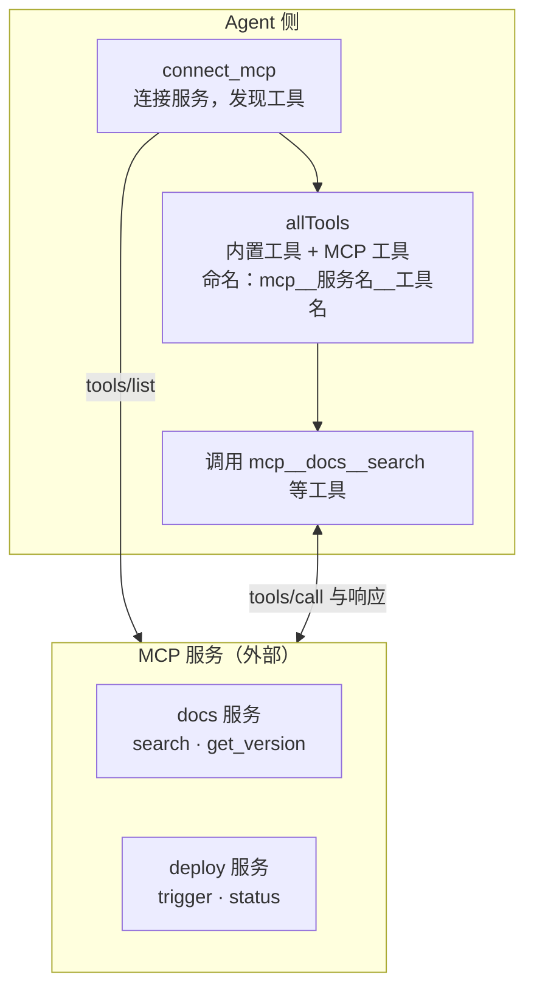

# s17：MCP Plugin —— 外部工具进入统一控制面

一个 coding agent 不可能把搜索、数据库、浏览器、部署平台和公司内部系统全写进主文件。`s17` 用一个可运行的 mock MCP hub 演示：外部工具被发现以后，怎样和内置工具共用同一条 agent loop。

## 本章目标

`s16` 已经有动态 prompt、权限 hook、任务、后台执行、团队和协议。`s17` 保留这些能力，只增加一条外部工具接入路径：

1. 模型调用 `connect_mcp` 连接一个 mock server。
2. hub 返回该 server 暴露的工具定义。
3. 工具名被改成 `mcp__server__tool`，避免和内置工具重名。
4. 下一轮模型请求使用更新后的工具池和 system prompt。
5. 模型调用 MCP 工具时，仍走权限检查、handler 分发和 `tool_call_id` 回灌。

## 流程图


```text
内置 tools
    |
    +--------------------------+
    |                          |
    v                          |
connect_mcp("docs")            |
    |                          |
    v                          |
mock hub 发现 search/version  |
    |                          |
    v                          |
mcp__docs__search schema ------+
    |
    v
allTools() -> call LLM -> tool_calls
    |
    v
同一权限门 -> getHandler() -> tool result 回灌
```

## 为什么这一步重要

MCP 的价值不是“多几个工具”，而是把第三方能力转换成 agent 已经认识的工具 schema 和 handler。工具来源可以不同，但模型选择、权限判断、执行和结果回灌不需要另写一条 loop。

## 代码入口

- JS：[s17-mcp-plugin.js](./s17-mcp-plugin.js)
- Test：[s17-mcp-plugin.test.js](./s17-mcp-plugin.test.js)

## 运行

```bash
node code-agent-course/s17-mcp-plugin.js
```

输入：

```text
连接 docs MCP server，搜索 agent loop，然后总结结果。
```

终端会出现类似日志：

```text
> connect_mcp({"name":"docs"})
[mcp] discovered: mcp__docs__search, mcp__docs__get_version
> mcp__docs__search({"query":"agent loop"})
```

## 新增函数速览

- `prefixedMcpName(serverName, toolDef)`：生成 `mcp__docs__search` 形式的全局工具名。
- `createMockMcpHub()`：创建内置 `docs`、`deploy` server，并保存已连接 server。
- `resetMcp()`：测试入口，重建 hub 并清空 system prompt 缓存。
- `mcpToolSchemas()`：把已发现工具转成模型可接收的 function tool schema。
- `allTools()`：合并内置工具与当前已发现的 MCP 工具。
- `findMcpTool(name)` / `getHandler(name)`：按名字查找 MCP 定义，并把内置与外部 handler 统一到一个分发入口。
- `runConnectMcp({ name })`：连接 mock server，打印新发现的工具，并让 prompt 缓存失效。

## 本章模拟了什么

mock server 中的一项工具定义长这样：

```js
{
  name: "search",
  description: "Search docs content.",
  annotations: { readOnly: true },
  parameters: {
    type: "object",
    properties: { query: { type: "string" } },
    required: ["query"],
  },
  handler({ query }) {
    return `docs search result for: ${query}`;
  },
}
```

hub 连接后给工具加 server 前缀：

```js
function prefixedMcpName(serverName, toolDef) {
  return `mcp__${serverName}__${toolDef.name}`;
}
```

然后 `mcpToolSchemas()` 复用前面章节的 `tool()`，把定义转换成 OpenAI-compatible function tool 格式：

```js
function mcpToolSchemas() {
  return mcpHub
    .discoveredTools()
    .map((toolDef) => tool(toolDef.name, toolDef.description, toolDef.parameters));
}

function allTools() {
  return [...tools, ...mcpToolSchemas()];
}
```

所以模型最终看到的仍是熟悉的结构：

```json
{
  "type": "function",
  "function": {
    "name": "mcp__docs__search",
    "description": "Search docs content.",
    "parameters": {
      "type": "object",
      "properties": { "query": { "type": "string" } },
      "required": ["query"]
    }
  }
}
```

## 动态工具怎样进入 loop

`connect_mcp` 不直接搜索文档，它只改变工具注册表：

```js
function runConnectMcp({ name }) {
  try {
    const before = mcpHub.discoveredTools().map((toolDef) => toolDef.name);
    const server = mcpHub.connect(name);
    const discovered = mcpHub
      .discoveredTools()
      .map((toolDef) => toolDef.name)
      .filter((toolName) => !before.includes(toolName));
    if (discovered.length) console.log(`[mcp] discovered: ${discovered.join(", ")}`);
    resetSystemPromptCache();
    return `Connected MCP server ${name}. Discovered ${server.tools.length} tools.`;
  } catch (error) {
    return `Error: ${error.message}`;
  }
}
```

下一轮调用 LLM 时使用 `allTools()`，`buildContext()` 也读取同一个列表。因此新工具既进入 API 请求，也进入动态 system prompt：

```js
callLlm(buildRequest(messages, memoriesContent), {
  system,
  tools: allTools(),
  model: state.currentModel,
  maxTokens,
})
```

执行阶段先尝试查 MCP 工具，再回退到内置 handlers：

```js
function getHandler(name) {
  const mcpTool = findMcpTool(name);
  return mcpTool ? mcpTool.handler : handlers[name];
}
```

无论来源是什么，执行结果仍使用原始 `call.id` 写回：

```js
messages.push({ role: "tool", tool_call_id: call.id, content: String(output) });
```

## 权限和 annotations

mock `deploy.trigger` 带有 `annotations: { destructive: true }`。主循环在调用 handler 前直接拦截：

```js
} else if (mcpTool?.annotations?.destructive) {
  output = `Permission blocked: ${name} is marked destructive.`;
}
```

这里有两个边界必须讲清楚：

- 本章的 `readOnly` / `destructive` 是教学简写；MCP 正式 schema 使用 `readOnlyHint`、`destructiveHint` 等字段。
- MCP 规范说明 annotations 只是提示，来自不可信 server 时不能直接当成安全事实。生产系统还要结合 server 信任、工具 allowlist 和用户审批。

## 测试 Prompt

```text
连接 docs MCP 搜索 agent loop；再连接 deploy MCP 查询 api 状态，最后尝试 trigger api 并说明为什么被拦截。
```

观察重点：连接前不存在 `mcp__docs__search`；连接后下一轮工具池出现它。`mcp__deploy__status` 可以执行，带 destructive 标记的 `mcp__deploy__trigger` 应返回 `Permission blocked`。

## 教学版边界

本章没有实现真正的 MCP transport。`createMockMcpHub()` 没有 JSON-RPC `initialize`、`tools/list`、`tools/call`、stdio / HTTP transport、OAuth、断线重连或 `list_changed` 通知。

当前动态 MCP 工具只合并进 lead 的主 `agentLoop()`；s06 subagent 和 s15 teammate 仍使用各自固定工具列表。若要让它们共享 MCP，需要在创建子 agent 时也调用 `allTools()`，再按角色过滤权限。

## 扩展阅读：真实 Coding Agent 怎么接 MCP

- Claude Code 支持本地 stdio 和远程 HTTP MCP server，能处理 OAuth、动态 `list_changed`、重连和 tool search；MCP 工具与手动配置工具一起进入会话，但项目级 server 仍需要信任确认。
- Codex CLI 和 IDE 可以作为 MCP client 连接 `config.toml` 中的 server；Codex 也能以实验性 MCP server 运行。app-server 还提供 MCP 状态、资源读取、OAuth 和工具调用接口。
- OpenCode 支持本地与远程 MCP server，并允许用和内置工具相同的 permission 规则控制单个 MCP 工具或整个 server。

参考：[MCP tool schema](https://modelcontextprotocol.io/specification/2025-11-25/schema)、[Claude Code MCP](https://code.claude.com/docs/en/mcp)、[Codex MCP support](https://github.com/openai/codex/blob/main/codex-rs/README.md)、[OpenCode MCP servers](https://opencode.ai/docs/mcp-servers)。

## 一句话总结

`s17` 用 mock hub 证明：外部工具只要被规范化成 schema 和 handler，就能进入同一条 agent loop 和权限控制面。

## 与 s16 的关键代码 diff（不含 helper.js）

下面只展示动态工具注册、prompt 更新、模型请求和 handler 分流；mock server 的完整工具数据见源码。

```diff
--- s16-team-protocols.js
+++ s17-mcp-plugin.js
-    tools: tools.map((t) => t.function.name),
+    tools: allTools().map((t) => t.function.name),

+function prefixedMcpName(serverName, toolDef) {
+  return `mcp__${serverName}__${toolDef.name}`;
+}

+let mcpHub = createMockMcpHub();
+
+export function resetMcp() {
+  mcpHub = createMockMcpHub();
+  resetSystemPromptCache();
+}
+
+function mcpToolSchemas() {
+  return mcpHub
+    .discoveredTools()
+    .map((toolDef) => tool(toolDef.name, toolDef.description, toolDef.parameters));
+}
+
+function allTools() {
+  return [...tools, ...mcpToolSchemas()];
+}
+
+function findMcpTool(name) {
+  return mcpHub.discoveredTools().find((toolDef) => toolDef.name === name);
+}
+
+function getHandler(name) {
+  const mcpTool = findMcpTool(name);
+  return mcpTool ? mcpTool.handler : handlers[name];
+}
+
+function runConnectMcp({ name }) {
+  try {
+    const before = mcpHub.discoveredTools().map((toolDef) => toolDef.name);
+    const server = mcpHub.connect(name);
+    const discovered = mcpHub
+      .discoveredTools()
+      .map((toolDef) => toolDef.name)
+      .filter((toolName) => !before.includes(toolName));
+    if (discovered.length) console.log(`[mcp] discovered: ${discovered.join(", ")}`);
+    resetSystemPromptCache();
+    return `Connected MCP server ${name}. Discovered ${server.tools.length} tools.`;
+  } catch (error) {
+    return `Error: ${error.message}`;
+  }
+}

+  tool("connect_mcp", "Connect to a mock MCP server and discover its tools.", {
+    type: "object",
+    properties: { name: { type: "string" } },
+    required: ["name"],
+  }),

+  connect_mcp: runConnectMcp,

-            tools,
+            tools: allTools(),

+      const mcpTool = findMcpTool(name);

+      } else if (mcpTool?.annotations?.destructive) {
+        output = `Permission blocked: ${name} is marked destructive.`;

-          const handler = handlers[name];
+          const handler = getHandler(name);

-        const handler = handlers[name];
+        const handler = getHandler(name);
```

## 博客代码演进

下面 8 个 patch 专门用于博客右侧的代码切换。第一步基于 `s16-team-protocols.js`，后面的每一步都继续修改上一帧，最后必须得到完整的 `s17-mcp-plugin.js`。

每一步的代码都可以运行。为了不依赖网络，本章用一个写在文件里的“模拟 MCP 中心”来代替真实的 MCP 服务器，重点是看清三件事：连接之后才发现工具，发现的工具和内置工具合并在一起发给模型，执行时仍然经过同一个 loop 和同一套权限。

### 1. 整理开头：MCP 工具怎么起名

到目前为止，所有工具都是我们自己写在文件里的。MCP 是一种约定，让外部的服务器把它的工具提供给 agent 使用。不同服务器可能有同名的工具，所以先定一个命名规则：`mcp__服务器名__工具名`。`prefixedMcpName` 负责拼出这个名字，看到 `mcp__` 开头就知道它来自外部。

```diff agent-step
@@
 const SUB_SYSTEM = `You are a coding subagent at ${process.cwd()}. Complete the task, then return a concise summary. Do not delegate further.`;
 
+function prefixedMcpName(serverName, toolDef) {
+  return `mcp__${serverName}__${toolDef.name}`;
+}
+
 const tools = [
   tool("bash", "Run a shell command. Set run_in_background for slow ops (install/build/test).", {
```

### 2. 模拟一个 MCP 中心

`createMockMcpHub` 创建一个模拟的 MCP 中心。里面有两张表：`servers` 是“有哪些服务器可以连”，`connected` 是“已经连上了哪些”。`connect` 按名字找到服务器，放进 `connected`；名字不存在就抛出错误。真实的 MCP 客户端在这里会启动进程或发起网络连接，再问对方“你有哪些工具”，模拟版本省掉了这些，但先连接、后发现的顺序是一样的。

```diff agent-step
@@
 }
 
+function createMockMcpHub() {
+  const servers = new Map();
+  const connected = new Map();
+
+  return {
+    connect(name) {
+      const server = servers.get(name);
+      if (!server) throw new Error(`Unknown MCP server: ${name}`);
+      connected.set(name, server);
+      return server;
+    },
+  };
+}
+
+let mcpHub = createMockMcpHub();
+
 const tools = [
   tool("bash", "Run a shell command. Set run_in_background for slow ops (install/build/test).", {
```

### 3. 第一个服务器：docs

往中心里登记第一个服务器 `docs`，它提供两个工具：`search` 搜索文档，`get_version` 返回版本号。每个工具的描述方式和我们自己的工具差不多：名字、说明、参数结构，再加一个真正执行的 `handler`。多出来的是 `annotations`，这是服务器对工具性质的声明，这两个都标着 `readOnly`，表示只读、不会改动任何东西。

```diff agent-step
@@
   const connected = new Map();
 
+  servers.set("docs", {
+    name: "docs",
+    tools: [
+      {
+        name: "search",
+        description: "Search docs content.",
+        annotations: { readOnly: true },
+        parameters: {
+          type: "object",
+          properties: { query: { type: "string" } },
+          required: ["query"],
+        },
+        handler({ query }) {
+          return `docs search result for: ${query}`;
+        },
+      },
+      {
+        name: "get_version",
+        description: "Return the docs version.",
+        annotations: { readOnly: true },
+        parameters: { type: "object", properties: {} },
+        handler() {
+          return "docs version: 1.0.0";
+        },
+      },
+    ],
+  });
+
   return {
     connect(name) {
```

### 4. 第二个服务器：deploy

再登记一个服务器 `deploy`，也有两个工具：`status` 查看部署状态，是只读的；`trigger` 触发一次部署，它的 `annotations` 标着 `destructive`，表示这是一个有破坏性的操作。稍后我们会用这个标记来决定要不要拦截它。

```diff agent-step
@@
   });
 
+  servers.set("deploy", {
+    name: "deploy",
+    tools: [
+      {
+        name: "trigger",
+        description: "Trigger a deployment.",
+        annotations: { destructive: true },
+        parameters: {
+          type: "object",
+          properties: { service: { type: "string" } },
+          required: ["service"],
+        },
+        handler({ service }) {
+          return `deploy triggered for: ${service}`;
+        },
+      },
+      {
+        name: "status",
+        description: "Check deployment status.",
+        annotations: { readOnly: true },
+        parameters: {
+          type: "object",
+          properties: { service: { type: "string" } },
+          required: ["service"],
+        },
+        handler({ service }) {
+          return `deploy status for ${service}: running`;
+        },
+      },
+    ],
+  });
+
   return {
     connect(name) {
```

### 5. 把发现的工具和内置工具合在一起

`discoveredTools` 列出所有已连接服务器的工具，并把名字换成带前缀的形式。`mcpToolSchemas` 用我们一直在用的 `tool()` 把它们转成模型认识的 schema。`allTools` 把内置的 `tools` 和这些 schema 拼成一个数组。因为每次都是现算的，刚连上一个服务器，下一次调用 `allTools` 就会多出它的工具。`resetMcp` 给测试用，换一个全新的中心，并清掉系统提示词的缓存。

```diff agent-step
@@
       return server;
     },
+    discoveredTools() {
+      return [...connected.values()].flatMap((server) =>
+        server.tools.map((toolDef) => ({
+          ...toolDef,
+          serverName: server.name,
+          name: prefixedMcpName(server.name, toolDef),
+        })),
+      );
+    },
   };
 }
 
 let mcpHub = createMockMcpHub();
+
+export function resetMcp() {
+  mcpHub = createMockMcpHub();
+  resetSystemPromptCache();
+}
+
+function mcpToolSchemas() {
+  return mcpHub
+    .discoveredTools()
+    .map((toolDef) => tool(toolDef.name, toolDef.description, toolDef.parameters));
+}
+
+function allTools() {
+  return [...tools, ...mcpToolSchemas()];
+}
 
 const tools = [
```

### 6. connect_mcp 工具：让模型自己去连接

把连接做成工具交给模型。`runConnectMcp` 连接指定的服务器，比较连接前后的工具列表，打印新发现了哪些工具，然后清掉系统提示词的缓存，因为 s10 的提示词里列着工具名，现在工具变多了，需要重新拼。连接失败时返回错误信息，不抛异常。`describeToolCall` 也补一个分支，让 MCP 相关的调用在日志里显示完整的名字和参数。

```diff agent-step
@@
 
 function describeToolCall(name, args, background) {
+  if (name === "connect_mcp" || name.startsWith("mcp__")) {
+    return `${name}(${JSON.stringify(args)})`;
+  }
   if (name === "bash") {
     return `bash "${preview(args.command, 60)}" (${background ? "run_in_background=true" : "fast, sync"})`;
@@
 }
 
+function runConnectMcp({ name }) {
+  try {
+    const before = mcpHub.discoveredTools().map((toolDef) => toolDef.name);
+    const server = mcpHub.connect(name);
+    const discovered = mcpHub
+      .discoveredTools()
+      .map((toolDef) => toolDef.name)
+      .filter((toolName) => !before.includes(toolName));
+    if (discovered.length) console.log(`[mcp] discovered: ${discovered.join(", ")}`);
+    resetSystemPromptCache();
+    return `Connected MCP server ${name}. Discovered ${server.tools.length} tools.`;
+  } catch (error) {
+    return `Error: ${error.message}`;
+  }
+}
+
 const tools = [
   tool("bash", "Run a shell command. Set run_in_background for slow ops (install/build/test).", {
@@
     required: ["request_id", "approve"],
   }),
+  tool("connect_mcp", "Connect to a mock MCP server and discover its tools.", {
+    type: "object",
+    properties: { name: { type: "string" } },
+    required: ["name"],
+  }),
 ];
@@
   request_plan: runRequestPlan,
   review_plan: runReviewPlan,
+  connect_mcp: runConnectMcp,
 };
```

### 7. loop 用上全部工具

现在把合并后的工具接进 loop，一共三处。调用模型时传 `allTools()`，模型从此能看到 MCP 工具。`buildContext` 也用 `allTools()`，系统提示词里的工具清单保持同步。执行时改用 `getHandler` 找处理函数：先看是不是 MCP 工具，是就用服务器提供的 `handler`，不是再查原来的 `handlers` 表。loop 的结构没有变化，对它来说，外部工具和内置工具走的是同一条路。

```diff agent-step
@@
   const skills = listSkills();
   return {
-    tools: tools.map((t) => t.function.name),
+    tools: allTools().map((t) => t.function.name),
     skills: skills === "(no skills found)" ? "" : skills,
     memories: readMemoryIndex(),
@@
 }
 
+function findMcpTool(name) {
+  return mcpHub.discoveredTools().find((toolDef) => toolDef.name === name);
+}
+
+function getHandler(name) {
+  const mcpTool = findMcpTool(name);
+  return mcpTool ? mcpTool.handler : handlers[name];
+}
+
 function runConnectMcp({ name }) {
   try {
@@
           callLlm(buildRequest(messages, memoriesContent), {
             system,
-            tools,
+            tools: allTools(),
             model: state.currentModel,
             maxTokens,
@@
       } else if (runInBackground) {
         const bgId = startBackgroundTask(name, args, () => {
-          const handler = handlers[name];
+          const handler = getHandler(name);
           if (name === "bash") return runBashInBackground(args.command);
           return handler ? handler(args, confirm) : `Unknown tool: ${name}`;
@@
         output = `[Background task ${bgId} started] ${args.command || name}. Result will arrive when complete.`;
       } else {
-        const handler = handlers[name];
+        const handler = getHandler(name);
         output = handler ? await handler(args, confirm) : `Unknown tool: ${name}`;
       }
```

### 8. 标着 destructive 的工具先拦下

外部工具同样要受权限约束。执行前先用 `findMcpTool` 查一下这个工具，如果它的 `annotations` 标着 `destructive`，就不执行，直接把“已拦截”作为结果交还给模型。所以模型可以调用 `mcp__deploy__status`，但调用 `mcp__deploy__trigger` 会被拦下。这只是最简单的规则，真实系统会在这里询问用户。提示符改成 `s17 >> `，整个 agent 的代码到这里就完整了。

```diff agent-step
@@
       const args = JSON.parse(call.function.arguments || "{}");
       const runInBackground = shouldRunBackground(name, args);
+      const mcpTool = findMcpTool(name);
       console.log(`> ${describeToolCall(name, args, runInBackground)}`);
@@
       if (blocked != null) {
         output = String(blocked);
+      } else if (mcpTool?.annotations?.destructive) {
+        output = `Permission blocked: ${name} is marked destructive.`;
       } else if (runInBackground) {
         const bgId = startBackgroundTask(name, args, () => {
@@
   ticker.unref?.();
   await runChatCli({
-    promptLabel: "s16 >> ",
+    promptLabel: "s17 >> ",
     onPrompt: async ({ prompt, messages, ask }) => {
       return runInteractiveAgentTurn(messages, ask);
```
