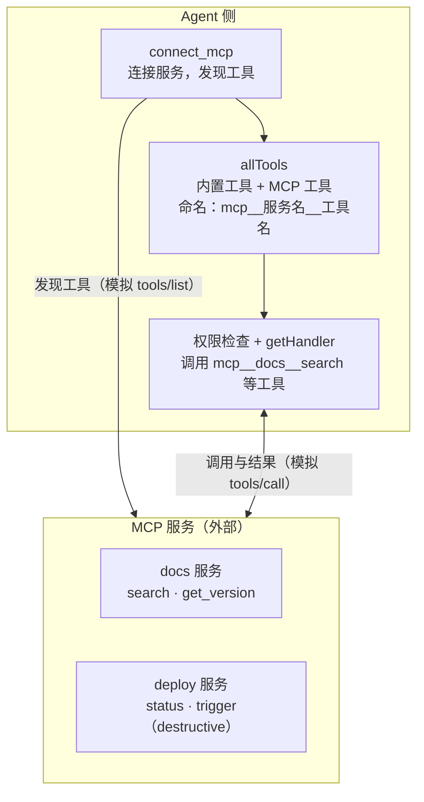

# s17：MCP Plugin - 外部工具接入同一条控制面

前面 `s00` 到 `s16` 已经把 Agent 的内置能力拼齐了：工具调用、权限拦截、上下文压缩、持久化记忆、任务图、后台并发、定时调度、多 Agent 团队与通信协议。但现实里没有哪个 Code Agent 能把文档检索、数据库查询、浏览器操控、部署平台和公司内部系统全硬编码进主文件。

这一章我们引入 **MCP（Model Context Protocol）插件接入层**。用一个不依赖网络的本地模拟 MCP Hub 演示最核心的设计：**外部工具被动态发现后，统一标准化成 schema 和 handler，直接并入主循环的工具池和执行前拦截入口，不用另写第二套循环逻辑。**

## 问题

如果每接一个外部系统（文档库、发布系统、工单平台、监控看板）都要修改 Agent 主源码、手动写死工具和分支逻辑，代码会迅速膨胀且无法复用。我们需要一条标准扩展路径：运行时按需连接外部服务、发现它暴露的工具、防止工具名和内置工具撞车，并在同一条主循环的调度与拦截入口里管住高危外部调用。

## 解决方案

我们给主循环增加一条动态工具发现路径：先提供 `connect_mcp` 内置工具，让模型按需连接本地模拟 MCP Hub（内置 `docs` 和 `deploy` 两个服务）；连上后把发现的工具统一加上 `mcp__服务名__工具名` 前缀，通过 `allTools()` 与内置工具合并发给模型；执行阶段先过主循环统一的拦截入口，再由 `getHandler()` 统一分发并按原始 `tool_call_id` 写回结果：



这里有三个关键设计点：

- **动态刷新工具池与提示词**：`connect_mcp` 连上服务后会立刻调用 `resetSystemPromptCache()`，下一轮的 `buildContext()` 和 `callLlm()` 都从 `allTools()` 取最新工具清单，让模型无缝感知新工具。
- **在同一调度入口拦截破坏性外部工具**：内置 `permissionHook` 目前只检查 `bash` 命令；主循环紧挨着 `PreToolUse` hook 加了一条 `mcpTool?.annotations?.destructive` 分支，调用前先查元数据，命中破坏性标记（如 `deploy.trigger`）就直接返回 `Permission blocked`。
- **教学版边界**：本地 `createMockMcpHub()` 只演示工具发现、合并与拦截闭环，不含真实 JSON-RPC（`initialize` / `tools/list` / `tools/call`）、stdio/HTTP transport、OAuth 或 `list_changed` 通知；`readOnly`/`destructive` 是教学简写（MCP 正式规范为 `readOnlyHint`/`destructiveHint`，且仅作提示不能替代服务信任与审批）；动态 MCP 工具目前只并入 Lead 主循环，子代理与队友仍用各自固定工具集。

## 测试 Prompt

```text
连接 docs MCP 搜索 agent loop；再连接 deploy MCP 查询 api 状态，最后尝试 trigger api 并说明为什么被拦截。
```

运行后可以重点观察三件事：连接前工具池里没有 `mcp__docs__search`，调用 `connect_mcp("docs")` 后终端会打印 `[mcp] discovered: mcp__docs__search, mcp__docs__get_version`，下一轮即可直接搜索文档；随后 `mcp__deploy__status` 正常返回状态，而带 `destructive` 标记的 `mcp__deploy__trigger` 会被拦截并返回 `Permission blocked`。

## 扩展阅读：商业级 Agent 怎么接 MCP

真实产品对接 MCP 时，除了把工具并进统一循环，还要处理传输协议、鉴权和信任边界：

- **Claude Code**：支持本地 stdio 和远程 HTTP MCP server，处理 OAuth、动态 `list_changed`、断线重连和按需工具检索；项目级配置的新 server 必须经过用户信任确认后才会启用。参考 [Claude Code MCP](https://code.claude.com/docs/en/mcp)。
- **Codex**：CLI 与 IDE 可作为 MCP client 连接 `config.toml` 中配置的服务，同时自身也能以实验性 MCP server 模式运行，支持状态查询、资源读取和 OAuth。参考 [Codex MCP support](https://github.com/openai/codex/blob/main/codex-rs/README.md)。
- **opencode**：支持本地与远程 MCP server，并允许用与内置工具一致的 permission 规则按单个工具或整个 server 做放行、询问或拒绝控制。参考 [OpenCode MCP servers](https://opencode.ai/docs/mcp-servers) 与 [MCP tool schema](https://modelcontextprotocol.io/specification/2025-11-25/schema)。

**MCP 真正的威力不是“多塞几个工具”，而是把第三方能力规范成相同的 schema 和 handler，接入同一套循环与权限控制面。**

## 本地运行与测试

交互运行（从仓库根目录执行）：

```bash
cd code-agent-course && node s17-mcp-plugin.js
```

离线单测（在仓库根目录执行，无需 API Token）：

```bash
pnpm vitest run code-agent-course/s17-mcp-plugin.test.js
```

## 博客代码演进

### 1. 给外部工具定统一命名前缀

到现在为止，所有工具都硬编码在主文件里。接进外部 MCP 服务后，不同服务器很可能暴露同名工具（比如都叫 `search` 或 `status`）。我们先约定统一的命名规则 `mcp__服务器名__工具名`，由 `prefixedMcpName` 负责拼接，这样既避免与内置工具撞名，也让模型和日志一眼认出它来自外部服务。

```diff agent-step
@@
 const SUB_SYSTEM = `You are a coding subagent at ${process.cwd()}. Complete the task, then return a concise summary. Do not delegate further.`;
 
+function prefixedMcpName(serverName, toolDef) {
+  return `mcp__${serverName}__${toolDef.name}`;
+}
+
 const tools = [
   tool("bash", "Run a shell command. Set run_in_background for slow ops (install/build/test).", {
```

### 2. 搭一个本地模拟 MCP 中心

`createMockMcpHub` 用两张 Map 模拟外部服务注册中心：`servers` 保存可连接的服务清单，`connected` 记录当前已经连上的服务。调用 `connect(name)` 按名字查找并加入已连接集合，找不到就抛错。真实 MCP 客户端在这里会走 stdio 或 HTTP 握手，本地模拟版省掉网络依赖，但保留了完全一致的“先连接、再发现”顺序。

```diff agent-step
@@
 }
 
+function createMockMcpHub() {
+  const servers = new Map();
+  const connected = new Map();
+
+  return {
+    connect(name) {
+      const server = servers.get(name);
+      if (!server) throw new Error(`Unknown MCP server: ${name}`);
+      connected.set(name, server);
+      return server;
+    },
+  };
+}
+
+let mcpHub = createMockMcpHub();
+
 const tools = [
   tool("bash", "Run a shell command. Set run_in_background for slow ops (install/build/test).", {
```

### 3. 注册第一个模拟服务：`docs`

往中心里挂上第一个外部服务 `docs`，暴露 `search` 和 `get_version` 两个工具。除了熟悉的名称、描述、参数 schema 和 `handler` 外，还多了一个 `annotations` 字段用来声明工具性质；这两个都标着 `readOnly: true`，表示纯只读操作。

```diff agent-step
@@
   const connected = new Map();
 
+  servers.set("docs", {
+    name: "docs",
+    tools: [
+      {
+        name: "search",
+        description: "Search docs content.",
+        annotations: { readOnly: true },
+        parameters: {
+          type: "object",
+          properties: { query: { type: "string" } },
+          required: ["query"],
+        },
+        handler({ query }) {
+          return `docs search result for: ${query}`;
+        },
+      },
+      {
+        name: "get_version",
+        description: "Return the docs version.",
+        annotations: { readOnly: true },
+        parameters: { type: "object", properties: {} },
+        handler() {
+          return "docs version: 1.0.0";
+        },
+      },
+    ],
+  });
+
   return {
     connect(name) {
```

### 4. 注册第二个模拟服务：`deploy`

再挂上第二个服务 `deploy`，同样包含两个工具：`status` 查看部署状态，标为 `readOnly: true`；`trigger` 触发发布动作，在 `annotations` 里显式标出 `destructive: true`。待会儿我们会用这个破坏性标记演示权限拦截。

```diff agent-step
@@
   });
 
+  servers.set("deploy", {
+    name: "deploy",
+    tools: [
+      {
+        name: "trigger",
+        description: "Trigger a deployment.",
+        annotations: { destructive: true },
+        parameters: {
+          type: "object",
+          properties: { service: { type: "string" } },
+          required: ["service"],
+        },
+        handler({ service }) {
+          return `deploy triggered for: ${service}`;
+        },
+      },
+      {
+        name: "status",
+        description: "Check deployment status.",
+        annotations: { readOnly: true },
+        parameters: {
+          type: "object",
+          properties: { service: { type: "string" } },
+          required: ["service"],
+        },
+        handler({ service }) {
+          return `deploy status for ${service}: running`;
+        },
+      },
+    ],
+  });
+
   return {
     connect(name) {
```

### 5. 把发现的外部工具合并进统一工具池

`discoveredTools()` 汇总所有已连接服务的工具并套上 `mcp__server__tool` 前缀；`mcpToolSchemas()` 复用 `tool()` 把它们转成标准 OpenAI-compatible function schema；`allTools()` 则动态拼接内置 `tools` 与外部 MCP 工具。只要新连上服务，下一次调 `allTools()` 就能立刻看到新工具。顺手导出 `resetMcp()` 供测试清理状态和提示词缓存。

```diff agent-step
@@
       return server;
     },
+    discoveredTools() {
+      return [...connected.values()].flatMap((server) =>
+        server.tools.map((toolDef) => ({
+          ...toolDef,
+          serverName: server.name,
+          name: prefixedMcpName(server.name, toolDef),
+        })),
+      );
+    },
   };
 }
 
 let mcpHub = createMockMcpHub();
+
+export function resetMcp() {
+  mcpHub = createMockMcpHub();
+  resetSystemPromptCache();
+}
+
+function mcpToolSchemas() {
+  return mcpHub
+    .discoveredTools()
+    .map((toolDef) => tool(toolDef.name, toolDef.description, toolDef.parameters));
+}
+
+function allTools() {
+  return [...tools, ...mcpToolSchemas()];
+}
 
 const tools = [
```

### 6. connect_mcp 工具：让模型在运行时按需连接

把连接动作做成内置工具交给模型：`runConnectMcp` 调用 `mcpHub.connect(name)`，对比前后清单打印 `[mcp] discovered: ...`，然后调用 `resetSystemPromptCache()` 触发 `s10` 系统提示词重拼，出错则返回友好错误文案不崩主循环。顺手在 `describeToolCall` 里补上分支，让终端日志完整打印 `connect_mcp` 和 `mcp__*` 的参数。

```diff agent-step
@@
 
 function describeToolCall(name, args, background) {
+  if (name === "connect_mcp" || name.startsWith("mcp__")) {
+    return `${name}(${JSON.stringify(args)})`;
+  }
   if (name === "bash") {
     return `bash "${preview(args.command, 60)}" (${background ? "run_in_background=true" : "fast, sync"})`;
@@
 }
 
+function runConnectMcp({ name }) {
+  try {
+    const before = mcpHub.discoveredTools().map((toolDef) => toolDef.name);
+    const server = mcpHub.connect(name);
+    const discovered = mcpHub
+      .discoveredTools()
+      .map((toolDef) => toolDef.name)
+      .filter((toolName) => !before.includes(toolName));
+    if (discovered.length) console.log(`[mcp] discovered: ${discovered.join(", ")}`);
+    resetSystemPromptCache();
+    return `Connected MCP server ${name}. Discovered ${server.tools.length} tools.`;
+  } catch (error) {
+    return `Error: ${error.message}`;
+  }
+}
+
 const tools = [
   tool("bash", "Run a shell command. Set run_in_background for slow ops (install/build/test).", {
@@
     required: ["request_id", "approve"],
   }),
+  tool("connect_mcp", "Connect to a mock MCP server and discover its tools.", {
+    type: "object",
+    properties: { name: { type: "string" } },
+    required: ["name"],
+  }),
 ];
@@
   request_plan: runRequestPlan,
   review_plan: runReviewPlan,
+  connect_mcp: runConnectMcp,
 };
```

### 7. 把合并工具池和统一分发接进主循环

这一步只动三个接入点，就把外部工具彻底融进了原有循环：`buildContext()` 改读 `allTools()`，让动态提示词里的工具列表保持同步；`callLlm()` 传入 `tools: allTools()`；执行分支统一改调 `getHandler(name)`（先查 MCP 工具，再回退内置 `handlers`）。整条 `agentLoop` 骨架纹丝不动。

```diff agent-step
@@
   const skills = listSkills();
   return {
-    tools: tools.map((t) => t.function.name),
+    tools: allTools().map((t) => t.function.name),
     skills: skills === "(no skills found)" ? "" : skills,
     memories: readMemoryIndex(),
@@
 }
 
+function findMcpTool(name) {
+  return mcpHub.discoveredTools().find((toolDef) => toolDef.name === name);
+}
+
+function getHandler(name) {
+  const mcpTool = findMcpTool(name);
+  return mcpTool ? mcpTool.handler : handlers[name];
+}
+
 function runConnectMcp({ name }) {
   try {
@@
           callLlm(buildRequest(messages, memoriesContent), {
             system,
-            tools,
+            tools: allTools(),
             model: state.currentModel,
             maxTokens,
@@
       } else if (runInBackground) {
         const bgId = startBackgroundTask(name, args, () => {
-          const handler = handlers[name];
+          const handler = getHandler(name);
           if (name === "bash") return runBashInBackground(args.command);
           return handler ? handler(args, confirm) : `Unknown tool: ${name}`;
@@
         output = `[Background task ${bgId} started] ${args.command || name}. Result will arrive when complete.`;
       } else {
-        const handler = handlers[name];
+        const handler = getHandler(name);
         output = handler ? await handler(args, confirm) : `Unknown tool: ${name}`;
       }
```

### 8. 拦截带 `destructive` 标记的外部工具

外部工具绝不能绕开安全门。执行前先用 `findMcpTool(name)` 查出元数据，若 `annotations.destructive` 为真就直接拦截，把 `Permission blocked` 回传给模型。这样 `mcp__deploy__status` 可以放行，而 `mcp__deploy__trigger` 会被稳稳挡下（真实系统这里还会弹出人工审批）。最后把 CLI 提示符切到 `s17 >> `，整套可运行 Code Agent 主线代码到此全部完工！

> **本章思考题**：从 `s00` 的一次 HTTP 请求走到 `s17` 的可扩展 Agent Runtime，代码主线已经完整落地。但往底层再多看一层：为什么对话越长请求往往越慢？模型内部到底是怎么逐个算出下一个 Token 的，KV Cache 和我们写过的上下文压缩、固定前缀 System Prompt 又是什么关系？收官篇 `s18`，我们把推理底层掀开一层，再给你一张后续进阶的扩展阅读地图。

```diff agent-step
@@
       const args = JSON.parse(call.function.arguments || "{}");
       const runInBackground = shouldRunBackground(name, args);
+      const mcpTool = findMcpTool(name);
       console.log(`> ${describeToolCall(name, args, runInBackground)}`);
@@
       if (blocked != null) {
         output = String(blocked);
+      } else if (mcpTool?.annotations?.destructive) {
+        output = `Permission blocked: ${name} is marked destructive.`;
       } else if (runInBackground) {
         const bgId = startBackgroundTask(name, args, () => {
@@
   ticker.unref?.();
   await runChatCli({
-    promptLabel: "s16 >> ",
+    promptLabel: "s17 >> ",
     onPrompt: async ({ prompt, messages, ask }) => {
       return runInteractiveAgentTurn(messages, ask);
```

## 和上一步的关键代码 diff（不含 helper.js）

```diff
--- s16-team-protocols.js
+++ s17-mcp-plugin.js
@@
-    tools: tools.map((t) => t.function.name),
+    tools: allTools().map((t) => t.function.name),
@@
+function prefixedMcpName(serverName, toolDef) {
+  return `mcp__${serverName}__${toolDef.name}`;
+}
+
+let mcpHub = createMockMcpHub();
+
+export function resetMcp() {
+  mcpHub = createMockMcpHub();
+  resetSystemPromptCache();
+}
+
+function mcpToolSchemas() {
+  return mcpHub
+    .discoveredTools()
+    .map((toolDef) => tool(toolDef.name, toolDef.description, toolDef.parameters));
+}
+
+function allTools() {
+  return [...tools, ...mcpToolSchemas()];
+}
+
+function findMcpTool(name) {
+  return mcpHub.discoveredTools().find((toolDef) => toolDef.name === name);
+}
+
+function getHandler(name) {
+  const mcpTool = findMcpTool(name);
+  return mcpTool ? mcpTool.handler : handlers[name];
+}
+
+function runConnectMcp({ name }) {
+  try {
+    const before = mcpHub.discoveredTools().map((toolDef) => toolDef.name);
+    const server = mcpHub.connect(name);
+    const discovered = mcpHub
+      .discoveredTools()
+      .map((toolDef) => toolDef.name)
+      .filter((toolName) => !before.includes(toolName));
+    if (discovered.length) console.log(`[mcp] discovered: ${discovered.join(", ")}`);
+    resetSystemPromptCache();
+    return `Connected MCP server ${name}. Discovered ${server.tools.length} tools.`;
+  } catch (error) {
+    return `Error: ${error.message}`;
+  }
+}
@@
+  connect_mcp: runConnectMcp,
@@
-            tools,
+            tools: allTools(),
@@
+      const mcpTool = findMcpTool(name);
@@
+      } else if (mcpTool?.annotations?.destructive) {
+        output = `Permission blocked: ${name} is marked destructive.`;
@@
-          const handler = handlers[name];
+          const handler = getHandler(name);
@@
-        const handler = handlers[name];
+        const handler = getHandler(name);
```
